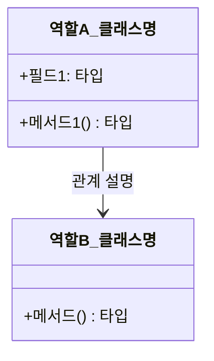

# {패턴 이름} 디자인 패턴 가이드

> 한 줄 요약: {이 패턴이 어떤 문제를 어떤 방식으로 해결하는지 한 문장으로 기술}
>
> 분류: {생성 패턴 / 구조 패턴 / 행위 패턴 등}
> 다른 이름(Aliases): {Alternative Name 1, Alternative Name 2}

---

## 상세 설명

{패턴이 무엇인지, 어떤 의도(Intent)로 만들어졌는지, 어떤 핵심 아이디어에 기반하는지를 3~6문단으로 설명한다.}

{설명할 때 포함하면 좋은 요소:}
- {해결하고자 하는 문제(Problem)}
- {패턴이 제안하는 해결책(Solution)}
- {패턴의 핵심 개념과 용어 정리}
- {역사적 배경이나 GoF 외 변형이 있다면 간단히 언급}

---

## 디자인 패턴을 충족하는 최소 조건

이 섹션에서는 "어떤 코드가 진짜로 이 패턴이라고 부를 수 있는가"의 기준을 명확히 한다.

1. **{필수 조건 1}** — {설명. 예: 객체 생성을 외부에서 직접 호출할 수 없도록 생성자가 캡슐화되어 있어야 한다.}
2. **{필수 조건 2}** — {설명}
3. **{필수 조건 3}** — {설명}

> 위 조건 중 하나라도 빠지면 본 패턴이라고 보기 어렵다 / 변형 패턴으로 분류된다.

### 흔히 오해하는 지점
- {유사 패턴과의 혼동 사례}
- {조건을 일부만 만족하면서 패턴으로 잘못 부르는 경우}

---

## 사례를 통한 예시

### 예시 1: {간단한 예시 제목}

**상황**: {어떤 도메인/요구사항에서 등장하는지 1~2문장}

```{언어}
// {패턴 적용 전 코드 또는 적용 후 코드}
```

**해설**: {코드의 어느 부분이 패턴의 어떤 역할에 해당하는지 매핑한다.}

### 예시 2: {실제 라이브러리/프레임워크에서의 사용}

{예: Java의 `java.util.logging.Logger`, Spring의 `BeanFactory`, React의 `useReducer` 등 실제 사용 사례를 코드 스니펫과 함께 제시}

```{언어}
// 실제 사용 예시
```

**해설**: {왜 이 사례가 이 패턴의 모범 사례인지}

---

## 어떨 때 사용하나

다음과 같은 신호(Symptom)가 보일 때 이 패턴 도입을 고려한다.

- {신호 1: 예) 동일한 객체를 여러 곳에서 새로 만들고 있고, 그 객체가 무거운 자원을 가지고 있을 때}
- {신호 2}
- {신호 3}

### 사용하면 안 되는 경우 (Anti-patterns)

- {피해야 하는 상황 1: 예) 단순한 유틸 함수면 충분한데 굳이 객체로 추상화하는 경우}
- {피해야 하는 상황 2}

---

## 장점과 단점, 한계점

### 장점
- **{장점 1 제목}**: {1~2문장 설명}
- **{장점 2 제목}**: {1~2문장 설명}
- **{장점 3 제목}**: {1~2문장 설명}

### 단점
- **{단점 1 제목}**: {1~2문장 설명}
- **{단점 2 제목}**: {1~2문장 설명}

### 한계점
- {언어/플랫폼/동시성 환경에서의 제약}
- {확장 시 깨지기 쉬운 가정}
- {테스트가 어려워지는 측면}

---

## 정보 표

| 항목 | 값 |
| --- | --- |
| 분류 | {생성 / 구조 / 행위} |
| 언어 의존성 | {언어 비의존적 / 특정 언어 기능 필요(예: Java reflection, C++ template)} |
| 활용성(1점~5점) | {★★★☆☆ (3/5) — 점수와 함께 짧은 근거 한 줄} |
| 학습 난이도 | {하 / 중 / 상} |
| 자주 함께 쓰이는 패턴 | {예: Factory Method, Abstract Factory} |
| 대표 사용 사례 | {짧게 2~3개} |

---

## Class Diagram



> 다이어그램에 등장하는 각 클래스가 패턴의 어떤 역할(Role)을 담당하는지 위 "상세 설명" 섹션과 1:1로 대응되어야 한다.

### 역할 설명
- **{역할A_클래스명}**: {이 클래스가 패턴 내에서 맡는 책임}
- **{역할B_클래스명}**: {이 클래스가 패턴 내에서 맡는 책임}

---

## 참고 자료
- {원전: GoF, "Design Patterns: Elements of Reusable Object-Oriented Software"}
- {관련 글/링크}
