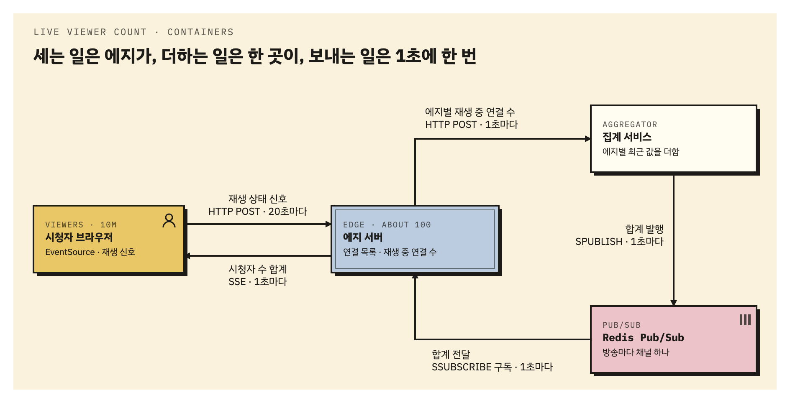
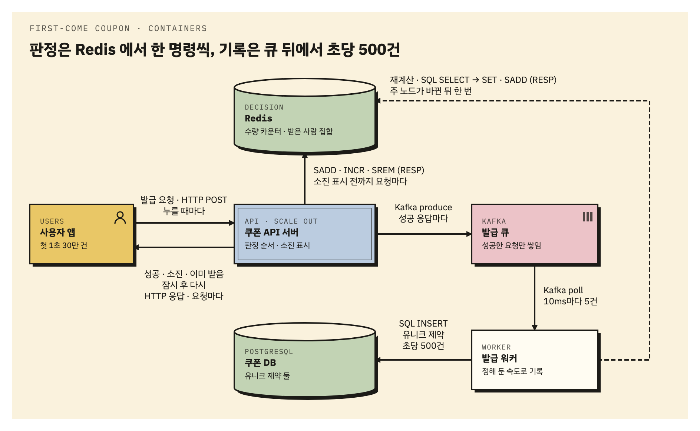

# KAN-002.2-4E05GD 검토 요청 — 파일럿 두 편과 회고 — RT-01 라이브 동시 시청자 수 · CT-01 선착순 쿠폰 발급

카드: [KAN-002.2-4E05GD.md](../cards/KAN-002.2-4E05GD.md)

> 이 문서는 **검토를 위한 산출물**이다. 수행 내역은 카드 실행 문서에 있고, 착수 전
> 계획은 배치 문서에 있다. 여기 있는 것은 "지금 이 브랜치를 무엇으로 판정하는가" 뿐이다.

## 1. 검토 대상

| 항목 | 값 |
|---|---|
| 브랜치 | `KAN-002-4FZX1V` |
| 워크트리 | `/Users/centurio/grow-up-architecture/.work/KAN-002-4FZX1V` |
| 베이스 | `26696fd046fb574c82ef864c1a24e9febf3819d4` |
| 변경 훑기 | `git diff 26696fd046fb574c82ef864c1a24e9febf3819d4...HEAD` |

**커밋 13건**

```text
b85462e guide: 파일럿 2 선착순 쿠폰 발급 v1.1.0 발행(명세 1.1.1), v1.0.0 은 legacy — S8 판올림 완료 (KAN-002.2 S8)
c6eb2b6 guide: 파일럿 1 라이브 동시 시청자 수 v1.1.0 발행(명세 1.1.1), v1.0.0 은 legacy (KAN-002.2 S8)
7d6ea48 kanban: KAN-002.2 배치 5 착수 시점 판단 — 두 편 한 묶음, 명세 1.1.1 정정 뒤 v1.1.0 판올림
abd27e7 spec: system-design-guide 1.1.1 — R3 정정, 서식 도구 기본 출력 대신 「한 줄에 문장 하나」 (KAN-002.2 S8 착수)
85ed574 spec: system-design-guide 1.1.0 — 파일럿 회고 R1~R14 반영, 새 원칙 SD43 (KAN-002.2 S7)
7516e9c research: 시스템 설계 사례 가이드 파일럿 회고 — 고칠 것 R1~R14, 250줄 · 세 언어 출력 결론, 1차 12편 재검토안 (KAN-002.2 S6)
d889ffb guide: system-design-guide 파일럿 2 — 선착순 쿠폰 발급 v1.0.0 발행 (KAN-002.2 S5)
d4b3061 kanban: KAN-002.2 배치 3 착수 시점 판단 — 파일럿 1 게이트 미흡 유형을 워커에 주의로 넘김, 의존성 링크는 카드 끝까지
ee15eaf guide: system-design-guide 파일럿 1 — 라이브 동시 시청자 수 v1.0.0 발행 (KAN-002.2 S4)
2d8b787 research: 시청자 수 리서치 노트에 원문 대조 절(9-1) — 출처 20곳, V15 열람 실패 · V16 표현 정정 (KAN-002.2 S4 준비)
7680647 research: 선착순 쿠폰 발급 리서치 노트 — 원재료를 파일럿 1 노트 절 구성으로, 출처 19곳 원문 대조 (KAN-002.2 S3)
24503bf spec: system-design-guide 1.0.1 — 병합된 검사기 새 검사에 맞춘 형식 수정, 진입 스킬에 트랙 줄 (KAN-002.2 S2)
88b8d90 kanban: KAN-002.2 S1 완료 — main 병합 뒤 판본 기록 갱신
```

**변경 파일 50개 (+15592 −80)**

| 파일 | 상태 | 추가 | 삭제 |
|---|:--:|---:|---:|
| `.claude/authoring.lock.json` | M | 4 | 3 |
| `.claude/authoring/specs/system-design-guide/spec.json` | M | 36 | 16 |
| `.claude/authoring/specs/system-design-guide/spec.md` | M | 56 | 33 |
| `.claude/skills/design-pattern-guide/SKILL.md` | M | 33 | 6 |
| `.claude/skills/design-pattern-guide/system-design-guide-canvas.md` | M | 10 | 10 |
| `KANBAN.board.html` | M | 2 | 2 |
| `KANBAN.md` | M | 1 | 1 |
| `KANBAN/batches/KAN-002.2-4E05GD.batch2.md` | M | 1 | 0 |
| `KANBAN/batches/KAN-002.2-4E05GD.batch3.md` | M | 1 | 0 |
| `KANBAN/batches/KAN-002.2-4E05GD.batch4.md` | M | 1 | 0 |
| `KANBAN/batches/KAN-002.2-4E05GD.batch5.md` | M | 1 | 0 |
| `KANBAN/cards/KAN-002.2-4E05GD.md` | M | 28 | 8 |
| `pattern-guide/gate-results.jsonl` | M | 4 | 0 |
| `pattern-guide/research/coupon-issuance-2026-11-15.md` | M | 219 | 0 |
| `pattern-guide/research/live-viewer-count-2026-11-13.md` | M | 30 | 1 |
| `pattern-guide/research/system-design-pilot-retro-2026-11-15.md` | M | 224 | 0 |
| `pattern-guide/system-design-guide/first-come-coupon/code/CouponIssue.java` | M | 252 | 0 |
| `pattern-guide/system-design-guide/first-come-coupon/code/expected-output.txt` | M | 24 | 0 |
| `pattern-guide/system-design-guide/first-come-coupon/code/main.rs` | M | 249 | 0 |
| `pattern-guide/system-design-guide/first-come-coupon/code/main.ts` | M | 254 | 0 |
| `pattern-guide/system-design-guide/first-come-coupon/diagrams/CouponContainers.tsx` | M | 34 | 0 |
| `pattern-guide/system-design-guide/first-come-coupon/diagrams/Scenario1Path.tsx` | M | 37 | 0 |
| `pattern-guide/system-design-guide/first-come-coupon/diagrams/Scenario2Path.tsx` | M | 56 | 0 |
| `pattern-guide/system-design-guide/first-come-coupon/diagrams/Scenario3Path.tsx` | M | 57 | 0 |
| `pattern-guide/system-design-guide/first-come-coupon/diagrams/_coupon-layout.tsx` | M | 123 | 0 |
| `pattern-guide/system-design-guide/first-come-coupon/diagrams/coupon-containers.png` | B | 0 | 0 |
| `pattern-guide/system-design-guide/first-come-coupon/diagrams/scenario-1-path.png` | B | 0 | 0 |
| `pattern-guide/system-design-guide/first-come-coupon/diagrams/scenario-2-path.png` | B | 0 | 0 |
| `pattern-guide/system-design-guide/first-come-coupon/diagrams/scenario-3-path.png` | B | 0 | 0 |
| `pattern-guide/system-design-guide/first-come-coupon/first-come-coupon-guide_v1.0.0.html` | M | 1942 | 0 |
| `pattern-guide/system-design-guide/first-come-coupon/first-come-coupon-guide_v1.0.0.md` | M | 1315 | 0 |
| `pattern-guide/system-design-guide/first-come-coupon/first-come-coupon-guide_v1.1.0.html` | M | 1957 | 0 |
| `pattern-guide/system-design-guide/first-come-coupon/first-come-coupon-guide_v1.1.0.md` | M | 1331 | 0 |
| `pattern-guide/system-design-guide/live-viewer-count/code/LiveViewerCount.java` | M | 250 | 0 |
| `pattern-guide/system-design-guide/live-viewer-count/code/expected-output.txt` | M | 29 | 0 |
| `pattern-guide/system-design-guide/live-viewer-count/code/main.rs` | M | 249 | 0 |
| `pattern-guide/system-design-guide/live-viewer-count/code/main.ts` | M | 250 | 0 |
| `pattern-guide/system-design-guide/live-viewer-count/diagrams/LiveViewerContainers.tsx` | M | 38 | 0 |
| `pattern-guide/system-design-guide/live-viewer-count/diagrams/Scenario1Path.tsx` | M | 41 | 0 |
| `pattern-guide/system-design-guide/live-viewer-count/diagrams/Scenario2Path.tsx` | M | 60 | 0 |
| `pattern-guide/system-design-guide/live-viewer-count/diagrams/Scenario3Path.tsx` | M | 69 | 0 |
| `pattern-guide/system-design-guide/live-viewer-count/diagrams/_live-layout.tsx` | M | 101 | 0 |
| `pattern-guide/system-design-guide/live-viewer-count/diagrams/live-viewer-containers.png` | B | 0 | 0 |
| `pattern-guide/system-design-guide/live-viewer-count/diagrams/scenario-1-path.png` | B | 0 | 0 |
| `pattern-guide/system-design-guide/live-viewer-count/diagrams/scenario-2-path.png` | B | 0 | 0 |
| `pattern-guide/system-design-guide/live-viewer-count/diagrams/scenario-3-path.png` | B | 0 | 0 |
| `pattern-guide/system-design-guide/live-viewer-count/live-viewer-count-guide_v1.0.0.html` | M | 1857 | 0 |
| `pattern-guide/system-design-guide/live-viewer-count/live-viewer-count-guide_v1.0.0.md` | M | 1251 | 0 |
| `pattern-guide/system-design-guide/live-viewer-count/live-viewer-count-guide_v1.1.0.html` | M | 1860 | 0 |
| `pattern-guide/system-design-guide/live-viewer-count/live-viewer-count-guide_v1.1.0.md` | M | 1255 | 0 |

**롤백 태그 14개**

```text
kan/KAN-002.2-4E05GD/S1
kan/KAN-002.2-4E05GD/S1-merge
kan/KAN-002.2-4E05GD/S2
kan/KAN-002.2-4E05GD/S3
kan/KAN-002.2-4E05GD/S4
kan/KAN-002.2-4E05GD/S5
kan/KAN-002.2-4E05GD/S6
kan/KAN-002.2-4E05GD/S7
kan/KAN-002.2-4E05GD/S8
kan/KAN-002.2-4E05GD/batch1
kan/KAN-002.2-4E05GD/batch2
kan/KAN-002.2-4E05GD/batch3
kan/KAN-002.2-4E05GD/batch4
kan/KAN-002.2-4E05GD/batch5
```

## 2. 검증 — 기준과 실행 결과

<!-- 기준은 카드 실행 문서 「검증」 절의 사본이다. 정본은 KANBAN/cards/KAN-002.2-4E05GD.md 이므로
     기준이 바뀌면 그쪽을 고치고 review-init --refresh 로 이 항만 다시 뜬다.
     결과는 착수한 쪽이 이미 돌린 것이다 — 검토자에게 다시 돌리라고 시키지 않는다.
     **다시 돌려 아래와 다르게 나오면 그 자체가 반려 사유다.** -->

**기준**

```
python3 ~/.claude/skills/manage-kanban/scripts/kanban.py batch-status . --card KAN-002.2-4E05GD   # work 마다 묶음 하나
git log --oneline HEAD..main                                                                     # 빈 출력 — main 이 합쳐져 있다
PLUGIN=~/.claude/plugins/cache/centurio87-plugins/authoring-kit/<lock 에 적힌 판>
python3 $PLUGIN/scripts/authoring.py lock                                                        # 0
python3 $PLUGIN/scripts/authoring.py resolve --voice ppangtolab-teacher --spec system-design-guide --profile main --frozen > /dev/null   # 0
python3 scripts/check-guides.py --all --compile --run                                            # 새 트랙 두 편 포함 최신본 전부 0 오류
python3 scripts/check-guides.py --gates --pointers --derived                                     # 게이트 PASS · 포인터 최신 · HTML fresh
```
**사람 판정**: 회고의 고칠 것 가운데 명세에 넣은 것과 뺀 것, 그리고 1차 12편 목록 재검토안. 루트 카드 검증 절이 둘 다 이 카드 검토에서 정한다고 적었다.

**실행 결과**

```text
$ python3 ~/.claude/skills/manage-kanban/scripts/kanban.py batch-status . --card KAN-002.2-4E05GD
unassigned=[] · duplicated=[] · unknown_steps=[] — 묶음 1~5 모두 complete (3/3 · 1/1 · 1/1 · 2/2 · 1/1)
$ git log --oneline HEAD..main
(빈 출력)
$ python3 $PLUGIN/scripts/authoring.py lock        # PLUGIN = authoring-kit 0.3.0 (lock 에 적힌 판)
lock 최신 — ~/grow-up-architecture/.work/KAN-002-4FZX1V/.claude/authoring.lock.json
$ python3 $PLUGIN/scripts/authoring.py resolve --voice ppangtolab-teacher --spec system-design-guide --profile main --frozen > /dev/null
exit 0
$ python3 scripts/check-guides.py --all --compile --run
== --all ==
files: 43
-- 결과: 통과
== --compile ==
files: 43
-- 결과: 통과
== --run ==
files: 43
-- 결과: 통과
전체: 통과
$ python3 scripts/check-guides.py --gates --pointers --derived
== --gates ==
files: 130
-- 결과: 통과
== --pointers ==
-- 결과: 통과
== --derived ==
-- 결과: 통과
전체: 통과
```

## 3. 판단 항목 — 스크립트가 판정할 수 없는 것

<!-- 스크립트가 판정할 수 없는 것만 적는다 — 값의 진위, 선택지 중 하나를 고른 근거,
     범위를 그은 자리. 2항에서 이미 돌아간 검증을 여기 옮겨 적지 않는다.
     한 줄 형식: 체크박스 하나에 의견 하나 — "<주제> — <지금 고른 값과 그 근거>".
     **의견마다 상세가 따라붙고, 상세는 조각 둘이다** — `**배경**` 과 `**정할 것**` 이
     각각 단독 줄이다(없거나 하나뿐이면 종료코드 12). 검토자는 이 카드를 수행하지
     않았으므로 내부 기호(`L10`·`P5`·`S8`)만 던지면 판정할 재료가 없고, 재료가 있어도
     줄글 한 덩이면 필요한 부분만 골라 읽지 못한다.
       **보기** — 그림이 설명보다 먼저다. `- 종류: 동작|설계|결과물` 과 `- `, 그릴 것이
         없으면 `- 종류: 없음 — <이유>`. 그림은 `review-attach` 로 붙인다(SKILL.md 5.6).
       **배경** — 무엇이 문제인가. `- ` 목록으로, 항목 하나에 사실 하나. 기호를 풀어 쓰고
         항목 끝에 `원문: 파일:줄` 이나 링크를 건다. ①②… 로 늘어놓을 것은 항목으로 가른다.
         목록이 없으면 종료코드 12 — 줄글은 화면에서 한 문단으로 붙는다.
       **정할 것** — 정할 것 한 줄. 그 아래 갈래마다 대가와 결과를 표로 단다:
         | 선택지 | 대가 | 그러면 어떻게 되는가 |
       추천은 선택지 셀 맨 앞의 `**추천** ` 접두다. 고를 것이 없는 항목이면 표를 비운다.
     **올리기 전에 둘을 본다.** ① 이 의견이 카드 의도(원문·목적·이유·목표)와 이어지는가
     — 이어지지 않으면 올리지 않는다. 문제를 위한 문제는 판단 항목이 아니라 별도 카드다.
     ② 지시 원본보다 낮은 레이어로 내려가지 않았는가 — 유저가 제품 관점으로 지시했는데
     플래그 이름·함수 이름을 묻고 있으면 서술을 고칠 것이 아니라 올릴 것이 아니다.
     (SKILL.md 5.6 「판단 항목에 무엇을 올리는가」)
     비어 있으면 "기계가 다 판정했고 사람이 정할 것이 없다"는 뜻이다. 그 판단도
     착수한 쪽이 하는 것이지 검토자가 빈칸을 보고 추측할 일이 아니다.
     **승계 절(3-0)이 있으면 그것이 먼저 온다** — 다른 검토서에서 넘어온 의견이고,
     판정은 승계를 받은 이 문서 하나에서만 내려진다. -->

**의견마다 판정과 추가 의견이 따로 붙습니다.** 판정은 상태이고 추가 의견은 말입니다 — 승인/반려를 아직
안 정했어도 의견 하나에만 추가 의견을 달 수 있고, 반대로 의견 하나만 먼저 닫을 수도 있습니다.
`<번호>`는 의견 순서이고, 주제의 문구 일부로도 찾습니다.

```
# 판정 — 승인 · 반려 · 철회
python3 scripts/kanban.py review-judge <project-root> --card KAN-002.2-4E05GD --item <번호> --verdict 승인
# 추가 의견
python3 scripts/kanban.py review-note <project-root> --card KAN-002.2-4E05GD --item <번호> --text "<추가 의견>"
# 추가 의견을 반영하다 새 의견이 생겼으면 (맨 뒤에 붙어 앞 번호가 안 밀립니다)
python3 scripts/kanban.py review-item <project-root> --card KAN-002.2-4E05GD --add "<주제>
  <상세>"
```

**전체 승인은 살아있는 항목이 전부 승인일 때만 섭니다**(철회는 분모에서 빠집니다). 하나라도
반려·추가 의견·미정이면 4항의 전체 승인도 `→ 완료` 이동도 종료코드 14로 거부됩니다.

- [x] 두 파일럿 가이드(v1.1.0)를 발행한 모양 그대로 둘 것인가 — 두 편 다 품질 게이트를 통과했고, 고른 구조는 리서치 노트의 권고를 따랐다
    - **보기**
      - 종류: 결과물
      - 
      - 
    - **배경**
      - 두 편은 같은 명세로 성격이 반대인 두 문제를 시험하려고 썼다. 시청자 수는 근삿값을 자주 보내는 문제이고, 쿠폰은 한 장도 틀리면 안 되는 문제다. 원문: KANBAN.md:46
      - 두 편 다 품질 게이트를 통과했다. 첫 판(v1.0.0)은 세 번째 채점에서, 개정 명세로 다시 낸 판(v1.1.0)은 두 번째 채점에서 통과했고 마지막 판정은 필수 항목 48개 모두 충족이다. 원문: pattern-guide/gate-results.jsonl:129
      - 세 언어(Java · TypeScript · Rust) 코드가 글자까지 같은 출력을 낸다. 쿠폰 편은 스레드 없이 사건 순서만으로 경합을 재현해, 확인한 뒤 차감하는 구조의 과발급 3,316건과 원자 판정의 0건을 한 실행에서 나란히 보인다. 원문: pattern-guide/research/system-design-pilot-retro-2026-11-15.md:134
      - 앞 판(v1.0.0)은 지우지 않고 legacy 로 남겼다. 그림 파일은 새 판과 함께 쓰므로, 앞 판 화면에도 부하 분산이 들어간 새 경로 그림이 보인다. 원문: pattern-guide/system-design-guide/live-viewer-count/live-viewer-count-guide_v1.0.0.md:7
    - **정할 것**
      두 편을 이대로 승인할 것인가.

    | 선택지 | 대가 | 그러면 어떻게 되는가 |
    | --- | --- | --- |
    | **추천** 이대로 승인한다 | 구조 선택(시청자 수는 에지 집계, 쿠폰은 Redis 판정과 큐)을 이번에는 바꾸지 못한다 | 1차 12편이 이 두 편을 형식의 기준 예시로 삼는다 |
    | 고칠 곳을 지목해 반려한다 | 판올림과 품질 게이트를 한 번 더 거친다 | 지목한 자리만 고친 다음 판이 나온다 |

    > **판정**
    >
    > - 승인 · ai · 2026-11-15

    > **추가 의견**
    >
    > - ai · 2026-11-15 — 검토자 확인: 두 편(v1.1.0) 모두 유저 원문(KANBAN.md:37-40)이 반드시 넣으라고 한 네 가지(개념도 · 시나리오 · 기술 상세 설명 · 구현 코드)를 절로 갖추고 있습니다. 게이트 기록 129 · 130행은 둘 다 2라운드 PASS 입니다. 개념도 두 장도 그림 설명과 같습니다.
출처 정정 하나: 「필수 항목 48개 모두 충족」은 gate-results.jsonl:129 에 없습니다(그 줄에는 rounds 2 · PASS 만 있습니다). 이 수치는 카드 수행 내역 KANBAN/cards/KAN-002.2-4E05GD.md:112 에 있습니다. 확인 결과에는 영향이 없습니다.

- [x] 코드 분량 규칙을 「언어당 300줄 상한 + 한 줄에 문장 하나」로 정했다 — 서식 도구의 기본 출력을 따르면 두 편의 Rust 가 369줄 · 415줄이 된다
    - **보기**
      - 종류: 없음 — 줄 수를 견주는 항목이라 그림 대신 배경의 실측값으로 견준다
    - **배경**
      - 계획 승인 때 「구현 코드가 250줄을 넘어도 멈추지 않고, 회고에서 재고 명세 개정 때 상한을 정한다」로 정했다. 원문: KANBAN/cards/KAN-002.2-4E05GD.md:40
      - 두 편의 첫 초안은 Java 263줄 · 275줄, TypeScript 276줄 · 269줄, Rust 343줄 · 258줄이었고, 줄여서 250줄 안팎에 맞췄다. 시나리오는 줄이지 않았다. 원문: pattern-guide/research/system-design-pilot-retro-2026-11-15.md:119
      - 처음 개정(1.1.0)에서는 「300줄 상한 + 서식 도구의 표준 서식」으로 정했다. 그런데 Rust 서식 도구(rustfmt) 기본값으로 정리하면 369줄 · 415줄, 가장 느슨한 설정으로도 331줄 · 391줄이라 둘을 함께 지킬 수 없었다. 1.1.0 은 재지 않은 짐작(약 290줄)에 기댄 결정이었다. 원문: pattern-guide/research/system-design-pilot-retro-2026-11-15.md:132
      - 그래서 1.1.1 에서 서식 도구의 기본 출력 대신 「한 줄에 문장 하나」를 요구하도록 고쳤다. 쿠폰 편 코드의 다섯 줄이 여기에 걸려 나눴고, 펜스는 252줄 · 254줄 · 249줄이 됐다. 원문: .claude/authoring/specs/system-design-guide/spec.md:206
      - 검사기는 줄 수를 세지 않으므로 이 규칙은 채점이 권장 등급으로 본다. 원문: .claude/authoring/specs/system-design-guide/spec.md:368
    - **정할 것**
      분량 규칙을 이대로 둘 것인가.

    | 선택지 | 대가 | 그러면 어떻게 되는가 |
    | --- | --- | --- |
    | **추천** 300줄 상한 + 한 줄에 문장 하나 | 독자가 코드를 옮겨 서식 도구로 정리하면 줄 수가 늘어난다 | 두 편이 그대로 통과하고, 12편도 같은 크기로 쓴다 |
    | 서식 도구 기본 출력 + 상한 450줄 | 펜스 하나가 400줄 안팎이 되어 본문이 길어진다 | 두 편의 코드를 다시 서식하고 판올림한다 |
    | 250줄을 엄격히 지킨다 | 시나리오나 출력을 덜어 내야 한다 | 두 편 다 재현 범위를 줄여 판올림한다 |

    > **판정**
    >
    > - 승인 · ai · 2026-11-15

    > **추가 의견**
    >
    > - ai · 2026-11-15 — 검토자 확인: 계획 승인 때 정할 것 2 는 「250줄을 넘어도 멈추지 않고, 상한은 S7 에서 정하며 사람이 검토에서 판정한다」였습니다(KANBAN/cards/KAN-002.2-4E05GD.md:40 · :82). S8 착수 때 잰 값으로 1.1.0 을 1.1.1 로 고친 것은 그 범위 안입니다. 계획은 「명세는 두 번 고친다」고 했으니 한 번이 더 늘었습니다. 다만 1.1.0 으로 발행한 편이 하나도 없을 때 고쳤고, 상한 300 은 그대로이며, 수행 내역 112행과 커밋 abd27e7 에 그 경위가 적혀 있습니다.
수치를 다시 쟀습니다. v1.0.0 코드를 rustfmt 1.9.0 으로 정리하면 기본값은 369 · 415줄, use_small_heuristics=Max 는 331 · 391줄로 배경과 같습니다. v1.1.0 펜스는 250 · 250 · 249줄과 252 · 254 · 249줄입니다. 한 줄에 문장이 둘 이상인 곳은 규칙이 허용한 짧은 if 본문 형태만 남아 있습니다.
대가 칸 보충: 회고 5절(pattern-guide/research/system-design-pilot-retro-2026-11-15.md:125)은 문장 하나짜리 if · for 본문을 한 줄로 붙인 것을 「rustfmt 형식이 아닌」 독자 비용으로 꼽았습니다. 1.1.1 은 바로 그 형태를 허용합니다. 추천안을 고르면, 서식 도구로 다시 정리할 때 줄 수가 늘어나는 것만이 아니라 실린 Rust 코드가 rustfmt 모양이 아니라는 점까지 받아들이는 것입니다.

- [x] 회고의 고칠 것 14개를 모두 명세에 넣었다(뺀 것 없음) — 하나는 새 원칙이고, 분량 규칙은 앞 항목에서 따로 묻는다
    - **보기**
      - 종류: 없음 — 명세 문장의 변경이라 그릴 결과물이 없고, 무엇을 어디에 넣었는지는 회고의 반영 표에 있다
    - **배경**
      - 회고는 두 편의 첫 채점에서 걸린 필수 항목 14개 가운데 여섯이 출처나 실행 결과를 원문보다 넓게 또는 다르게 쓴 것이라고 보았다. 명세 원칙은 이미 그것을 요구했으므로, 규칙을 새로 만들기보다 어기기 쉬운 자리를 원칙 문장 안에 적었다. 원문: pattern-guide/research/system-design-pilot-retro-2026-11-15.md:45
      - 고칠 것은 절 구성을 바꾸지 않는다. 명세 문장 속 금지 낱말 여섯 곳, 구현 해설 안의 코드 블록 금지, 경합 재현 방법, 요구 충족 표의 예시 교체 등이다. 원문: pattern-guide/research/system-design-pilot-retro-2026-11-15.md:143
      - 새 원칙은 하나다. 코드를 바꿔 실행한 결과를 본문에 쓰면 무엇을 바꿨는지 그 자리에 적고 실제로 실행한 값만 쓴다(필수). 원문: .claude/authoring/specs/system-design-guide/spec.md:383
      - 개정 명세(1.1.1)로 다시 낸 두 편이 품질 게이트를 통과했다. 원문: pattern-guide/gate-results.jsonl:130
      - 공유 도구(문체 스캐너가 천 단위 쉼표를 문장의 쉼표로 세는 일 등) 넷은 이 카드 범위 밖이라 고치지 않고 기록만 했다. 원문: pattern-guide/research/system-design-pilot-retro-2026-11-15.md:164
    - **정할 것**
      회고의 반영을 이대로 둘 것인가.

    | 선택지 | 대가 | 그러면 어떻게 되는가 |
    | --- | --- | --- |
    | **추천** 이대로 둔다 | 원칙 문장이 길어져 집필 규칙 전문이 1,632줄에서 1,645줄로 늘었다 | 1차 12편이 1.1.1 로 바로 시작한다 |
    | 일부를 빼거나 고친다 | 명세 판본이 다시 오르고 두 편을 또 판올림한다 | 지목한 항목만 고친 다음 명세가 나온다 |

    > **판정**
    >
    > - 승인 · ai · 2026-11-15

    > **추가 의견**
    >
    > - ai · 2026-11-15 — 검토자 확인: R1~R14 열넷이 모두 .claude/authoring/specs/system-design-guide/spec.md 의 해당 자리에 들어간 것을 하나씩 확인했습니다. R1 의 금지 표현 다섯은 spec.md 와 캔버스 어디에도 남아 있지 않습니다. 고친 범위는 카드 목적(「회고로 명세 · 250줄 상한 · 세 언어 출력 규약을 고친다」, KANBAN.md:47) 안에 있고, 절 구성은 바뀌지 않았습니다.
고칠 곳 하나: spec.md:366 원칙 표의 SD26 행이 아직 「결정성 네 규칙」입니다. 본문 spec.md:199 와 spec.json 의 SD26 은 R4 를 넣으면서 「다섯 규칙」이 됐습니다. 표 한 칸만 정정하면 되는 일이라 이 확인 결과를 바꾸지는 않습니다.

- [x] 1차 12편 목록을 그대로 두고 순서만 바꾼다 — 작은 시뮬레이션에 맞는 편을 앞에, 시뮬레이션이 어려운 셋을 뒤에 두고 집필 전 확인을 붙인다
    - **보기**
      - 종류: 없음 — 목록과 차례를 고르는 항목이라 회고 8절의 차례 표로 본다
    - **배경**
      - 이 카드의 검증 절은 1차 12편 목록 재검토안을 사람이 정할 것으로 남겼다. 원문: KANBAN/cards/KAN-002.2-4E05GD.md:82
      - 파일럿 두 편이 알려 준 것은 한 편의 무게가 세 언어 각 300줄 안의 결정적 시뮬레이션과 출처 대조에 달렸다는 것, 그리고 두 편 다 품질 게이트에 세 번의 채점이 들었다는 것이다. 원문: pattern-guide/research/system-design-pilot-retro-2026-11-15.md:203
      - 그래서 처리율 제한 · 결제 중복 방지 · 좌석 선점처럼 파일럿의 코드를 이어 쓸 수 있는 편을 앞에 두었다. 원문: pattern-guide/research/system-design-pilot-retro-2026-11-15.md:211
      - 실시간 공동 편집 · 동영상 업로드와 인코딩 · 문서 검색 증강 생성(RAG) 셋은 핵심을 작은 시뮬레이션으로 보일 수 있는지가 불확실해 맨 뒤에 두고 집필 전 확인을 붙였다(판단). 원문: pattern-guide/research/system-design-pilot-retro-2026-11-15.md:220
      - 빼거나 바꿀 후보는 없다. 집필 전 확인에서 서지 않는 편이 나오면 같은 계열의 2차 후보와 바꾸는 것을 다음 카드(KAN-002.3) 착수 계획에서 정한다. 원문: pattern-guide/research/system-design-pilot-retro-2026-11-15.md:224
    - **정할 것**
      이 재검토안으로 1차 12편 카드를 시작할 것인가.

    | 선택지 | 대가 | 그러면 어떻게 되는가 |
    | --- | --- | --- |
    | **추천** 목록 유지 · 차례 변경 · 셋에 집필 전 확인 | 어려운 셋이 맨 뒤에 놓여 늦게 나온다 | 다음 카드의 착수 계획이 이 차례를 쓴다 |
    | 원래 차례 그대로 | 어려운 편이 앞에 오면 그 편에서 형식이 다시 흔들릴 수 있다(판단) | 다음 카드가 원래 목록 차례로 쓴다 |
    | 셋을 지금 2차 후보와 바꾼다 | 바꿀 근거(집필 전 확인)가 아직 없다 | 사례 목록에서 바꿀 후보를 지금 고른다 |

    > **판정**
    >
    > - 승인 · 유저 · 2026-11-16

    > **추가 의견**
    >
    > - ai · 2026-11-15 — 검토자 의견(판정은 내지 않았습니다. 루트 카드가 사람이 정한다고 둔 항목이고, 아래 재료가 빠져 있습니다): 추천안은 확신이 덜한 셋(SY-01 · MD-01 · AI-02)을 10~12번째에 두고, 각 편을 쓰기 바로 앞에 집필 전 확인을 붙입니다. 그러면 명세가 그 셋에서 서지 않는다는 사실을 아홉 편을 발행한 뒤에야 알게 됩니다. 그때 명세를 고치면 아홉 편을 다시 판올림해야 합니다. 이 카드의 이유 「명세는 산출물로 검증되기 전엔 추정이고 … 되돌리는 비용이 크다」(KANBAN.md:48)와 1차 카드의 이유 「명세가 여러 난제에서 서는지 확인되고」(KANBAN.md:12)가 피하려는 순서입니다. 그런데 대가 칸에는 「늦게 나온다」만 적혀 있습니다.
표에 없는 길이 하나 있습니다. 차례는 추천대로 두되, 셋의 집필 전 확인(시험 코드)만 KAN-002.3 을 시작할 때 첫 편보다 먼저 하는 것입니다. 회고 224행의 「KAN-002.3 착수 계획에서 정합니다」는 두 가지로 읽혀서, 확인을 언제 할지를 이 자리에서 정해 두어야 합니다.
    > - ai · 2026-11-15 — 검토자 의견 둘째: 「집필 전 확인에서 서지 않으면 같은 계열의 2차 후보와 바꾼다」(회고 224행)는 이 형식에 맞지 않는 문제를 목록에서 빼는 길입니다. 유저 원문은 문제를 먼저 두고 그 문제를 가장 잘 푸는 구조를 보이라는 것이고(KANBAN.md:33-35), 1차 카드의 이유도 명세가 난제에서 서는지 보는 것입니다. 그러니 셋 가운데 하나가 「세 언어 각 300줄 안의 결정적 시뮬레이션」에 들어가지 않는다면, 그것은 목록을 바꿀 근거이면서 명세(구현 코드 규약)를 고칠 근거이기도 합니다. 그럴 때 문제를 바꿀지 명세를 고칠지를 미리 정해 두실지, 그때 다시 물을지도 함께 정해 주셔야 합니다.
    > - 유저 · 2026-11-16 — 「KAN-002.3 시작 때 먼저」 — 질문 「세 편의 집필 전 확인은 언제 할까요?」에 대한 답(2026-11-16, 채팅).
집필 차례는 재검토안대로 두고, 세 편(SY-01 실시간 공동 편집 · MD-01 동영상 업로드와 인코딩 · AI-02 문서 검색 증강 생성)의 집필 전 확인(시험 코드)만 KAN-002.3 을 시작할 때 첫 편보다 먼저 한다.
    > - ai · 2026-11-16 — 검토자 둘째 의견(집필 전 확인을 통과하지 못한 편이 나올 때 문제를 바꿀지 명세를 고칠지)은 확인 결과에 달린 선택이라 지금 정하지 않습니다. 그런 편이 나오면 확인 결과를 근거로 두 길을 함께 들고 유저에게 묻습니다. 회고 8절 마지막 문단(pattern-guide/research/system-design-pilot-retro-2026-11-15.md:224)을 이 두 결정에 맞게 고쳤습니다.

- [x] 판본 기록(authoring.lock.json)을 이 저장소가 고정한 플러그인 0.3.0 으로 갱신했다 — 계획이 말한 「이 카드와 무관한 어긋남 다섯」은 0.4.2 로 잰 값이었다
    - **보기**
      - 종류: 없음 — 기록 파일의 항목 차이를 묻는 항목이라 그릴 결과물이 없다
    - **배경**
      - 계획 승인 때 정할 것 1 은 「판본 기록을 갱신할 때 이 카드와 무관한 어긋남 다섯(문체 설정 voice 둘 · 문체 설정 파일 셋)도 함께 담는다」였다. 원문: KANBAN/cards/KAN-002.2-4E05GD.md:39
      - 그 다섯은 집필 플러그인 0.4.2 로 잰 값이었다. 판본 기록과 검사기는 0.3.0 을 쓰고, 0.3.0 으로 재면 어긋남은 이 카드의 두 항목(새 명세 · 계획 리포트 명세)뿐이었다. 원문: KANBAN/cards/KAN-002.2-4E05GD.md:95
      - 앞 카드 KAN-002.1 에서도 같은 다섯을 이유로 「갱신 안 함」으로 정했는데, 그 전제도 같은 잘못이었다. 원문: KANBAN/cards/KAN-002.1-7YT11M.md:74
      - 0.3.0 으로 갱신한 뒤에도 기존 37편의 게이트 기록과 고정 해석은 그대로 통과한다. 원문: .claude/authoring.lock.json:10
    - **정할 것**
      0.3.0 기준 갱신을 이대로 둘 것인가.

    | 선택지 | 대가 | 그러면 어떻게 되는가 |
    | --- | --- | --- |
    | **추천** 이대로 둔다 | 0.4.2 가 보는 다섯 항목은 기록에 없다 — 플러그인을 0.4.x 로 올릴 때 그때 담는다 | 지금 고정한 0.3.0 기준으로 기록 0 · 고정 해석 0 이 유지된다 |
    | 0.4.2 로 기록을 다시 쓴다 | 검사기 기본값(0.3.0)과 갈라지고, 기존 편의 게이트 해시가 낡을 수 있다(확인 안 함) | 별도 카드로 다룬다 |

    > **판정**
    >
    > - 승인 · ai · 2026-11-15

    > **추가 의견**
    >
    > - ai · 2026-11-15 — 검토자 확인: 읽기 전용 `authoring.py lock`(--update 없이 검사만)을 두 판으로 돌렸습니다. 0.3.0 은 「lock 최신」으로 exit 0 입니다. 0.4.2 는 exit 1 로 정확히 다섯을 냅니다(voice algorithm-guide-writer · ppangtolab-teacher 내용 변경, style/catalog/lexicon.json · style/catalog/qualitative.json · style/global/style.json 추가). 진입 스킬은 lock 에 적힌 판을 쓰고(.claude/skills/design-pattern-guide/SKILL.md:63), 검사기 기본값도 0.3.0 입니다(scripts/check-guides.py:54). S1 커밋 88b8d90 이 lock 에서 바꾼 것은 system-design-guide 추가, kanban-report 변경, principles.revision 표기뿐입니다. 승인된 정할 것 1 은 「무관한 어긋남도 함께 담는다」였고, 실제로는 담을 것이 그보다 줄었으므로 승인 범위 안입니다.
남는 빈틈 하나: SKILL.md:63 은 CLAUDE_PLUGIN_ROOT 가 있으면 그 판을 먼저 씁니다. 그래서 0.4.2 플러그인 환경에서 집필을 시작하면 이 다섯 때문에 lock 검사에서 멈춥니다. 추천안 대가 칸의 「0.4.x 로 올릴 때 담는다」가 그때 할 일입니다.


## 4. 판정

<!-- 문서 하나에 대한 판정이다. **항목별로 갈리는 말은 여기 적지 않는다** — 3항 각 의견의
     「판정」과 「추가 의견」이 그 자리다. 여기 남는 것은 그 항목들이 전부 승인으로 닫혔다는
     사실 하나뿐이다.
     아래 「판정 이력」은 **덧붙기만 하는 이력**이다. 왕복이 돌면 줄이 쌓이고, 그것이 이 문서가
     무엇을 거쳐 승인에 닿았는지의 전부다 — 지우지 않는다. **판정에는 사유 칸이 없다** —
     승인은 대체로 덧붙일 말이 없고, 있다면 그것은 문서 전체가 아니라 그 항목에 대한
     말이라 3항의 「추가 의견」이 받는다.
     `review-judge --card KAN-002.2-4E05GD --verdict 승인` 이 이 자리를 쓰고
     frontmatter 의 status 도 함께 고친다. 손으로 적어도 되지만, 그때는 수렴 검사를
     안 거치므로 `validate` 가 항목 판정과 어긋난 승인을 error 로 잡는다. -->

**판정**: 승인

**판정 이력**:

- 승인 · 유저 · 2026-11-16
- 승인 · 유저 · 2026-11-16

- 승인이면 → `apply --op move --id KAN-002.2-4E05GD --to done` 뒤에 `main` 병합과 워크트리 정리(출력의 `cleanup`)
- 반려면 → `apply --op move --id KAN-002.2-4E05GD --to doing` 뒤에 `doc-log --entry "<반려 사유>"`.
  요청서는 **지우지도 다시 뜨지도 않는다** — 고친 뒤 그 항목을 `review-judge --verdict 승인` 으로
  뒤집으면 같은 문서에서 수렴한다. 1·2항이 낡았으면 `review-init --refresh` 로 그 두 항만 간다.
