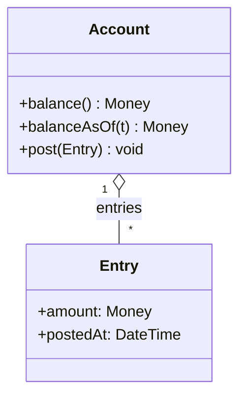

# Account 분석 패턴 가이드

> 한 줄 요약: 일련의 입출금 항목(Entry)을 누적해 잔액을 산출하는 "계정"을 Account 객체로 모델링하여, 금액의 흐름을 항목들의 집합과 그 합으로 일관되게 표현한다.
>
> 분류: 분석 패턴(Analysis Pattern) — 회계/거래(Accounting) 범주
> 다른 이름(Aliases): Account, Ledger Account, Balance Account

---

## 상세 설명

돈·포인트·재고처럼 "들어오고 나가며 누적되는 양"을 다루는 도메인은 매우 흔하다. 은행 계좌, 적립 포인트, 재고 수량, 회계 원장이 모두 그렇다. 이를 단일 `balance` 숫자 필드로만 관리하면 치명적인 문제가 생긴다. 잔액이 어떻게 그 값이 되었는지 추적할 수 없고("왜 -3,000원이지?"), 동시 수정 시 정합성이 깨지며, 사후 감사가 불가능하다.

Account 패턴은 잔액을 "값"이 아니라 "항목들의 합"으로 본다. 하나의 Account는 다수의 Entry(입출금 항목)를 보유하며, 각 Entry는 금액(Quantity/Money)과 시점을 가진다. 잔액(balance)은 저장되는 것이 아니라 Entry들을 합산해 도출(derive)되거나, 성능을 위해 캐시되더라도 항상 Entry 집합과 일치해야 하는 종속 값이다. 즉 Account는 "잔액을 설명하는 거래 내역을 잃지 않는다".

이 모델의 핵심은 불변 이력(immutable history)이다. 잘못된 거래가 있어도 기존 Entry를 수정·삭제하지 않고, 상쇄(reversal) Entry를 추가해 바로잡는다. 이렇게 하면 모든 잔액 변화가 추적 가능하고, 특정 시점의 잔액("3월 1일 잔액")을 그 시점까지의 Entry 합으로 재구성할 수 있다. 회계의 기본 원칙과 정확히 일치한다.

Account는 단독으로 쓰이기보다 Transaction 패턴과 짝을 이룬다. 한 계정의 출금은 다른 계정의 입금과 짝지어져야 하며(복식부기), 그 짝을 묶는 것이 Transaction이다. 또한 어떤 거래가 어느 계정에 어떻게 반영되는지를 규칙으로 다루는 것이 Posting Rule 패턴이다. 따라서 Account는 Quantity(금액), Transaction(거래), Posting Rule(전기 규칙)과 함께 회계·정산 도메인의 골격을 이룬다. Fowler는 이 일련의 패턴을 기업 금융·재고 회계 모델링의 핵심으로 제시한다.

---

## 디자인 패턴을 충족하는 최소 조건

이 섹션에서는 "어떤 모델이 진짜로 Account 패턴이라고 부를 수 있는가"의 기준을 명확히 한다.

1. **항목 집합으로서의 계정** — Account가 단일 잔액 값이 아니라 다수의 Entry(항목)를 보유하며, 잔액이 그 항목들로부터 도출(또는 항목과 일관되게 유지)되어야 한다.
2. **항목의 불변 이력성** — Entry는 추가될 뿐 임의로 수정·삭제되지 않고, 정정이 필요하면 상쇄 항목으로 처리되어 이력이 보존되어야 한다.
3. **금액의 Quantity 표현** — 각 항목의 금액이 단위(통화 등)를 동반한 Quantity/Money로 표현되어야 한다.

> 위 조건 중 하나라도 빠지면 단순한 "잔액 컬럼"일 뿐, 추적 가능한 거래 이력을 보장하는 Account 패턴으로 보기 어렵다.

### 흔히 오해하는 지점
- 잔액만 저장하고 Entry를 두지 않는 경우. 가장 흔한 오용이며, 추적성과 감사가 불가능해진다.
- Entry를 사후 수정/삭제로 정정하는 경우. 이력이 깨져 패턴의 핵심 이점을 잃는다.
- 한 계정의 입출금만 다루고 상대 계정(복식부기)을 무시하는 경우. 균형 검증이 불가능하다(→ Transaction 패턴 필요).

---

## 사례를 통한 예시

### 예시 1: 항목 합산으로 잔액을 도출하는 계정

**상황**: 포인트 적립/사용 시스템에서 사용자 잔액이 왜 그 값인지 항상 추적 가능해야 한다.

```java
final class Entry {                     // 불변 항목
    private final Money amount;          // 입금 +, 출금 - (부호로 방향 표현)
    private final LocalDateTime postedAt;
    Entry(Money amount, LocalDateTime postedAt) {
        this.amount = amount; this.postedAt = postedAt;
    }
    Money amount() { return amount; }
    LocalDateTime postedAt() { return postedAt; }
}

class Account {
    private final List<Entry> entries = new ArrayList<>();

    void post(Entry e) { entries.add(e); }      // 추가만 가능 (불변 이력)

    Money balance() {                            // 잔액은 도출 값
        return entries.stream().map(Entry::amount)
                      .reduce(Money.zero(Currency.getInstance("KRW")), Money::add);
    }
    Money balanceAsOf(LocalDateTime t) {         // 특정 시점 잔액 재구성
        return entries.stream().filter(e -> !e.postedAt().isAfter(t))
                      .map(Entry::amount)
                      .reduce(Money.zero(Currency.getInstance("KRW")), Money::add);
    }
}
```

```java
Account points = new Account();
points.post(new Entry(Money.won(1000),  LocalDateTime.now()));   // 적립
points.post(new Entry(Money.won(-300),  LocalDateTime.now()));   // 사용
points.balance();   // 700원 — 항목 합으로 도출
```

**해설**: 잔액은 별도 필드가 아니라 `entries`의 합이다. 모든 변화가 Entry로 남으므로 "왜 700원인지" 추적되고, `balanceAsOf`로 과거 잔액도 재구성된다. 정정이 필요하면 기존 Entry를 고치지 않고 상쇄 Entry를 추가한다.

### 예시 2: 실제 사례 — 복식부기 원장과 이벤트 소싱

복식부기 회계 시스템과 현대적 거래 원장(예: 오픈소스 회계 라이브러리, 핀테크 원장 서비스)은 거의 예외 없이 "Account + 불변 Entry/Posting" 구조를 사용한다. 이벤트 소싱(Event Sourcing) 아키텍처도 동일한 발상으로, 현재 상태(잔액)를 저장하지 않고 불변 이벤트(거래) 시퀀스로부터 상태를 재구성한다.

```text
Account(현금)            Entries: +100,000(매출), -30,000(임대료) -> balance 70,000
Account(매출)            Entries: -100,000                          -> balance -100,000(대변)
잔액 = Σ entries         (저장 X, 항상 항목으로부터 계산)
정정 = 역분개 entry 추가 (기존 항목 불변)
```

**해설**: 모든 금융 원장이 "잔액은 거래의 합"이라는 Account 패턴 원칙을 따른다. 이벤트 소싱은 이 원칙을 회계 밖 일반 도메인으로 확장한 것으로, Account 패턴이 단순 회계를 넘어 상태 관리의 근본 발상임을 보여준다.

---

## 어떨 때 사용하나

다음과 같은 신호(Symptom)가 보일 때 이 패턴 도입을 고려한다.

- 잔액·누적량의 변화 이력을 추적·감사해야 하고, "왜 이 값이 되었는가"에 답할 수 있어야 할 때.
- 특정 과거 시점의 잔액을 재구성해야 할 때.
- 금액 정정을 데이터 수정이 아니라 상쇄 거래로 처리해야 하는 회계·정산 도메인일 때.

### 사용하면 안 되는 경우 (Anti-patterns)

- 단순 카운터처럼 이력 추적이 전혀 필요 없고 현재 값만 의미 있는 경우. 단일 필드가 더 간단하다.
- 항목 수가 폭발적으로 많아 매번 전건 합산이 비현실적인데, 스냅샷/집계 전략 없이 도출만 고집하는 경우(이 경우 주기적 스냅샷 + 이후 항목 합산으로 절충).

---

## 장점과 단점, 한계점

### 장점
- **완전한 추적성**: 모든 잔액 변화가 항목으로 남아 감사·디버깅·분쟁 해결이 쉽다.
- **시점 잔액 재구성**: 과거 임의 시점의 잔액을 항목 합으로 복원할 수 있다.
- **정합성**: 잔액이 항목의 종속 값이라 "잔액과 내역 불일치"가 구조적으로 방지된다.

### 단점
- **성능 비용**: 항목이 많으면 매번 합산이 부담이라 스냅샷/캐시 전략이 필요하다.
- **저장 공간**: 모든 항목을 영구 보존하므로 데이터가 누적된다.

### 한계점
- 동시 입출금의 정합성(락·버전 관리)을 별도로 보장해야 한다.
- 단일 Account만으로는 "어디서 와서 어디로 갔는가"의 균형이 보장되지 않아, Transaction 패턴과의 결합이 사실상 필수다.

---

## 정보 표

| 항목 | 값 |
| --- | --- |
| 분류 | 분석 패턴 — 회계/거래(Accounting) |
| 언어 의존성 | 언어 비의존적 |
| 활용성(1점~5점) | ★★★★☆ (4/5) — 금융·정산·재고·포인트 등 누적 잔액 도메인에서 핵심 |
| 학습 난이도 | 중 |
| 자주 함께 쓰이는 패턴 | Transaction, Posting Rule, Quantity(Money) |
| 대표 사용 사례 | 은행 계좌/원장, 적립 포인트, 재고 수량, 복식부기 회계 |

---

## Class Diagram



> 다이어그램에 등장하는 각 클래스가 패턴의 어떤 역할(Role)을 담당하는지 위 "상세 설명" 섹션과 1:1로 대응되어야 한다.

### 역할 설명
- **Account**: 항목들을 보유하고 잔액을 항목 합으로 도출하는 계정. 항목 추가(post)만 허용한다.
- **Entry**: 하나의 입출금 사실을 나타내는 불변 항목. 금액(Money)과 시점을 가진다.

---

## 참고 자료
- Martin Fowler, "Analysis Patterns: Reusable Object Models", Addison-Wesley, 1997 — Chapter 6 (Inventory and Accounting), Account/Entry.
- Martin Fowler, "Accounting Patterns" 및 Analysis Patterns 소개: https://martinfowler.com/books/ap.html
- 복식부기, Event Sourcing 아키텍처.
