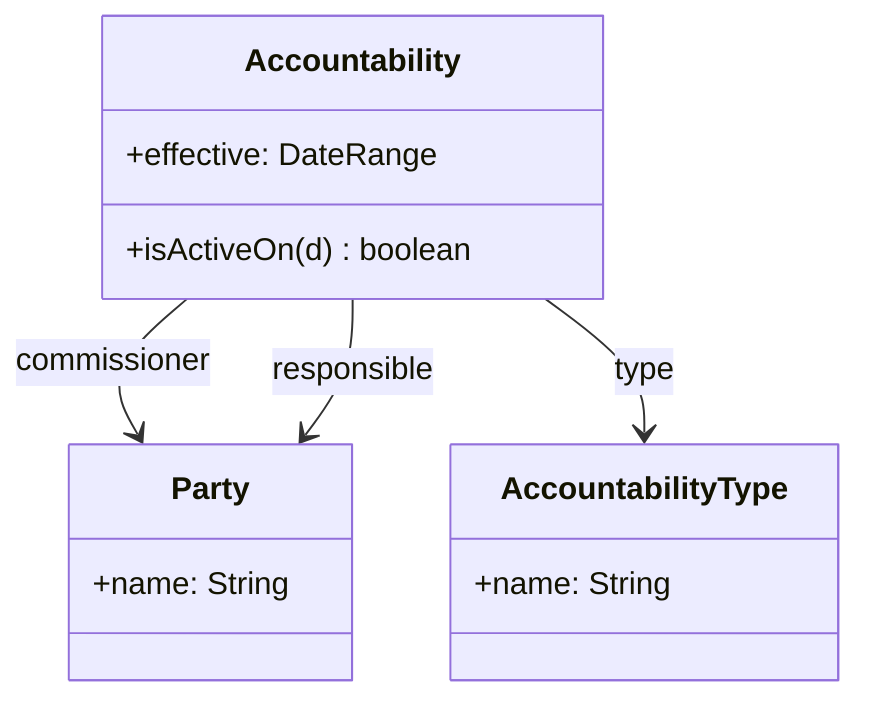

# Accountability 분석 패턴 가이드

> 한 줄 요약: 두 Party 사이의 책임·권한 관계(고용, 소유, 관리, 감독 등)를 Accountability라는 객체로 명시화하여, 다양한 관계를 통일된 구조로 표현하고 시간에 따른 변화까지 추적한다.
>
> 분류: 분석 패턴(Analysis Pattern) — 관계 모델링(Relationship) 범주
> 다른 이름(Aliases): Accountability, Party Relationship, Organization Structure(조직 구조 특화 변형)

---

## 상세 설명

조직과 사람 사이에는 수많은 관계가 존재한다. 직원은 부서에 소속되고, 부서는 회사에 속하며, 관리자는 팀원을 감독하고, 의사는 환자를 담당하고, 회사는 자회사를 소유한다. 이런 관계를 각각 별도의 연관(association)이나 별도 클래스(`Employment`, `Ownership`, `Supervision`...)로 만들면, 관계 종류가 늘어날 때마다 모델이 폭발적으로 커진다. 게다가 "관계가 언제 시작되고 끝났는지", "이 관계가 유효한 조건은 무엇인지" 같은 공통 관심사가 각 관계 클래스에 반복된다.

Accountability 패턴은 "한 Party가 다른 Party에 대해 어떤 책임이나 권한을 가진다"는 사실 자체를 하나의 객체로 본다. 즉 두 Party를 잇는 관계를 1급 객체(first-class object)인 Accountability로 승격시키고, 그 관계가 어떤 종류인지는 AccountabilityType이라는 별도 객체가 규정한다. 고용·소유·감독은 모두 "AccountabilityType이 다른 Accountability"일 뿐이다.

이 구조의 강점은 관계의 종류를 데이터로 다룬다는 점이다. 새로운 관계 유형이 필요하면 클래스를 추가하는 것이 아니라 AccountabilityType 인스턴스를 추가하면 된다. 또한 Accountability에 유효 기간(effective period)을 두면, "2020년부터 2023년까지 A가 B의 관리자였다"는 이력을 자연스럽게 보존할 수 있다. 이는 조직 개편이나 인사 변동 같은 시간 의존적 사실을 다루는 데 필수적이다.

Accountability는 Party 패턴 위에 세워진다. 관계의 양 끝(commissioner/responsible, 또는 parent/child)은 모두 Party이며, 따라서 사람–조직, 조직–조직, 사람–사람 사이의 어떤 관계든 동일한 구조로 표현된다. Fowler는 여기에 더해 "어떤 AccountabilityType이 어떤 종류의 Party 사이에만 성립하는가" 같은 제약을 다루기 위해 Knowledge Level(지식 수준) 분리를 결합한다(별도 가이드 참조).

---

## 디자인 패턴을 충족하는 최소 조건

이 섹션에서는 "어떤 모델이 진짜로 Accountability 패턴이라고 부를 수 있는가"의 기준을 명확히 한다.

1. **관계의 객체화** — 두 Party 사이의 관계가 단순 참조가 아니라 독립된 객체(Accountability)로 표현되어, 자체 속성(기간, 상태 등)을 가질 수 있어야 한다.
2. **관계 종류의 데이터화** — 관계가 어떤 종류인지(고용·소유 등)가 코드(클래스)가 아니라 AccountabilityType 인스턴스로 표현되어, 새로운 종류를 데이터 추가로 수용할 수 있어야 한다.
3. **양 끝이 Party로 일반화** — 관계의 양 당사자가 모두 Party(또는 그 하위 타입)로 참조되어, 사람·조직 구분 없이 동일 구조가 적용되어야 한다.

> 위 조건 중 하나라도 빠지면 단순한 "관계 테이블" 또는 종류별로 하드코딩된 관계 클래스이며, Accountability 패턴의 유연성을 갖추지 못한다.

### 흔히 오해하는 지점
- AccountabilityType을 단순 enum 문자열로만 두고 제약·규칙을 코드에 흩뿌리는 경우. Type을 진짜 객체로 두어 규칙을 담는 것이 패턴의 핵심이다.
- Accountability를 모든 다대다 관계의 만능 해법으로 남용하는 경우. 책임/권한 의미가 없는 단순 연관까지 끌어오면 모델이 추상적이고 모호해진다.
- 방향성을 무시하는 경우. Accountability는 보통 비대칭(감독자→피감독자)이므로 어느 쪽이 책임 주체(responsible)이고 어느 쪽이 위임자(commissioner)인지 명확해야 한다.

---

## 사례를 통한 예시

### 예시 1: 고용·관리 관계를 하나의 구조로

**상황**: 인사 시스템에서 직원의 소속(부서), 관리(상사), 멘토링 등 다양한 관계를 표현해야 하고, 새 관계 유형이 수시로 추가된다.

```java
class AccountabilityType {
    private final String name;          // "Employment", "Supervision", "Ownership"
    AccountabilityType(String name) { this.name = name; }
    String name() { return name; }
}

class Accountability {
    private final Party commissioner;   // 권한을 위임/보유하는 쪽 (예: 부서)
    private final Party responsible;     // 책임을 지는 쪽 (예: 직원)
    private final AccountabilityType type;
    private final DateRange effective;   // 관계 유효 기간

    Accountability(Party commissioner, Party responsible,
                   AccountabilityType type, DateRange effective) {
        this.commissioner = commissioner;
        this.responsible = responsible;
        this.type = type;
        this.effective = effective;
    }
    boolean isActiveOn(LocalDate d) { return effective.includes(d); }
    AccountabilityType type() { return type; }
}
```

```java
// 사용: 새 관계 종류도 클래스 추가 없이 인스턴스로 표현
AccountabilityType employment  = new AccountabilityType("Employment");
AccountabilityType supervision = new AccountabilityType("Supervision");

new Accountability(salesDept, alice, employment,  DateRange.from(LocalDate.of(2024,1,1)));
new Accountability(bob,       alice, supervision, DateRange.from(LocalDate.of(2024,3,1)));
```

**해설**: `Employment`과 `Supervision`은 별도 클래스가 아니라 `AccountabilityType` 인스턴스다. 동일한 `Accountability` 구조가 부서–직원, 상사–부하 관계를 모두 담아내며, `effective` 기간 덕분에 과거 이력도 보존된다.

### 예시 2: 실제 표준에서의 사용 — 조직 구조와 SID

통신 산업 표준인 TM Forum SID, 그리고 Apache OFBiz의 엔터티 모델은 모두 Party 사이의 관계를 `PartyRelationship`(SID) 또는 `PartyRelationship`/`PartyRole` 엔터티로 일반화한다. 관계의 종류는 `RelationshipType` 코드값으로 데이터화되며, 시작/종료일을 두어 이력을 관리한다. 이는 Accountability 패턴의 직접적 구현이다.

```text
PartyRelationship
  ├─ fromParty  -> Party
  ├─ toParty    -> Party
  ├─ type       -> PartyRelationshipType  ("employs", "owns", "manages")
  └─ validFor   -> TimePeriod (fromDate, toDate)
```

**해설**: 관계 유형을 코드 테이블로 분리하고 양 끝을 Party로 두며 유효 기간을 명시하는 이 구조는, 새로운 비즈니스 관계가 등장해도 스키마 변경 없이 코드값 추가만으로 대응한다. 이것이 Accountability가 대규모 업무 시스템에서 검증된 이유다.

---

## 어떨 때 사용하나

다음과 같은 신호(Symptom)가 보일 때 이 패턴 도입을 고려한다.

- 사람·조직 사이의 관계 종류가 여럿이고 앞으로 더 늘어날 것 같으며, 관계마다 클래스를 추가하는 부담이 커질 때.
- "이 관계는 언제부터 언제까지 유효했는가" 같은 시간 의존 이력을 추적해야 할 때.
- 조직도, 권한 위임, 소유 구조처럼 계층적이고 가변적인 관계망을 다뤄야 할 때.

### 사용하면 안 되는 경우 (Anti-patterns)

- 관계 종류가 하나뿐이고 변할 일이 없는 경우. 단순 연관 하나로 충분하며, Accountability는 과한 일반화다.
- 관계에 책임/권한의 의미가 전혀 없는 단순 데이터 연결(예: 게시글–태그). 이런 경우 평범한 다대다 관계가 더 명확하다.

---

## 장점과 단점, 한계점

### 장점
- **관계 종류의 확장성**: 새 관계 유형을 데이터(Type 인스턴스)로 추가하므로 코드 변경이 거의 없다.
- **이력 추적**: 유효 기간을 통해 관계의 변화와 과거 상태를 자연스럽게 보존한다.
- **구조 통일**: 사람–조직–조직 등 모든 조합의 관계를 단일 구조로 다뤄 질의·집계가 일관된다.

### 단점
- **추상화 비용**: 관계가 단순한 도메인에서는 직관적인 연관보다 이해·구현이 복잡해진다.
- **제약 표현의 어려움**: "이 Type은 사람–조직 사이에만 허용" 같은 규칙을 강제하려면 Knowledge Level 등 추가 구조가 필요하다.

### 한계점
- 모든 관계를 같은 테이블/클래스로 모으면 질의 성능과 무결성 제약(타입별 외래키 등)이 약해질 수 있다.
- 양방향 탐색, 순환 관계(A가 B의 상사이면서 동시에...)를 다룰 때 무한 루프·일관성 관리에 주의가 필요하다.

---

## 정보 표

| 항목 | 값 |
| --- | --- |
| 분류 | 분석 패턴 — 관계 모델링(Relationship) |
| 언어 의존성 | 언어 비의존적 (객체/관계형 모두 매핑 가능) |
| 활용성(1점~5점) | ★★★★☆ (4/5) — 조직·인사·소유 구조를 다루는 시스템에서 매우 강력하나 단순 도메인에는 과함 |
| 학습 난이도 | 중 |
| 자주 함께 쓰이는 패턴 | Party, Knowledge Level, Organization Structure |
| 대표 사용 사례 | 조직도, 권한·소유 구조, 인사/고용 이력, 진료 담당 관계 |

---

## Class Diagram



> 다이어그램에 등장하는 각 클래스가 패턴의 어떤 역할(Role)을 담당하는지 위 "상세 설명" 섹션과 1:1로 대응되어야 한다.

### 역할 설명
- **Party**: 관계의 양 끝에 위치하는 행위 주체. Party 패턴으로 일반화된 사람/조직.
- **Accountability**: 두 Party 사이의 책임·권한 관계를 나타내는 1급 객체. 유효 기간 등 자체 속성을 가진다.
- **AccountabilityType**: 관계의 종류(고용·소유·감독 등)를 데이터로 규정하는 객체. 새 유형을 인스턴스로 추가한다.

---

## 참고 자료
- Martin Fowler, "Analysis Patterns: Reusable Object Models", Addison-Wesley, 1997 — Chapter 2 (Accountability).
- Martin Fowler, Analysis Patterns 소개 페이지: https://martinfowler.com/books/ap.html
- TM Forum SID — Party / PartyRelationship 모델.
