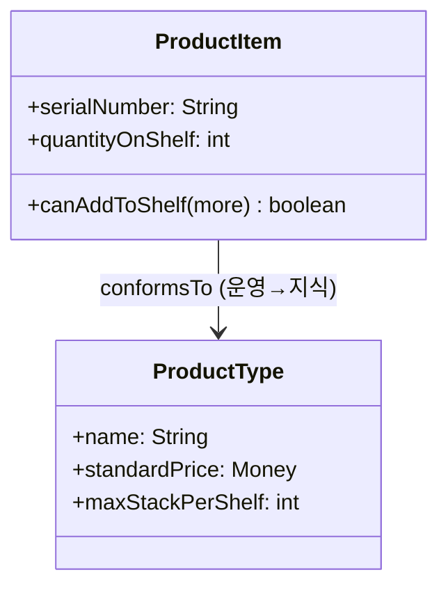

# Knowledge Level 분석 패턴 가이드

> 한 줄 요약: 구체적 사실을 다루는 "운영 수준(Operational Level)"과 그 사실이 따라야 할 규칙·분류·정의를 다루는 "지식 수준(Knowledge Level)"을 두 개의 계층으로 분리하여, 규칙을 코드가 아닌 데이터로 표현하고 도메인 변경에 유연하게 대응한다.
>
> 분류: 분석 패턴(Analysis Pattern) — 메타 모델링(Meta-level) 범주
> 다른 이름(Aliases): Knowledge Level, Operational/Knowledge Level, Two-Level Model, Type-Instance(메타 변형), Item-Description

---

## 상세 설명

대부분의 업무 모델에는 두 종류의 정보가 섞여 있다. 하나는 "오늘 앨리스가 부서 A에 고용되었다"처럼 시간·장소가 특정된 개별 사실이고, 다른 하나는 "직원은 반드시 부서에 소속되어야 하고, 부서는 회사에만 속한다"처럼 그런 사실이 따라야 할 규칙과 분류 체계다. 전자를 운영 수준, 후자를 지식 수준이라 부른다.

Knowledge Level 패턴은 이 두 종류의 정보를 의도적으로 분리된 계층으로 모델링한다. 운영 수준에는 실제 인스턴스(이 직원, 이 측정값, 이 거래)가 살고, 지식 수준에는 그것들의 타입·정의·허용 규칙(직원 유형, 측정 항목 정의, 허용된 관계 유형)이 산다. 운영 수준의 각 객체는 자신을 규정하는 지식 수준 객체를 참조한다.

핵심 동기는 "규칙을 코드가 아니라 데이터로 두기" 위함이다. 규칙을 if 문이나 클래스 계층으로 하드코딩하면, 도메인 규칙이 바뀔 때마다 프로그램을 재배포해야 한다. 규칙을 지식 수준 객체로 만들면, 도메인 전문가가 새 타입이나 새 제약을 데이터로 추가하는 것만으로 시스템 행동을 바꿀 수 있다. Fowler는 이를 "분석 모델을 두 단계로 나누는 가장 강력한 기법 중 하나"로 소개한다.

이 패턴은 다른 분석 패턴들과 거의 항상 짝을 이룬다. Accountability에서는 AccountabilityType이 지식 수준, Accountability가 운영 수준이다. Observation/Measurement에서는 PhenomenonType·MeasurementType이 지식 수준이고 실제 Observation·Measurement가 운영 수준이다. 즉 Knowledge Level은 단독 패턴이라기보다, 다른 모델 위에 "타입 계층"을 얹는 일반 전략이다. 객체지향에서 클래스–인스턴스가 컴파일 타임에 고정되는 한계를 런타임 데이터로 극복하는 셈이다.

---

## 디자인 패턴을 충족하는 최소 조건

이 섹션에서는 "어떤 모델이 진짜로 Knowledge Level 패턴이라고 부를 수 있는가"의 기준을 명확히 한다.

1. **두 계층의 명시적 분리** — 개별 사실을 담는 운영 수준 객체와, 그 사실의 타입·정의·규칙을 담는 지식 수준 객체가 서로 다른 클래스로 분리되어 있어야 한다.
2. **운영→지식 참조** — 운영 수준 인스턴스가 자신을 규정하는 지식 수준 객체를 참조하여, "이 인스턴스가 어떤 종류인가"를 데이터로 알 수 있어야 한다.
3. **규칙의 데이터화** — 분류·제약·허용 조합 같은 도메인 규칙이 지식 수준 객체에 담겨, 코드 수정 없이 데이터 추가/변경으로 규칙을 바꿀 수 있어야 한다.

> 위 조건 중 하나라도 빠지면 단순한 enum/코드 테이블 사용일 뿐, 두 수준을 분리해 규칙을 데이터로 다루는 Knowledge Level 패턴이라 보기 어렵다.

### 흔히 오해하는 지점
- 지식 수준을 단순 "코드값 목록"으로만 쓰고 규칙·제약을 여전히 코드에 두는 경우. 타입이 규칙을 담아야 진짜 지식 수준이다.
- 운영 수준과 지식 수준을 한 클래스에 섞는 경우(예: 인스턴스에 분류 규칙 메서드까지 직접 구현). 두 관심사가 한 곳에 엉키면 패턴의 이점이 사라진다.
- 무한 메타 계층으로 빠지는 경우. 대개 두 단계면 충분하며, 셋 이상은 복잡도 대비 이득이 거의 없다.

---

## 사례를 통한 예시

### 예시 1: 제품과 제품 정의 분리

**상황**: 창고 시스템에서 선반 위 개별 물품(serial number를 가진 실물)과, 그 물품이 어떤 상품인지(가격·규격·제조사)를 구분해야 한다. 상품 정의는 자주 추가·변경된다.

```java
// 지식 수준(Knowledge Level): "어떤 종류인가"와 규칙
class ProductType {
    private final String name;
    private Money standardPrice;
    private final int maxStackPerShelf;   // 도메인 규칙을 데이터로 보유

    ProductType(String name, Money price, int maxStack) {
        this.name = name; this.standardPrice = price; this.maxStackPerShelf = maxStack;
    }
    int maxStackPerShelf() { return maxStackPerShelf; }
    Money standardPrice() { return standardPrice; }
}

// 운영 수준(Operational Level): 실제 물품 인스턴스
class ProductItem {
    private final String serialNumber;
    private final ProductType type;       // 자신을 규정하는 지식 수준 참조
    private int quantityOnShelf;

    ProductItem(String serial, ProductType type) {
        this.serialNumber = serial; this.type = type;
    }
    boolean canAddToShelf(int more) {
        return quantityOnShelf + more <= type.maxStackPerShelf();
    }
}
```

**해설**: "선반당 최대 적재량" 같은 규칙은 `ProductItem`(운영)이 아니라 `ProductType`(지식)에 데이터로 들어간다. 새 상품을 추가하거나 적재 규칙을 바꿀 때 코드가 아니라 `ProductType` 데이터만 손대면 된다. 운영 객체는 항상 자신의 타입을 참조해 규칙을 위임한다.

### 예시 2: 실제 사례 — 측정 항목 정의와 동적 분류

병원·과학 정보 시스템에서 "혈압", "체온", "헤모글로빈 수치" 같은 측정 항목은 끊임없이 추가된다. 이를 `PhenomenonType`/`MeasurementType`(지식 수준) 객체로 두고, 실제 환자의 측정값은 그 타입을 참조하는 `Measurement`(운영 수준)로 기록한다. 이는 Fowler의 Observation/Measurement 패턴이 Knowledge Level을 활용하는 대표 사례다.

```text
지식 수준 :  MeasurementType("수축기혈압", 단위=mmHg, 정상범위=90~120)
운영 수준 :  Measurement(patient=Alice, type=수축기혈압, amount=118 mmHg, when=2026-05-29)
```

**해설**: 새로운 검사 항목이 생겨도 프로그램을 다시 배포할 필요 없이 `MeasurementType` 인스턴스를 추가하는 것으로 끝난다. 정상 범위 같은 임상 규칙도 타입 객체에 데이터로 보관되어, 운영 데이터(실측값)와 깔끔히 분리된다.

---

## 어떨 때 사용하나

다음과 같은 신호(Symptom)가 보일 때 이 패턴 도입을 고려한다.

- 분류 체계나 도메인 규칙이 자주 바뀌어, 그때마다 코드 수정·재배포가 부담스러울 때.
- 도메인 전문가/관리자가 직접 "새 유형"이나 "새 규칙"을 시스템에 추가할 수 있어야 할 때.
- 같은 구조의 객체가 종류에 따라 다른 제약·기본값을 가져야 하고, 그 종류 목록이 가변적일 때.

### 사용하면 안 되는 경우 (Anti-patterns)

- 타입 종류가 적고 거의 변하지 않는 경우. 단순 enum이나 클래스 계층이 더 명료하고 안전하다.
- 메타 계층을 과도하게 쌓아 "모든 것이 데이터"가 되어버려, 정작 도메인 의미가 코드에서 사라지고 디버깅이 어려워지는 경우.

---

## 장점과 단점, 한계점

### 장점
- **규칙의 런타임 변경**: 분류·제약을 데이터로 다루므로 재배포 없이 도메인 변화를 수용한다.
- **관심사 분리**: "무엇인가(인스턴스)"와 "어떤 종류·규칙인가(타입)"가 분리되어 모델이 명료해진다.
- **확장성**: 새로운 유형 추가가 데이터 입력 수준으로 단순해진다.

### 단점
- **이해 난이도**: 두 계층 구조와 메타 관계는 초보자가 파악하기 어렵고, 과용 시 모델이 추상적으로 변한다.
- **타입 안전성 약화**: 규칙이 데이터로 옮겨가면 컴파일러의 검증을 받지 못해 런타임 검증·테스트 부담이 늘어난다.

### 한계점
- 지식 수준 데이터의 무결성(잘못된 규칙 입력)을 보장할 별도 검증 장치가 필요하다.
- 다단계 메타(지식의 지식)로 확장하면 질의·디버깅 복잡도가 급격히 증가한다.

---

## 정보 표

| 항목 | 값 |
| --- | --- |
| 분류 | 분석 패턴 — 메타 모델링(Meta-level) |
| 언어 의존성 | 언어 비의존적 (정적 타입 언어에서 특히 유용 — 클래스/인스턴스 한계를 데이터로 보완) |
| 활용성(1점~5점) | ★★★★☆ (4/5) — 규칙·분류가 가변적인 도메인에서 핵심적이나 단순 도메인엔 과함 |
| 학습 난이도 | 상 |
| 자주 함께 쓰이는 패턴 | Accountability, Observation, Measurement, Quantity |
| 대표 사용 사례 | 제품/상품 정의, 측정 항목 정의, 동적 분류 체계, 설정 가능한 비즈니스 규칙 |

---

## Class Diagram



> 다이어그램에 등장하는 각 클래스가 패턴의 어떤 역할(Role)을 담당하는지 위 "상세 설명" 섹션과 1:1로 대응되어야 한다.

### 역할 설명
- **ProductType (지식 수준)**: 인스턴스가 따라야 할 분류·규칙·기본값을 데이터로 보유하는 타입 객체.
- **ProductItem (운영 수준)**: 실제 개별 사실(인스턴스). 자신을 규정하는 지식 수준 객체를 참조하며 규칙 판단을 그쪽에 위임한다.

---

## 참고 자료
- Martin Fowler, "Analysis Patterns: Reusable Object Models", Addison-Wesley, 1997 — Knowledge Level / Operational Level 논의(여러 장에 걸쳐 등장).
- Martin Fowler, Analysis Patterns 소개 페이지: https://martinfowler.com/books/ap.html
- 관련 구현 패턴: Type Object, Item–Description, Metamodel.
