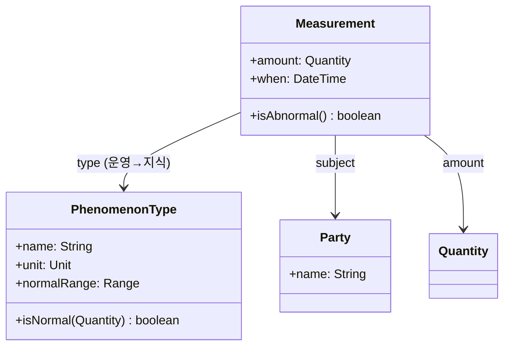

# Measurement 분석 패턴 가이드

> 한 줄 요약: 어떤 대상(Party 등)에 대해 "무엇을(현상 유형) 얼마만큼(Quantity)" 정량적으로 기록한 사실을 Measurement 객체로 모델링하여, 측정 항목을 데이터로 다루고 수치 측정값을 통일된 구조로 저장한다.
>
> 분류: 분석 패턴(Analysis Pattern) — 관찰/측정(Observation) 범주
> 다른 이름(Aliases): Measurement, Quantitative Observation

---

## 상세 설명

사람이나 사물에 대한 정량적 사실은 끝없이 다양하다. 환자의 키·몸무게·혈압, 제품의 무게·전압, 계좌의 잔액 등이다. 이를 클래스 속성으로 직접 박으면(`Patient.height`, `Patient.weight`, ...) 새 측정 항목이 생길 때마다 클래스를 수정해야 하고, 항목 수가 수백 개에 이르는 도메인(의료·과학)에서는 클래스가 감당할 수 없이 비대해진다.

Measurement 패턴은 "측정"을 속성이 아니라 객체로 본다. 하나의 Measurement는 "어떤 대상(subject)에 대해, 어떤 현상 유형(PhenomenonType/측정 항목)으로, 얼마만큼(Quantity)" 측정되었는가를 담는다. 즉 `Patient.height = 175cm` 대신 `Measurement(subject=Alice, type=키, amount=175cm)`가 된다. 측정 항목(키, 몸무게)은 코드가 아니라 PhenomenonType이라는 지식 수준(Knowledge Level) 객체로 표현되므로, 새 항목 추가가 데이터 입력 수준으로 단순해진다.

이 패턴의 핵심은 세 가지 결합이다. ① 측정 항목을 Knowledge Level로 분리해 데이터화하고, ② 측정값을 Quantity(값+단위)로 안전하게 담고, ③ 이 모두를 하나의 측정 사실 객체로 묶는다. 그 결과 "Alice의 모든 측정값", "특정 항목의 시계열", "정상 범위 벗어난 측정값" 같은 질의를 통일된 구조로 처리할 수 있다.

Measurement는 Observation 패턴의 정량적 짝이다. Observation은 정성적/범주형 사실("Alice는 혈액형이 A형")을, Measurement는 정량적 사실("Alice의 혈압은 118mmHg")을 다룬다. 둘은 종종 상위 개념으로 통합되어, 동일한 Phenomenon/현상 모델 아래 정량·정성 관찰을 함께 표현한다. Fowler는 이 측정/관찰 모델을 의료 정보 시스템 경험에서 도출했으며, 가변적이고 방대한 속성 집합을 다루는 도메인의 표준 해법으로 제시한다.

---

## 디자인 패턴을 충족하는 최소 조건

이 섹션에서는 "어떤 모델이 진짜로 Measurement 패턴이라고 부를 수 있는가"의 기준을 명확히 한다.

1. **측정의 객체화** — 측정값이 대상의 고정 속성이 아니라, 대상·항목·값을 묶은 독립된 Measurement 객체로 표현되어야 한다.
2. **측정 항목의 데이터화(Knowledge Level)** — 무엇을 측정했는가(현상 유형)가 클래스/필드가 아니라 PhenomenonType 같은 데이터 객체로 표현되어, 새 항목을 코드 변경 없이 추가할 수 있어야 한다.
3. **값의 Quantity 표현** — 측정값이 단위를 동반한 Quantity로 저장되어, 단위 없는 맨 숫자로 다루지 않아야 한다.

> 위 조건 중 하나라도 빠지면 단순히 측정 항목을 클래스 속성으로 박은 모델일 뿐, 가변 항목을 데이터로 다루는 Measurement 패턴으로 보기 어렵다.

### 흔히 오해하는 지점
- 측정 항목을 enum/컬럼으로만 두고 새 항목마다 스키마를 바꾸는 경우. 항목은 PhenomenonType 인스턴스(데이터)여야 한다.
- 값을 단위 없는 숫자로 저장하는 경우. Quantity 결합이 빠지면 단위 혼동 위험이 남는다.
- 정성적 사실(범주형)까지 억지로 Measurement에 욱여넣는 경우. 그것은 Observation의 영역이다.

---

## 사례를 통한 예시

### 예시 1: 환자 측정값을 객체로 기록

**상황**: 병원 시스템에서 환자의 다양한 측정 항목을 다뤄야 하고, 검사 항목은 계속 추가된다.

```java
// 지식 수준: 측정 항목 정의
class PhenomenonType {
    private final String name;       // "수축기 혈압", "체중"
    private final Unit unit;          // mmHg, kg
    private final Range<Quantity> normalRange;  // 정상 범위(선택)
    PhenomenonType(String name, Unit unit, Range<Quantity> normal) {
        this.name = name; this.unit = unit; this.normalRange = normal;
    }
    boolean isNormal(Quantity q) { return normalRange == null || normalRange.includes(q); }
    Unit unit() { return unit; }
    String name() { return name; }
}

// 운영 수준: 실제 측정 사실
class Measurement {
    private final Party subject;          // 측정 대상
    private final PhenomenonType type;    // 무엇을
    private final Quantity amount;        // 얼마만큼 (값+단위)
    private final LocalDateTime when;     // 언제

    Measurement(Party subject, PhenomenonType type, Quantity amount, LocalDateTime when) {
        this.subject = subject; this.type = type; this.amount = amount; this.when = when;
    }
    boolean isAbnormal() { return !type.isNormal(amount); }
}
```

```java
PhenomenonType sbp = new PhenomenonType("수축기 혈압", Unit.MMHG,
        new Range<>(Quantity.of(90,"mmHg"), Quantity.of(120,"mmHg")));
Measurement m = new Measurement(alice, sbp, Quantity.of(135,"mmHg"), LocalDateTime.now());
m.isAbnormal();   // true — 정상 범위 초과
```

**해설**: 새 검사 항목은 `PhenomenonType` 인스턴스를 추가하면 끝이고, `Patient` 클래스는 손대지 않는다. 값은 `Quantity`로 단위와 함께 저장되며, 정상 범위 판정(`Range`)도 항목 정의에 데이터로 들어 있다. 측정 항목(지식)·실측값(운영)·값 단위(Quantity)·범위(Range)가 결합된 전형적 형태다.

### 예시 2: 실제 사례 — 관찰 가능 항목의 EAV/표준 코드 모델

의료 표준 HL7 FHIR의 `Observation` 리소스는 `code`(무엇을 측정/관찰했는가, LOINC 등 코드값=지식 수준), `subject`(대상), `valueQuantity`(값+단위=Quantity), `effectiveDateTime`(시점)을 분리해 담는다. 이는 Measurement 패턴의 산업 표준 구현이다.

```json
{
  "resourceType": "Observation",
  "code":    { "coding": [{ "system": "http://loinc.org", "code": "8480-6", "display": "Systolic blood pressure" }] },
  "subject": { "reference": "Patient/alice" },
  "valueQuantity": { "value": 135, "unit": "mmHg", "system": "http://unitsofmeasure.org" },
  "effectiveDateTime": "2026-05-29T09:00:00Z"
}
```

**해설**: 측정 항목이 코드 시스템(LOINC)으로 데이터화되어 수만 종 항목을 스키마 변경 없이 수용하고, 값은 단위와 함께 `valueQuantity`로 안전하게 표현된다. 표준이 정확히 Measurement 패턴 구조를 따른다는 강력한 사례다.

---

## 어떨 때 사용하나

다음과 같은 신호(Symptom)가 보일 때 이 패턴 도입을 고려한다.

- 한 대상에 대한 측정/속성 항목이 매우 많고 가변적이어서, 클래스 속성으로 박으면 클래스가 비대해질 때.
- 측정 항목을 관리자/도메인 전문가가 직접 추가·정의할 수 있어야 할 때.
- 측정값의 시계열·집계·이상치 판정을 통일된 구조로 질의해야 할 때.

### 사용하면 안 되는 경우 (Anti-patterns)

- 측정 항목이 소수로 고정되어 있고 변하지 않는 경우. 명시적 속성이 더 안전하고 빠르다.
- 강한 타입 안전성·간단한 질의가 더 중요한데, EAV식 일반화로 모든 것을 동적화해 도메인 의미가 흐려지는 경우.

---

## 장점과 단점, 한계점

### 장점
- **항목 확장성**: 새 측정 항목을 데이터로 추가하므로 코드/스키마 변경이 최소화된다.
- **통일된 처리**: 모든 측정을 같은 구조로 다뤄 시계열·집계·이상치 판정이 일관된다.
- **단위 안전성**: 값이 Quantity라 단위 혼동을 방지한다.

### 단점
- **타입 안전성 약화**: 항목이 데이터라 컴파일러 검증을 못 받고, 잘못된 값/단위 입력을 런타임에 막아야 한다.
- **질의 복잡성**: 특정 항목 값을 꺼낼 때 조인/필터가 늘어 단순 속성 접근보다 번거롭다.

### 한계점
- 대량 측정 데이터의 저장/조회 성능 최적화(인덱싱, 시계열 DB)가 별도로 필요하다.
- 항목 정의(PhenomenonType) 자체의 버전 관리·변경 이력을 다루려면 추가 설계가 든다.

---

## 정보 표

| 항목 | 값 |
| --- | --- |
| 분류 | 분석 패턴 — 관찰/측정(Observation) |
| 언어 의존성 | 언어 비의존적 |
| 활용성(1점~5점) | ★★★★☆ (4/5) — 의료·과학·IoT 등 가변 측정 항목 도메인에서 매우 강력 |
| 학습 난이도 | 중 |
| 자주 함께 쓰이는 패턴 | Quantity, Range, Knowledge Level, Observation, Party |
| 대표 사용 사례 | 의료 측정값(FHIR Observation), 센서/IoT 계측, 품질 검사 수치 |

---

## Class Diagram



> 다이어그램에 등장하는 각 클래스가 패턴의 어떤 역할(Role)을 담당하는지 위 "상세 설명" 섹션과 1:1로 대응되어야 한다.

### 역할 설명
- **Measurement**: "대상–항목–값–시점"을 묶은 정량적 측정 사실(운영 수준).
- **PhenomenonType**: 무엇을 측정했는가를 규정하는 측정 항목 정의(지식 수준). 단위·정상 범위 등 규칙을 데이터로 보유.
- **Party**: 측정 대상(주체).
- **Quantity**: 측정값. 단위를 동반한 값 객체.

---

## 참고 자료
- Martin Fowler, "Analysis Patterns: Reusable Object Models", Addison-Wesley, 1997 — Chapter 3 (Observations and Measurements).
- Martin Fowler, Analysis Patterns 소개 페이지: https://martinfowler.com/books/ap.html
- HL7 FHIR `Observation` 리소스, LOINC 코드 체계.
