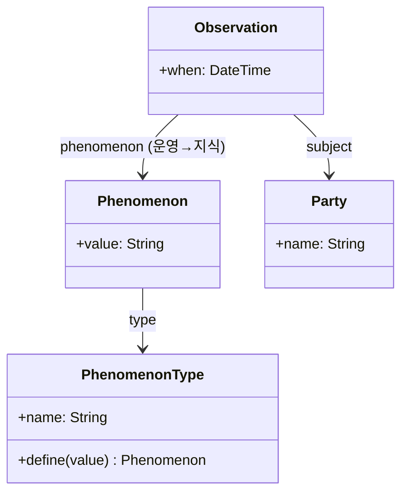

# Observation 분석 패턴 가이드

> 한 줄 요약: 어떤 대상에 대한 정성적(범주형) 사실 — 예: 혈액형이 A형이다 — 을 "현상(Phenomenon)"이라는 분류 값과 연결된 Observation 객체로 모델링하여, 측정값(Measurement)과 함께 통일된 관찰 모델을 구성한다.
>
> 분류: 분석 패턴(Analysis Pattern) — 관찰/측정(Observation) 범주
> 다른 이름(Aliases): Observation, Qualitative Observation, Category Observation

---

## 상세 설명

대상에 대한 사실에는 수치로 표현되는 것(키 175cm)과, 범주로 표현되는 것(혈액형 A형, 성별 여성, 진단명 당뇨)이 있다. 후자를 단순 문자열이나 boolean 속성으로 박으면, 가능한 범주 목록과 그에 딸린 규칙(예: "A형과 B형은 서로 배타적", "특정 진단은 특정 검사 결과에서만 가능")이 코드 곳곳에 흩어진다. 또한 정량 사실과 정성 사실이 서로 다른 메커니즘으로 다뤄져 통합 질의가 어려워진다.

Observation 패턴은 정성적 사실을 객체로 본다. 하나의 Observation은 "어떤 대상(subject)에 대해, 어떤 현상(Phenomenon)이 관찰되었는가"를 담는다. Phenomenon은 어떤 PhenomenonType(예: "혈액형")이 취할 수 있는 하나의 범주 값(예: "A형")이다. 즉 PhenomenonType과 Phenomenon은 지식 수준(Knowledge Level)에서 "분류 체계와 그 값"을 정의하고, Observation은 운영 수준에서 "이 대상에 이 현상이 나타났다"는 사실을 기록한다.

Observation은 Measurement의 정성적 짝이다. Measurement가 "얼마만큼(Quantity)"이라면 Observation은 "어떤 범주(Phenomenon)"다. 둘은 보통 공통 상위 개념(예: Observation 추상) 아래 묶여, 정량·정성 관찰을 같은 모델로 표현한다. 이렇게 하면 "Alice에 대한 모든 관찰"을 종류 무관하게 한 번에 조회할 수 있다.

이 패턴의 강점은 "범주 자체를 데이터로 다룬다"는 데 있다. 새로운 분류 항목이나 새로운 범주 값은 PhenomenonType·Phenomenon 데이터를 추가하는 것으로 끝나며, 그들 사이의 배타성·의존성 같은 규칙도 지식 수준 객체에 담을 수 있다. Fowler는 이 모델 역시 의료 정보 시스템 경험에서 도출했으며, 진단·증상·분류가 방대하고 끊임없이 변하는 도메인에서 특히 유용하다고 설명한다.

---

## 디자인 패턴을 충족하는 최소 조건

이 섹션에서는 "어떤 모델이 진짜로 Observation 패턴이라고 부를 수 있는가"의 기준을 명확히 한다.

1. **정성적 사실의 객체화** — 범주형 사실이 대상의 단순 속성이 아니라, 대상과 현상을 묶은 독립된 Observation 객체로 표현되어야 한다.
2. **현상의 분류 체계화(Knowledge Level)** — 관찰된 값이 PhenomenonType(분류)과 그 값 Phenomenon으로 데이터화되어, 새 범주를 코드 변경 없이 추가할 수 있어야 한다.
3. **측정과의 통합 가능성** — 정성 관찰(Observation)이 정량 측정(Measurement)과 공통 관찰 모델 아래에서 일관되게 다뤄질 수 있어야 한다(최소한 같은 subject·시점 구조를 공유).

> 위 조건 중 하나라도 빠지면 단순한 범주 문자열 속성일 뿐, 분류를 데이터로 다루는 Observation 패턴으로 보기 어렵다.

### 흔히 오해하는 지점
- 범주 값을 자유 문자열로 저장해 오타·중복이 난무하는 경우. Phenomenon은 통제된 분류 값이어야 한다.
- Observation을 수치 측정에까지 적용하려 하거나, 반대로 Measurement에 범주를 욱여넣는 경우. 정량은 Measurement, 정성은 Observation으로 나뉜다.
- 현상 간 규칙(배타성 등)을 코드로만 처리하고 분류 체계에 담지 않는 경우. 규칙을 지식 수준에 두는 것이 패턴의 이점이다.

---

## 사례를 통한 예시

### 예시 1: 혈액형 관찰을 객체로

**상황**: 환자에 대한 정성적 사실(혈액형, 흡연 여부 등)을 통제된 분류 체계로 기록해야 한다.

```java
// 지식 수준: 분류 체계와 그 값
class PhenomenonType {
    private final String name;                 // "혈액형"
    private final List<Phenomenon> values = new ArrayList<>();  // A, B, AB, O
    PhenomenonType(String name) { this.name = name; }
    Phenomenon define(String value) {
        Phenomenon p = new Phenomenon(this, value);
        values.add(p); return p;
    }
}
class Phenomenon {
    private final PhenomenonType type;
    private final String value;                // "A형"
    Phenomenon(PhenomenonType type, String value) { this.type = type; this.value = value; }
    PhenomenonType type() { return type; }
}

// 운영 수준: 관찰된 사실
class Observation {
    private final Party subject;
    private final Phenomenon phenomenon;       // 어떤 범주가 관찰됨
    private final LocalDateTime when;
    Observation(Party subject, Phenomenon phenomenon, LocalDateTime when) {
        this.subject = subject; this.phenomenon = phenomenon; this.when = when;
    }
}
```

```java
PhenomenonType bloodType = new PhenomenonType("혈액형");
Phenomenon typeA = bloodType.define("A형");
new Observation(alice, typeA, LocalDateTime.now());   // "Alice는 A형으로 관찰됨"
```

**해설**: 분류(`PhenomenonType`)와 그 허용 값(`Phenomenon`)이 데이터로 정의되고, 실제 사실은 `Observation`으로 기록된다. 새 분류나 값이 필요하면 데이터를 추가할 뿐 `Patient` 클래스를 바꾸지 않는다. 값이 통제된 `Phenomenon`이라 자유 문자열의 오타 문제가 없다.

### 예시 2: 실제 사례 — FHIR의 정성 관찰과 코드화된 값

HL7 FHIR `Observation` 리소스는 정량값(`valueQuantity`)뿐 아니라 정성값(`valueCodeableConcept`)도 지원한다. 분류 항목은 `code`(무엇을 관찰했는가), 관찰된 범주 값은 코드 체계(SNOMED CT 등)의 코드로 표현된다. 이는 Observation 패턴이 정성 사실을 다루는 방식과 정확히 일치한다.

```json
{
  "resourceType": "Observation",
  "code":    { "coding": [{ "system": "http://loinc.org", "code": "883-9", "display": "ABO group" }] },
  "subject": { "reference": "Patient/alice" },
  "valueCodeableConcept": { "coding": [{ "system": "http://snomed.info/sct", "code": "112144000", "display": "Blood group A" }] }
}
```

**해설**: 관찰 항목(혈액형)과 관찰된 범주 값(A형)이 모두 표준 코드로 데이터화되어, 정량 측정과 동일한 `Observation` 구조 안에서 정성 사실을 통일되게 표현한다. 분류 체계를 외부 표준에 위임함으로써 일관성과 상호운용성을 얻는다.

---

## 어떨 때 사용하나

다음과 같은 신호(Symptom)가 보일 때 이 패턴 도입을 고려한다.

- 대상에 대한 범주형 사실 항목이 많고 가변적이며, 통제된 분류 체계가 필요할 때.
- 정성 사실과 정량 측정을 한 모델에서 함께 조회·관리해야 할 때.
- 범주 값과 그들 사이의 규칙(배타성·의존성)을 데이터로 관리해 코드 변경 없이 바꾸고 싶을 때.

### 사용하면 안 되는 경우 (Anti-patterns)

- 범주 항목이 소수로 고정되어 있고 변하지 않는 경우. 단순 enum 속성이 더 명료하고 안전하다.
- 통제 어휘가 필요 없는 자유 서술 메모. 이런 경우 일반 텍스트 필드가 적절하다.

---

## 장점과 단점, 한계점

### 장점
- **분류 확장성**: 새 분류·범주 값을 데이터로 추가하므로 코드 변경이 최소화된다.
- **관찰의 통합**: 정성(Observation)·정량(Measurement)을 공통 모델로 다뤄 통합 질의가 가능하다.
- **데이터 품질**: 통제된 Phenomenon 값으로 오타·표기 흔들림을 방지한다.

### 단점
- **타입 안전성 약화**: 분류가 데이터라 컴파일러 검증을 못 받고, 무결성을 런타임/규칙으로 보장해야 한다.
- **모델 추상성**: 단순 boolean 한두 개로 끝날 일을 과도하게 일반화하면 이해가 어려워진다.

### 한계점
- 분류 체계 자체의 버전 관리(코드 폐기·대체)와 이력 추적에 추가 설계가 필요하다.
- 현상 간 복잡한 의존 규칙을 표현·검증하는 메커니즘을 따로 마련해야 한다.

---

## 정보 표

| 항목 | 값 |
| --- | --- |
| 분류 | 분석 패턴 — 관찰/측정(Observation) |
| 언어 의존성 | 언어 비의존적 |
| 활용성(1점~5점) | ★★★☆☆ (3/5) — 의료·과학 등 분류가 방대한 도메인에선 필수에 가깝지만 일반 도메인엔 과할 수 있음 |
| 학습 난이도 | 중 |
| 자주 함께 쓰이는 패턴 | Measurement, Knowledge Level, Quantity, Party |
| 대표 사용 사례 | 의료 진단/소견, 정성 검사 결과, 자산 상태 분류 |

---

## Class Diagram



> 다이어그램에 등장하는 각 클래스가 패턴의 어떤 역할(Role)을 담당하는지 위 "상세 설명" 섹션과 1:1로 대응되어야 한다.

### 역할 설명
- **Observation**: "대상에 어떤 현상이 관찰되었다"는 정성적 사실(운영 수준).
- **Phenomenon**: 특정 분류가 취하는 하나의 범주 값(지식 수준). 예: "A형".
- **PhenomenonType**: 분류 체계 자체와 허용 값 집합(지식 수준). 예: "혈액형".
- **Party**: 관찰 대상(주체).

---

## 참고 자료
- Martin Fowler, "Analysis Patterns: Reusable Object Models", Addison-Wesley, 1997 — Chapter 3 (Observations and Measurements).
- Martin Fowler, Analysis Patterns 소개 페이지: https://martinfowler.com/books/ap.html
- HL7 FHIR `Observation`(valueCodeableConcept), SNOMED CT.
