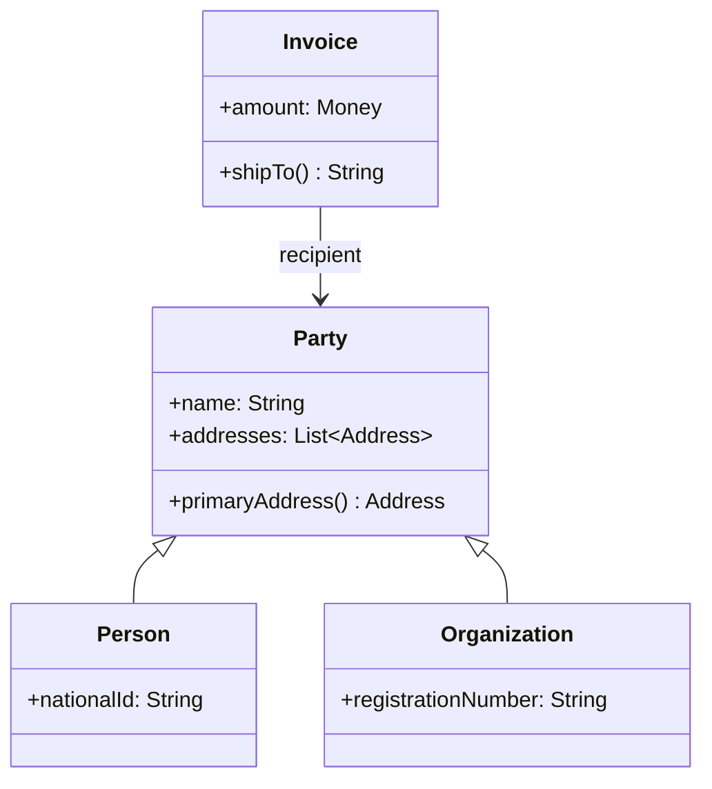

# Party 분석 패턴 가이드

> 한 줄 요약: 사람(Person)과 조직(Organization)이 공통으로 가지는 "행위 주체"라는 개념을 Party라는 상위 추상으로 묶어, 주소·연락처·식별 같은 공통 속성과 관계를 중복 없이 모델링한다.
>
> 분류: 분석 패턴(Analysis Pattern) — 기반 추상(Foundational) 범주
> 다른 이름(Aliases): Party, Party Abstraction, Legal Entity(법적 주체 변형)

---

## 상세 설명

업무 시스템을 모델링하다 보면 거의 항상 "사람"과 "조직"을 동시에 다루게 된다. 고객은 개인일 수도 법인일 수도 있고, 송장(invoice)의 수신자도, 계약의 당사자도, 메시지의 발신자도 사람이거나 조직이다. 이때 Person과 Organization을 완전히 별개의 클래스로 만들면, 주소(Address), 전화번호, 이메일, 식별자 같은 속성과 그에 딸린 연락(contact) 로직이 두 클래스에 그대로 복제된다. 새로운 연락 수단이 생기면 두 곳을 모두 고쳐야 하고, "고객"을 참조하는 코드는 Person인지 Organization인지에 따라 분기해야 한다.

Party 패턴은 Person과 Organization이 본질적으로 "이름을 가지고 주소로 연락할 수 있으며 다른 주체와 관계를 맺는 행위 주체"라는 공통 역할을 한다는 점에 착안한다. 이 공통 개념을 Party라는 상위 타입으로 추출하고, Person과 Organization을 그 하위 타입으로 둔다. 그러면 주소·연락처·식별 정보는 Party에 한 번만 정의되고, 송장·계약·주문 등은 구체 타입이 아니라 Party를 참조하면 된다.

이 패턴의 핵심 아이디어는 "행위 주체에 대한 참조를 구체 타입이 아니라 추상 타입으로 끌어올린다"는 것이다. Martin Fowler는 『Analysis Patterns』(1997)에서 Party를 Accountability 패턴과 함께 가장 기초가 되는 추상으로 제시했다. Party 자체로도 유용하지만, 진가는 여러 Party 사이의 관계(고용, 소유, 관리 등)를 Accountability로 일반화할 때 드러난다.

Party는 단순한 상속 트리가 아니라 "개념적 일반화(conceptual generalization)"다. 즉 코드 재사용을 위한 상속이 아니라, 도메인 전문가가 실제로 "거래처는 개인일 수도 회사일 수도 있다"고 말하는 방식을 그대로 모델에 반영한 것이다. 그래서 Party는 분석(요구사항·도메인 이해) 단계의 패턴으로 분류되며, 구현 시에는 상속, 인터페이스, 혹은 별도 식별 체계 등 여러 형태로 실현될 수 있다.

---

## 디자인 패턴을 충족하는 최소 조건

이 섹션에서는 "어떤 모델이 진짜로 Party 패턴이라고 부를 수 있는가"의 기준을 명확히 한다.

1. **공통 상위 추상의 존재** — Person과 Organization(또는 그에 준하는 행위 주체들)을 포괄하는 단일 상위 타입 Party가 존재해야 한다. 단순히 두 클래스가 같은 인터페이스 일부를 우연히 공유하는 것으로는 부족하다.
2. **참조의 추상화** — 시스템의 다른 개념(주문, 계약, 송장 등)이 Person/Organization 대신 Party를 참조해야 한다. 행위 주체를 받는 자리는 구체 타입이 아니라 Party로 선언된다.
3. **공통 속성·행위의 상위 집약** — 주소, 연락 수단, 식별자처럼 모든 행위 주체가 공유하는 속성과 동작이 Party 수준에 정의되어 하위 타입에서 중복되지 않아야 한다.

> 위 조건 중 하나라도 빠지면 단순한 "Person/Organization 두 클래스"이거나 우연한 공통 인터페이스일 뿐, Party 패턴으로 보기 어렵다.

### 흔히 오해하는 지점
- Party를 "사람과 조직을 담는 만능 테이블"로 오해해, 의미가 다른 속성까지 전부 상위로 올려 거대한 God Class를 만드는 경우. Party에는 모든 행위 주체가 공유하는 것만 둔다.
- Party와 Accountability를 혼동하는 경우. Party는 "주체 자체"를, Accountability는 "주체 간의 관계"를 모델링한다.
- 역할(Role)과 혼동하는 경우. "고객", "공급자"는 Party의 하위 타입이 아니라 Party가 특정 맥락에서 맡는 역할이며, 보통 Accountability나 별도 Role 모델로 다룬다.

---

## 사례를 통한 예시

### 예시 1: 송장 수신자를 Party로 추상화

**상황**: 청구 시스템에서 송장은 개인 고객에게도, 법인 고객에게도 발행된다. 수신자가 개인인지 법인인지에 따라 코드가 갈라지는 것을 막고 싶다.

```java
abstract class Party {
    private String name;
    private final List<Address> addresses = new ArrayList<>();

    Party(String name) { this.name = name; }

    String getName() { return name; }
    void addAddress(Address a) { addresses.add(a); }
    Address primaryAddress() { return addresses.get(0); }
}

class Person extends Party {
    private final String nationalId;
    Person(String name, String nationalId) {
        super(name);
        this.nationalId = nationalId;
    }
}

class Organization extends Party {
    private final String registrationNumber;
    Organization(String name, String registrationNumber) {
        super(name);
        this.registrationNumber = registrationNumber;
    }
}

class Invoice {
    private final Party recipient;   // 구체 타입이 아니라 Party를 참조
    private final Money amount;
    Invoice(Party recipient, Money amount) {
        this.recipient = recipient;
        this.amount = amount;
    }
    String shipTo() { return recipient.getName() + " / " + recipient.primaryAddress(); }
}
```

**해설**: `Invoice`는 수신자가 `Person`인지 `Organization`인지 전혀 알 필요가 없다. `recipient`를 `Party`로 선언함으로써 분기 로직이 사라지고, 이름·주소 접근은 상위 타입의 공통 행위로 처리된다. `nationalId`, `registrationNumber`처럼 타입별로만 의미 있는 속성은 각 하위 타입에 남긴다.

### 예시 2: 실제 표준/프레임워크에서의 사용

전자상거래·CRM 도메인 표준에서 Party는 사실상 표준 추상으로 자리 잡았다. OASIS UBL(Universal Business Language)의 송장 스키마는 공급자·구매자를 모두 `Party` 타입(`PartyName`, `PostalAddress`, `Contact` 포함)으로 표현하며, TM Forum의 SID(Shared Information/Data Model)와 Apache OFBiz의 엔터티 모델도 `Party`–`Person`/`PartyGroup` 구조를 사용한다.

```xml
<!-- OASIS UBL Invoice의 발신자(AccountingSupplierParty) 일부 -->
<cac:AccountingSupplierParty>
  <cac:Party>
    <cac:PartyName><cbc:Name>Acme Corp</cbc:Name></cac:PartyName>
    <cac:PostalAddress>
      <cbc:StreetName>123 Market St</cbc:StreetName>
      <cbc:CityName>Seoul</cbc:CityName>
    </cac:PostalAddress>
  </cac:Party>
</cac:AccountingSupplierParty>
```

**해설**: 송장의 발신자·수신자를 모두 동일한 `Party` 구조로 표현하므로, 거래 상대가 개인이든 회사든 같은 스키마와 같은 처리 코드를 재사용한다. 이는 Party 추상이 단순 이론이 아니라 산업 표준 데이터 모델의 토대임을 보여준다.

---

## 어떨 때 사용하나

다음과 같은 신호(Symptom)가 보일 때 이 패턴 도입을 고려한다.

- 사람과 조직(또는 부서·시스템 같은 또 다른 주체)을 동시에 "거래처/고객/당사자"로 다뤄야 하고, 두 클래스에 주소·연락처 코드가 중복되고 있을 때.
- "이 참조가 개인인가 법인인가"를 묻는 `instanceof`/타입 분기가 도메인 곳곳에 흩어져 있을 때.
- 향후 새로운 종류의 행위 주체(예: 정부기관, 자동화 에이전트)가 추가될 가능성이 있고, 이를 기존 거래·계약 로직 변경 없이 수용하고 싶을 때.

### 사용하면 안 되는 경우 (Anti-patterns)

- 시스템이 오직 한 종류의 주체(예: 개인 사용자만)만 다루며 앞으로도 그럴 것이 분명한 경우. 불필요한 상위 추상은 복잡도만 늘린다.
- Person과 Organization이 공유하는 속성이 거의 없고 행동이 완전히 다른 경우. 억지 일반화는 빈 껍데기 상위 타입을 만든다.

---

## 장점과 단점, 한계점

### 장점
- **참조의 단순화**: 거래·계약·문서 등이 Party 하나만 참조하므로 타입 분기가 사라지고 결합도가 낮아진다.
- **공통 로직의 단일화**: 주소·연락처·식별 로직이 한곳에 모여 변경과 확장이 쉽다.
- **확장성**: 새로운 종류의 행위 주체를 하위 타입으로 추가해도 기존 참조 코드를 건드리지 않는다.

### 단점
- **과잉 일반화 위험**: 공통점이 적은 개념을 억지로 묶으면 의미가 모호한 상위 타입이 생긴다.
- **타입별 속성의 처리**: 개인에게만, 조직에게만 있는 속성을 다루려면 결국 하위 타입 캐스팅이나 별도 처리 지점이 필요할 수 있다.

### 한계점
- 상속 기반으로 구현하면 다중 분류(예: "개인이면서 동시에 1인 법인")를 표현하기 어렵다. 이런 경우 역할(Role)·Accountability로 보완해야 한다.
- 관계형 DB에 매핑할 때 단일 테이블/클래스별 테이블/조인 전략 중 무엇을 쓰느냐에 따라 트레이드오프가 발생한다.

---

## 정보 표

| 항목 | 값 |
| --- | --- |
| 분류 | 분석 패턴 — 기반 추상(Foundational) |
| 언어 의존성 | 언어 비의존적 (상속/인터페이스/타입 식별 등 다양한 방식으로 구현 가능) |
| 활용성(1점~5점) | ★★★★★ (5/5) — 사람·조직을 함께 다루는 거의 모든 업무 시스템의 출발점 |
| 학습 난이도 | 하 |
| 자주 함께 쓰이는 패턴 | Accountability, Knowledge Level, Role |
| 대표 사용 사례 | CRM 고객 모델, 청구/송장 수신자, ERP 거래처, 조직도 |

---

## Class Diagram



> 다이어그램에 등장하는 각 클래스가 패턴의 어떤 역할(Role)을 담당하는지 위 "상세 설명" 섹션과 1:1로 대응되어야 한다.

### 역할 설명
- **Party**: 모든 행위 주체의 공통 추상. 이름·주소 등 공통 속성과 행위를 보유한다.
- **Person / Organization**: Party의 구체 하위 타입. 각자에게만 의미 있는 식별자를 추가로 가진다.
- **Invoice**: Party를 참조하는 클라이언트. 수신자의 구체 타입을 알지 못한 채 협력한다.

---

## 참고 자료
- Martin Fowler, "Analysis Patterns: Reusable Object Models", Addison-Wesley, 1997 — Chapter 2 (Accountability)에서 Party 추상을 소개.
- Martin Fowler, Analysis Patterns 소개 페이지: https://martinfowler.com/books/ap.html
- OASIS UBL (Universal Business Language) — Party 데이터 구조 표준.
