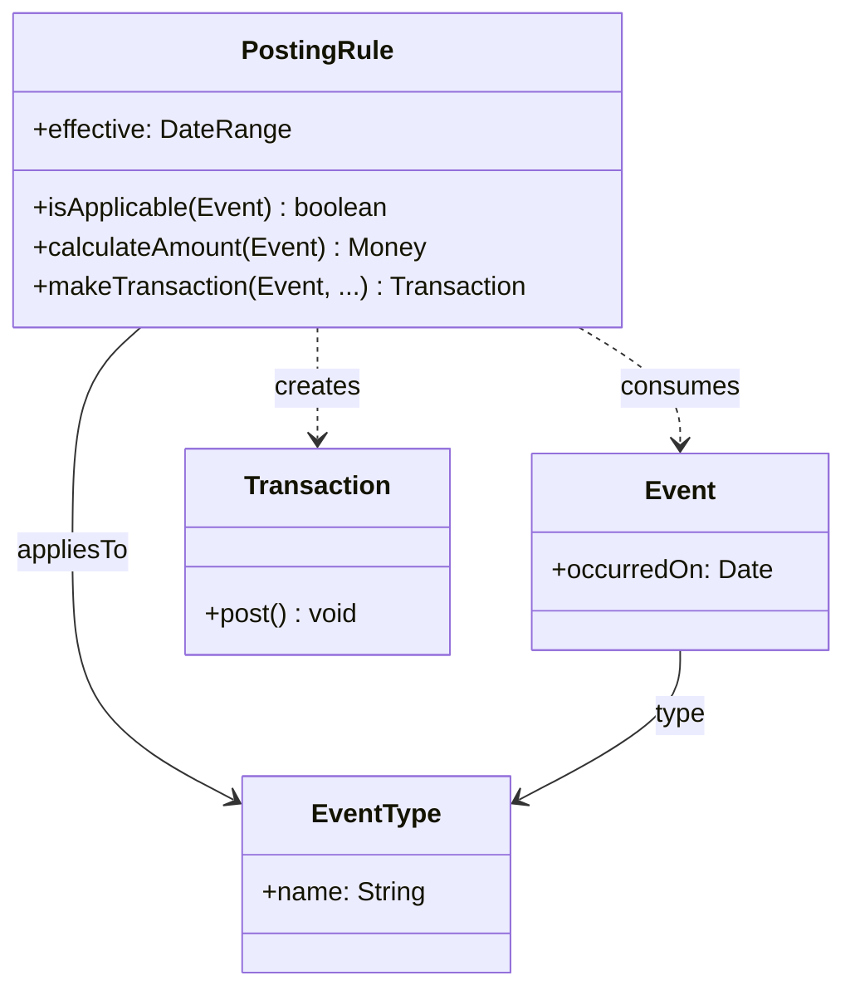

# Posting Rule 분석 패턴 가이드

> 한 줄 요약: "어떤 사건이 발생하면 어느 계정에 얼마를 어떤 부호로 전기(posting)할 것인가"라는 회계 규칙을 객체로 분리하여, 거래 처리 로직을 코드가 아닌 데이터·규칙으로 다루고 손쉽게 추가·변경한다.
>
> 분류: 분석 패턴(Analysis Pattern) — 회계/거래(Accounting) 범주
> 다른 이름(Aliases): Posting Rule, Accounting Rule, Posting Service

---

## 상세 설명

회계·정산 시스템에서 "사건"과 "그 사건의 회계 처리"는 다르다. 예를 들어 "전화 통화 1건 발생"이라는 사건은, "통화료 계정에 +금액, 매출 계정에 -금액"이라는 전기(posting)로 이어진다. 그런데 이 매핑 규칙은 상품·요금제·세금 정책에 따라 끊임없이 달라지고 새로 생긴다. 규칙을 if-else로 코드에 박으면, 새 요금제 하나가 출시될 때마다 회계 엔진을 수정·재배포해야 하고, 규칙이 코드 곳곳에 흩어져 일관성이 무너진다.

Posting Rule 패턴은 "사건을 거래(Transaction)로 변환하는 규칙" 자체를 1급 객체로 만든다. PostingRule은 특정 종류의 사건(EventType)에 대해 "어느 계정에, 얼마를(보통 금액 함수), 어떤 방향으로 전기할지"를 안다. 사건이 들어오면 시스템은 해당 사건에 적용 가능한 PostingRule들을 찾아 실행하고, 그 결과로 균형 잡힌 Transaction을 생성해 Account에 게시한다.

핵심은 두 가지다. 첫째, 사건과 회계 처리의 분리. 원천 사건(통화·주문·결제)은 회계 구조를 몰라도 되고, 회계 규칙은 사건을 입력으로 받아 거래를 산출한다. 둘째, 규칙의 데이터화(Knowledge Level). 어떤 EventType에 어떤 PostingRule이 적용되는지를 데이터로 두면, 새 규칙을 인스턴스 추가로 도입할 수 있다. 규칙에는 유효 기간을 둘 수 있어, "이 요금 규칙은 2026년 1월부터 적용" 같은 시간 의존성도 표현된다.

Posting Rule은 Account·Transaction 패턴 위에 얹히는 최상층이다. Account가 잔액을, Transaction이 균형을 보장한다면, Posting Rule은 "비즈니스 사건을 어떻게 회계로 번역하는가"를 담당한다. 또한 Knowledge Level과 결합해 규칙 자체를 운영 데이터와 분리한다. Fowler는 이 패턴을 통신·금융처럼 과금 규칙이 복잡하고 변화무쌍한 도메인에서 특히 강조한다.

---

## 디자인 패턴을 충족하는 최소 조건

이 섹션에서는 "어떤 모델이 진짜로 Posting Rule 패턴이라고 부를 수 있는가"의 기준을 명확히 한다.

1. **규칙의 객체화** — 사건을 거래로 변환하는 회계 규칙이 흩어진 분기 코드가 아니라, 독립된 PostingRule 객체로 표현되어야 한다.
2. **사건과 처리의 분리** — 원천 사건(EventType/Event)과 그 회계 처리(PostingRule이 생성하는 Transaction)가 분리되어, 사건 측이 계정 구조를 직접 알지 않아야 한다.
3. **규칙의 적용 매핑 데이터화** — 어떤 사건에 어떤 규칙이 적용되는지가 데이터로 관리되어(가능하면 유효 기간 포함), 새 규칙을 코드 변경 없이 추가·교체할 수 있어야 한다.

> 위 조건 중 하나라도 빠지면 단순히 거래를 만드는 서비스 코드일 뿐, 규칙을 분리·데이터화한 Posting Rule 패턴으로 보기 어렵다.

### 흔히 오해하는 지점
- PostingRule을 만들어 놓고도 적용 분기를 결국 if-else로 처리하는 경우. 규칙 선택까지 데이터/다형성으로 가야 이점이 산다.
- 규칙에 유효 기간이 없어 과거 사건을 과거 규칙으로 재처리하지 못하는 경우. 시간 의존성은 핵심 요구사항이다.
- 규칙이 균형 잡힌 Transaction을 만들지 않고 한쪽 계정만 건드리는 경우. 출력은 항상 합 0의 Transaction이어야 한다.

---

## 사례를 통한 예시

### 예시 1: 사건을 거래로 변환하는 전기 규칙

**상황**: 통신 과금 시스템에서 "통화" 사건을 회계 거래로 바꾸되, 요금 규칙이 자주 바뀐다.

```java
abstract class PostingRule {
    private final EventType appliesTo;
    private final DateRange effective;          // 규칙 유효 기간
    PostingRule(EventType type, DateRange effective) {
        this.appliesTo = type; this.effective = effective;
    }
    boolean isApplicable(Event e) {
        return e.type() == appliesTo && effective.includes(e.occurredOn());
    }
    abstract Money calculateAmount(Event e);     // 금액 산출 로직(규칙별)

    Transaction makeTransaction(Event e, Account revenue, Account receivable) {
        Money amount = calculateAmount(e);
        Transaction t = new Transaction();
        t.add(receivable, amount);               // 미수금 +
        t.add(revenue,    amount.negate());      // 매출 - (합 0 균형)
        return t;
    }
}

class PerCallRule extends PostingRule {          // 건당 정액 규칙
    private final Money unitPrice;
    PerCallRule(EventType t, DateRange eff, Money price) { super(t, eff); this.unitPrice = price; }
    @Override Money calculateAmount(Event e) { return unitPrice; }
}
```

```java
// 규칙은 데이터처럼 등록되고, 사건에 매칭되어 거래를 생성
List<PostingRule> rules = List.of(
    new PerCallRule(EventType.CALL, DateRange.from(LocalDate.of(2026,1,1)), Money.won(50)));

Event call = new Event(EventType.CALL, LocalDate.of(2026,5,29));
rules.stream().filter(r -> r.isApplicable(call)).findFirst()
     .ifPresent(r -> r.makeTransaction(call, revenueAcc, receivableAcc).post());
```

**해설**: 과금 규칙이 `PostingRule` 객체로 분리되어, 새 요금제는 새 규칙 클래스/인스턴스를 추가하면 된다. 규칙은 `isApplicable`로 사건 종류·시점에 따라 선택되고, 출력은 항상 합 0의 `Transaction`이다. 통화 사건은 계정 구조를 전혀 모른다.

### 예시 2: 실제 사례 — 빌링/레이팅 엔진과 규칙 테이블

통신 BSS(Business Support System)의 레이팅·빌링 엔진, ERP의 회계 규칙 엔진은 "이벤트 → 규칙 적용 → 분개 생성" 파이프라인을 사용한다. 규칙은 코드가 아니라 규칙 테이블/구성으로 관리되며, 유효 일자별 버전을 가진다. 이는 Posting Rule 패턴의 산업적 구현이다.

```text
Event(통화, 2026-05-29)
   └─ RuleSelector: 유효 규칙 조회 (요금제 X, 2026-05 적용분)
        └─ PostingRule.calculateAmount() -> 50원
             └─ Transaction { 미수금 +50, 매출 -50 } (합 0)
                  └─ post() -> Account 반영
```

**해설**: 규칙을 데이터(유효 일자 포함)로 관리하기 때문에, 요금 정책이 바뀌어도 엔진 코드를 재배포하지 않고 규칙만 갱신한다. 과거 사건은 그 시점에 유효했던 규칙으로 재처리·정정할 수 있다. 규칙·사건·거래의 분리가 복잡한 과금 도메인을 지탱한다.

---

## 어떨 때 사용하나

다음과 같은 신호(Symptom)가 보일 때 이 패턴 도입을 고려한다.

- 비즈니스 사건을 회계/정산 거래로 변환하는 규칙이 다양하고 자주 바뀔 때.
- 규칙을 코드 배포 없이(또는 도메인 담당자가 직접) 추가·수정해야 할 때.
- 규칙에 유효 기간이 있어 시점별로 다른 처리가 필요하고, 과거 사건을 과거 규칙으로 재처리해야 할 때.

### 사용하면 안 되는 경우 (Anti-patterns)

- 사건→거래 매핑이 단 하나로 고정되어 변하지 않는 경우. 단순 서비스 메서드가 더 명료하다.
- 규칙 수가 적고 안정적인데 규칙 엔진까지 도입해 과도한 일반화로 디버깅을 어렵게 만드는 경우.

---

## 장점과 단점, 한계점

### 장점
- **규칙의 유연한 변경**: 회계 규칙을 객체/데이터로 분리해 코드 변경 없이 추가·교체할 수 있다.
- **관심사 분리**: 원천 사건과 회계 처리가 분리되어 각자 독립적으로 진화한다.
- **시점 정확성**: 유효 기간 규칙으로 과거 사건을 당시 규칙대로 정확히 재처리한다.

### 단점
- **간접성 증가**: 사건→규칙→거래의 여러 단계가 생겨 흐름 추적이 어려워질 수 있다.
- **규칙 관리 부담**: 규칙 충돌·우선순위·중복 적용을 다룰 메커니즘이 필요하다.

### 한계점
- 규칙 선택 로직이 복잡해지면(다중 조건·우선순위) 그 자체가 새로운 복잡도 원천이 된다.
- 규칙 데이터의 정확성·버전 관리·테스트 체계를 별도로 갖춰야 신뢰할 수 있다.

---

## 정보 표

| 항목 | 값 |
| --- | --- |
| 분류 | 분석 패턴 — 회계/거래(Accounting) |
| 언어 의존성 | 언어 비의존적 (다형성 또는 규칙 엔진으로 구현) |
| 활용성(1점~5점) | ★★★☆☆ (3/5) — 통신·금융 등 과금 규칙이 복잡한 도메인에선 강력, 단순 회계엔 과함 |
| 학습 난이도 | 상 |
| 자주 함께 쓰이는 패턴 | Account, Transaction, Knowledge Level, Quantity(Money), Range(유효 기간) |
| 대표 사용 사례 | 통신 빌링/레이팅, ERP 회계 규칙 엔진, 정산 정책 |

---

## Class Diagram



> 다이어그램에 등장하는 각 클래스가 패턴의 어떤 역할(Role)을 담당하는지 위 "상세 설명" 섹션과 1:1로 대응되어야 한다.

### 역할 설명
- **PostingRule**: 특정 EventType의 사건을 균형 잡힌 Transaction으로 변환하는 회계 규칙. 금액 산출과 유효 기간 판정을 책임진다.
- **EventType / Event**: 회계 처리의 원천이 되는 사건의 종류와 실제 사건. 계정 구조를 알지 못한다.
- **Transaction**: PostingRule이 생성하는 합 0의 거래(Transaction 패턴 참조).

---

## 참고 자료
- Martin Fowler, "Analysis Patterns: Reusable Object Models", Addison-Wesley, 1997 — Posting Rules / Using the Accounting Models.
- Martin Fowler, Analysis Patterns 소개 페이지: https://martinfowler.com/books/ap.html
- 통신 BSS 레이팅/빌링, ERP 회계 규칙 엔진.
