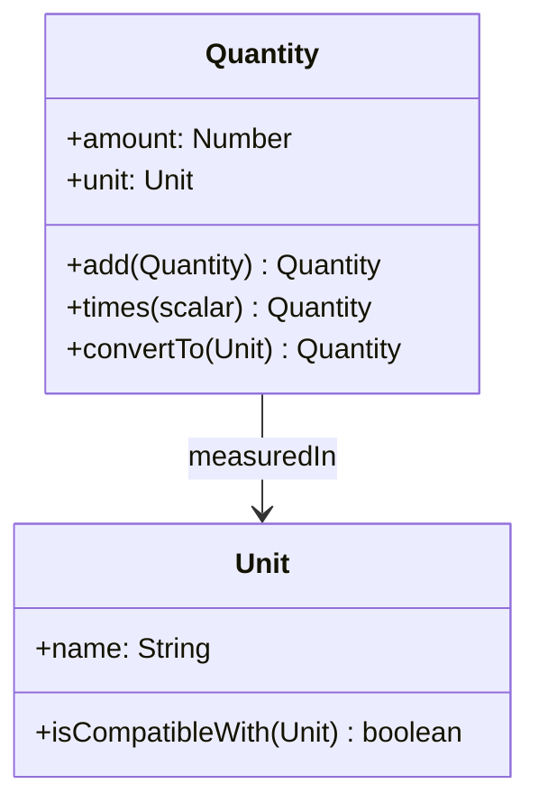

# Quantity 분석 패턴 가이드

> 한 줄 요약: 숫자 값과 그 단위(unit)를 분리할 수 없는 하나의 값 객체(Value Object)로 묶어, 단위가 다른 값의 잘못된 연산을 막고 단위 변환·비교를 안전하게 수행한다.
>
> 분류: 분석 패턴(Analysis Pattern) — 값 모델링(Value) 범주
> 다른 이름(Aliases): Quantity, Money(통화 특화 변형), Measure, Unit-Amount

---

## 상세 설명

업무 도메인의 숫자는 거의 언제나 단위를 동반한다. "5"는 무의미하지만 "5 kg", "5 USD", "5 시간"은 의미가 있다. 그런데 많은 코드가 금액·무게·기간을 그냥 `double`이나 `BigDecimal`로 다룬다. 그 결과 달러와 유로를 그대로 더하거나, 킬로그램과 파운드를 비교하거나, 단위를 주석으로만 표시하다가 혼동이 생기는 사고가 끊이지 않는다(화성 탐사선 사고가 대표적이다).

Quantity 패턴은 "수량 = 숫자 값 + 단위"라는 사실을 모델에 명시한다. 즉 `amount`(수치)와 `unit`(단위)을 한 객체로 묶고, 이 객체를 불변(immutable) 값 객체로 만든다. 두 Quantity를 더하거나 비교하는 연산은 단위가 호환될 때만 허용되며, 호환되지 않으면 변환을 거치거나 예외를 던진다. 이렇게 하면 단위 정합성 검사를 도메인 객체 스스로가 책임진다.

Quantity는 산술의 닫힘성(closure)을 지향한다. Quantity + Quantity는 다시 Quantity여야 하고, Quantity × 스칼라도 Quantity여야 한다. 이런 "연산 결과가 같은 타입"이라는 성질 덕분에 수량을 자연스럽게 합산·집계할 수 있다. 또한 값 객체이므로 동일성은 식별자가 아니라 값(수치+단위)으로 판정된다. "10,000원"이라는 두 객체는 서로 같다.

Fowler는 통화를 다루는 특수한 Quantity를 Money로 따로 제시했는데, 이는 반올림 규칙, 분배(allocation), 환율 변환 같은 통화 고유의 까다로움 때문이다. Quantity는 또한 Measurement·Observation 패턴의 구성 요소가 된다. 측정값은 결국 "현상 + 시점 + Quantity"이기 때문이다. 그래서 Quantity는 분석 패턴 중 가장 재사용도가 높은 기초 값 모델로 꼽힌다.

---

## 디자인 패턴을 충족하는 최소 조건

이 섹션에서는 "어떤 모델이 진짜로 Quantity 패턴이라고 부를 수 있는가"의 기준을 명확히 한다.

1. **값과 단위의 결합** — 수치(amount)와 단위(unit)가 분리되지 않는 하나의 객체로 캡슐화되어, 단위 없는 맨 숫자로 도메인 금액·측정값을 다루지 않아야 한다.
2. **단위 인지 연산** — 더하기·빼기·비교 등의 연산이 단위를 인지하여, 호환되지 않는 단위의 연산을 거부하거나 명시적 변환을 강제해야 한다.
3. **불변 값 객체로서의 동등성** — Quantity는 불변이며, 동일성이 식별자가 아니라 값(수치+단위)으로 판정되어야 한다.

> 위 조건 중 하나라도 빠지면 단순히 숫자를 감싼 래퍼일 뿐, 단위 안전성을 제공하는 Quantity 패턴으로 보기 어렵다.

### 흔히 오해하는 지점
- 단위를 문자열 필드로만 들고 연산 시 검사하지 않는 경우. 단위는 보관되지만 안전성은 전혀 보장되지 않는다.
- 부동소수점(double)으로 금액을 다루며 Quantity라 부르는 경우. 금액은 반올림·정밀도 문제로 정수 최소단위나 BigDecimal 기반이어야 한다.
- Quantity를 가변(mutable)으로 만들어 `add`가 자기 자신을 바꾸게 하는 경우. 값 객체의 의미가 깨진다.

---

## 사례를 통한 예시

### 예시 1: 단위 안전한 금액 연산

**상황**: 주문 합계를 계산할 때 통화가 다른 금액이 섞이는 사고를 막고 싶다.

```java
final class Money {                     // Quantity의 통화 특화 형태
    private final long amountMinor;     // 최소 단위(예: 센트/원), 정수로 정밀도 보장
    private final Currency currency;     // 단위

    Money(long amountMinor, Currency currency) {
        this.amountMinor = amountMinor; this.currency = currency;
    }
    Money add(Money other) {
        requireSameCurrency(other);     // 단위 인지 연산
        return new Money(this.amountMinor + other.amountMinor, currency);
    }
    Money times(int factor) {            // 스칼라 곱 — 결과도 Money (닫힘성)
        return new Money(amountMinor * factor, currency);
    }
    private void requireSameCurrency(Money o) {
        if (!currency.equals(o.currency))
            throw new IllegalArgumentException("통화 불일치: " + currency + " vs " + o.currency);
    }
    @Override public boolean equals(Object o) {
        return o instanceof Money m && m.amountMinor == amountMinor && m.currency.equals(currency);
    }
    @Override public int hashCode() { return Objects.hash(amountMinor, currency); }
}
```

```java
Money a = new Money(1500, Currency.getInstance("KRW"));
Money b = new Money(2500, Currency.getInstance("KRW"));
Money total = a.add(b);                 // OK -> 4000 KRW
// a.add(new Money(10, Currency.getInstance("USD"))); // 예외: 통화 불일치
```

**해설**: 수치(`amountMinor`)와 단위(`currency`)가 한 불변 객체에 묶여 있고, `add`는 통화가 같을 때만 동작한다. 결과는 다시 `Money`이므로 합산이 자연스럽게 이어진다. 동등성은 값으로 판정된다.

### 예시 2: 실제 라이브러리에서의 사용 — javax.measure / Joda-Money

자바 진영의 JSR-385(`javax.measure`, Unit API)는 `Quantity<Q>`를 단위(`Unit<Q>`)와 함께 1급으로 제공하여 길이·질량·시간 등의 단위 안전 연산과 변환을 지원한다. 통화에는 Joda-Money(`org.joda.money.Money`)가 금액+통화를 불변 값 객체로 제공한다.

```java
import javax.measure.Quantity;
import javax.measure.quantity.Mass;
import static tech.units.indriya.unit.Units.KILOGRAM;
import static javax.measure.MetricPrefix.*;

Quantity<Mass> bag  = javax.measure.quantity.... ; // 예: 5 kg
Quantity<Mass> grams = bag.to(GRAM.getUnit());      // 5000 g 로 안전 변환
```

**해설**: 단위가 타입 파라미터(`Mass`)로 표현되어, 질량과 시간을 더하려는 시도는 컴파일 단계에서부터 막힌다. 변환(`to`)은 명시적으로만 일어나므로, Quantity 패턴이 라이브러리 수준에서 단위 안전성을 어떻게 강제하는지 보여준다.

---

## 어떨 때 사용하나

다음과 같은 신호(Symptom)가 보일 때 이 패턴 도입을 고려한다.

- 금액·무게·길이·시간 등 단위가 있는 값을 맨 숫자로 다루다가 단위 혼동·환산 버그가 발생할 때.
- 통화·단위가 여러 종류 섞여 있어 잘못된 연산을 컴파일/런타임에 차단하고 싶을 때.
- 측정·청구·재고처럼 수량을 끊임없이 합산·비교·변환하는 도메인일 때.

### 사용하면 안 되는 경우 (Anti-patterns)

- 단위가 단 하나로 고정되어 절대 변하지 않고 변환도 필요 없는 단순 카운터 같은 경우. 평범한 정수면 충분하다.
- 극단적 성능이 요구되어 값 객체 생성 비용조차 부담되는 핫 루프(이 경우에도 경계에서만 Quantity로 감싸는 절충을 고려).

---

## 장점과 단점, 한계점

### 장점
- **단위 안전성**: 호환되지 않는 단위의 연산을 차단해 금액·측정 사고를 예방한다.
- **명료한 의미**: 값에 단위가 항상 따라붙어 코드의 의도가 분명해진다.
- **합성 용이성**: 연산의 닫힘성 덕분에 합산·집계 파이프라인을 안전하게 구성할 수 있다.

### 단점
- **객체 생성 비용**: 다량의 수치 연산에서 값 객체 생성/GC 부담이 있을 수 있다.
- **변환 규칙 관리**: 단위 간 환율·환산 비율을 어디서 관리할지(특히 통화) 별도 설계가 필요하다.

### 한계점
- 부동소수점 누적 오차를 피하려면 통화는 정수 최소단위/BigDecimal로 다뤄야 하며, 분배(allocation) 시 잔돈 처리 규칙이 필요하다.
- 정적 타입 언어가 아니면 단위 호환성 검사를 런타임에 의존해야 한다.

---

## 정보 표

| 항목 | 값 |
| --- | --- |
| 분류 | 분석 패턴 — 값 모델링(Value) |
| 언어 의존성 | 언어 비의존적 (정적 타입 언어에서 컴파일 타임 단위 검사가 추가로 가능) |
| 활용성(1점~5점) | ★★★★★ (5/5) — 금액·측정을 다루는 거의 모든 도메인에서 기본기로 권장 |
| 학습 난이도 | 하 |
| 자주 함께 쓰이는 패턴 | Measurement, Observation, Range, Account/Transaction |
| 대표 사용 사례 | 통화 금액(Money), 단위 측정값, 재고 수량, 영양/계량 정보 |

---

## Class Diagram



> 다이어그램에 등장하는 각 클래스가 패턴의 어떤 역할(Role)을 담당하는지 위 "상세 설명" 섹션과 1:1로 대응되어야 한다.

### 역할 설명
- **Quantity**: 수치와 단위를 묶은 불변 값 객체. 단위 인지 연산과 변환을 책임진다.
- **Unit**: 측정 단위. 단위 간 호환성·변환 비율 판정의 기준을 제공한다.

---

## 참고 자료
- Martin Fowler, "Analysis Patterns: Reusable Object Models", Addison-Wesley, 1997 — Chapter 3 (Quantity / Observations and Measurements).
- Martin Fowler, "Patterns of Enterprise Application Architecture" — Money 패턴.
- JSR-385 (javax.measure, Units of Measurement API), Joda-Money.
