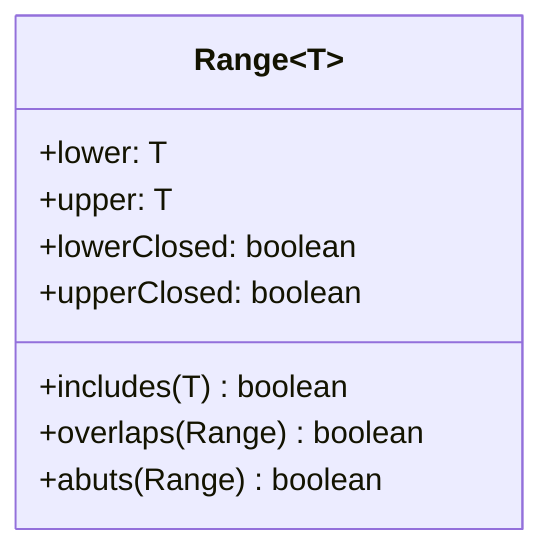

# Range 분석 패턴 가이드

> 한 줄 요약: 시작과 끝으로 정의되는 "구간"을 하나의 값 객체로 캡슐화하여, 포함 여부 판정·겹침·인접 같은 구간 연산을 일관되고 안전하게 제공한다.
>
> 분류: 분석 패턴(Analysis Pattern) — 값 모델링(Value) 범주
> 다른 이름(Aliases): Range, Interval, DateRange/TimePeriod(시간 특화 변형)

---

## 상세 설명

도메인에는 "구간"이 끊임없이 등장한다. 계약 유효 기간(2024-01-01 ~ 2024-12-31), 허용 온도 범위(18°C ~ 24°C), 가격 구간, 나이대, 예약 시간대 등이다. 이런 구간을 두 개의 별도 변수(`startDate`, `endDate`)로 다루면, "이 날짜가 기간 안에 드는가", "두 기간이 겹치는가", "끝이 시작보다 앞서지 않는가" 같은 판정 로직이 시스템 전역에 흩어지고 매번 미묘하게 다르게 구현된다. 경계 포함(inclusive)/제외(exclusive)를 둘러싼 off-by-one 버그도 단골이다.

Range 패턴은 "시작–끝"을 하나의 값 객체로 묶는다. Range는 두 끝점(lower, upper)과 경계 포함 여부를 자신 안에 담고, `includes(value)`, `overlaps(other)`, `abuts(other)`(인접), `gap(other)`(간격) 같은 구간 연산을 메서드로 제공한다. 구간에 관한 지식이 한 객체에 응집되므로, 경계 처리 규칙을 한 곳에서 일관되게 보장할 수 있다.

핵심은 "구간을 1급 개념으로 끌어올린다"는 점이다. 두 끝점을 흩어 놓으면 그것이 한 구간을 이룬다는 사실이 코드에 드러나지 않고, 불변식("시작 ≤ 끝")을 강제할 주체도 없다. Range는 생성 시점에 이 불변식을 검증하고 이후 불변(immutable)으로 유지되므로, 잘못된 구간이 아예 만들어지지 않는다. 동등성은 값(끝점+경계 규칙)으로 판정된다.

Range는 다른 분석 패턴에서 부품처럼 쓰인다. Accountability의 유효 기간, Measurement에서 정상 범위, 가격표의 수량 구간 등이 모두 Range다. 또한 Range는 임의의 비교 가능한 타입(날짜·수치·Quantity)에 대해 일반화할 수 있어, 제네릭 값 객체의 좋은 예가 된다. Fowler는 이를 단순하지만 거의 모든 모델에서 재사용되는 기초 값 패턴으로 소개한다.

---

## 디자인 패턴을 충족하는 최소 조건

이 섹션에서는 "어떤 모델이 진짜로 Range 패턴이라고 부를 수 있는가"의 기준을 명확히 한다.

1. **두 끝점의 단일 객체화** — 시작과 끝(및 경계 포함 규칙)이 하나의 객체로 캡슐화되어, 흩어진 두 변수로 구간을 다루지 않아야 한다.
2. **구간 연산의 제공** — 최소한 포함 여부(`includes`)와 겹침(`overlaps`) 같은 구간 의미 연산을 객체 스스로 제공해야 한다.
3. **불변식 보장과 불변성** — 생성 시 "시작 ≤ 끝" 같은 불변식을 검증하고, 생성 이후 값이 바뀌지 않는 불변 값 객체여야 한다.

> 위 조건 중 하나라도 빠지면 단순한 시작/끝 필드 묶음일 뿐, 구간 의미와 안전성을 제공하는 Range 패턴으로 보기 어렵다.

### 흔히 오해하는 지점
- 경계 포함/제외 규칙을 명시하지 않아, 같은 끝점인데 구현마다 포함 여부가 다른 경우. Range는 이 규칙을 객체에 못 박아야 한다.
- `includes`/`overlaps`를 객체 밖 유틸 함수로 두는 경우. 구간 지식이 분산되어 패턴의 응집 이점이 사라진다.
- 무한·열린 구간(상한 없음)을 표현하지 못해 null로 때우다가 NPE를 만드는 경우. 열린 끝을 명시적으로 모델링해야 한다.

---

## 사례를 통한 예시

### 예시 1: 날짜 구간과 겹침 판정

**상황**: 예약 시스템에서 새 예약 기간이 기존 예약과 겹치는지 검사해야 한다.

```java
final class DateRange {
    private final LocalDate start;       // 포함(inclusive)
    private final LocalDate end;         // 포함(inclusive)

    DateRange(LocalDate start, LocalDate end) {
        if (end.isBefore(start))         // 불변식 검증
            throw new IllegalArgumentException("끝이 시작보다 앞설 수 없음");
        this.start = start; this.end = end;
    }
    boolean includes(LocalDate d) {
        return !d.isBefore(start) && !d.isAfter(end);
    }
    boolean overlaps(DateRange o) {
        return !this.start.isAfter(o.end) && !o.start.isAfter(this.end);
    }
    @Override public boolean equals(Object o) {
        return o instanceof DateRange r && r.start.equals(start) && r.end.equals(end);
    }
    @Override public int hashCode() { return Objects.hash(start, end); }
}
```

```java
DateRange existing = new DateRange(LocalDate.of(2026,6,1), LocalDate.of(2026,6,5));
DateRange request  = new DateRange(LocalDate.of(2026,6,4), LocalDate.of(2026,6,8));
boolean conflict = existing.overlaps(request);   // true
```

**해설**: 시작·끝과 경계 규칙(여기서는 양끝 포함)이 한 객체에 모이고, 겹침 판정 로직도 그 안에 응집된다. 생성자에서 불변식을 검증하므로 "끝이 시작보다 앞선" 잘못된 구간은 존재할 수 없다.

### 예시 2: 실제 라이브러리에서의 사용 — Guava Range / ThreeTen Interval

Google Guava의 `Range<C extends Comparable>`는 경계 타입(open/closed)을 명시적으로 지원하며 `contains`, `encloses`, `intersection`, `span` 등 풍부한 구간 연산을 제공한다. 시간 구간에는 ThreeTen-Extra의 `Interval`이 시각 기반 구간을 다룬다.

```java
import com.google.common.collect.Range;

Range<Integer> normalTemp = Range.closed(18, 24);   // [18, 24]
normalTemp.contains(20);                              // true
normalTemp.contains(25);                              // false
Range<Integer> warm = Range.open(24, 30);            // (24, 30)
normalTemp.isConnected(warm);                         // 인접 여부 판정
```

**해설**: 경계 포함 여부를 `closed`/`open`으로 명시해 off-by-one 모호함을 제거하고, 포함·연결·교집합 연산을 표준화한다. 이는 Range 패턴이 범용 라이브러리로 정착한 형태로, 직접 구현 대신 검증된 구간 연산을 재사용하게 해준다.

---

## 어떨 때 사용하나

다음과 같은 신호(Symptom)가 보일 때 이 패턴 도입을 고려한다.

- 시작/끝 쌍을 여러 곳에서 들고 다니며 "포함/겹침" 판정 코드가 중복·불일치할 때.
- 경계 포함 여부나 off-by-one 때문에 미묘한 버그가 반복될 때.
- 유효 기간·허용 범위·가격 구간처럼 구간 자체가 도메인 1급 개념일 때.

### 사용하면 안 되는 경우 (Anti-patterns)

- 구간 연산이 전혀 필요 없고 단지 두 시점을 기록만 하는 경우(그래도 응집을 위해 묶는 편이 보통 낫다).
- 구간이 단순·일회성이며 표준 라이브러리(Guava 등)로 충분한데 굳이 자체 Range를 새로 구현하는 경우.

---

## 장점과 단점, 한계점

### 장점
- **로직 응집**: 포함·겹침·인접 판정을 한 객체에 모아 일관성과 재사용성을 높인다.
- **불변식 보장**: 생성 시 검증으로 잘못된 구간의 존재를 원천 차단한다.
- **가독성**: `range.includes(x)`가 흩어진 비교식보다 의도를 명확히 드러낸다.

### 단점
- **경계 규칙 설계 부담**: open/closed 조합을 일관되게 정해야 하며, 잘못 정하면 오히려 혼란이 커진다.
- **타입별 일반화 비용**: 날짜·수치·Quantity마다 비교 의미가 달라 제네릭화가 까다로울 수 있다.

### 한계점
- 무한/열린 구간, 빈 구간(empty)의 의미를 명확히 정의하지 않으면 경계 사례에서 오작동한다.
- 이산(discrete) vs 연속(continuous) 구간에서 "인접"의 정의가 달라 주의가 필요하다.

---

## 정보 표

| 항목 | 값 |
| --- | --- |
| 분류 | 분석 패턴 — 값 모델링(Value) |
| 언어 의존성 | 언어 비의존적 (Comparable/비교 연산만 있으면 구현 가능) |
| 활용성(1점~5점) | ★★★★☆ (4/5) — 기간·범위가 등장하는 거의 모든 도메인에서 유용 |
| 학습 난이도 | 하 |
| 자주 함께 쓰이는 패턴 | Quantity, Measurement, Accountability(유효 기간) |
| 대표 사용 사례 | 계약/예약 기간, 허용 측정 범위, 가격·수량 구간, 나이대 |

---

## Class Diagram



> 다이어그램에 등장하는 각 클래스가 패턴의 어떤 역할(Role)을 담당하는지 위 "상세 설명" 섹션과 1:1로 대응되어야 한다.

### 역할 설명
- **Range\<T\>**: 비교 가능한 타입 T에 대한 구간을 표현하는 불변 값 객체. 끝점·경계 규칙을 보유하고 포함·겹침·인접 등 구간 연산을 제공하며 생성 시 불변식을 검증한다.

---

## 참고 자료
- Martin Fowler, "Analysis Patterns: Reusable Object Models", Addison-Wesley, 1997 — Range 논의(Quantity/측정 맥락에서 등장).
- Martin Fowler, Analysis Patterns 소개 페이지: https://martinfowler.com/books/ap.html
- Google Guava `Range`, ThreeTen-Extra `Interval`.
