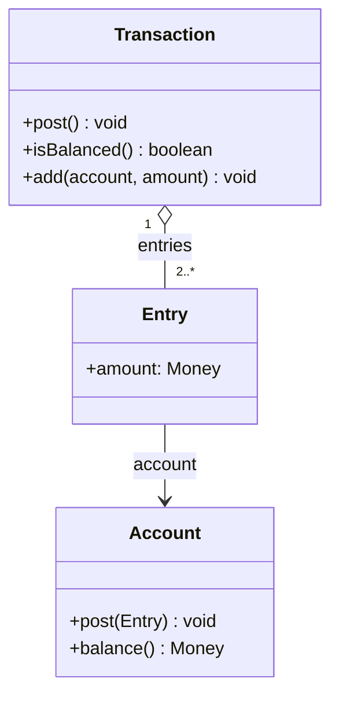

# Transaction 분석 패턴 가이드

> 한 줄 요약: 한 계정에서 빠져나간 금액이 다른 계정으로 정확히 들어가도록, 서로 짝을 이루는 입출금 항목(Entry)들을 합이 0이 되는 하나의 Transaction으로 묶어 가치 보존과 균형을 보장한다.
>
> 분류: 분석 패턴(Analysis Pattern) — 회계/거래(Accounting) 범주
> 다른 이름(Aliases): Transaction, Double-Entry Transaction, Transfer, Two-Legged/Multi-Legged Transaction

---

## 상세 설명

Account 패턴은 한 계정의 잔액을 항목 합으로 안전하게 표현한다. 그러나 현실의 돈은 "어디선가 나와서 어디론가 들어간다". 단일 계정에 출금 항목만 추가하면, 그 돈이 어디로 갔는지 알 수 없고 시스템 전체의 금액 총합이 맞는지 검증할 수 없다. 송금 도중 한쪽 기록만 남고 다른 쪽이 누락되는 부분 실패도 막을 수 없다.

Transaction 패턴은 복식부기(double-entry bookkeeping)를 모델화한다. 하나의 Transaction은 둘 이상의 Entry를 묶되, 그 Entry들의 금액 합이 정확히 0이 되도록 강제한다(한쪽 -10,000원, 다른 쪽 +10,000원). 즉 가치는 생성·소멸하지 않고 계정 사이를 이동할 뿐이라는 보존 법칙을 구조로 표현한다. Transaction은 이 균형이 맞을 때만 성립(post)하며, 모든 Entry가 함께 반영되거나 전부 반영되지 않는 원자성(atomicity)을 가진다.

핵심은 "균형(balance to zero)" 불변식이다. Transaction은 자신이 묶은 모든 Entry의 합이 0임을 확정한 뒤에야 각 계정에 항목을 게시한다. 덕분에 시스템 전체 잔액 총합은 항상 일정하게 유지되고, "돈이 새거나 늘어나는" 버그가 구조적으로 차단된다. 두 다리(two-legged) 이체뿐 아니라, 한 출금이 여러 계정으로 분배되는 다중 다리(multi-legged) 거래도 합이 0이면 동일하게 표현된다.

Transaction은 Account 위에 세워지고, 어떤 거래가 어느 계정에 어떤 부호로 들어가는지를 규칙화하면 Posting Rule 패턴으로 이어진다. 금액은 Quantity/Money로 표현된다. 이 세 패턴(Account–Transaction–Posting Rule)이 금융·정산 시스템의 무결성 골격을 이룬다. Fowler는 이를 기업 금융 모델링의 중심 패턴으로 다룬다.

---

## 디자인 패턴을 충족하는 최소 조건

이 섹션에서는 "어떤 모델이 진짜로 Transaction 패턴이라고 부를 수 있는가"의 기준을 명확히 한다.

1. **다수 항목의 묶음** — 하나의 Transaction이 둘 이상의 Entry를 묶어, 서로 다른 계정에 대한 입출금을 하나의 사건으로 표현해야 한다.
2. **합 0 균형 불변식** — 묶인 Entry들의 금액 합이 정확히 0이 되어야 성립하며, 균형이 맞지 않는 거래는 게시(post)될 수 없어야 한다.
3. **원자적 반영** — 모든 Entry가 함께 각 계정에 반영되거나 전혀 반영되지 않아야 한다(부분 반영 금지).

> 위 조건 중 하나라도 빠지면 단순한 "이체 기록"일 뿐, 가치 보존과 무결성을 보장하는 Transaction 패턴으로 보기 어렵다.

### 흔히 오해하는 지점
- 출금만 기록하고 상대 계정 입금을 누락하는 경우(단식부기). 전체 균형 검증이 불가능해진다.
- 균형 검사 없이 Entry를 각자 게시하는 경우. 합이 0이 아닌 거래가 새어 들어가 총합이 어긋난다.
- Transaction의 원자성을 DB 트랜잭션과만 동일시하는 경우. 도메인 차원의 "전부 또는 전무" 게시 규칙 자체가 패턴의 일부다.

---

## 사례를 통한 예시

### 예시 1: 균형을 강제하는 이체 거래

**상황**: 두 계정 사이의 송금에서 한쪽만 반영되거나 금액이 어긋나는 일을 구조적으로 막고 싶다.

```java
final class Entry {
    final Account account;
    final Money amount;      // 부호로 방향 표현 (출금 -, 입금 +)
    Entry(Account account, Money amount) { this.account = account; this.amount = amount; }
}

class Transaction {
    private final List<Entry> entries = new ArrayList<>();
    private boolean posted = false;

    void add(Account account, Money amount) {
        if (posted) throw new IllegalStateException("게시된 거래는 수정 불가");
        entries.add(new Entry(account, amount));
    }
    void post() {                                  // 균형 검증 후 원자적 게시
        if (!isBalanced())
            throw new IllegalStateException("거래 불균형: 합이 0이 아님");
        for (Entry e : entries) e.account.post(new AccountEntry(e.amount));
        posted = true;
    }
    private boolean isBalanced() {
        return entries.stream().map(e -> e.amount)
                      .reduce(Money.zero(), Money::add)
                      .isZero();
    }
}
```

```java
Transaction t = new Transaction();
t.add(checking, Money.won(-50_000));   // 출금
t.add(savings,  Money.won(+50_000));   // 입금
t.post();   // 합 0 -> 성립. 두 계정에 동시 반영
// 합이 0이 아니면 post()에서 예외 -> 어느 계정에도 반영되지 않음
```

**해설**: `post()`는 `isBalanced()`로 합 0을 확인한 뒤에만 모든 Entry를 각 계정에 게시한다. 균형이 깨지면 어느 계정에도 반영되지 않으므로(원자성), 돈이 새거나 한쪽만 기록되는 사고가 차단된다.

### 예시 2: 실제 사례 — 복식부기 분개와 결제 원장

회계 시스템의 "분개(journal entry)"는 정확히 이 패턴이다. 모든 분개는 차변(debit) 합 = 대변(credit) 합이어야 게시되며, 이 균형이 회계 무결성의 토대다. 핀테크 결제 원장(예: 더블엔트리 기반 결제 서비스)과 블록체인의 UTXO/계정 모델도 "입력 합 = 출력 합" 보존 법칙을 강제한다.

```text
Journal Entry (이체)
  Debit  현금계좌   50,000   (+)
  Credit 예금계좌   50,000   (-)
  ----------------------------------
  합계               0        <- 균형 OK -> 게시
```

**해설**: 차변과 대변의 합이 일치해야만 분개가 성립한다는 수백 년 된 회계 규칙이, Transaction 패턴의 "합 0 불변식"과 동일하다. 결제·원장 시스템이 이 패턴을 따르는 이유는 그것이 금액 무결성을 보장하는 가장 검증된 방법이기 때문이다.

---

## 어떨 때 사용하나

다음과 같은 신호(Symptom)가 보일 때 이 패턴 도입을 고려한다.

- 금액·가치가 계정 사이를 이동하며, 전체 총합이 항상 보존되어야 할 때.
- 이체·정산에서 한쪽만 반영되는 부분 실패를 절대 허용할 수 없을 때.
- 회계·결제·원장처럼 차변/대변 균형이 도메인 규칙으로 요구될 때.

### 사용하면 안 되는 경우 (Anti-patterns)

- 계정이 하나뿐이거나 외부와의 가치 이동 개념이 없는 단순 적립/소모. 이 경우 Account의 단순 항목 추가로 충분하다.
- 균형 보존이 의미 없는 비금전 카운터. 굳이 합 0 제약을 도입하면 모델만 무거워진다.

---

## 장점과 단점, 한계점

### 장점
- **가치 보존 보장**: 합 0 불변식으로 시스템 전체 잔액 총합이 항상 유지된다.
- **원자성**: 모든 다리가 함께 반영되어 부분 실패로 인한 불일치가 없다.
- **추적성**: 한 거래로 묶인 항목들로 "어디서 어디로" 이동했는지가 명확하다.

### 단점
- **구현 복잡도**: 균형 검증·원자적 게시·동시성 제어를 모두 갖춰야 한다.
- **단순 도메인 과설계**: 가치 이동이 없는 곳에 적용하면 불필요한 제약이 된다.

### 한계점
- 다통화 거래에서는 통화별로 균형을 맞추거나 환산 항목을 명시해야 해 복잡해진다.
- 분산 시스템에서 여러 계정이 서로 다른 저장소에 있으면 원자성 확보(분산 트랜잭션/사가)가 어렵다.

---

## 정보 표

| 항목 | 값 |
| --- | --- |
| 분류 | 분석 패턴 — 회계/거래(Accounting) |
| 언어 의존성 | 언어 비의존적 |
| 활용성(1점~5점) | ★★★★☆ (4/5) — 금융·결제·회계의 무결성 핵심이나 비금전 도메인엔 부적합 |
| 학습 난이도 | 중 |
| 자주 함께 쓰이는 패턴 | Account, Posting Rule, Quantity(Money) |
| 대표 사용 사례 | 계좌 이체, 복식부기 분개, 결제 원장, 정산 |

---

## Class Diagram



> 다이어그램에 등장하는 각 클래스가 패턴의 어떤 역할(Role)을 담당하는지 위 "상세 설명" 섹션과 1:1로 대응되어야 한다.

### 역할 설명
- **Transaction**: 합이 0이 되는 Entry들을 묶어 균형을 검증하고 원자적으로 게시하는 거래.
- **Entry**: 특정 계정에 대한 한쪽 입출금(다리). 금액(Money)과 대상 계정을 가진다.
- **Account**: Entry가 게시되는 대상 계정(Account 패턴 참조).

---

## 참고 자료
- Martin Fowler, "Analysis Patterns: Reusable Object Models", Addison-Wesley, 1997 — Chapter 6 (Inventory and Accounting), Transaction.
- Martin Fowler, Analysis Patterns 소개 페이지: https://martinfowler.com/books/ap.html
- 복식부기(Double-entry bookkeeping), 결제 원장(Ledger) 아키텍처.
