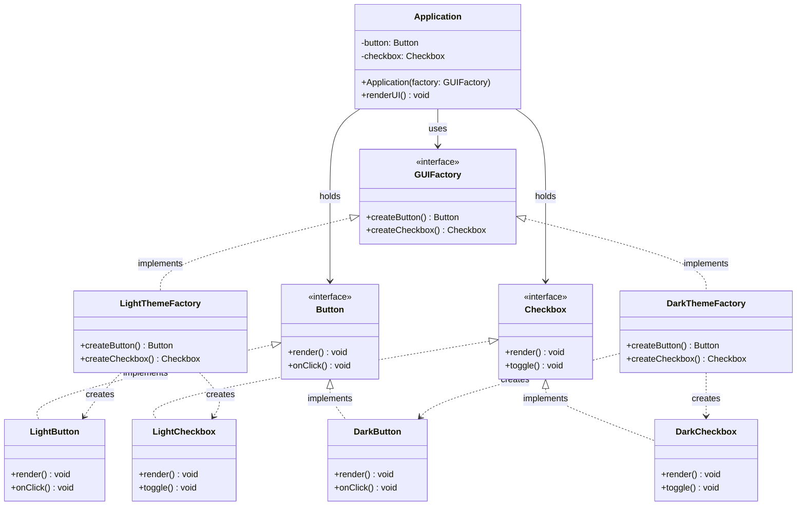

# 추상 팩토리(Abstract Factory) 디자인 패턴 가이드

> 한 줄 요약: 서로 연관되거나 의존적인 객체들의 "제품군(Family)"을 구체 클래스를 노출하지 않고 일관성 있게 생성하기 위한 인터페이스를 제공하는 생성 패턴이다.
>
> 분류: 생성 패턴(Creational Pattern)
> 다른 이름(Aliases): Kit

---

## 상세 설명

추상 팩토리(Abstract Factory) 패턴은 GoF가 정의한 23개 디자인 패턴 중 하나로, "관련된 객체들의 묶음(제품군, Family of Products)"을 함께 만들어야 하는 상황을 다룬다. 의도(Intent)는 명확하다 — 구체 클래스(Concrete Class)를 클라이언트 코드에 노출하지 않으면서, 서로 짝이 맞는 객체들을 일관성 있게 생성할 수 있는 인터페이스를 제공한다. 핵심 비유로 자주 등장하는 "Kit"이라는 별칭은, 제품 하나를 만드는 것이 아니라 "함께 쓰여야 하는 부품 한 세트"를 한 번에 공급한다는 점을 잘 드러낸다.

해결하고자 하는 문제(Problem)는 두 가지 차원이 동시에 존재할 때 발생한다. 첫째, 시스템이 여러 종류의 제품(예: Button, Checkbox, Scrollbar)을 만들어 사용한다. 둘째, 그 제품들에는 서로 다른 변형(Variant)(예: Light 테마용, Dark 테마용)이 존재하며, 한 번 변형이 결정되면 모든 제품은 같은 변형으로 통일되어야 한다. Dark 테마 윈도에 Light 테마 버튼이 섞이면 외관과 동작 모두 깨진다. 이 "제품군 일관성(Family Consistency)" 요구가 추상 팩토리의 존재 이유다.

해결책(Solution)은 다음과 같다. 먼저 각 제품 종류마다 추상 제품(Abstract Product) 인터페이스를 정의한다(예: `Button`, `Checkbox`). 그다음, 그 모든 제품의 생성 메서드를 한 인터페이스 위에 모아둔 추상 팩토리(Abstract Factory)를 정의한다(예: `GUIFactory.createButton()`, `createCheckbox()`). 마지막으로 제품군마다 한 개의 구체 팩토리(Concrete Factory)를 두어(예: `LightThemeFactory`, `DarkThemeFactory`) 그 팩토리가 자기 변형에 맞는 구체 제품만 생산하게 한다. 클라이언트(Client)는 구체 팩토리/제품을 모르고 오직 추상 인터페이스만 사용하므로, 런타임에 어떤 팩토리 인스턴스를 주입하느냐만으로 전체 제품군이 한꺼번에 교체된다.

이 구조의 핵심 개념은 "두 계층의 추상화"다. 한 계층은 제품 자체의 추상화(Abstract Product), 다른 계층은 제품을 만드는 행위의 추상화(Abstract Factory)다. 이 둘이 결합되어 "어떤 변형인지"라는 정보가 단 하나의 팩토리 객체 선택으로 결정되고, 그 결정이 모든 후속 객체 생성에 자동으로 전파된다. 즉, 추상 팩토리는 "변형의 결정 지점"을 시스템 전체에서 한 곳으로 응집시킨다.

역사적으로 추상 팩토리는 GoF(1994)에서 크로스-플랫폼 GUI 툴킷(예: Motif, Presentation Manager)을 대표 예시로 소개되었다. 이후 자바 진영의 `javax.xml.parsers.DocumentBuilderFactory`, `javax.xml.transform.TransformerFactory`, JDBC의 `Connection` 계열 등 표준 라이브러리에서 광범위하게 채택되었다. 또한 의존성 주입(Dependency Injection) 컨테이너가 보편화되면서 "팩토리를 직접 작성"하기보다 "팩토리 역할을 컨테이너에 위임"하는 방식으로 변형되어 사용되는 경우도 많다.

---

## 디자인 패턴을 충족하는 최소 조건

이 섹션에서는 "어떤 코드가 진짜로 추상 팩토리 패턴이라고 부를 수 있는가"의 기준을 명확히 한다.

1. **복수의 제품 종류를 한 인터페이스가 함께 생성한다(Family of Products)** — 추상 팩토리 인터페이스에는 서로 다른 종류의 객체를 만드는 생성 메서드(Creation Method)가 둘 이상 모여 있어야 한다. 단 하나의 `createX()`만 있다면 그것은 팩토리 메서드(Factory Method)이지 추상 팩토리가 아니다.
2. **추상 제품(Abstract Product) 인터페이스가 존재한다** — 각 제품 종류는 인터페이스 혹은 추상 클래스로 추상화되어 있어야 하며, 클라이언트는 구체 제품 타입을 직접 참조하지 않는다. 반환 타입이 `Button` 같은 추상이 아니라 `LightButton` 같은 구체 타입이라면 추상화의 의미가 사라진다.
3. **변형(Variant)별 구체 팩토리(Concrete Factory)가 분리되어 있다** — 변형이 두 개 이상 존재하고, 각 변형마다 그 변형에 속하는 구체 제품만 생산하는 별도의 구체 팩토리 클래스가 존재해야 한다. 한 팩토리 클래스 안에서 `if (theme == LIGHT)` 분기로 변형을 처리한다면 추상 팩토리 구조가 아니라 단순 조건 분기다.
4. **제품군 내 일관성이 보장된다** — `factory.createButton()`과 `factory.createCheckbox()`가 반환한 객체는 반드시 같은 변형 계열이어야 한다. 클라이언트가 변형이 섞인 조합을 받을 수 있다면 패턴의 목적이 무너진다.
5. **클라이언트는 추상 팩토리에만 의존한다** — 클라이언트 코드는 `new ConcreteFactory()`를 직접 호출하지 않고, 외부에서 주입받거나(보통 생성자/설정) 단 한 곳에서만 인스턴스화한다. 그렇지 않으면 "변형 결정 지점을 한 곳에 모은다"는 효과가 사라진다.

> 위 조건 중 하나라도 빠지면 본 패턴이라고 보기 어렵거나, 팩토리 메서드(Factory Method)·심플 팩토리(Simple Factory) 등 변형으로 분류된다.

### 흔히 오해하는 지점

- **팩토리 메서드(Factory Method)와의 혼동**: 팩토리 메서드는 "한 종류의 제품을 어떻게 만들지를 서브클래스에 위임"하는 패턴이고, 추상 팩토리는 "여러 종류의 제품 묶음을 어떻게 만들지를 팩토리 객체 자체에 위임"하는 패턴이다. 추상 팩토리는 내부 구현 단계에서 각각의 `createX()`가 팩토리 메서드로 구현되는 경우가 흔하지만, 둘은 의도의 층위가 다르다.
- **이름에 "Factory"가 들어가면 모두 추상 팩토리라는 오해**: `LoggerFactory`, `BeanFactory`처럼 이름에 Factory가 들어가도 단일 종류의 객체만 생성한다면 추상 팩토리가 아니다. 제품군 일관성 요구가 없으면 단순한 정적 팩토리(Static Factory) 혹은 팩토리 메서드다.
- **빌더(Builder)와의 혼동**: 빌더는 "한 개의 복잡한 객체를 단계별로 조립"하는 데 초점이 있고, 추상 팩토리는 "여러 개의 독립적인 객체를 한 번씩 생산"하는 데 초점이 있다. 단계(Step) 개념의 유무가 결정적 차이다.
- **조건 분기로 위장된 가짜 추상 팩토리**: 팩토리 클래스를 하나 만들어 놓고 내부에서 `switch (theme)`로 분기하여 다른 제품들을 반환한다면, 변형이 추가될 때마다 모든 메서드의 분기를 수정해야 한다. 이는 OCP(Open-Closed Principle)를 위반하며 추상 팩토리의 핵심 이득을 잃은 형태다.

---

## 사례를 통한 예시

### 예시 1: GUI 테마(Light/Dark) 위젯 키트

**상황**: 동일한 애플리케이션을 Light 테마와 Dark 테마로 동시에 지원해야 한다. 화면을 구성하는 `Button`과 `Checkbox`는 테마마다 다르게 렌더링되며, 한 화면에는 항상 동일 테마의 위젯만 섞여야 한다. 사용자가 설정에서 테마를 바꾸면 전체 위젯이 한꺼번에 교체된다.

```java
// === 1) 추상 제품(Abstract Product) ===
interface Button {
    void render();
    void onClick();
}

interface Checkbox {
    void render();
    void toggle();
}

// === 2) 구체 제품(Concrete Product) - Light 변형 ===
class LightButton implements Button {
    @Override public void render() { System.out.println("[Light] Button rendered"); }
    @Override public void onClick() { System.out.println("[Light] Button clicked"); }
}

class LightCheckbox implements Checkbox {
    @Override public void render() { System.out.println("[Light] Checkbox rendered"); }
    @Override public void toggle() { System.out.println("[Light] Checkbox toggled"); }
}

// === 2) 구체 제품(Concrete Product) - Dark 변형 ===
class DarkButton implements Button {
    @Override public void render() { System.out.println("[Dark] Button rendered"); }
    @Override public void onClick() { System.out.println("[Dark] Button clicked"); }
}

class DarkCheckbox implements Checkbox {
    @Override public void render() { System.out.println("[Dark] Checkbox rendered"); }
    @Override public void toggle() { System.out.println("[Dark] Checkbox toggled"); }
}

// === 3) 추상 팩토리(Abstract Factory) ===
interface GUIFactory {
    Button createButton();
    Checkbox createCheckbox();
}

// === 4) 구체 팩토리(Concrete Factory) ===
class LightThemeFactory implements GUIFactory {
    @Override public Button createButton() { return new LightButton(); }
    @Override public Checkbox createCheckbox() { return new LightCheckbox(); }
}

class DarkThemeFactory implements GUIFactory {
    @Override public Button createButton() { return new DarkButton(); }
    @Override public Checkbox createCheckbox() { return new DarkCheckbox(); }
}

// === 5) 클라이언트(Client) ===
class Application {
    private final Button button;
    private final Checkbox checkbox;

    // 변형 결정은 외부(주입)에서 단 한 번만 이뤄진다.
    public Application(GUIFactory factory) {
        this.button = factory.createButton();
        this.checkbox = factory.createCheckbox();
    }

    public void renderUI() {
        button.render();
        checkbox.render();
    }

    public static void main(String[] args) {
        String theme = System.getProperty("theme", "light");
        GUIFactory factory = theme.equals("dark")
            ? new DarkThemeFactory()
            : new LightThemeFactory();

        new Application(factory).renderUI();
    }
}
```

**해설**: `Button`/`Checkbox`는 추상 제품(Abstract Product), `LightButton`/`DarkButton` 등은 구체 제품(Concrete Product)이다. `GUIFactory`가 추상 팩토리(Abstract Factory)이며, `LightThemeFactory`/`DarkThemeFactory`가 구체 팩토리(Concrete Factory)에 해당한다. 클라이언트인 `Application`은 어떤 구체 클래스도 알지 못한 채 오직 `GUIFactory` 인터페이스에만 의존한다. 테마 변형이 추가되면(예: HighContrast) 새로운 구체 팩토리와 구체 제품 클래스를 추가하기만 하면 되고, 기존 `Application` 코드는 한 줄도 수정되지 않는다. 또한 `LightThemeFactory`가 반환하는 모든 객체가 Light 계열이라는 점에서 제품군 일관성이 컴파일 타임에 사실상 보장된다.

### 예시 2: 표준 라이브러리에서의 사용 — `javax.xml.parsers.DocumentBuilderFactory`

**상황**: 자바 표준 XML API는 환경에 따라 서로 다른 XML 파서 구현체(Xerces, Crimson, Aalto 등)를 갈아 끼울 수 있어야 한다. 또한 XML 파싱에 필요한 객체는 `DocumentBuilder` 하나가 아니라 그와 짝이 맞는 다른 구성요소들이며, 한 번 구현체를 선택하면 그 모든 구성요소가 같은 구현체로 통일되어야 한다. 이 구조는 추상 팩토리의 전형이다.

```java
import javax.xml.parsers.DocumentBuilder;
import javax.xml.parsers.DocumentBuilderFactory;
import org.w3c.dom.Document;
import java.io.ByteArrayInputStream;
import java.nio.charset.StandardCharsets;

public class XmlParsingExample {
    public static void main(String[] args) throws Exception {
        // 1) 추상 팩토리 인스턴스 획득
        //    - 어떤 구체 팩토리가 반환될지는 시스템 프로퍼티/META-INF/services 등으로 결정된다.
        //    - 클라이언트는 구체 클래스명을 전혀 모른다.
        DocumentBuilderFactory factory = DocumentBuilderFactory.newInstance();
        factory.setNamespaceAware(true);

        // 2) 추상 팩토리로부터 추상 제품 생성
        DocumentBuilder builder = factory.newDocumentBuilder();

        // 3) 같은 팩토리에서 만든 제품들끼리 일관성 있게 협력
        String xml = "<note><to>Reader</to><body>Hello</body></note>";
        Document doc = builder.parse(
            new ByteArrayInputStream(xml.getBytes(StandardCharsets.UTF_8))
        );

        System.out.println("Root element: " + doc.getDocumentElement().getNodeName());
    }
}
```

**해설**: `DocumentBuilderFactory`가 바로 추상 팩토리(Abstract Factory)이며, `newDocumentBuilder()`는 추상 제품(Abstract Product)인 `DocumentBuilder`를 생산한다. 같은 패키지의 `SAXParserFactory` 역시 동일한 구조다. `DocumentBuilderFactory.newInstance()` 호출 시 JVM은 시스템 프로퍼티(`javax.xml.parsers.DocumentBuilderFactory`), `META-INF/services`의 SPI 메타데이터, JDK 기본값을 차례로 확인해 구체 팩토리(Concrete Factory) 구현체를 결정한다. 즉, 클라이언트 코드는 구체 클래스명을 한 줄도 적지 않고도 런타임에 XML 파서 전체 묶음을 교체할 수 있다. 이는 추상 팩토리가 "구현체 교체 가능성"과 "제품군 일관성"이라는 두 목적을 어떻게 동시에 달성하는지를 보여주는 표준 라이브러리 레벨의 모범 사례다.

---

## 어떨 때 사용하나

추상 팩토리는 단순히 "객체 생성을 캡슐화하고 싶다"는 동기로 도입하는 패턴이 아니다. 도입을 정당화하려면 "여러 종류의 객체"와 "그 객체들 사이의 변형 일관성"이라는 두 조건이 동시에 필요하다. 다음과 같은 신호(Symptom)가 보일 때 도입을 고려한다.

- **변형이 둘 이상 존재하고, 각 변형이 여러 객체에 걸쳐 있을 때**: GUI의 Light/Dark 테마, OS별(Windows/macOS/Linux) 위젯, 데이터베이스 종류별(MySQL/PostgreSQL/Oracle) Connection·Statement·ResultSet 묶음처럼, 하나의 변형 결정이 여러 객체 종류에 동시 영향을 줄 때 가장 효과적이다.
- **클라이언트 코드 전반에 구체 클래스 이름이 흩어져 있을 때**: `new LightButton()`, `new LightCheckbox()`가 곳곳에 직접 등장하고 있고, 다른 변형으로 교체해야 할 가능성이 있다면 추상 팩토리로 "변형 결정 지점"을 한 곳에 모으는 것이 적절하다.
- **제품들이 짝이 맞아야 한다는 도메인 제약이 명확할 때**: 한 화면에 Light 버튼과 Dark 체크박스가 섞이는 것이 명백한 버그라면, 컴파일·구조 수준에서 그 잘못된 조합을 막을 수단이 필요하다. 추상 팩토리는 변형 혼합을 사실상 불가능하게 만든다.
- **실행 시점에 변형이 결정되어야 할 때**: 설정 파일, 환경 변수, 사용자 선택 등에 따라 어떤 구현체를 쓸지가 런타임에 정해진다면, 그 결정을 단일 객체(팩토리)의 선택으로 환원할 수 있는 추상 팩토리가 잘 맞는다.
- **라이브러리/프레임워크가 구현체 교체 가능성을 약속해야 할 때**: JAXP, JDBC처럼 SPI(Service Provider Interface) 형태로 다양한 벤더 구현을 허용해야 하는 경우, 추상 팩토리는 가장 자연스러운 골격이다.

### 사용하면 안 되는 경우 (Anti-patterns)

- **제품 종류가 단 하나일 때**: 만들 객체 종류가 `Logger` 하나뿐이라면 추상 팩토리는 과잉이다. 팩토리 메서드(Factory Method) 또는 단순한 정적 팩토리(Static Factory)로 충분하다.
- **변형이 하나뿐이거나 추가될 가능성이 거의 없을 때**: 미래에 변형이 늘어날 가능성이 사실상 0이라면, 인터페이스 두 계층(제품·팩토리)을 도입하는 비용이 이득을 초과한다. YAGNI(You Aren't Gonna Need It) 위반이 된다.
- **제품군에 새로운 제품 종류가 자주 추가되는 경우**: 추상 팩토리 인터페이스에 새 `createX()` 메서드를 추가하면 모든 구체 팩토리가 영향을 받는다. "제품 종류"가 자주 늘어나는 도메인이라면 오히려 OCP를 깨뜨린다. 이때는 Prototype/Registry 기반 생성 등 다른 전략을 고려한다.
- **단순 조건 분기로 충분한 경우**: `if (env.isDev()) return new MockX(); else return new RealX();` 수준의 한두 줄 분기를, 5개 클래스로 풀어 헤치는 것은 명백한 과한 추상화다.
- **DI 컨테이너가 이미 동일 역할을 수행 중일 때**: Spring 같은 DI 프레임워크에 빈(Bean)으로 등록되어 프로파일·조건부 빈으로 변형이 결정되고 있다면, 그 위에 또 한 겹의 수동 추상 팩토리를 두는 것은 중복이다.

---

## 장점과 단점, 한계점

### 장점

- **구체 클래스로부터 클라이언트를 분리한다(Decoupling)**: 클라이언트 코드는 오직 추상 제품과 추상 팩토리 인터페이스만 본다. 구체 클래스가 교체되어도 클라이언트는 영향을 받지 않는다.
- **제품군 일관성을 구조적으로 보장한다(Family Consistency)**: 한 구체 팩토리는 자기 변형의 제품만 반환하도록 작성되므로, 변형이 섞이는 실수가 컴파일·설계 수준에서 사전 차단된다.
- **변형 결정 지점을 단일화한다(Single Switch Point)**: 어떤 변형을 쓸지를 결정하는 코드가 시스템 전체에서 단 한 곳(팩토리 인스턴스 선택)으로 응집된다. 변형 추가/교체의 영향 범위가 명확하다.
- **새로운 변형 추가가 용이하다(OCP 충족, 변형 축에 한해)**: 새로운 변형이 필요할 때 기존 코드를 수정하지 않고 새로운 구체 팩토리와 구체 제품들을 추가하는 것만으로 확장된다.
- **테스트 더블 주입이 자연스럽다**: 테스트에서 Mock/Stub 변형의 팩토리를 주입하면, 시스템 전반의 객체 생성을 일관되게 테스트용으로 바꿀 수 있다.

### 단점

- **클래스 수가 급격히 증가한다**: 제품 종류 N개, 변형 M개라면 최소 N개의 추상 제품 + N×M개의 구체 제품 + 1개의 추상 팩토리 + M개의 구체 팩토리가 필요하다. 작은 시스템에서는 비용 대비 이득이 떨어진다.
- **새로운 "제품 종류" 추가가 어렵다(OCP 위반, 종류 축)**: 새로운 제품 종류(예: 기존 Button/Checkbox에 더해 Slider를 추가)가 필요해지면, 추상 팩토리 인터페이스 자체와 모든 구체 팩토리에 새 메서드를 추가해야 한다. 추상 팩토리는 "변형 축"에는 열려 있지만 "제품 종류 축"에는 닫혀 있다.
- **간접화로 인한 가독성 저하**: 단순한 객체 생성을 따라가려면 인터페이스, 추상 팩토리, 구체 팩토리, 구체 제품을 모두 거쳐야 한다. 소규모 프로젝트에서는 코드를 읽기 어렵게 만들 수 있다.
- **초기 설계 비용이 높다**: 어떤 객체들을 한 묶음으로 묶을지, 변형 축이 무엇인지를 처음부터 결정해야 한다. 잘못 묶으면 이후 리팩토링 비용이 크다.

### 한계점

- **"제품 종류"와 "변형"의 두 축이 균형 잡혀 있어야 한다**: 한 축이 자주 변하는 도메인에서는 추상 팩토리가 오히려 변경 비용을 키운다. 두 축의 변화 빈도를 가늠하지 않고 도입하면 곧 깨진다.
- **언어/플랫폼 제약**: 자바·C#처럼 인터페이스와 다형성이 기본 지원되는 언어에서는 자연스럽지만, 동적 타입 언어에서는 굳이 클래스를 N×M개 만들지 않고도 클로저·딕셔너리·고차 함수로 동일 효과를 달성할 수 있어 패턴의 "필요성" 자체가 낮아진다.
- **DI 컨테이너와의 역할 중복**: 현대적 프레임워크에서는 컨테이너가 변형별 빈 그래프(Profile, Conditional Bean)를 구성해 주므로, 동일 책임을 수동 추상 팩토리로 또 한 번 구현하면 책임이 두 곳에 분산되어 유지 보수성이 떨어진다.
- **테스트의 단위 격리는 여전히 별도 노력 필요**: 추상 팩토리가 통합 테스트에서 변형 교체를 쉽게 해 주지만, 한 구체 제품의 단위 테스트는 여전히 그 클래스 자체를 대상으로 별도로 작성해야 한다.

---

## 정보 표

| 항목 | 값 |
| --- | --- |
| 분류 | 생성 패턴(Creational Pattern) |
| 언어 의존성 | 언어 비의존적. 단, 인터페이스(또는 추상 클래스)와 다형성을 지원하는 객체지향 언어에서 자연스럽다. 동적 타입 언어에서는 클로저·딕셔너리로 대체되는 경우가 많다. |
| 활용성(1점~5점) | ★★★★☆ (4/5) — 크로스-플랫폼 UI, JAXP/JDBC 같은 SPI 기반 표준 API, 환경별 구현체 교체 등 실무 빈도가 높다. 단, "변형 축"이 분명한 도메인에서만 빛난다. |
| 학습 난이도 | 중. 팩토리 메서드(Factory Method)와의 차이를 정확히 잡는 것이 핵심 난관이다. |
| 자주 함께 쓰이는 패턴 | 팩토리 메서드(Factory Method, 내부 구현 수단), 싱글턴(Singleton, 팩토리 인스턴스 관리), 프로토타입(Prototype, 변형 추가 비용 절감), 빌더(Builder, 복잡한 단일 제품 생성과 결합) |
| 대표 사용 사례 | `javax.xml.parsers.DocumentBuilderFactory`, `javax.xml.parsers.SAXParserFactory`, `javax.xml.transform.TransformerFactory`, 크로스-플랫폼 GUI 툴킷(Swing의 Look & Feel) |

---

## Class Diagram



> 다이어그램에 등장하는 각 클래스가 패턴의 어떤 역할(Role)을 담당하는지 위 "상세 설명" 섹션과 1:1로 대응된다.

### 역할 설명

- **GUIFactory**: 추상 팩토리(Abstract Factory). 제품군 전체의 생성 메서드를 한곳에 선언하는 인터페이스다. 클라이언트는 오직 이 타입에만 의존한다.
- **LightThemeFactory / DarkThemeFactory**: 구체 팩토리(Concrete Factory). 각자 자기 변형(Light/Dark)에 속하는 구체 제품만 생산한다. 변형 추가는 이 계층에 새 클래스를 추가하는 것으로 이뤄진다.
- **Button / Checkbox**: 추상 제품(Abstract Product). 클라이언트가 사용할 제품의 표준 동작을 선언한다. 클라이언트는 구체 제품 타입을 직접 알지 못한다.
- **LightButton / LightCheckbox / DarkButton / DarkCheckbox**: 구체 제품(Concrete Product). 각자 한 변형에 속하며 추상 제품 인터페이스를 구현한다. 같은 변형의 구체 제품들은 함께 협력해 일관된 동작을 제공한다.
- **Application**: 클라이언트(Client). 어떤 구체 클래스가 실제로 주입되었는지 모른 채 추상 팩토리와 추상 제품만으로 동작한다. 변형 결정 지점은 이 클래스의 생성 시점, 단 한 곳이다.

---

## 참고 자료

- 원전: Erich Gamma, Richard Helm, Ralph Johnson, John Vlissides (Gang of Four), "Design Patterns: Elements of Reusable Object-Oriented Software", Addison-Wesley, 1994 — Chapter 3, "Abstract Factory".
- Refactoring.Guru, "Abstract Factory" — https://refactoring.guru/design-patterns/abstract-factory
- Oracle Java Platform SE Documentation, `javax.xml.parsers.DocumentBuilderFactory` — https://docs.oracle.com/javase/8/docs/api/javax/xml/parsers/DocumentBuilderFactory.html
- Joshua Bloch, "Effective Java" (3rd ed.), Item 1 "Consider static factory methods instead of constructors" — 추상 팩토리와의 대비를 통해 정적 팩토리·팩토리 메서드의 위치를 이해하는 데 유용하다.
- Wikipedia, "Abstract factory pattern" — https://en.wikipedia.org/wiki/Abstract_factory_pattern
