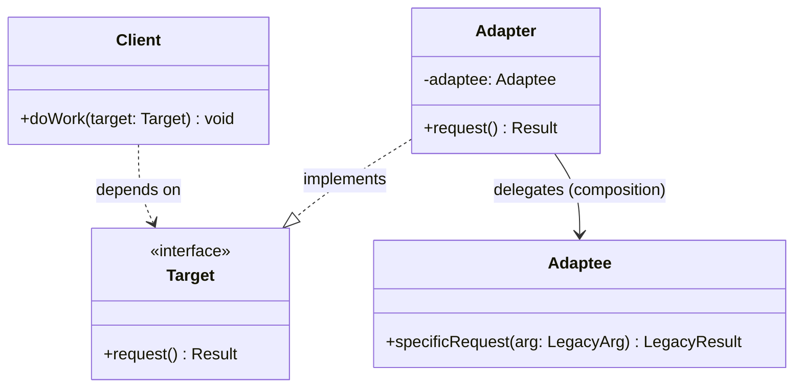

# 어댑터(Adapter) 디자인 패턴 가이드

> 한 줄 요약: 서로 호환되지 않는 인터페이스(Interface)를 가진 클래스들이 함께 동작할 수 있도록, 한쪽의 인터페이스를 다른 쪽이 기대하는 형태로 변환해 주는 중간 객체(Wrapper)를 두는 패턴.
>
> 분류: 구조 패턴(Structural Pattern)
> 다른 이름(Aliases): Wrapper(래퍼)

---

## 상세 설명

어댑터 패턴(Adapter Pattern)은 이미 존재하는 클래스(Adaptee)의 기능을 그대로 활용하고 싶지만, 클라이언트(Client)가 기대하는 인터페이스와 시그니처(Signature)가 일치하지 않을 때 사용된다. GoF는 이 패턴의 의도(Intent)를 "클래스의 인터페이스를 클라이언트가 기대하는 다른 인터페이스로 변환한다. 어댑터는 호환되지 않는 인터페이스들 때문에 함께 동작할 수 없는 클래스들이 함께 일할 수 있게 한다"라고 정의한다.

실무에서 가장 흔하게 등장하는 동기는 두 가지다. 첫째, 외부에서 들여온 라이브러리(Legacy / Third-party Library)의 인터페이스를 자사 도메인 인터페이스에 맞춰야 할 때. 둘째, 이미 운영 중인 레거시 코드를 새 시스템에 통합할 때 기존 호출 규약(Calling Convention)을 흔들지 않으면서 변환 계층(Translation Layer)을 끼워 넣어야 할 때다. 어댑터는 이 변환 책임을 단일 객체에 캡슐화(Encapsulation)해, 클라이언트와 어댑티(Adaptee) 어느 쪽도 수정하지 않는다.

핵심 용어는 네 가지다. **Target(타겟)**은 클라이언트가 사용하는 도메인 고유 인터페이스, **Adaptee(어댑티)**는 변환 대상이 되는 기존 클래스, **Adapter(어댑터)**는 Target을 구현하면서 내부적으로 Adaptee를 호출해 변환을 수행하는 객체, 그리고 **Client(클라이언트)**는 Target 인터페이스를 통해서만 협력하는 호출자다.

구현 방식에 따라 두 가지 변형이 있다.

- **Object Adapter(객체 어댑터)**: 어댑터가 Adaptee를 **합성(Composition)**으로 보유하고, Target 인터페이스를 구현한다. 다중 상속이 없는 언어(Java, C#)에서 표준적으로 사용된다. Adaptee의 서브클래스에도 자동으로 적용되어 유연성이 높다.
- **Class Adapter(클래스 어댑터)**: 어댑터가 Target과 Adaptee를 **동시에 상속(Multiple Inheritance)**한다. C++처럼 다중 상속을 지원하는 언어에서 가능하다. Java/Kotlin에서는 인터페이스 상속과 단일 구현 상속을 조합한 변형으로만 부분적으로 흉내 낼 수 있다. Adaptee의 protected 멤버에 직접 접근할 수 있는 대신, 구체 클래스에 종속(Coupling)되어 다른 Adaptee 서브클래스에는 적용되지 않는다.

대부분의 현대 Java/Kotlin/Swift/TypeScript 코드베이스에서 어댑터라고 하면 사실상 Object Adapter를 의미한다.

---

## 디자인 패턴을 충족하는 최소 조건

이 섹션에서는 "어떤 코드가 진짜로 어댑터 패턴이라고 부를 수 있는가"의 기준을 명확히 한다.

1. **변환 대상이 둘 이상의 인터페이스로 분리되어 있다** — 클라이언트가 의존하는 Target 인터페이스(또는 추상 클래스)와, 실제 기능을 제공하는 Adaptee 클래스가 별도로 존재해야 한다. 이 둘의 시그니처(Signature)는 일치하지 않는다.
2. **어댑터가 Target 인터페이스를 구현(Implements/Extends)한다** — 클라이언트는 오직 Target 타입을 통해서만 어댑터를 다룬다. 어댑터의 구체 타입을 클라이언트가 알면 캡슐화가 깨진 것이다.
3. **어댑터 내부에서 Adaptee를 호출해 시그니처/데이터 형식을 변환한다** — 단순 위임(Delegation)이라도 메서드 이름/파라미터 형식/반환 타입 중 최소 하나의 차이를 메우는 변환 코드가 어댑터 안에 존재해야 한다. 1:1로 그대로 넘기기만 한다면 사실상 프록시(Proxy)에 가깝다.
4. **Client와 Adaptee가 서로를 직접 알지 못한다** — Client는 Adaptee 타입을 import 하지 않고, Adaptee 역시 Target/Client의 존재를 알지 못한다. 변환 책임이 어댑터 한 곳에 모여야 한다.

> 위 조건 중 하나라도 빠지면 어댑터 패턴이라고 보기 어렵다. 특히 2, 4번을 모두 만족하지 못하면 단순한 유틸리티 변환 함수에 가깝다.

### 흔히 오해하는 지점

- **Facade(파사드)와의 혼동**: 파사드는 "여러 개의 복잡한 서브시스템(Subsystem)을 새로 정의한 단순 인터페이스로 묶어서 노출"하는 데 목적이 있다. 어댑터는 "이미 정의된 인터페이스(Target)에 맞추도록 변환"하는 데 목적이 있다. 파사드는 새 인터페이스를 만들고, 어댑터는 기존 인터페이스에 끼워 맞춘다.
- **Decorator(데코레이터)와의 혼동**: 데코레이터는 Target과 Adaptee의 인터페이스가 **동일**하며, 동작을 보강(추가/감싸기)하는 것이 목적이다. 어댑터는 인터페이스가 **다르며**, 변환이 목적이다. 시그니처가 그대로라면 데코레이터, 시그니처가 바뀐다면 어댑터다.
- **Proxy(프록시)와의 혼동**: 프록시 역시 Target과 Adaptee(RealSubject)의 인터페이스가 동일하다. 프록시는 접근 제어/지연 로딩 등이 목적이고 시그니처는 보존된다.
- **DTO 매핑(Mapping) ≠ Adapter**: 두 객체 간 필드만 옮겨주는 단순 매퍼(Mapper)는 어댑터의 한 변형으로 볼 수도 있지만, "클라이언트가 Target 인터페이스를 통해 어댑터를 호출"하는 구조가 없으면 단순 변환 함수로 본다.

---

## 사례를 통한 예시

### 예시 1: 레거시 결제 API 어댑팅 (Object Adapter)

**상황**: 신규 주문 시스템은 `PaymentProcessor` 인터페이스를 통해 결제를 수행하도록 설계되어 있다. 그러나 회사가 오래전부터 사용해 온 레거시 결제 모듈 `LegacyBankGateway`는 시그니처가 전혀 다르고, 손댈 수 없는 외부 JAR로 배포된다. 클라이언트 코드를 흔들지 않고 레거시 모듈을 끼워 넣어야 한다.

```java
// === Target: 클라이언트가 기대하는 인터페이스 ===
public interface PaymentProcessor {
    PaymentResult pay(String orderId, long amountKrw);
}

public record PaymentResult(boolean success, String transactionId, String message) {}

// === Adaptee: 시그니처가 다른 레거시 모듈 (수정 불가) ===
public class LegacyBankGateway {
    // 금액 단위가 '원'이 아니라 '전(0.01원)' 이고, 결과는 int 코드로 반환된다.
    public int requestTransfer(String accountNo, long amountInJeon, String memo) {
        // ... 실제로는 소켓 통신/HTTP 호출 ...
        return 0; // 0 = 성공, 그 외 = 오류 코드
    }

    public String lastTransactionRef() {
        return "TX-1234567890";
    }
}

// === Adapter: Target을 구현하면서 Adaptee를 합성으로 보유 ===
public class LegacyBankPaymentAdapter implements PaymentProcessor {
    private final LegacyBankGateway legacy;
    private final String accountNo;

    public LegacyBankPaymentAdapter(LegacyBankGateway legacy, String accountNo) {
        this.legacy = legacy;
        this.accountNo = accountNo;
    }

    @Override
    public PaymentResult pay(String orderId, long amountKrw) {
        long amountInJeon = amountKrw * 100L;            // 단위 변환
        int code = legacy.requestTransfer(accountNo, amountInJeon, "ORDER:" + orderId);
        if (code == 0) {
            return new PaymentResult(true, legacy.lastTransactionRef(), "OK");
        }
        return new PaymentResult(false, null, "Legacy error code=" + code);
    }
}

// === Client: Target 인터페이스만 알고 있다 ===
public class CheckoutService {
    private final PaymentProcessor payment;

    public CheckoutService(PaymentProcessor payment) {
        this.payment = payment;
    }

    public void checkout(String orderId, long amountKrw) {
        PaymentResult r = payment.pay(orderId, amountKrw);
        if (!r.success()) {
            throw new IllegalStateException(r.message());
        }
        System.out.println("결제 완료: " + r.transactionId());
    }
}

// === 조립 ===
public class Main {
    public static void main(String[] args) {
        PaymentProcessor processor =
            new LegacyBankPaymentAdapter(new LegacyBankGateway(), "110-1234-5678");
        new CheckoutService(processor).checkout("ORD-001", 50_000L);
    }
}
```

**해설**: `PaymentProcessor`가 **Target**, `LegacyBankGateway`가 **Adaptee**, `LegacyBankPaymentAdapter`가 **Adapter**, `CheckoutService`가 **Client**다. 어댑터 안에서 (1) 메서드명 변환(`pay` → `requestTransfer`), (2) 단위 변환(원 → 전), (3) 반환 타입 변환(`int` 코드 → `PaymentResult`)이라는 세 가지 변환이 모두 이루어진다. `CheckoutService`는 레거시 모듈의 존재 자체를 모른다.

### 예시 2: JDK 표준 라이브러리의 어댑터 — `java.util.Arrays.asList`와 `InputStreamReader`

**상황**: JDK 표준 API에는 어댑터 패턴이 광범위하게 사용된다. 두 가지 대표 사례를 본다.

```java
import java.io.*;
import java.nio.charset.StandardCharsets;
import java.util.Arrays;
import java.util.List;

public class JdkAdapterExamples {

    // (A) Arrays.asList — 배열을 List 인터페이스로 어댑팅
    public static void arrayToListExample() {
        String[] array = { "A", "B", "C" };
        // 배열(T[])은 List 인터페이스를 구현하지 않는다.
        // Arrays.asList 가 배열을 감싸 List<T> 로 노출한다.
        List<String> view = Arrays.asList(array);

        // 이제 List API 로 다룰 수 있다.
        for (String s : view) {
            System.out.println(s);
        }
        // 단, 내부적으로 원본 배열을 그대로 들고 있으므로
        // view.set(0, "Z") 는 array[0] 도 함께 바꾼다.
        // add/remove 같은 구조 변경은 UnsupportedOperationException.
    }

    // (B) InputStreamReader — 바이트 스트림을 문자 스트림으로 어댑팅
    public static void byteToCharExample(InputStream in) throws IOException {
        // InputStream  : 바이트 단위(byte-oriented) API
        // Reader       : 문자 단위(char-oriented) API (Target)
        // InputStreamReader 가 둘 사이의 변환(인코딩 디코딩)을 담당한다.
        try (Reader reader = new InputStreamReader(in, StandardCharsets.UTF_8);
             BufferedReader br = new BufferedReader(reader)) {
            String line;
            while ((line = br.readLine()) != null) {
                System.out.println(line);
            }
        }
    }
}
```

**해설**:

- **`Arrays.asList(T[])`**: 반환되는 `java.util.Arrays$ArrayList`는 `List<T>`(Target)를 구현하면서 내부에 원본 `T[]`(Adaptee)를 합성으로 보유한다. 배열의 인덱스 접근을 `List`의 `get/set/size` 시그니처로 변환해 노출하는 전형적인 **Object Adapter**다.
- **`InputStreamReader`**: `Reader`(Target, 문자 스트림)를 상속하면서 생성자에서 `InputStream`(Adaptee, 바이트 스트림)을 받는다. `read(char[] cbuf, ...)` 호출이 들어오면 내부에서 바이트를 읽어 지정된 `Charset`으로 디코딩(Decoding)해 문자로 변환한다. "단위가 다른 두 스트림을 잇는 변환 계층"이라는 어댑터의 의도를 가장 명확히 보여 주는 JDK 사례다. 짝이 되는 출력 방향의 어댑터로 `OutputStreamWriter`가 있다.

이외에도 `java.io.StringReader`(String → Reader), `java.util.Collections#enumeration`(Iterator → Enumeration), `javax.xml.bind.annotation.adapters.XmlAdapter`(임의 타입 ↔ XML 매핑 타입) 등이 JDK 안의 대표적인 어댑터 적용 사례다.

---

## 어떨 때 사용하나

다음과 같은 신호(Symptom)가 보일 때 어댑터 패턴 도입을 고려한다.

- 외부 라이브러리/SDK의 인터페이스가 자사 도메인 인터페이스와 어긋나는데, 둘 다 직접 수정하기 어렵다.
- 레거시 모듈을 새 시스템에 통합해야 하지만, 레거시 호출 규약을 그대로 두어야 하는 제약이 있다.
- 동일한 도메인 개념(예: 결제, 인증, 알림)을 여러 외부 벤더가 각자 다른 시그니처로 제공하고 있어, 단일 추상화를 통해 교체 가능하게 만들고 싶다(이때 어댑터는 사실상 안티 부패 계층(Anti-Corruption Layer)의 구현 수단이 된다).
- 단위/포맷/인코딩의 차이(바이트↔문자, 원↔전, snake_case JSON↔camelCase DTO)를 한곳에 모아 캡슐화하고 싶다.
- 테스트 시 외부 의존을 인터페이스 경계에서 갈아끼우고 싶다(어댑터가 Target 인터페이스를 구현하므로 Mock으로 대체하기 쉽다).

### 사용하면 안 되는 경우 (Anti-patterns)

- **이미 인터페이스가 일치하는데도 굳이 한 겹 더 두는 경우**: 의미 있는 변환이 없는 단순 위임은 코드만 늘리고 추적성을 해친다.
- **변환할 곳이 한 군데뿐이고 일회성**: 한 줄짜리 변환 호출을 클래스로 승격할 필요는 없다. 메서드 추출 정도로 충분하다.
- **호출 빈도가 매우 높고 변환 비용이 무거운데, 본질적으로 두 인터페이스를 통합 설계할 수 있는 상황**: 어댑터로 영구히 끌고 가지 말고, 인터페이스 통합 리팩터링의 임시 다리(Bridge)로만 사용해야 한다.
- **양쪽 인터페이스의 의미 자체가 다른 경우**: 시그니처만 비슷해도 의미가 다르면 억지 변환은 버그의 온상이다. 이 경우는 새로운 추상화를 설계해야 한다.

---

## 장점과 단점, 한계점

### 장점

- **개방-폐쇄 원칙(Open-Closed Principle) 준수**: Adaptee와 Client의 코드를 수정하지 않고 새 인터페이스에 연결할 수 있다. 새로운 Adaptee가 추가되면 어댑터만 하나 더 만들면 된다.
- **단일 책임 원칙(Single Responsibility Principle) 강화**: 인터페이스 변환이라는 책임이 어댑터 한 곳에 격리된다. 비즈니스 로직과 변환 로직이 섞이지 않는다.
- **레거시/서드파티 격리**: 외부 모듈의 변경 영향이 어댑터 경계 안에서 멈춘다. 안티 부패 계층(Anti-Corruption Layer)의 자연스러운 구현 수단이 된다.
- **테스트 용이성**: Client는 Target 인터페이스만 알기 때문에 테스트에서 어댑터 대신 페이크(Fake)/스텁(Stub)으로 손쉽게 교체할 수 있다.

### 단점

- **클래스 수 증가**: Adaptee마다 어댑터를 별도로 두어야 하므로 클래스 수가 늘어난다. 작은 프로젝트에서는 과한 추상화가 된다.
- **간접 호출에 따른 가독성/디버깅 비용**: 호출 스택이 한 단계 깊어진다. IDE의 "Go to Implementation"이 어댑터에서 멈춰, 실제 동작 위치를 한 번 더 찾아 들어가야 한다.
- **변환 로직의 누수 위험**: 어댑터에 단순 변환만 두어야 하지만, 시간이 지나며 비즈니스 로직이 슬며시 흘러들어 가는 경우가 많다.

### 한계점

- **Class Adapter의 언어 제약**: 다중 상속이 없는 Java/C#/Kotlin에서는 순수 Class Adapter를 만들 수 없고, 대부분 Object Adapter로 귀결된다.
- **Adaptee 인터페이스의 표현력 한계**: Adaptee가 Target에서 요구하는 정보를 애초에 제공하지 않으면(예: 트랜잭션 ID를 노출하지 않음), 어댑터가 메우지 못한다. 이때는 어댑터로 해결될 일이 아니다.
- **양방향 변환 시 복잡도 증가**: 클라이언트가 Adaptee 쪽 API도 호출해야 하는 경우 Two-way Adapter가 필요해지며, 두 인터페이스를 모두 구현해야 해 결합도가 올라간다.
- **성능 민감 경로에서의 오버헤드**: 매 호출마다 변환(객체 생성, 포맷 변환)이 일어나면 누적 비용이 크다. 핫 패스(Hot Path)에서는 캐싱 또는 인터페이스 통합을 검토해야 한다.

---

## 정보 표

| 항목 | 값 |
| --- | --- |
| 분류 | 구조 패턴(Structural Pattern) |
| 언어 의존성 | 언어 비의존적. 단, Class Adapter 변형은 다중 상속을 지원하는 언어(C++ 등)에서만 순수 형태로 구현 가능 |
| 활용성(1점~5점) | ★★★★★ (5/5) — 외부 API 통합, 레거시 결합, 안티 부패 계층 구현에서 가장 빈번하게 등장하는 구조 패턴이다. |
| 학습 난이도 | 하 — 핵심 아이디어가 "변환 객체 한 개"로 명확하다. |
| 자주 함께 쓰이는 패턴 | Facade(파사드), Bridge(브리지), Decorator(데코레이터), Proxy(프록시), Strategy(전략) |
| 대표 사용 사례 | JDK `InputStreamReader`/`OutputStreamWriter`, `Arrays.asList`, Spring `HandlerAdapter`, SLF4J 바인딩, 결제/인증 벤더 통합 추상화 |

---

## Class Diagram



> 다이어그램의 각 클래스는 본문 "상세 설명"의 역할 정의와 1:1로 대응된다. Object Adapter 형태를 기준으로 그렸으며, Class Adapter 변형에서는 `Adapter --> Adaptee` 관계가 상속(`Adapter --|> Adaptee`)으로 바뀐다.

### 역할 설명

- **Client(클라이언트)**: Target 인터페이스에만 의존하여 작업을 수행한다. Adapter나 Adaptee의 구체 타입은 알지 못한다.
- **Target(타겟)**: 클라이언트가 사용하는 도메인 고유 인터페이스. 어댑터가 구현해야 할 시그니처를 정의한다.
- **Adapter(어댑터)**: Target을 구현하면서 내부적으로 Adaptee를 합성(또는 상속)으로 보유한다. `request()` 호출을 받아 시그니처/단위/형식을 변환한 뒤 Adaptee의 `specificRequest(...)`를 호출한다.
- **Adaptee(어댑티)**: 변환 대상이 되는 기존 클래스. 원하는 기능은 이미 갖고 있지만, 시그니처가 Target과 다르다. 어댑터에 의해 감싸지며 그 자신은 패턴의 존재를 모른다.

---

## 참고 자료
- Erich Gamma, Richard Helm, Ralph Johnson, John Vlissides, *Design Patterns: Elements of Reusable Object-Oriented Software*, Addison-Wesley, 1994 — "Adapter" 항목 (Structural Patterns).
- Joshua Bloch, *Effective Java* (3rd Edition), Item 18 ("상속보다는 컴포지션을 사용하라") — Object Adapter가 합성을 권장하는 배경.
- Refactoring.Guru — Adapter Pattern: https://refactoring.guru/design-patterns/adapter
- Oracle JDK Documentation — `java.io.InputStreamReader`, `java.util.Arrays#asList`.
- Eric Evans, *Domain-Driven Design*, Addison-Wesley, 2003 — Anti-Corruption Layer 패턴과 어댑터의 관계.
- Spring Framework Reference — `HandlerAdapter` 인터페이스가 다양한 컨트롤러 타입을 `DispatcherServlet`이 기대하는 단일 시그니처로 어댑팅하는 사례.
