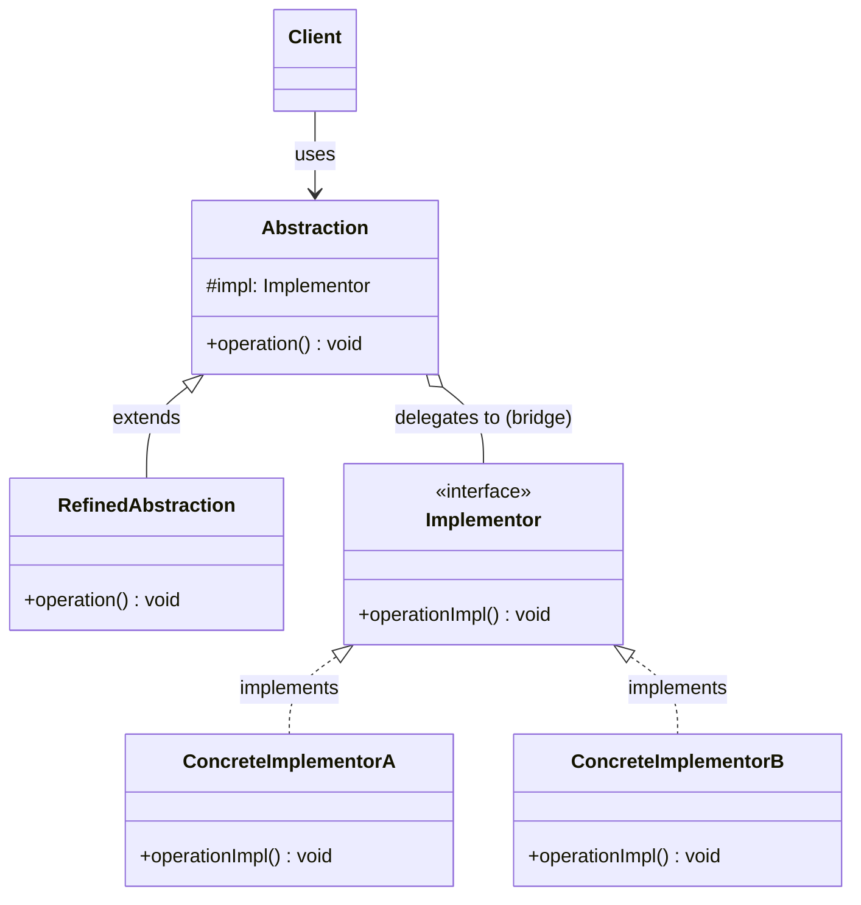

# 브릿지(Bridge) 디자인 패턴 가이드

> 한 줄 요약: 추상(Abstraction)과 구현(Implementor)을 별도의 클래스 계층으로 분리하여 두 축이 서로 독립적으로 확장될 수 있도록 만드는 구조 패턴.
>
> 분류: 구조 패턴(Structural Pattern)
> 다른 이름(Aliases): Handle/Body, Driver/Implementation

---

## 상세 설명

브릿지(Bridge) 패턴은 하나의 추상 개념이 여러 가지 구체적인 구현 방식을 가질 수 있고, 그 두 축이 각각 독립적으로 변할 때 발생하는 폭발적인 클래스 조합을 막기 위한 패턴이다. GoF는 이를 "추상(Abstraction)과 구현(Implementation)을 분리하여 둘이 독립적으로 변할 수 있게 한다(Decouple an abstraction from its implementation so that the two can vary independently)"라고 정의한다.

문제(Problem)는 다음과 같이 나타난다. 예를 들어 `Shape`(도형)이 `Circle`, `Square` 두 종류가 있고, 이를 그리는 방식이 `Vector` 렌더러와 `Raster` 렌더러 두 가지가 있다고 하자. 단순한 상속만으로 이 두 축을 결합하면 `VectorCircle`, `RasterCircle`, `VectorSquare`, `RasterSquare`처럼 M × N 개의 클래스가 만들어진다. 도형이 1개, 렌더러가 1개씩 추가될 때마다 조합 클래스가 곱셈으로 늘어나는 것이 핵심 문제다. 이를 흔히 "데카르트 곱 폭발(Cartesian Product Explosion)" 또는 "다중 차원 변화 문제"라고 한다.

브릿지가 제안하는 해결책(Solution)은 두 축을 상속(Inheritance) 관계가 아니라 합성(Composition) 관계로 잇는 것이다. 추상 계층(`Shape`)은 자신이 "어떻게 그릴지(How)"를 직접 구현하지 않고, 구현자(Implementor) 인터페이스(`Renderer`)에 대한 참조만 보유한다. 추상 계층의 메서드는 자기 책임을 구현자 인터페이스의 메서드 호출(`renderer.drawCircle(...)` 등)로 위임(Delegate)한다. 그 결과 두 계층은 별도의 상속 트리를 갖고, 각자 독립적으로 새 클래스를 추가할 수 있다.

핵심 용어는 네 가지다. 추상(Abstraction)은 클라이언트가 사용하는 상위 인터페이스, 정제된 추상(Refined Abstraction)은 그 하위 클래스, 구현자(Implementor)는 추상이 위임할 구현 인터페이스, 구체 구현자(Concrete Implementor)는 그 구현체다. 이때 추상과 구현자는 1:1 메서드 매핑이 아니라, "추상이 사용하기 좋은 고수준 메서드"와 "구체 구현자가 제공해야 하는 저수준 메서드"가 서로 다른 추상 수준을 가지는 경우가 많다는 점이 중요하다. 즉 `Shape.draw()`는 고수준 의도이고, `Renderer.drawLine(x1,y1,x2,y2)`는 저수준 프리미티브다.

브릿지는 종종 어댑터(Adapter)와 혼동되지만, 어댑터는 이미 만들어진 두 인터페이스를 사후에 호환시키기 위한 "사후 봉합" 패턴인 반면, 브릿지는 처음부터 두 축을 분리해서 설계하기 위한 "선제적 분리" 패턴이라는 점에서 의도(Intent)가 명확히 다르다. 또한 브릿지의 구현자(Implementor)는 추상(Abstraction)의 단순한 서브타입이 아니라, 별개의 독립적인 추상화 단계라는 점도 핵심이다.

---

## 디자인 패턴을 충족하는 최소 조건

이 섹션에서는 "어떤 코드가 진짜로 브릿지 패턴이라고 부를 수 있는가"의 기준을 명확히 한다.

1. **두 개의 독립된 클래스 계층 존재** — 변경 축이 두 개(예: 도형 종류 × 렌더링 방식)이며, 각각이 별도의 상속 트리(추상 계층과 구현자 계층)로 표현되어 있어야 한다. 한쪽 계층만 존재하는 경우는 브릿지가 아니다.
2. **합성(Composition)을 통한 연결** — 추상(Abstraction) 클래스가 구현자(Implementor) 인터페이스 타입의 필드를 보유하고, 생성 시 주입받는다. 두 계층이 상속으로 연결되어 있으면 브릿지가 아니다.
3. **위임(Delegation) 기반의 동작** — 추상의 public 메서드는 자체 로직만으로 끝나지 않고, 일부 또는 전부를 구현자 인터페이스 메서드 호출로 위임한다.
4. **양쪽 축의 독립적 확장 가능성** — 새로운 정제된 추상(예: 새 도형)을 추가할 때 기존 구현자 코드를 수정할 필요가 없어야 하고, 새 구체 구현자(예: 새 렌더러)를 추가할 때 기존 추상 코드를 수정할 필요가 없어야 한다.

> 위 조건 중 하나라도 빠지면 본 패턴이라고 보기 어렵다. 특히 조건 4가 깨지면(즉, 한쪽을 늘릴 때마다 반대쪽도 손봐야 한다면) 사실상 어댑터나 단순한 전략(Strategy)으로 분류된다.

### 흔히 오해하는 지점
- **전략(Strategy)과의 혼동**: 전략 패턴도 위임 구조를 갖지만, 전략은 "하나의 알고리즘 자리"를 교체하는 데 초점이 있고, 변경 축이 하나다. 브릿지는 의도적으로 두 축의 직교적(Orthogonal) 확장을 노린다.
- **어댑터(Adapter)와의 혼동**: 어댑터는 기존 인터페이스를 호환시키는 사후 처리, 브릿지는 처음부터 분리를 설계한 선제 구조다. 구조 다이어그램이 비슷해 보여도 의도가 다르다.
- **단순 인터페이스 분리와의 혼동**: 한 클래스가 인터페이스를 필드로 갖는다고 모두 브릿지가 아니다. "두 개의 독립적 확장 축"이 명시적으로 존재해야 한다.
- **"Refined Abstraction"이 필수라는 오해**: 정제된 추상이 1개여도 브릿지로 분류될 수 있다. 핵심은 구현자 측의 다형성과 분리 구조다.

---

## 사례를 통한 예시

### 예시 1: Shape × Renderer (Vector / Raster)

**상황**: 도형(`Circle`, `Square`)을 두 가지 방식(`Vector`, `Raster`)으로 그려야 한다. 단순 상속으로 풀면 M × N 클래스가 생기지만, 브릿지로 분리하면 M + N 클래스로 줄어든다.

```java
// ===== Implementor =====
interface Renderer {
    void renderCircle(double x, double y, double radius);
    void renderSquare(double x, double y, double side);
}

// ===== Concrete Implementors =====
class VectorRenderer implements Renderer {
    @Override
    public void renderCircle(double x, double y, double radius) {
        System.out.printf("[Vector] Drawing circle at (%.1f, %.1f), r=%.1f as SVG path%n", x, y, radius);
    }
    @Override
    public void renderSquare(double x, double y, double side) {
        System.out.printf("[Vector] Drawing square at (%.1f, %.1f), side=%.1f as SVG path%n", x, y, side);
    }
}

class RasterRenderer implements Renderer {
    @Override
    public void renderCircle(double x, double y, double radius) {
        System.out.printf("[Raster] Rasterizing circle at (%.1f, %.1f), r=%.1f pixel by pixel%n", x, y, radius);
    }
    @Override
    public void renderSquare(double x, double y, double side) {
        System.out.printf("[Raster] Rasterizing square at (%.1f, %.1f), side=%.1f pixel by pixel%n", x, y, side);
    }
}

// ===== Abstraction =====
abstract class Shape {
    protected final Renderer renderer; // bridge

    protected Shape(Renderer renderer) {
        this.renderer = renderer;
    }
    public abstract void draw();
    public abstract void resize(double factor);
}

// ===== Refined Abstractions =====
class Circle extends Shape {
    private double x, y, radius;
    public Circle(Renderer renderer, double x, double y, double radius) {
        super(renderer);
        this.x = x; this.y = y; this.radius = radius;
    }
    @Override public void draw() { renderer.renderCircle(x, y, radius); }
    @Override public void resize(double factor) { radius *= factor; }
}

class Square extends Shape {
    private double x, y, side;
    public Square(Renderer renderer, double x, double y, double side) {
        super(renderer);
        this.x = x; this.y = y; this.side = side;
    }
    @Override public void draw() { renderer.renderSquare(x, y, side); }
    @Override public void resize(double factor) { side *= factor; }
}

// ===== Client =====
public class BridgeDemo {
    public static void main(String[] args) {
        Shape c1 = new Circle(new VectorRenderer(), 1, 2, 3);
        Shape c2 = new Circle(new RasterRenderer(), 1, 2, 3);
        Shape s1 = new Square(new VectorRenderer(), 0, 0, 4);
        c1.draw();
        c2.draw();
        s1.draw();
    }
}
```

**해설**: `Shape`이 추상(Abstraction), `Circle`/`Square`가 정제된 추상(Refined Abstraction), `Renderer`가 구현자(Implementor), `VectorRenderer`/`RasterRenderer`가 구체 구현자(Concrete Implementor)다. 도형 종류를 늘리려면 `Shape` 하위에 클래스를 추가하면 되고, 렌더링 방식을 늘리려면 `Renderer` 구현체만 추가하면 된다. 양쪽 코드는 서로 건드리지 않는다. 만약 같은 일을 단순 상속으로 풀었다면 `VectorCircle`, `RasterCircle`, `VectorSquare`, `RasterSquare`처럼 2 × 2 = 4개의 구체 클래스가 생기고, 새로운 도형이나 렌더러를 하나 추가할 때마다 곱셈으로 증가한다.

### 예시 2: JDBC의 DriverManager-Driver 구조

**상황**: Java의 JDBC(`java.sql`) API는 데이터베이스 종류와 무관한 표준 인터페이스(`Connection`, `Statement`, `ResultSet`)를 제공한다. 클라이언트 코드는 이 표준 인터페이스에만 의존하고, 실제 데이터베이스 통신은 각 벤더(MySQL, PostgreSQL, Oracle 등)가 제공하는 `Driver` 구현체가 담당한다. 이는 브릿지 패턴의 대표적인 실제 적용 사례로 자주 인용된다.

```java
import java.sql.Connection;
import java.sql.DriverManager;
import java.sql.ResultSet;
import java.sql.Statement;

public class JdbcBridgeDemo {
    public static void main(String[] args) throws Exception {
        // 1) 어떤 Driver(Concrete Implementor)를 사용할지는 URL로 결정된다.
        //    클라이언트 코드는 Connection/Statement/ResultSet이라는
        //    "추상(Abstraction)" 인터페이스에만 의존한다.
        String url = "jdbc:mysql://localhost:3306/test"; // 또는 jdbc:postgresql://...
        try (Connection conn = DriverManager.getConnection(url, "user", "pwd");
             Statement stmt = conn.createStatement();
             ResultSet rs = stmt.executeQuery("SELECT id, name FROM users")) {

            while (rs.next()) {
                System.out.println(rs.getInt("id") + " : " + rs.getString("name"));
            }
        }
        // 동일 코드로 MySQL, PostgreSQL, Oracle, H2 등 어떤 DB도 사용할 수 있다.
        // 클라이언트는 Driver(Implementor) 구현 세부 사항을 알지 못한다.
    }
}
```

**해설**: 여기서 `Connection`, `Statement`, `ResultSet`은 클라이언트가 사용하는 추상(Abstraction) 계층이며, 각 DB 벤더의 `Driver`, `Connection` 구현체(`com.mysql.cj.jdbc.ConnectionImpl`, `org.postgresql.jdbc.PgConnection` 등)는 구체 구현자(Concrete Implementor)에 해당한다. `DriverManager`는 URL에 따라 적절한 `Driver`를 찾아 추상과 구현자를 연결해주는 중개 역할을 한다. 새 DB 벤더가 추가되어도 `java.sql` 표준 인터페이스는 손대지 않으며, 반대로 표준 API에 메서드가 추가되어도 각 벤더가 그 메서드를 구현하면 된다. 두 축(표준 API 계층 / 벤더 구현 계층)이 독립적으로 진화하는 전형적인 브릿지 구조다.

추가로 자주 인용되는 사례로는 AWT의 `java.awt.Component`와 플랫폼별 `ComponentPeer`(`WComponentPeer`, `XComponentPeer`) 사이의 분리가 있다. GoF가 책에서 직접 예로 든 구조이기도 하다.

---

## 어떨 때 사용하나

브릿지는 다음과 같은 신호(Symptom)가 보일 때 도입을 고려한다.

- 한 클래스 계층이 두 개 이상의 직교적인 변경 축을 갖고 있고, 그 조합이 단순 상속으로 표현되어 클래스 수가 곱셈으로 늘어나고 있을 때.
- 컴파일 타임이 아니라 런타임에 구현(Implementation)을 교체하고 싶을 때. 예: 같은 로직을 그리는 방식만 바꾸고 싶다, DB만 바꾸고 싶다, 운영체제 API만 바꾸고 싶다.
- 추상 계층과 구현 계층이 서로 다른 팀/모듈/배포 단위에서 진화하고 있을 때. 예: 표준 API 위원회가 인터페이스를 정의하고, 각 벤더가 구현을 제공하는 구조.
- 구현 세부사항(예: 플랫폼 종속 API, 저수준 GPU 호출)이 클라이언트에 노출되면 안 되고, 안정된 상위 인터페이스만 노출하고 싶을 때.
- 같은 추상을 서로 다른 구현으로 동시에 사용해야 할 때(예: 같은 `Shape` 객체 중 일부는 Vector로, 일부는 Raster로 그려야 함).

### 사용하면 안 되는 경우 (Anti-patterns)

- 변경 축이 하나뿐이고 앞으로도 한 축으로만 진화할 게 명확할 때. 이런 경우 단순한 다형성이나 전략(Strategy) 패턴으로 충분하다.
- 구현 후보가 단 하나뿐이고, 가까운 미래에 추가될 가능성도 없을 때. 추상과 구현을 미리 분리하는 비용이 이득보다 크다.
- 추상과 구현이 너무 강하게 결합되어 있어 분리할 경우 메서드 시그니처가 오히려 자연스럽지 않게 비대해질 때(특히 구현자 인터페이스가 추상 측 데이터를 매개변수로 매번 받아야만 동작하는 형태가 되면 위임 비용만 커진다).
- 단순히 "확장 가능성을 위해"라는 추상적인 이유만으로 도입하는 경우. 실제 두 축 변화 사례가 명확하지 않다면 YAGNI(You Aren't Gonna Need It) 원칙에 따라 미루는 것이 낫다.

---

## 장점과 단점, 한계점

### 장점
- **클래스 수의 곱셈 폭발 방지**: M × N개의 조합 클래스를 M + N개로 줄여, 새 축의 멤버 추가 비용을 곱이 아닌 합으로 만든다.
- **OCP(개방-폐쇄 원칙) 준수**: 새 도형/새 렌더러를 추가할 때 기존 코드를 수정하지 않고 확장할 수 있다.
- **런타임 교체 가능성**: 합성 기반이므로 동일 추상 객체에 다른 구현자를 주입하는 식으로 동작을 동적으로 바꿀 수 있다.
- **관심사 분리(SoC)**: 추상 계층은 "무엇을(What)" 책임지고, 구현자 계층은 "어떻게(How)"를 책임진다. 코드 가독성과 유지보수성이 올라간다.
- **계층별 독립 배포·테스트**: 구현자 인터페이스를 목(Mock)으로 갈아끼우면 추상 계층을 단위 테스트하기 쉬워진다.

### 단점
- **간접 호출 비용과 복잡도 증가**: 단순한 케이스에도 인터페이스, 추상 클래스, 합성 관계가 추가되어 첫 진입 장벽이 높다.
- **사전 설계 부담**: 어디까지를 추상, 어디까지를 구현자로 둘지의 경계 설계가 잘못되면 양쪽 모두를 자주 수정해야 하고, 그러면 패턴의 이점이 사라진다.
- **위임 단계가 늘어남에 따른 추적 난이도**: 디버깅 시 호출이 한 단계 더 점프하므로 스택 추적이 길어진다.

### 한계점
- **두 축의 진정한 직교성 가정**: 두 축이 실제로 독립적이지 않고 강하게 얽혀 있는 경우(예: 특정 도형은 특정 렌더러에서만 의미가 있는 경우), 브릿지로 분리해도 결국 if/instanceof 분기가 다시 등장한다.
- **구현자 인터페이스의 안정성**: 구현자 인터페이스에 메서드가 추가되면 모든 구체 구현자가 영향을 받는다. JDBC가 새 버전에서 `Connection`에 메서드를 추가할 때마다 벤더 드라이버가 영향을 받는 것이 그 예다.
- **추상화 누수**: 구현 세부 사항(예: 특정 렌더러만 지원하는 옵션)을 노출하려는 유혹이 생기면 추상 계층이 구현자 종류를 알게 되어 분리가 깨질 수 있다.

---

## 정보 표

| 항목 | 값 |
| --- | --- |
| 분류 | 구조 패턴(Structural Pattern) |
| 언어 의존성 | 언어 비의존적. 인터페이스(또는 추상 클래스)와 합성을 지원하는 모든 OOP 언어에서 동일하게 구현 가능. |
| 활용성(1점~5점) | ★★★★☆ (4/5) — 직접 작성 빈도는 보통이지만, JDBC/JAXP/SLF4J/AWT 등 표준 API와 플랫폼 추상화에서 실질적으로 매우 폭넓게 활용된다. |
| 학습 난이도 | 중 — 구조 자체는 단순하지만 어댑터·전략과의 의도 차이를 이해해야 정확히 쓸 수 있다. |
| 자주 함께 쓰이는 패턴 | 추상 팩토리(Abstract Factory, 적절한 구현자 선택), 어댑터(Adapter, 기존 구현 호환), 싱글톤(Singleton, 구현자 공유), 전략(Strategy, 구조적 유사성) |
| 대표 사용 사례 | JDBC `Connection`/`Driver`, Java AWT `Component`/`ComponentPeer`, SLF4J Facade와 Logger 구현체, JAXP의 `DocumentBuilder`와 파서 구현체 |

---

## Class Diagram



> 다이어그램에 등장하는 각 클래스가 패턴의 어떤 역할(Role)을 담당하는지 위 "상세 설명" 섹션과 1:1로 대응되어야 한다.

### 역할 설명
- **Abstraction(추상)**: 클라이언트가 사용하는 상위 인터페이스. 구현자(Implementor) 참조를 보유하며 자신의 메서드를 구현자에 위임한다. 예시의 `Shape`, JDBC의 `Connection`.
- **RefinedAbstraction(정제된 추상)**: `Abstraction`을 상속하여 추가 동작이나 특정 도메인 데이터를 부여한 구체 클래스. 예시의 `Circle`, `Square`.
- **Implementor(구현자 인터페이스)**: 추상 계층이 위임할 저수준 동작의 계약(Contract)을 정의한다. 예시의 `Renderer`, JDBC의 `Driver` 또는 벤더용 `Connection` 인터페이스.
- **ConcreteImplementorA / ConcreteImplementorB(구체 구현자)**: `Implementor`를 실제 플랫폼/기술 별로 구현. 예시의 `VectorRenderer`, `RasterRenderer`, 또는 MySQL/PostgreSQL 드라이버.
- **Client(클라이언트)**: `Abstraction`을 사용하며, 어떤 `ConcreteImplementor`가 주입되었는지는 알지 못한다. 의존은 추상 계층에만 한정된다.

---

## 참고 자료
- Erich Gamma, Richard Helm, Ralph Johnson, John Vlissides, "Design Patterns: Elements of Reusable Object-Oriented Software" (1994), Bridge 패턴 장.
- Refactoring.Guru, "Bridge" — https://refactoring.guru/design-patterns/bridge
- Wikipedia, "Bridge pattern" — https://en.wikipedia.org/wiki/Bridge_pattern
- Oracle, "JDBC Overview" — https://docs.oracle.com/javase/tutorial/jdbc/overview/index.html
- Joshua Bloch, "Effective Java" 3rd ed., Item 18 (상속보다는 컴포지션을 사용하라).
