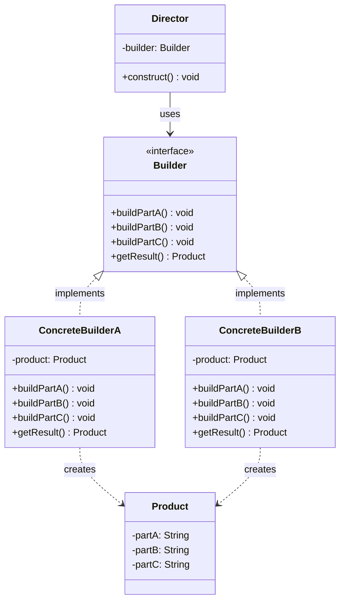

# 빌더(Builder) 디자인 패턴 가이드

> 한 줄 요약: 복잡한 객체의 생성 과정과 표현(representation)을 분리하여, 같은 생성 절차로 서로 다른 표현의 객체를 단계적으로 조립할 수 있게 하는 패턴.
>
> 분류: 생성 패턴 (Creational Pattern)
> 다른 이름(Aliases): Builder, Step Builder, Fluent Builder

---

## 상세 설명

빌더(Builder) 패턴은 GoF의 23개 디자인 패턴 중 생성 패턴(Creational Pattern)에 속한다. 생성자(constructor)에 인자가 지나치게 많아지거나, 일부 필드가 선택적(optional)이거나, 같은 절차로 서로 다른 표현을 만들고 싶을 때 사용한다. 즉 "무엇을(What) 만들지"는 동일하지만 "어떻게(How) 표현할지"는 다양해야 하는 상황에서, 객체 생성 로직을 별도의 빌더(Builder) 객체로 분리한다.

GoF가 정의한 원형(Original Builder)은 디렉터(Director)와 빌더(Builder) 두 축으로 이루어진다. 디렉터는 빌더에게 부품을 만들도록 지시하는 "생성 순서(construction algorithm)"를 보유하고, 빌더는 그 지시에 따라 실제 부품을 만들고 보관한다. 동일한 디렉터가 ConcreteBuilderA를 받으면 텍스트 문서를, ConcreteBuilderB를 받으면 RTF 문서를 만드는 식이다. 핵심은 "생성 절차 재사용"과 "표현 교체 용이성"이다.

반면 Joshua Bloch가 *Effective Java*에서 제안한 빌더(Effective Java Builder)는 자바 진영에서 가장 널리 통용되는 변형이다. 디렉터가 사라지고, 정적 중첩 클래스(static nested class)인 Builder가 자기 자신의 setter 메서드를 반환(`return this`)하면서 메서드 체이닝(fluent interface)을 이루다가, 마지막에 `build()`를 호출하면 불변(immutable) 객체를 만들어 반환한다. 이는 텔레스코핑 생성자(telescoping constructor) 안티패턴과, 모든 필드를 setter로 노출하여 가변 상태를 만드는 JavaBeans 패턴의 단점을 동시에 해결하기 위해 만들어졌다.

요약하면, GoF Builder는 "복잡한 조립 절차의 추상화"에 무게가 있고, Effective Java Builder는 "다인자(多引子) 불변 객체의 가독성 있는 생성"에 무게가 있다. 두 변형은 형태가 비슷해 보이지만 의도가 다르며, 본 문서에서는 양쪽을 모두 다룬다.

---

## 디자인 패턴을 충족하는 최소 조건

이 섹션에서는 "어떤 코드가 진짜로 빌더 패턴이라고 부를 수 있는가"의 기준을 명확히 한다.

1. **객체 생성이 다단계(step-by-step)로 분리되어 있어야 한다** — 최종 객체(Product)는 하나의 생성자 호출이 아니라 여러 번의 부품(component) 설정 호출을 거쳐 완성된다. 단발성 생성자 호출만 있다면 빌더가 아니다.
2. **생성 절차와 최종 표현이 분리되어 있어야 한다** — 빌더(Builder)는 부품을 만들고 누적하는 책임만 가지며, 결과물(Product) 자체를 반환하는 명시적 종결 메서드(`build()`, `getResult()`, `toString()` 등)가 존재해야 한다. 부품 추가 메서드가 곧바로 Product를 반환해 버리면 빌더가 아니다.
3. **동일한 생성 절차로 서로 다른 표현을 만들 수 있거나(또는) 다인자 생성을 가독성 있게 캡슐화한다** — GoF 변형이라면 디렉터(Director)가 빌더 인터페이스에만 의존해야 하고, Effective Java 변형이라면 Product의 필드 조합이 다양해 텔레스코핑 생성자로는 표현하기 어려운 수준이어야 한다.
4. **최종 산출물의 일관성을 빌더가 보장한다** — `build()` 시점에 필수 필드 누락, 불변식(invariant) 위반 여부를 검증해야 한다. 검증 없이 부분 상태 그대로 반환하면 단순 setter 묶음과 차이가 없다.

> 위 조건 중 (1), (2), (4)가 빠지면 빌더라고 부르기 어렵다. (3) 중 어느 쪽도 만족하지 못한다면 "그냥 다인자 생성자를 메서드로 쪼갠 것"에 가깝다.

### 흔히 오해하는 지점

- **Fluent Setter와의 혼동**: `return this`로 메서드 체이닝만 되면 빌더라고 부르는 경우가 많지만, 이는 fluent interface일 뿐이다. 빌더의 본질은 "체이닝"이 아니라 "별도 빌더 객체가 Product와 분리되어 있고, 종결 메서드(`build()`)에서 Product를 일관된 상태로 생성한다"는 점이다. 결과 객체가 자기 자신을 반환하는 setter를 가졌다면 그것은 가변(mutable) 객체에 fluent setter를 단 것이지 빌더가 아니다.
- **Factory Method와의 혼동**: 둘 다 생성 패턴이지만, 팩토리는 "어떤 클래스의 인스턴스를 만들지" 결정하는 한 방의 호출에 집중하고, 빌더는 "한 종류의 복잡한 객체를 여러 단계에 걸쳐" 만든다. 단계가 없으면 팩토리에 가깝다.
- **단순 DTO에 빌더 붙이기**: 필드가 2~3개뿐인 단순 데이터 객체에 빌더를 두는 것은 과한 추상화이며, 가독성을 해치는 흔한 오용이다.
- **부품 설정 메서드가 Product를 반환하는 경우**: `pizza.addTopping("cheese").addTopping("ham")`처럼 Product가 자기 자신을 반환한다면 이는 Product가 곧 Builder이며, GoF가 강조한 "생성과 표현의 분리"가 깨진 형태다.

---

## 사례를 통한 예시

### 예시 1: Pizza 빌더 (Effective Java 스타일)

**상황**: 피자는 도우(dough), 소스(sauce), 치즈(cheese)는 필수이고, 토핑(toppings), 사이즈(size), 크러스트 스타일(crustStyle) 등은 선택적이다. 생성자 오버로딩으로 표현하면 텔레스코핑 생성자가 발생한다.

```java
public final class Pizza {
    private final String dough;       // 필수
    private final String sauce;       // 필수
    private final String cheese;      // 필수
    private final int size;           // 선택 (기본 12)
    private final boolean glutenFree; // 선택 (기본 false)
    private final List<String> toppings; // 선택

    private Pizza(Builder b) {
        this.dough = b.dough;
        this.sauce = b.sauce;
        this.cheese = b.cheese;
        this.size = b.size;
        this.glutenFree = b.glutenFree;
        this.toppings = List.copyOf(b.toppings); // 불변 복사
    }

    public static Builder builder(String dough, String sauce, String cheese) {
        return new Builder(dough, sauce, cheese);
    }

    public static class Builder {
        private final String dough;
        private final String sauce;
        private final String cheese;
        private int size = 12;
        private boolean glutenFree = false;
        private final List<String> toppings = new ArrayList<>();

        private Builder(String dough, String sauce, String cheese) {
            if (dough == null || sauce == null || cheese == null) {
                throw new IllegalArgumentException("필수 재료 누락");
            }
            this.dough = dough;
            this.sauce = sauce;
            this.cheese = cheese;
        }

        public Builder size(int size) { this.size = size; return this; }
        public Builder glutenFree(boolean v) { this.glutenFree = v; return this; }
        public Builder addTopping(String t) { this.toppings.add(t); return this; }

        public Pizza build() {
            if (size < 8 || size > 20) {
                throw new IllegalStateException("size는 8~20인치만 허용");
            }
            return new Pizza(this);
        }
    }
}

// 사용
Pizza p = Pizza.builder("thin", "tomato", "mozzarella")
        .size(14)
        .addTopping("ham")
        .addTopping("pineapple")
        .build();
```

**해설**: `Pizza`는 생성자가 `private`이라 외부에서 직접 만들 수 없다(조건 1, 2). `Builder`는 필수 인자를 생성자로 받아 누락을 컴파일·런타임에서 차단하고, 선택 인자는 fluent 메서드로 단계적으로 누적한다(조건 1, 3). 마지막 `build()`에서 불변식(`size` 범위, 토핑 리스트 불변 복사)을 검사한 뒤 Product를 생성하므로 일관성이 보장된다(조건 4). Pizza 자체에는 setter가 없어 불변(immutable)이다.

### 예시 2: Computer 빌더 (GoF Director + Builder 변형)

**상황**: "게이밍 PC"와 "사무용 PC"라는 두 표현이 동일한 조립 순서(CPU 장착 → RAM 장착 → 저장장치 장착 → 그래픽카드 장착)를 공유한다. 조립 순서를 한 곳(Director)에 두고, 표현은 ConcreteBuilder로 갈아끼운다.

```java
class Computer {
    String cpu, ram, storage, gpu;
    @Override public String toString() {
        return "CPU=" + cpu + ", RAM=" + ram + ", Storage=" + storage + ", GPU=" + gpu;
    }
}

interface ComputerBuilder {
    void buildCpu();
    void buildRam();
    void buildStorage();
    void buildGpu();
    Computer getResult();
}

class GamingComputerBuilder implements ComputerBuilder {
    private final Computer c = new Computer();
    public void buildCpu()     { c.cpu = "Intel i9"; }
    public void buildRam()     { c.ram = "32GB DDR5"; }
    public void buildStorage() { c.storage = "2TB NVMe SSD"; }
    public void buildGpu()     { c.gpu = "RTX 4090"; }
    public Computer getResult() { return c; }
}

class OfficeComputerBuilder implements ComputerBuilder {
    private final Computer c = new Computer();
    public void buildCpu()     { c.cpu = "Intel i5"; }
    public void buildRam()     { c.ram = "16GB DDR4"; }
    public void buildStorage() { c.storage = "512GB SSD"; }
    public void buildGpu()     { c.gpu = "내장 그래픽"; }
    public Computer getResult() { return c; }
}

class ComputerDirector {
    public Computer construct(ComputerBuilder builder) {
        builder.buildCpu();
        builder.buildRam();
        builder.buildStorage();
        builder.buildGpu();
        return builder.getResult();
    }
}

// 사용
ComputerDirector director = new ComputerDirector();
Computer gaming = director.construct(new GamingComputerBuilder());
Computer office = director.construct(new OfficeComputerBuilder());
```

**해설**: `ComputerDirector#construct`는 "어떤 순서로 조립할지"만 알고, 실제 부품 결정은 ConcreteBuilder가 책임진다. 같은 절차로 두 가지 표현(게이밍/사무용)을 생산하므로 GoF가 강조한 "동일한 생성 절차로 서로 다른 표현"이 성립한다. 빌더 인터페이스에 종결 메서드 `getResult()`가 명시되어 있고, Director는 Product 자체에 의존하지 않는다.

### 예시 3: `java.lang.StringBuilder` (표준 라이브러리의 빌더)

**상황**: 문자열은 자바에서 불변(immutable) 객체이므로 `+` 연산을 반복하면 매번 새 String이 생성되어 성능이 나쁘다. `StringBuilder`는 가변 버퍼에 부분 문자열을 누적했다가, `toString()`이 호출되는 시점에 최종 String을 만든다.

```java
String csv = new StringBuilder()
        .append("id")
        .append(',')
        .append("name")
        .append(',')
        .append("email")
        .append('\n')
        .append(1).append(',').append("Alice").append(',').append("a@x.com")
        .toString(); // <- 종결 메서드: 여기서 진짜 Product(String)가 만들어진다
```

**해설**: `StringBuilder`(빌더)는 부품(문자, 숫자, 문자열)을 단계적으로 누적하는 책임만 갖고, 최종 Product인 `String`은 종결 메서드 `toString()`이 호출될 때 비로소 생성된다. 부품 추가 메서드 `append(...)`가 `StringBuilder` 자신을 반환하여 fluent 체이닝을 지원하지만, Product인 `String`을 반환하지는 않는다는 점이 fluent setter와 빌더를 가르는 핵심이다. 동일 계열로 `StringBuffer`(스레드 안전 버전), `java.lang.StringBuilder`의 자매격인 `java.lang.ProcessBuilder`(외부 프로세스 실행 명령을 단계적으로 조립하고 `start()`로 종결), `Stream.Builder<T>` 등이 같은 구조를 따른다.

---

## 어떨 때 사용하나

생성자에 매개변수가 4개를 넘어가고 그중 일부가 선택적이거나 같은 타입(예: 여러 개의 `boolean`, `int`)이라 호출부에서 의미를 알아보기 어려울 때 빌더 도입을 고려한다. 또한 객체가 불변이어야 하지만 필드 조합이 다양해 모든 조합에 대한 생성자를 두기 어려운 경우, 빌더는 불변성을 유지하면서도 가독성 있는 생성 API를 제공한다. 동일한 "조립 순서"를 유지하되 결과물(표현)만 갈아끼우고 싶다면 디렉터를 동반한 GoF 원형이 적합하다. 예컨대 같은 보고서 생성 절차로 HTML 보고서와 PDF 보고서를 모두 만드는 경우다. 마지막으로, `build()` 시점에 객체 전체의 불변식을 한 번에 검증하고 싶을 때, 즉 "절반만 초기화된 상태"가 외부에 노출되지 않아야 할 때 강력한 도구가 된다.

대표 신호(Symptom):

- 생성자 인자가 4개 이상이고, 그중 절반 이상이 선택적이다.
- 같은 타입의 인자가 연달아 등장해 호출부에서 의미가 흐려진다(예: `new User("a","b","c","d")`).
- 객체를 불변(immutable)으로 유지하고 싶지만 필드 조합이 너무 다양해서 생성자 오버로딩이 폭발한다.
- 동일한 절차로 표현만 다른 결과물을 여러 종류 만들어야 한다(보고서 포맷, AST 노드 직렬화 등).
- 객체 전체의 정합성을 마지막에 한 번 검증하고 싶다.

### 사용하면 안 되는 경우 (Anti-patterns)

- **필드가 2~3개에 불과한 단순 값 객체(VO)**: `record Point(int x, int y)`로 충분하다. 빌더는 보일러플레이트만 늘린다.
- **성능에 민감한 핫 패스에서 짧은 수명의 객체를 대량 생성하는 경우**: 빌더 인스턴스 자체가 GC 부담을 유발할 수 있다.
- **객체가 가변(mutable)이고 외부에서 자유롭게 setter를 호출하길 원할 때**: JavaBeans 스타일이 더 적합하다.
- **생성 단계가 사실상 한 단계뿐일 때**: 정적 팩토리 메서드(static factory method)나 일반 생성자가 더 단순하다.
- **체이닝만 흉내내고 종결 메서드(`build()`)가 없는 경우**: 이는 빌더가 아니라 fluent setter다. 이름만 Builder로 붙이지 말 것.

---

## 장점과 단점, 한계점

### 장점
- **가독성 있는 생성 API**: 명명된 메서드로 인자의 의미가 드러나므로, 다인자 생성자보다 호출부가 자기설명적(self-documenting)이다.
- **불변 객체와의 궁합**: Product에 setter를 두지 않고도 다양한 필드 조합으로 안전하게 생성할 수 있어, 동시성 환경에서 유리하다.
- **생성 절차와 표현의 분리**: 동일한 절차(Director)로 여러 표현(ConcreteBuilder)을 만들 수 있어, 새로운 표현 추가가 OCP(Open-Closed Principle)에 부합한다.
- **검증의 일관성**: `build()` 시점에 모든 필수 필드와 불변식을 한 번에 검사할 수 있어, 부분 초기화 상태가 외부로 새지 않는다.
- **선택 인자의 자연스러운 표현**: 호출하지 않으면 기본값이 적용되는 구조라 텔레스코핑 생성자가 사라진다.

### 단점
- **보일러플레이트 증가**: 필드마다 빌더 메서드를 두어야 하므로 코드량이 늘어난다. Lombok `@Builder` 같은 도구 없이는 유지보수 비용이 크다.
- **추가 객체 생성 비용**: Product 한 개를 만들기 위해 Builder 인스턴스를 한 개 더 만들어야 한다. 짧은 수명의 객체를 대량 생성하는 경로에서는 GC 압박이 된다.
- **클래스 수 증가**: GoF 원형을 따르면 Director, Builder 인터페이스, ConcreteBuilder들이 새로 등장한다.
- **간접성(indirection)**: "객체를 만들었더니 사실은 빌더가 만든 것"이라는 한 단계 우회가 추가되어, 디버깅이 한 단계 깊어진다.

### 한계점
- **언어/플랫폼 제약**: 자바에서는 정적 중첩 클래스, 메서드 체이닝, 불변 컬렉션 API와 잘 어울리지만, 코틀린의 `data class` + 명명된 인자(named arguments) + 기본값(default values)이 있는 환경에서는 빌더가 거의 불필요하다.
- **상속 시 깨지기 쉬움**: 빌더 자체를 상속해서 확장하려면 자기참조 제네릭(self-referential generics, *Curiously Recurring Template Pattern*)을 동원해야 하며, 학습 비용이 가파르다.
- **부분 객체 노출 위험**: 빌더가 Product의 내부 가변 컬렉션을 그대로 보관하는 구현이라면, `build()` 후에도 빌더를 통해 Product 내부 상태를 바꿀 수 있다. 반드시 `build()`에서 방어적 복사(defensive copy)를 해야 한다.
- **테스트 시 픽스처(fixture) 복잡도**: 빌더 자체가 테스트 픽스처로 자주 쓰이지만, 빌더가 빌더를 또 호출하는 식의 중첩이 깊어지면 테스트 데이터 추적이 어려워진다.

---

## 정보 표

| 항목 | 값 |
| --- | --- |
| 분류 | 생성 패턴 (Creational Pattern) |
| 언어 의존성 | 언어 비의존적. 다만 Effective Java 변형은 정적 중첩 클래스와 메서드 체이닝이 자연스러운 언어(Java, C#)에서 가장 잘 작동하며, Kotlin/Scala처럼 명명된 인자 + 기본값이 있는 언어에서는 효용이 떨어진다. |
| 활용성(1점~5점) | ★★★★★ (5/5) — 실무 자바 코드에서 가장 빈번히 등장하는 생성 패턴 중 하나로, Lombok `@Builder`, Spring `UriComponentsBuilder`, OkHttp `Request.Builder`, AWS SDK 등 표준적으로 채택되어 있다. |
| 학습 난이도 | 중 — fluent 인터페이스만 흉내내는 잘못된 구현이 매우 흔하여, 종결 메서드와 검증의 의미를 정확히 이해해야 한다. |
| 자주 함께 쓰이는 패턴 | Abstract Factory(여러 ConcreteBuilder의 생성), Composite(트리 구조 Product 조립), Singleton(Director를 단일 인스턴스로 관리), Prototype(빌더 내부에서 부분 객체 복제) |
| 대표 사용 사례 | `java.lang.StringBuilder` / `StringBuffer`, `java.lang.ProcessBuilder`, `java.util.stream.Stream.Builder`, OkHttp `Request.Builder`, Spring `UriComponentsBuilder`, Lombok `@Builder` |

---

## Class Diagram



> 다이어그램에 등장하는 각 클래스가 패턴의 어떤 역할(Role)을 담당하는지 위 "상세 설명" 섹션과 1:1로 대응되어야 한다.

### 역할 설명
- **Director(감독자)**: 어떤 순서로 부품을 만들지 결정하는 "생성 알고리즘"을 보유한다. Builder 인터페이스에만 의존하고 ConcreteBuilder의 내부는 알지 못한다. Effective Java 변형에서는 호출자(client) 코드가 Director 역할을 흡수하여 사라지는 경우가 많다.
- **Builder(빌더 인터페이스)**: 부품을 만드는 추상 메서드(`buildPartX`)와 최종 결과를 회수하는 종결 메서드(`getResult`/`build`)를 선언한다. Director가 의존하는 추상 타입이다.
- **ConcreteBuilderA / ConcreteBuilderB(구체 빌더)**: Builder 인터페이스를 구현하여 실제 부품을 만들고 내부에 누적한다. 같은 절차를 따르더라도 어떤 ConcreteBuilder를 주입하느냐에 따라 최종 Product의 표현이 달라진다.
- **Product(결과물)**: 빌더가 최종적으로 조립해 반환하는 객체. Effective Java 변형에서는 보통 불변(immutable)으로 설계되며, `build()` 시점에 검증을 거친 정합성 있는 상태로만 외부에 노출된다.

---

## 참고 자료
- Erich Gamma, Richard Helm, Ralph Johnson, John Vlissides (1994). *Design Patterns: Elements of Reusable Object-Oriented Software* — "Builder" 항목 (GoF 원전).
- Joshua Bloch (2018). *Effective Java*, 3rd Edition — Item 2: "Consider a builder when faced with many constructor parameters".
- Refactoring.Guru — Builder Pattern: https://refactoring.guru/design-patterns/builder
- Oracle Java SE API Docs — `java.lang.StringBuilder`, `java.lang.ProcessBuilder`, `java.util.stream.Stream.Builder`
- Square OkHttp `Request.Builder` 소스: https://github.com/square/okhttp
- Spring Framework `UriComponentsBuilder` 문서: https://docs.spring.io/spring-framework/docs/current/javadoc-api/org/springframework/web/util/UriComponentsBuilder.html
