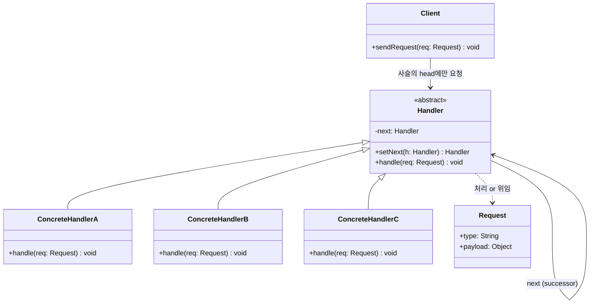

# 책임 연쇄(Chain of Responsibility) 디자인 패턴 가이드

> 한 줄 요약: 요청(Request)을 처리할 수 있는 핸들러(Handler) 객체들을 사슬(Chain)로 연결해 두고, 요청을 사슬을 따라 흘려보내며 각 핸들러가 "처리할지/다음으로 넘길지"를 스스로 결정하도록 만들어 발신자(Sender)와 수신자(Receiver)의 결합도를 낮추는 행위 패턴.
>
> 분류: 행위 패턴(Behavioral Pattern)
> 다른 이름(Aliases): CoR, Chain of Command, 책임 사슬

---

## 상세 설명

책임 연쇄(Chain of Responsibility) 패턴은 "하나의 요청을 누가 처리할지"를 사전에 못 박지 않고, 잠재적인 처리자(Handler) 여러 개를 일렬로 연결한 뒤 요청을 그 사슬을 따라 통과시키는 방식으로 동작한다. 각 핸들러는 요청을 살펴보고 자신이 처리할 수 있으면 처리하고, 아니면 사슬의 다음(next) 핸들러에게 그대로 넘긴다. 이 구조 덕분에 요청을 보낸 쪽은 "누가 처리할 것인가"를 알 필요가 없으며, 처리자들 또한 자기 앞뒤에 어떤 핸들러가 더 붙어 있는지 알 필요가 없다.

이 패턴이 해결하려는 문제(Problem)는 전형적으로 다음 형태로 나타난다. 어떤 요청을 처리할 수 있는 대상이 여러 개 존재하고, 그 대상의 종류와 순서가 런타임에 가서야 정해지거나 자주 바뀐다. 발신자가 if/else 또는 switch로 수신자를 하드코딩하면 새 처리자가 추가될 때마다 발신자 코드를 고쳐야 하므로 개방-폐쇄 원칙(OCP, Open-Closed Principle)이 깨지고, 발신자가 모든 후보 처리자의 존재를 알아야 하므로 결합도가 높아진다.

해결책(Solution)은 공통의 핸들러 인터페이스(Handler interface)를 정의하고, 그 구현체들이 자신의 다음 핸들러(successor / next) 참조를 들고 있게 하는 것이다. 발신자는 사슬의 첫 핸들러에게만 요청을 던지면 되고, 그 다음의 디스패치(dispatch)는 사슬 내부 책임이 된다. 핸들러를 추가하거나 순서를 바꾸는 일은 사슬을 재구성하는 것만으로 끝난다.

핵심 용어(Core terms)는 다음과 같다. **Handler(처리자 인터페이스)** 는 `handle(request)` 같은 추상 메서드와 다음 핸들러를 가리키는 참조 `next`를 정의한다. **ConcreteHandler(구체 처리자)** 는 자신이 책임지는 조건을 검사한 뒤 처리하거나 다음으로 위임(forward)한다. **Client(클라이언트)** 는 사슬을 구성하고 첫 핸들러에게 요청을 보낸다. 처리 정책은 보통 두 가지로 나뉜다. 사슬을 따라가다 처음으로 처리 가능한 핸들러를 만나면 거기서 끝나는 "단일 처리(single handling)" 방식과, 모든 핸들러가 차례로 가공/검사에 참여하는 "필터 체인(filter chain)" 방식이다. 후자는 Java의 `javax.servlet.Filter`/`FilterChain`이 대표적이다.

GoF(Gamma et al., "Design Patterns") 정의에서는 요청이 "처리되거나(handled), 또는 사슬 끝까지 도달했는데 아무도 처리하지 않을(unhandled) 수도 있다"는 점이 명시되어 있다. 즉, 사슬은 처리 보장을 자동으로 제공하지 않는다. 처리 보장을 원한다면 사슬 끝에 항상 동작하는 기본 핸들러(default handler)를 두는 것이 일반적인 변형이다.

---

## 디자인 패턴을 충족하는 최소 조건

이 섹션에서는 "어떤 코드가 진짜로 책임 연쇄 패턴이라고 부를 수 있는가"의 기준을 명확히 한다.

1. **공통 Handler 추상화가 존재한다** — 사슬에 들어가는 모든 처리자는 동일한 인터페이스 또는 추상 클래스(공통 타입)를 공유해야 한다. 발신자와 다음 핸들러는 이 추상 타입만 알면 충분해야 한다.
2. **각 핸들러가 다음 핸들러에 대한 참조(next/successor)를 보유한다** — 처리자가 자기 다음 처리자를 알고, 직접 그쪽으로 요청을 넘길 수 있어야 한다. 사슬의 연결 자체가 핸들러 객체 안에 캡슐화(encapsulated)되어 있어야 한다.
3. **핸들러가 "처리 vs 위임"을 스스로 결정한다** — 외부 디스패처가 일일이 "너가 처리해"라고 지시하지 않고, 핸들러가 요청을 보고 처리 가능 여부를 판단해 처리하거나 next로 넘긴다.
4. **발신자(Client)는 구체 핸들러를 모른다** — 발신자는 사슬의 시작점(head)에만 의존하며, 어떤 구체 핸들러가 실제로 응답할지에 대한 정보를 갖지 않는다.

> 위 조건 중 하나라도 빠지면 책임 연쇄 패턴이라고 보기 어렵고, 단순한 리스트 순회나 옵저버(Observer) 패턴의 변형으로 분류된다.

### 흔히 오해하는 지점

- **Decorator(데코레이터)와의 혼동** — Decorator도 동일 인터페이스의 객체를 감싸 연쇄적으로 호출되지만, 목적이 다르다. Decorator는 모든 wrapper가 동일 요청에 "기능을 덧붙이는" 것이 본질이고 "통과 여부"를 결정하지 않는다. 반면 CoR은 어떤 핸들러가 "이 요청은 내 책임이 아니다"라고 판단하고 통과시키는(short-circuit / forward) 결정 로직이 중심이다. 즉, Decorator는 무엇을 더할지(what to add)에, CoR은 누가 처리할지(who handles)에 초점이 있다.
- **Observer(옵저버)와의 혼동** — Observer는 동일 이벤트를 등록된 모든 구독자에게 브로드캐스트(broadcast)한다. 순서는 본질이 아니며, 한 구독자가 다른 구독자의 수신을 중단시킬 수도 없다. CoR은 본질적으로 순차적(sequential)이며, 앞쪽 핸들러가 사슬을 끊을(break) 수 있다.
- **단순 if/else 분기를 CoR이라고 부르는 경우** — `if 조건1 then A else if 조건2 then B ...`처럼 한 곳에 모든 분기를 적은 코드는 처리자가 객체로 분리되지 않았고 next 참조도 없으므로 CoR이 아니다.
- **사슬이 한 곳에 하드코딩되어 있고 핸들러가 next를 모르는 경우** — `for (Handler h : list) h.tryHandle(req);` 형태로 외부 루프가 모든 핸들러를 호출하면, 처리 vs 위임 결정 권한이 외부 루프에 있으므로 정통 CoR이라기보다 "핸들러 목록 순회(list dispatch)"에 가깝다. 다만 실무에서는 이 변형도 CoR로 묶어서 부르기도 한다.

---

## 사례를 통한 예시

### 예시 1: 결재 승인(Approval Chain) — 직접 구현

**상황**: 사내 비용 청구 시스템에서, 청구 금액에 따라 결재자(팀장 → 부서장 → 임원 → CEO)가 달라진다. 새로운 결재 단계가 추가되거나 금액 한도가 바뀌어도 청구자(Sender) 코드는 그대로 두고 싶다.

```java
// Handler: 공통 추상 클래스
public abstract class Approver {
    protected Approver next; // 다음 결재자

    public Approver linkWith(Approver next) {
        this.next = next;
        return next; // fluent 체이닝
    }

    public final void handle(ExpenseRequest request) {
        if (canApprove(request)) {
            approve(request);
        } else if (next != null) {
            next.handle(request); // 다음으로 위임
        } else {
            throw new IllegalStateException(
                "결재 가능한 사람이 없습니다: " + request);
        }
    }

    protected abstract boolean canApprove(ExpenseRequest r);
    protected abstract void approve(ExpenseRequest r);
}

// ConcreteHandler 1
public class TeamLead extends Approver {
    protected boolean canApprove(ExpenseRequest r) { return r.amount() <= 1_000_000; }
    protected void approve(ExpenseRequest r) {
        System.out.println("[팀장] 승인: " + r);
    }
}

// ConcreteHandler 2
public class Director extends Approver {
    protected boolean canApprove(ExpenseRequest r) { return r.amount() <= 10_000_000; }
    protected void approve(ExpenseRequest r) {
        System.out.println("[부서장] 승인: " + r);
    }
}

// ConcreteHandler 3
public class Executive extends Approver {
    protected boolean canApprove(ExpenseRequest r) { return r.amount() <= 100_000_000; }
    protected void approve(ExpenseRequest r) {
        System.out.println("[임원] 승인: " + r);
    }
}

public record ExpenseRequest(String title, long amount) {}

// Client: 사슬 구성과 요청 전달
public class ApprovalDemo {
    public static void main(String[] args) {
        Approver teamLead = new TeamLead();
        teamLead.linkWith(new Director())
                .linkWith(new Executive()); // 사슬: 팀장 → 부서장 → 임원

        teamLead.handle(new ExpenseRequest("키보드 구매", 200_000));      // 팀장 승인
        teamLead.handle(new ExpenseRequest("워크숍 비용", 5_000_000));    // 부서장 승인
        teamLead.handle(new ExpenseRequest("서버 증설", 80_000_000));     // 임원 승인
    }
}
```

**해설**: `Approver`가 **Handler(처리자 추상)** 역할이며 `next` 필드와 `handle()` 템플릿 메서드를 통해 "처리 vs 위임" 결정을 캡슐화한다. `TeamLead`, `Director`, `Executive`는 **ConcreteHandler** 역할로 각자 책임지는 금액 범위만 알면 충분하다. 클라이언트(`ApprovalDemo`)는 사슬의 첫 노드 `teamLead`에만 요청을 보내고 어떤 결재자가 최종 처리할지는 알지 못한다. 새로운 단계(CEO)를 추가하려면 `Approver` 하위 클래스 하나를 더 만들어 `linkWith`로 붙이기만 하면 되므로 OCP가 보존된다.

### 예시 2: 실제 프레임워크 사용 사례 — `javax.servlet.Filter` / `FilterChain`

**상황**: Java EE / Jakarta EE의 서블릿(Servlet) 스펙은 HTTP 요청을 서블릿이 처리하기 전에, 인증(Authentication)·로깅(Logging)·압축(Compression) 같은 횡단 관심사를 여러 필터가 사슬로 처리하도록 정의한다. 이는 책임 연쇄 패턴의 교과서적 사례다.

```java
import jakarta.servlet.*;
import jakarta.servlet.http.HttpServletRequest;
import jakarta.servlet.http.HttpServletResponse;
import java.io.IOException;

// ConcreteHandler 1: 인증 필터
public class AuthFilter implements Filter {
    @Override
    public void doFilter(ServletRequest req, ServletResponse res, FilterChain chain)
            throws IOException, ServletException {
        HttpServletRequest http = (HttpServletRequest) req;
        if (http.getHeader("Authorization") == null) {
            ((HttpServletResponse) res).sendError(401, "Unauthorized");
            return; // 사슬을 끊는다 (short-circuit)
        }
        chain.doFilter(req, res); // 다음 핸들러로 위임
    }
}

// ConcreteHandler 2: 접근 로그 필터
public class AccessLogFilter implements Filter {
    @Override
    public void doFilter(ServletRequest req, ServletResponse res, FilterChain chain)
            throws IOException, ServletException {
        long start = System.nanoTime();
        try {
            chain.doFilter(req, res); // 먼저 다음으로 위임
        } finally {
            long ms = (System.nanoTime() - start) / 1_000_000;
            System.out.printf("[ACCESS] %s %dms%n",
                ((HttpServletRequest) req).getRequestURI(), ms);
        }
    }
}
```

`web.xml` 또는 `@WebFilter` 어노테이션, Spring Boot의 `FilterRegistrationBean`을 통해 등록된 순서대로 `FilterChain`이 구성되며, 각 필터는 `chain.doFilter(req, res)`로 다음 필터에게 요청을 넘긴다.

**해설**: 여기서 `Filter` 인터페이스가 **Handler** 역할, `AuthFilter`/`AccessLogFilter`가 **ConcreteHandler** 역할, `FilterChain`이 사슬을 순회시키는 **구동 객체(Driver)** 역할을 한다. 정통 GoF CoR이 핸들러 객체 안에 `next` 참조를 직접 두는 것과 달리, Servlet은 사슬 순회 책임을 `FilterChain` 객체로 추출했지만 본질(요청을 핸들러 사슬에 흘려보내고, 각 핸들러가 처리/위임/중단을 결정한다)은 동일하다. 또한 `AuthFilter`처럼 `chain.doFilter()`를 호출하지 않고 즉시 응답을 보내면 사슬이 끊어진다는 점이 CoR의 "short-circuit" 동작을 그대로 보여준다. 이 외에도 `java.util.logging.Logger`의 부모-자식 logger 체인(상위 로거로 LogRecord가 전파되는 구조), Spring Security의 `SecurityFilterChain`, Netty의 `ChannelPipeline`, OkHttp의 `Interceptor.Chain`이 모두 같은 패턴이다.

---

## 어떨 때 사용하나

다음과 같은 신호(Symptom)가 보일 때 책임 연쇄(Chain of Responsibility) 패턴 도입을 고려한다.

- 동일한 요청을 처리할 수 있는 후보가 여러 개 있고, 그 중 누가 실제로 처리할지는 런타임 상태나 요청 내용에 따라 결정된다. 결재 승인 한도, 로그 레벨에 따른 핸들러 선택, 라우팅 규칙 등이 전형적이다.
- 처리 단계가 자주 추가/제거되거나 순서가 바뀐다. if/else 사슬을 코드로 박아두면 변경 비용이 빠르게 누적되는 상황이다.
- 횡단 관심사(cross-cutting concern)를 파이프라인으로 엮고 싶을 때. 인증, 로깅, 트랜잭션, 캐싱, 입력 검증 같은 책임을 핸들러로 분리해 자유롭게 조합한다.
- 발신자가 수신자에 대해 알아서는 안 되는 경우. UI 이벤트 버블링(event bubbling)처럼 "누가 받을지" 자체를 수신 측 구조에 위임해야 할 때.

### 사용하면 안 되는 경우 (Anti-patterns)

- 처리자가 단 한두 개로 고정되어 있고 앞으로 늘어날 일도 없는 경우. 이 경우 단순한 if/else나 polymorphism 한 번이면 충분하며, CoR을 도입하면 간접화 비용(indirection cost)만 늘어난다.
- 요청을 반드시 어떤 핸들러가 처리해야 한다는 보장이 강하게 필요한데, 사슬 끝까지 처리되지 않을 가능성을 무시하는 경우. 기본 핸들러(default handler)나 사슬 끝 검증 로직 없이 CoR만 쓰면 "조용히 무시된 요청"이라는 버그가 생긴다.
- 모든 핸들러가 항상 실행되어야 하고, 순서 자체는 본질이 아닌 경우. 이때는 Observer 또는 단순 컬렉션 순회가 더 직관적이다.
- 사슬이 너무 길거나 분기가 복잡해 디버깅 비용이 호출 스택을 따라 폭증하는 경우. CoR보다는 명시적인 라우터/디스패처(router/dispatcher) 객체로 한 곳에서 매핑을 보는 편이 유지보수성이 높다.

---

## 장점과 단점, 한계점

### 장점
- **발신자와 수신자의 결합도 감소(Decoupling)**: 발신자는 사슬의 머리만 알고, 어떤 구체 핸들러가 응답할지 알 필요가 없다.
- **개방-폐쇄 원칙(OCP) 친화적**: 새 핸들러를 추가하거나 순서를 재구성해도 기존 핸들러와 발신자 코드를 거의 건드리지 않는다.
- **단일 책임 원칙(SRP) 강화**: 각 핸들러가 한 가지 책임만 갖도록 분리되어 단위 테스트가 쉬워진다.
- **유연한 사슬 구성**: 런타임에 사슬을 재구성하거나, 환경(개발/운영)에 따라 다른 사슬을 조립할 수 있다.

### 단점
- **처리 보장이 없다**: 사슬 끝까지 갔는데 아무 핸들러도 처리하지 않으면 요청이 조용히 사라질 수 있다. 기본 핸들러를 두거나 명시적 예외를 던지는 식의 보강이 필요하다.
- **디버깅이 어렵다**: 어디서 처리되었는지 추적하려면 사슬을 거슬러 따라가야 하고, 호출 스택이 깊어진다. 특히 사슬이 동적으로 구성되면 정적 분석으로 흐름을 파악하기 어렵다.
- **성능 오버헤드**: 사슬이 길수록 각 노드에서의 분기/메서드 호출 비용이 누적된다. 고빈도 경로에서는 영향을 측정해야 한다.

### 한계점
- 사슬 구성을 잘못하면 무한 루프(cycle)가 발생할 수 있다. `next` 그래프가 트리/리스트임을 보장하는 검증이 필요하다.
- 동시성(concurrency) 환경에서 사슬을 런타임에 변경하면 가시성/순서 문제가 생긴다. 사슬 변경은 보통 초기화 시점에 끝내고 이후에는 불변(immutable)으로 두는 것이 안전하다.
- 사슬을 통과하는 요청 객체가 가변(mutable)이라면 각 핸들러가 상태를 어떻게 변형하는지에 대한 규약을 명확히 해두지 않으면 디버깅이 매우 어려워진다.
- 정통 CoR(핸들러 내부에 next 보유)과 변형(외부 리스트 순회)의 의미적 차이를 팀이 통일하지 않으면, "이게 CoR이다/아니다" 논쟁만 발생하고 실익이 없다.

---

## 정보 표

| 항목 | 값 |
| --- | --- |
| 분류 | 행위 패턴(Behavioral Pattern) |
| 언어 의존성 | 언어 비의존적. 인터페이스/추상 클래스와 객체 참조만 있으면 어떤 OOP 언어에서도 구현 가능. 일급 함수가 있는 언어(JavaScript, Kotlin 등)에서는 함수 체이닝으로도 표현된다. |
| 활용성(1점~5점) | ★★★★☆ (4/5) — 웹 프레임워크의 필터/미들웨어, 로깅, 이벤트 라우팅 등에서 광범위하게 쓰여 실무 노출 빈도가 매우 높다. |
| 학습 난이도 | 중 — 개념 자체는 단순하지만, Decorator/Observer와의 구분, 사슬 단절(short-circuit) 처리, 기본 핸들러 설계까지 포함하면 중간 난이도다. |
| 자주 함께 쓰이는 패턴 | Composite(사슬을 트리로 일반화), Command(요청을 객체화), Decorator(동일 인터페이스 연쇄 호출), Strategy(핸들러 내부 처리 정책 교체) |
| 대표 사용 사례 | Servlet `Filter`/`FilterChain`, Spring Security `SecurityFilterChain`, `java.util.logging.Logger`의 parent chain, Netty `ChannelPipeline`, OkHttp `Interceptor.Chain`, Express.js/Koa의 middleware, GUI 이벤트 버블링 |

---

## Class Diagram



> 다이어그램에 등장하는 각 클래스가 패턴의 어떤 역할(Role)을 담당하는지 위 "상세 설명" 섹션과 1:1로 대응되어야 한다.

### 역할 설명
- **Client(클라이언트)**: 사슬을 구성하고 첫 번째 핸들러에게만 요청을 전달한다. 어떤 ConcreteHandler가 실제로 응답하는지는 알지 못한다.
- **Handler(처리자 추상)**: 모든 처리자가 공유하는 공통 인터페이스/추상 클래스. `next` 참조를 보유하고, `handle()`의 기본 흐름(처리할 수 있으면 처리, 아니면 next로 위임)을 정의한다. Servlet 예시에서는 `Filter` 인터페이스가 이 역할이며 사슬 순회는 `FilterChain`이 보조한다.
- **ConcreteHandlerA / B / C(구체 처리자)**: 자신이 책임지는 조건을 검사하고 처리하거나 위임한다. 결재 예시의 `TeamLead`, `Director`, `Executive`가 이에 해당한다.
- **Request(요청 객체)**: 사슬을 따라 흐르는 데이터. 가변/불변 여부와 각 핸들러가 어떤 필드를 수정해도 되는지는 팀 규약으로 못 박는 것이 좋다.

---

## 참고 자료
- Erich Gamma, Richard Helm, Ralph Johnson, John Vlissides (1994). **"Design Patterns: Elements of Reusable Object-Oriented Software"**, Addison-Wesley. — Chain of Responsibility 패턴의 원전.
- Refactoring.Guru, "Chain of Responsibility" — https://refactoring.guru/design-patterns/chain-of-responsibility
- Jakarta EE Servlet Specification, `jakarta.servlet.Filter` / `jakarta.servlet.FilterChain` JavaDoc.
- Spring Framework Reference, "Servlet Filters" 및 Spring Security의 `SecurityFilterChain` 문서.
- Joshua Bloch, **"Effective Java"** (3rd ed.) — 인터페이스/추상 클래스 설계와 관련된 항목들이 CoR의 Handler 설계에 직접적인 가이드를 제공한다.
- OkHttp 공식 문서, "Interceptors" — https://square.github.io/okhttp/features/interceptors/
