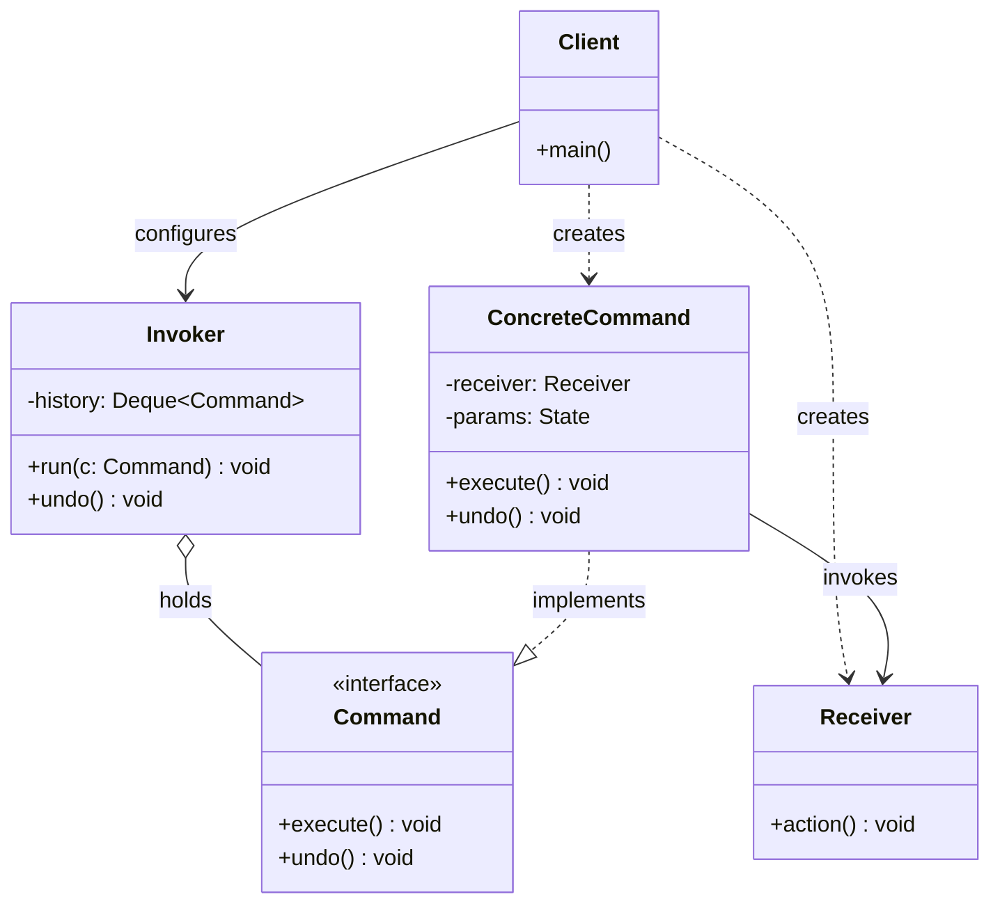

# 커맨드(Command) 디자인 패턴 가이드

> 한 줄 요약: 요청(Request)을 하나의 객체로 캡슐화하여, 호출자(Invoker)와 수신자(Receiver)를 분리하고 실행·취소·큐잉·로깅을 일관된 방식으로 다룰 수 있게 하는 패턴이다.
>
> 분류: 행위 패턴 (Behavioral Pattern)
> 다른 이름(Aliases): Action, Transaction

---

## 상세 설명

커맨드(Command) 패턴은 "어떤 작업을 수행하라"는 요청 자체를 일급 객체(First-Class Object)로 승격시키는 패턴이다. 일반적으로 메서드 호출은 호출 시점에 즉시 실행되고 흩어진 뒤 사라지지만, 커맨드 패턴은 그 호출을 `execute()`라는 인터페이스를 가진 객체로 감싸 보관·전달·재실행·취소가 가능한 형태로 만든다. 그 결과 "무엇을 할 것인가"라는 의도(Intent)와 "언제, 어떻게 할 것인가"라는 제어 흐름을 분리할 수 있게 된다.

이 패턴이 해결하고자 하는 문제(Problem)는 다음과 같다. 버튼·메뉴·단축키·매크로 같은 호출자(Invoker)는 자신이 어떤 동작을 시키는지 알면 알수록 수신자(Receiver)의 구현에 강하게 결합된다. 또 사용자의 명령을 되돌리기(undo) 위해서는 "방금 무엇을 했는가"를 어딘가에 기록해야 하는데, 일반 메서드 호출은 호출 후 사라지므로 이를 표현할 자연스러운 자리가 없다. 작업을 지연 실행하거나 다른 스레드에서 실행하려는 경우, 다른 머신으로 전송하려는 경우도 마찬가지다.

커맨드 패턴이 제안하는 해결책(Solution)은 모든 요청을 동일한 `Command` 인터페이스(주로 `execute()`, 필요하면 `undo()`)를 구현한 객체로 통일하는 것이다. 호출자는 구체적인 수신자의 메서드를 직접 호출하지 않고 `Command` 인터페이스에만 의존한다. 그 결과 커맨드는 큐(Queue)에 쌓아 두었다가 차례로 실행할 수 있고, 스택(Stack)에 쌓아 두었다가 역순으로 `undo()`를 호출해 되돌릴 수 있으며, 직렬화해 로그로 남겼다가 시스템 재시작 시 재실행(Replay)할 수도 있다.

핵심 용어는 다음과 같다. Command는 실행 단위의 추상화이고, Concrete Command는 특정 Receiver에 대한 호출을 캡슐화한 구체 클래스이며, Receiver는 실제 비즈니스 로직을 수행하는 객체다. Invoker는 Command를 보관하고 적절한 시점에 `execute()`를 호출하는 객체이고, Client는 Concrete Command를 만들어 Invoker에게 건네주는 조립자(Assembler)다.

역사적으로 이 패턴은 GoF(1994)의 행위 패턴으로 정형화되었지만, 그 이전부터 GUI 툴킷의 메뉴/버튼 액션, 트랜잭션 처리(데이터베이스 Redo 로그), 매크로 레코더 등에서 사실상 통용되는 관용구였다. 오늘날에도 Java의 `Runnable`, `Callable`, GUI 프레임워크의 `Action`, 메시지 큐 워커, CQRS의 Command 객체 등 다양한 형태로 살아 있다.

---

## 디자인 패턴을 충족하는 최소 조건

이 섹션에서는 "어떤 코드가 진짜로 커맨드 패턴이라고 부를 수 있는가"의 기준을 명확히 한다.

1. **요청이 객체로 캡슐화되어 있다 (Request as Object)** — 수행할 동작과 그 동작에 필요한 매개변수(Receiver 참조 포함)가 하나의 객체에 담겨 있어야 한다. 단순히 메서드를 직접 호출하는 코드라면 커맨드 패턴이 아니다.
2. **공통 실행 인터페이스가 존재한다 (Uniform Interface)** — 모든 커맨드는 동일한 인터페이스(보통 `execute()`)를 통해 호출 가능해야 한다. 호출자(Invoker)는 이 인터페이스 외에 구체 클래스를 알지 못해야 한다.
3. **호출자와 수신자가 분리되어 있다 (Invoker–Receiver Decoupling)** — Invoker는 Receiver의 구체 타입이나 메서드 시그니처를 알지 않고, Command 객체만 보유·실행한다. 이 결합 분리가 없으면 그냥 함수 호출의 우회에 지나지 않는다.
4. **Command는 자기-완결적이다 (Self-Contained Execution)** — `execute()`만 호출하면 별도 컨텍스트 없이도 작업이 수행되도록, 필요한 정보(Receiver, 인자, 이전 상태 등)를 자기 안에 가지고 있어야 한다.

> 위 조건 중 하나라도 빠지면 본 패턴이라고 보기 어렵다. 특히 1, 3번이 빠지면 "메서드 호출에 이름만 다르게 붙인 것"이며, undo/redo가 필요한 경우 4번이 빠지면 실용성이 무너진다.

### 흔히 오해하는 지점

- **Strategy 패턴과의 혼동**: 두 패턴 모두 동작을 객체로 만들지만 의도가 다르다. Strategy는 "어떤 알고리즘으로 같은 종류의 일을 처리할지"를 교체 가능하게 만드는 것이고, Command는 "어떤 작업을 언제·어디서·얼마나 자주 수행할지"를 제어 가능하게 만드는 것이다. Strategy는 보통 상태를 거의 갖지 않고 즉시 실행되지만, Command는 실행에 필요한 인자와 Receiver를 내부에 보관하며 지연 실행·취소·큐잉의 대상이 된다.
- **익명 함수/람다는 모두 커맨드인가**: 람다 한 줄로 `Runnable`을 넘기는 것도 형식상 커맨드의 일종으로 볼 수 있지만, 호출자–수신자 분리와 캡슐화 의도가 분명할 때만 패턴이라고 부른다. 단순 콜백은 패턴이라기보다 함수 일급 객체의 활용으로 보는 편이 적절하다.
- **`undo()`가 반드시 필요한가**: 아니다. GoF는 `undo()`를 선택 사항으로 본다. 큐잉·로깅·매크로 용도만으로도 커맨드 패턴이며, undo 지원은 패턴의 확장 형태(흔히 "Undoable Command")로 본다.
- **Memento 없이 undo가 되는가**: 단순한 토글이나 가산/감산은 Command 안의 작은 상태만으로 가능하지만, 복잡한 상태 복원이 필요할 때는 Memento 패턴과 결합한다. 이 경계를 무시하면 Command가 비대해진다.

---

## 사례를 통한 예시

### 예시 1: 텍스트 에디터의 undo 가능한 타이핑 명령

**상황**: 간단한 텍스트 에디터에서 사용자가 친 문자열을 문서에 추가하고, Ctrl+Z로 되돌릴 수 있어야 한다. 각 키 입력 또는 붙여넣기 동작을 커맨드로 캡슐화하면 undo/redo를 일관된 방식으로 구현할 수 있다.

```java
import java.util.ArrayDeque;
import java.util.Deque;

// Receiver: 실제 작업을 수행하는 도메인 객체
class Document {
    private final StringBuilder buffer = new StringBuilder();

    public void insert(int position, String text) {
        buffer.insert(position, text);
    }

    public void delete(int position, int length) {
        buffer.delete(position, position + length);
    }

    public int length() {
        return buffer.length();
    }

    @Override
    public String toString() {
        return buffer.toString();
    }
}

// Command: 공통 실행 인터페이스
interface Command {
    void execute();
    void undo();
}

// Concrete Command: "텍스트 삽입" 동작을 캡슐화
class InsertTextCommand implements Command {
    private final Document document;
    private final int position;
    private final String text;

    public InsertTextCommand(Document document, int position, String text) {
        this.document = document;
        this.position = position;
        this.text = text;
    }

    @Override
    public void execute() {
        document.insert(position, text);
    }

    @Override
    public void undo() {
        document.delete(position, text.length());
    }
}

// Invoker: 커맨드를 보관하고 실행/취소 시점을 제어
class EditorHistory {
    private final Deque<Command> done = new ArrayDeque<>();
    private final Deque<Command> undone = new ArrayDeque<>();

    public void run(Command command) {
        command.execute();
        done.push(command);
        undone.clear(); // 새 명령이 들어오면 redo 스택은 비운다
    }

    public void undo() {
        if (done.isEmpty()) return;
        Command c = done.pop();
        c.undo();
        undone.push(c);
    }

    public void redo() {
        if (undone.isEmpty()) return;
        Command c = undone.pop();
        c.execute();
        done.push(c);
    }
}

// Client
public class EditorDemo {
    public static void main(String[] args) {
        Document doc = new Document();
        EditorHistory history = new EditorHistory();

        history.run(new InsertTextCommand(doc, 0, "Hello"));
        history.run(new InsertTextCommand(doc, doc.length(), ", World"));
        System.out.println(doc); // Hello, World

        history.undo();
        System.out.println(doc); // Hello

        history.redo();
        System.out.println(doc); // Hello, World
    }
}
```

**해설**: `Document`는 Receiver, `Command`는 추상 Command, `InsertTextCommand`는 Concrete Command, `EditorHistory`는 Invoker, `EditorDemo`의 `main`이 Client에 대응된다. `EditorHistory`는 어떤 종류의 편집 동작인지 전혀 모른 채 `Command` 인터페이스만으로 실행/취소를 관리한다. 새로운 동작(예: `DeleteTextCommand`, `ReplaceTextCommand`)이 추가되어도 `EditorHistory`는 수정되지 않는다 — OCP(Open/Closed Principle)를 자연스럽게 따르게 된다.

### 예시 2: `java.lang.Runnable`과 `ExecutorService`의 명령 큐

**상황**: 표준 라이브러리의 `java.util.concurrent.ExecutorService`는 워커 스레드 풀(Worker Thread Pool)에 작업을 던지면 큐에 쌓였다가 차례로 실행되는 전형적인 커맨드 큐다. 여기서 `Runnable`(또는 `Callable`)이 Command의 역할을 한다.

```java
import java.util.concurrent.ExecutorService;
import java.util.concurrent.Executors;
import java.util.concurrent.TimeUnit;

public class CommandQueueDemo {

    // Receiver
    static class ReportService {
        public void generate(String reportId) {
            System.out.println(Thread.currentThread().getName()
                    + " generating report " + reportId);
        }
    }

    // Concrete Command: Runnable 구현체로서 Receiver 호출을 캡슐화
    static class GenerateReportCommand implements Runnable {
        private final ReportService service;
        private final String reportId;

        GenerateReportCommand(ReportService service, String reportId) {
            this.service = service;
            this.reportId = reportId;
        }

        @Override
        public void run() {
            service.generate(reportId);
        }
    }

    public static void main(String[] args) throws InterruptedException {
        ReportService service = new ReportService();

        // Invoker: 내부적으로 BlockingQueue<Runnable>을 보유하는 명령 큐
        ExecutorService executor = Executors.newFixedThreadPool(2);

        for (int i = 1; i <= 5; i++) {
            executor.submit(new GenerateReportCommand(service, "R-" + i));
        }

        executor.shutdown();
        executor.awaitTermination(5, TimeUnit.SECONDS);
    }
}
```

**해설**: `Runnable` 인터페이스는 "인자 없이 실행 가능한 단위 작업"이라는 커맨드의 본질을 그대로 표현한다. `ExecutorService`는 호출자(Invoker)로서 작업을 받아 내부 큐에 쌓고, 풀에 속한 워커 스레드가 차례로 `run()`을 호출한다. 작업이 어떤 도메인의 어떤 메서드를 호출하는지는 `ExecutorService`의 관심사가 아니다 — 호출자–수신자가 완전히 분리되어 있다. 또한 작업이 큐에 보관되는 동안 다른 스레드, 다른 시점, 다른 우선순위로 실행될 수 있다는 점이 커맨드를 객체화한 덕분이라는 사실을 잘 보여 준다. `Callable`과 `Future`까지 결합하면 결과값과 예외까지 커맨드의 일부로 다룰 수 있다.

---

## 어떨 때 사용하나

다음과 같은 신호(Symptom)가 보일 때 이 패턴 도입을 고려한다.

- **undo/redo, 매크로(Macro), 트랜잭션 롤백**이 요구될 때. 사용자의 행위를 객체로 보관해 두어야 되돌리기·다시하기를 일관된 정책으로 처리할 수 있다.
- **GUI의 메뉴·툴바·단축키·컨텍스트 메뉴**에서 동일한 동작을 여러 위젯이 공유해야 할 때. 위젯은 `Command`만 알면 되고, 동일 커맨드를 여러 진입점에 연결해 두면 된다.
- **작업의 지연·예약·재시도·우선순위 처리**가 필요할 때. `ScheduledExecutorService`, 메시지 큐(MQ), 잡 큐(Job Queue) 워커처럼 "지금 실행"과 "나중 실행"이 갈리는 시스템에서 자연스럽다.
- **작업을 직렬화하여 로그/네트워크로 보내야 할 때**. 분산 시스템의 명령 메시지, CQRS의 Command, 이벤트 소싱(Event Sourcing)의 커맨드 핸들러가 대표 예다.
- **여러 동작을 묶어 하나의 단위로 실행해야 할 때 (Composite Command / Macro Command)**. 여러 커맨드를 담는 `MacroCommand`를 만들어 일괄 실행/일괄 취소를 지원한다.

### 사용하면 안 되는 경우 (Anti-patterns)

- **단순 1회성 함수 호출까지 커맨드로 감싸는 경우**: 지연 실행, 취소, 큐잉, 로깅 중 어느 것도 필요 없는 평범한 메서드 호출을 Command 클래스로 감싸면, 클래스 수만 늘어나고 가독성은 떨어진다.
- **상태 복원이 본질적으로 불가능한 작업의 undo를 강요하는 경우**: 외부 시스템에 전송된 이메일, 결제 승인 등은 진정한 의미의 undo가 불가능하다. 이를 Command의 `undo()`로 흉내내려 하면 비즈니스 의미가 왜곡된다. 보상 트랜잭션(Compensating Transaction)이라는 별도 개념으로 모델링하는 편이 정확하다.
- **Strategy로 충분한 경우**: 알고리즘 교체가 목적일 뿐 실행 시점 제어가 필요 없다면 Strategy가 더 가볍고 적합하다.
- **함수형 언어/람다로 자연스럽게 표현되는 콜백을 굳이 클래스로 만드는 경우**: 인터페이스 1개·메서드 1개짜리 Command가 반복되어 보일러플레이트가 된다면, 람다·메서드 레퍼런스(Method Reference)로 대체하거나 함수형 인터페이스(`Runnable`, `Consumer`)를 직접 사용하는 편이 낫다.

---

## 장점과 단점, 한계점

### 장점
- **호출자–수신자의 결합도 감소(Decoupling)**: Invoker는 Command 인터페이스만 알면 되므로, 새로운 Receiver/동작을 추가해도 Invoker를 수정할 필요가 없다.
- **실행 시점의 자유로움**: 즉시 실행 외에 큐잉, 지연, 예약, 비동기 실행, 분산 실행이 모두 동일한 인터페이스 위에서 일관되게 처리된다.
- **undo/redo·로깅·매크로의 자연스러운 구현**: 행위 자체가 객체이므로 스택/큐/로그라는 일반 자료구조에 그대로 담을 수 있다.
- **OCP를 따르기 쉽다**: 새로운 동작은 새로운 Concrete Command 클래스를 추가하는 것으로 끝난다. 기존 Invoker·Receiver·다른 Command는 변경되지 않는다.
- **Composite와의 결합 용이성**: 여러 커맨드를 묶는 MacroCommand로 자연스럽게 확장된다.

### 단점
- **클래스 수의 증가**: 작은 동작 하나하나가 별도 클래스가 되므로 코드베이스의 클래스 수가 빠르게 늘어난다. 람다를 적극 활용해도 의미 있는 이름이 필요할 때는 결국 클래스가 생긴다.
- **간접 호출로 인한 가독성 저하**: 호출 흐름이 "Client → Invoker → Command → Receiver"로 길어져 처음 보는 사람에게는 추적이 어렵다.
- **undo 구현의 비용**: `undo()`를 제대로 구현하려면 실행 시점의 상태를 보관해야 하며, 큰 상태를 다루는 경우 Memento와 결합하면서 메모리 사용량이 늘어난다.

### 한계점
- **외부 부수효과(Side Effect)의 비가역성**: 파일 시스템, 네트워크, 결제 시스템처럼 외부 상태를 변경하는 작업은 원리상 완전한 undo가 불가능하다. Command의 `undo()`만으로 모든 종류의 작업을 되돌릴 수 있다는 가정은 위험하다.
- **동시성 환경에서의 미묘함**: 큐잉 자체는 쉽지만, undo 스택을 멀티스레드에서 공유하면 동기화 정책을 별도로 정의해야 한다. 또 Command가 외부 상태를 참조하는 경우, 실행 시점과 생성 시점 사이의 상태 변화에 취약하다.
- **직렬화 한계**: 커맨드를 디스크나 네트워크로 옮기려면 Command와 그 내부 참조가 모두 직렬화 가능해야 한다. Receiver가 외부 자원(파일 핸들, 소켓 등)을 들고 있으면 직렬화가 깨진다.
- **테스트의 분산**: 동작 검증이 Command·Receiver·Invoker로 흩어지므로, 통합 테스트를 별도로 설계하지 않으면 회귀(Regression)를 놓치기 쉽다.

---

## 정보 표

| 항목 | 값 |
| --- | --- |
| 분류 | 행위 패턴 (Behavioral) |
| 언어 의존성 | 언어 비의존적. 단, 함수가 일급 객체인 언어(자바스크립트, 파이썬, Java 8+)에서는 람다·함수형 인터페이스로 더 가볍게 구현된다. |
| 활용성(1점~5점) | ★★★★★ (5/5) — GUI 액션, 작업 큐(`ExecutorService`), 메시지 큐, CQRS, 이벤트 소싱 등 산업 전반에서 일상적으로 사용된다. |
| 학습 난이도 | 중 — 기본 구조는 간단하지만 undo/redo, Composite, Memento 결합까지 가면 설계 복잡도가 빠르게 올라간다. |
| 자주 함께 쓰이는 패턴 | Composite (Macro Command), Memento (상태 복원형 undo), Prototype (커맨드 복제), Chain of Responsibility (커맨드 처리 체인), Observer (실행 결과 통지) |
| 대표 사용 사례 | Java `Runnable`/`Callable` + `ExecutorService`, Swing `javax.swing.Action`, 텍스트 에디터의 undo/redo, 메시지 큐(JMS, Kafka 워커) 작업 단위, CQRS의 Command 객체 |

---

## Class Diagram



> 다이어그램에 등장하는 각 클래스가 패턴의 어떤 역할(Role)을 담당하는지 위 "상세 설명" 섹션과 1:1로 대응되어야 한다.

### 역할 설명
- **Client (클라이언트)**: Concrete Command를 생성하고, 그 안에 Receiver와 실행에 필요한 매개변수를 주입한 뒤 Invoker에게 전달하는 조립자. 위 예시의 `EditorDemo.main`이 여기에 해당한다.
- **Invoker (호출자)**: Command를 보관하고 적절한 시점에 `execute()`를 호출한다. 큐/스택/스케줄러 등 시점 제어 자료구조를 가질 수 있다. 예시의 `EditorHistory`, `ExecutorService`가 이 역할이다.
- **Command (커맨드)**: 모든 요청이 공유하는 추상 인터페이스. 보통 `execute()`, 선택적으로 `undo()`를 포함한다. 호출자가 의존하는 유일한 타입이다.
- **ConcreteCommand (구체 커맨드)**: 특정 Receiver에 대한 호출과 인자를 캡슐화한 구현체. 자기-완결적으로 동작에 필요한 모든 정보를 들고 있다. 예시의 `InsertTextCommand`, `GenerateReportCommand`.
- **Receiver (수신자)**: 실제 비즈니스 로직을 보유한 도메인 객체. 커맨드가 자신을 호출해 줄 때 본래의 일을 수행한다. 예시의 `Document`, `ReportService`.

---

## 참고 자료
- Erich Gamma, Richard Helm, Ralph Johnson, John Vlissides, "Design Patterns: Elements of Reusable Object-Oriented Software" (GoF, 1994) — Command 패턴 원전.
- Eric Freeman, Elisabeth Robson, "Head First Design Patterns" 2nd Edition, O'Reilly, 2020 — 리모컨/주문 예시로 Command 패턴 설명.
- Refactoring.Guru, "Command Pattern" — https://refactoring.guru/design-patterns/command
- Oracle Java Documentation, `java.lang.Runnable`, `java.util.concurrent.ExecutorService`, `java.util.concurrent.Callable` — 표준 라이브러리에서의 커맨드 큐 구현.
- Martin Fowler, "CQRS" — https://martinfowler.com/bliki/CQRS.html — 도메인 수준에서 Command를 일급 객체로 다루는 아키텍처 사례.
- Joshua Kerievsky, "Refactoring to Patterns", Addison-Wesley, 2004 — 기존 코드에서 Command 패턴으로 리팩터링하는 절차.
