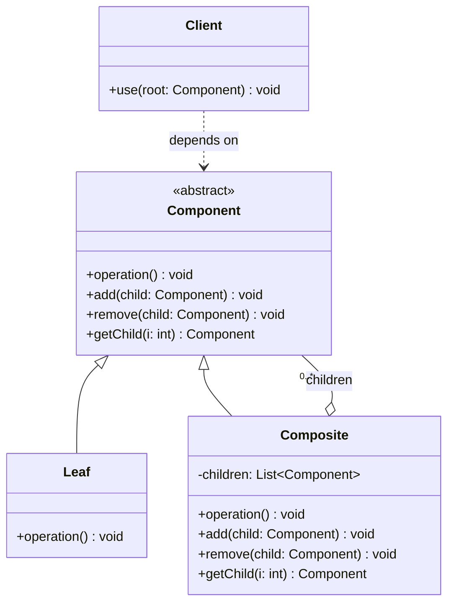

# 컴포지트(Composite) 디자인 패턴 가이드

> 한 줄 요약: 단일 객체(Leaf)와 객체의 집합(Composite)을 동일한 인터페이스(Component)로 다룰 수 있게 하여, 부분-전체(part-whole) 트리 구조를 클라이언트가 일관되게 조작하도록 만드는 패턴이다.
>
> 분류: 구조 패턴 (Structural Pattern)
> 다른 이름(Aliases): Object Tree, Part-Whole Hierarchy

---

## 상세 설명

컴포지트(Composite) 패턴은 객체들을 트리(tree) 형태의 계층 구조로 구성하고, 그 트리의 어떤 노드든 동일한 추상 타입을 통해 다룰 수 있도록 만드는 구조 패턴이다. 트리의 잎(Leaf)에 해당하는 단일 객체와, 자식 노드를 가질 수 있는 가지(Composite) 객체가 공통 인터페이스(Component)를 구현함으로써 클라이언트는 "지금 다루는 것이 단일 객체인지 묶음인지"를 분기 없이 처리할 수 있다.

이 패턴이 해결하려는 문제(Problem)는 분명하다. 그래픽 편집기의 도형 그룹, 파일 시스템의 디렉터리/파일, GUI의 컨테이너/위젯처럼 "하나의 원소"와 "원소의 묶음"이 동일한 연산(그리기, 크기 계산, 권한 확인 등)을 지원해야 하는 도메인에서는, 클라이언트 코드가 `if (item instanceof Group) ... else ...` 같은 타입 분기로 가득 차기 쉽다. 새로운 요소 타입이 추가될 때마다 분기 지점이 늘어나고, 단일과 묶음을 섞은 재귀 구조를 다루는 로직은 빠르게 복잡해진다.

컴포지트가 제안하는 해결책(Solution)은 공통 추상 타입 `Component`를 정의하고, `Leaf`는 자기 자신에 대한 연산을, `Composite`는 보유한 자식들에게 연산을 위임(delegate)하도록 구현하는 것이다. `Composite.operation()`은 일반적으로 자식 컬렉션을 순회하며 각 자식의 `operation()`을 호출한 뒤 결과를 합성한다. 이로 인해 트리의 깊이와 모양에 관계없이 클라이언트는 루트 `Component` 하나에 동일한 호출만 보내면 된다.

GoF 원전(Design Patterns, 1994)에서 정의한 핵심 용어는 세 가지다. `Component`는 트리에 들어갈 수 있는 모든 객체의 공통 인터페이스이며, `Leaf`는 자식을 갖지 않는 기본 단위, `Composite`는 자식 `Component`를 보유하고 그들에게 작업을 위임하는 노드다. GoF는 또한 `add(child)`, `remove(child)`, `getChild(i)` 같은 자식 관리 메서드를 어디에 둘지에 대해 "투명성(transparency) 대 안전성(safety)"의 트레이드오프를 명시했는데, 이는 본 패턴을 구현할 때 가장 자주 마주치는 설계 결정이다.

컴포지트는 단순한 트리 자료구조 그 자체가 아니라 "트리의 모든 노드가 같은 연산을 지원한다"는 다형성(polymorphism)에 본질이 있다. 즉 트리만 있다고 컴포지트가 아니며, 단일과 묶음이 동일 인터페이스로 치환 가능(substitutable)할 때 비로소 이 패턴이 성립한다.

---

## 디자인 패턴을 충족하는 최소 조건

이 섹션에서는 "어떤 코드가 진짜로 컴포지트 패턴이라고 부를 수 있는가"의 기준을 명확히 한다.

1. **공통 컴포넌트 추상화(Component abstraction)** — `Leaf`와 `Composite`가 동일한 추상 타입(인터페이스 또는 추상 클래스)을 구현하거나 상속해야 한다. 클라이언트는 이 추상 타입만 보고 작업하므로, 두 타입 모두 같은 핵심 연산(`operation()`)을 지원해야 한다.
2. **재귀적 합성(Recursive composition)** — `Composite`는 0개 이상의 `Component`를 자식으로 보유하며, 그 자식 또한 `Leaf`이거나 다시 `Composite`일 수 있다. 즉 트리는 임의 깊이로 중첩 가능해야 한다.
3. **연산의 위임(Delegation of operation)** — `Composite.operation()`은 자체 로직만 수행하는 것이 아니라, 보유한 자식들의 `operation()`을 호출해 결과를 모으거나 합성해야 한다. 자식에게 책임을 넘기지 않으면 단순한 객체 보유 컬렉션일 뿐 컴포지트가 아니다.
4. **클라이언트의 타입 불변(Uniform treatment)** — 클라이언트 코드는 다루는 노드가 `Leaf`인지 `Composite`인지 알 필요가 없어야 한다. 클라이언트 측에 `instanceof` 분기가 필수가 된다면 패턴의 의도를 충족하지 못한 것이다.

> 위 조건 중 하나라도 빠지면 컴포지트 패턴이라고 보기 어렵거나, 변형 패턴(예: 단순 트리 자료구조, Iterator와 결합된 변형)으로 분류해야 한다.

### 흔히 오해하는 지점
- **트리 = 컴포지트라는 오해**: 이진 탐색 트리나 DOM 파싱 결과처럼 단지 트리 구조를 가진 자료구조는 컴포지트가 아니다. 노드 타입이 단일하고 다형적 위임이 없다면 자료구조에 불과하다.
- **데코레이터(Decorator)와의 혼동**: 데코레이터도 동일 인터페이스로 객체를 감싸지만 자식이 항상 1개이고 책임 추가가 목적이다. 컴포지트는 자식이 N개이고 부분-전체 표현이 목적이다.
- **Leaf에 children 메서드를 강제로 두는 잘못된 투명성**: 투명성을 위해 `Leaf`에도 `add(child)`를 두면서 런타임에 항상 예외를 던지면, 컴파일러는 안전성을 보장하지 못한다. 이 경우 "투명성을 얻은 대신 타입 안전성을 잃었다"는 트레이드오프를 명확히 의식해야 한다.
- **Composite가 자식을 호출하지 않는 경우**: `Composite.operation()`이 자식들에게 위임하지 않고 자체 데이터만 처리한다면 패턴의 본질인 재귀적 합성이 사라진 것이다.

---

## 사례를 통한 예시

### 예시 1: 파일 시스템(File/Directory) 직접 구현

**상황**: 파일과 디렉터리가 모두 "용량(size)"을 가지며, 디렉터리의 용량은 내부에 포함된 모든 파일과 하위 디렉터리 용량의 합이다. 클라이언트는 루트가 파일인지 디렉터리인지 신경 쓰지 않고 `getSize()`만 호출하고자 한다.

```java
import java.util.ArrayList;
import java.util.List;

// Component: 공통 추상 타입
abstract class FileSystemNode {
    protected final String name;

    protected FileSystemNode(String name) {
        this.name = name;
    }

    public abstract long getSize();
    public abstract void print(String indent);

    // 자식 관리 메서드는 Composite에만 둠 (안전성 우선)
}

// Leaf: 자식을 갖지 않는 단일 객체
class FileNode extends FileSystemNode {
    private final long size;

    public FileNode(String name, long size) {
        super(name);
        this.size = size;
    }

    @Override
    public long getSize() {
        return size;
    }

    @Override
    public void print(String indent) {
        System.out.println(indent + "- " + name + " (" + size + "B)");
    }
}

// Composite: 자식을 보유하고 연산을 위임
class DirectoryNode extends FileSystemNode {
    private final List<FileSystemNode> children = new ArrayList<>();

    public DirectoryNode(String name) {
        super(name);
    }

    public void add(FileSystemNode child) {
        children.add(child);
    }

    public void remove(FileSystemNode child) {
        children.remove(child);
    }

    @Override
    public long getSize() {
        long total = 0;
        for (FileSystemNode child : children) {
            total += child.getSize();   // 자식에게 위임
        }
        return total;
    }

    @Override
    public void print(String indent) {
        System.out.println(indent + "+ " + name + "/ (" + getSize() + "B)");
        for (FileSystemNode child : children) {
            child.print(indent + "  ");
        }
    }
}

// Client
public class FileSystemDemo {
    public static void main(String[] args) {
        DirectoryNode root = new DirectoryNode("root");
        DirectoryNode src = new DirectoryNode("src");
        src.add(new FileNode("Main.java", 1200));
        src.add(new FileNode("Util.java", 800));

        DirectoryNode docs = new DirectoryNode("docs");
        docs.add(new FileNode("README.md", 400));

        root.add(src);
        root.add(docs);
        root.add(new FileNode("LICENSE", 100));

        // 클라이언트는 Leaf/Composite 구분 없이 동일 호출
        System.out.println("총 용량: " + root.getSize() + "B");
        root.print("");
    }
}
```

**해설**: `FileSystemNode`가 `Component`, `FileNode`가 `Leaf`, `DirectoryNode`가 `Composite`다. `DirectoryNode.getSize()`가 자식들의 `getSize()`를 재귀 호출해 합산하는 부분이 컴포지트의 "연산 위임"에 정확히 해당한다. 클라이언트(`FileSystemDemo`)는 루트가 파일이든 디렉터리든 같은 메서드 시그니처만 호출하면 된다. `add`/`remove`는 `DirectoryNode`에만 두어 안전성(safety) 쪽 트레이드오프를 선택했다.

### 예시 2: `java.awt.Container` / Swing `JComponent`

**상황**: Java AWT와 Swing의 GUI 트리는 컴포지트 패턴의 대표적인 실제 구현이다. 버튼, 레이블 같은 단일 위젯과 패널, 프레임 같은 컨테이너가 모두 같은 상위 타입(`Component`)을 상속해, 페인팅과 레이아웃이 재귀적으로 처리된다.

```java
import javax.swing.*;
import java.awt.*;

public class SwingCompositeExample {
    public static void main(String[] args) {
        // JFrame, JPanel은 Container(=Composite), JButton/JLabel은 Leaf 성격
        JFrame frame = new JFrame("Composite in Swing");
        frame.setDefaultCloseOperation(JFrame.EXIT_ON_CLOSE);
        frame.setLayout(new BorderLayout());

        JPanel header = new JPanel(new FlowLayout());
        header.add(new JLabel("Title"));        // Leaf
        header.add(new JButton("Save"));        // Leaf

        JPanel body = new JPanel(new GridLayout(2, 1));
        body.add(new JLabel("Hello"));          // Leaf
        JPanel innerGroup = new JPanel();       // Composite (중첩)
        innerGroup.add(new JButton("OK"));
        innerGroup.add(new JButton("Cancel"));
        body.add(innerGroup);

        frame.add(header, BorderLayout.NORTH);  // Composite.add(Component)
        frame.add(body, BorderLayout.CENTER);

        frame.pack();
        frame.setVisible(true);

        // 클라이언트는 Leaf/Composite를 구분하지 않고 동일 API를 사용
        Component root = frame;
        System.out.println("루트 크기: " + root.getPreferredSize());
        // root.paint(g) 한 번이면 트리 전체가 재귀적으로 그려진다
    }
}
```

**해설**: `java.awt.Component`가 `Component` 역할, `JButton`/`JLabel` 같은 위젯이 `Leaf`, `java.awt.Container`를 상속한 `JPanel`/`JFrame`이 `Composite` 역할이다. `Container.add(Component)`로 자식을 등록하고, `Container.paint(Graphics)`는 내부적으로 모든 자식의 `paint()`를 호출해 화면을 재귀적으로 그린다. `getPreferredSize()` 같은 레이아웃 계산도 자식들의 결과를 합성해 결정되므로, 클라이언트는 트리 깊이나 컨테이너 종류와 무관하게 루트에 동일 호출만 보내면 된다. 또한 Swing은 `add(Component)`를 `Container`에만 두는 "안전성" 모델과 `Component`에 `getParent()` 같은 트리 탐색 메서드를 두는 "투명성" 모델을 절충해 사용한다.

---

## 어떨 때 사용하나

부분-전체(part-whole) 계층을 다루어야 하고, 클라이언트가 단일 객체와 묶음을 동일하게 취급하길 원할 때 컴포지트 패턴을 고려한다. 구체적으로 다음과 같은 신호(Symptom)가 보일 때 도입을 검토한다.

- 동일한 연산(렌더링, 가격 합산, 권한 검사, 직렬화 등)을 단일 객체와 그 객체들의 집합 모두에 대해 수행해야 한다.
- 클라이언트 코드에 `if (x instanceof Group) ... else ...` 형태의 타입 분기가 반복적으로 나타나며, 새로운 노드 타입이 추가될 때마다 분기를 늘리고 있다.
- 도메인 자체가 명확한 재귀 구조다. 예를 들어 GUI 위젯 트리, 파일 시스템, 조직도, 메뉴/서브메뉴, 수식 트리(AST), 그래픽 도형 그룹화 등이 그렇다.
- 트리의 깊이가 가변적이고, 컴파일 타임에 노드 구성을 확정할 수 없다.

### 사용하면 안 되는 경우 (Anti-patterns)

- 단일 객체와 묶음의 "공통 연산"이 사실상 존재하지 않거나 매우 인위적인 경우. 억지로 공통 인터페이스를 만들면 빈 메서드와 예외 던지기로 가득 차 오히려 복잡도가 증가한다.
- 트리 구조가 필요 없는 1차원 컬렉션. 단순 리스트나 `Iterable<T>`로 충분한데 컴포지트로 추상화하면 과설계다.
- 노드 종류가 단 하나뿐이라 다형성이 의미 없는 경우. 이때는 일반 트리 노드 클래스 하나면 충분하다.
- 연산이 노드 타입마다 의미가 너무 달라서 추상 메서드로 통일하는 것이 거짓 추상화(false abstraction)가 되는 경우. 이 경우엔 Visitor 패턴이 더 적합할 수 있다.

---

## 장점과 단점, 한계점

### 장점
- **클라이언트 코드 단순화**: 클라이언트는 `Component` 인터페이스만 알면 되고, `Leaf`인지 `Composite`인지에 따른 분기가 사라진다. 트리 전체를 루트 노드 하나에 같은 호출을 보내 처리할 수 있다.
- **개방-폐쇄 원칙(OCP) 친화적**: 새로운 종류의 `Leaf`나 `Composite`를 추가해도 기존 클라이언트 코드를 수정할 필요가 없다. 트리 확장이 자연스럽다.
- **재귀 구조를 명시적으로 모델링**: 도메인이 본래 가지는 재귀성을 코드 구조가 그대로 반영하므로 가독성과 유지보수성이 좋다.

### 단점
- **과도하게 일반화된 인터페이스**: 모든 노드가 동일한 `Component` 인터페이스를 만족해야 하므로, 일부 노드에만 의미 있는 연산도 공통 인터페이스에 들어가게 되어 인터페이스가 비대해지거나 의미 없는 빈 구현이 늘어난다.
- **타입 안전성과 투명성의 트레이드오프**: `add(child)` 같은 자식 관리 메서드를 `Component`에 두면(투명성) `Leaf`에서 호출 시 런타임 예외를 던져야 하고, `Composite`에만 두면(안전성) 클라이언트가 다운캐스트해야 한다. 어느 쪽을 택해도 비용이 있다.
- **제약 조건을 컴파일 타임에 강제하기 어려움**: "이 컴포지트에는 특정 타입의 자식만 들어갈 수 있다" 같은 제약은 인터페이스가 일반화되어 있어 런타임 검증으로 풀 수밖에 없는 경우가 많다.

### 한계점
- **순회 성능과 깊이 제약**: 트리가 매우 깊고 자식 수가 많으면 `Composite.operation()`의 재귀 호출이 스택 오버플로나 성능 저하를 일으킬 수 있다. 깊은 트리에는 반복형 순회 또는 캐싱 전략이 필요하다.
- **상태 변경의 동기화 어려움**: 부분 변경이 전체 합계(예: 디렉터리 전체 크기)에 영향을 주는 경우 캐시 무효화/부모 갱신 전략이 별도로 필요하다. 컴포지트 패턴 자체는 이 문제를 풀어주지 않는다.
- **양방향 참조 시 메모리 누수 가능성**: `Composite`가 자식을 보유하고 자식이 부모를 참조하면, 잘못된 제거 처리 시 순환 참조로 인한 누수가 발생할 수 있다. 특히 GUI 트리에서 리스너 해제와 함께 다뤄야 한다.
- **불변성(immutability) 적용이 까다로움**: 트리에 자식이 동적으로 추가/제거되어야 하는 패턴 특성상 완전한 불변 구조로 만들기 어렵고, 영속적(persistent) 자료구조 기법이 추가로 필요하다.

---

## 정보 표

| 항목 | 값 |
| --- | --- |
| 분류 | 구조 패턴 (Structural) |
| 언어 의존성 | 언어 비의존적 — 인터페이스/추상 클래스와 컬렉션만 있으면 어떤 OOP 언어에서도 구현 가능하다. |
| 활용성(1점~5점) | ★★★★☆ (4/5) — GUI 툴킷, 파일 시스템, 조직도, AST 등 재귀 도메인에서 자주 등장하지만, 평탄한 도메인에는 과설계가 되기 쉬워 만점은 아니다. |
| 학습 난이도 | 중 — 개념 자체는 직관적이나, 자식 관리 메서드의 투명성/안전성 트레이드오프와 Visitor와의 차이를 이해하는 데 시간이 필요하다. |
| 자주 함께 쓰이는 패턴 | Iterator(자식 순회), Visitor(노드 타입별 연산 분리), Decorator(같은 인터페이스로 감싼다는 공통점), Chain of Responsibility(트리 위 책임 전달) |
| 대표 사용 사례 | `java.awt.Container`/Swing `JComponent` 트리, 파일 시스템 디렉터리/파일, HTML/XML DOM의 `Node`, 그래픽 편집기의 도형 그룹화 |

---

## Class Diagram



> 다이어그램에 등장하는 각 클래스가 패턴의 어떤 역할(Role)을 담당하는지 위 "상세 설명" 섹션과 1:1로 대응되어야 한다. 위 다이어그램은 자식 관리 메서드(`add`/`remove`/`getChild`)를 `Component`에 둔 "투명성(transparency) 우선" 형태이며, "안전성(safety) 우선" 형태에서는 해당 메서드를 `Composite`에만 두고 `Leaf`에서는 제거한다.

### 역할 설명
- **Component**: `Leaf`와 `Composite`의 공통 추상 타입. 트리 노드가 공통으로 지원해야 하는 연산(`operation()`)을 선언한다. 클라이언트는 오직 이 타입에만 의존한다.
- **Leaf**: 자식을 갖지 않는 말단 노드. `operation()`을 자기 자신에 대해 수행한다. 트리의 실제 작업 단위(파일, 버튼, 단일 도형 등)에 해당한다.
- **Composite**: 0개 이상의 `Component`를 자식으로 보유하는 노드. `operation()`을 호출받으면 자체 처리와 함께 자식들의 `operation()`을 호출하여 결과를 합성한다. 자식 추가/제거 책임도 보유한다.
- **Client**: `Component` 인터페이스를 통해 트리를 사용하는 코드. 다루는 노드가 `Leaf`인지 `Composite`인지 알 필요가 없으며, 루트 `Component`에만 명령을 보낸다.

---

## 참고 자료
- 원전: Erich Gamma, Richard Helm, Ralph Johnson, John Vlissides, "Design Patterns: Elements of Reusable Object-Oriented Software", Addison-Wesley, 1994 — "Composite" 항목.
- Refactoring Guru, "Composite": https://refactoring.guru/design-patterns/composite
- Java Platform SE API, `java.awt.Container`: https://docs.oracle.com/javase/8/docs/api/java/awt/Container.html
- Java Platform SE API, `javax.swing.JComponent`: https://docs.oracle.com/javase/8/docs/api/javax/swing/JComponent.html
- Joshua Bloch, "Effective Java" (3rd ed.) — 상속 vs 합성 관련 항목(컴포지트의 자식 보유는 합성 기반).
