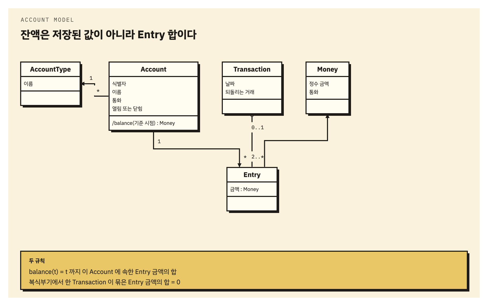

# Account — 잔액을 적어 두지 않고 Entry 의 합으로 설명하기

## 한눈에 보는 개요

작은 회사의 회계 프로그램이 계정마다 잔액 숫자 하나를 두고, 돈이 오갈 때마다 그 숫자를 고쳐 쓴다고 해 봅시다. 4월 1일에 매출 100,000원이 현금으로 들어왔고 4월 5일에 임대료 30,000원을 냈어요. 그런데 실제 임대료는 25,000원이어서, 담당자가 4월 6일에 현금 잔액에 5,000원을 더해 맞췄습니다.

```text
Before — 잔액을 숫자 하나로 고쳐 쓰는 모델

  실제로 일어난 일                  현금 잔액 칸
  4/1  매출 100,000 입금            0       → 100,000
  4/5  임대료 30,000 지급           100,000 →  70,000
  4/6  담당자가 5,000 을 더함        70,000  →  75,000

  시스템에 남는 것: 현금 잔액 = 75,000   (왼쪽 줄들은 어디에도 없음)
  "4/5 마감 때 현금은 얼마였나요?"   → 계산할 재료가 없음
  "4/6 의 +5,000 은 무엇이었나요?"    → 설명할 기록이 없음
```

마감 보고서를 다시 뽑거나 감사에서 5,000원의 출처를 물으면 숫자 하나로는 답할 수 없어요. 75,000 이 맞는 값인지 확인할 기준조차 없습니다.

Account 패턴은 잔액을 저장해 두는 값으로 보지 않아요. 돈이 오갈 때마다 **Entry**(계정 하나에 금액 하나가 오간 기록) 한 건을 남기고, 잔액은 그 시점까지 이 계정에 기록된 Entry 금액의 합으로 정의합니다. 이 글에서는 확정된 기록을 고치지 않고, 바로잡을 때도 Entry 를 새로 더해요 — 부호가 반대인 Entry 로 효과를 지운 뒤 올바른 Entry 를 남기는 방식(역분개)입니다.

```text
After — 잔액은 Entry 를 더해서 얻는 값

  현금 계정의 Entry
    4/1   +100,000   매출 입금
    4/5    -30,000   임대료 지급 (금액이 틀림)
    4/6    +30,000   4/5 기록을 되돌림
    4/6    -25,000   올바른 임대료
  ─────────────────────────────────────────────────────────
  잔액(4/5) = +100,000 - 30,000                    = 70,000
  잔액(4/6) = +100,000 - 30,000 + 30,000 - 25,000  = 75,000
```

> 기억법 — 잔액은 적어 두는 숫자가 아니라 Entry 를 더해서 얻는 답.

이 글을 끝까지 읽으면 어떤 모델을 Account 패턴이라고 불러도 되는지 조건으로 판정할 수 있어요. 이 패턴을 DDD(Domain-Driven Design, 도메인 주도 설계)로 옮길 때 Entry 를 누가 소유할지 네 가지 선택지 가운데서 고르는 기준과, 그 선택을 Java · TypeScript · Rust 코드로 옮긴 모습도 함께 봅니다.

분류는 Fowler 『Analysis Patterns』 6장 「Inventory and Accounting」의 회계 패턴이고, 함께 쓰는 패턴은 [Quantity](../quantity/quantity-guide_v1.0.0.md)(단위를 가진 금액) · [Transaction](../transaction/transaction-guide_v0.1.0.md)(합이 0 인 Entry 묶음) · [Posting Rule](../posting-rule/posting-rule-guide_v0.1.0.md)(업무 사건에서 거래를 만드는 규칙)입니다.

## 패턴 자세히 들여다보기

### 등장하는 개념과 정의

여기 나오는 이름은 분석 모델의 개념이에요. 개념이 맡는 책임과, 그 책임을 코드의 어느 객체가 수행하는지는 다른 문제입니다. 후자는 뒤의 「상황 설정」 표가 정해요.

- **Account**(계정) — 금액 기록을 모으고 그 합을 알려 주는 개념입니다.
  - 기본 책임(원서 그림 6.1 · eaaDev Account): 자기에게 속한 Entry 를 모으는 기준이 되어, 그 합인 잔액에 답합니다. 그러려면 식별자로 자기를 구별하고, 받을 금액의 통화를 정해야 해요.
  - 이 가이드의 예제가 더한 책임: AccountType 으로 분류되고, 열려 있는지 닫혀 있는지를 압니다. 최소 조건에서는 둘 다 선택으로 둡니다.
  - **balance**(잔액) — Account 의 파생 속성입니다. 어느 시점 t 의 balance 는 t 까지 그 Account 에 속한 Entry 금액의 합이에요. 저장된 사실이 아니라 Entry 에서 계산되는 값이라, 빨리 답하려고 계산해 둘 수는 있지만 계산해 둔 값이 Entry 합과 다르면 틀린 쪽은 계산해 둔 값입니다.
  - 협력: Entry 가 Account 에 속합니다(Account 1 — Entry 여럿). Fowler 는 이 패턴의 의도를 관련된 회계 Entry 를 모으고 요약 동작을 제공하는 것으로 적었어요([eaaDev Account](https://martinfowler.com/eaaDev/Account.html)).
- **Entry**(항목) — 계정 하나에 금액 하나가 오간 사실 한 건입니다.
  - 책임: 어느 Account 에 얼마(Money)가 기록됐는지 담습니다. 확정된 뒤에는 바뀌지 않는다는 규칙은 Fowler 가 흔한 규칙으로 적은 것이고([eaaDev Accounting Entry](https://martinfowler.com/eaaDev/AccountingEntry.html)), 이 글은 그 규칙을 따라요 — 최소 조건에서는 선택으로 둡니다.
  - 협력: 정확히 한 Account 에 속하고, balance 계산의 재료가 됩니다. 복식부기에서는 한 Transaction 에도 묶여요.
  - 금액·계정·날짜가 모두 같은 Entry 둘도 서로 다른 사실이에요. 같은 날 같은 금액을 두 번 입금하면 기록도 두 건입니다.
  - 원서 그림 6.1 의 Entry 는 금액과 함께 시각 둘(`whenCharged`, `whenBooked`)을 가집니다. 이 글의 예제는 거래 날짜 하나로 줄였어요.
- **Transaction**(거래) — 복식부기에서 업무 사건 하나가 만든 Entry 묶음이고, 묶인 Entry 금액의 합은 0 입니다.
  - 책임: 날짜를 갖고, 합이 0 인지 확인하고, 정정 거래라면 되돌리는 원 거래를 가리킵니다.
  - 협력: Entry 2개 이상을 만들어 묶습니다. 원서도 §6.1 Account 다음 §6.2 에서 따로 도입하고, Fowler 는 Account 와 Transaction 이 모두 선택이라 Transaction 없이 쓰는 시스템도 있다고 적었어요([eaaDev Patterns for Accounting](https://martinfowler.com/eaaDev/AccountingNarrative.html)). 이 글은 예제 배경이 복식부기라서 Entry 가 어디서 오는지를 설명하는 만큼만 다루고, 거래의 규칙은 [Transaction 가이드](../transaction/transaction-guide_v0.1.0.md)가 맡습니다.
- **Money**(금액) — 금액과 통화를 묶은 값입니다. 이 가이드의 예제는 금액을 정수 최소 단위로 표현해요.
  - 책임: 통화가 다른 금액끼리는 더하지 않습니다.
  - 협력: Entry 의 금액과 balance 의 값이 Money 예요. Fowler 는 금액을 단위를 가진 수량(Quantity)의 한 종류로 봅니다("Money is a kind of quantity", [JAOO 1999 튜토리얼 슬라이드](http://jaoo.dk/jaoo1999/schedule/MartinFowlerAnalysisPatterns.pdf)).
- **AccountType**(계정 종류) — 자산·부채·자본·수익·비용처럼 계정을 나누는 분류입니다.
  - 책임: 같은 종류의 계정이 공유하는 정의를 담습니다.
  - 협력: Account 마다 자기 AccountType 하나에 속합니다.
  - Fowler 는 이렇게 매일 생기는 사실이 아니라 사실을 해석하는 타입·규칙을 지식 층위(knowledge level)라고 불러요. 원서는 계정 분류를 그림 6.28 에서 하위 타입으로, 그림 6.20 에서 지식 층위의 Account Type 으로 그렸습니다([apchap6.pdf](https://martinfowler.com/apsupp/apchap6.pdf)).



그림에서 Entry 는 Account 와 Transaction 양쪽에 연관돼 있어요. 원서 그림 6.1 은 Account 쪽에 `balance = sum(entries.amount)` 제약을, 그림 6.2·6.3 은 Transaction 쪽에 `Sum(entries.amount) = 0` 제약을 둡니다. 분석 모델은 연관만 정할 뿐 누가 Entry 를 소유하는지는 정하지 않아요. 소유는 설계가 정합니다. 뒤의 코드에서 Account 클래스에 Entry 목록이 없는 것도 이 연관을 식별자 참조로 옮겼기 때문이지, 연관이 사라져서가 아닙니다.

```text
개념을 개요의 숫자에 대 보면

  AccountType(자산) ◀── Account 1010 현금 (KRW, 열림)
                                  ▲ 속함
  T1 4/1   Entry #1 현금 +100,000   Entry #2 매출 -100,000     묶음 합 = 0
  T2 4/5   Entry #1 임대료 +30,000  Entry #2 현금  -30,000     묶음 합 = 0
                                  │
  현금의 balance(4/5) = +100,000 - 30,000 = 70,000 KRW
```

### 동작 절차

개요의 4월 거래로 따라가 볼게요. 금액의 방향은 부호로 적습니다. 자산·비용 계정이 늘면 +, 부채·자본·수익 계정이 늘면 − 예요. hledger 매뉴얼도 posting(hledger 에서 Entry 에 해당하는 거래 한 줄)의 양수 금액을 차변(debit), 음수를 대변(credit)으로 읽고, 부채·자본·수익 잔액은 보통 음수라고 적습니다([hledger manual](https://hledger.org/hledger.html)).

```text
날짜  거래  Entry (순번 계정 금액)                메모
4/1   T1    #1 현금 +100,000   #2 매출 -100,000
4/5   T2    #1 임대료 +30,000  #2 현금 -30,000    금액이 틀림 (실제 25,000)
4/6   T3    #1 임대료 -30,000  #2 현금 +30,000    T2 를 되돌리는 역분개
4/6   T4    #1 임대료 +25,000  #2 현금 -25,000    올바른 금액
```

1. **Account 열기.** 현금·매출·임대료 계정이 식별자, AccountType, 통화(KRW)를 갖고 열린 상태로 생깁니다.
   - 왜 먼저인가: Entry 는 Account 에 속하는 기록이라 속할 대상이 먼저 있어야 해요. 통화도 계정이 정해 두어야 3단계에서 Entry 금액과 대조할 기준이 생깁니다.
2. **Transaction 이 Entry 를 만들어 묶기.** 복식부기 원장에서는 4/1 매출 사건 하나가 T1 을 만들고, T1 이 Entry #1(현금 +100,000)과 #2(매출 −100,000)를 묶습니다. 합은 +100,000 − 100,000 = 0 이에요.
   - 왜 Transaction 이 맡는가: 합이 0 이라는 조건은 두 계정에 걸친 규칙이라서, 계정 하나만 보는 Account 는 판정할 수 없습니다.
3. **Account 가 Entry 를 받을 수 있는지 확인.** Entry 마다 속할 Account 가 열려 있는지, Entry 금액의 통화가 계정 통화와 같은지 봅니다. 여기서 거절된 거래는 만들어졌어도 원장에 없는 거래예요.
   - 왜 Account 가 맡는가: 열림/닫힘과 통화는 Account 만 아는 사실이에요.
   - 순서를 바꾸면: 4단계(확정)를 먼저 하고 확인을 뒤에 하면 닫힌 계정에 Entry 가 남습니다. 그 거래를 되돌리는 역분개도 같은 닫힌 계정을 가리키므로 이 확인에서 거절돼요. 계정을 다시 열거나 정정만 허용하는 규칙을 따로 두지 않으면 지울 방법이 없습니다.
4. **Entry 확정.** 확인을 통과한 Transaction 이 원장(모든 거래가 확정돼 쌓이는 장부)에 기록됩니다. 이 일을 전기(posting)라고 불러요. 이후 어떤 단계도 확정된 Entry 를 고치거나 지우지 않습니다.
   - 왜 고치지 않는가: 확정된 Entry 가 바뀌어서 4/5 잔액이 달라지는 일이 없어야 하기 때문입니다.
   - 주의할 점: 4/5 날짜의 새 거래를 4/7 에 전기하면 기존 Entry 를 고치지 않아도 4/5 잔액이 달라져요. 이런 뒤늦은 전기를 막는 기간 마감 규칙은 이 예제에 없습니다.
5. **잔액 계산.** 묻는 방식에 따라 두 갈래로 나뉘어집니다.
   - 5-a 어느 시점의 잔액: 그 날짜까지의 Entry 가운데 이 Account 에 속한 것만 더합니다. 4/5 현금 = +100,000(T1 #1) − 30,000(T2 #2) = 70,000 이에요.
   - 5-b 지금 잔액을 자주 물을 때: 매번 처음부터 더하지 않고, 새로 확정된 Entry 만 이전 결과에 더해 둡니다. 이 값은 반영한 위치까지의 Entry 합과 같아야 해요. 아직 반영하지 않은 Entry 가 있으면 그만큼 늦은 값입니다. 뒤의 코드는 반영 위치를 날짜가 아니라 전기 순번으로 세서, 5/1 날짜의 거래를 4/6 에 전기하면 계산해 둔 값에는 바로 들어가지만 4/6 기준 Entry 합에는 들어가지 않아요.
   - 왜 Entry 가 기준인가: 더해 둔 값은 Entry 로 다시 만들 수 있지만, Entry 는 더해 둔 값으로 다시 만들 수 없습니다. 원천이 한쪽에만 있어야 둘이 어긋났을 때 무엇을 고칠지가 정해져요.
6. **틀린 기록을 역분개로 정정.** T2 금액이 틀렸다는 걸 알게 돼도 T2 는 그대로 둡니다. T2 의 Entry 부호를 뒤집은 T3(역분개)과 올바른 금액의 T4 를 새로 만들어 3·4단계를 다시 거쳐요.
   - 결과: 4/6 현금 = 70,000(4/5 까지의 합) + 30,000(T3 #2) − 25,000(T4 #2) = 75,000 입니다. 4/5 현금은 여전히 70,000 이에요. T3·T4 의 날짜가 4/6 이라 4/5 까지의 합에 들어가지 않으니까요.
   - 왜 고치지 않는가: T2 #2 의 −30,000 을 −25,000 으로 고치면 4/5 현금이 75,000 으로 바뀝니다. 4/5 에 70,000 으로 이미 낸 보고서와 지금 계산이 어긋나는데, 어느 쪽이 맞는지 보여 줄 기록이 남지 않아요.
7. **Account 닫기.** 닫힌 계정은 3단계에서 새 Entry 를 거절합니다. 이미 확정된 Entry 와 5단계 계산은 그대로예요.
   - 왜 이렇게 나누는가: 닫힘은 앞으로 들어올 기록을 막는 규칙입니다. 지난 Entry 까지 지우면 확정된 Entry 는 그대로 남는다는 4단계와 부딪혀요.

잠깐, 확인 하나만 해 볼까요? 4/6 기준으로 임대료 계정의 잔액은 얼마일까요? 표에서 임대료에 속한 Entry 만 골라 더하면 됩니다.

```text
임대료의 Entry:  T2 #1 +30,000   T3 #1 -30,000   T4 #1 +25,000
잔액(4/6) = +30,000 - 30,000 + 25,000 = 25,000
```

여기서 헷갈리기 쉬운 포인트는 5-b 처럼 잔액을 계산해 두는 순간 Account 패턴에서 벗어난다고 생각하는 것입니다. Fowler 도 Entry 가 많으면 현재 잔액을 필드에 캐시할 수 있다고 적었어요([eaaDev Account](https://martinfowler.com/eaaDev/Account.html)). 갈리는 지점은 기준입니다. 캐시가 Entry 합과 다를 때 캐시를 다시 계산하면 Account 패턴이고, Entry 를 캐시에 맞춰 고치면 잔액 필드 모델이에요.

## 사용 목적

코드나 요구서에서 아래 단서가 보이면 Account 패턴을 꺼낼 때입니다.

- **잔액 칸을 고치는 코드가 여러 곳에 흩어져 있고, 잔액이 왜 이 금액이냐는 문의에 로그를 뒤져 답하는 상황.** 예를 들어 `UPDATE account SET balance = balance - ?` 가 결제·환불·수수료 코드에 따로 들어 있는 경우예요. 잔액의 이유를 모델이 모르니 로그가 대신 답하고 있습니다.
- **요구서에 과거 시점과 기간이 나오는 경우.** 3월 31일 기준 잔액, 1분기 입금 합계, 지난달 말 창고 재고 같은 문장이요. 현재 숫자 하나로는 계산할 수 없습니다.
- **정정을 행 수정·삭제로 하다가 원래 값이 무엇이었는지 답하지 못한 경험.** 감사나 분쟁에서 수정 전 값을 물을 때 드러납니다.
- **돈이 아닌 수량이 같은 모양으로 들어오고 나가는 도메인.** Fowler 는 냉장고의 맥주병과 창고 네트워크를 예로 들며 돈 이외에도 Account 를 쓴다고 적었어요([eaaDev Account](https://martinfowler.com/eaaDev/Account.html)).

쓰지 말아야 할 경우도 분명합니다.

- **현재 값만 필요할 때.** 게시글 조회수처럼 지금 몇인지만 묻는 값은 필드 하나로 충분하다고 Fowler 도 적었습니다. Account 로 만들면 증가 한 번마다 Entry 가 쌓이고 조회 때 합산이나 캐시 동기화를 챙겨야 하는데, 그렇게 해서 새로 답할 수 있는 질문은 없어요.
- **값이 시점마다 바뀌지만 변화를 더해서 값을 얻지는 않을 때.** 직원의 주소나 월급처럼 그 날짜에 무엇이었는지만 묻는다면 Temporal Property(시점을 받아 그때의 값을 돌려주는 속성)로 충분합니다([eaaDev Account](https://martinfowler.com/eaaDev/Account.html), [eaaDev Temporal Property](https://martinfowler.com/eaaDev/TemporalProperty.html)). 월급은 금액이라 더할 수는 있지만, 올해 월급은 인상분 기록의 합이 아니라 그 날짜부터 정해진 값이에요. Account 로 만들면 정해진 값을 적는 대신 이전 값과의 차이를 계산해 Entry 로 넣어야 합니다.
- **더할 양이 없는 이력일 때.** 소스 코드 버전 이력에 계정 비유를 쓰는 것을 Fowler 는 "stretching the analogy a little too far"라고 적었습니다([eaaDev Account](https://martinfowler.com/eaaDev/Account.html)). 커밋 기록을 Entry 로, 그 시점의 코드를 balance 로 옮겨 보면 어디서 맞지 않는지 보입니다.

```text
모델에 보이는 모양으로 나란히 놓기 — 쓰지 말아야 할 세 경우와 Account 가 맞는 경우

조회수 — 필드로 충분
  모양      Post { viewCount } · view() 가 viewCount 에 1 을 더함
  묻는 것   지금 몇인가 → 필드 하나로 답이 끝남. 과거 값이나 변경 한 건을 묻는 코드가 없음

월급 이력 — Temporal Property
  모양      Employee { salaryAt(날짜) } · 기록: 2025-01-01 부터 3,000,000 / 2026-01-01 부터 3,200,000
  묻는 것   그 날짜의 값 → 그 날짜가 든 기간의 값을 찾아 돌려줌. 기록끼리 더하는 코드가 없음

소스 코드 이력 — Account 가 맞지 않음
  모양      기록: "3행 추가" · "그 3행 중 2행 삭제" · "파일 이름 변경"
  묻는 것   그 시점의 코드 → 기록을 정해진 순서대로 적용. 순서를 바꾸면 없는 행을 지우게 됨
            기록끼리의 덧셈, 0, 단위가 없어 balance 를 합으로 정의할 수 없음

창고 재고 — Account
  모양      한 계정에 속한 Entry: +10개 · -3개 · +5개
  묻는 것   그날의 재고와 그 이유 → Entry 를 더함: 0 + 10 - 3 + 5 = 12개, 어느 Entry 때문인지도 답함
```

넷을 가르는 질문은 하나예요. 현재 값이 한 계정에 속한 기록들의 합으로 정의되는가. 조회수는 합을 물을 과거가 없고, 월급은 기간마다 정해진 값이라 합이 아니며, 코드 이력은 기록끼리 더할 수 없어요. 모델에서는 기록 값 타입에 단위를 확인하는 덧셈과 0 이 있는지, 조회 코드가 기록을 더하는지 아니면 기간을 찾거나 순서대로 적용하는지를 보면 됩니다.

```text
단서                                          먼저 떠올릴 패턴
잔액의 이유 · 과거 시점 잔액 · 합산되는 양      Account
돈이 어디서 와서 어디로 갔는지 짝 맞추기         Transaction (Account 와 함께)
날짜마다 정해진 값, 변화를 더해 얻지 않음         Temporal Property
금액이 아닌 상태 변경까지 기록에서 재구성        Event Sourcing (Account 와 겹쳐 쓸 수 있음)
```

## 패턴의 경계

### 디자인 패턴을 충족하는 최소 조건

아래 조건은 클래스 모양이 아니라 개념이 맡는 책임과 모델이 늘 지키는 불변식으로 판정해요. Entry 를 누가 소유하든 같은 기준으로 판정할 수 있어야 하기 때문입니다. 조건마다 근거가 원서 그림인지, Fowler 의 후속 초안(eaaDev)인지, 이 가이드의 정책인지를 괄호로 밝혔어요. `[필수]` 에는 원전이 Account 의 성립 요건으로 적은 것만 올렸고, 원전이 흔한 규칙으로 적은 것과 이 가이드의 정책은 번호 순서와 무관하게 `[선택]` 입니다.

1. [필수] 잔액은 Entry 의 합으로 정의됩니다 — 어느 시점의 잔액이든 그 시점까지 확정된 Entry 가운데 그 Account 에 속한 것의 금액 합과 같아요. 잔액을 계산해 둔 값이 있어도 기준은 이 합이고, 계산해 둔 값은 반영한 위치까지의 합과 같아야 합니다. 오래된 Entry 를 합이 같은 한 건으로 정리했다면 정리한 구간 안쪽 시점만 예외예요. (근거: 원서 그림 6.1 의 `balance = sum(entries.amount)`, 정리는 eaaDev Account)
   빠지면: 개요의 Before 처럼 잔액 숫자를 고쳐 쓰는 필드가 됩니다. 4/5 마감 때 현금이 얼마였는지, +5,000 이 무엇이었는지 답할 재료가 없어요. Fowler 도 현재 값만 필요하면 필드로 충분하다고 했는데, 그건 Account 패턴이 아니라 속성 하나입니다.
2. [필수] Account 는 Entry 를 모으는 기준을 책임집니다 — 모든 Entry 는 정확히 한 Account 에 속하고, 한 Account 의 잔액은 그 Account 에 속한 Entry 만 더해요. 속한다는 말은 Account 가 Entry 목록을 들고 있다는 뜻이 아니라 Entry 마다 속한 Account 가 하나로 정해진다는 뜻이고, 목록에 담든 식별자로 가리키든 같습니다. (근거: 원서 그림 6.1 의 Account 1 — Entry 여럿)
   빠지면: Entry 에 `"현금"` 같은 분류 문자열만 붙은 기록 목록이 됩니다. `"현금"` 과 `"현금 "` 이 서로 다른 묶음으로 더해지고, 통화나 열림/닫힘처럼 묶음 전체에 걸리는 사실을 둘 곳이 없어요. Fowler 가 Account 없이 Entry 만 쓰는 선택지로 따로 적은 모양입니다([eaaDev Accounting Entry](https://martinfowler.com/eaaDev/AccountingEntry.html)).
3. [선택] 확정된 Entry 를 고치거나 지워서 정정하지 않습니다 — 값의 변화와 정정은 Entry 를 새로 더해서 기록해요. (근거: Fowler 가 흔한 규칙으로 적은 것 — eaaDev Accounting Entry 는 확정 뒤 변경 금지와 함께 확정 전 변경을 허용하는 규칙도 흔하다고 적었고, 원전이 Account 의 성립 요건으로 든 것은 Entry 를 모으는 것과 그 합으로 요약을 주는 것 둘입니다. 감사와 과거 시점 보고가 요구로 들어오면 이 조건이 필요하고, 이 가이드는 역분개로 따릅니다)
   빠지면 잃는 것: 과거 시점 잔액의 재현, 수정 전 값. T2 #2 의 −30,000 을 −25,000 으로 고치면 4/5 현금 잔액이 70,000 에서 75,000 으로 바뀌어 4/5 에 낸 보고서와 어긋나고, 수정 전 값이 남지 않으니 어느 쪽이 맞는지도 보일 수 없어요. 조건 1 은 그대로 지켜집니다 — 잔액은 여전히 Entry 합이고, 합의 재료였던 Entry 가 바뀌었을 뿐이에요. 그래서 이 조건이 빠져도 Account 패턴이 아니게 되지는 않고, 과거를 묻는 질문에만 답하지 못합니다. Fowler 는 오래된 Entry 정리도 적었으므로, 이 조건이 막는 것은 확정된 Entry 를 정정하려고 고치거나 지우는 일뿐입니다.
4. [필수] 금액은 단위를 가진 값이고, 한 잔액으로 더하는 금액은 단위가 같습니다 — 돈이면 통화를 가진 Money 이고, 통화가 다른 금액은 한 잔액에 더하지 않아요. 단위가 하나로 고정된 모델이면 그것으로 충족하고, 여러 통화를 받는 계정이면 통화별로 따로 더합니다(eaaDev 가 말하는 Money Bag, 통화별 금액 묶음). (근거: 원서 그림 6.1 에서 amount 와 balance 가 Quantity, eaaDev Account 의 계정 통화)
   빠지면: 현금(KRW) 잔액 70,000 에 USD 100 이 숫자 100 으로 더해져 70,100 이 됩니다. 합은 나오지만 어느 통화의 금액도 아니에요.
5. [선택] 계정 열림/닫힘 — 닫힌 Account 는 새 Entry 를 받지 않고, 이미 확정된 Entry 와 잔액은 그대로 둡니다. (근거: 이 가이드의 정책, [회계 배경 확정안](../../research/accounting-context.md) I5 의 계정 유효)
6. [선택] 계정 분류 — AccountType 으로 계정 종류를 나눕니다. 이 가이드는 자산·부채·자본·수익·비용을 예로 써요. (근거: 원서 그림 6.20 의 지식 층위 Account Type, 분류 예는 그림 6.28 의 Asset · Liability · Income · Expense)
7. [선택] 기간 잔액 — 시점 하나가 아니라 기간 안의 Entry 합을 돌려줍니다. (근거: eaaDev Account 의 `balance(DateRange)`)
8. [선택] 잔액 캐시 — 현재 잔액을 계산해 두고 새 Entry 만 더합니다. 반영한 위치까지의 Entry 합과 같게 유지하고 Entry 에서 다시 만들 수 있는 한 패턴 안이에요. (근거: eaaDev Account 의 현재 잔액 캐시)

### 비슷한 패턴·안티패턴과의 차이

Account 와 닮아 보이거나 같은 단서에서 떠오르는 넷을 구분 기준부터 모았어요.

| 대상 | 구분 기준 | Account 를 고르면 얻는 것 | 포기하는 것 |
| --- | --- | --- | --- |
| 필드가 원천인 잔액 모델 (감사·과거 잔액이 필요한 곳에 쓰면 안티패턴) | 잔액과 기록이 어긋날 때 무엇을 고치는가 — 기록으로 잔액을 다시 계산하면 Account, 필드를 기준으로 두면 이 모델 | 어느 시점의 잔액이든 기록에서 다시 계산하고, 계산해 둔 값이 틀렸는지 판정하는 능력 | 조회 때 합산 비용, 또는 캐시를 Entry 와 맞추는 일 |
| Temporal Property | 현재 값을 변화 기록의 합으로 얻는가(합산 책임), 시점마다 정해진 값을 찾아 돌려주는가(시점 조회 책임). 값이 금액이어도 합으로 정의되지 않으면 Temporal Property | 변경 한 건 한 건과 그 합을 함께 다루는 모델 | Temporal Property 의 단순함(기간별 값만 적고 찾음), 그리고 변화를 모두 Entry 로 남기는 저장 |
| Transaction (함께 쓰는 짝) | 규칙이 한 계정의 Entry 합(= 잔액)에 걸리는가, 한 사건의 Entry 합(= 0)에 걸리는가 | Transaction 없이 Account 만 두면 계정별 잔액과 내역에 답하는 가벼운 모델 | Transaction 없이 Account 만 두면 돈이 어디서 와서 어디로 갔는지 짝을 맞추는 검증이 없음. 둘은 대체 관계가 아니라 함께 쓰는 관계 |
| Event Sourcing | 저장된 원천이 무엇인가 — 계정 이름·열림/닫힘 같은 현재 상태까지 이벤트에서 다시 만들면 Event Sourcing, 현재 상태는 그대로 저장하고 금액 결과만 Entry 로 모아 더하면 Account | 계정·금액 질문에 맞춘 좁은 모델, 합산 하나로 끝나는 잔액 | 금액이 아닌 상태 변경의 이력(계정 이름 변경 등). 필요하면 Event Sourcing 과 겹쳐 씀 |

Event Sourcing 은 애플리케이션 상태의 모든 변경을 이벤트 순서대로 저장하는 패턴이에요([eaaDev Event Sourcing](https://martinfowler.com/eaaDev/EventSourcing.html)). 금액 이벤트를 더해 잔액을 만드는 것도 이벤트 재생의 한 형태라서 둘은 겹칠 수 있고, Fowler 도 Account 가 사건의 금전적 결과를 추적하므로 Event Sourcing 과 잘 맞는다고 적었습니다([eaaDev Patterns for Accounting](https://martinfowler.com/eaaDev/AccountingNarrative.html)). 표의 대상마다 모델이나 코드에서 무엇을 보면 갈리는지 모아 볼게요. 필드가 원천인 모델은 바로 아래 코드로 따로 봅니다.

```text
Temporal Property 와 Account — 조회 코드가 하는 일
  Temporal Property   salaryAt(날짜) 가 그 날짜가 든 기간의 값을 찾아 돌려줌 (사용 목적의 월급 이력)
  Account             balanceAsOf(계정, 날짜) 가 그 날짜까지의 Entry 를 더함
  확인할 곳           조회가 기록을 더하는가, 기간을 찾는가

Transaction 과 Account — 짝을 검사하는 코드가 있는가
  Account 만 둔 단식 기록   현금 계정에 Entry(-30,000) 한 건. 임대료 쪽 +30,000 이 빠져도 알아챌 코드가 없음
  Transaction 을 함께 둠    T2 = {임대료 +30,000, 현금 -30,000}. Transaction.create 가 합 0 을 검사
  확인할 곳                 여러 계정의 Entry 를 한 묶음으로 만들고 합을 검사하는 생성 코드가 있는가

Account 만 쓰는 모델 (이 가이드의 코드)
  저장소에 있는 것   Account(1010, 현금, 열림) ← 현재 상태를 그대로 저장
                     Transaction T1~T4 와 그 Entry
  잔액               Entry 의 합. TransactionPosted 는 읽기 모델에 알리는 용도
  계정 이름 이력     물을 수 없음. 이름을 바꾸면 현재 값만 남음

Event Sourcing 을 겹쳐 쓴 모델 (예시 이벤트 이름)
  저장소에 있는 것   AccountOpened(1010, 현금) · AccountRenamed(1010, 보통예금)
                     AmountPosted(1010, +100,000) · AccountClosed(1010)
  Account 객체       이벤트를 순서대로 적용해 이름·열림/닫힘·잔액을 모두 다시 만듦
  확인할 곳          Account 의 현재 상태를 저장하는 테이블이나 필드가 있는가
                     없고 이벤트만 있으면 Event Sourcing
```

가장 헷갈리는 쌍은 첫 줄이에요. 잔액 필드 옆에 변경 로그를 쌓으면 기록이 있으니 Account 처럼 보입니다. 갈리는 곳은 로그의 유무가 아니라 원천이 어디냐예요. 아래 코드에서 원천은 필드이고 로그는 부산물입니다.

```java no-compile
// Account 패턴처럼 보이지만 잔액의 원천이 필드인 모델
class CashAccount {
    private long balance;
    private final List<String> log = new ArrayList<>();

    void deposit(long amount) {
        balance += amount;
        log.add("deposit " + amount);
    }

    void withdraw(long amount) {
        balance -= amount;
        log.add("withdraw " + amount);
    }

    void adjust(long delta) {      // 정정: 필드만 고치고 로그는 남기지 않음
        balance += delta;
    }
}
```

`adjust(5000)` 한 번이면 필드와 로그가 달라집니다.

```text
필드가 원천인 잔액 모델
  로그   deposit 100000 · withdraw 30000         로그 합 = 70,000
  필드   balance = 75,000                         (adjust(5000) 이후)
  → 필드가 맞는지 확인할 독립적인 기록이 없음 (로그는 adjust 를 모름)

Account 패턴
  Entry  +100,000 · -30,000 · +30,000 · -25,000   Entry 합 = 75,000
  캐시   75,000                                   → 다르면 캐시를 다시 계산
```

`adjust` 가 로그를 남기도록 고치는 것만으로는 부족해요. 모든 변경을 필드와 같은 원자 단위로 기록하고, 둘이 어긋나면 기록으로 필드를 다시 계산한다는 규칙까지 두면 조건 8 의 잔액 캐시, 즉 Account 패턴이 됩니다. 그 규칙이 없는 한 필드 모델이 얻는 것은 조회 한 번에 숫자 하나를 읽는 단순함이고, 그 대신 과거 시점의 잔액과 정정의 흔적을 믿을 근거를 포기합니다. 구현 예시의 `AccountBalance` 도 필드에 금액을 더해 가는 모양은 같지만, 원천이 아니라서 `rebuildBalance` 로 버리고 이벤트에서 다시 만들 수 있다는 점이 다릅니다.

## 구현 예시

### 상황 설정

예시 도메인은 작은 회사의 총계정원장(General Ledger, 모든 계정의 거래를 모아 두는 장부)이에요. 청구·결제 같은 다른 시스템에서 일어난 업무 사건이 거래로 들어오면, 이 원장은 거래를 전기하고 계정별 잔액을 알려 줍니다. 배경은 Account · Transaction · Posting Rule 세 가이드가 함께 쓰는 [회계 배경 확정안](../../research/accounting-context.md)을 따릅니다.

```text
고정된 것
  · 계정마다 통화 하나, 금액은 정수 최소 단위 (KRW 는 1원)
  · 방향은 부호 (자산·비용 +, 부채·자본·수익 -)
  · 전기된 거래와 그 Entry 는 바꾸지 않음, 정정은 역분개 한 가지
  · 결제 승인이나 잔액 한도 판단은 이 원장이 하지 않음
변하는 것
  · 계정이 새로 열리거나 닫힘
  · 거래는 계속 쌓임 (Entry 수는 줄지 않음)
  · 잔액 조회가 방금 전기한 거래를 아직 반영하지 않았을 수 있음
```

고정된 것의 마지막 줄이 경계를 가릅니다. 잔액이 음수가 되면 안 된다는 규칙은 결제를 승인하는 쪽의 것이라 이 원장에는 없어요(확정안 2절). 그래서 잔액을 전기와 같은 순간에 맞출 필요가 없고, 조금 늦게 따라와도 됩니다. 그 규칙이 원장으로 들어오면 경계가 달라지는데, 그 경우는 「상황이 달라지면」에서 봅니다.

```text
예시 타입               개념
────────────────────    ──────────────────────────────────────────────────
Account                 Account
AccountId               Account 의 식별자
AccountTypeId           AccountType 의 식별자 (AccountType 자체는 코드에 없음)
Entry                   Entry (Transaction 안에서만 쓰임)
AccountAmount           계정 id + 금액 값 (거래를 만들 때의 입력, 이벤트의 내용)
Transaction             Transaction
TransactionId           Transaction 의 식별자
Money                   Money
balanceAsOf             Account 의 balance 정의 그대로 Entry 를 더하는 조회
AccountBalance          Account 의 balance 를 전기 순번 기준 반영 위치까지 계산해 둔 값 (날짜와 무관)
rebuildBalance          읽기 모델을 버리고 이벤트에서 다시 만드는 작업 (구현 전용)
TransactionPosted       전기가 끝났음을 알리는 이벤트 (구현 전용)
GeneralLedger           저장소와 전기 서비스를 메모리로 흉내 낸 것 (구현 전용)
```

| 항목 | 이 가이드의 설정 |
| --- | --- |
| bounded context | 총계정원장 전기 컨텍스트 — 다른 컨텍스트의 업무 사건을 균형 잡힌 거래로 전기하고 계정별 잔액을 파생 |
| 불변식의 위치 | ① 한 거래의 Entry 금액 합 = 0(통화별), Entry 2개 이상 → `Transaction` root 의 Factory `Transaction.create`, 동기 ② 전기된 Entry 는 불변 → `Transaction` root, 생성 뒤 상태를 바꾸는 메서드가 없고 Entry 객체를 밖으로 내보내지 않음 ③ Entry 가 속할 Account 가 있고 열려 있으며 통화가 같음 → 전기 서비스가 저장 전에 `Account` root 의 `checkPostable` 을 호출, 동기 (계정 닫기와 같은 순간에 일어난 전기의 경합은 허용, 통화가 다른 금액의 덧셈은 `Money` 가 거절) ④ 잔액 = 그 Account 에 속한 Entry 금액의 합 → aggregate 경계 밖의 `AccountBalance` 읽기 모델이 `TransactionPosted` 이벤트로 반영 위치(`lastAppliedSeq`)까지 갱신, 결과적 일관성 (이벤트가 전기 순서대로 전달된다는 전제) |
| root·entity·VO 배정 | `Account` = aggregate root (식별자·이름·계정 종류 id·통화·열림/닫힘만, Entry 목록과 잔액 필드 없음) · `Transaction` = 별도 aggregate root · `Entry` = `Transaction` 안의 불변 child entity (식별자 = 거래 id + 순번 `seq`, 같은 거래 안에서는 `seq` 로 비교) · `Money` · `AccountAmount` = VO · `AccountBalance` = 읽기 모델 (aggregate 아님) · `TransactionPosted` = 값만 담는 도메인 이벤트 |
| 타 aggregate 참조 방식 | id 참조 — `Entry` → `Account` 는 `AccountId`, 역분개 `Transaction` → 원 `Transaction` 은 `TransactionId`, `AccountBalance` → `Account` 는 `AccountId`, `Account` → 지식 층위의 계정 종류는 `AccountTypeId`. 어느 aggregate 도 다른 aggregate 의 객체를 필드나 메서드 시그니처에 두지 않음 |

- **Bounded Context**: 한 모델의 용어와 규칙이 같은 뜻으로 통하는 경계예요. 이 가이드에서 잔액과 전기는 총계정원장 안에서의 뜻입니다.
- **Aggregate**: 함께 일관성을 지켜야 하는 객체 묶음이고, 저장과 동시 수정의 단위입니다.
- **Aggregate Root**(root): 바깥에서 aggregate 에 접근할 때 거치는 객체예요. 바깥에서는 root 만 참조하고, 안쪽 객체는 root 의 메서드로만 바뀝니다.
- **Entity**: 속성이 같아도 식별자로 구별되는 객체입니다. child entity 는 다른 root 안에 들어 있는 entity 예요.
- **Value Object**(VO): 식별자 없이 값으로 같음을 판단하는 불변 객체입니다.
- **Factory**(팩토리): 불변식을 검사한 뒤에만 aggregate 를 만들어 돌려주는 생성 책임이에요. 여기서는 `Transaction.create` 와 `reverse` 입니다.
- **Repository**(저장소): aggregate 를 식별자로 찾아오고 저장하는 창구입니다. 여기서는 `GeneralLedger` 가 메모리로 흉내 내요.
- **도메인 서비스**: 한 aggregate 에 속하지 않고 여러 aggregate 를 식별자로 찾아 함께 다루는 작업이에요. 여기서는 전기 서비스, 즉 `GeneralLedger.post` 입니다.
- **읽기 모델**: 조회를 빠르게 하려고 aggregate 밖에 계산해 둔 데이터예요. 규칙을 지키는 곳이 아니라 결과를 보여 주는 곳입니다.
- **도메인 이벤트**: 이미 일어난 일을 알리는 불변 메시지입니다.
- **동기 / 결과적 일관성**: 동기는 저장과 같은 순간에 검사하거나 맞추는 것이고, 결과적 일관성은 잠시 어긋남을 허용하고 뒤이어 맞추는 것이에요.

정의는 [Evans 의 DDD Reference](https://www.domainlanguage.com/wp-content/uploads/2016/05/DDD_Reference_2015-03.pdf)와 Vernon 의 「Effective Aggregate Design」([Part I](https://www.dddcommunity.org/wp-content/uploads/files/pdf_articles/Vernon_2011_1.pdf) · [Part II](https://www.dddcommunity.org/wp-content/uploads/files/pdf_articles/Vernon_2011_2.pdf))을 한 줄로 줄인 것입니다.

표의 네 칸은 [회계 배경 확정안](../../research/accounting-context.md)의 2절(bounded context), 3절(불변식 I1 · I2 · I4 · I5), 4절(배정), 5절(참조)에서 가져왔어요. ③에는 I5(계정 유효)에 계정 통화 대조를 붙였는데, Fowler 의 Account 코드도 Entry 를 받을 때 통화가 같은지 확인합니다([eaaDev Account](https://martinfowler.com/eaaDev/Account.html)). 확정안의 I3(같은 원천 사건을 같은 규칙으로 두 번 전기하지 않음)은 원천 사건과 Posting Rule 을 키로 쓰는 규칙이라 Transaction · Posting Rule 가이드가 맡고, 이 표에는 Account 가 관여하는 불변식만 올렸습니다.

```text
참조 칸을 뒤집어 보기 — Entry 가 AccountId 대신 Account 객체를 들고,
저장소는 거래를 저장할 때 참조를 따라 객체 그래프를 함께 저장한다고 가정
(객체 참조 자체가 두 aggregate 를 합치지는 않지만, 이런 저장 경로가 생길 수 있음)

Entry 가 Account 객체를 들 때
  09:00  요청 A  현금 Account(열림)를 읽어 T8 의 Entry 에 넣음
  09:01  요청 B  현금 Account 를 닫고 저장                 → 저장소의 현금: 닫힘
  09:02  요청 A  T8 저장. Entry 가 든 현금 Account(열림)도 함께 저장
                                                        → 저장소의 현금: 열림
  결과   누구도 계정을 다시 열지 않았는데 닫힌 계정이 열림

Entry 가 AccountId 를 들 때
  09:02  요청 A  T8 저장 직전에 저장소에서 현금 Account 를 새로 읽어 checkPostable → 닫힘이라 거절
                 T8 저장은 Transaction 하나만 씀. 현금 Account 는 건드리지 않음
```

코드에 있는 id 참조 네 곳을 모두 같은 방식으로(시간표와 같은 저장 전제에서) 뒤집어 보면, 각각 어느 행과 어긋나고 무엇이 가능해지는지가 이렇습니다.

| 코드의 id 참조 | 객체 참조로 바꾸면 | 어긋나는 상황 설정 행 | 가능해지는 잘못된 변경 |
| --- | --- | --- | --- |
| `AccountAmount.accountId: AccountId` (Entry → Account) | Entry 가 `Account` 객체를 듦 | 참조 칸, 배정 칸(Account 는 별도 root 이고 `close()` 로만 바뀜), 불변식 ③ | 위 시간표처럼 T8 저장이 옛 현금 Account(열림)를 함께 써서 닫힘이 되돌려짐. 거래 쪽 코드에서 Entry 가 든 Account 의 `close()` 를 부를 수도 있어, 전기 한 번이 aggregate 둘을 고침 |
| `Transaction.reverses: TransactionId` (역분개 → 원 거래) | T3 가 `Transaction` 객체 T2 를 듦 | 참조 칸, 불변식 ②(전기된 거래는 불변) | 객체로 이어지면 원 거래 쪽에 되돌림 표시(T2 가 T3 을 가리키는 필드)를 적기 쉬워짐. 확정안은 이 표시를 원 거래에 쓰지 않고 역분개 거래가 있는지로 알아냄(I2). 표시를 쓰는 순간 T3 전기가 이미 전기된 T2 까지 고치고, 4/5 에 전기되어 보고서에 쓰인 T2 와 저장소의 T2 가 달라짐. 그래프를 함께 읽으면 T3 하나를 읽을 때 되돌림 사슬 전체가 딸려 옴 |
| `Account.accountTypeId: AccountTypeId` (Account → 계정 종류) | Account 가 계정 종류 객체를 듦 | 참조 칸, 배정 칸(계정 종류는 지식 층위라 계정과 따로 바뀜) | 계정을 닫는 저장이 들고 있던 옛 계정 종류 정의까지 함께 써서, 같은 시각 종류 이름을 고친 요청의 결과를 덮음 |
| `AccountBalance.accountId: AccountId` (읽기 모델 → Account) | 읽기 모델이 `Account` 객체를 듦 | 불변식 ④(잔액은 aggregate 경계 밖 읽기 모델), 참조 칸 | 읽기 모델 갱신 코드가 `close()` 같은 변경 메서드에 닿아, 결과를 보여 주는 곳이 규칙을 바꾸는 곳이 됨. 붙든 Account 사본이 오래되면 닫힌 계정이 열린 것으로 보이고, 그 사본을 저장하면 닫힘이 되돌려짐 |

네 행의 모양은 같아요. 객체 참조가 곧 규칙 위반은 아니지만, 참조를 따라가면 다른 aggregate 를 읽은 순간의 사본으로 고치거나 함께 저장하는 경로가 열립니다. id 로만 가리키면 다른 aggregate 가 필요할 때마다 저장소에서 지금 값을 새로 읽어야 해서 그 경로가 코드에 남지 않아요([Vernon Part II](https://www.dddcommunity.org/wp-content/uploads/files/pdf_articles/Vernon_2011_2.pdf)의 id 참조 규칙).

뒤의 세 언어 구현은 이 설정을 그대로 옮긴 것이고, 실행하면 셋이 아래 10줄을 글자까지 같게 냅니다(Java 21 · TypeScript 를 tsc 로 변환한 뒤 Node · Rust 2021 에서 실행해 확인). 가이드 폴더의 `code/expected-output.txt` 와 같은 내용이고, 이 글의 모든 실행 수치가 여기서 옵니다. 무엇이 나오는지 먼저 보아 두면 뒤의 코드와 해설을 따라가기 쉬워요.

```text
T1 전기 직후 현금: 읽기 모델 0 KRW / Entry 합 100000 KRW
이벤트 전달 후 현금: 읽기 모델 100000 KRW
T3 이 되돌리는 거래: T2
현금 4/5 기준 Entry 합: 70000 KRW
현금 4/6 기준 Entry 합: 75000 KRW
현금 읽기 모델: 75000 KRW (Entry 합과 같음: true)
매출(수익) 읽기 모델: -100000 KRW
거절(불균형): KRW 합이 0 이 아닙니다: 10000
거절(닫힌 계정): 가수금 계정은 닫혀 있습니다
현금 읽기 모델을 이벤트로 다시 만든 값: 75000 KRW
```

### 구현

```java
import java.time.LocalDate;
import java.util.ArrayList;
import java.util.HashMap;
import java.util.LinkedHashMap;
import java.util.List;
import java.util.Map;
import java.util.Optional;
import java.util.TreeMap;

record AccountId(String value) {}
record AccountTypeId(String value) {}
record TransactionId(String value) {}

// VO: 식별자 없이 값으로 같음을 판단. 금액은 정수 최소 단위(KRW 는 원)
record Money(long minor, String currency) {
    static Money zero(String currency) { return new Money(0, currency); }
    Money plus(Money other) {
        if (!currency.equals(other.currency)) throw new IllegalArgumentException("통화가 다른 금액은 더할 수 없습니다");
        return new Money(Math.addExact(minor, other.minor), currency);
    }
    Money negate() { return new Money(Math.negateExact(minor), currency); }
    @Override public String toString() { return minor + " " + currency; }
}

// VO: 계정 id 와 금액 한 쌍 — 거래를 만들 때의 입력이자 이벤트에 담는 값
record AccountAmount(AccountId accountId, Money amount) {}

// aggregate root: Entry 목록도 잔액 필드도 없다
final class Account {
    private final AccountId id;
    private final String name;
    private final AccountTypeId accountTypeId;
    private final String currency;
    private boolean closed = false;
    Account(AccountId id, String name, AccountTypeId accountTypeId, String currency) {
        this.id = id; this.name = name; this.accountTypeId = accountTypeId; this.currency = currency;
    }
    void close() { closed = true; }

    // 이 계정이 이 금액의 Entry 를 받을 수 있는가 — 열림/닫힘과 통화는 Account 만 안다
    void checkPostable(Money amount) {
        if (closed) throw new IllegalStateException(name + " 계정은 닫혀 있습니다");
        if (!currency.equals(amount.currency())) throw new IllegalArgumentException(name + " 계정의 통화는 " + currency + " 입니다");
    }
    AccountId id() { return id; }
    String name() { return name; }
    AccountTypeId accountTypeId() { return accountTypeId; }
    String currency() { return currency; }
}

// Transaction 안의 불변 child entity: 같은 거래 안에서만 seq 로 비교한다(값이 같아도 seq 가 다르면 다른 사실)
final class Entry {
    final int seq;
    final AccountAmount line;
    Entry(int seq, AccountAmount line) { this.seq = seq; this.line = line; }
    @Override public boolean equals(Object o) { return o instanceof Entry other && seq == other.seq; }
    @Override public int hashCode() { return Integer.hashCode(seq); }
}

// aggregate root: 만들 때 균형을 검사하고, 만든 뒤에는 바꾸는 메서드가 없다
final class Transaction {
    private final TransactionId id;
    private final LocalDate date;
    private final TransactionId reverses;
    private final List<Entry> entries;
    private Transaction(TransactionId id, LocalDate date, TransactionId reverses, List<Entry> entries) {
        this.id = id; this.date = date; this.reverses = reverses; this.entries = entries;
    }
    static Transaction create(TransactionId id, LocalDate date, List<AccountAmount> lines) {
        return build(id, date, null, lines);
    }

    // 역분개: 원 거래를 고치지 않고, 부호를 뒤집은 거래를 새로 만든다
    Transaction reverse(TransactionId newId, LocalDate newDate) {
        List<AccountAmount> negated = new ArrayList<>();
        for (Entry e : entries) negated.add(new AccountAmount(e.line.accountId(), e.line.amount().negate()));
        return build(newId, newDate, id, negated);
    }
    private static Transaction build(TransactionId id, LocalDate date, TransactionId reverses, List<AccountAmount> lines) {
        if (lines.size() < 2) throw new IllegalArgumentException("Entry 는 2개 이상이어야 합니다");
        Map<String, Long> sums = new TreeMap<>();
        List<Entry> entries = new ArrayList<>();
        for (AccountAmount line : lines) {
            sums.merge(line.amount().currency(), line.amount().minor(), Math::addExact);
            entries.add(new Entry(entries.size() + 1, line));
        }
        sums.forEach((currency, sum) -> {
            if (sum != 0) throw new IllegalArgumentException(currency + " 합이 0 이 아닙니다: " + sum);
        });
        return new Transaction(id, date, reverses, List.copyOf(entries));
    }
    TransactionId id() { return id; }
    LocalDate date() { return date; }
    Optional<TransactionId> reverses() { return Optional.ofNullable(reverses); }
    // Entry 객체는 내보내지 않고 값(AccountAmount)의 수정 불가 목록만 내보낸다
    List<AccountAmount> lines() { return entries.stream().map(e -> e.line).toList(); }
}

// 도메인 이벤트: Entry 객체가 아니라 값만 담는다
record TransactionPosted(long position, List<AccountAmount> lines) {
    TransactionPosted { lines = List.copyOf(lines); }
}

// 읽기 모델(aggregate 아님): 전기 순번 lastAppliedSeq 까지 반영한 잔액(날짜와 무관). 이벤트가 순서대로 온다는 전제
final class AccountBalance {
    private final AccountId accountId;
    private Money balance;
    private long lastAppliedSeq = 0;
    AccountBalance(AccountId accountId, String currency) { this.accountId = accountId; this.balance = Money.zero(currency); }
    void apply(TransactionPosted event) {
        if (event.position() <= lastAppliedSeq) return; // 이미 반영한 이벤트는 건너뛴다
        Money next = balance;
        for (AccountAmount line : event.lines()) if (line.accountId().equals(accountId)) next = next.plus(line.amount());
        balance = next; // 합을 다 구한 뒤에 잔액과 반영 위치를 함께 바꾼다
        lastAppliedSeq = event.position();
    }
    Money balance() { return balance; }
}

// 저장소(Repository)와 전기 서비스(도메인 서비스)를 메모리에서 흉내 낸 것
final class GeneralLedger {
    private final Map<AccountId, Account> accounts = new HashMap<>();
    private final List<Transaction> transactions = new ArrayList<>();
    private final List<TransactionPosted> events = new ArrayList<>();
    private final Map<AccountId, AccountBalance> balances = new HashMap<>();
    void add(Account account) {
        if (accounts.putIfAbsent(account.id(), account) != null) throw new IllegalArgumentException("이미 있는 계정입니다");
    }
    void closeAccount(AccountId id) { account(id).close(); }
    Account account(AccountId id) {
        Account account = accounts.get(id);
        if (account == null) throw new IllegalArgumentException("없는 계정입니다: " + id.value());
        return account;
    }
    Transaction transaction(TransactionId id) {
        for (Transaction t : transactions) if (t.id().equals(id)) return t;
        throw new IllegalArgumentException("없는 거래입니다: " + id.value());
    }
    void post(Transaction tx) {
        for (Transaction t : transactions) if (t.id().equals(tx.id())) throw new IllegalArgumentException("이미 있는 거래 id 입니다");
        for (AccountAmount line : tx.lines()) account(line.accountId()).checkPostable(line.amount()); // 저장 전에, 동기로
        transactions.add(tx);
        events.add(new TransactionPosted(events.size() + 1, tx.lines()));
    }

    // 단순한 배달자: 전달 위치를 기억하지 않아 이미 보낸 이벤트도 다시 보낸다. 이벤트 하나를 계정마다 한 번씩 전한다
    void deliverEvents() {
        for (TransactionPosted event : events) {
            Map<AccountId, String> touched = new LinkedHashMap<>();
            for (AccountAmount line : event.lines()) touched.putIfAbsent(line.accountId(), line.amount().currency());
            touched.forEach((id, currency) -> balances.computeIfAbsent(id, k -> new AccountBalance(k, currency)).apply(event));
        }
    }
    // 읽기 모델은 원천이 아니므로 버리고 이벤트에서 다시 만들 수 있다
    void rebuildBalance(AccountId id) {
        balances.remove(id);
        deliverEvents();
    }
    Money balance(AccountId id) {
        AccountBalance b = balances.get(id);
        return b != null ? b.balance() : Money.zero(account(id).currency());
    }

    // 정의 그대로: date 까지의 Entry 중 이 계정에 속한 것의 합
    Money balanceAsOf(AccountId id, LocalDate date) {
        Money sum = Money.zero(account(id).currency());
        for (Transaction tx : transactions) {
            if (tx.date().isAfter(date)) continue;
            for (AccountAmount line : tx.lines()) if (line.accountId().equals(id)) sum = sum.plus(line.amount());
        }
        return sum;
    }
}

public class AccountExample {
    static final String KRW = "KRW";
    static AccountAmount line(AccountId id, long minor) { return new AccountAmount(id, new Money(minor, KRW)); }
    static String rejection(Runnable action) {
        try { action.run(); return "통과(예상과 다름)"; } catch (RuntimeException e) { return e.getMessage(); }
    }
    public static void main(String[] args) {
        GeneralLedger ledger = new GeneralLedger();
        AccountId cash = new AccountId("1010"), suspense = new AccountId("2990");
        AccountId sales = new AccountId("4010"), rent = new AccountId("5010");
        ledger.add(new Account(cash, "현금", new AccountTypeId("자산"), KRW));
        ledger.add(new Account(suspense, "가수금", new AccountTypeId("부채"), KRW));
        ledger.add(new Account(sales, "매출", new AccountTypeId("수익"), KRW));
        ledger.add(new Account(rent, "임대료", new AccountTypeId("비용"), KRW));
        LocalDate apr1 = LocalDate.of(2026, 4, 1), apr5 = LocalDate.of(2026, 4, 5), apr6 = LocalDate.of(2026, 4, 6);

        ledger.post(Transaction.create(new TransactionId("T1"), apr1, List.of(line(cash, 100_000), line(sales, -100_000))));
        System.out.println("T1 전기 직후 현금: 읽기 모델 " + ledger.balance(cash) + " / Entry 합 " + ledger.balanceAsOf(cash, apr1));
        ledger.deliverEvents();
        System.out.println("이벤트 전달 후 현금: 읽기 모델 " + ledger.balance(cash));

        ledger.post(Transaction.create(new TransactionId("T2"), apr5, List.of(line(rent, 30_000), line(cash, -30_000))));
        Transaction t3 = ledger.transaction(new TransactionId("T2")).reverse(new TransactionId("T3"), apr6);
        ledger.post(t3);
        ledger.post(Transaction.create(new TransactionId("T4"), apr6, List.of(line(rent, 25_000), line(cash, -25_000))));
        ledger.deliverEvents();

        System.out.println("T3 이 되돌리는 거래: " + t3.reverses().map(TransactionId::value).orElse("없음"));
        System.out.println("현금 4/5 기준 Entry 합: " + ledger.balanceAsOf(cash, apr5));
        System.out.println("현금 4/6 기준 Entry 합: " + ledger.balanceAsOf(cash, apr6));
        boolean same = ledger.balance(cash).equals(ledger.balanceAsOf(cash, apr6));
        System.out.println("현금 읽기 모델: " + ledger.balance(cash) + " (Entry 합과 같음: " + same + ")");
        Account salesAccount = ledger.account(sales);
        System.out.println(salesAccount.name() + "(" + salesAccount.accountTypeId().value() + ") 읽기 모델: " + ledger.balance(sales));

        ledger.closeAccount(suspense);
        System.out.println("거절(불균형): " + rejection(() -> Transaction.create(new TransactionId("T5"), apr6, List.of(line(cash, 100_000), line(sales, -90_000)))));
        System.out.println("거절(닫힌 계정): " + rejection(() -> ledger.post(Transaction.create(new TransactionId("T6"), apr6, List.of(line(cash, 50_000), line(suspense, -50_000))))));
        ledger.rebuildBalance(cash);
        System.out.println("현금 읽기 모델을 이벤트로 다시 만든 값: " + ledger.balance(cash));
    }
}
```

```typescript
type AccountId = string & { readonly __brand: "AccountId" };
type AccountTypeId = string & { readonly __brand: "AccountTypeId" };
type TransactionId = string & { readonly __brand: "TransactionId" };

// VO: 식별자 없이 값으로 같음을 판단. 금액은 정수 최소 단위(KRW 는 원)
class Money {
  constructor(readonly minor: number, readonly currency: string) {
    if (!Number.isSafeInteger(minor)) throw new Error(`금액이 안전한 정수 범위를 벗어났습니다: ${minor}`);
    Object.freeze(this);
  }
  static zero(currency: string): Money { return new Money(0, currency); }
  plus(other: Money): Money {
    if (this.currency !== other.currency) throw new Error("통화가 다른 금액은 더할 수 없습니다");
    return new Money(this.minor + other.minor, this.currency);
  }
  negate(): Money { return new Money(-this.minor, this.currency); }
  equals(other: Money): boolean { return this.minor === other.minor && this.currency === other.currency; }
  toString(): string { return `${this.minor} ${this.currency}`; }
}

// VO: 계정 id 와 금액 한 쌍 — 거래를 만들 때의 입력이자 이벤트에 담는 값
class AccountAmount {
  constructor(readonly accountId: AccountId, readonly amount: Money) { Object.freeze(this); }
  equals(other: AccountAmount): boolean { return this.accountId === other.accountId && this.amount.equals(other.amount); }
}

// aggregate root: Entry 목록도 잔액 필드도 없다
class Account {
  private closed = false;
  constructor(
    readonly id: AccountId,
    readonly name: string,
    readonly accountTypeId: AccountTypeId,
    readonly currency: string,
  ) {}
  close(): void { this.closed = true; }

  // 이 계정이 이 금액의 Entry 를 받을 수 있는가 — 열림/닫힘과 통화는 Account 만 안다
  checkPostable(amount: Money): void {
    if (this.closed) throw new Error(`${this.name} 계정은 닫혀 있습니다`);
    if (this.currency !== amount.currency) throw new Error(`${this.name} 계정의 통화는 ${this.currency} 입니다`);
  }
}

// Transaction 안의 불변 child entity: 같은 거래 안에서만 seq 로 비교한다(값이 같아도 seq 가 다르면 다른 사실)
class Entry {
  constructor(readonly seq: number, readonly line: AccountAmount) { Object.freeze(this); }
  sameAs(other: Entry): boolean { return this.seq === other.seq; }
}

// aggregate root: 만들 때 균형을 검사하고, 만든 뒤에는 바꾸는 메서드가 없다
class Transaction {
  private constructor(
    readonly id: TransactionId,
    readonly date: string, // YYYY-MM-DD 형식을 전제로 문자열 비교가 날짜 순서와 같다
    readonly reverses: TransactionId | undefined,
    private readonly entries: readonly Entry[],
  ) {
    Object.freeze(this);
  }
  static create(id: TransactionId, date: string, lines: readonly AccountAmount[]): Transaction {
    return Transaction.build(id, date, undefined, lines);
  }

  // 역분개: 원 거래를 고치지 않고, 부호를 뒤집은 거래를 새로 만든다
  reverse(newId: TransactionId, newDate: string): Transaction {
    const negated = this.entries.map((e) => new AccountAmount(e.line.accountId, e.line.amount.negate()));
    return Transaction.build(newId, newDate, this.id, negated);
  }
  private static build(id: TransactionId, date: string, reverses: TransactionId | undefined, lines: readonly AccountAmount[]): Transaction {
    if (lines.length < 2) throw new Error("Entry 는 2개 이상이어야 합니다");
    const sums = new Map<string, Money>();
    const entries = lines.map((line, i) => {
      const currency = line.amount.currency;
      sums.set(currency, (sums.get(currency) ?? Money.zero(currency)).plus(line.amount));
      return new Entry(i + 1, line);
    });
    for (const sum of sums.values()) {
      if (sum.minor !== 0) throw new Error(`${sum.currency} 합이 0 이 아닙니다: ${sum.minor}`);
    }
    return new Transaction(id, date, reverses, Object.freeze(entries));
  }

  // Entry 객체는 내보내지 않고 값(AccountAmount)의 읽기 전용 목록만 내보낸다
  lines(): readonly AccountAmount[] { return this.entries.map((e) => e.line); }
}

// 도메인 이벤트: Entry 객체가 아니라 값만 담는다
interface TransactionPosted {
  readonly position: number;
  readonly lines: readonly AccountAmount[];
}

// 읽기 모델(aggregate 아님): 전기 순번 lastAppliedSeq 까지 반영한 잔액(날짜와 무관). 이벤트가 순서대로 온다는 전제
class AccountBalance {
  private lastAppliedSeq = 0;
  constructor(readonly accountId: AccountId, private current: Money) {}
  apply(event: TransactionPosted): void {
    if (event.position <= this.lastAppliedSeq) return; // 이미 반영한 이벤트는 건너뛴다
    let next = this.current;
    for (const line of event.lines) if (line.accountId === this.accountId) next = next.plus(line.amount);
    this.current = next; // 합을 다 구한 뒤에 잔액과 반영 위치를 함께 바꾼다
    this.lastAppliedSeq = event.position;
  }
  get balance(): Money { return this.current; }
}

// 저장소(Repository)와 전기 서비스(도메인 서비스)를 메모리에서 흉내 낸 것
class GeneralLedger {
  private readonly accounts = new Map<AccountId, Account>();
  private readonly transactions: Transaction[] = [];
  private readonly events: TransactionPosted[] = [];
  private readonly balances = new Map<AccountId, AccountBalance>();
  add(account: Account): void {
    if (this.accounts.has(account.id)) throw new Error("이미 있는 계정입니다");
    this.accounts.set(account.id, account);
  }
  closeAccount(id: AccountId): void { this.account(id).close(); }
  account(id: AccountId): Account {
    const account = this.accounts.get(id);
    if (account === undefined) throw new Error(`없는 계정입니다: ${id}`);
    return account;
  }
  transaction(id: TransactionId): Transaction {
    const tx = this.transactions.find((t) => t.id === id);
    if (tx === undefined) throw new Error(`없는 거래입니다: ${id}`);
    return tx;
  }
  post(tx: Transaction): void {
    if (this.transactions.some((t) => t.id === tx.id)) throw new Error("이미 있는 거래 id 입니다");
    for (const line of tx.lines()) this.account(line.accountId).checkPostable(line.amount); // 저장 전에, 동기로
    this.transactions.push(tx);
    this.events.push(Object.freeze({ position: this.events.length + 1, lines: Object.freeze([...tx.lines()]) }));
  }

  // 단순한 배달자: 전달 위치를 기억하지 않아 이미 보낸 이벤트도 다시 보낸다. 이벤트 하나를 계정마다 한 번씩 전한다
  deliverEvents(): void {
    for (const event of this.events) {
      const touched = new Map<AccountId, string>();
      for (const line of event.lines) if (!touched.has(line.accountId)) touched.set(line.accountId, line.amount.currency);
      for (const [id, currency] of touched) {
        const b = this.balances.get(id) ?? new AccountBalance(id, Money.zero(currency));
        this.balances.set(id, b);
        b.apply(event);
      }
    }
  }
  // 읽기 모델은 원천이 아니므로 버리고 이벤트에서 다시 만들 수 있다
  rebuildBalance(id: AccountId): void {
    this.balances.delete(id);
    this.deliverEvents();
  }
  balance(id: AccountId): Money {
    return this.balances.get(id)?.balance ?? Money.zero(this.account(id).currency);
  }

  // 정의 그대로: date 까지의 Entry 중 이 계정에 속한 것의 합
  balanceAsOf(id: AccountId, date: string): Money {
    let sum = Money.zero(this.account(id).currency);
    for (const tx of this.transactions) {
      if (tx.date > date) continue;
      for (const line of tx.lines()) if (line.accountId === id) sum = sum.plus(line.amount);
    }
    return sum;
  }
}

const KRW = "KRW";
const line = (accountId: AccountId, minor: number): AccountAmount => new AccountAmount(accountId, new Money(minor, KRW));
const tid = (value: string) => value as TransactionId;

function rejection(action: () => unknown): string {
  try { action(); return "통과(예상과 다름)"; } catch (e) { return e instanceof Error ? e.message : String(e); }
}

function main(): void {
  const ledger = new GeneralLedger();
  const cash = "1010" as AccountId, suspense = "2990" as AccountId;
  const sales = "4010" as AccountId, rent = "5010" as AccountId;
  ledger.add(new Account(cash, "현금", "자산" as AccountTypeId, KRW));
  ledger.add(new Account(suspense, "가수금", "부채" as AccountTypeId, KRW));
  ledger.add(new Account(sales, "매출", "수익" as AccountTypeId, KRW));
  ledger.add(new Account(rent, "임대료", "비용" as AccountTypeId, KRW));

  ledger.post(Transaction.create(tid("T1"), "2026-04-01", [line(cash, 100_000), line(sales, -100_000)]));
  console.log(`T1 전기 직후 현금: 읽기 모델 ${ledger.balance(cash)} / Entry 합 ${ledger.balanceAsOf(cash, "2026-04-01")}`);
  ledger.deliverEvents();
  console.log(`이벤트 전달 후 현금: 읽기 모델 ${ledger.balance(cash)}`);

  ledger.post(Transaction.create(tid("T2"), "2026-04-05", [line(rent, 30_000), line(cash, -30_000)]));
  const t3 = ledger.transaction(tid("T2")).reverse(tid("T3"), "2026-04-06");
  ledger.post(t3);
  ledger.post(Transaction.create(tid("T4"), "2026-04-06", [line(rent, 25_000), line(cash, -25_000)]));
  ledger.deliverEvents();

  console.log(`T3 이 되돌리는 거래: ${t3.reverses ?? "없음"}`);
  console.log(`현금 4/5 기준 Entry 합: ${ledger.balanceAsOf(cash, "2026-04-05")}`);
  console.log(`현금 4/6 기준 Entry 합: ${ledger.balanceAsOf(cash, "2026-04-06")}`);
  const same = ledger.balance(cash).equals(ledger.balanceAsOf(cash, "2026-04-06"));
  console.log(`현금 읽기 모델: ${ledger.balance(cash)} (Entry 합과 같음: ${same})`);
  const salesAccount = ledger.account(sales);
  console.log(`${salesAccount.name}(${salesAccount.accountTypeId}) 읽기 모델: ${ledger.balance(sales)}`);

  ledger.closeAccount(suspense);
  console.log(`거절(불균형): ${rejection(() => Transaction.create(tid("T5"), "2026-04-06", [line(cash, 100_000), line(sales, -90_000)]))}`);
  console.log(`거절(닫힌 계정): ${rejection(() => ledger.post(Transaction.create(tid("T6"), "2026-04-06", [line(cash, 50_000), line(suspense, -50_000)])))}`);
  ledger.rebuildBalance(cash);
  console.log(`현금 읽기 모델을 이벤트로 다시 만든 값: ${ledger.balance(cash)}`);
}

main();
```

```rust
mod ledger {
    use std::collections::{BTreeMap, HashMap};
    use std::fmt;

    #[derive(Clone, Copy, Debug, PartialEq, Eq, Hash)]
    pub struct AccountId(pub &'static str);
    #[derive(Clone, Copy, Debug, PartialEq, Eq, Hash)]
    pub struct AccountTypeId(pub &'static str);
    #[derive(Clone, Copy, Debug, PartialEq, Eq, Hash)]
    pub struct TransactionId(pub &'static str);

    // VO: 식별자 없이 값으로 같음을 판단. 금액은 정수 최소 단위(KRW 는 원)
    #[derive(Clone, Copy, Debug, PartialEq, Eq)]
    pub struct Money { minor: i64, currency: &'static str }

    impl Money {
        pub fn new(minor: i64, currency: &'static str) -> Money { Money { minor, currency } }
        pub fn plus(self, other: Money) -> Result<Money, String> {
            if self.currency != other.currency { return Err("통화가 다른 금액은 더할 수 없습니다".into()); }
            Ok(Money::new(self.minor.checked_add(other.minor).ok_or("금액 오버플로")?, self.currency))
        }
        pub fn negate(self) -> Result<Money, String> {
            Ok(Money::new(self.minor.checked_neg().ok_or("금액 오버플로")?, self.currency))
        }
    }

    impl fmt::Display for Money {
        fn fmt(&self, f: &mut fmt::Formatter<'_>) -> fmt::Result { write!(f, "{} {}", self.minor, self.currency) }
    }

    // VO: 계정 id 와 금액 한 쌍 — 거래를 만들 때의 입력이자 이벤트에 담는 값
    #[derive(Clone, Copy, Debug, PartialEq, Eq)]
    pub struct AccountAmount { pub account_id: AccountId, pub amount: Money }

    // aggregate root: Entry 목록도 잔액 필드도 없다
    pub struct Account {
        id: AccountId,
        name: &'static str,
        account_type_id: AccountTypeId,
        currency: &'static str,
        closed: bool,
    }

    impl Account {
        pub fn new(id: AccountId, name: &'static str, account_type_id: AccountTypeId, currency: &'static str) -> Account {
            Account { id, name, account_type_id, currency, closed: false }
        }
        pub fn close(&mut self) { self.closed = true; }
        // 이 계정이 이 금액의 Entry 를 받을 수 있는가 — 열림/닫힘과 통화는 Account 만 안다
        pub fn check_postable(&self, amount: Money) -> Result<(), String> {
            if self.closed { return Err(format!("{} 계정은 닫혀 있습니다", self.name)); }
            if self.currency != amount.currency { return Err(format!("{} 계정의 통화는 {} 입니다", self.name, self.currency)); }
            Ok(())
        }
        pub fn name(&self) -> &'static str { self.name }
        pub fn account_type_id(&self) -> AccountTypeId { self.account_type_id }
    }

    // Transaction 안의 불변 child entity: 같은 거래 안에서만 seq 로 비교한다(값이 같아도 seq 가 다르면 다른 사실)
    struct Entry { seq: u32, line: AccountAmount }
    impl PartialEq for Entry {
        fn eq(&self, other: &Entry) -> bool { self.seq == other.seq }
    }

    // aggregate root: 만들 때 균형을 검사하고, 만든 뒤에는 바꾸는 메서드가 없다
    pub struct Transaction {
        id: TransactionId,
        date: &'static str, // YYYY-MM-DD 형식을 전제로 문자열 비교가 날짜 순서와 같다
        reverses: Option<TransactionId>,
        entries: Vec<Entry>,
    }

    impl Transaction {
        pub fn create(id: TransactionId, date: &'static str, lines: &[AccountAmount]) -> Result<Transaction, String> {
            Transaction::build(id, date, None, lines)
        }

        // 역분개: 원 거래를 고치지 않고, 부호를 뒤집은 거래를 새로 만든다
        pub fn reverse(&self, new_id: TransactionId, new_date: &'static str) -> Result<Transaction, String> {
            let mut negated = Vec::new();
            for e in &self.entries {
                negated.push(AccountAmount { account_id: e.line.account_id, amount: e.line.amount.negate()? });
            }
            Transaction::build(new_id, new_date, Some(self.id), &negated)
        }
        fn build(id: TransactionId, date: &'static str, reverses: Option<TransactionId>, lines: &[AccountAmount]) -> Result<Transaction, String> {
            if lines.len() < 2 { return Err("Entry 는 2개 이상이어야 합니다".into()); }
            let mut sums: BTreeMap<&'static str, i64> = BTreeMap::new();
            let mut entries = Vec::new();
            for (i, line) in lines.iter().enumerate() {
                let sum = sums.entry(line.amount.currency).or_insert(0);
                *sum = sum.checked_add(line.amount.minor).ok_or("금액 오버플로")?;
                entries.push(Entry { seq: i as u32 + 1, line: *line });
            }
            for (currency, sum) in &sums {
                if *sum != 0 { return Err(format!("{} 합이 0 이 아닙니다: {}", currency, sum)); }
            }
            Ok(Transaction { id, date, reverses, entries })
        }
        pub fn reverses(&self) -> Option<TransactionId> { self.reverses }
        // Entry 는 내보내지 않고 값(AccountAmount)의 사본만 내보낸다
        pub fn lines(&self) -> Vec<AccountAmount> { self.entries.iter().map(|e| e.line).collect() }
    }

    // 도메인 이벤트: Entry 객체가 아니라 값만 담는다
    pub struct TransactionPosted { position: u64, lines: Vec<AccountAmount> }

    // 읽기 모델(aggregate 아님): 전기 순번 last_applied_seq 까지 반영한 잔액(날짜와 무관). 이벤트가 순서대로 온다는 전제
    pub struct AccountBalance { account_id: AccountId, balance: Money, last_applied_seq: u64 }

    impl AccountBalance {
        fn apply(&mut self, event: &TransactionPosted) -> Result<(), String> {
            if event.position <= self.last_applied_seq { return Ok(()); } // 이미 반영한 이벤트는 건너뛴다
            let mut next = self.balance;
            for line in event.lines.iter().filter(|l| l.account_id == self.account_id) {
                next = next.plus(line.amount)?;
            }
            self.balance = next; // 합을 다 구한 뒤에 잔액과 반영 위치를 함께 바꾼다
            self.last_applied_seq = event.position;
            Ok(())
        }
    }

    // 저장소(Repository)와 전기 서비스(도메인 서비스)를 메모리에서 흉내 낸 것
    #[derive(Default)]
    pub struct GeneralLedger {
        accounts: HashMap<AccountId, Account>,
        transactions: Vec<Transaction>,
        events: Vec<TransactionPosted>,
        balances: HashMap<AccountId, AccountBalance>,
    }

    impl GeneralLedger {
        pub fn add(&mut self, account: Account) -> Result<(), String> {
            if self.accounts.contains_key(&account.id) { return Err("이미 있는 계정입니다".into()); }
            self.accounts.insert(account.id, account);
            Ok(())
        }
        pub fn account(&self, id: AccountId) -> Result<&Account, String> {
            self.accounts.get(&id).ok_or(format!("없는 계정입니다: {}", id.0))
        }
        pub fn close_account(&mut self, id: AccountId) -> Result<(), String> {
            self.accounts.get_mut(&id).ok_or(format!("없는 계정입니다: {}", id.0))?.close();
            Ok(())
        }
        pub fn transaction(&self, id: TransactionId) -> Result<&Transaction, String> {
            self.transactions.iter().find(|t| t.id == id).ok_or(format!("없는 거래입니다: {}", id.0))
        }
        pub fn post(&mut self, tx: Transaction) -> Result<(), String> {
            if self.transactions.iter().any(|t| t.id == tx.id) { return Err("이미 있는 거래 id 입니다".into()); }
            for line in tx.lines() { self.account(line.account_id)?.check_postable(line.amount)?; } // 저장 전에, 동기로
            let lines = tx.lines();
            self.transactions.push(tx);
            self.events.push(TransactionPosted { position: self.events.len() as u64 + 1, lines });
            Ok(())
        }

        // 단순한 배달자: 전달 위치를 기억하지 않아 이미 보낸 이벤트도 다시 보낸다
        pub fn deliver_events(&mut self) -> Result<(), String> {
            for event in &self.events {
                let mut touched: Vec<(AccountId, &'static str)> = Vec::new();
                for line in &event.lines {
                    if !touched.iter().any(|(id, _)| *id == line.account_id) { touched.push((line.account_id, line.amount.currency)); }
                }
                for (id, currency) in touched {
                    let b = self.balances.entry(id).or_insert(AccountBalance { account_id: id, balance: Money::new(0, currency), last_applied_seq: 0 });
                    b.apply(event)?;
                }
            }
            Ok(())
        }
        // 읽기 모델은 원천이 아니므로 버리고 이벤트에서 다시 만들 수 있다
        pub fn rebuild_balance(&mut self, id: AccountId) -> Result<(), String> {
            self.balances.remove(&id);
            self.deliver_events()
        }
        pub fn balance(&self, id: AccountId) -> Result<Money, String> {
            match self.balances.get(&id) {
                Some(b) => Ok(b.balance),
                None => Ok(Money::new(0, self.account(id)?.currency)),
            }
        }

        // 정의 그대로: date 까지의 Entry 중 이 계정에 속한 것의 합
        pub fn balance_as_of(&self, id: AccountId, date: &str) -> Result<Money, String> {
            let mut sum = Money::new(0, self.account(id)?.currency);
            for tx in self.transactions.iter().filter(|t| t.date <= date) {
                for line in tx.lines().iter().filter(|l| l.account_id == id) {
                    sum = sum.plus(line.amount)?;
                }
            }
            Ok(sum)
        }
    }
}

use ledger::{Account, AccountAmount, AccountId, AccountTypeId, GeneralLedger, Money, Transaction, TransactionId};

const KRW: &str = "KRW";

fn line(account_id: AccountId, minor: i64) -> AccountAmount {
    AccountAmount { account_id, amount: Money::new(minor, KRW) }
}

fn main() -> Result<(), String> {
    let mut ledger = GeneralLedger::default();
    let (cash, suspense, sales, rent) = (AccountId("1010"), AccountId("2990"), AccountId("4010"), AccountId("5010"));
    ledger.add(Account::new(cash, "현금", AccountTypeId("자산"), KRW))?;
    ledger.add(Account::new(suspense, "가수금", AccountTypeId("부채"), KRW))?;
    ledger.add(Account::new(sales, "매출", AccountTypeId("수익"), KRW))?;
    ledger.add(Account::new(rent, "임대료", AccountTypeId("비용"), KRW))?;

    ledger.post(Transaction::create(TransactionId("T1"), "2026-04-01", &[line(cash, 100_000), line(sales, -100_000)])?)?;
    println!("T1 전기 직후 현금: 읽기 모델 {} / Entry 합 {}", ledger.balance(cash)?, ledger.balance_as_of(cash, "2026-04-01")?);
    ledger.deliver_events()?;
    println!("이벤트 전달 후 현금: 읽기 모델 {}", ledger.balance(cash)?);

    ledger.post(Transaction::create(TransactionId("T2"), "2026-04-05", &[line(rent, 30_000), line(cash, -30_000)])?)?;
    let t3 = ledger.transaction(TransactionId("T2"))?.reverse(TransactionId("T3"), "2026-04-06")?;
    let reversed = t3.reverses().map_or("없음", |id| id.0);
    ledger.post(t3)?;
    ledger.post(Transaction::create(TransactionId("T4"), "2026-04-06", &[line(rent, 25_000), line(cash, -25_000)])?)?;
    ledger.deliver_events()?;

    println!("T3 이 되돌리는 거래: {}", reversed);
    println!("현금 4/5 기준 Entry 합: {}", ledger.balance_as_of(cash, "2026-04-05")?);
    println!("현금 4/6 기준 Entry 합: {}", ledger.balance_as_of(cash, "2026-04-06")?);
    let same = ledger.balance(cash)? == ledger.balance_as_of(cash, "2026-04-06")?;
    println!("현금 읽기 모델: {} (Entry 합과 같음: {})", ledger.balance(cash)?, same);
    let sales_account = ledger.account(sales)?;
    println!("{}({}) 읽기 모델: {}", sales_account.name(), sales_account.account_type_id().0, ledger.balance(sales)?);

    ledger.close_account(suspense)?;
    let unbalanced = Transaction::create(TransactionId("T5"), "2026-04-06", &[line(cash, 100_000), line(sales, -90_000)]);
    println!("거절(불균형): {}", unbalanced.err().unwrap_or_default());
    let to_closed = Transaction::create(TransactionId("T6"), "2026-04-06", &[line(cash, 50_000), line(suspense, -50_000)])?;
    println!("거절(닫힌 계정): {}", ledger.post(to_closed).err().unwrap_or_default());
    ledger.rebuild_balance(cash)?;
    println!("현금 읽기 모델을 이벤트로 다시 만든 값: {}", ledger.balance(cash)?);
    Ok(())
}
```

세 언어 모두 같은 시나리오를 돌립니다. 「상황 설정」 끝에 실어 둔 10줄이 그 실행 출력이고, 줄마다 무엇을 보이는지는 이렇습니다.

| 출력 | 무엇을 보이는가 |
| --- | --- |
| `T1 전기 직후 현금: 읽기 모델 0 KRW / Entry 합 100000 KRW` | 조건 1 의 잔액은 Entry 합 100000 이고, 0 은 아직 반영 전인 계산해 둔 값 — 결과적 일관성 |
| `이벤트 전달 후 현금: 읽기 모델 100000 KRW` | 이벤트를 받은 뒤 Entry 합과 같아짐 |
| `T3 이 되돌리는 거래: T2` | 역분개는 원 거래를 `TransactionId` 로 가리키는 새 거래 |
| `현금 4/5 기준 Entry 합: 70000 KRW` | 정정 뒤에도 4/5 잔액은 그대로 |
| `현금 4/6 기준 Entry 합: 75000 KRW` | 동작 절차 6단계의 계산과 같음 |
| `현금 읽기 모델: 75000 KRW (Entry 합과 같음: true)` | 표 ④ — 이벤트가 두 번 전달돼도 읽기 모델 = Entry 합 |
| `매출(수익) 읽기 모델: -100000 KRW` | 수익 계정은 − 방향으로 늘어남, 계정 종류는 `AccountTypeId` 로만 앎 |
| `거절(불균형): KRW 합이 0 이 아닙니다: 10000` | 표 ① — Factory `Transaction.create` 가 검사 |
| `거절(닫힌 계정): 가수금 계정은 닫혀 있습니다` | 표 ③ — `closeAccount` 로 닫은 뒤, 전기 서비스가 저장 전에 부른 `checkPostable` |
| `현금 읽기 모델을 이벤트로 다시 만든 값: 75000 KRW` | 읽기 모델은 원천이 아니라 버리고 다시 만들 수 있음 — 필드가 원천인 모델과 갈리는 곳 |

여기서 가장 중요한 줄은 `Account` 의 선언부입니다. 세 언어의 필드를 좁혀 보면 어디에도 `Entry` 목록이나 잔액이 없어요.

| 언어 | `Account` 가 가진 것 |
| --- | --- |
| Java | `AccountId id` · `String name` · `AccountTypeId accountTypeId` · `String currency` · `boolean closed` |
| TypeScript | `id: AccountId` · `name` · `accountTypeId: AccountTypeId` · `currency` · `private closed` |
| Rust | `id: AccountId` · `name` · `account_type_id: AccountTypeId` · `currency` · `closed: bool` |

이 표가 상황 설정의 배정 칸이 코드에 드러나는 자리이고, Account 개념의 요약 책임(잔액에 답하기)은 `balanceAsOf`(Rust `balance_as_of`)와 `AccountBalance` 가 대신 수행합니다. 나머지 핵심 줄은 다섯 곳이에요.

- **합 0 검사** — Java `sums.merge(...)` 와 `if (sum != 0)`, TypeScript `sums.set(currency, (...).plus(line.amount))` 와 `if (sum.minor !== 0)`, Rust `*sum = sum.checked_add(...)` 와 `if *sum != 0`. `create` 와 `reverse` 가 함께 쓰는 `build` 안에 있어서, 불균형 거래 객체는 아예 만들어지지 않습니다. 이 줄이 없으면 T5 가 만들어지고, 그대로 전기하면 현금에는 +100,000, 매출에는 −90,000 만 기록돼 합이 +10,000 인 거래가 원장에 남아요.
- **저장 전 계정 확인** — `GeneralLedger.post` 의 `checkPostable` 반복문(Rust `self.account(line.account_id)?.check_postable(line.amount)?`). 이 줄을 저장 뒤로 옮기면 거절 메시지는 똑같이 나오지만 T6 이 이미 저장된 뒤라 닫힌 가수금 계정의 Entry 합이 −50,000 이 됩니다. T6 을 역분개하려 해도 그 거래가 같은 닫힌 계정을 가리키니 올바른 순서의 확인에서 거절돼요(두 경우 모두 코드를 바꿔 실행해 확인). 계정을 닫는 일은 세 언어 모두 root 의 `close()` 를 거치고, 저장된 Account 를 통째로 바꿔 끼우는 길은 두지 않았습니다. 다만 그 `close()` 에 닿는 경로는 언어마다 달라요. Rust 의 `account` 는 `&Account` 를 돌려주어 `close(&mut self)` 를 부를 수 없으니 저장소의 `close_account` 하나뿐이지만(넣어 보면 `E0596 cannot borrow data in a & reference as mutable`), Java·TypeScript 의 `account(id)` 는 저장된 Account 를 그대로 돌려주므로 `ledger.account(id).close()` 로도 닫힙니다(세 경우 모두 코드에 넣어 컴파일해 확인). 조회가 읽기 전용을 돌려주는지는 언어의 가변성 표현이 정하는 것이고, 어느 경로든 계정의 상태가 바뀌는 자리는 root 의 `close()` 하나예요.
- **이미 반영한 이벤트 건너뛰기** — `AccountBalance.apply` 의 첫 줄, Java `if (event.position() <= lastAppliedSeq) return;` · TypeScript `if (event.position <= this.lastAppliedSeq) return;` · Rust `if event.position <= self.last_applied_seq`. 예시의 배달자는 전달 위치를 기억하지 않아 이미 보낸 이벤트도 다시 보내는데, 이 줄 덕분에 같은 이벤트가 한 번만 더해집니다. 같은 메서드는 합을 `next` 에 먼저 모은 뒤 잔액과 반영 위치를 함께 바꿔서, 도중에 덧셈이 실패해도 절반만 반영된 채 위치가 남지 않아요. 배달자는 이벤트 하나를 계정마다 한 번만 전하므로, 한 거래에 같은 계정의 Entry 가 둘이어도 이 줄에 기대지 않습니다. 이 건너뛰기는 이벤트가 전기 순서대로 온다는 전제에서만 안전해요. T1·T2 만 전기하고 거꾸로 전달하도록 바꿔 실행하면 T2(2번)가 먼저 반영돼 T1(1번)이 건너뛰어지고, 현금 읽기 모델은 −30,000, Entry 합은 70,000 이 됩니다.
- **Entry 를 밖으로 내보내지 않기** — `Transaction.lines()` 는 Entry 객체가 아니라 `AccountAmount` 값만 돌려줍니다(Java `toList()` 의 수정 불가 목록, TypeScript 는 얼린 값의 읽기 전용 배열이고 `Transaction` 자체도 `Object.freeze`, Rust 는 값 사본 `Vec<AccountAmount>`). `TransactionPosted` 도 이 값만 담고, 받은 목록을 복사하거나(Java compact 생성자의 `List.copyOf`) 얼려서(TypeScript `Object.freeze`) 보관하므로 root 바깥에서 child entity 를 붙잡는 곳이 없습니다. `AccountAmount` 는 VO 라 값으로 비교해요 — Java `record` 의 `equals`, TypeScript `equals` 메서드, Rust `#[derive(PartialEq, Eq)]`. 이 예제의 이벤트는 읽기 모델이 쓰는 전기 순번과 값만 담았고, 거래를 되짚는 소비자가 생기면 `TransactionId` 도 담아야 합니다.
- **읽기 모델 다시 만들기** — `rebuildBalance`(Rust `rebuild_balance`)는 읽기 모델을 버리고 이벤트를 처음부터 다시 전달합니다. 마지막 출력의 75,000 이 그 결과이고, 원천이 Transaction 과 이벤트 쪽에 있기 때문에 가능한 작업이에요.

표의 참조 칸은 필드 타입에서 확인할 수 있어요. `Entry` 의 값 `AccountAmount` 는 `AccountId` 를, `Transaction` 의 `reverses` 는 `TransactionId` 를 들고, 정정할 원 거래는 저장소 역할의 `ledger.transaction(...)` 이 id 로 찾아옵니다. 저장소는 같은 id 의 거래나 계정을 두 번 받지 않아서, 거래 id + `seq` 가 Entry 하나만 가리킨다는 식별 규칙도 지켜집니다. TypeScript 와 Rust 의 날짜는 `YYYY-MM-DD` 형식을 전제로 한 문자열 비교이고 형식 검사는 하지 않아요.

### 상황이 달라지면

분석 모델에서 Entry 는 Account 와 Transaction 양쪽에 연관돼 있었어요. DDD 로 옮기면 한 Entry 를 두 root 가 함께 가질 수 없는데, 왜 안 되는지는 개요의 숫자로 확인할 수 있습니다.

```text
T2 의 Entry #2 (현금 -30,000) 를 Transaction T2 와 Account 현금이 함께 가진다면

  전기 T2 = T2 저장 + 현금 저장                       aggregate 둘을 한 번에
  T2 저장 성공, 현금 저장 직전에 실패
    거래 쪽 Entry 로 더한 현금(4/5)  = +100,000 - 30,000 =  70,000
    계정 쪽 목록으로 더한 현금(4/5)  = +100,000          = 100,000
    → 같은 Entry 가 한쪽에만 있어 두 합이 어긋나고, 어느 쪽이 맞는지 정한 규칙이 없음
  같은 시각 T4 도 현금에 전기          → 현금 aggregate 하나를 두 요청이 동시에 고침
```

그래서 한쪽을 골라야 하고, 무엇을 고를지는 한 트랜잭션에서 함께 지켜야 할 규칙이 어디 있느냐로 정해집니다. 아래 표의 네 가지 소속 가운데 이 가이드는 첫 행을 골랐어요.

| 상황 | 경계 | 이유 |
| --- | --- | --- |
| **이 가이드** — 복식부기 원장이라 거래마다 Entry 합 = 0 을 지켜야 하고, 잔액 조회는 조금 늦어도 됨 | Entry 를 Transaction 이 가진다 — `Transaction` root 안의 불변 child entity. `Account` 는 Entry 도 잔액도 없는 별도 root, 잔액은 읽기 모델 | 균형은 한 거래 안 Entry 들 사이의 규칙이라 Transaction 한 경계에서 동기로 지킴. 전기 한 번이 aggregate 하나만 저장하므로 같은 계정의 잔액을 두고 두 전기가 경합하지 않음. 대가는 잔액 반영의 지연, 그리고 계정 닫기와 같은 순간의 전기는 막지 못함(확정안 I5 가 허용) |
| 거래 균형 규칙이 없는 단식 기록이고, 계정 단위 규칙이 그 계정의 Entry 전체에 걸리며, Entry 수가 작게 제한됨 (예: 사용 횟수가 정해진 선불권) | Entry 를 Account 가 가진다 — `Account` root 안의 child (원서 그림 6.1 과 eaaDev Account 코드가 그린 모양) | 계정 단위 규칙을 한 경계에서 지킴. Entry 가 계속 쌓이는 원장에서는 aggregate 가 끝없이 커져(Vernon Part I) Entry 한 건을 더할 때도 큰 경계를 불러오고 잠그기 쉽고, 복식부기라면 거래 하나가 Account 둘을 함께 고쳐야 해서 지양 ([Account와 Entry의 관계 설계](<../../consideration/Account와 Entry의 관계 설계.md>) 시나리오 1) |
| 거래 균형이 없는 단식 기록 (포인트 적립 내역, 활동 기록)이고 Entry 끼리 묶어 지킬 생성 규칙이 없음 | Entry 가 홀로 존재한다 — Entry 가 자기 root (크기 1 aggregate), `AccountId` 로 계정을 가리킴 | 함께 지킬 규칙이 없으니 가장 작은 경계로 충분. 복식부기라면 균형 규칙이 여러 Entry aggregate 에 걸쳐 경계 밖으로 나가서, 여러 aggregate 를 원자적으로 묶는 장치 없이는 지킬 곳이 없음 (같은 문서 시나리오 2) |
| 잔액이 음수가 되면 안 된다는 규칙을 전기 순간에 지켜야 함 | Entry 는 별도 entity 로 존재하고, Account 가 그에 대한 VO 를 가진다 — ④-a: Account 가 요약 VO(잔액·예약액)만 가짐 | 한도 검사에 필요한 것은 Entry 전체가 아니라 현재 잔액이라 요약 VO 로 충분. 대가는 전기 한 번에 Account 와 Transaction 두 aggregate 를 함께 고치는 것 — 트랜잭션 하나에서 aggregate 인스턴스 하나만 고친다는 Vernon 규칙의 예외로 받아들이거나, 잔액을 먼저 예약한 뒤 확정하는 두 단계로 나눔 ([TigerBeetle Transfer](https://docs.tigerbeetle.com/reference/transfer/)의 pending → post/void) |
| 계정 안에서 최근 내역을 바로 보며 규칙을 검사하고 싶음 (예: 최근 N건 기준 한도) | Entry 는 별도 entity 로 존재하고, Account 가 그에 대한 VO 를 가진다 — ④-b: Account 가 Entry 내역을 투영한 VO 목록을 가짐 | 지양(확정안 8절). 투영이라는 점은 이 가이드의 읽기 모델과 같지만, Account 안에 두고 한도 규칙에 쓰면 늦어서는 안 되므로 전기마다 Transaction 과 Account 를 함께 고쳐야 함. 한쪽만 반영되면 위 도식처럼 두 합이 70,000 과 100,000 으로 어긋남. 최근 N건만 두면 목록 크기는 N 으로 묶이지만 이 동시 갱신 부담은 남음. [account-transaction-entry-modeling](../../consideration/account-transaction-entry-modeling.md)의 `List<AccountLedger>` 가 이 형태이고, 그쪽은 건수 제한이 없음 |

표의 이유 칸이 말하는 보장이 경계를 옮기면 어느 동작에서 빠지는지, 「상황 설정」 표의 불변식 네 개로 모두 따라가 볼게요. 여러 aggregate 를 한 저장으로 원자적으로 묶는 장치는 쓰지 않는다고 전제합니다(트랜잭션 하나에 aggregate 하나라는 Vernon 규칙). 그런 장치를 쓰면 부분 실패는 없어지지만 그 장치의 잠금과 비용이 대신 붙어요.

| 불변식 | 경계를 이렇게 바꾸면 | 이 동작에서 | 이렇게 깨지거나 막힘 (개요 숫자) |
| --- | --- | --- | --- |
| ① 합 0 · Entry 2개 이상 | Entry 가 홀로 존재 | T2 전기 = Entry aggregate 두 건 저장 | 두 건을 함께 볼 root 가 없음. 임대료 +30,000 만 저장되고 멈추면 짝 없는 Entry 1건이 확정돼, 4/5 기준 임대료 30,000 · 현금 100,000 그대로 |
| ① | Entry 를 Account 가 가짐 | T2 전기 = 임대료 Account · 현금 Account 두 건 저장 | 위와 같은 부분 실패. 합 0 을 한 번에 검사할 root 가 없음 |
| ① · ③ | Account 와 Transaction 을 한 aggregate(원장 전체)로 합침 | T2 전기와 가수금 닫기가 같은 순간에 옴 | 합 0 과 계정 열림은 한 경계에서 함께 지켜지지만, 서로 관계없는 두 요청이 같은 aggregate 를 고쳐 한쪽은 충돌 후 다시 시도. 모든 전기와 계정 변경이 한 줄로 늘어섬 |
| ② 전기된 Entry 불변 | Entry 가 홀로 존재 | 전기가 끝난 T2 에 속한다는 Entry 를 나중에 한 건 더 저장 | 각 Entry 는 스스로 바뀌지 않아도, T2 라는 묶음이 닫혔다는 것을 지킬 root 가 없어 막을 곳이 없음. 4/7 에 T2 소속 현금 −5,000 을 더하면 4/5 현금이 65,000 으로 바뀌고 T2 합은 −5,000. 역분개도 T2 의 다리를 조회로 모으므로 언제 모으느냐에 따라 다른 T3 이 만들어짐 |
| ② | Entry 를 Account 가 가짐 | Account 의 오래된 Entry 정리(합이 같은 한 건으로 바꿈, [eaaDev Account](https://martinfowler.com/eaaDev/Account.html)) | 현금이 4/5 이전 Entry 를 +70,000 한 건으로 정리하면 합은 그대로지만 T2 #2 가 사라져, T2 를 되돌릴 현금 다리를 찾을 수 없음. 전기된 Entry 가 남는다는 보장을 Transaction 이 할 수 없음 |
| ③ 계정 존재 · 열림 · 통화 | 이 가이드 그대로 | `checkPostable` 통과 직후 다른 요청이 가수금을 닫음 | 닫힌 가수금에 전기가 확정될 수 있음. 확정안 I5 가 허용한 경합이고, 막으려면 아래 두 행이나 위 합친 행의 비용을 치러야 함 |
| ③ | Entry 를 Account 가 가짐 | T2 전기 | 열림·통화 확인이 각 Account 안에서 Entry 추가와 함께 끝나 닫기와의 경합은 사라짐. 대가는 ① 둘째 행의 부분 실패이고, 이를 막으려고 두 계정을 한 저장으로 묶으면 T2 가 두 계정을 함께 잠가 같은 시각 현금을 쓰는 T4 가 기다림 |
| ③ | Entry 가 홀로 존재 | T2 의 Entry 를 한 건씩 확인하고 저장 | #1(임대료) 확인·저장 뒤 #2 확인 전에 현금이 닫히면 #2 만 거절돼, ③ 을 지키다가 ① 이 깨짐 |
| ④ 잔액 = Entry 합 | Account 가 요약 VO(잔액)를 가짐 (④-a) | T2 전기 | 잔액이 전기와 같은 순간 맞지만, 전기 한 번이 Transaction · 임대료 Account · 현금 Account 셋을 고쳐 원자적으로 묶거나 예약 두 단계를 거쳐야 함. T2 와 T4 가 현금 잔액 VO 를 두고 경합 |
| ④ | 이 가이드 그대로 | 이벤트가 전기 순서와 다르게 도착 | 건너뛰기가 위치만 보고 판단해, 2번을 먼저 반영하면 1번은 영영 빠짐. T1 · T2 만 전기하고 거꾸로 전달하면 현금 읽기 모델 −30,000 · Entry 합 70,000 (코드를 바꿔 실행해 확인). 이벤트 순서 보장이 이 경계의 전제 |

소속 표의 ④-a 행이 이 가이드와 가장 가까운 선택지예요. 원장에 잔액 하한 규칙이 들어오면 경계가 이렇게 바뀝니다.

```text
Before — 이 가이드 (Entry 를 Transaction 이 가진다)
  전기 1회  = Transaction 저장 1건
  잔액      = AccountBalance 읽기 모델, 이벤트로 늦게 맞춰짐
  잔액 하한 = 검사할 곳 없음

After — ④-a (Account 가 요약 VO 를 가진다)
  전기 1회  = Transaction 저장 + Account 의 잔액 VO 갱신 (aggregate 둘)
  잔액      = Account 안, 전기와 같은 순간
  잔액 하한 = Account root 가 전기 전에 검사
```

### 실제 사례

- **TigerBeetle** — [Account](https://docs.tigerbeetle.com/reference/account/) · [Data Modeling](https://docs.tigerbeetle.com/coding/data-modeling/) 문서
  - Account ↔ TigerBeetle 의 account. 계정 필드는 만든 뒤 사용자가 바꿀 수 없고, `debits_pending` · `debits_posted` · `credits_pending` · `credits_posted` 네 누적값만 이체가 오갈 때 TigerBeetle 이 갱신합니다.
  - 잔액 ↔ `debits_posted` 와 `credits_posted` 의 차이. 합을 계정에 누적해 두는 형태라 「상황이 달라지면」의 ④-a 에 해당해요.
  - 잔액 하한 ↔ `flags.debits_must_not_exceed_credits`. `debits_pending + debits_posted + amount > credits_posted` 가 되는 이체를 거절해, 하한을 전기 순간에 지킵니다.
- **Apache OFBiz** — [accounting-entitymodel.xml](https://github.com/apache/ofbiz-framework/blob/trunk/applications/datamodel/entitydef/accounting-entitymodel.xml)
  - Account ↔ `GlAccount`. `glAccountId` 로 식별하고, `glAccountTypeId` 가 AccountType 에, `parentGlAccountId` 가 계정 계층에 해당합니다.
  - Transaction ↔ `AcctgTrans`, Entry ↔ `AcctgTransEntry`. `AcctgTransEntry` 의 기본 키가 (`acctgTransId`, `acctgTransEntrySeqId`) 라서 Entry 가 거래 id + 순번으로 식별되고, `glAccountId` 로 계정을 가리켜요. 이 가이드의 첫 행과 식별·연관 구조가 같습니다. 수정 진입점이나 트랜잭션 경계까지 같은지는 데이터 모델만으로는 알 수 없어요.
  - Money ↔ `amount` + `currencyUomId`. 방향은 부호가 아니라 `debitCreditFlag` 로 적는 점이 이 가이드와 다릅니다.
- **hledger** — [hledger manual](https://hledger.org/hledger.html)
  - Transaction ↔ transaction, Entry ↔ posting, Account ↔ account. 매뉴얼은 "The posting amounts in a transaction must sum up to zero" 라고 적습니다.
  - 잔액 ↔ posting 금액을 더해 계산하는 계정 잔액. posting 금액 뒤에 `= EXPECTEDBALANCE` 꼴의 balance assertion 을 적으면 그 지점의 계정 잔액이 기대한 값인지 확인해요. 조건 1 의 합을 사람이 적어 둔 값과 대조하는 장치입니다.

## 스스로 점검하기

**1. 경계 판정.** 아래 포인트 지갑 모델이 Account 패턴인지 필수 조건 1 · 2 · 4 로 판정해 보세요.

```java
class PointWallet {
    private final String walletId;
    private long points;                                    // 현재 포인트
    private final List<PointHistory> history = new ArrayList<>();

    void earn(long amount, String reason) {
        points += amount;
        history.add(new PointHistory(amount, reason, LocalDate.now()));
    }

    void cancelEarn(int index) {                            // 적립 취소: 내역을 지우고 포인트를 뺀다
        points -= history.get(index).amount();
        history.remove(index);
    }
}
```

> 풀이 — 조건 2 는 지갑 하나가 내역을 모으는 기준이라 충족하고, 조건 4 는 포인트라는 단위 하나만 쓰니 충족합니다. 갈리는 곳은 조건 1 이에요. 이 모델의 잔액은 `points` 필드이고 `history` 는 그 옆에 쌓이는 기록일 뿐입니다 — 잔액을 `history` 의 합으로 정의한 곳도, 둘이 어긋나면 `history` 로 `points` 를 다시 계산한다는 규칙도 없어요. 「비슷한 패턴·안티패턴과의 차이」 첫 행의 필드가 원천인 잔액 모델입니다. `cancelEarn` 이 그것을 드러내요. 내역을 지우고 필드를 빼므로 취소 전 날짜의 포인트를 `history` 로 되짚을 수 없고, 필드와 내역이 어긋났을 때 어느 쪽이 맞는지 정한 규칙도 없습니다. 그래서 조건 1 에서 이미 Account 패턴이 아니에요. 잔액을 `history` 의 합으로 정의하면 조건 1 을 충족하고, 취소까지 부호가 반대인 내역 추가로 바꾸면 선택 조건 3 도 함께 충족합니다.

**2. 비교 판별.** 요구가 두 가지 있습니다. 어느 쪽이 Account 이고 어느 쪽이 Temporal Property 인지, 구분 기준을 근거로 골라 보세요.

- (가) 급여 계좌의 월말 잔액을 보고하고, 이의가 들어오면 어느 입금이 문제였는지 찾아내는 일
- (나) 직원 등급이 날짜마다 무엇이었는지 조회하는 일

> 풀이 — 구분 기준은 현재 값을 변화 기록의 합으로 얻는지, 시점마다 정해진 값을 찾아 돌려주는지입니다. (가)는 입금과 출금을 더해 잔액을 얻고 그 한 건 한 건을 되짚으니 Account 예요. (나)는 날짜가 든 기간의 등급을 찾아 돌려주면 되고, 등급은 변화를 더해서 얻는 값이 아니라 Temporal Property 입니다.

**3. 책임 옮기기.** 구현 예시에서 `AccountBalance.apply` 의 첫 줄(이미 반영한 이벤트 건너뛰기)을 지웠다고 해 봅시다. 시나리오를 그대로 돌리면 현금과 매출의 읽기 모델은 얼마가 되고, 현금의 대조 결과는 어떻게 바뀔까요? `deliverEvents` 가 두 번 호출된다는 점부터 따라가 보세요.

```text
deliverEvents 1회차   보내는 이벤트: T1               현금 ?   매출 ?
T2 · T3 · T4 전기
deliverEvents 2회차   보내는 이벤트: T1 T2 T3 T4      현금 ?   매출 ?
```

> 풀이 — 첫 전달에서 T1 이 반영돼 현금은 100,000 입니다. 두 번째 전달은 T1~T4 를 모두 다시 보내는데 건너뛰는 줄이 없으니 T1 이 한 번 더 더해져요. 현금 = 100,000 + 100,000 − 30,000 + 30,000 − 25,000 = 175,000, 매출 = −100,000 − 100,000 = −200,000 이 됩니다. 출력의 대조는 `Entry 합과 같음: false` 로 바뀌어요(줄을 지운 코드로 실행해 확인). 조건 1 의 합(75,000)은 그대로인데 계산해 둔 값만 틀어졌으니, 고칠 쪽은 읽기 모델입니다. 실제로 마지막 줄처럼 현금 읽기 모델을 버리고 이벤트에서 다시 만들면, 새 읽기 모델은 이벤트를 한 번씩만 받으므로 75,000 으로 돌아와요.

## 참고 자료

- Martin Fowler, 『Analysis Patterns: Reusable Object Models』, Addison-Wesley, 1997 — Chapter 6 「Inventory and Accounting」 §6.1 Account, §6.2 Transactions. 절 단위 쪽은 확인하지 못했고 6장은 95쪽에서 시작합니다. 장·절 위치는 [Pearson 목차 PDF](https://www.pearson.de/media/muster/toc/toc_9780134271439.pdf)로 확인. — 패턴 이름과 원전 위치
- [UML Diagrams for Chapter 6 (apchap6.pdf)](https://martinfowler.com/apsupp/apchap6.pdf) — 그림 6.1 (Account 1 — Entry 여럿, `balance = sum(entries.amount)`, Entry 의 `whenCharged` · `whenBooked`), 그림 6.2 · 6.3 (Transaction 쪽 `Sum(entries.amount) = 0`), 그림 6.20 · 6.28 (계정 종류와 분류). 개념 정의, 최소 조건 근거, 「상황이 달라지면」 도입의 근거
- [Account (eaaDev)](https://martinfowler.com/eaaDev/Account.html) — 의도문, 현재 값만이면 필드 · 현재와 과거 값만이면 Temporal Property, 잔액 캐시와 오래된 Entry 정리, 계정 통화 확인과 Money Bag, 돈 이외의 사용, "stretching the analogy a little too far"
- [Accounting Entry (eaaDev)](https://martinfowler.com/eaaDev/AccountingEntry.html) — Account 없이 쓰는 Entry, 확정 전 변경 허용과 확정 뒤 불변 (최소 조건 2 · 3)
- [Patterns for Accounting (eaaDev)](https://martinfowler.com/eaaDev/AccountingNarrative.html) — Account 와 Transaction 이 모두 선택, Account 와 Event Sourcing 의 관계 (개념 정의, 비교 표)
- [Temporal Property (eaaDev)](https://martinfowler.com/eaaDev/TemporalProperty.html) — 시점을 받아 그때 값을 돌려주는 속성 (사용 목적, 비교 표)
- [Event Sourcing (eaaDev)](https://martinfowler.com/eaaDev/EventSourcing.html) — 상태의 모든 변경을 이벤트 순서대로 저장 (비교 표)
- [Analysis Patterns 튜토리얼 슬라이드 (Fowler, JAOO 1999)](http://jaoo.dk/jaoo1999/schedule/MartinFowlerAnalysisPatterns.pdf) — "Money is a kind of quantity" (Money 정의)
- [회계 배경 확정안](../../research/accounting-context.md) — 상황 설정 표 네 칸, 「상황이 달라지면」의 Entry 소속 네 가지와 ④-a · ④-b 구분
- [Account와 Entry의 관계 설계](<../../consideration/Account와 Entry의 관계 설계.md>) — 시나리오 1 · 2 · 3, 요약 VO 하이브리드 (「상황이 달라지면」 둘째 · 셋째 · 넷째 행)
- [account-transaction-entry-modeling](../../consideration/account-transaction-entry-modeling.md) — `List<AccountLedger>` 모델 (「상황이 달라지면」 다섯째 행)
- [Domain-Driven Design Reference (Evans, 2015)](https://www.domainlanguage.com/wp-content/uploads/2016/05/DDD_Reference_2015-03.pdf) — Entity · Value Object · Aggregate · Factory · Repository · Domain Event 정의, 바깥은 root 만 참조 (상황 설정 용어 정의)
- [Effective Aggregate Design Part I (Vernon)](https://www.dddcommunity.org/wp-content/uploads/files/pdf_articles/Vernon_2011_1.pdf) — 작은 aggregate, 계속 커지는 컬렉션, 트랜잭션 하나에 aggregate 인스턴스 하나 (용어 정의, 「상황이 달라지면」 둘째 · 넷째 행)
- [Effective Aggregate Design Part II (Vernon)](https://www.dddcommunity.org/wp-content/uploads/files/pdf_articles/Vernon_2011_2.pdf) — id 참조, 경계 밖 결과적 일관성 (용어 정의, 참조 칸, id 참조를 뒤집어 본 표)
- [TigerBeetle: Account](https://docs.tigerbeetle.com/reference/account/) · [Data Modeling](https://docs.tigerbeetle.com/coding/data-modeling/) · [Transfer](https://docs.tigerbeetle.com/reference/transfer/) — 불변 계정 필드, 네 누적값(`debits_pending` · `debits_posted` · `credits_pending` · `credits_posted`), 한도 flag, pending → post/void (실제 사례, ④-a)
- [OFBiz accounting-entitymodel.xml](https://github.com/apache/ofbiz-framework/blob/trunk/applications/datamodel/entitydef/accounting-entitymodel.xml) — `GlAccount` · `AcctgTrans` · `AcctgTransEntry` 필드와 기본 키 (실제 사례)
- [hledger manual](https://hledger.org/hledger.html) — posting(거래 한 줄)의 양수 금액 = 차변 · 음수 = 대변, 부채·자본·수익 잔액은 보통 음수, balanced transaction, balance assertion (동작 절차의 부호 규약, 실제 사례)
