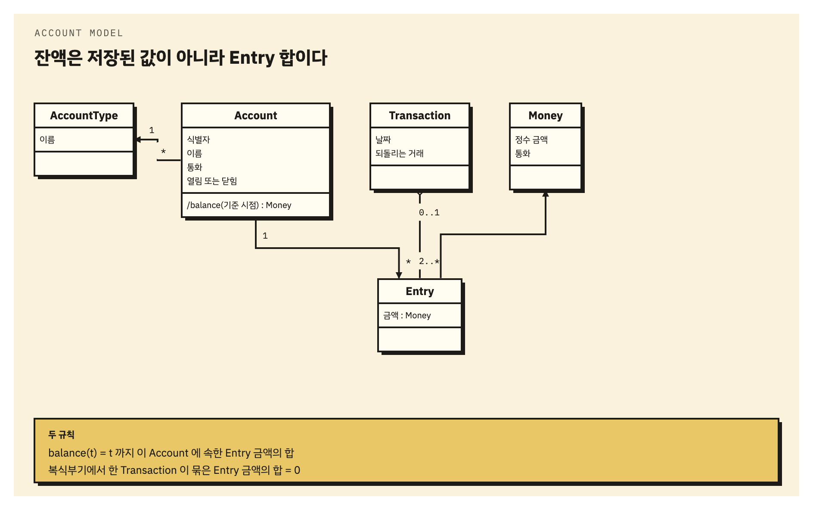

# Account — 잔액을 적어 두지 않고 Entry 의 합으로 설명하기

## 한눈에 보는 개요

작은 회사의 회계 프로그램이 계정마다 잔액 숫자 하나를 두고, 돈이 오갈 때마다 그 숫자를 고쳐 쓴다고 해 봅시다. 4월 1일에 매출 100,000원이 현금으로 들어왔고, 4월 5일에 임대료 30,000원을 냈어요. 그런데 실제 임대료는 25,000원이어서, 담당자가 4월 6일에 현금 잔액에 5,000원을 더해 맞췄습니다.

```text
Before — 잔액을 숫자 하나로 고쳐 쓰는 모델

  실제로 일어난 일                  현금 잔액 칸
  4/1  매출 100,000 입금            0       → 100,000
  4/5  임대료 30,000 지급           100,000 →  70,000
  4/6  담당자가 5,000 을 더함        70,000  →  75,000

  시스템에 남는 것: 현금 잔액 = 75,000   (왼쪽 줄들은 어디에도 없음)
  "4/5 마감 때 현금은 얼마였나요?"   → 계산할 재료가 없음
  "4/6 의 +5,000 은 무엇이었나요?"    → 설명할 기록이 없음
```

마감 보고서를 다시 뽑거나 감사에서 5,000원의 출처를 물으면 숫자 하나로는 답할 수 없어요. 75,000 이 맞는 값인지 확인할 기준조차 없습니다.

Account 패턴이 두는 한 수는 **잔액을 저장하지 않고 정의하는 것**이에요. 돈이 오갈 때마다 Entry(계정 하나에 금액 하나가 오간 기록) 한 건을 남기고, 잔액은 그 시점까지 이 계정에 기록된 Entry 금액의 합이라고 정합니다. 바로잡을 때도 기록을 고치지 않아요. 부호가 반대인 Entry 로 효과를 지운 뒤 올바른 Entry 를 남기는 방식, 즉 역분개를 씁니다.

```text
After — 잔액은 Entry 를 더해서 얻는 값

  현금 계정의 Entry
    4/1   +100,000   매출 입금
    4/5    -30,000   임대료 지급 (금액이 틀림)
    4/6    +30,000   4/5 기록을 되돌림
    4/6    -25,000   올바른 임대료
  ─────────────────────────────────────────────────────────
  잔액(4/5) = +100,000 - 30,000                    = 70,000
  잔액(4/6) = +100,000 - 30,000 + 30,000 - 25,000  = 75,000
```

> 기억법 — 잔액은 적어 두는 숫자가 아니라 Entry 를 더해서 얻는 답.

분류는 Fowler 『Analysis Patterns』 의 회계 패턴이고(근거: Analysis Patterns 6장 「Inventory and Accounting」 §6.1 Account), 함께 쓰는 패턴은 [Quantity](../quantity/quantity-guide_v1.1.0.md)(단위를 가진 금액) · [Transaction](../transaction/transaction-guide_v1.0.0.md)(합이 0 인 Entry 묶음) · [Posting Rule](../posting-rule/posting-rule-guide_v1.0.0.md)(업무 사건에서 거래를 만드는 규칙)입니다. 이 글의 예제는 복식부기 원장을 배경으로 삼아요. 차변과 대변의 부호 규약 · 원장과 전기 · 역분개 같은 회계 기초는 [참고 문서 「복식부기와 회계 모델」](../../reference/accounting-model/accounting-model-ref_v1.0.1.md)이 풀어 두었으니, 이 글은 그 위에서 4월 거래의 값으로만 말합니다. 시나리오 셋을 따라갈 거예요. 거래가 원장에 쌓여 잔액이 나오는 길, 틀린 금액을 정정하는 길, 규칙을 어기면 어느 단계에서 어떤 값이 어긋나는지요. 끝까지 읽으면 어떤 모델을 Account 패턴이라고 불러도 되는지 필수 조건 셋으로 판정할 수 있고, Entry 를 누가 소유할지 네 갈래 가운데 하나를 고르는 기준도 함께 얻습니다.

## 패턴 자세히 들여다보기

### 시나리오 1 — 4월 거래 둘이 원장에 쌓이고 4/5 현금 잔액이 나오기까지

원장을 막 연 회사에 4월 거래가 둘 들어옵니다. 4/1 에 매출 100,000원이 현금으로 들어왔고(T1), 4/5 에 임대료 30,000원을 현금으로 냈어요(T2). 계정은 현금(1010) · 매출(4010) · 임대료(5010) 셋이고 통화는 모두 KRW 입니다. 나와야 하는 답은 하나예요 — 4/5 기준 현금 잔액 70,000 KRW. 이 장면에 다섯 이름이 나옵니다. 금액 기록이 모이는 이름표인 Account, 계정 하나에 금액 하나가 오간 기록 한 건인 Entry, 한 업무 사건이 만든 Entry 묶음인 Transaction, 금액과 통화를 묶은 값인 Money, 그리고 계정을 자산·부채·자본·수익·비용으로 가르는 분류인 AccountType 이에요. 이름은 여기서 한 구절씩만 소개하고 정식 정의는 개념 정리가 맡습니다.

```text
날짜  거래  Entry (순번 계정 금액)                메모
4/1   T1    #1 현금 +100,000   #2 매출 -100,000   자산이 늘면 +, 수익이 늘면 -
4/5   T2    #1 임대료 +30,000  #2 현금 -30,000    비용이 늘면 +
```

1. 원장이 세 계정을 엽니다. 현금은 자산, 매출은 수익, 임대료는 비용이고 셋 다 통화가 KRW 예요. 계정이 먼저인 이유는 Entry 가 어느 Account 에 속하는 기록이라서, 속할 대상이 없으면 기록을 놓을 자리가 정해지지 않기 때문입니다. 통화도 계정이 미리 정해 두어야 3단계에서 대조할 기준이 생겨요.
2. Transaction 이 Entry 를 만들어 묶고, 묶인 금액의 합이 0 인지 봅니다. 4/1 매출 사건이 T1 을 만들고 T1 이 Entry #1(현금 +100,000)과 #2(매출 −100,000)를 묶어요. 합은 +100,000 − 100,000 = 0 입니다. 이 판정을 Transaction 이 맡는 이유는 합 0 이 두 계정에 걸친 규칙이기 때문이에요. 계정 하나만 보는 Account 는 상대편 다리를 볼 수 없어서 판정할 수 없습니다. 검사를 통과하지 못하면 거래 객체가 아예 만들어지지 않아요(시나리오 3 의 2단계).
3. Account 가 그 Entry 를 받을 수 있는지 확인합니다. Entry 마다 속할 계정이 열려 있는지, Entry 금액의 통화가 계정 통화와 같은지 봐요. 이 확인을 Account 가 맡는 이유는 열림·닫힘과 계정 통화가 Account 만 아는 사실이어서입니다. 순서를 4단계 뒤로 미루면 닫힌 계정에 Entry 가 남고, 그것을 되돌릴 역분개마저 같은 확인에서 거절돼 지울 길이 사라져요(시나리오 3 의 3단계).
4. 확인을 통과한 거래를 원장에 전기합니다. 이 순간 Entry 가 확정되고, 이후 어떤 단계도 확정된 Entry 를 고치거나 지우지 않아요. 고치지 않는 이유는 확정된 Entry 가 바뀌면 이미 4/5 로 낸 보고서의 잔액이 오늘 달라지기 때문입니다(시나리오 3 의 1단계).
5. 누군가 4/5 기준 현금 잔액을 묻습니다. 그 날짜까지의 Entry 가운데 현금에 속한 것만 더해요 — +100,000(T1 #1) − 30,000(T2 #2) = 70,000 KRW. Entry 를 기준으로 삼는 이유는 방향이 한쪽으로만 열려 있어서예요. 합은 Entry 에서 언제든 다시 만들 수 있지만, Entry 는 합에서 다시 만들 수 없습니다. 원천이 한쪽에만 있어야 둘이 어긋났을 때 무엇을 고칠지가 정해져요.
6. 자주 묻는 현재 잔액은 따로 계산해 둡니다. 매번 처음부터 더하지 않고, 전기가 끝났다는 알림을 받아 새 Entry 만 더해 두는 값을 원장 밖에 둬요. T1 을 전기한 직후에는 그 값이 아직 0 이고 Entry 합은 100,000 이며, 알림이 전달된 뒤에야 100,000 으로 같아집니다. 늦어도 되는 이유는 이 원장에 잔액을 전기와 같은 순간에 맞춰야 할 규칙이 없어서예요. 잔액 하한 같은 규칙이 들어오면 경계가 달라지는데, 그 경우는 「상황이 달라지면」에서 봅니다.

```text
단계   누가 → 누구에게                넘기는 것                     지켜지는 규칙
 1     원장 → Account                 식별자 · 종류 · 통화           -
 2     사건 → Transaction             현금 +100,000 · 매출 -100,000  묶음 합 = 0
 3     Transaction → Account          Entry 마다 금액 하나            계정 열림 · 통화 일치
 4     원장 → 원장                    통과한 거래                    확정된 Entry 는 불변
 5     묻는 쪽 → 원장                 계정 · 기준 날짜                잔액 = Entry 합 (70,000)
 6     전기 알림 → 계산해 둔 값        전기 순번 · 금액 목록           반영한 위치까지의 합과 같음
```

잠깐, 확인 하나만 해 볼까요? 4/5 기준으로 매출 계정의 잔액은 얼마일까요? 표에서 매출에 속한 Entry 만 골라 더하면 됩니다. T1 #2 의 −100,000 하나뿐이니 −100,000 KRW 예요. 수익 계정의 잔액이 음수로 나오는 것이 정상인 이유는 부호 규약에 있고, 그 규약은 앞서 링크한 참고 문서가 풉니다.

이 시나리오가 보여 준 것은 책임이 어떻게 갈리는가입니다. 묶음 안의 규칙(합 0)은 Transaction 이 맡고, 계정 하나가 아는 사실(열림·통화)은 Account 가 봅니다. 확정과 기록의 보존은 원장 몫이에요. 잔액은 어디에도 저장되지 않은 채 5단계에서 Entry 를 더해 나옵니다. 6단계의 계산해 둔 값은 답을 빨리 내려고 둔 사본일 뿐이라 늦을 수 있고, 틀리면 고치는 쪽은 언제나 그 사본이에요. 여기서 나온 이름 다섯이 개념 정리로 모입니다.

### 시나리오 2 — 임대료가 30,000 이 아니라 25,000 이었을 때

4월 6일에 T2 의 금액이 틀렸다는 것을 알게 됐습니다. 임대료는 30,000원이 아니라 25,000원이었어요. 나와야 하는 답은 둘입니다. 4/6 기준 현금 잔액은 75,000 KRW 여야 하고, 4/5 기준 현금 잔액은 70,000 KRW 그대로여야 해요. 이미 4/5 로 낸 보고서가 있으니까요. 이 시나리오에서 새로 나오는 이름은 역분개 하나뿐이고, 원 거래의 Entry 부호를 모두 뒤집은 거래를 뜻합니다.

1. 원장에서 T2 를 식별자로 찾아 읽습니다. 고치려고 찾는 것이 아니라 어떤 다리로 이루어졌는지 보려고 찾는 거예요. 원 거래가 필요한 이유는 역분개가 다리 하나가 아니라 T2 의 다리 전부를 부호만 바꿔 되풀이해야 해서입니다. 현금 쪽만 되돌리면 임대료 쪽 +30,000 이 남아 합이 0 이 아닌 거래가 돼요.
2. T2 의 Entry 부호를 뒤집은 T3 을 4/6 자로 만듭니다. Entry #1 은 임대료 −30,000, #2 는 현금 +30,000 이고, T3 은 자기가 되돌리는 거래로 T2 를 가리켜요. 되돌림 표시를 T2 쪽이 아니라 T3 쪽에 두는 이유는 T2 가 이미 확정된 기록이기 때문입니다. T2 에 "정정됨" 표시를 적는 순간 확정된 거래를 고치는 일이 되고, 4/5 에 보고서로 나간 T2 와 저장된 T2 가 달라져요.
3. 올바른 금액의 T4 를 4/6 자로 전기합니다. 임대료 +25,000, 현금 −25,000 이에요. T3 과 T4 도 시나리오 1 의 2·3단계를 똑같이 지납니다. 정정 거래라고 검사를 건너뛰지 않는 이유는 역분개도 거래라서예요. 건너뛰면 잘못된 정정이 원장에 그대로 들어가 원본보다 고치기 어려워집니다.
4. 두 시점의 잔액을 다시 묻습니다. 4/6 기준 현금은 70,000 + 30,000(T3 #2) − 25,000(T4 #2) = 75,000 KRW 이고, 4/5 기준 현금은 여전히 70,000 KRW 예요. 4/5 가 안 움직이는 이유는 T3·T4 의 날짜가 4/6 이라 4/5 까지의 합에 들어가지 않아서입니다.
5. 무엇이 바뀌었는지 셉니다. T2 는 한 글자도 바뀌지 않았고 거래가 둘 늘었을 뿐이에요. 늘어난 것이 거래 수뿐인 이유는 정정이 기록을 고치는 일이 아니라 새 기록을 더하는 일이기 때문입니다. 이 셈을 마지막에 두는 이유도 같아요 — 고친 자리를 찾는 대신 더해진 자리를 세면 되니, 4/5 에 낸 보고서를 다시 들춰 볼 일이 없습니다. 임대료 계정도 같은 방식으로 따라옵니다 — +30,000(T2 #1) − 30,000(T3 #1) + 25,000(T4 #1) = 25,000 KRW 가 4/6 기준 잔액이에요.

| 무엇 | 정정 전 | 정정 후 |
| --- | --- | --- |
| T2 의 Entry #2 | 현금 −30,000 | 현금 −30,000 (그대로) |
| 원장의 거래 수 | T1 · T2 | T1 · T2 · T3 · T4 |
| 현금 4/5 기준 잔액 | 70,000 KRW | 70,000 KRW (그대로) |
| 현금 4/6 기준 잔액 | 70,000 KRW | 75,000 KRW |
| 임대료 4/6 기준 잔액 | 30,000 KRW | 25,000 KRW |

여기서 헷갈리기 쉬운 포인트는 정정이 두 거래가 아니라 한 거래로 끝날 것 같다는 점입니다. 차액 5,000원만 되돌리는 거래 하나를 쓰면 4/6 잔액은 같게 나와요. 대신 T2 와의 대응이 사라집니다. 차액 거래만 보고는 원래 금액이 30,000 이었는지 35,000 이었는지 알 수 없고, T2 를 통째로 무르는 것과 일부만 무르는 것도 구분되지 않아요. 이 가이드가 역분개 한 가지만 쓰는 이유가 그것이고, 선택지 셋을 견준 판단은 [회계 배경 확정안](../../research/accounting-context.md) 7절에 있습니다.

이 시나리오가 보여 준 것은 변화가 들어올 때 무엇이 움직이지 않는가입니다. 새 사실은 언제나 새 Entry 로 들어오고(2·3단계), 지난 기록은 손대지 않으며(1·5단계), 그래서 과거 시점의 답이 오늘 바뀌지 않아요(4단계). 잔액이 Entry 의 합이라는 정의 하나가 이 성질을 떠받칩니다 — 합의 재료를 더하기만 하면 어느 시점이든 그때의 답을 다시 만들 수 있으니까요.

### 시나리오 3 — 규칙을 어기면 어느 단계에서 어떤 값이 어긋나는가

같은 원장에 규칙을 어기는 일이 셋 들어옵니다. T2 의 현금 다리 −30,000 을 −25,000 으로 덮어써 정정하는 것, 현금 +100,000 과 매출 −90,000 만 담은 거래 T5 를 만드는 것, 그리고 닫아 둔 가수금 계정(2990, 부채)으로 가는 거래 T6(현금 +50,000 · 가수금 −50,000)을 전기하는 것이에요. 아래 값은 모두 Java 21 로 실제 컴파일해 실행하거나, 코드를 그렇게 고쳐 실행해 확인한 것입니다.

1. 확정된 Entry 를 덮어씁니다. T2 #2 의 −30,000 을 −25,000 으로 바꾸면 4/5 기준 현금이 70,000 에서 75,000 으로 바뀌어요. 눈여겨볼 것은 잔액이 여전히 Entry 의 합이라는 점입니다 — 최소 조건 1 은 깨지지 않았고 합의 재료가 바뀌었을 뿐이에요. 그래서 어긋나는 것은 모델이 아니라 답입니다. 4/5 에 70,000 으로 낸 보고서와 오늘의 계산이 다른데 수정 전 값이 남지 않아 어느 쪽이 맞는지 보일 수 없어요. 같은 정정을 하고도 4/5 를 70,000 으로 지킨 시나리오 2 와 여기가 갈립니다.
2. 합이 0 이 아닌 거래를 만들려 합니다. T5 는 현금 +100,000 과 매출 −90,000 뿐이라 합이 +10,000 이에요. 만들려는 순간 `KRW 합이 0 이 아닙니다: 10000` 으로 거절되고 거래 객체 자체가 생기지 않습니다. 만드는 자리에서 막는 이유는 한 번이라도 불균형 거래가 만들어지면 저장 경로마다 같은 검사를 되풀이해야 하기 때문이에요. 한 경로만 빠뜨려도 합이 +10,000 인 거래가 원장에 남고, 그때는 현금에 +100,000 매출에 −90,000 만 기록돼 돈 10,000원이 어디서 왔는지 답할 수 없습니다.
3. 닫힌 계정으로 전기하려 합니다. 가수금을 닫은 뒤 T6 을 전기하면 `가수금 계정은 닫혀 있습니다` 로 거절되고 원장에는 아무것도 남지 않아요. 검사가 저장 앞에 있기 때문입니다. 이 검사를 저장 뒤로 옮겨 돌려 보면 거절 메시지는 똑같이 나오는데 T6 이 이미 저장된 뒤라, 닫힌 가수금의 4/6 기준 Entry 합이 −50,000 이 되고 현금은 75,000 이 아니라 125,000 이 돼요. 지우려고 T6 을 역분개하면 그 거래도 같은 닫힌 계정을 가리켜 `가수금 계정은 닫혀 있습니다` 로 또 거절됩니다. 순서 하나로 지울 방법이 없는 기록이 남는 거예요.
4. 계산해 둔 잔액이 전기 순서와 다르게 갱신됩니다. 전기 알림이 순서대로 오지 않으면 뒤 번호를 먼저 반영한 뒤 앞 번호를 이미 반영한 것으로 보고 건너뛰어요. T1 과 T2 만 전기하고 알림을 거꾸로 전달해 돌려 보니 현금의 계산해 둔 값은 −30,000, 같은 시점 Entry 합은 70,000 이었습니다. 이번에 깨진 것은 최소 조건 1 이 아니라 조건 8 이고, 원천이 Entry 쪽이라 고칠 쪽은 계산해 둔 값이에요. 실제로 그 값을 버리고 알림에서 다시 만들면 Entry 합과 같은 값으로 돌아옵니다.

```text
어긴 규칙                     막히는 자리            막히지 않으면 어긋나는 값 (4/6 기준)
확정된 Entry 불변             없음 (모델 밖의 일)     현금 4/5 잔액 70,000 → 75,000, 수정 전 값 소실
묶음 합 = 0                   거래를 만드는 자리      원장에 합 +10,000 인 거래
계정 열림 확인 → 저장          저장 앞               가수금 Entry 합 -50,000 · 현금 125,000, 역분개도 거절
반영 위치까지의 합 = 캐시      전기 알림의 순서       현금 캐시 -30,000 vs Entry 합 70,000
```

이 시나리오가 보여 준 것은 규칙마다 지켜지는 자리가 다르다는 것입니다. 묶음 합은 거래를 만드는 자리에서, 계정 열림은 저장 바로 앞에서 막히고, 확정된 기록의 불변은 아예 고칠 경로를 두지 않는 방식으로 지켜져요. 그리고 1단계와 4단계를 나란히 놓으면 무엇이 원천인지가 드러납니다. 1단계는 재료가 바뀌어 답이 달라진 것이라 되돌릴 수 없지만, 4단계는 사본이 틀어진 것이라 버리고 다시 만들면 그만이에요.

### 개념 정리

시나리오에 나온 분석 층위의 개념 다섯을 정식으로 정의합니다. 이 절이 정하는 것은 개념이 무엇을 책임지고 누구와 협력하는가까지예요. 그 책임을 코드의 어느 객체가 지는지, 무엇이 aggregate 의 root 인지는 뒤의 「상황 설정」 표가 정합니다.

- **Account**(계정) — 금액 기록을 모으는 기준이 되고, 그 합인 잔액에 답하는 개념입니다.
  - 책임: 식별자로 자기를 구별하고, 자기에게 속한 Entry 의 합을 어느 시점 기준으로든 돌려줍니다. 받을 금액의 통화는 계정마다 하나를 정하고, 열려 있는지 닫혀 있는지를 알아요(시나리오 1 의 1·3단계).
  - **balance**(잔액) — Account 의 파생 속성이에요. 어느 시점 t 의 balance 는 거래일이 t 이하인, 그 Account 에 속한 Entry 금액의 합입니다. 저장된 사실이 아니라 계산되는 값이라, 빨리 답하려고 계산해 둘 수는 있지만 계산해 둔 값이 Entry 합과 다르면 틀린 쪽은 계산해 둔 값이에요(시나리오 3 의 4단계).
  - 협력: Entry 가 Account 에 속합니다(Account 하나에 Entry 여럿). AccountType 하나에 분류돼요.
- **Entry**(항목) — 계정 하나에 금액 하나가 오간 사실 한 건입니다.
  - 책임: 어느 Account 에 얼마가 기록됐는지를 담습니다. 금액·계정·날짜가 모두 같은 Entry 둘도 서로 다른 사실이에요 — 같은 날 같은 금액을 두 번 입금하면 기록도 두 건입니다.
  - 협력: 정확히 한 Account 에 속하고 balance 계산의 재료가 됩니다. 복식부기에서는 한 Transaction 에도 묶여요(시나리오 1 의 2단계).
- **Transaction**(거래) — 업무 사건 하나가 만든 Entry 묶음이고, 묶인 Entry 금액의 합은 통화별로 0 입니다.
  - 책임: 날짜를 갖고, 합이 0 인지 판정하고, 정정 거래라면 되돌리는 원 거래를 가리킵니다(시나리오 2 의 2단계).
  - 협력: Entry 를 2개 이상 묶습니다. 거래 자체의 규칙은 [Transaction 가이드](../transaction/transaction-guide_v1.0.0.md)가 맡고, 이 글은 Entry 가 어디서 오는지를 설명하는 만큼만 다뤄요.
- **Money**(금액) — 금액과 통화를 묶은 값입니다. 이 가이드의 예제는 금액을 정수 최소 단위로 적어요(KRW 는 1원).
  - 책임: 통화가 다른 금액끼리는 더하지 않습니다.
  - 협력: Entry 의 금액과 balance 의 값이 Money 예요. 금액을 단위를 가진 수량의 한 종류로 보는 관점은 [Quantity 가이드](../quantity/quantity-guide_v1.1.0.md)가 풉니다.
- **AccountType**(계정 종류) — 자산·부채·자본·수익·비용처럼 계정을 나누는 분류입니다.
  - 책임: 같은 종류의 계정이 공유하는 정의를 담습니다. 매일 생기는 사실이 아니라 사실을 해석하는 규칙 쪽이라, 계정과는 따로 바뀌어요.
  - 협력: Account 마다 자기 AccountType 하나에 속합니다(시나리오 1 의 1단계).



그림에서 Entry 는 Account 와 Transaction 양쪽에 연관돼 있어요. 계정 쪽에는 잔액이 Entry 합이라는 제약이, 거래 쪽에는 묶음 합이 0 이라는 제약이 붙습니다(근거: Analysis Patterns 그림 6.1 · 6.2 · 6.3). 분석 모델은 연관만 정할 뿐 누가 Entry 를 소유하는지는 정하지 않아요. 소유는 설계가 정하고, 그 선택지 넷은 「상황이 달라지면」에서 나란히 봅니다.

## 사용 목적

Account 를 꺼낼 때는 코드나 요구서에서 보이는 단서가 있어요. 셋을 차례로 봅시다.

**단서 1. 잔액 칸을 고치는 코드가 여러 곳에 흩어져 있습니다.** `UPDATE account SET balance = balance - ?` 가 결제·환불·수수료 코드에 따로 들어 있고, 잔액이 왜 이 금액이냐는 문의가 오면 로그를 뒤져 답하는 상황이에요. 잔액의 이유를 모델이 모르니 로그가 대신 답하고 있는 겁니다.

```text
변경 이력                     잔액 칸을 고치는 자리
───────────────────────────   ─────────────────────────────────────
결제 수수료 차감 추가          결제 코드의 UPDATE account SET balance
환불 처리 추가                환불 코드의 UPDATE account SET balance
적립금 회수 배치 추가          배치 코드의 UPDATE account SET balance
"이 잔액은 왜 이 값인가요?"    → 세 곳의 로그를 모아 사람이 재구성
```

**단서 2. 요구서에 과거 시점과 기간이 나옵니다.** 3월 31일 기준 잔액, 1분기 입금 합계, 지난달 말 창고 재고 같은 문장이요. 현재 숫자 하나로는 계산할 재료가 없고, 정정을 행 수정이나 삭제로 해 왔다면 수정 전 값을 묻는 질문에도 답하지 못합니다.

```text
요구서의 문장                  현재 잔액 하나로 답할 수 있는가
──────────────────────────    ────────────────────────────────────
지금 현금이 얼마인가            예
3월 31일 기준 현금 잔액         아니오 — 그 날짜까지의 기록이 필요
1분기 입금 합계                 아니오 — 기간 안의 기록이 필요
정정 전 금액은 얼마였나          아니오 — 고쳐 쓴 모델에는 남지 않음
```

**단서 3. 돈이 아닌 수량이 같은 모양으로 들어오고 나갑니다.** 창고 재고처럼 +10개 · −3개 · +5개가 쌓이고 그날 재고가 왜 12개였는지를 되짚어야 하는 도메인이면 금액이 아니어도 같은 모델이 맞아요.

반대로 아래 두 경우에는 쓰면 잃는 것이 더 큽니다.

| 쓰지 말아야 할 상황 | 쓰면 잃는 것 |
| --- | --- |
| 현재 값만 묻고 과거를 묻지 않음 (게시글 조회수) | 증가 한 번마다 Entry 가 쌓이고 조회 때 합산이나 캐시 맞추기를 챙기게 되는데, 그렇게 해서 새로 답할 수 있는 질문이 없음 |
| 값이 시점마다 정해질 뿐 변화를 더해 얻지 않음 (직원 월급·등급) | 정해진 값을 그대로 적는 대신 이전 값과의 차이를 계산해 Entry 로 넣어야 함. 그 날짜의 값을 돌려주는 Temporal Property 로 충분한 자리임 |

넷을 나란히 놓고 보면 가르는 질문이 하나로 모여요.

```text
모델에 보이는 모양으로 나란히 놓기

조회수         Post { viewCount } · view() 가 1 을 더함
               묻는 것: 지금 몇인가 → 필드 하나로 끝. 과거 값을 묻는 코드가 없음
월급 이력      Employee { salaryAt(날짜) } · 2025-01-01 부터 3,000,000 / 2026-01-01 부터 3,200,000
               묻는 것: 그 날짜의 값 → 기간을 찾아 돌려줌. 기록끼리 더하는 코드가 없음
소스 코드 이력  "3행 추가" · "그 3행 중 2행 삭제" · "파일 이름 변경"
               묻는 것: 그 시점의 코드 → 정해진 순서대로 적용. 덧셈도 0 도 단위도 없음
창고 재고      한 계정에 속한 Entry: +10개 · -3개 · +5개
               묻는 것: 그날의 재고와 그 이유 → 0 + 10 - 3 + 5 = 12개, 어느 Entry 때문인지도 답함
```

질문은 이것입니다 — 현재 값이 한 계정에 속한 기록들의 합으로 정의되는가. 조회수는 합을 물을 과거가 없고, 월급은 기간마다 정해진 값이라 합이 아니며, 코드 이력은 기록끼리 더할 수 없어요. 모델에서는 기록 값 타입에 단위를 확인하는 덧셈과 0 이 있는지, 조회 코드가 기록을 더하는지 아니면 기간을 찾거나 순서대로 적용하는지를 보면 됩니다. 비슷한 단서에서 다른 모델을 고르게 되는 자리가 둘 더 있어요. 돈이 어디서 와서 어디로 갔는지 짝을 맞춰야 하면 Transaction 을 함께 두고, 금액이 아닌 상태 변경까지 기록에서 재구성해야 하면 Event Sourcing 을 봅니다. 차이는 다음 절에서 풀어요.

## 패턴의 경계

### 디자인 패턴을 충족하는 최소 조건

어떤 모델을 Account 패턴이라고 불러도 되는지 가르는 기준입니다. 클래스 모양이 아니라 개념이 맡는 책임과 모델이 늘 지키는 불변식으로 판정해요 — Entry 를 누가 소유하든 같은 기준으로 판정할 수 있어야 하니까요. `[필수]` 에는 원전이 Account 의 성립 요건으로 든 것만 올렸고, 원전이 흔한 규칙으로 적은 것과 이 가이드 예제의 정책은 번호 순서와 무관하게 `[선택]` 입니다. 조건마다 그것을 보여 준 시나리오의 단계를 함께 적었어요.

1. [필수] 잔액은 Entry 의 합으로 정의됩니다 — 어느 시점의 잔액이든 그 시점까지(거래일 기준) 확정된 Entry 가운데 그 Account 에 속한 것의 금액 합과 같습니다. 전기된 때가 아니라 거래일로 가르므로 4/5 거래를 4/7 에 전기해도 그 Entry 는 4/5 잔액에 들어가요. 시나리오 1 의 5단계가 이 정의를 그대로 쓴 자리입니다 (근거: Analysis Patterns 그림 6.1 의 `balance = sum(entries.amount)` 제약, 오래된 Entry 를 합이 같은 한 건으로 정리하는 예외는 eaaDev Account).
   - 빠지면: 개요의 Before 처럼 잔액 숫자를 고쳐 쓰는 필드가 됩니다. 4/5 마감 때 현금이 얼마였는지, +5,000 이 무엇이었는지 답할 재료가 없어요. 시나리오 3 의 1단계는 이 조건이 지켜지는데도 답이 달라지는 경우라 반대편 반례이고, 그 자리를 맡는 것은 조건 3 입니다.
2. [필수] Account 가 Entry 를 모으는 기준을 책임집니다 — 모든 Entry 는 정확히 한 Account 에 속하고, 한 Account 의 잔액은 그 Account 에 속한 Entry 만 더합니다. 속한다는 말은 Account 가 Entry 목록을 들고 있다는 뜻이 아니라 Entry 마다 속한 Account 가 하나로 정해진다는 뜻이고, 목록에 담든 식별자로 가리키든 같아요. 시나리오 1 의 5단계에서 현금에 속한 Entry 만 골라 더할 수 있었던 것이 이 책임이고, 3단계에서 계정이 통화와 열림 여부로 Entry 를 거른 것도 같은 기준이 있어서 가능했습니다 (근거: Analysis Patterns 그림 6.1 의 Account 하나 — Entry 여럿 연관).
   - 빠지면: Entry 에 `"현금"` 같은 분류 문자열만 붙은 기록 목록이 됩니다. `"현금"` 과 `"현금 "` 이 서로 다른 묶음으로 더해지고, 통화나 열림·닫힘처럼 묶음 전체에 걸리는 사실을 둘 자리가 없어요(근거: eaaDev Accounting Entry 가 Account 없이 쓰는 Entry 를 선택지로 적는다).
3. [선택] 확정된 Entry 를 고치거나 지워서 정정하지 않습니다 — 값의 변화와 정정을 Entry 를 새로 더해서 기록합니다. 시나리오 2 전체가 이 규칙을 따른 정정이고, 시나리오 3 의 1단계가 어긴 결과예요 (근거: eaaDev Accounting Entry 가 확정 뒤 변경 금지를 흔한 규칙으로 적으면서 확정 전 변경을 허용하는 규칙도 흔하다고 적었으므로, 성립 요건이 아니라 선택으로 둔다).
   - 빠지면 잃는 것: 과거 시점 잔액의 재현과 수정 전 값입니다. 조건 1 은 그대로 지켜지는데도 4/5 현금이 70,000 에서 75,000 으로 바뀌어요. 이 예제는 수정 이력을 따로 보존하지 않으므로, 고치거나 지우면 이전 기록이 사라집니다.
4. [필수] 금액은 단위를 가진 값이고, 한 잔액으로 더하는 금액은 단위가 같습니다 — 돈이면 통화를 가진 Money 이고, 통화가 다른 금액은 한 잔액에 더하지 않습니다. 단위가 하나로 고정된 모델이면 그것으로 충족하고, 여러 통화를 받는 계정이면 통화별로 따로 더해요. 시나리오 1 의 3단계에서 계정 통화와 Entry 통화를 대조한 것이 이 조건입니다 (근거: Analysis Patterns 그림 6.1 에서 amount 와 balance 가 Quantity, 계정 통화 대조와 통화별 묶음은 eaaDev Account).
   - 빠지면: 현금(KRW) 잔액 70,000 에 USD 100 이 숫자 100 으로 더해져 70,100 이 됩니다. 합은 나오지만 어느 통화의 금액도 아니에요.
5. [선택] 계정 열림·닫힘 — 닫힌 Account 는 새 Entry 를 받지 않고, 이미 확정된 Entry 와 잔액은 그대로 둡니다. 시나리오 3 의 3단계가 이 검사가 저장 앞에 있어야 하는 이유를 보여 준 자리예요 (근거: 이 가이드의 정책 — [회계 배경 확정안](../../research/accounting-context.md) I5 의 계정 유효).
6. [선택] 계정 분류 — AccountType 으로 계정 종류를 나누고, 시나리오 1 의 1단계처럼 계정을 열 때 종류를 함께 정합니다 (근거: Analysis Patterns 그림 6.20 의 지식 층위 Account Type, 분류 예는 그림 6.28 의 Asset · Liability · Income · Expense).
7. [선택] 기간 잔액 — 시점 하나가 아니라 기간 안의 Entry 합을 돌려줍니다. 시나리오 1 의 5단계가 낸 시점 잔액을 두 날짜 사이로 넓힌 것이에요 (근거: eaaDev Account 의 `balance(DateRange)`).
8. [선택] 잔액 캐시 — 현재 잔액을 계산해 두고 새 Entry 만 더합니다. 반영한 위치까지의 Entry 합과 같게 유지하고 Entry 에서 다시 만들 수 있는 한 패턴 안이에요. 시나리오 1 의 6단계가 그 값을 두는 자리이고, 시나리오 3 의 4단계가 어긋났을 때 어느 쪽을 고치는지 보인 자리입니다 (근거: eaaDev Account 의 현재 잔액 캐시).

> 필수는 셋이다 — 합으로 정의되는가, 모으는 기준이 있는가, 단위가 같은가.

### 비슷한 패턴·안티패턴과의 차이

Account 와 닮아 보이거나 같은 단서에서 떠오르는 넷을 구분 기준부터 모았어요.

| 대상 | 구분 기준 | Account 를 고르면 얻는 것 | 포기하는 것 |
| --- | --- | --- | --- |
| 필드가 원천인 잔액 모델 (감사·과거 잔액이 필요한 곳에 쓰면 안티패턴) | 잔액과 기록이 어긋날 때 무엇을 고치는가 — 기록으로 잔액을 다시 계산하면 Account, 필드를 기준으로 두면 이 모델 | 어느 시점의 잔액이든 기록에서 다시 계산하고, 계산해 둔 값이 틀렸는지 판정하는 능력 | 조회 때 합산 비용, 또는 캐시를 Entry 와 맞추는 일 |
| Temporal Property | 현재 값을 변화 기록의 합으로 얻는가, 시점마다 정해진 값을 찾아 돌려주는가. 값이 금액이어도 합으로 정의되지 않으면 이쪽 | 변경 한 건 한 건과 그 합을 함께 다루는 모델 | 기간별 값만 적고 찾는 단순함, 그리고 변화를 모두 Entry 로 남기는 저장 |
| Transaction (함께 쓰는 짝) | 규칙이 한 계정의 Entry 합(= 잔액)에 걸리는가, 한 사건의 Entry 합(= 0)에 걸리는가 | Account 만 두면 계정별 잔액과 내역에 답하는 가벼운 모델 | 돈이 어디서 와서 어디로 갔는지 짝을 맞추는 검증. 둘은 대체가 아니라 함께 쓰는 관계 |
| Event Sourcing | 원천이 무엇인가 — 계정 이름·열림·닫힘 같은 상태 변경까지 모두 이벤트로 저장되고 재생으로 다시 만들 수 있으면 Event Sourcing, 그런 변경은 이벤트로 남기지 않고 금액 결과만 Entry 로 모아 더하면 Account | 계정·금액 질문에 맞춘 좁은 모델, 합산 하나로 끝나는 잔액 | 금액이 아닌 상태 변경의 이력. 필요하면 Event Sourcing 과 겹쳐 씀 |

가장 헷갈리는 쌍은 첫 줄입니다. 잔액 필드 옆에 변경 로그를 쌓으면 기록이 있으니 Account 처럼 보여요. 갈리는 곳은 로그의 유무가 아니라 원천이 어디냐입니다. 아래 코드에서 원천은 필드이고 로그는 부산물이에요.

```java no-compile
// Account 패턴처럼 보이지만 잔액의 원천이 필드인 모델
class CashAccount {
    private long balance;
    private final List<String> log = new ArrayList<>();

    void deposit(long amount) {
        balance += amount;
        log.add("deposit " + amount);
    }

    void withdraw(long amount) {
        balance -= amount;
        log.add("withdraw " + amount);
    }

    void adjust(long delta) {      // 정정: 필드만 고치고 로그는 남기지 않음
        balance += delta;
    }
}
```

`deposit(100000)` · `withdraw(30000)` · `adjust(5000)` 을 차례로 부르면 필드와 로그가 달라집니다. 로그를 더해 얻는 값은 70,000 인데 필드는 75,000 이고, 필드가 맞는지 확인할 독립적인 기록이 없어요.

```text
필드가 원천인 잔액 모델
  로그   deposit 100000 · withdraw 30000        로그 합 = 70,000
  필드   balance = 75,000                       (adjust(5000) 이후)
  → 필드가 맞는지 확인할 독립적인 기록이 없음 (로그는 adjust 를 모름)

Account 패턴 (시나리오 2 의 정정)
  Entry  +100,000 · -30,000 · +30,000 · -25,000  Entry 합 = 75,000
  캐시   75,000                                  → 다르면 캐시를 다시 계산
```

시나리오 2 의 정정과 견주면 차이가 선명해요. 거기서는 5,000원의 차이가 T3·T4 라는 기록으로 남아 4/6 잔액 75,000 이 왜 그 값인지 되짚을 수 있었습니다. `adjust` 가 로그를 남기도록 고치는 것만으로는 부족합니다. 모든 변경을 필드와 같은 원자 단위로 기록하고, 둘이 어긋나면 기록으로 필드를 다시 계산한다는 규칙까지 두어야 최소 조건 8 의 잔액 캐시, 즉 Account 패턴이 돼요. 그 규칙이 없는 한 이 모델이 얻는 것은 조회 한 번에 숫자 하나를 읽는 단순함이고, 그 대가로 과거 시점의 잔액과 정정의 흔적을 믿을 근거를 포기합니다.

**Temporal Property 와의 차이.** 구분 기준은 조회 코드가 기록을 더하는지, 기간을 찾는지예요. 급여 계좌의 월말 잔액은 입금과 출금을 더해 얻으니 Account 이고, 직원 등급이 날짜마다 무엇이었는지는 그 날짜가 든 기간의 값을 찾아 돌려주면 되니 Temporal Property 입니다. 값이 금액이라도 기준은 같아요 — 월급은 인상분 기록의 합이 아니라 그 날짜부터 정해진 값이라 Account 로 만들면 정해진 값 대신 이전 값과의 차이를 계산해 넣어야 합니다.

```text
조회 코드가 하는 일
  Temporal Property   gradeAt(날짜) 가 그 날짜가 든 기간의 값을 찾아 돌려줌
  Account             balanceAsOf(계정, 날짜) 가 그 날짜까지의 Entry 를 더함
  확인할 곳           조회가 기록을 더하는가, 기간을 찾는가
```

**Transaction 과의 차이.** 구분 기준은 규칙이 걸리는 단위예요. 한 계정의 Entry 합에 걸리면 Account 쪽 규칙이고, 한 사건의 Entry 합에 걸리면 Transaction 쪽 규칙입니다. 시나리오 1 의 2단계와 3단계가 그 둘을 나란히 보여 줬어요 — 합 0 은 Transaction 이, 통화와 열림은 Account 가 판정했죠. Account 만 두면 현금 계정에 −30,000 한 건이 들어와도 임대료 쪽 +30,000 이 빠진 것을 알아챌 코드가 없습니다. 둘은 대체 관계가 아니라 함께 쓰는 관계예요.

```text
Account 만 둔 단식 기록     현금 계정에 Entry(-30,000) 한 건. 짝이 빠져도 알아챌 코드가 없음
Transaction 을 함께 둠      T2 = {임대료 +30,000, 현금 -30,000}. 만드는 자리가 합 0 을 검사
확인할 곳                   여러 계정의 Entry 를 한 묶음으로 만들고 합을 검사하는 생성 코드가 있는가
```

**Event Sourcing 과의 차이.** 구분 기준은 원천이 어디냐입니다. 상태를 저장해 둔 자리가 있느냐가 아니에요 — Event Sourcing 도 현재 상태를 이벤트와 함께 두거나 중간 지점을 스냅숏으로 저장합니다([eaaDev Event Sourcing](https://martinfowler.com/eaaDev/EventSourcing.html)). 그 둘은 이벤트를 재생해 언제든 다시 만들 수 있으니 원천이 아니고, 시나리오 3 의 4단계에서 계산해 둔 잔액을 버리고 다시 만든 것과 같은 잣대예요. 가르는 자리는 상태 변경입니다. 계정 이름을 바꾸거나 계정을 닫은 일까지 이벤트로 남고 그 재생만으로 현재 상태가 복원되면 Event Sourcing 이고, 이 가이드의 모델처럼 이름 변경과 닫힘이 이벤트로 남지 않으면 Account 예요. 금액 이벤트를 더해 잔액을 만드는 것도 재생의 한 형태라서 둘은 겹쳐 쓸 수 있습니다.

```text
Account 만 쓰는 모델 (이 가이드의 코드)
  저장소에 있는 것   Account(1010, 현금, 열림) ← 상태를 바로 고쳐 저장
                     Transaction T1~T4 와 그 Entry
  잔액               Entry 의 합. 전기 알림은 계산해 둔 값에 알리는 용도
  계정 이름 이력     물을 수 없음. 이름을 바꾸면 현재 값만 남음

Event Sourcing 을 겹쳐 쓴 모델 (예시 이벤트 이름)
  저장소에 있는 것   AccountOpened(1010, 현금) · AccountRenamed(1010, 보통예금)
                     AmountPosted(1010, +100,000) · AccountClosed(1010)
  Account 객체       이벤트를 순서대로 적용해 이름·열림·닫힘·잔액을 모두 다시 만듦
  확인할 곳          상태 변경이 전부 이벤트로 남고 재생만으로 현재 상태가 되는가
                     빨리 읽으려고 둔 상태 테이블이나 스냅숏이 있는지는 기준이 아님
```

## 구현 예시

### 상황 설정

예시 도메인은 시나리오가 쓴 그 원장입니다. 작은 회사의 총계정원장(General Ledger, 모든 계정의 거래를 모아 두는 장부)이고, 청구·결제 같은 다른 시스템에서 일어난 업무 사건이 거래로 들어오면 전기하고 계정별 잔액을 알려 줘요. 계정도 금액도 날짜도 시나리오 1~3 의 값 그대로입니다 — 현금 1010 · 가수금 2990 · 매출 4010 · 임대료 5010, T1 부터 T6 까지요. 배경은 Account · Transaction · Posting Rule 세 가이드가 함께 쓰는 [회계 배경 확정안](../../research/accounting-context.md)을 따르고, 아래 표의 네 칸은 그 문서의 2절(bounded context) · 3절(불변식 I1 · I2 · I4 · I5) · 4절(배정) · 5절(참조)에서 가져왔어요.

```text
고정된 것
  · 계정마다 통화 하나, 금액은 정수 최소 단위 (KRW 는 1원)
  · 방향은 부호 (자산·비용 +, 부채·자본·수익 -)
  · 전기된 거래와 그 Entry 는 바꾸지 않음, 정정은 역분개 한 가지
  · 결제 승인이나 잔액 한도 판단은 이 원장이 하지 않음
변하는 것
  · 계정이 새로 열리거나 닫힘
  · 거래는 계속 쌓임 (Entry 수는 줄지 않음)
  · 잔액 조회가 방금 전기한 거래를 아직 반영하지 않았을 수 있음
```

고정된 것의 마지막 줄이 경계를 가릅니다. 잔액이 음수가 되면 안 된다는 규칙은 결제를 승인하는 쪽의 것이라 이 원장에는 없어요. 그래서 잔액을 전기와 같은 순간에 맞출 필요가 없고 조금 늦게 따라와도 됩니다. 그 규칙이 원장으로 들어오면 경계가 달라지는데, 그 경우는 「상황이 달라지면」에서 봐요. 예시 타입이 어느 개념을 맡는지는 이렇습니다.

```text
예시 타입               개념
────────────────────    ──────────────────────────────────────────────────
Account                 Account
AccountId               Account 의 식별자
AccountTypeId           AccountType 의 식별자 (AccountType 자체는 코드에 없음)
Entry                   Entry (Transaction 안에서만 쓰임)
AccountAmount           계정 id + 금액 값 (거래를 만들 때의 입력, 이벤트의 내용)
Transaction             Transaction
TransactionId           Transaction 의 식별자
Money                   Money
balanceAsOf             Account 의 balance 정의 그대로 Entry 를 더하는 조회
AccountBalance          balance 를 전기 순번 기준 반영 위치까지 계산해 둔 값 (날짜와 무관)
rebuildBalance          읽기 모델을 버리고 이벤트에서 다시 만드는 작업 (구현 전용)
TransactionPosted       전기가 끝났음을 알리는 이벤트 (구현 전용)
GeneralLedger           저장소와 전기 서비스를 메모리로 흉내 낸 것 (구현 전용)
```

아래 표는 DDD(Domain-Driven Design, 도메인 주도 설계)의 전술 용어를 씁니다. Bounded Context · Aggregate · Aggregate Root · Entity · Value Object · id 참조 · 불변식 · Repository 여덟은 이 가이드의 주제 밖이라 [참고 문서 「DDD 전술 용어」](../../reference/ddd-tactical-terms/ddd-tactical-terms-ref_v1.0.1.md)가 풀어 두었어요. 그 문서에 없는 낱말 넷만 여기서 한 줄씩 펴 둡니다.

- **읽기 모델** — 조회를 빠르게 하려고 aggregate 밖에 계산해 둔 데이터예요. 규칙을 지키는 곳이 아니라 결과를 보여 주는 곳입니다.
- **도메인 이벤트** — 이미 일어난 일을 알리는 불변 메시지입니다.
- **Factory**(팩토리) — 불변식을 검사한 뒤에만 aggregate 를 만들어 돌려주는 생성 책임이에요. 여기서는 `Transaction.create` 와 `reverse` 가 그 자리입니다.
- **도메인 서비스** — 한 aggregate 에 속하지 않고 여러 aggregate 를 식별자로 찾아 함께 다루는 작업이에요. 여기서는 전기 서비스, 즉 `GeneralLedger.post` 입니다.

| 항목 | 이 가이드의 설정 |
| --- | --- |
| bounded context | 총계정원장 전기 컨텍스트 — 다른 컨텍스트의 업무 사건을 균형 잡힌 거래로 전기하고 계정별 잔액을 파생 |
| 불변식의 위치 | ① 한 거래의 Entry 금액 합 = 0(통화별), Entry 2개 이상 → `Transaction` root 의 Factory `Transaction.create` 와 `Transaction.reverse`, 동기 ② 전기된 Transaction 과 그 Entry 는 수정·삭제하지 않음 — 각 Entry 의 값뿐 아니라 그 거래에 어떤 Entry 가 속하는지도 전기 뒤에 바뀌지 않음 → `Transaction` root, 생성 뒤 상태를 바꾸는 메서드가 없어 Entry 를 더하거나 뺄 수 없고 Entry 객체를 밖으로 내보내지 않음 ③ Entry 가 속할 Account 가 검사 시점 기준으로 있고 열려 있으며 통화가 같음 → 전기 서비스가 저장 전에 `Account` root 의 `checkPostable` 을 호출, 동기 (검사와 저장 사이에 계정이 닫히는 경합은 허용, 통화가 다른 금액의 덧셈은 `Money` 가 거절) ④ 잔액 = 그 Account 에 속한 Entry 금액의 합 → aggregate 경계 밖의 `AccountBalance` 읽기 모델이 `TransactionPosted` 이벤트로 반영 위치(`lastAppliedSeq`)까지 갱신, 결과적 일관성 (이벤트가 전기 순서대로 전달된다는 전제) |
| root·entity·VO 배정 | `Account` = aggregate root (식별자·이름·계정 종류 id·통화·열림/닫힘만, Entry 목록과 잔액 필드 없음) · `Transaction` = 별도 aggregate root · `Entry` = `Transaction` 안의 불변 child entity (식별자 = 거래 id + 순번 `seq`, 같은 거래 안에서는 `seq` 로 비교) · `Money` · `AccountAmount` = VO · `AccountBalance` = 읽기 모델 (aggregate 아님) · `TransactionPosted` = 값만 담는 도메인 이벤트 |
| 타 aggregate 참조 방식 | id 참조 — `Entry` → `Account` 는 `AccountId`, 역분개 `Transaction` → 원 `Transaction` 은 `TransactionId`, `AccountBalance` → `Account` 는 `AccountId`, `Account` → 지식 층위의 계정 종류는 `AccountTypeId`. 어느 aggregate 도 다른 aggregate 의 객체를 필드나 메서드 시그니처에 두지 않음 |

확정안의 I3(같은 원천 사건을 같은 규칙으로 두 번 전기하지 않음)은 원천 사건과 Posting Rule 을 키로 쓰는 규칙이라 Transaction · Posting Rule 가이드가 맡고, 이 표에는 Account 가 관여하는 불변식만 올렸어요. bounded context 가 코드에서 드러나는 자리는 모듈 경계입니다 — Rust 판은 `mod ledger` 하나가 그 경계이고, Java 와 TypeScript 판은 파일 하나가 그 몫을 해요. 표의 참조 칸을 뒤집어 보면 id 로 가리키는 이유가 드러납니다. 아래 시간표는 Entry 가 `AccountId` 대신 `Account` 객체를 들고, 저장소가 거래를 저장할 때 참조를 따라 객체 그래프를 함께 저장한다고 가정한 것이에요.

```text
Entry 가 Account 객체를 들 때
  09:00  요청 A  현금 Account(열림)를 읽어 T8 의 Entry 에 넣음
  09:01  요청 B  현금 Account 를 닫고 저장                 → 저장소의 현금: 닫힘
  09:02  요청 A  T8 저장. Entry 가 든 현금 Account(열림)도 함께 저장
                                                        → 저장소의 현금: 열림
  결과   누구도 계정을 다시 열지 않았는데 닫힌 계정이 열림

Entry 가 AccountId 를 들 때
  09:02  요청 A  T8 저장 직전에 저장소에서 현금 Account 를 새로 읽어 확인 → 닫힘이라 거절
                 T8 저장은 Transaction 하나만 씀. 현금 Account 는 건드리지 않음
```

코드에 있는 id 참조 네 곳을 모두 같은 저장 전제에서 뒤집어 보면 각각 어느 행과 어긋나고 무엇이 가능해지는지가 이렇습니다.

| 코드의 id 참조 | 객체 참조로 바꾸면 | 어긋나는 상황 설정 행 | 가능해지는 잘못된 변경 |
| --- | --- | --- | --- |
| `AccountAmount.accountId: AccountId` (Entry → Account) | Entry 가 `Account` 객체를 듦 | 참조 칸, 배정 칸, 불변식 ③ | 위 시간표처럼 T8 저장이 옛 현금 Account(열림)를 함께 써서 닫힘이 되돌려짐. 거래 쪽 코드에서 Entry 가 든 Account 의 `close()` 를 부를 수도 있어, 전기 한 번이 aggregate 둘을 고침 |
| `Transaction.reverses: TransactionId` (역분개 → 원 거래) | T3 가 `Transaction` 객체 T2 를 듦 | 참조 칸, 불변식 ② | 객체로 이어지면 원 거래 쪽에 되돌림 표시를 적기 쉬워짐. 그 표시를 쓰는 순간 T3 전기가 이미 전기된 T2 까지 고치고, 4/5 에 보고서로 나간 T2 와 저장소의 T2 가 달라짐(시나리오 2 의 2단계가 표시를 T3 쪽에 둔 이유) |
| `Account.accountTypeId: AccountTypeId` (Account → 계정 종류) | Account 가 계정 종류 객체를 듦 | 참조 칸, 배정 칸 | 계정을 닫는 저장이 들고 있던 옛 계정 종류 정의까지 함께 써서, 같은 시각 종류 이름을 고친 요청의 결과를 덮음 |
| `AccountBalance.accountId: AccountId` (읽기 모델 → Account) | 읽기 모델이 `Account` 객체를 듦 | 불변식 ④, 참조 칸 | 읽기 모델 갱신 코드가 `close()` 같은 변경 메서드에 닿아, 결과를 보여 주는 곳이 규칙을 바꾸는 곳이 됨. 붙든 사본이 오래되면 닫힌 계정이 열린 것으로 보이고, 그 사본을 저장하면 닫힘이 되돌려짐 |

네 행의 모양은 같아요. 객체 참조가 곧 규칙 위반은 아니지만, 참조를 따라가면 다른 aggregate 를 읽은 순간의 사본으로 고치거나 함께 저장하는 경로가 열립니다. id 로만 가리키면 다른 aggregate 가 필요할 때 저장소를 거쳐 다시 읽는 코드가 되고, 읽은 사본을 함께 저장하는 경로가 기본으로 생기지 않아요. 다시 읽은 값이 최신인지까지 id 참조가 보장하지는 않습니다 — 저장소가 캐시나 오래된 사본을 돌려줄 수 있고, 그 몫은 저장·동시성 정책이 집니다.

뒤의 세 언어 구현은 이 설정을 그대로 옮긴 것이고, 돌리면 셋이 아래 10줄을 글자까지 같게 냅니다. 가이드 폴더의 `code/expected-output.txt` 와 같은 내용이고 이 글의 실행 수치가 전부 여기서 와요.

```text
T1 전기 직후 현금: 읽기 모델 0 KRW / Entry 합 100000 KRW
이벤트 전달 후 현금: 읽기 모델 100000 KRW
T3 이 되돌리는 거래: T2
현금 4/5 기준 Entry 합: 70000 KRW
현금 4/6 기준 Entry 합: 75000 KRW
현금 읽기 모델: 75000 KRW (Entry 합과 같음: true)
매출(수익) 읽기 모델: -100000 KRW
거절(불균형): KRW 합이 0 이 아닙니다: 10000
거절(닫힌 계정): 가수금 계정은 닫혀 있습니다
현금 읽기 모델을 이벤트로 다시 만든 값: 75000 KRW
```

### 구현

```java
import java.time.LocalDate;
import java.util.ArrayList;
import java.util.HashMap;
import java.util.LinkedHashMap;
import java.util.List;
import java.util.Map;
import java.util.Optional;
import java.util.TreeMap;

record AccountId(String value) {}
record AccountTypeId(String value) {}
record TransactionId(String value) {}

// VO: 식별자 없이 값으로 같음을 판단. 금액은 정수 최소 단위(KRW 는 원)
record Money(long minor, String currency) {
    static Money zero(String currency) { return new Money(0, currency); }
    Money plus(Money other) {
        if (!currency.equals(other.currency)) throw new IllegalArgumentException("통화가 다른 금액은 더할 수 없습니다");
        return new Money(Math.addExact(minor, other.minor), currency);
    }
    Money negate() { return new Money(Math.negateExact(minor), currency); }
    @Override public String toString() { return minor + " " + currency; }
}

// VO: 계정 id 와 금액 한 쌍 — 거래를 만들 때의 입력이자 이벤트에 담는 값
record AccountAmount(AccountId accountId, Money amount) {}

// aggregate root: Entry 목록도 잔액 필드도 없다
final class Account {
    private final AccountId id;
    private final String name;
    private final AccountTypeId accountTypeId;
    private final String currency;
    private boolean closed = false;
    Account(AccountId id, String name, AccountTypeId accountTypeId, String currency) {
        this.id = id; this.name = name; this.accountTypeId = accountTypeId; this.currency = currency;
    }
    void close() { closed = true; }

    // 이 계정이 이 금액의 Entry 를 받을 수 있는가 — 열림/닫힘과 통화는 Account 만 안다
    void checkPostable(Money amount) {
        if (closed) throw new IllegalStateException(name + " 계정은 닫혀 있습니다");
        if (!currency.equals(amount.currency())) throw new IllegalArgumentException(name + " 계정의 통화는 " + currency + " 입니다");
    }
    AccountId id() { return id; }
    String name() { return name; }
    AccountTypeId accountTypeId() { return accountTypeId; }
    String currency() { return currency; }
}

// Transaction 안의 불변 child entity: 같은 거래 안에서만 seq 로 비교한다(값이 같아도 seq 가 다르면 다른 사실)
final class Entry {
    final int seq;
    final AccountAmount line;
    Entry(int seq, AccountAmount line) { this.seq = seq; this.line = line; }
    @Override public boolean equals(Object o) { return o instanceof Entry other && seq == other.seq; }
    @Override public int hashCode() { return Integer.hashCode(seq); }
}

// aggregate root: 만들 때 균형을 검사하고, 만든 뒤에는 바꾸는 메서드가 없다
final class Transaction {
    private final TransactionId id;
    private final LocalDate date;
    private final TransactionId reverses;
    private final List<Entry> entries;
    private Transaction(TransactionId id, LocalDate date, TransactionId reverses, List<Entry> entries) {
        this.id = id; this.date = date; this.reverses = reverses; this.entries = entries;
    }
    static Transaction create(TransactionId id, LocalDate date, List<AccountAmount> lines) {
        return build(id, date, null, lines);
    }

    // 역분개: 원 거래를 고치지 않고, 부호를 뒤집은 거래를 새로 만든다
    Transaction reverse(TransactionId newId, LocalDate newDate) {
        List<AccountAmount> negated = new ArrayList<>();
        for (Entry e : entries) negated.add(new AccountAmount(e.line.accountId(), e.line.amount().negate()));
        return build(newId, newDate, id, negated);
    }
    private static Transaction build(TransactionId id, LocalDate date, TransactionId reverses, List<AccountAmount> lines) {
        if (lines.size() < 2) throw new IllegalArgumentException("Entry 는 2개 이상이어야 합니다");
        Map<String, Long> sums = new TreeMap<>();
        List<Entry> entries = new ArrayList<>();
        for (AccountAmount line : lines) {
            sums.merge(line.amount().currency(), line.amount().minor(), Math::addExact);
            entries.add(new Entry(entries.size() + 1, line));
        }
        sums.forEach((currency, sum) -> {
            if (sum != 0) throw new IllegalArgumentException(currency + " 합이 0 이 아닙니다: " + sum);
        });
        return new Transaction(id, date, reverses, List.copyOf(entries));
    }
    TransactionId id() { return id; }
    LocalDate date() { return date; }
    Optional<TransactionId> reverses() { return Optional.ofNullable(reverses); }
    // Entry 객체는 내보내지 않고 값(AccountAmount)의 수정 불가 목록만 내보낸다
    List<AccountAmount> lines() { return entries.stream().map(e -> e.line).toList(); }
}

// 도메인 이벤트: Entry 객체가 아니라 값만 담는다
record TransactionPosted(long position, List<AccountAmount> lines) {
    TransactionPosted { lines = List.copyOf(lines); }
}

// 읽기 모델(aggregate 아님): 전기 순번 lastAppliedSeq 까지 반영한 잔액(날짜와 무관). 이벤트가 순서대로 온다는 전제
final class AccountBalance {
    private final AccountId accountId;
    private Money balance;
    private long lastAppliedSeq = 0;
    AccountBalance(AccountId accountId, String currency) { this.accountId = accountId; this.balance = Money.zero(currency); }
    void apply(TransactionPosted event) {
        if (event.position() <= lastAppliedSeq) return; // 이미 반영한 이벤트는 건너뛴다
        Money next = balance;
        for (AccountAmount line : event.lines()) if (line.accountId().equals(accountId)) next = next.plus(line.amount());
        balance = next; // 합을 다 구한 뒤에 잔액과 반영 위치를 함께 바꾼다
        lastAppliedSeq = event.position();
    }
    Money balance() { return balance; }
}

// 저장소(Repository)와 전기 서비스(도메인 서비스)를 메모리에서 흉내 낸 것
final class GeneralLedger {
    private final Map<AccountId, Account> accounts = new HashMap<>();
    private final List<Transaction> transactions = new ArrayList<>();
    private final List<TransactionPosted> events = new ArrayList<>();
    private final Map<AccountId, AccountBalance> balances = new HashMap<>();
    void add(Account account) {
        if (accounts.putIfAbsent(account.id(), account) != null) throw new IllegalArgumentException("이미 있는 계정입니다");
    }
    void closeAccount(AccountId id) { account(id).close(); }
    Account account(AccountId id) {
        Account account = accounts.get(id);
        if (account == null) throw new IllegalArgumentException("없는 계정입니다: " + id.value());
        return account;
    }
    Transaction transaction(TransactionId id) {
        for (Transaction t : transactions) if (t.id().equals(id)) return t;
        throw new IllegalArgumentException("없는 거래입니다: " + id.value());
    }
    void post(Transaction tx) {
        for (Transaction t : transactions) if (t.id().equals(tx.id())) throw new IllegalArgumentException("이미 있는 거래 id 입니다");
        for (AccountAmount line : tx.lines()) account(line.accountId()).checkPostable(line.amount()); // 저장 전에, 동기로
        transactions.add(tx);
        events.add(new TransactionPosted(events.size() + 1, tx.lines()));
    }

    // 단순한 배달자: 전달 위치를 기억하지 않아 이미 보낸 이벤트도 다시 보낸다. 이벤트 하나를 계정마다 한 번씩 전한다
    void deliverEvents() {
        for (TransactionPosted event : events) {
            Map<AccountId, String> touched = new LinkedHashMap<>();
            for (AccountAmount line : event.lines()) touched.putIfAbsent(line.accountId(), line.amount().currency());
            touched.forEach((id, currency) -> balances.computeIfAbsent(id, k -> new AccountBalance(k, currency)).apply(event));
        }
    }
    // 읽기 모델은 원천이 아니므로 버리고 이벤트에서 다시 만들 수 있다
    void rebuildBalance(AccountId id) {
        balances.remove(id);
        deliverEvents();
    }
    Money balance(AccountId id) {
        AccountBalance b = balances.get(id);
        return b != null ? b.balance() : Money.zero(account(id).currency());
    }

    // 정의 그대로: date 까지의 Entry 중 이 계정에 속한 것의 합
    Money balanceAsOf(AccountId id, LocalDate date) {
        Money sum = Money.zero(account(id).currency());
        for (Transaction tx : transactions) {
            if (tx.date().isAfter(date)) continue;
            for (AccountAmount line : tx.lines()) if (line.accountId().equals(id)) sum = sum.plus(line.amount());
        }
        return sum;
    }
}

public class AccountExample {
    static final String KRW = "KRW";
    static AccountAmount line(AccountId id, long minor) { return new AccountAmount(id, new Money(minor, KRW)); }
    static String rejection(Runnable action) {
        try { action.run(); return "통과(예상과 다름)"; } catch (RuntimeException e) { return e.getMessage(); }
    }
    public static void main(String[] args) {
        GeneralLedger ledger = new GeneralLedger();
        AccountId cash = new AccountId("1010"), suspense = new AccountId("2990");
        AccountId sales = new AccountId("4010"), rent = new AccountId("5010");
        ledger.add(new Account(cash, "현금", new AccountTypeId("자산"), KRW));
        ledger.add(new Account(suspense, "가수금", new AccountTypeId("부채"), KRW));
        ledger.add(new Account(sales, "매출", new AccountTypeId("수익"), KRW));
        ledger.add(new Account(rent, "임대료", new AccountTypeId("비용"), KRW));
        LocalDate apr1 = LocalDate.of(2026, 4, 1), apr5 = LocalDate.of(2026, 4, 5), apr6 = LocalDate.of(2026, 4, 6);

        ledger.post(Transaction.create(new TransactionId("T1"), apr1, List.of(line(cash, 100_000), line(sales, -100_000))));
        System.out.println("T1 전기 직후 현금: 읽기 모델 " + ledger.balance(cash) + " / Entry 합 " + ledger.balanceAsOf(cash, apr1));
        ledger.deliverEvents();
        System.out.println("이벤트 전달 후 현금: 읽기 모델 " + ledger.balance(cash));

        ledger.post(Transaction.create(new TransactionId("T2"), apr5, List.of(line(rent, 30_000), line(cash, -30_000))));
        Transaction t3 = ledger.transaction(new TransactionId("T2")).reverse(new TransactionId("T3"), apr6);
        ledger.post(t3);
        ledger.post(Transaction.create(new TransactionId("T4"), apr6, List.of(line(rent, 25_000), line(cash, -25_000))));
        ledger.deliverEvents();

        System.out.println("T3 이 되돌리는 거래: " + t3.reverses().map(TransactionId::value).orElse("없음"));
        System.out.println("현금 4/5 기준 Entry 합: " + ledger.balanceAsOf(cash, apr5));
        System.out.println("현금 4/6 기준 Entry 합: " + ledger.balanceAsOf(cash, apr6));
        boolean same = ledger.balance(cash).equals(ledger.balanceAsOf(cash, apr6));
        System.out.println("현금 읽기 모델: " + ledger.balance(cash) + " (Entry 합과 같음: " + same + ")");
        Account salesAccount = ledger.account(sales);
        System.out.println(salesAccount.name() + "(" + salesAccount.accountTypeId().value() + ") 읽기 모델: " + ledger.balance(sales));

        ledger.closeAccount(suspense);
        System.out.println("거절(불균형): " + rejection(() -> Transaction.create(new TransactionId("T5"), apr6, List.of(line(cash, 100_000), line(sales, -90_000)))));
        System.out.println("거절(닫힌 계정): " + rejection(() -> ledger.post(Transaction.create(new TransactionId("T6"), apr6, List.of(line(cash, 50_000), line(suspense, -50_000))))));
        ledger.rebuildBalance(cash);
        System.out.println("현금 읽기 모델을 이벤트로 다시 만든 값: " + ledger.balance(cash));
    }
}
```

```typescript
type AccountId = string & { readonly __brand: "AccountId" };
type AccountTypeId = string & { readonly __brand: "AccountTypeId" };
type TransactionId = string & { readonly __brand: "TransactionId" };

// VO: 식별자 없이 값으로 같음을 판단. 금액은 정수 최소 단위(KRW 는 원)
class Money {
  constructor(readonly minor: number, readonly currency: string) {
    if (!Number.isSafeInteger(minor)) throw new Error(`금액이 안전한 정수 범위를 벗어났습니다: ${minor}`);
    Object.freeze(this);
  }
  static zero(currency: string): Money { return new Money(0, currency); }
  plus(other: Money): Money {
    if (this.currency !== other.currency) throw new Error("통화가 다른 금액은 더할 수 없습니다");
    return new Money(this.minor + other.minor, this.currency);
  }
  negate(): Money { return new Money(-this.minor, this.currency); }
  equals(other: Money): boolean { return this.minor === other.minor && this.currency === other.currency; }
  toString(): string { return `${this.minor} ${this.currency}`; }
}

// VO: 계정 id 와 금액 한 쌍 — 거래를 만들 때의 입력이자 이벤트에 담는 값
class AccountAmount {
  constructor(readonly accountId: AccountId, readonly amount: Money) { Object.freeze(this); }
  equals(other: AccountAmount): boolean { return this.accountId === other.accountId && this.amount.equals(other.amount); }
}

// aggregate root: Entry 목록도 잔액 필드도 없다
class Account {
  private closed = false;
  constructor(
    readonly id: AccountId,
    readonly name: string,
    readonly accountTypeId: AccountTypeId,
    readonly currency: string,
  ) {}
  close(): void { this.closed = true; }

  // 이 계정이 이 금액의 Entry 를 받을 수 있는가 — 열림/닫힘과 통화는 Account 만 안다
  checkPostable(amount: Money): void {
    if (this.closed) throw new Error(`${this.name} 계정은 닫혀 있습니다`);
    if (this.currency !== amount.currency) throw new Error(`${this.name} 계정의 통화는 ${this.currency} 입니다`);
  }
}

// Transaction 안의 불변 child entity: 같은 거래 안에서만 seq 로 비교한다(값이 같아도 seq 가 다르면 다른 사실)
class Entry {
  constructor(readonly seq: number, readonly line: AccountAmount) { Object.freeze(this); }
  sameAs(other: Entry): boolean { return this.seq === other.seq; }
}

// aggregate root: 만들 때 균형을 검사하고, 만든 뒤에는 바꾸는 메서드가 없다
class Transaction {
  private constructor(
    readonly id: TransactionId,
    readonly date: string, // YYYY-MM-DD 형식을 전제로 문자열 비교가 날짜 순서와 같다
    readonly reverses: TransactionId | undefined,
    private readonly entries: readonly Entry[],
  ) {
    Object.freeze(this);
  }
  static create(id: TransactionId, date: string, lines: readonly AccountAmount[]): Transaction {
    return Transaction.build(id, date, undefined, lines);
  }

  // 역분개: 원 거래를 고치지 않고, 부호를 뒤집은 거래를 새로 만든다
  reverse(newId: TransactionId, newDate: string): Transaction {
    const negated = this.entries.map((e) => new AccountAmount(e.line.accountId, e.line.amount.negate()));
    return Transaction.build(newId, newDate, this.id, negated);
  }
  private static build(id: TransactionId, date: string, reverses: TransactionId | undefined, lines: readonly AccountAmount[]): Transaction {
    if (lines.length < 2) throw new Error("Entry 는 2개 이상이어야 합니다");
    const sums = new Map<string, Money>();
    const entries = lines.map((line, i) => {
      const currency = line.amount.currency;
      sums.set(currency, (sums.get(currency) ?? Money.zero(currency)).plus(line.amount));
      return new Entry(i + 1, line);
    });
    for (const sum of sums.values()) {
      if (sum.minor !== 0) throw new Error(`${sum.currency} 합이 0 이 아닙니다: ${sum.minor}`);
    }
    return new Transaction(id, date, reverses, Object.freeze(entries));
  }

  // Entry 객체는 내보내지 않고 값(AccountAmount)의 읽기 전용 목록만 내보낸다
  lines(): readonly AccountAmount[] { return this.entries.map((e) => e.line); }
}

// 도메인 이벤트: Entry 객체가 아니라 값만 담는다
interface TransactionPosted {
  readonly position: number;
  readonly lines: readonly AccountAmount[];
}

// 읽기 모델(aggregate 아님): 전기 순번 lastAppliedSeq 까지 반영한 잔액(날짜와 무관). 이벤트가 순서대로 온다는 전제
class AccountBalance {
  private lastAppliedSeq = 0;
  constructor(readonly accountId: AccountId, private current: Money) {}
  apply(event: TransactionPosted): void {
    if (event.position <= this.lastAppliedSeq) return; // 이미 반영한 이벤트는 건너뛴다
    let next = this.current;
    for (const line of event.lines) if (line.accountId === this.accountId) next = next.plus(line.amount);
    this.current = next; // 합을 다 구한 뒤에 잔액과 반영 위치를 함께 바꾼다
    this.lastAppliedSeq = event.position;
  }
  get balance(): Money { return this.current; }
}

// 저장소(Repository)와 전기 서비스(도메인 서비스)를 메모리에서 흉내 낸 것
class GeneralLedger {
  private readonly accounts = new Map<AccountId, Account>();
  private readonly transactions: Transaction[] = [];
  private readonly events: TransactionPosted[] = [];
  private readonly balances = new Map<AccountId, AccountBalance>();
  add(account: Account): void {
    if (this.accounts.has(account.id)) throw new Error("이미 있는 계정입니다");
    this.accounts.set(account.id, account);
  }
  closeAccount(id: AccountId): void { this.account(id).close(); }
  account(id: AccountId): Account {
    const account = this.accounts.get(id);
    if (account === undefined) throw new Error(`없는 계정입니다: ${id}`);
    return account;
  }
  transaction(id: TransactionId): Transaction {
    const tx = this.transactions.find((t) => t.id === id);
    if (tx === undefined) throw new Error(`없는 거래입니다: ${id}`);
    return tx;
  }
  post(tx: Transaction): void {
    if (this.transactions.some((t) => t.id === tx.id)) throw new Error("이미 있는 거래 id 입니다");
    for (const line of tx.lines()) this.account(line.accountId).checkPostable(line.amount); // 저장 전에, 동기로
    this.transactions.push(tx);
    this.events.push(Object.freeze({ position: this.events.length + 1, lines: Object.freeze([...tx.lines()]) }));
  }

  // 단순한 배달자: 전달 위치를 기억하지 않아 이미 보낸 이벤트도 다시 보낸다. 이벤트 하나를 계정마다 한 번씩 전한다
  deliverEvents(): void {
    for (const event of this.events) {
      const touched = new Map<AccountId, string>();
      for (const line of event.lines) if (!touched.has(line.accountId)) touched.set(line.accountId, line.amount.currency);
      for (const [id, currency] of touched) {
        const b = this.balances.get(id) ?? new AccountBalance(id, Money.zero(currency));
        this.balances.set(id, b);
        b.apply(event);
      }
    }
  }
  // 읽기 모델은 원천이 아니므로 버리고 이벤트에서 다시 만들 수 있다
  rebuildBalance(id: AccountId): void {
    this.balances.delete(id);
    this.deliverEvents();
  }
  balance(id: AccountId): Money {
    return this.balances.get(id)?.balance ?? Money.zero(this.account(id).currency);
  }

  // 정의 그대로: date 까지의 Entry 중 이 계정에 속한 것의 합
  balanceAsOf(id: AccountId, date: string): Money {
    let sum = Money.zero(this.account(id).currency);
    for (const tx of this.transactions) {
      if (tx.date > date) continue;
      for (const line of tx.lines()) if (line.accountId === id) sum = sum.plus(line.amount);
    }
    return sum;
  }
}

const KRW = "KRW";
const line = (accountId: AccountId, minor: number): AccountAmount => new AccountAmount(accountId, new Money(minor, KRW));
const tid = (value: string) => value as TransactionId;

function rejection(action: () => unknown): string {
  try { action(); return "통과(예상과 다름)"; } catch (e) { return e instanceof Error ? e.message : String(e); }
}

function main(): void {
  const ledger = new GeneralLedger();
  const cash = "1010" as AccountId, suspense = "2990" as AccountId;
  const sales = "4010" as AccountId, rent = "5010" as AccountId;
  ledger.add(new Account(cash, "현금", "자산" as AccountTypeId, KRW));
  ledger.add(new Account(suspense, "가수금", "부채" as AccountTypeId, KRW));
  ledger.add(new Account(sales, "매출", "수익" as AccountTypeId, KRW));
  ledger.add(new Account(rent, "임대료", "비용" as AccountTypeId, KRW));

  ledger.post(Transaction.create(tid("T1"), "2026-04-01", [line(cash, 100_000), line(sales, -100_000)]));
  console.log(`T1 전기 직후 현금: 읽기 모델 ${ledger.balance(cash)} / Entry 합 ${ledger.balanceAsOf(cash, "2026-04-01")}`);
  ledger.deliverEvents();
  console.log(`이벤트 전달 후 현금: 읽기 모델 ${ledger.balance(cash)}`);

  ledger.post(Transaction.create(tid("T2"), "2026-04-05", [line(rent, 30_000), line(cash, -30_000)]));
  const t3 = ledger.transaction(tid("T2")).reverse(tid("T3"), "2026-04-06");
  ledger.post(t3);
  ledger.post(Transaction.create(tid("T4"), "2026-04-06", [line(rent, 25_000), line(cash, -25_000)]));
  ledger.deliverEvents();

  console.log(`T3 이 되돌리는 거래: ${t3.reverses ?? "없음"}`);
  console.log(`현금 4/5 기준 Entry 합: ${ledger.balanceAsOf(cash, "2026-04-05")}`);
  console.log(`현금 4/6 기준 Entry 합: ${ledger.balanceAsOf(cash, "2026-04-06")}`);
  const same = ledger.balance(cash).equals(ledger.balanceAsOf(cash, "2026-04-06"));
  console.log(`현금 읽기 모델: ${ledger.balance(cash)} (Entry 합과 같음: ${same})`);
  const salesAccount = ledger.account(sales);
  console.log(`${salesAccount.name}(${salesAccount.accountTypeId}) 읽기 모델: ${ledger.balance(sales)}`);

  ledger.closeAccount(suspense);
  console.log(`거절(불균형): ${rejection(() => Transaction.create(tid("T5"), "2026-04-06", [line(cash, 100_000), line(sales, -90_000)]))}`);
  console.log(`거절(닫힌 계정): ${rejection(() => ledger.post(Transaction.create(tid("T6"), "2026-04-06", [line(cash, 50_000), line(suspense, -50_000)])))}`);
  ledger.rebuildBalance(cash);
  console.log(`현금 읽기 모델을 이벤트로 다시 만든 값: ${ledger.balance(cash)}`);
}

main();
```

```rust
mod ledger {
    use std::collections::{BTreeMap, HashMap};
    use std::fmt;

    #[derive(Clone, Copy, Debug, PartialEq, Eq, Hash)]
    pub struct AccountId(pub &'static str);
    #[derive(Clone, Copy, Debug, PartialEq, Eq, Hash)]
    pub struct AccountTypeId(pub &'static str);
    #[derive(Clone, Copy, Debug, PartialEq, Eq, Hash)]
    pub struct TransactionId(pub &'static str);

    // VO: 식별자 없이 값으로 같음을 판단. 금액은 정수 최소 단위(KRW 는 원)
    #[derive(Clone, Copy, Debug, PartialEq, Eq)]
    pub struct Money { minor: i64, currency: &'static str }

    impl Money {
        pub fn new(minor: i64, currency: &'static str) -> Money { Money { minor, currency } }
        pub fn plus(self, other: Money) -> Result<Money, String> {
            if self.currency != other.currency { return Err("통화가 다른 금액은 더할 수 없습니다".into()); }
            Ok(Money::new(self.minor.checked_add(other.minor).ok_or("금액 오버플로")?, self.currency))
        }
        pub fn negate(self) -> Result<Money, String> {
            Ok(Money::new(self.minor.checked_neg().ok_or("금액 오버플로")?, self.currency))
        }
    }

    impl fmt::Display for Money {
        fn fmt(&self, f: &mut fmt::Formatter<'_>) -> fmt::Result { write!(f, "{} {}", self.minor, self.currency) }
    }

    // VO: 계정 id 와 금액 한 쌍 — 거래를 만들 때의 입력이자 이벤트에 담는 값
    #[derive(Clone, Copy, Debug, PartialEq, Eq)]
    pub struct AccountAmount { pub account_id: AccountId, pub amount: Money }

    // aggregate root: Entry 목록도 잔액 필드도 없다
    pub struct Account {
        id: AccountId,
        name: &'static str,
        account_type_id: AccountTypeId,
        currency: &'static str,
        closed: bool,
    }

    impl Account {
        pub fn new(id: AccountId, name: &'static str, account_type_id: AccountTypeId, currency: &'static str) -> Account {
            Account { id, name, account_type_id, currency, closed: false }
        }
        pub fn close(&mut self) { self.closed = true; }
        // 이 계정이 이 금액의 Entry 를 받을 수 있는가 — 열림/닫힘과 통화는 Account 만 안다
        pub fn check_postable(&self, amount: Money) -> Result<(), String> {
            if self.closed { return Err(format!("{} 계정은 닫혀 있습니다", self.name)); }
            if self.currency != amount.currency { return Err(format!("{} 계정의 통화는 {} 입니다", self.name, self.currency)); }
            Ok(())
        }
        pub fn name(&self) -> &'static str { self.name }
        pub fn account_type_id(&self) -> AccountTypeId { self.account_type_id }
    }

    // Transaction 안의 불변 child entity: 같은 거래 안에서만 seq 로 비교한다(값이 같아도 seq 가 다르면 다른 사실)
    struct Entry { seq: u32, line: AccountAmount }
    impl PartialEq for Entry {
        fn eq(&self, other: &Entry) -> bool { self.seq == other.seq }
    }

    // aggregate root: 만들 때 균형을 검사하고, 만든 뒤에는 바꾸는 메서드가 없다
    pub struct Transaction {
        id: TransactionId,
        date: &'static str, // YYYY-MM-DD 형식을 전제로 문자열 비교가 날짜 순서와 같다
        reverses: Option<TransactionId>,
        entries: Vec<Entry>,
    }

    impl Transaction {
        pub fn create(id: TransactionId, date: &'static str, lines: &[AccountAmount]) -> Result<Transaction, String> {
            Transaction::build(id, date, None, lines)
        }

        // 역분개: 원 거래를 고치지 않고, 부호를 뒤집은 거래를 새로 만든다
        pub fn reverse(&self, new_id: TransactionId, new_date: &'static str) -> Result<Transaction, String> {
            let mut negated = Vec::new();
            for e in &self.entries {
                negated.push(AccountAmount { account_id: e.line.account_id, amount: e.line.amount.negate()? });
            }
            Transaction::build(new_id, new_date, Some(self.id), &negated)
        }
        fn build(id: TransactionId, date: &'static str, reverses: Option<TransactionId>, lines: &[AccountAmount]) -> Result<Transaction, String> {
            if lines.len() < 2 { return Err("Entry 는 2개 이상이어야 합니다".into()); }
            let mut sums: BTreeMap<&'static str, i64> = BTreeMap::new();
            let mut entries = Vec::new();
            for (i, line) in lines.iter().enumerate() {
                let sum = sums.entry(line.amount.currency).or_insert(0);
                *sum = sum.checked_add(line.amount.minor).ok_or("금액 오버플로")?;
                entries.push(Entry { seq: i as u32 + 1, line: *line });
            }
            for (currency, sum) in &sums {
                if *sum != 0 { return Err(format!("{} 합이 0 이 아닙니다: {}", currency, sum)); }
            }
            Ok(Transaction { id, date, reverses, entries })
        }
        pub fn reverses(&self) -> Option<TransactionId> { self.reverses }
        // Entry 는 내보내지 않고 값(AccountAmount)의 사본만 내보낸다
        pub fn lines(&self) -> Vec<AccountAmount> { self.entries.iter().map(|e| e.line).collect() }
    }

    // 도메인 이벤트: Entry 객체가 아니라 값만 담는다
    pub struct TransactionPosted { position: u64, lines: Vec<AccountAmount> }

    // 읽기 모델(aggregate 아님): 전기 순번 last_applied_seq 까지 반영한 잔액(날짜와 무관). 이벤트가 순서대로 온다는 전제
    pub struct AccountBalance { account_id: AccountId, balance: Money, last_applied_seq: u64 }

    impl AccountBalance {
        fn apply(&mut self, event: &TransactionPosted) -> Result<(), String> {
            if event.position <= self.last_applied_seq { return Ok(()); } // 이미 반영한 이벤트는 건너뛴다
            let mut next = self.balance;
            for line in event.lines.iter().filter(|l| l.account_id == self.account_id) {
                next = next.plus(line.amount)?;
            }
            self.balance = next; // 합을 다 구한 뒤에 잔액과 반영 위치를 함께 바꾼다
            self.last_applied_seq = event.position;
            Ok(())
        }
    }

    // 저장소(Repository)와 전기 서비스(도메인 서비스)를 메모리에서 흉내 낸 것
    #[derive(Default)]
    pub struct GeneralLedger {
        accounts: HashMap<AccountId, Account>,
        transactions: Vec<Transaction>,
        events: Vec<TransactionPosted>,
        balances: HashMap<AccountId, AccountBalance>,
    }

    impl GeneralLedger {
        pub fn add(&mut self, account: Account) -> Result<(), String> {
            if self.accounts.contains_key(&account.id) { return Err("이미 있는 계정입니다".into()); }
            self.accounts.insert(account.id, account);
            Ok(())
        }
        pub fn account(&self, id: AccountId) -> Result<&Account, String> {
            self.accounts.get(&id).ok_or(format!("없는 계정입니다: {}", id.0))
        }
        pub fn close_account(&mut self, id: AccountId) -> Result<(), String> {
            self.accounts.get_mut(&id).ok_or(format!("없는 계정입니다: {}", id.0))?.close();
            Ok(())
        }
        pub fn transaction(&self, id: TransactionId) -> Result<&Transaction, String> {
            self.transactions.iter().find(|t| t.id == id).ok_or(format!("없는 거래입니다: {}", id.0))
        }
        pub fn post(&mut self, tx: Transaction) -> Result<(), String> {
            if self.transactions.iter().any(|t| t.id == tx.id) { return Err("이미 있는 거래 id 입니다".into()); }
            for line in tx.lines() { self.account(line.account_id)?.check_postable(line.amount)?; } // 저장 전에, 동기로
            let lines = tx.lines();
            self.transactions.push(tx);
            self.events.push(TransactionPosted { position: self.events.len() as u64 + 1, lines });
            Ok(())
        }

        // 단순한 배달자: 전달 위치를 기억하지 않아 이미 보낸 이벤트도 다시 보낸다
        pub fn deliver_events(&mut self) -> Result<(), String> {
            for event in &self.events {
                let mut touched: Vec<(AccountId, &'static str)> = Vec::new();
                for line in &event.lines {
                    if !touched.iter().any(|(id, _)| *id == line.account_id) { touched.push((line.account_id, line.amount.currency)); }
                }
                for (id, currency) in touched {
                    let b = self.balances.entry(id).or_insert(AccountBalance { account_id: id, balance: Money::new(0, currency), last_applied_seq: 0 });
                    b.apply(event)?;
                }
            }
            Ok(())
        }
        // 읽기 모델은 원천이 아니므로 버리고 이벤트에서 다시 만들 수 있다
        pub fn rebuild_balance(&mut self, id: AccountId) -> Result<(), String> {
            self.balances.remove(&id);
            self.deliver_events()
        }
        pub fn balance(&self, id: AccountId) -> Result<Money, String> {
            match self.balances.get(&id) {
                Some(b) => Ok(b.balance),
                None => Ok(Money::new(0, self.account(id)?.currency)),
            }
        }

        // 정의 그대로: date 까지의 Entry 중 이 계정에 속한 것의 합
        pub fn balance_as_of(&self, id: AccountId, date: &str) -> Result<Money, String> {
            let mut sum = Money::new(0, self.account(id)?.currency);
            for tx in self.transactions.iter().filter(|t| t.date <= date) {
                for line in tx.lines().iter().filter(|l| l.account_id == id) {
                    sum = sum.plus(line.amount)?;
                }
            }
            Ok(sum)
        }
    }
}

use ledger::{Account, AccountAmount, AccountId, AccountTypeId, GeneralLedger, Money, Transaction, TransactionId};

const KRW: &str = "KRW";

fn line(account_id: AccountId, minor: i64) -> AccountAmount {
    AccountAmount { account_id, amount: Money::new(minor, KRW) }
}

fn main() -> Result<(), String> {
    let mut ledger = GeneralLedger::default();
    let (cash, suspense, sales, rent) = (AccountId("1010"), AccountId("2990"), AccountId("4010"), AccountId("5010"));
    ledger.add(Account::new(cash, "현금", AccountTypeId("자산"), KRW))?;
    ledger.add(Account::new(suspense, "가수금", AccountTypeId("부채"), KRW))?;
    ledger.add(Account::new(sales, "매출", AccountTypeId("수익"), KRW))?;
    ledger.add(Account::new(rent, "임대료", AccountTypeId("비용"), KRW))?;

    ledger.post(Transaction::create(TransactionId("T1"), "2026-04-01", &[line(cash, 100_000), line(sales, -100_000)])?)?;
    println!("T1 전기 직후 현금: 읽기 모델 {} / Entry 합 {}", ledger.balance(cash)?, ledger.balance_as_of(cash, "2026-04-01")?);
    ledger.deliver_events()?;
    println!("이벤트 전달 후 현금: 읽기 모델 {}", ledger.balance(cash)?);

    ledger.post(Transaction::create(TransactionId("T2"), "2026-04-05", &[line(rent, 30_000), line(cash, -30_000)])?)?;
    let t3 = ledger.transaction(TransactionId("T2"))?.reverse(TransactionId("T3"), "2026-04-06")?;
    let reversed = t3.reverses().map_or("없음", |id| id.0);
    ledger.post(t3)?;
    ledger.post(Transaction::create(TransactionId("T4"), "2026-04-06", &[line(rent, 25_000), line(cash, -25_000)])?)?;
    ledger.deliver_events()?;

    println!("T3 이 되돌리는 거래: {}", reversed);
    println!("현금 4/5 기준 Entry 합: {}", ledger.balance_as_of(cash, "2026-04-05")?);
    println!("현금 4/6 기준 Entry 합: {}", ledger.balance_as_of(cash, "2026-04-06")?);
    let same = ledger.balance(cash)? == ledger.balance_as_of(cash, "2026-04-06")?;
    println!("현금 읽기 모델: {} (Entry 합과 같음: {})", ledger.balance(cash)?, same);
    let sales_account = ledger.account(sales)?;
    println!("{}({}) 읽기 모델: {}", sales_account.name(), sales_account.account_type_id().0, ledger.balance(sales)?);

    ledger.close_account(suspense)?;
    let unbalanced = Transaction::create(TransactionId("T5"), "2026-04-06", &[line(cash, 100_000), line(sales, -90_000)]);
    println!("거절(불균형): {}", unbalanced.err().unwrap_or_default());
    let to_closed = Transaction::create(TransactionId("T6"), "2026-04-06", &[line(cash, 50_000), line(suspense, -50_000)])?;
    println!("거절(닫힌 계정): {}", ledger.post(to_closed).err().unwrap_or_default());
    ledger.rebuild_balance(cash)?;
    println!("현금 읽기 모델을 이벤트로 다시 만든 값: {}", ledger.balance(cash)?);
    Ok(())
}
```

세 프로그램을 돌리면 위 10줄이 그대로 나옵니다. Java 는 21.0.11 로, TypeScript 는 5.9.3 으로 변환한 뒤 Node.js 22.22.3 에서, Rust 는 1.95.0 으로 돌렸고 셋의 출력이 글자까지 같아요. 시나리오의 단계가 코드의 어느 줄인지부터 맞춰 봅시다. 줄 번호는 각 펜스의 첫 줄을 1 로 센 것입니다.

| 시나리오 단계 | Java | TypeScript | Rust |
| --- | --- | --- | --- |
| 시나리오 1 의 1단계 — 세 계정을 연다 | 185~188행, `Account` 선언은 29~49행 | 180~183행, 선언은 28~43행 | 208~211행, 선언은 36~57행 |
| 시나리오 1 의 2단계 — 거래가 Entry 를 묶고 합 0 을 검사한다 | `create` 69~71행 → `build` 79~91행, 검사는 87~89행 | 61~63행 → 70~82행, 검사는 78~80행 | 74~76행 → 86~99행, 검사는 95~97행 |
| 시나리오 1 의 3단계 — 계정이 받을 수 있는지 확인한다 | `checkPostable` 41~44행, 호출은 141행 | 39~42행, 호출은 131행 | 50~54행, 호출은 151행 |
| 시나리오 1 의 4단계 — 전기해 확정한다 | 142~143행 | 132~133행 | 153~154행 |
| 시나리오 1 의 5단계 — 그 시점까지의 Entry 를 더한다 | `balanceAsOf` 165~172행, 호출은 192행 | 158~165행, 호출은 186행 | 185~193행, 호출은 214행 |
| 시나리오 1 의 6단계 — 계산해 둔 값이 알림으로 따라온다 | 110~116행 · 147~153행, 호출은 193행. 출력 1·2줄은 192·194행 | 98~104행 · 137~147행, 호출은 187행 | 112~121행 · 159~171행, 호출은 215행 |
| 시나리오 2 의 1단계 — 원 거래를 id 로 찾아 읽는다 | 135~138행, 호출은 197행 | 124~128행, 호출은 191행 | 146~148행, 호출은 219행 |
| 시나리오 2 의 2단계 — 부호를 뒤집은 T3 을 만든다 | `reverse` 74~78행, 호출은 197행. 출력 3줄은 202행 | 66~69행, 호출은 191행 | 79~85행, 호출은 219행 |
| 시나리오 2 의 3단계 — T3·T4 를 전기한다 | 198~199행 | 192~193행 | 221~222행 |
| 시나리오 2 의 4단계 — 4/5 와 4/6 잔액을 다시 묻는다 | 203~204행 → 출력 4·5줄 | 197~198행 | 226~227행 |
| 시나리오 3 의 2단계 — 합 0 이 아닌 거래가 거절된다 | 87~89행, 시도는 211행 → 출력 8줄 | 78~80행, 시도는 205행 | 95~97행, 시도는 234~235행 |
| 시나리오 3 의 3단계 — 닫힌 계정으로 가는 거래가 거절된다 | 141행, 시도는 212행 → 출력 9줄 | 131행, 시도는 206행 | 151행, 시도는 236~237행 |
| 시나리오 3 의 4단계 — 이미 반영한 알림을 건너뛴다 | 111행 | 99행 | 113행 |

시나리오 3 의 1단계만 표에 없습니다. 확정된 Entry 를 덮어쓰는 경로가 이 코드에 아예 없기 때문이에요. Java 판 `Transaction` 은 61~97행 어디에도 상태를 바꾸는 메서드가 없고, 96행의 `lines()` 는 Entry 객체가 아니라 값 목록만 내보냅니다(TypeScript 52~86행과 85행, Rust 66~103행과 102행이 같은 자리예요). 상황 설정 표의 네 칸도 같은 방식으로 코드에서 짚을 수 있어요.

| 표의 칸 | 코드에서 확인하는 자리 (Java · TypeScript · Rust) |
| --- | --- |
| 불변식 ① 합 0 | 87~89행 · 78~80행 · 95~97행 — `create` 와 `reverse` 가 함께 쓰는 생성 경로 안이라 불균형 거래 객체가 만들어지지 않음 |
| 불변식 ② 전기된 거래 불변 | 61~97행 · 52~86행 · 66~103행 — 변경 메서드 없음. 값만 내보내는 `lines()` 는 96행 · 85행 · 102행 |
| 불변식 ③ 계정 존재·열림·통화 | `checkPostable` 41~44행 · 39~42행 · 50~54행, 저장 앞에서 부르는 곳이 141행 · 131행 · 151행 |
| 불변식 ④ 잔액 = Entry 합 | 읽기 모델 105~118행 · 95~106행 · 109~122행, 원장 밖 조회는 159~162행 · 153~155행 · 177~182행 |
| root·entity·VO 배정 | `Account` 29~49행 · 28~43행 · 36~57행 에 Entry 목록도 잔액 필드도 없음. `Entry` 는 52~58행 · 46~49행 · 60~63행 이고 `seq` 로만 같음을 판단 |
| 타 aggregate 참조 방식 | `AccountAmount` 26행 · 22~25행 · 33행 · `reverses` 64행 · 56행 · 69행 · `AccountBalance` 106행 · 97행 · 109행 · `accountTypeId` 32행 · 33행 · 39행 |

여기서 가장 중요한 줄은 `Account` 의 선언부예요. 세 언어 모두 식별자·이름·계정 종류 id·통화·열림 여부만 들고 있고 Entry 목록도 잔액도 없습니다. Account 개념의 요약 책임은 `balanceAsOf`(Rust `balance_as_of`)와 `AccountBalance` 가 나눠 지고, 잔액이 어디에도 저장되지 않는다는 이 패턴의 정의가 그 선언부에 그대로 보여요. 언어 차이는 셋뿐입니다.

- 계정을 닫는 경로 — Rust 의 `account` 는 `&Account` 를 돌려주어 `close(&mut self)` 를 부를 수 없으니 길이 저장소의 `close_account` 하나뿐이에요. Java 와 TypeScript 는 저장된 Account 를 그대로 돌려주므로 `ledger.account(id).close()` 로도 닫힙니다. 어느 쪽이든 상태가 바뀌는 자리는 root 의 `close()` 하나예요.
- 실패를 알리는 방식 — Rust 는 `Result` 로 돌려주어 235·237행이 `err()` 로 메시지를 꺼내고, Java·TypeScript 는 예외를 던져서 도우미 함수(Java 178~180행 · TypeScript 172~174행)가 잡습니다.
- 날짜 타입 — Java 만 `LocalDate` 이고 TypeScript·Rust 는 `YYYY-MM-DD` 형식을 전제한 문자열 비교라 형식 검사를 하지 않아요.

### 상황이 달라지면

분석 모델에서 Entry 는 Account 와 Transaction 양쪽에 연관돼 있었어요. DDD 로 옮기면 한 Entry 를 두 root 가 함께 가질 수 없는데, 왜 안 되는지는 시나리오 1 의 숫자로 확인할 수 있습니다.

```text
T2 의 Entry #2 (현금 -30,000) 를 Transaction T2 와 Account 현금이 함께 가진다면

  전기 T2 = T2 저장 + 현금 저장                       aggregate 둘을 한 번에
  T2 저장 성공, 현금 저장 직전에 실패
    거래 쪽 Entry 로 더한 현금(4/5)  = +100,000 - 30,000 =  70,000
    계정 쪽 목록으로 더한 현금(4/5)  = +100,000          = 100,000
    → 같은 Entry 가 한쪽에만 있어 두 합이 어긋나고, 어느 쪽이 맞는지 정한 규칙이 없음
  같은 시각 T4 도 현금에 전기          → 현금 aggregate 하나를 두 요청이 동시에 고침
```

그래서 한쪽을 골라야 하고, 무엇을 고를지는 한 트랜잭션에서 함께 지켜야 할 규칙이 어디 있느냐로 정해집니다. 아래 표의 네 갈래 가운데 이 가이드는 첫 행을 골랐어요.

| 상황 | 경계 | 이유 |
| --- | --- | --- |
| **이 가이드** — 복식부기 원장이라 거래마다 Entry 합 = 0 을 지켜야 하고, 잔액 조회는 조금 늦어도 됨 | Entry 를 Transaction 이 가진다 — `Transaction` root 안의 불변 child entity. `Account` 는 Entry 도 잔액도 없는 별도 root, 잔액은 읽기 모델 | 균형은 한 거래 안 Entry 들 사이의 규칙이라 Transaction 한 경계에서 동기로 지킴. 전기 한 번이 aggregate 하나만 저장하므로 같은 계정의 잔액을 두고 두 전기가 경합하지 않음. 대가는 잔액 반영의 지연, 그리고 계정 닫기와 같은 순간의 전기는 막지 못함 |
| 거래 균형 규칙이 없는 단식 기록이고, 계정 단위 규칙이 그 계정의 Entry 전체에 걸리며, Entry 수가 작게 제한됨 (예: 사용 횟수가 정해진 선불권) | Entry 를 Account 가 가진다 — `Account` root 안의 child | 계정 단위 규칙을 한 경계에서 지킴. Entry 가 계속 쌓이는 원장에서는 aggregate 가 끝없이 커져 Entry 한 건을 더할 때도 큰 경계를 불러오고 잠그기 쉽고, 복식부기라면 거래 하나가 Account 둘을 함께 고쳐야 해서 지양 ([Account와 Entry의 관계 설계](<../../consideration/Account와 Entry의 관계 설계.md>) 시나리오 1, [참고 문서 「복식부기와 회계 모델」](../../reference/accounting-model/accounting-model-ref_v1.0.1.md)의 「Account」가 그린 모양) |
| 거래 균형이 없는 단식 기록 (포인트 적립 내역, 활동 기록)이고 Entry 끼리 묶어 지킬 생성 규칙이 없음 | Entry 가 홀로 존재한다 — Entry 가 자기 root (크기 1 aggregate), `AccountId` 로 계정을 가리킴 | 함께 지킬 규칙이 없으니 가장 작은 경계로 충분. 복식부기라면 균형 규칙이 여러 Entry aggregate 에 걸쳐 경계 밖으로 나가서, 여러 aggregate 를 원자적으로 묶는 장치 없이는 지킬 곳이 없음 (같은 문서 시나리오 2) |
| 잔액이 음수가 되면 안 된다는 규칙을 전기 순간에 지켜야 함 | Entry 는 별도 entity 로 존재하고, Account 가 그에 대한 VO 를 가진다 — ④-a: Account 가 요약 VO(잔액·예약액)만 가짐 | 한도 검사에 필요한 것은 Entry 전체가 아니라 현재 잔액이라 요약 VO 로 충분. 대가는 전기 한 번에 `Transaction` 과 `Account` 두 종류의 aggregate 를 함께 고치는 것 — T2 처럼 계정 둘이 걸린 거래라면 인스턴스로는 셋(T2 · 임대료 · 현금)입니다. 트랜잭션 하나에서 aggregate 인스턴스 하나만 고친다는 Vernon 규칙의 예외로 받아들이거나, 잔액을 먼저 예약한 뒤 확정하는 두 단계로 나눔 ([TigerBeetle Transfer](https://docs.tigerbeetle.com/reference/transfer/)의 pending → post/void) |
| 계정 안에서 최근 내역을 바로 보며 규칙을 검사하고 싶음 (예: 최근 N건 기준 한도) | Entry 는 별도 entity 로 존재하고, Account 가 그에 대한 VO 를 가진다 — ④-b: Account 가 Entry 내역을 투영한 VO 목록을 가짐 | 지양. 투영이라는 점은 이 가이드의 읽기 모델과 같지만, Account 안에 두고 한도 규칙에 쓰면 늦어서는 안 되므로 전기마다 Transaction 과 Account 를 함께 고쳐야 함. 한쪽만 반영되면 위 도식처럼 두 합이 70,000 과 100,000 으로 어긋남. 최근 N건만 두면 목록 크기는 묶이지만 동시 갱신 부담은 남음 ([account-transaction-entry-modeling](../../consideration/account-transaction-entry-modeling.md)의 `List<AccountLedger>` 가 이 형태) |

이유 칸이 말하는 보장이 경계를 옮기면 어느 동작에서 빠지는지, 상황 설정 표의 불변식 넷으로 모두 따라가 볼게요. 여러 aggregate 를 한 저장으로 원자적으로 묶는 장치는 쓰지 않는다고 전제합니다. 그런 장치를 쓰면 부분 실패는 없어지지만 그 장치의 잠금과 비용이 대신 붙어요.

| 불변식 | 경계를 이렇게 바꾸면 | 이 동작에서 | 이렇게 깨지거나 막힘 |
| --- | --- | --- | --- |
| ① 합 0 · Entry 2개 이상 | Entry 가 홀로 존재 | T2 전기 = Entry aggregate 두 건 저장 | 두 건을 함께 볼 root 가 없음. 임대료 +30,000 만 저장되고 멈추면 짝 없는 Entry 1건이 확정돼, 4/5 기준 임대료 30,000 · 현금 100,000 그대로 |
| ① | Entry 를 Account 가 가짐 | T2 전기 = 임대료 Account · 현금 Account 두 건 저장 | 위와 같은 부분 실패. 합 0 을 한 번에 검사할 root 가 없음 |
| ① · ③ | Account 와 Transaction 을 한 aggregate(원장 전체)로 합침 | T2 전기와 가수금 닫기가 같은 순간에 옴 | 합 0 과 계정 열림은 한 경계에서 함께 지켜지지만, 서로 관계없는 두 요청이 같은 aggregate 를 고쳐 한쪽은 충돌 후 다시 시도. 모든 전기와 계정 변경이 한 줄로 늘어섬 |
| ② 전기된 거래·Entry 불변 | Entry 가 홀로 존재 | 전기가 끝난 T2 에 속한다는 Entry 를 나중에 한 건 더 저장 | 각 Entry 는 스스로 바뀌지 않아도 T2 라는 묶음이 닫혔다는 것을 지킬 root 가 없어 막을 곳이 없음. 4/7 에 T2 소속 현금 −5,000 을 더하면 4/5 현금이 65,000 으로 바뀌고 T2 합은 −5,000 |
| ② | Entry 를 Account 가 가짐 | Account 의 오래된 Entry 를 합이 같은 한 건으로 정리 | 현금이 4/5 이전 Entry 를 +70,000 한 건으로 정리하면 합은 그대로지만 T2 #2 가 사라져, 시나리오 2 의 1단계가 찾던 현금 다리를 찾을 수 없음 |
| ③ 계정 존재·열림·통화 | 이 가이드 그대로 | 확인을 통과한 직후 다른 요청이 가수금을 닫음 | 닫힌 가수금에 전기가 확정될 수 있음. 확정안 I5 가 허용한 경합이고, 막으려면 아래 두 행이나 위 합친 행의 비용을 치러야 함 |
| ③ | Entry 를 Account 가 가짐 | T2 전기 | 열림·통화 확인이 각 Account 안에서 Entry 추가와 함께 끝나 닫기와의 경합은 사라짐. 대가는 ① 둘째 행의 부분 실패이고, 이를 막으려고 두 계정을 한 저장으로 묶으면 T2 가 두 계정을 함께 잠가 같은 시각 현금을 쓰는 T4 가 기다림 |
| ③ | Entry 가 홀로 존재 | T2 의 Entry 를 한 건씩 확인하고 저장 | #1(임대료) 확인·저장 뒤 #2 확인 전에 현금이 닫히면 #2 만 거절돼, ③ 을 지키다가 ① 이 깨짐 |
| ④ 잔액 = Entry 합 | Account 가 요약 VO(잔액)를 가짐 (④-a) | T2 전기 | 잔액이 전기와 같은 순간 맞지만, 전기 한 번이 `Transaction` 과 `Account` 두 종류 — T2 에서는 인스턴스 셋(T2 · 임대료 · 현금) — 을 고쳐 원자적으로 묶거나 예약 두 단계를 거쳐야 함. T2 와 T4 가 현금 잔액 VO 를 두고 경합 |
| ④ | 이 가이드 그대로 | 전기 알림이 순서와 다르게 도착 | 시나리오 3 의 4단계가 이 자리. 건너뛰기가 위치만 보고 판단해 2번을 먼저 반영하면 1번은 영영 빠짐 — 현금 읽기 모델 −30,000 · Entry 합 70,000 |

소속 표의 ④-a 행이 이 가이드와 가장 가까운 선택지예요. 원장에 잔액 하한 규칙이 들어오면 경계가 이렇게 바뀝니다.

```text
Before — 이 가이드 (Entry 를 Transaction 이 가진다)
  전기 1회  = Transaction 저장 1건
  잔액      = AccountBalance 읽기 모델, 알림으로 늦게 맞춰짐
  잔액 하한 = 검사할 곳 없음

After — ④-a (Account 가 요약 VO 를 가진다)
  전기 1회  = Transaction 저장 + 걸린 계정마다 Account 의 잔액 VO 갱신
              (aggregate 종류 둘, T2 는 인스턴스 셋: T2 · 임대료 · 현금)
  잔액      = Account 안, 전기와 같은 순간
  잔액 하한 = Account root 가 전기 전에 검사
```

### 실제 사례

- **TigerBeetle** — [Account](https://docs.tigerbeetle.com/reference/account/) · [Data Modeling](https://docs.tigerbeetle.com/coding/data-modeling/) 문서
  - Account ↔ TigerBeetle 의 account. 계정 필드는 만든 뒤 사용자가 바꿀 수 없고, `debits_pending` · `debits_posted` · `credits_pending` · `credits_posted` 네 누적값만 이체가 오갈 때 TigerBeetle 이 갱신합니다.
  - 잔액 ↔ `debits_posted` 와 `credits_posted` 의 차이. 합을 계정에 누적해 두는 형태라 「상황이 달라지면」의 ④-a 에 해당해요.
  - 잔액 하한 ↔ `flags.debits_must_not_exceed_credits`. `debits_pending + debits_posted + amount > credits_posted` 가 되는 이체를 거절해, 하한을 전기 순간에 지킵니다.
- **Apache OFBiz** — [accounting-entitymodel.xml](https://github.com/apache/ofbiz-framework/blob/trunk/applications/datamodel/entitydef/accounting-entitymodel.xml)
  - Account ↔ `GlAccount`. `glAccountId` 로 식별하고, `glAccountTypeId` 가 AccountType 에, `parentGlAccountId` 가 계정 계층에 해당합니다.
  - Transaction ↔ `AcctgTrans`, Entry ↔ `AcctgTransEntry`. `AcctgTransEntry` 의 기본 키가 (`acctgTransId`, `acctgTransEntrySeqId`) 라서 Entry 가 거래 id + 순번으로 식별되고, `glAccountId` 로 계정을 가리켜요. 이 가이드의 첫 행과 식별·연관 구조가 같습니다. 수정 진입점이나 트랜잭션 경계까지 같은지는 데이터 모델만으로는 알 수 없어요.
  - Money ↔ `amount` + `currencyUomId`. 방향은 부호가 아니라 `debitCreditFlag` 로 적는 점이 이 가이드와 다릅니다.
- **hledger** — [hledger manual](https://hledger.org/hledger.html)
  - Transaction ↔ transaction, Entry ↔ posting, Account ↔ account. 매뉴얼은 "The posting amounts in a transaction must sum up to zero" 라고 적습니다.
  - 잔액 ↔ posting 금액을 더해 계산하는 계정 잔액. posting 금액 뒤에 `= EXPECTEDBALANCE` 꼴을 적으면 그 지점의 계정 잔액이 기대한 값인지 확인해요. 최소 조건 1 의 합을 사람이 적어 둔 값과 대조하는 장치입니다.

## 스스로 점검하기

**1. 경계 판정.** 아래 포인트 지갑 모델이 Account 패턴인지 필수 조건 1 · 2 · 4 로 판정해 보세요.

```java
class PointWallet {
    private final String walletId;
    private long points;                                    // 현재 포인트
    private final List<PointHistory> history = new ArrayList<>();

    void earn(long amount, String reason) {
        points += amount;
        history.add(new PointHistory(amount, reason, LocalDate.now()));
    }

    void cancelEarn(int index) {                            // 적립 취소: 내역을 지우고 포인트를 뺀다
        points -= history.get(index).amount();
        history.remove(index);
    }
}
```

> 풀이 — 조건 2 는 지갑 하나가 내역을 모으는 기준이라 충족하고, 조건 4 는 포인트라는 단위 하나만 쓰니 충족합니다. 갈리는 곳은 조건 1 이에요. 이 모델의 잔액은 `points` 필드이고 `history` 는 그 옆에 쌓이는 기록일 뿐입니다 — 잔액을 `history` 의 합으로 정의한 곳도, 둘이 어긋나면 `history` 로 `points` 를 다시 계산한다는 규칙도 없어요. 비교 절 첫 행의 필드가 원천인 잔액 모델입니다. `cancelEarn` 이 그것을 드러내요. 내역을 지우고 필드를 빼므로 취소 전 날짜의 포인트를 되짚을 수 없고, 어느 쪽이 맞는지 정한 규칙도 없습니다. 잔액을 `history` 의 합으로 정의하면 조건 1 을 충족하고, 취소까지 시나리오 2 처럼 부호가 반대인 내역 추가로 바꾸면 선택 조건 3 도 함께 충족해요.

**2. 비교 판별.** 요구가 두 가지 있습니다. 어느 쪽이 Account 이고 어느 쪽이 Temporal Property 인지, 구분 기준을 근거로 골라 보세요.

- (가) 급여 계좌의 월말 잔액을 보고하고, 이의가 들어오면 어느 입금이 문제였는지 찾아내는 일
- (나) 직원 등급이 날짜마다 무엇이었는지 조회하는 일

> 풀이 — 구분 기준은 현재 값을 변화 기록의 합으로 얻는지, 시점마다 정해진 값을 찾아 돌려주는지입니다. (가)는 입금과 출금을 더해 잔액을 얻고 그 한 건 한 건을 되짚으니 Account 예요. (나)는 날짜가 든 기간의 등급을 찾아 돌려주면 되고, 등급은 변화를 더해서 얻는 값이 아니라 Temporal Property 입니다.

**3. 책임 옮기기.** 시나리오 1 의 6단계에서 알림을 전달하는 코드는 전달 위치를 기억하지 않아 이미 보낸 알림도 다시 보냅니다. 그것을 받는 쪽이 이미 반영한 알림을 건너뛰는데(구현 해설 표의 시나리오 3 의 4단계 자리), 그 한 줄을 지웠다고 해 봅시다. 진입점은 알림을 두 번 전달하고 그 사이에 T2·T3·T4 를 전기해요. 현금과 매출의 계산해 둔 값은 각각 얼마가 되고, 출력 여섯째 줄의 대조 결과는 어떻게 바뀔까요? 마지막 줄의 다시 만든 값은요?

```text
알림 전달 1회차   보내는 알림: T1               현금 ?   매출 ?
T2 · T3 · T4 전기
알림 전달 2회차   보내는 알림: T1 T2 T3 T4      현금 ?   매출 ?
```

> 풀이 — 첫 전달에서 T1 이 반영돼 현금은 100,000 입니다. 두 번째 전달은 T1~T4 를 모두 다시 보내는데 건너뛰는 줄이 없으니 T1 이 한 번 더 더해져요. 현금 = 100,000 + 100,000 − 30,000 + 30,000 − 25,000 = 175,000, 매출 = −100,000 − 100,000 = −200,000 이 됩니다. 여섯째 줄의 대조는 `Entry 합과 같음: false` 로 바뀌어요(줄을 지운 코드로 실행해 확인). 최소 조건 1 의 합(75,000)은 그대로인데 계산해 둔 값만 틀어졌으니 고칠 쪽은 그 값입니다. 실제로 마지막 줄처럼 현금 쪽을 버리고 알림에서 다시 만들면 새 값은 알림을 한 번씩만 받으므로 75,000 으로 돌아와요.

## 참고 자료

웹 자료는 모두 2026-09-21 에 확인했습니다.

- Martin Fowler, 『Analysis Patterns: Reusable Object Models』, Addison-Wesley, 1997 — Chapter 6 「Inventory and Accounting」 §6.1 Account, §6.2 Transactions. 절 단위 쪽은 확인하지 못했고 6장은 95쪽에서 시작합니다. 장·절 위치는 [Pearson 목차 PDF](https://www.pearson.de/media/muster/toc/toc_9780134271439.pdf)로 확인 — 패턴 이름과 원전 위치
- [UML Diagrams for Chapter 6 (apchap6.pdf)](https://martinfowler.com/apsupp/apchap6.pdf) — 그림 6.1(Account 1 — Entry 여럿, `balance = sum(entries.amount)`), 그림 6.2 · 6.3(Transaction 쪽 `Sum(entries.amount) = 0`), 그림 6.20 · 6.28(계정 종류와 분류). 개념 정리의 연관 설명과 최소 조건 1 · 2 · 4 · 6 의 근거
- [Account (eaaDev)](https://martinfowler.com/eaaDev/Account.html) — 계정 통화 대조와 통화별 금액 묶음, 현재 잔액 캐시와 오래된 Entry 정리, `balance(DateRange)`. 최소 조건 1 · 4 · 7 · 8 의 근거
- [Accounting Entry (eaaDev)](https://martinfowler.com/eaaDev/AccountingEntry.html) — Account 없이 쓰는 Entry, 확정 전 변경 허용과 확정 뒤 불변. 최소 조건 2 의 반례와 조건 3 을 선택으로 둔 근거
- [Event Sourcing (eaaDev)](https://martinfowler.com/eaaDev/EventSourcing.html) — 현재 상태를 이벤트와 함께 두는 구현과 스냅숏. 비교 절의 구분 기준
- [참고 문서 「복식부기와 회계 모델」](../../reference/accounting-model/accounting-model-ref_v1.0.1.md) — 차변·대변의 부호 규약, 원장과 전기, 역분개, Account · Entry · Transaction · AccountType 의 회계 쪽 뜻. 개요와 시나리오 1 이 값을 쓰기 전에 기대는 사전 지식
- [참고 문서 「DDD 전술 용어」](../../reference/ddd-tactical-terms/ddd-tactical-terms-ref_v1.0.1.md) — Bounded Context · Aggregate · Aggregate Root · Entity · Value Object · id 참조 · 불변식 · Repository. 상황 설정 표의 네 행을 읽는 데 필요한 용어
- [회계 배경 확정안](../../research/accounting-context.md) — 상황 설정 표 네 칸, 정정을 역분개 한 가지로 고정한 판단, 「상황이 달라지면」의 Entry 소속 네 갈래와 ④-a · ④-b 구분
- [Account와 Entry의 관계 설계](<../../consideration/Account와 Entry의 관계 설계.md>) — 시나리오 1 · 2 · 3, 요약 VO 하이브리드. 「상황이 달라지면」 둘째 · 셋째 · 넷째 행
- [account-transaction-entry-modeling](../../consideration/account-transaction-entry-modeling.md) — **정정 전**의 `List<AccountLedger>` 모델. 「상황이 달라지면」 다섯째 행. 그 문서는 2026-09-29 에 이 프로젝트의 배정대로 정정됐고(4절 머리에 정정 기록), 지금 그 자리는 AR 밖의 읽기 모델이다
- [Effective Aggregate Design Part I (Vernon)](https://www.dddcommunity.org/wp-content/uploads/files/pdf_articles/Vernon_2011_1.pdf) — 작은 aggregate, 계속 커지는 컬렉션, 트랜잭션 하나에 aggregate 인스턴스 하나. 「상황이 달라지면」 둘째 · 넷째 행
- [Effective Aggregate Design Part II (Vernon)](https://www.dddcommunity.org/wp-content/uploads/files/pdf_articles/Vernon_2011_2.pdf) — id 참조와 경계 밖 결과적 일관성. 상황 설정의 참조 칸과 id 참조를 뒤집어 본 표
- [TigerBeetle: Account](https://docs.tigerbeetle.com/reference/account/) · [Data Modeling](https://docs.tigerbeetle.com/coding/data-modeling/) · [Transfer](https://docs.tigerbeetle.com/reference/transfer/) — 불변 계정 필드, 네 누적값, 한도 flag, pending → post/void. 실제 사례와 ④-a
- [OFBiz accounting-entitymodel.xml](https://github.com/apache/ofbiz-framework/blob/trunk/applications/datamodel/entitydef/accounting-entitymodel.xml) — `GlAccount` · `AcctgTrans` · `AcctgTransEntry` 필드와 기본 키. 실제 사례
- [hledger manual](https://hledger.org/hledger.html) — balanced transaction 과 balance assertion. 실제 사례
