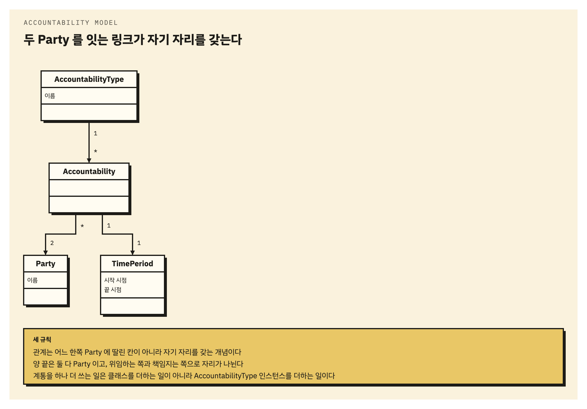

# Accountability — 관계를 칸이 아니라 개념으로 두기

## 한눈에 보는 개요

자재를 사들이는 회사의 조직 정보를 다룬다고 해 봅시다. 부산 구매팀은 기능으로는 구매 본부에 보고하고, 지역으로는 부산 사무소에 보고해요. 그래서 팀 레코드에 `상위조직` 칸을 하나 두었더니 둘째 계통을 넣을 자리가 없어서 `상위지역조직` 을 하나 더 만들었습니다. 6월에 감사 계통이 생기자 칸이 또 하나 늘었어요.

```text
Before — 계통마다 칸을 하나씩 더 붙인 모델

  부산 구매팀
    상위조직       : 조직 또는 비어 있음   ┐ 기능 계통
    상위지역조직   : 조직 또는 비어 있음   ┤ 지역 계통
    감사상위       : 조직 또는 비어 있음   ┘ 감사 계통 — 요구가 올 때마다 칸이 하나씩

  "언제부터 그랬나" 를 물으면 → 칸마다 시작일·종료일이 더 붙음 (3칸 → 9칸)
  "상위가 누구인가" 조회      → 계통 수만큼 갈라짐
  계통이 하나 늘면            → 팀의 모양이 바뀌고 저장 구조도 함께 바뀜
```

문제는 계통이 셋이라는 사실 자체가 아니라, **계통이 몇이고 무엇인지를 조직 쪽이 알아야 한다**는 데 있습니다. 관계를 담은 것이 조직의 칸이라서, 관계에 대해 묻고 싶은 것이 늘어날 때마다 조직이 바뀌어요.

Accountability 패턴의 해법은 **두 당사자를 잇는 선 자체를 개념으로 올리는 것**입니다. 선이 자기 자리를 가지면 그 선에 종류와 기간을 달 수 있고, 계통을 하나 더 쓰는 일은 칸을 만드는 일이 아니라 종류를 하나 더 만드는 일이 돼요.

```text
After — 잇는 선이 자기 자리를 갖는 모델

  Accountability ─── 종류 : AccountabilityType
                └── 기간 : TimePeriod
       위임하는 쪽 : Party
       책임지는 쪽 : Party

  부산 구매팀                    ← 칸이 하나도 늘지 않음 (그냥 Party 하나)

  "언제부터 그랬나" 를 물으면 → 선이 자기 기간을 가지고 있음
  "상위가 누구인가" 조회      → 종류를 함께 묻는 한 줄
  계통이 하나 늘면            → 종류 데이터 한 줄
```

> 기억법 — 칸을 늘리는 패턴이 아니라, **선을 개념으로 승격시키는** 패턴.

분류는 Fowler 『Analysis Patterns』 의 책임 관계 장에 속한 기반 추상이고(근거: Analysis Patterns 2장 「Accountability」 §2.4 Accountability), 함께 쓰는 패턴은 Party(양 끝에 오는 행위 주체를 한 이름으로 담는 것)와 Knowledge Level(어떤 종류의 당사자끼리 이어도 되는지를 규칙 데이터로 올리는 것)입니다. Party 가 먼저 있어야 이 패턴을 적용할 수 있어서 [Party 편](../party/party-guide_v1.0.1.md)이 그 전제를 먼저 다뤄요. 시나리오 셋을 따라갑니다. 한 팀이 두 계통에 동시에 보고하는 것을 모델에 담는 흐름, 감사 계통이 새로 생기고 한 관계가 끝날 때 무엇이 움직이는지, 그리고 규칙을 어기면 어느 단계에서 어떤 값이 어긋나는지요. 끝까지 읽으면 어떤 모델을 Accountability 라고 불러도 되는지 필수 조건 넷으로 판정할 수 있고, 그 넷을 다 만족하는데도 이 패턴으로 쓰면 곤란한 모양까지 가릴 수 있습니다.

## 패턴 자세히 들여다보기

### 시나리오 1 — 한 팀이 두 계통에 동시에 보고하는 것을 모델에 담기

2026년 4월 1일에 회사가 부산 구매팀을 새로 만듭니다. 이 팀은 기능으로는 구매 본부에 속하고, 지역으로는 부산 사무소에 속해요. 같은 날 구매 담당자 Han Jiwoo 와 선임 Choi Minseo 가 그 팀의 관리를 받기 시작합니다. 나와야 하는 답은 하나예요. "부산 구매팀의 상위는 누구인가"에 **계통마다 다른 답**이 나오되, 그 답을 내는 것이 같은 한 줄의 코드인 것입니다. 이 장면에 네 이름이 나옵니다. 두 당사자를 잇는 선이 Accountability 이고, 그 선의 종류가 AccountabilityType 이에요. 선의 양 끝에 오는 행위 주체가 Party 이고, 선이 유효한 동안을 적은 것이 TimePeriod 입니다. 이름은 여기서 한 구절씩만 소개하고 정식 정의는 개념 정리가 맡아요.

```text
당사자 장부                              계통 장부
  P-2001  Purchasing Division     조직     AT-1  functional    기능 계통
  P-2002  Busan Office            조직     AT-2  regional      지역 계통
  P-2003  Busan Purchasing Team   조직     AT-3  supervision   관리
  P-1001  Han Jiwoo               사람     AT-4  audit         감사
  P-2004  Choi Minseo             사람     AT-5  mentoring     멘토링
  P-2005  Audit Office            조직
```

1. 계통을 **데이터로 먼저 등록**합니다. functional · regional · supervision 을 AccountabilityType 인스턴스로 만들어요. 종류를 클래스로 두지 않고 인스턴스로 두는 이유는, 계통이 하나 늘 때 코드가 아니라 데이터가 늘게 하려는 것입니다. 계통을 늘릴 때마다 코드를 배포해야 한다면 "필요할 때 계통을 더한다"는 이 패턴의 쓸모가 그대로 사라져요. 이 단계가 지키는 것이 최소 조건 3 입니다.
2. 양 끝에 올 것을 **모두 Party 로** 등록합니다. 본부도 사무소도 팀도 사람도 같은 종류로 들어와요. 한 종류여야 하는 이유는, 끝이 두 종류면 조직–조직 관계와 사람–조직 관계가 서로 다른 구조가 되어 계통 질의도 둘로 갈리기 때문입니다. 특히 **팀은 회사가 아니라 조직 안쪽인데도 Party** 인데, 아니면 관계의 한쪽 끝이 비어 버려요. 이 단계가 최소 조건 2 입니다.
3. 관계를 **선 하나씩 독립으로** 만듭니다. (구매 본부 → 부산 구매팀, functional), (부산 사무소 → 부산 구매팀, regional), (부산 구매팀 → Han Jiwoo, supervision), (부산 구매팀 → Choi Minseo, supervision) 넷이에요. 팀 쪽에 상위 칸을 두지 않는 이유는 첫째 계통이 그 칸을 차지하는 순간 둘째 계통이 들어갈 자리가 없어서입니다. 선이 따로 있으면 몇 개를 더하든 팀은 그대로예요. 이 단계가 최소 조건 1 입니다.
4. 각 선의 **두 끝이 어느 자리인지** 정합니다. 위임하는 쪽과 책임지는 쪽이에요. 자리를 구분해야 하는 이유는, 맞바꾸면 "구매 본부가 부산 구매팀에 보고한다"가 되어 아예 다른 사실이 되기 때문입니다. 이 단계가 최소 조건 4 이고, 만드는 자리에서 두 끝이 같은 Party 인지도 함께 봅니다.
5. 질의가 들어옵니다. "부산 구매팀의 기능 계통 상위는?" 답은 Purchasing Division 이고, "지역 계통 상위는?" 답은 Busan Office 예요. **종류를 함께 묻는 것**이 핵심인데, 종류를 빼고 물으면 상위가 둘 다 나와서 답이 하나로 정해지지 않습니다.
6. 각 선에 **유효 기간**을 답니다. 넷 다 2026-04-01 부터예요. 기간이 Party 가 아니라 선에 붙는 이유는, "언제부터 그 관계였는가"가 당사자의 성질이 아니라 관계의 성질이어서입니다. 부산 구매팀이 언제 생겼는지와 부산 구매팀이 언제부터 구매 본부에 속했는지는 다른 사실이에요. 이 단계가 선택 조건 5 입니다.

| 단계 | 누가 → 누구에게 | 넘기는 것 | 그 단계에서 지켜지는 것 |
| --- | --- | --- | --- |
| 1 | 등록 흐름 → AccountabilityType | 계통 이름 | 종류가 클래스가 아니라 데이터 |
| 2 | 등록 흐름 → Party | 이름 | 양 끝에 올 것이 모두 한 종류 |
| 3 | 등록 흐름 → Accountability | 양 끝 · 종류 | 선이 당사자 밖에 자기 자리를 가짐 |
| 4 | Accountability → 자기 자신 | 위임하는 쪽 · 책임지는 쪽 | 두 끝의 자리가 구분되고 서로 다른 Party |
| 5 | 질의 → Accountability | 당사자 · 종류 · 날짜 | 계통마다 답이 따로 나옴 |
| 6 | Accountability → TimePeriod | 시작 시점 | 기간이 당사자가 아니라 선에 붙음 |

잠깐 확인 하나 해 볼까요? 2단계에서 부산 구매팀을 Party 로 등록하지 않으면 어떻게 될까요? 팀은 functional 과 regional 에서 책임지는 쪽이고 supervision 둘에서 위임하는 쪽이라 **3단계에서 만든 네 선 모두에서 한쪽 끝입니다.** 그래서 네 선이 모두 한쪽 끝을 잃어요 — 관계의 끝에 올 수 있는 것은 Party 뿐이니까요. 여기서 하나 분명히 해 둘 것이 있습니다. 조직 안쪽을 Party 로 담는 것은 이 패턴이 따로 요구하는 조건이 **아니라**, 조건 2 를 조직 계통에 적용한 결과예요. 사람과 법인만 잇는 모델이라면 팀을 Party 로 만들 이유가 없고, 팀을 관계의 끝에 두려는 순간 조건 2 가 그것을 요구합니다.

이 시나리오가 보여 준 것은 **관계에 대해 묻고 싶은 것이 늘어도 당사자는 그대로**라는 것입니다. 계통이 둘이 되어도(3단계) 부산 구매팀에는 칸이 하나도 늘지 않았고, 기간을 달아도(6단계) 마찬가지예요. 달라진 것은 선이 자기 자리를 가졌다는 것 하나입니다. 그리고 4단계가 덧붙인 것이 있어요. 선이 자기 자리를 가지면 두 끝이 대칭으로 보이기 시작하는데, 책임 관계는 대칭이 아니므로 어느 쪽이 어느 자리인지를 모델이 따로 말해야 합니다. 여기서 나온 네 이름이 개념 정리로 모여요.

### 시나리오 2 — 감사 계통이 새로 생기고 한 관계가 끝날 때

6월 1일에 요구가 둘 들어옵니다. 하나는 **감사 계통**을 새로 다뤄야 한다는 것이에요. 감사실이 Han Jiwoo 를 감사하고, Han Jiwoo 는 감사 담당자로서 Choi Minseo 를 점검합니다. 다른 하나는 Han Jiwoo 가 6월 30일자로 부산 구매팀을 떠난다는 것이고요. 이 시나리오에서 새로 나오는 이름은 없고, 바뀌는 것과 안 바뀌는 것을 셉니다.

1. 새 계통을 **데이터 한 줄로** 더합니다. audit 이라는 AccountabilityType 인스턴스 하나예요. 클래스도 필드도 저장 구조도 늘지 않습니다. 시나리오 1 의 1단계가 종류를 인스턴스로 둔 덕이에요.
2. 선을 둘 만듭니다. (감사실 → Han Jiwoo, audit) 과 (Han Jiwoo → Choi Minseo, audit) 이고 둘 다 6월 1일부터예요. Han Jiwoo 는 이제 **선 셋에 걸려** 있습니다 — supervision 의 책임지는 쪽, mentoring 의 책임지는 쪽, audit 의 책임지는 쪽. 겸직을 표현하려고 새로 만든 것은 없어요.
3. 눈여겨볼 것이 하나 있습니다. Choi Minseo 와 Han Jiwoo 사이에는 이제 **방향이 서로 반대인 선이 둘** 있어요. mentoring 은 Choi Minseo 가 위임하는 쪽이고, audit 은 Han Jiwoo 가 위임하는 쪽입니다. 종류가 다르면 이것이 모순이 아닌 이유는, 두 선이 서로 다른 계통의 사실이어서예요. 선임이 후배를 멘토링하면서 감사 담당자로서는 그 선임을 점검하는 것이 실제로 있는 일이고, 이것이 계통마다 별도의 그래프라는 말의 뜻입니다.
4. 6월 30일에 supervision 관계를 **닫습니다**. 선을 지우지 않고 기간의 끝만 적어요. 지우지 않는 이유는, 지우면 "5월에 누가 Han Jiwoo 를 관리했는가"에 답할 수 없게 되기 때문입니다. 닫을 때 끝이 시작보다 앞서지 않는지도 함께 봐요.
5. 무엇이 안 바뀌었는지 셉니다. Party 등록 흐름도, 계통 질의 코드도, 저장 구조도 그대로예요. 두 요구가 모두 선 쪽에만 해당했기 때문입니다.

| 무엇 | 요구가 들어오기 전 | 들어온 뒤 |
| --- | --- | --- |
| 등록된 계통 | functional · regional · supervision · mentoring | + audit (데이터 한 줄) |
| Party 에 붙은 칸 | 이름 | 그대로 |
| Han Jiwoo 가 걸린 선 | supervision · mentoring | supervision · mentoring · audit |
| 계통 질의 코드 | 종류를 함께 받는 한 줄 | 그대로 |
| 끝난 관계 | — | supervision 은 2026-06-30 에 닫힘 (선은 남음) |

8월 1일 기준으로 물으면 답이 이렇게 나뉩니다. `supervision parent of Han Jiwoo on 2026-08-01: none` 이고 `audit parent of Han Jiwoo on 2026-08-01: Audit Office` 예요. 5월 1일 기준으로 같은 질문을 하면 supervision 쪽은 `Busan Purchasing Team` 이 나옵니다. 같은 모델이 같은 질의로 두 시점의 답을 따로 내는 것이고, 4단계에서 선을 지우지 않았기 때문에 가능한 일이에요.

이 시나리오가 보여 준 것은 **새 요구가 선 쪽에 해당하면 당사자 쪽은 움직이지 않는다**는 것입니다. 감사 계통은 "이을 종류가 하나 더 있다"는 요구라 종류 데이터 한 줄로 끝났고(1·2단계), 관계 종료는 "선이 언제까지 유효했는가"라는 요구라 선의 기간 안에서 끝났어요(4단계). 3단계가 덧붙인 것은 계통이 서로 독립이라는 사실입니다 — 한 계통에서 위인 쪽이 다른 계통에서는 아래일 수 있고, 그것이 모델의 결함이 아니라 이 패턴이 표현하려던 것이에요.

### 시나리오 3 — 규칙을 어기거나 잘못 쓰면 어느 단계에서 어떤 값이 어긋나는가

같은 장부에 **규칙을 어기는 일 셋과, 규칙은 지키는데 그 모델을 잘못 쓰는 일 하나**가 들어옵니다. 선을 **당사자의 칸으로** 되돌리는 것, 양 끝 가운데 하나를 Party 가 아닌 것으로 두는 것, 종류를 클래스로 두는 것, 그리고 두 끝을 맞바꿔 넘기는 것이에요. 1·2·4단계의 값은 코드를 실제로 그렇게 고쳐 실행해 확인한 것입니다. 고친 범위도 단계마다 함께 적어요. 값만 옮겨 적으면 같은 수치를 다른 입력에서 얻게 되니까요. **3단계만 성격이 다릅니다.** 거기서 세는 것은 실행 출력이 아니라 코드의 모양이라 실행하지 않았고, 그 사실을 그 자리에 적어 두었어요.

1. 선을 **당사자의 칸으로** 되돌립니다(조건 1 위반). 부산 구매팀에 `상위조직` 칸 하나를 두면 functional 과 regional 중 **하나만** 들어가요. 칸 하나에 하나만 담긴다는 것은 등록 두 줄 가운데 하나를 지우는 것과 같아서, 고친 범위는 **등록을 부르는 한 줄을 지운 것뿐**입니다. 그렇게 실행하면 출력 12줄 가운데 **한 줄**이 `none` 으로 바뀌어요. 어느 줄인지는 어느 계통이 칸을 차지하느냐에 따라 달라집니다 — functional 이 차지하면 둘째 줄이, regional 이 차지하면 첫째 줄이 빈 답을 내요. 칸을 둘로 늘리면 그 줄은 맞지만 감사 계통이 들어오는 순간 같은 일이 되풀이됩니다.
2. 양 끝 가운데 하나를 **Party 가 아닌 것**으로 둡니다(조건 2 위반). 부산 구매팀을 Party 로 등록하지 않고 팀 이름 문자열로만 두면, 팀이 끝에 오는 관계 **넷이 모두 거절**됩니다 — 팀이 책임지는 쪽인 functional·regional 둘도, 위임하는 쪽인 supervision 둘도요. 고친 범위는 팀을 등록하는 **한 줄을 지우고**, 거절 때문에 프로그램이 중단되지 않도록 등록 네 줄을 세는 자리로 감싼 것입니다. 출력 12줄 가운데 **넷**이 바뀌어요 — 첫째·둘째·셋째 줄이 전부 `none` 이 되고, 열두째 줄은 거절 사유가 종류가 아니라 당사자로 바뀝니다(그 줄이 쓰는 등록도 팀을 끝에 두고 있어서 당사자 확인에 먼저 걸리거든요).
3. 종류를 **클래스로** 둡니다(조건 3 위반). 이 단계만 **실행값이 아니라 코드의 모양을 센 것**이에요 — 클래스로 나눠도 같은 답을 내도록 짜면 출력은 그대로이고, 바뀌는 것은 코드의 크기입니다. `FunctionalLine` · `RegionalLine` · `SupervisionLine` 클래스를 만들면 질의도 클래스마다 하나씩 생겨요. 시나리오 2 의 1단계에서 데이터 한 줄로 끝났던 감사 계통이 여기서는 클래스 하나와 질의 하나가 됩니다. 계통이 다섯이면 클래스 다섯과 질의 다섯이고, 그때부터는 "계통 목록을 보여 달라"는 요구에 코드를 읽어야 답할 수 있어요.
4. 두 끝을 **맞바꿔 넘깁니다**. 앞 셋과 달리 이번에는 **모델을 고치지 않았습니다** — 조건 4 는 그대로 지켜지고, 틀린 것은 그 모델을 쓰는 **호출** 쪽이에요. mentoring 선을 만들 때 위임하는 쪽과 책임지는 쪽 자리에 넘기는 값을 서로 바꿔 보았고, 고친 범위는 등록을 부르는 **한 줄의 인자 순서뿐**입니다. 결과가 이 항목에서 가장 조용해요 — 타입 검사가 **0건**을 내고, 두 끝이 같은 Party 인지 보는 검사도 서로 다른 Party 라 그냥 통과하며, 실행도 아무것도 거절하지 않습니다. 달라지는 것은 출력 12줄 가운데 **2줄**뿐이에요.

```text
어긋난 자리            막히는 자리 (제대로 뒀을 때)   어긋나는 값
선은 당사자 밖에 있다   선이 자기 자리를 가짐          출력 12줄 중 1줄이 none (어느 줄인지는 어느 계통이 칸을 차지하느냐에 따라 다름)
양 끝은 둘 다 Party     팀도 Party 로 등록             팀이 끝에 오는 관계 4건이 전부 거절 · 출력 12줄 중 4줄이 바뀜
종류는 종류 개념의 것   AccountabilityType 인스턴스    계통 하나 = 클래스 하나 + 질의 하나 (코드 모양을 센 것)
두 끝을 맞바꿔 넘김     없음 — 모델은 그대로 지켜짐    진단 0건 · 거절 0건 · 출력 12줄 중 2줄만 조용히 바뀜
```

4단계의 두 줄이 정확히 어떻게 바뀌는지 보면 이 조건이 왜 따로 있어야 하는지가 분명해집니다. 여섯째 줄이 `lines where Han Jiwoo is responsible on 2026-08-01: mentoring, audit` 에서 `audit` 만 남고, 일곱째 줄이 `mentoring parent of Han Jiwoo on 2026-08-01: Choi Minseo` 에서 `none` 으로 바뀌어요. 장부에는 여전히 선 일곱이 있고 종류도 다섯 그대로입니다. 바뀐 것은 **누가 누구에게 책임지는가** 하나뿐인데, 그것이 이 패턴이 표현하려던 바로 그 사실이에요.

이 시나리오가 보여 준 것은 **어긋나는 방식이 저마다 다르다**는 점입니다. 1단계는 계통이 둘 이상일 때 답이 사라지는 것을, 2단계는 관계의 끝에 걸 자리가 없어지는 것을, 3단계는 종류가 늘 때 코드가 느는 것을 보여요. 4단계만 성격이 다릅니다 — 모델은 조건 넷을 그대로 지키는데 **아무것도 거절되지 않은 채로 사실이 뒤집힙니다.** 뒤집힌다는 것 자체가 조건 4 가 지켜진 증거예요. 두 끝이 대칭인 모델이었다면 맞바꿔도 아무 일이 없었을 테니까요. 그 대칭 모델이 바로 조건 4 를 통과하지 못하는 경우이고, 비교 절이 그것을 다룹니다.

### 개념 정리

시나리오에 나온 분석 층위의 개념 넷을 정식으로 정의합니다. 이 절이 정하는 것은 개념이 무엇을 책임지고 누구와 협력하는가까지예요. 그 책임을 코드의 어느 객체가 지는지, 무엇이 aggregate 의 root 인지는 뒤의 「상황 설정」 표가 정합니다.

- **Accountability**(책임 관계) — 두 Party 사이에 성립하는 책임·권한 관계 하나이고, 이 패턴의 중심입니다. 당사자 어느 쪽에도 속해 있지 않고 자기 자리를 가져요.
  - 책임: 양 끝이 누구인지, 어느 종류인지, 언제부터 언제까지인지를 답합니다. 두 끝이 서로 다른 Party 인지도 자기가 봐요(시나리오 1 의 4단계).
  - 협력: 양 끝으로 Party 둘을 가리키고, 종류로 AccountabilityType 하나를 가리키고, 기간으로 TimePeriod 를 답니다. 양 끝의 자리에는 이름이 붙는데, 위임하는 쪽을 commissioner, 책임지는 쪽을 responsible 이라고 불러요(원전이 쓰는 다른 이름 한 쌍은 parent 와 child 입니다). 이 글은 자리가 구분된다는 사실만 조건으로 삼고 이름은 삼지 않습니다.
- **AccountabilityType**(관계의 종류) — 그 선이 어떤 계통의 사실인지를 담는 개념입니다. 이 글의 예제에서는 functional · regional · supervision · audit · mentoring 다섯이에요.
  - 책임: 계통 하나를 대표합니다. 계통을 하나 더 쓰는 일이 이 개념의 인스턴스를 하나 더 만드는 일이 되게 하는 것이 이 개념이 있는 이유예요(시나리오 2 의 1단계).
  - 협력: Accountability 가 자기 종류로 이것 하나를 가리킵니다. 같은 종류를 가진 선들이 모여 계통 하나의 그래프가 되고, 계통이 다르면 두 Party 사이에 방향이 반대인 선이 함께 있을 수 있어요(시나리오 2 의 3단계).
- **Party**(당사자) — 관계의 양 끝에 오는 행위 주체입니다. 사람도 법인도 부서도 팀도 여기 들어와요. 이 개념의 자세한 내용은 [Party 편](../party/party-guide_v1.0.1.md)이 맡고, 이 글은 그것이 **양 끝에 오는 한 종류**라는 성질만 씁니다.
  - 책임: 자기가 누구인지를 답합니다. 자기가 어떤 관계에 걸려 있는지는 알지 못해요 — 그것은 선 쪽이 압니다.
  - 협력: Accountability 의 양 끝에 옵니다. 조직 안쪽(부서·팀)도 같은 종류로 담기기 때문에 조직 계통을 사람까지 이어 그릴 수 있어요(시나리오 1 의 2단계).
- **TimePeriod**(유효 기간) — 관계가 유효한 동안을 적은 값입니다. 끝이 비어 있으면 아직 열려 있어요.
  - 책임: 어느 시점에 그 관계가 성립했는지를 답합니다. 누구의 기간인지는 자기가 모르고, 붙은 Accountability 가 알아요.
  - 협력: Accountability 에 붙습니다. Party 에는 붙지 않는데, 당사자가 존재한 기간과 관계가 유효한 기간이 다른 사실이기 때문이에요(시나리오 1 의 6단계).



그림에서 눈여겨볼 것은 **선이 어디에 붙어 있는가**입니다. Party 에서 Party 로 직접 가는 선이 없고, 가운데에 Accountability 가 있고 거기서 양쪽으로 갈라져요. Party 쪽 다중도가 2 인 것은 관계 하나가 당사자 둘을 가리킨다는 뜻이고, 그 둘이 같은 종류라서 이 패턴의 관계들이 그래프 하나를 이룹니다(근거: Analysis Patterns 2장 「Accountability」 §2.4 의 그림 2.8 — Accountability 의 양 끝이 commissioner 와 responsible 이라는 서로 다른 이름의 연관 끝으로 각각 Party 에 이어지고, 종류 쪽으로 Accountability Type 이 붙습니다). AccountabilityType 이 위에 있는 것은 그것이 여러 선을 분류한다는 뜻이지 소유한다는 뜻이 아니에요.

## 사용 목적

Accountability 가 필요하다는 단서는 요구나 기존 모델에서 눈으로 셀 수 있는 모양으로 나타납니다.

- **같은 종류의 "상위" 칸이 둘 이상 있습니다.** `상위조직` 과 `상위지역조직` 이 나란히 있고, 둘 다 같은 종류를 가리켜요. 요구가 하나 올 때마다 칸이 하나씩 붙는 자리입니다.
- **관계 종류마다 클래스나 테이블이 하나씩 있고, 그 필드가 거의 같습니다.** `Employment` 와 `Supervision` 이 양 끝과 기간을 똑같이 갖고 이름만 다를 때예요.
- **"언제부터 언제까지 그 관계였는가"를 묻는 요구가 있습니다.** 조직 개편 이력을 남겨야 하거나, 지난달 기준으로 승인선을 다시 그려야 하는 경우가 그렇습니다.
- **어떤 종류끼리 이어도 되는지가 요구서에 적혀 있습니다.** "병원에는 의사와 컨설턴트만 소속될 수 있다" 같은 문장이요. 이런 연결 규칙이 여럿이면 규칙 자체를 데이터로 올리고 싶어집니다.

쓰지 말아야 할 때도 분명합니다.

- **계통이 하나뿐일 때.** 조직도가 한 벌이고 앞으로도 그럴 것 같으면 조직에 부모 참조 한 줄을 두는 편이 낫습니다. 잃는 것은 직접성이에요 — 상위를 읽는 데 선 저장소를 한 번 거치게 되고, 그렇게 우회해서 얻는 것이 없습니다. 원전도 이 패턴이 조직 계층보다 손이 많이 가니 필요해지기 전에는 꺼내지 말라고 적어요(근거: Fowler 개정 초안 Organization Structures 의 「Accountability」 「When to use it」).
- **두 끝을 맞바꿔도 뜻이 그대로인 대칭 연결일 때.** "이 두 회사는 같은 그룹이다" 처럼 어느 쪽을 앞에 적든 같은 사실이면 이 패턴이 아닙니다.
- **방향은 있는데 위임된 책임이 없을 때.** 팔로우·추천·선호처럼 한쪽이 다른 쪽을 **가리키기만** 하는 관계가 그렇습니다. 방향이 있으니 앞 항목으로는 걸러지지 않는데, "그 계통의 상위가 누구인가"가 뜻을 갖지 않아요. 원전이 이 패턴을 쓰는 동기로 든 것이 권한 계통이 여럿이라는 사정이고(근거: Fowler 개정 초안 Organization Structures 의 「Accountability」 「When to use it」), 위임된 책임이 없으면 그 동기가 통째로 빠집니다. 잃는 것은 이 패턴이 주는 것 전부예요 — 계통 질의도 조상 개념도 성립하지 않는데 관계·종류·저장소 셋을 떠안습니다.
- **관계가 아니라 사건을 남기고 싶을 때.** "누가 언제 무엇을 승인했다"는 기록은 그 시점에 일어난 일이지 지금 성립하는 관계가 아닙니다. 이 항목과 바로 앞 항목은 최소 조건만으로는 걸러지지 않아서 다음 절이 따로 다뤄요.
- **관계에 양이 붙고 그 양들의 합에 규칙이 걸릴 때.** 지분·배분율·할당량이 그렇습니다. 이 패턴이 담는 것은 관계가 있느냐 없느냐라서 양을 둘 자리도, 한 당사자에 걸린 관계들의 합을 볼 자리도 없어요. 구현의 계통 질의가 활성 관계 가운데 **먼저 찾은 하나**를 돌려주는 것이 그 증거인데, 그러면 60%와 0.5%가 같은 한 줄이 됩니다. "한 발행사의 지분 합은 100%" 같은 규칙도 관계 하나 안에는 물론이고 종류 안에도 둘 자리가 없고요. 이 경우는 최소 조건 넷으로도 다음 절의 구분 기준으로도 걸러지지 않으니 여기서 밝혀 둡니다.

## 패턴의 경계

### 디자인 패턴을 충족하는 최소 조건

어떤 모델을 Accountability 패턴이라고 불러도 되는지 가르는 기준입니다. 클래스 모양이 아니라 **개념이 맡는 책임**과 **모델이 늘 지키는 규칙**으로 판정해요 — 테이블 한 장으로 풀든 객체 그래프로 풀든 같은 기준으로 가려야 하니까요. `[필수]` 에는 원전이 Accountability 의 성립 요건으로 적은 것만 올렸고, 원전이 구현 지침이나 흔한 규칙으로 적은 것과 이 글 예제의 정책은 `[선택]` 입니다. 조건마다 그것을 보여 준 시나리오의 단계를 함께 적었어요.

1. [필수] 두 당사자를 잇는 관계가 어느 한쪽에 붙은 칸이 아니라 자기 자리를 갖는 개념입니다 — 관계에 대해 말할 것(종류·기간 따위)이 당사자의 속성이 아니라 그 관계의 속성으로 붙고, 같은 두 당사자 사이에 관계가 여럿 있을 수 있습니다. 시나리오 1 의 3단계가 선을 넷 만든 자리예요 (근거: Fowler 개정 초안 Organization Structures 가 여러 계통을 다뤄야 하는 상황에서 이 패턴으로 넘어간다고 적으면서, 이 패턴이 하는 일을 당사자 사이의 관계를 그 자체로 하나의 객체로 만드는 것이라고 적습니다. 같은 초안의 「Object Graph」 절이 링크를 연관으로 두는 길과 별도의 연관 객체로 두는 길을 나란히 놓고, 조직 계층은 앞을 쓰고 Accountability 는 뒤를 쓴다고 갈라 적습니다).
   - 빠지면: 당사자에 `상위조직` 칸이 붙은 모델이 됩니다. 계통이 둘이 되는 순간 칸 하나에 하나만 들어가 출력 12줄 가운데 한 줄이 `none` 으로 바뀌어요. 시나리오 3 의 1단계가 그 자리입니다.
   - 위 근거 괄호가 받쳐 주는 것은 **관계를 독립한 객체로 만드는 것이 이 패턴이 하는 일이다**까지입니다. 「같은 두 당사자 사이에 관계가 여럿 있을 수 있다」는 그 결과를 판정할 수 있게 옮긴 것인데, 원전이 여러 계통을 한 그래프 위에 겹치는 것을 이 패턴의 용도로 들고 있으므로 무리한 확장은 아니에요.
2. [필수] 관계의 양 끝이 둘 다 Party 입니다 — 사람이든 법인이든 부서든, 관계의 끝에 오는 것이 모두 같은 한 종류이고 그 종류가 행위 주체를 담는 이름입니다. 시나리오 1 의 2단계가 본부·사무소·팀·사람을 같은 종류로 등록한 자리예요 (근거: Fowler 개정 초안 Organization Structures 의 「Accountability」 **절 머리글**이 이 패턴을 당사자들 사이의 관계 그래프를 나타내는 것이라고 적고, 같은 절의 「Making it work」 가 이 관계의 인스턴스 하나가 당사자 둘 사이의 링크라고 적습니다. Analysis Patterns 2장 「Accountability」 §2.4 의 그림 2.8 도 양 끝을 모두 Party 로 그립니다).
   - 빠지면: 관계의 한쪽 끝에 올 것이 없어집니다. 조직 안쪽인 팀을 Party 로 담지 않은 모델에서는 팀이 끝에 오는 관계 넷이 전부 거절되고 출력 12줄 가운데 넷이 바뀌어요. 시나리오 3 의 2단계입니다.
   - 위 근거 괄호가 받쳐 주는 것은 **조건 문면 전부**입니다. 절 머리글이 관계의 양 끝을 당사자로 적고 해법 그림이 그것을 두 연관 끝으로 그리고 있어서 "양 끝"도 "Party"도 원전의 말이에요. 한 가지만 밝혀 둡니다 — 원전은 **어떤 것들이 Party 여야 하는지**는 이 패턴의 조건으로 적지 않습니다. 조직 안쪽인 부서나 팀을 Party 로 담을 수 있다는 것은 Party 쪽에서 할 수 있다고 적은 말이라 [Party 편](../party/party-guide_v1.0.1.md)의 선택 조건 7 에 있어요. 이 조건은 그것을 필수로 끌어올리지 않고, **관계의 끝에 두려는 것이 있다면 그것이 Party 여야 한다**고만 요구합니다. 조직 계통을 다루는 모델에서는 그 요구가 결과적으로 같은 결론에 이르러요.
3. [필수] 관계의 종류가 **그 종류를 대표하는 개념의 인스턴스**로 있고, 클래스가 아니라 그 인스턴스로 구별됩니다 — 계통이나 관계 종류를 하나 더 쓰는 일이 타입을 하나 더 정의하는 일이 아니라 그 개념의 인스턴스를 하나 더 만드는 일입니다. 시나리오 2 의 1단계가 감사 계통을 데이터 한 줄로 더한 자리예요 (근거: Fowler 개정 초안 Organization Structures 가 이 패턴을 소개하면서 관계를 필요한 링크의 종류에 따라 타입이 매겨진 객체로 만든다고 적고, 같은 초안의 「Making it work」 가 필요한 관계 종류마다 관계 종류의 **인스턴스**를 만들어 당사자들을 그 종류의 관계로 잇는다고 적습니다. Analysis Patterns 2장 「Accountability」 §2.4 의 그림 2.8 도 Accountability Type 을 별도 개념으로 두고 관계마다 하나씩 붙입니다).
   - 빠지면: 갈래가 둘입니다. 종류를 클래스로 두면 클래스가 하나씩 늘고 질의도 종류마다 하나씩 늘어나요 — 계통 다섯이면 클래스 다섯과 질의 다섯이 되고, "지금 어떤 계통이 있는가"를 데이터가 아니라 코드가 답하게 됩니다. 시나리오 3 의 3단계가 그쪽이에요. 종류를 문자열 리터럴로만 둔 모델도 통과하지 못하는데, 문자열은 어느 종류 개념의 인스턴스도 아니기 때문입니다. 그쪽은 코드가 늘지는 않지만 계통을 대표하는 개념이 아예 없어 선택 조건 8 을 적용할 자리도 없어요. 스스로 점검하기 1번이 그 경우입니다.
   - 위 근거 괄호가 받쳐 주는 것은 **조건 문면 전부**입니다. 「그 종류를 대표하는 개념의 인스턴스」까지 원전의 말이에요. 관계 종류마다 그 종류의 인스턴스를 만들라고 적은 것이 그 뜻이고, 해법 그림도 종류를 별도 개념으로 두고 관계마다 그 인스턴스 하나를 가리키게 그립니다. **원전이 적지 않은 것도 밝혀 둘게요** — 그 인스턴스들을 모델이 한데 모아 두거나 세어 볼 수 있어야 한다고는 어디에도 적지 않습니다. 그래서 조건에 그 요구를 넣지 않았어요. 넣었다면 원전이 자기 예제로 보인 모델이 이 패턴에서 제외됐을 겁니다. 그 예제는 종류를 개념의 인스턴스로 두되 어디에도 모아 두지 않거든요. 근거로 **단독으로는 쓰지 않은** 자리도 하나 있습니다. 같은 초안의 「Object Graph」 절에 연관 객체를 쓰면 흔히 연관에 타입이 붙는다는 문장이 있고 그것이 이 패턴을 직접 지목하기까지 하는데, 「흔히」로 적힌 것은 연관 객체 일반에 대한 **흔한 규칙**이라 보강으로만 봅니다.
4. [필수] 관계의 두 끝이 서로 다른 자리를 차지해서, 둘을 맞바꾸면 다른 사실이 됩니다 — 어느 쪽이 위임하는 쪽이고 어느 쪽이 책임지는 쪽인지가 모델에 있고, 그 구별 위에서만 "상위가 누구인가"가 정의됩니다. 시나리오 1 의 4단계가 두 자리를 정한 자리예요 (근거: Analysis Patterns 2장 「Accountability」 §2.4 의 그림 2.8 이 두 끝을 commissioner 와 responsible 이라는 서로 다른 이름의 연관 끝으로 그리고 각각 다중도 1 을 답니다. Fowler 개정 초안 Organization Structures 의 「Accountability」 「Making it work」 도 이 패턴이 주는 질의를 "무엇의 어느 계통 상위가 누구인가"라는 **한 방향** 질문으로 적습니다).
   - 빠지면: 두 끝이 이름만 다른 대칭 연결이 됩니다. 어느 쪽을 앞에 적든 같은 사실이라 "상위가 누구인가"가 뜻을 잃어요. 비교 절이 드는 `GroupTie` 가 그 모양입니다. 거꾸로 이 조건을 **지킨** 모델에서는 두 끝을 맞바꾸는 것이 곧 다른 사실을 적는 일이 되는데, 그 값이 시나리오 3 의 4단계예요 — 타입 진단 0건 · 실행 거절 0건에 출력 12줄 가운데 2줄이 조용히 바뀝니다.
   - 위 근거 괄호가 받쳐 주는 것은 **원전의 모델에서 두 끝이 서로 다른 자리로 그려지고 계통 질의가 한 방향으로만 정의된다**까지입니다. 「맞바꾸면 다른 사실이 된다」는 그 자리를 판정할 수 있는 문장으로 옮긴 것이고, 두 끝의 **이름**(commissioner·responsible 인지 parent·child 인지)은 원전 안에서도 달라서 조건으로 삼지 않았어요.
5. [선택] 관계가 유효 기간을 답니다 — 시나리오 1 의 6단계가 선에 시작 시점을 달고 시나리오 2 의 4단계가 끝을 닫는 자리입니다 (근거: Analysis Patterns 2장 「Accountability」 §2.4 의 그림 2.8 이 Accountability 에 Time Period 를 붙입니다. 다만 Fowler 개정 초안의 기본형은 당사자·관계·관계 종류 셋만으로 이 패턴을 구성하고 기간을 두지 않으므로, 성립 요건이 아니라 선택으로 둡니다).
   - 빠지면 잃는 것: 지난 시점의 답입니다. 관계를 끝낼 때 지우는 수밖에 없어져서 "5월에 누가 관리했는가"에 답할 수 없게 돼요. 지금 성립하는 관계만 물으면 되는 모델이면 잃는 것이 없습니다.
6. [선택] 양 끝의 당사자가 속성이 같아도 서로 다른 것으로 구별되고, 관계는 그 식별자로 양 끝을 가리킵니다 — 시나리오 1 의 2단계에서 당사자마다 식별자를 준 자리예요 (근거: 이 가이드의 정책 — Evans DDD Reference 의 Entity 정의를 양 끝에 적용한 DDD 매핑 판단이고, 이 조건이 본래 사는 자리는 상황 설정 표의 배정 칸입니다).
   - 빠지면 잃는 것: 답이 하나로 정해지는 성질입니다. 이름으로 양 끝을 가리키면 동명이인이 생기는 순간 계통이 갈라져요.
   - 왜 `[필수]` 가 아닌가 — **원전이 이 패턴의 조건으로 식별성을 적은 문장이 없습니다.** 개정 초안 전문과 원전의 그림 자료를 글자 단위로 처음부터 끝까지 찾아보면 identity · identifier · unique 가 **각각 0건**이고, 그 자료들이 싣는 모델 그림 어디에도 식별자 속성이 붙어 있지 않아요. 초안의 예제 코드가 순환을 검사하며 당사자끼리 같은지를 묻기는 하지만, 그것은 "둘을 구별할 수 있다"는 전제이지 "속성이 같아도 다르다"는 요구가 아니고, 그 전제는 그 코드를 쓴 언어에서 비용 없이 따라옵니다. 그러니 이것은 원전이 성립 요건으로 적은 것이 아니라 이 글이 DDD 로 옮기며 내린 판단이고, 그런 것은 `[선택]` 에 둡니다. [Party 편](../party/party-guide_v1.0.1.md)이 이 판단을 이쪽으로 넘겼는데, 받아 보니 이쪽에도 원전 근거가 없어서 같은 표기가 됐어요.
7. [선택] 같은 종류 안에서 순환이 생기지 않습니다 — 시나리오 2 의 3단계가 종류가 다른 반대 방향 선 둘을 함께 두는 자리이고, 그 규칙이 종류 안쪽에만 걸린다는 것을 보입니다 (근거: Fowler 개정 초안 Organization Structures 의 「Accountability」 가 관계를 불변 객체로 다루면서 만들기 전에 순환 여부를 확인하는 방식을 구현 지침으로 적습니다. 같은 초안의 「Object Graph」 가 실무에서 만나는 그래프는 **대개** 비순환이라고 적어 전부라고 하지 않으므로, 성립 요건이 아니라 선택으로 둡니다).
   - 빠지면 잃는 것: 계통 질의가 끝난다는 보장입니다. 상위를 거슬러 올라가는 조회가 자기 자신을 다시 만나게 돼요. 순환이 정상인 그래프라면 이 조건을 쓰지 않는데, 그런 그래프는 대개 **이 패턴 밖의 모델**입니다 — 위임된 책임이 있는 계통에서 자기가 자기 조상이 되는 일은 뜻을 갖지 않으니까요. 비교 절이 그 경우를 다룹니다.
8. [선택] 어떤 종류의 당사자끼리 어떤 종류의 관계로 이어도 되는지를 규칙 데이터로 둡니다 — 시나리오 2 의 2단계에서 감사 계통을 아무 제약 없이 이은 자리가 이 조건이 필요해지는 지점이에요 (근거: Analysis Patterns 2장 「Accountability」 §2.5 「Accountability Knowledge Level」 이 당사자의 분류를 별도 개념으로 두고 관계 종류마다 허용되는 분류 짝을 제약으로 적습니다. Fowler 개정 초안도 이 패턴의 기본형은 아무 조합이나 허용하는 느슨한 형태이고 제약을 두고 싶으면 지식 층위를 **쓸 수 있다**고 적으므로, 성립 요건이 아니라 선택으로 둡니다).
   - 빠지면 잃는 것: 잘못된 짝을 만들기 전에 막을 방법입니다. 이 글의 예제는 감사실과 담당자를 잇는 것이 맞는지 아무도 보지 않아요. 이 조건을 실제로 갖추는 일은 Knowledge Level 패턴의 몫이고, 그 편이 당사자 분류와 연결 규칙을 다룹니다.

> 필수는 넷이다 — 선이 자기 자리를 갖는가, 양 끝이 둘 다 Party 인가, 종류가 종류 개념의 인스턴스인가, 두 끝을 맞바꾸면 다른 사실이 되는가.

### 비슷한 패턴·안티패턴과의 차이

Accountability 와 닮아 보이거나 같은 단서에서 떠오르는 여섯을 구분 기준부터 모았어요.

| 대상 | 구분 기준 (모델에서 확인) | Accountability 를 고르면 얻는 것 | 포기하는 것 |
| --- | --- | --- | --- |
| Party | 그 개념을 지웠을 때 남는 것이 노드인가 링크인가. Party 는 혼자 존재하지만 Accountability 는 두 Party 가 있어야 성립 | 당사자 위에 관계를 둘 자리. 계통이 몇이든 당사자는 안 바뀜 | 당사자 자체의 정체·연락 수단. 관계만으로는 "이 사람이 누구인가"에 답하지 못함 |
| 조직 계층을 재귀 연관으로 둔 모델 | 계통이 한 종류뿐인가 여러 종류인가. 링크가 자기 속성을 갖는가 | 계통을 몇이든 겹칠 수 있고 기간·이력이 붙음 | 단순함. 계통이 끝까지 하나면 부모 참조 한 줄로 끝날 일을 저장소와 종류를 거쳐 표현함 |
| 관계 종류마다 클래스를 둔 모델 | 새 종류를 더하는 일이 인스턴스 생성인가 클래스 추가인가 | 새 계통이 코드가 아니라 데이터로 늘어남. 종류가 늘어도 질의는 한 줄 | 종류별로 다른 필드·규칙을 타입으로 강제하는 것. 그건 지식 층위로 따로 둬야 함 |
| 단순한 다대다 조인 (대칭 연결) | 두 끝을 맞바꾸면 뜻이 달라지는가 | 방향이 있는 사실을 방향째로 표현 | 없음 — 대칭 연결이라면 이 패턴이 더하는 것이 전부 비용임 |
| 방향은 있지만 위임된 책임이 없는 연결 (팔로우·추천·선호) | 한쪽이 다른 쪽에 **책임지는가**, 그냥 **가리키기만** 하는가. 자기가 자기 조상이 되는 일이 정상인지로도 확인 | 없음 — 계통 질의도 조상 개념도 뜻을 갖지 않음 | 없음. 관계·종류·저장소 셋을 떠안고 얻는 것이 없음 |
| 감사 로그 (사건 기록) | 그 개념에 물을 수 있는 것이 "지금 성립하는가"인가 "그때 일어났는가"인가 | 어느 시점의 상태를 되물을 수 있음 | 일어난 일의 순서와 횟수. 관계는 상태라 "몇 번 승인했는가"에 답하지 못함 |

이 표를 쓰는 법을 먼저 밝혀 둘게요. **구분 기준은 이웃과 가르는 데 쓰는 것이고 최소 조건을 대신하지 않습니다.** 두 판정이 갈리면 최소 조건이 먼저예요. 이 표가 못 가르는 자리가 둘 있습니다. 하나는 **조건 2**(양 끝이 둘 다 Party)인데, 양 끝에 올 수 있는 것이 한 종류인지를 여섯 기준 어디에서도 묻지 않아요. 다른 하나는 **조건 3 의 셋째 갈래**입니다. 셋째 행의 기준이 「인스턴스 생성인가 클래스 추가인가」로 둘만 두는데, 종류를 문자열 값으로만 둔 모델은 어느 쪽도 아니라서 그 기준이 이 패턴 쪽으로 답해 버립니다. 스스로 점검하기 1번이 그 둘에 한꺼번에 걸리는 모양이고, 가르는 것은 표가 아니라 조건 2 와 조건 3 이에요. 기준 하나로 전부 가리려 하지 않는 것이 이 표를 쓰는 법입니다.

넷째 행부터가 헷갈리는 자리인데, 셋이 서로 다른 이유로 헷갈립니다. 먼저 대칭 연결이에요. 아래는 두 회사가 같은 그룹에 속한다는 사실을 적은 모델입니다.

```java no-compile
// 조건 4 를 표기로 읽으면 통과해 보이지만, 문면대로 읽으면 걸린다
final class GroupTie {
    final PartyId partyIdFrom;              // 선이 당사자 밖에 자기 자리를 가짐   (조건 1)
    final PartyId partyIdTo;                // 양 끝이 둘 다 Party                 (조건 2)
    final TieTypeId tieTypeId;              // 종류가 종류 개념의 인스턴스          (조건 3)
    final TimePeriod period;

    GroupTie(PartyId from, PartyId to, TieTypeId type, TimePeriod period) { /* … */ }
}
// tieTypeId = "같은 그룹" 하나. GroupTie(A, B) 와 GroupTie(B, A) 는 같은 말이다.
```

이 모델은 조건 1·2·3 을 통과합니다. **조건 4 도 표기로 읽으면 통과해 보여요.** 두 끝의 이름이 `partyIdFrom` 과 `partyIdTo` 로 다르니까요. 그런데 조건 4 가 요구하는 것은 두 끝에 다른 이름이 붙는 것이 아니라 맞바꾸면 다른 사실이 되는 것이라, 문면대로 읽으면 여기서 걸립니다. 그러니 이것은 필수를 통과하는 모양이 아니라 **조건 4 를 표기 검사로 잘못 읽을 때 빠져나가는 모양**이에요. 가려내는 방법은 시나리오 3 의 4단계를 그대로 해 보는 것입니다. 두 끝을 맞바꿔 넣고 답이 바뀌지 않으면 그 관계에는 방향이 없는 겁니다.

다음은 방향이 **있는데도** 이 패턴이 아닌 자리예요. 여기서는 조건 넷이 정말로 전부 통과합니다.

```java no-compile
// 필수 조건 넷을 전부 통과하지만, 위임된 책임이 없다
final class Follows {
    final PartyId followerId;               // 선이 당사자 밖에 자기 자리를 가짐   (조건 1)
    final PartyId followeeId;               // 양 끝이 둘 다 Party                 (조건 2)
    final FollowTypeId followTypeId;        // follow · block · mute 가 인스턴스 한 줄씩 (조건 3)
    final TimePeriod period;                // 같은 쌍에 follow 와 block 이 함께 설 수 있음

    Follows(PartyId follower, PartyId followee, FollowTypeId type, TimePeriod period) { /* … */ }
}
// Follows(A, B) 와 Follows(B, A) 는 다른 사실이고, 둘이 동시에 성립하는 것이 정상이다 (조건 4)
```

A 가 B 를 팔로우하는 것과 B 가 A 를 팔로우하는 것은 분명히 다른 사실이고, 둘이 함께 있는 것이 정상입니다. 그래서 조건 4 도 통과해요. **그런데 이 패턴이 아닙니다.** 한쪽이 다른 쪽을 가리키기만 하고 책임을 위임하지 않아서, "그 계통의 상위가 누구인가"가 뜻을 갖지 않거든요. 순환이 정상이라 조상 개념 자체가 성립하지 않고, 시나리오 1 의 5단계 같은 계통 질의가 물을 것이 없습니다. 원전이 이 패턴을 쓰는 동기로 든 것이 권한 계통이 여럿이라는 사정인데, 위임된 책임이 없으면 그 동기가 통째로 빠져요. **최소 조건 넷으로는 이 형태가 걸러지지 않으니 여기서 밝혀 둡니다** — 가르는 것은 다섯째 행의 기준입니다.

셋째는 감사 로그이고, 이쪽도 조건 문면으로는 가려지지 않습니다. 아래처럼 행위자와 대상이 둘 다 Party 이고 행위 종류가 데이터인 로그는 네 조건을 그대로 통과해요.

```text
승인 로그
  2026-06-01  actor P-1001 Han Jiwoo  →  target P-2004 Choi Minseo   action APPROVE
  2026-06-01  actor P-1001 Han Jiwoo  →  target P-2004 Choi Minseo   action APPROVE   ← 같은 일이 두 번
  2026-06-03  actor P-2005 Audit Office → target P-1001 Han Jiwoo    action REVIEW

  물을 수 있는 것 : "6월 1일에 무슨 일이 있었는가" · "몇 번 승인했는가"
  물을 수 없는 것 : "8월 1일에 그 관계가 성립하는가"
```

물을 수 있는 것이 다른 것이 이 둘을 가릅니다. 시나리오 2 의 4단계에서 한 질문은 "8월 1일에 그 관계가 성립했는가"였고, 답은 관계가 열려 있는지로 나왔어요. 로그에는 그 질문을 할 수 없습니다. 거꾸로 로그는 같은 일이 두 번 일어난 것을 두 건으로 세는데, 관계는 상태라 그것을 세지 못해요 — 같은 두 당사자·같은 종류의 관계를 둘 만들어 두면 "두 번"이 아니라 "겹친 기간"이 됩니다.

Party 와의 경계는 훨씬 또렷합니다. [Party 편](../party/party-guide_v1.0.1.md)이 같은 경계를 반대쪽에서 적어 두었는데, 그쪽 표현으로는 Party 는 혼자 존재할 수 있고 Han Jiwoo 는 아무 관계가 없어도 Party 라는 것이었어요. 이쪽에서 보면 같은 말이 이렇게 됩니다 — 시나리오 1 의 3단계에서 만든 선 넷을 전부 지워도 당사자 여섯은 그대로 남지만, 당사자를 지우면 그 당사자가 걸린 선이 함께 사라집니다. 지웠을 때 남는 쪽이 노드이고 못 남는 쪽이 링크예요. 그래서 Party 가 먼저 있고 Accountability 가 그 위에 놓입니다.

## 구현 예시

### 상황 설정

예시 도메인은 시나리오가 쓴 그 조직 장부입니다. 자재를 사들이는 회사의 **조직·권한 관리 컨텍스트**이고, 누가 누구에게 어떤 계통으로 책임지는지와 그 유효 기간을 등록하고 조회해요. 당사자도 계통도 날짜도 시나리오 1~3 의 값 그대로입니다 — P-2001 Purchasing Division · P-2002 Busan Office · P-2003 Busan Purchasing Team · P-1001 Han Jiwoo · P-2004 Choi Minseo · P-2005 Audit Office, 그리고 계통 다섯이요. 급여도 평가도 발주도 이 컨텍스트가 하지 않습니다.

```text
고정된 것
  · 관계의 양 끝은 언제나 Party 둘이고, 위임하는 쪽과 책임지는 쪽으로 자리가 구분됨
  · 계통은 데이터이고, 종류를 더하는 일에 코드가 필요 없음
  · 관계는 만든 뒤 양 끝도 종류도 바뀌지 않음 — 끝나면 기간을 닫음
  · 급여·평가·발주 승인은 이 컨텍스트 밖
변하는 것
  · 계통이 새로 생기고, 관계가 새로 맺어지고 끝남
  · 같은 두 당사자 사이에 종류가 다른 관계가 함께 있을 수 있음
  · 당사자가 새로 등록됨
```

예시 타입이 어느 개념을 맡는지는 이렇습니다.

```text
예시 타입                      개념
────────────────────────       ──────────────────────────────────────────────
Accountability                 Accountability
AccountabilityId               Accountability 의 식별자
AccountabilityType             AccountabilityType
AccountabilityTypeId           AccountabilityType 의 식별자
Party                          Party (이 컨텍스트가 보는 만큼만 — 식별자와 이름)
PartyId                        Party 의 식별자
TimePeriod                     TimePeriod
commissionerId / responsibleId 양 끝의 두 자리 (위임하는 쪽 / 책임지는 쪽)
PartyRegistry                  당사자 저장소 (구현 전용)
AccountabilityTypeRegistry     계통 저장소 (구현 전용)
AccountabilityRegistry         관계 저장소 (구현 전용)
OrganizationStructure          관계 등록과 계통 조회를 맡는 도메인 서비스 (구현 전용)
```

아래 표는 DDD(Domain-Driven Design, 도메인 주도 설계)의 전술 용어를 씁니다. Bounded Context · Aggregate · Aggregate Root · Entity · Value Object · id 참조 · 불변식 · Repository 여덟은 이 가이드의 주제 밖이라 [참고 문서 「DDD 전술 용어」](../../reference/ddd-tactical-terms/ddd-tactical-terms-ref_v1.0.2.md)가 풀어 두었어요. 그 문서에 없는 낱말 둘만 여기서 한 줄씩 풀어 둡니다.

- **Factory**(팩토리) — 불변식을 검사한 뒤에만 aggregate 를 만들어 돌려주는 생성 책임이에요. 여기서는 `Accountability.start` 가 그 자리입니다.
- **도메인 서비스** — 한 aggregate 에 속하지 않고 여러 aggregate 를 식별자로 찾아 함께 다루는 작업이에요. 여기서는 관계 등록과 계통 조회, 곧 `OrganizationStructure` 입니다.

| 항목 | 이 가이드의 설정 |
| --- | --- |
| bounded context | 조직·권한 관리 컨텍스트 — 누가 누구에게 어떤 계통으로 책임지는지와 그 유효 기간을 등록·조회하고, 급여·평가·발주 승인은 맡지 않음 |
| 불변식의 위치 | ① 관계의 두 끝은 서로 다른 Party 다 → `Accountability` root 의 Factory `Accountability.start`, 동기 ② 관계는 만든 뒤 양 끝도 종류도 바뀌지 않는다 → `Accountability` root (그 셋을 바꾸는 메서드가 없고 필드가 불변) ③ 기간의 끝은 시작보다 앞설 수 없다 → `Accountability` root 의 `close`, 동기 ④ 같은 종류 안에서 순환이 생기지 않는다 → 이것은 관계 하나 안에서 지킬 수 없는 집합 규칙이라 `OrganizationStructure` 가 저장 전에 관계 저장소를 거슬러 확인, 동기 (확인과 저장 사이에 다른 관계가 끼어드는 경합은 허용) ⑤ 관계의 양 끝과 종류는 등록된 것을 가리킨다 → 역시 집합 규칙이라 `OrganizationStructure` 가 저장 전에 두 저장소로 확인, 동기 |
| root·entity·VO 배정 | `Accountability` = aggregate root 이자 entity (식별자 `AccountabilityId` 를 가짐) · `AccountabilityType` = 별도 aggregate root 이자 entity (계통을 대표하는 참조 데이터) · `Party` = 별도 aggregate root (이 컨텍스트는 식별자와 이름만 봄) · `TimePeriod` = `Accountability` 안의 불변 VO (식별자 없이 값으로 같음을 판단) · `PartyId` · `AccountabilityTypeId` · `AccountabilityId` = 식별자 VO · `PartyRegistry` · `AccountabilityTypeRegistry` · `AccountabilityRegistry` = 각 root 의 Repository · `OrganizationStructure` = 도메인 서비스 (aggregate 아님) |
| 타 aggregate 참조 방식 | id 참조 — `Accountability` → 위임하는 쪽 `Party` 는 `PartyId`, `Accountability` → 책임지는 쪽 `Party` 는 `PartyId`, `Accountability` → `AccountabilityType` 은 `AccountabilityTypeId`. 어느 aggregate 도 다른 aggregate 의 객체를 필드나 메서드 시그니처에 두지 않고, 계통을 거슬러 올라가는 흐름은 aggregate 밖의 `OrganizationStructure` 가 id 로 저장소에서 찾아 조립함 |

bounded context 가 코드에서 나타나는 자리는 파일 경계입니다 — 세 판 모두 한 파일 안이 이 컨텍스트이고, 급여나 평가는 어느 타입에도 없어요. 표의 불변식 다섯과 id 참조 셋을 다른 곳에 두면 어느 동작에서 무엇이 어긋나는지, 전부 따라가 보면 이렇습니다.

| 규칙(불변식) 또는 참조 | 다른 곳에 두거나 바꾸면 | 어느 동작에서 무엇이 어긋나는가 |
| --- | --- | --- |
| ① 두 끝이 서로 다른 Party | 검사를 등록 서비스로 옮김 | 관계를 저장소를 거치지 않고 만드는 경로가 하나라도 생기면 자기 자신에게 책임지는 관계가 장부에 생김. 계통을 거슬러 올라가는 조회가 그 자리에서 끝나지 않음 |
| ① | 검사를 아예 빼고 호출자가 봄 | `P-1001 → P-1001` supervision 이 통과해 `rejected (same party on both ends)` 줄이 사라짐. 아홉째 줄이 없어지고 장부에 선이 하나 더 늚 |
| ② 양 끝·종류가 안 바뀜 | 양 끝이나 종류를 바꾸는 메서드를 `Accountability` 에 둠 | 이미 통과한 순환 검사가 무효가 됨. `A-7`(Han Jiwoo → Choi Minseo, audit)의 종류를 mentoring 으로 바꾸면 mentoring 안에 Choi Minseo → Han Jiwoo → Choi Minseo 순환이 생기는데, 만들 때 본 검사는 다시 실행되지 않음 |
| ③ 기간의 끝 ≥ 시작 | 검사를 빼거나 호출자가 함 | `A-3` 을 `2026-03-01` 로 닫으면 시작(2026-04-01)보다 앞선 기간이 생김. 어느 날짜로 물어도 `covers` 가 거짓이라 5월 1일 기준 supervision 조회가 `none` 으로 바뀌어 셋째 줄이 어긋남 |
| ④ 같은 종류 안에 순환 없음 | 확인을 빼거나 저장 뒤로 옮김 | `A-9`(Choi Minseo → Audit Office, audit)가 통과해 audit 계통에 Audit Office → Han Jiwoo → Choi Minseo → Audit Office 가 닫힘. 열째 줄의 `rejected (cycle)` 이 사라져 출력이 11줄이 되고, **그 뒤에** 조상을 거슬러 올라가는 조회를 부르면 끝나지 않음 |
| ④ | 확인을 관계 하나 안으로 옮김 | 관계는 자기 양 끝만 알아서 두 칸 너머를 못 봄. `A-9` 는 직접 이웃이 아니라 세 칸을 돌아오는 순환이라 그 자리에서는 보이지 않고 그대로 통과함 |
| ⑤ 양 끝·종류가 등록돼 있음 | 확인을 빼거나 저장 뒤로 옮김 | `P-9999` 를 위임하는 쪽으로 쓴 관계가 장부에 남고, 계통 조회가 그 이름을 찾지 못해 조용히 건너뜀. 열한째·열두째 줄의 거절이 사라짐 |
| `Accountability.commissionerId : PartyId` | `Party` 객체를 가지게 함 | 관계를 저장할 때 가지고 있던 당사자 사본까지 함께 저장됨. 방금 이름이 바뀐 Busan Purchasing Team 이 옛 사본으로 되돌아가 계통 조회의 답이 옛 이름으로 나옴 |
| `Accountability.responsibleId : PartyId` | `Party` 객체를 가지게 함 | 관계 코드에서 상대 당사자의 상태 변경에 접근할 수 있게 됨. 관계를 하나 맺는 일이 aggregate 둘을 고치는 일이 됨 |
| `Accountability.typeId : AccountabilityTypeId` | `AccountabilityType` 객체를 가지게 함 | 계통의 이름을 고치면 이미 맺은 관계들이 가지고 있는 사본이 제각각이 됨. 여섯째 줄의 `mentoring, audit` 가 관계마다 다른 이름으로 나올 수 있음 |

세 줄로 줄이면 이렇습니다. 만들 때 보는 검사를 밖으로 내보내면 경로가 늘어날 때마다 빠뜨릴 자리가 생기고, 만든 뒤 양 끝이나 종류를 바꿀 수 있게 하면 이미 통과한 검사가 조용히 무효가 되며, 참조를 객체로 바꾸면 관계 하나를 저장하는 일이 당사자를 덮어쓰는 경로를 엽니다. 가운데 줄이 특히 조용해요 — 아무도 순환을 만들려 하지 않았는데 종류 하나를 고쳤더니 생기니까요.

뒤의 세 언어 구현은 이 설정을 그대로 옮긴 것이고, 실행하면 셋이 아래 12줄을 글자까지 같게 냅니다. 가이드 폴더의 `code/expected-output.txt` 와 같은 내용이고 이 글의 실행 수치가 전부 여기서 와요.

```text
functional parent of Busan Purchasing Team on 2026-05-01: Purchasing Division
regional parent of Busan Purchasing Team on 2026-05-01: Busan Office
supervision parent of Han Jiwoo on 2026-05-01: Busan Purchasing Team
supervision parent of Han Jiwoo on 2026-08-01: none
audit parent of Han Jiwoo on 2026-08-01: Audit Office
lines where Han Jiwoo is responsible on 2026-08-01: mentoring, audit
mentoring parent of Han Jiwoo on 2026-08-01: Choi Minseo
audit parent of Choi Minseo on 2026-08-01: Han Jiwoo
rejected (same party on both ends): both ends must be different parties
rejected (cycle): Audit Office is already an ancestor of Choi Minseo under audit
rejected (unknown party): no party registered as P-9999
rejected (unknown accountability type): no accountability type registered as AT-9
```

### 구현

```java
import java.util.ArrayList;
import java.util.HashMap;
import java.util.List;
import java.util.Map;

/** 조직·권한 관리 컨텍스트 — 두 Party 사이의 책임 관계가 자기 자리를 갖는다. */
public final class AccountabilityExample {

    record PartyId(String value) {}
    record AccountabilityTypeId(String value) {}
    record AccountabilityId(String value) {}

    /** 유효 기간 — 끝이 비어 있으면 아직 열려 있다. ISO 문자열이라 사전순 비교가 곧 시간순이다. */
    record TimePeriod(String start, String end) {
        boolean covers(String date) {
            return start.compareTo(date) <= 0 && (end == null || date.compareTo(end) <= 0);
        }
    }

    /** 행위 주체 — 이 컨텍스트는 식별자와 이름만 본다. */
    record Party(PartyId id, String name) {}

    /** 관계의 종류 — 계통을 하나 더 쓰는 일은 이 타입의 인스턴스를 하나 더 만드는 일이다. */
    record AccountabilityType(AccountabilityTypeId id, String name) {}

    /** 두 Party 사이의 책임 관계. 양 끝과 종류는 만든 뒤 바뀌지 않고, 기간의 끝만 닫힌다. */
    static final class Accountability {
        final AccountabilityId id;
        final PartyId commissionerId;
        final PartyId responsibleId;
        final AccountabilityTypeId typeId;
        private TimePeriod period;

        private Accountability(AccountabilityId id, PartyId commissionerId, PartyId responsibleId,
                               AccountabilityTypeId typeId, TimePeriod period) {
            this.id = id;
            this.commissionerId = commissionerId;
            this.responsibleId = responsibleId;
            this.typeId = typeId;
            this.period = period;
        }

        /** 두 끝이 서로 다른 Party 인지 여기서 본다 — 만든 뒤엔 바꿀 수 없으니 만들 때가 유일한 자리다. */
        static Accountability start(AccountabilityId id, PartyId commissionerId, PartyId responsibleId,
                                    AccountabilityTypeId typeId, String startDate) {
            if (commissionerId.equals(responsibleId)) {
                throw new IllegalArgumentException("both ends must be different parties");
            }
            return new Accountability(id, commissionerId, responsibleId, typeId,
                    new TimePeriod(startDate, null));
        }

        void close(String endDate) {
            if (endDate.compareTo(period.start()) < 0) {
                throw new IllegalArgumentException("period end " + endDate + " is before start " + period.start());
            }
            this.period = new TimePeriod(period.start(), endDate);
        }

        boolean isActiveOn(String date) { return period.covers(date); }
    }

    /** 이 아래 넷은 구현 전용이다 — 저장소 셋과, 그 셋을 id 로 엮는 도메인 서비스. */
    static final class PartyRegistry {
        private final Map<String, Party> byId = new HashMap<>();

        void save(Party party) { byId.put(party.id().value(), party); }

        Party require(PartyId id) {
            Party found = byId.get(id.value());
            if (found == null) throw new IllegalArgumentException("no party registered as " + id.value());
            return found;
        }
    }

    static final class AccountabilityTypeRegistry {
        private final Map<String, AccountabilityType> byId = new HashMap<>();

        void save(AccountabilityType kind) { byId.put(kind.id().value(), kind); }

        AccountabilityType require(AccountabilityTypeId id) {
            AccountabilityType found = byId.get(id.value());
            if (found == null) {
                throw new IllegalArgumentException("no accountability type registered as " + id.value());
            }
            return found;
        }
    }

    static final class AccountabilityRegistry {
        private final List<Accountability> links = new ArrayList<>();

        void save(Accountability link) { links.add(link); }

        List<Accountability> all() { return List.copyOf(links); }
    }

    /** 세 저장소를 id 로 엮는 자리 — 순환 금지처럼 관계 하나로는 지킬 수 없는 규칙이 여기 산다. */
    static final class OrganizationStructure {
        private final PartyRegistry parties;
        private final AccountabilityTypeRegistry types;
        private final AccountabilityRegistry links;

        OrganizationStructure(PartyRegistry parties, AccountabilityTypeRegistry types,
                              AccountabilityRegistry links) {
            this.parties = parties;
            this.types = types;
            this.links = links;
        }

        Accountability register(AccountabilityId id, PartyId commissionerId, PartyId responsibleId,
                                AccountabilityTypeId typeId, String startDate) {
            parties.require(commissionerId);
            parties.require(responsibleId);
            types.require(typeId);
            if (ancestorsInclude(commissionerId, responsibleId, typeId)) {
                throw new IllegalArgumentException(parties.require(responsibleId).name()
                        + " is already an ancestor of " + parties.require(commissionerId).name()
                        + " under " + types.require(typeId).name());
            }
            Accountability link = Accountability.start(id, commissionerId, responsibleId, typeId, startDate);
            links.save(link);
            return link;
        }

        void close(AccountabilityId id, String endDate) {
            for (Accountability link : links.all()) {
                if (link.id.equals(id)) { link.close(endDate); return; }
            }
            throw new IllegalArgumentException("no accountability registered as " + id.value());
        }

        private boolean ancestorsInclude(PartyId party, PartyId candidate, AccountabilityTypeId typeId) {
            for (PartyId above : commissionersOf(party, typeId)) {
                if (above.equals(candidate) || ancestorsInclude(above, candidate, typeId)) return true;
            }
            return false;
        }

        private List<PartyId> commissionersOf(PartyId responsibleId, AccountabilityTypeId typeId) {
            List<PartyId> found = new ArrayList<>();
            for (Accountability link : links.all()) {
                if (link.typeId.equals(typeId) && link.responsibleId.equals(responsibleId)) {
                    found.add(link.commissionerId);
                }
            }
            return found;
        }

        /** 계통을 함께 묻는다 — 종류를 빼면 상위가 여럿 나와 답이 하나로 정해지지 않는다. */
        String parentName(PartyId responsibleId, AccountabilityTypeId typeId, String date) {
            for (Accountability link : links.all()) {
                if (link.typeId.equals(typeId) && link.responsibleId.equals(responsibleId)
                        && link.isActiveOn(date)) {
                    return parties.require(link.commissionerId).name();
                }
            }
            return "none";
        }

        String linesWhereResponsible(PartyId responsibleId, String date) {
            List<String> names = new ArrayList<>();
            for (Accountability link : links.all()) {
                if (link.responsibleId.equals(responsibleId) && link.isActiveOn(date)) {
                    names.add(types.require(link.typeId).name());
                }
            }
            return names.isEmpty() ? "none" : String.join(", ", names);
        }
    }

    public static void main(String[] args) {
        PartyId division = new PartyId("P-2001");
        PartyId office = new PartyId("P-2002");
        PartyId team = new PartyId("P-2003");
        PartyId jiwoo = new PartyId("P-1001");
        PartyId minseo = new PartyId("P-2004");
        PartyId auditOffice = new PartyId("P-2005");
        PartyRegistry parties = new PartyRegistry();
        parties.save(new Party(division, "Purchasing Division"));
        parties.save(new Party(office, "Busan Office"));
        parties.save(new Party(team, "Busan Purchasing Team"));
        parties.save(new Party(jiwoo, "Han Jiwoo"));
        parties.save(new Party(minseo, "Choi Minseo"));
        parties.save(new Party(auditOffice, "Audit Office"));

        AccountabilityTypeId functional = new AccountabilityTypeId("AT-1");
        AccountabilityTypeId regional = new AccountabilityTypeId("AT-2");
        AccountabilityTypeId supervision = new AccountabilityTypeId("AT-3");
        AccountabilityTypeId audit = new AccountabilityTypeId("AT-4");
        AccountabilityTypeId mentoring = new AccountabilityTypeId("AT-5");
        AccountabilityTypeRegistry types = new AccountabilityTypeRegistry();
        types.save(new AccountabilityType(functional, "functional"));
        types.save(new AccountabilityType(regional, "regional"));
        types.save(new AccountabilityType(supervision, "supervision"));
        types.save(new AccountabilityType(audit, "audit"));
        types.save(new AccountabilityType(mentoring, "mentoring"));

        var structure = new OrganizationStructure(parties, types, new AccountabilityRegistry());
        structure.register(new AccountabilityId("A-1"), division, team, functional, "2026-04-01");
        structure.register(new AccountabilityId("A-2"), office, team, regional, "2026-04-01");
        structure.register(new AccountabilityId("A-3"), team, jiwoo, supervision, "2026-04-01");
        structure.register(new AccountabilityId("A-4"), team, minseo, supervision, "2026-04-01");
        structure.register(new AccountabilityId("A-5"), minseo, jiwoo, mentoring, "2026-04-01");
        structure.register(new AccountabilityId("A-6"), auditOffice, jiwoo, audit, "2026-06-01");
        structure.register(new AccountabilityId("A-7"), jiwoo, minseo, audit, "2026-06-01");
        structure.close(new AccountabilityId("A-3"), "2026-06-30");

        System.out.println("functional parent of Busan Purchasing Team on 2026-05-01: "
                + structure.parentName(team, functional, "2026-05-01"));
        System.out.println("regional parent of Busan Purchasing Team on 2026-05-01: "
                + structure.parentName(team, regional, "2026-05-01"));
        System.out.println("supervision parent of Han Jiwoo on 2026-05-01: "
                + structure.parentName(jiwoo, supervision, "2026-05-01"));
        System.out.println("supervision parent of Han Jiwoo on 2026-08-01: "
                + structure.parentName(jiwoo, supervision, "2026-08-01"));
        System.out.println("audit parent of Han Jiwoo on 2026-08-01: "
                + structure.parentName(jiwoo, audit, "2026-08-01"));
        System.out.println("lines where Han Jiwoo is responsible on 2026-08-01: "
                + structure.linesWhereResponsible(jiwoo, "2026-08-01"));
        System.out.println("mentoring parent of Han Jiwoo on 2026-08-01: "
                + structure.parentName(jiwoo, mentoring, "2026-08-01"));
        System.out.println("audit parent of Choi Minseo on 2026-08-01: "
                + structure.parentName(minseo, audit, "2026-08-01"));

        try {
            structure.register(new AccountabilityId("A-8"), jiwoo, jiwoo, supervision, "2026-08-01");
        } catch (IllegalArgumentException e) {
            System.out.println("rejected (same party on both ends): " + e.getMessage());
        }
        try {
            structure.register(new AccountabilityId("A-9"), minseo, auditOffice, audit, "2026-08-01");
        } catch (IllegalArgumentException e) {
            System.out.println("rejected (cycle): " + e.getMessage());
        }
        try {
            structure.register(new AccountabilityId("A-10"), new PartyId("P-9999"), team,
                    functional, "2026-08-01");
        } catch (IllegalArgumentException e) {
            System.out.println("rejected (unknown party): " + e.getMessage());
        }
        try {
            structure.register(new AccountabilityId("A-11"), office, team,
                    new AccountabilityTypeId("AT-9"), "2026-08-01");
        } catch (IllegalArgumentException e) {
            System.out.println("rejected (unknown accountability type): " + e.getMessage());
        }
    }
}
```

```typescript
// 조직·권한 관리 컨텍스트 — 두 Party 사이의 책임 관계가 자기 자리를 갖는다.

type PartyId = string & { readonly __brand: 'PartyId' };
type AccountabilityTypeId = string & { readonly __brand: 'AccountabilityTypeId' };
type AccountabilityId = string & { readonly __brand: 'AccountabilityId' };

const partyId = (value: string): PartyId => value as PartyId;
const typeId = (value: string): AccountabilityTypeId => value as AccountabilityTypeId;
const linkId = (value: string): AccountabilityId => value as AccountabilityId;

/** 유효 기간 — 끝이 비어 있으면 아직 열려 있다. ISO 문자열이라 사전순 비교가 곧 시간순이다. */
class TimePeriod {
  constructor(readonly start: string, readonly end: string | null) {}

  covers(date: string): boolean {
    return this.start <= date && (this.end === null || date <= this.end);
  }
}

/** 행위 주체 — 이 컨텍스트는 식별자와 이름만 본다. */
class Party {
  constructor(readonly id: PartyId, readonly name: string) {}
}

/** 관계의 종류 — 계통을 하나 더 쓰는 일은 이 타입의 인스턴스를 하나 더 만드는 일이다. */
class AccountabilityType {
  constructor(readonly id: AccountabilityTypeId, readonly name: string) {}
}

/** 두 Party 사이의 책임 관계. 양 끝과 종류는 만든 뒤 바뀌지 않고, 기간의 끝만 닫힌다. */
class Accountability {
  private period: TimePeriod;

  private constructor(
    readonly id: AccountabilityId,
    readonly commissionerId: PartyId,
    readonly responsibleId: PartyId,
    readonly typeId: AccountabilityTypeId,
    period: TimePeriod,
  ) {
    this.period = period;
  }

  /** 두 끝이 서로 다른 Party 인지 여기서 본다 — 만든 뒤엔 바꿀 수 없으니 만들 때가 유일한 자리다. */
  static start(id: AccountabilityId, commissionerId: PartyId, responsibleId: PartyId,
               kindId: AccountabilityTypeId, startDate: string): Accountability {
    if (commissionerId === responsibleId) throw new Error('both ends must be different parties');
    return new Accountability(id, commissionerId, responsibleId, kindId, new TimePeriod(startDate, null));
  }

  close(endDate: string): void {
    if (endDate < this.period.start) {
      throw new Error(`period end ${endDate} is before start ${this.period.start}`);
    }
    this.period = new TimePeriod(this.period.start, endDate);
  }

  isActiveOn(date: string): boolean {
    return this.period.covers(date);
  }
}

/** 이 아래 넷은 구현 전용이다 — 저장소 셋과, 그 셋을 id 로 엮는 도메인 서비스. */
class PartyRegistry {
  private readonly byId = new Map<string, Party>();

  save(party: Party): void {
    this.byId.set(party.id, party);
  }

  require(id: PartyId): Party {
    const found = this.byId.get(id);
    if (found === undefined) throw new Error(`no party registered as ${id}`);
    return found;
  }
}

class AccountabilityTypeRegistry {
  private readonly byId = new Map<string, AccountabilityType>();

  save(kind: AccountabilityType): void {
    this.byId.set(kind.id, kind);
  }

  require(id: AccountabilityTypeId): AccountabilityType {
    const found = this.byId.get(id);
    if (found === undefined) throw new Error(`no accountability type registered as ${id}`);
    return found;
  }
}

class AccountabilityRegistry {
  private readonly links: Accountability[] = [];

  save(link: Accountability): void {
    this.links.push(link);
  }

  all(): readonly Accountability[] {
    return this.links.slice();
  }

  require(id: AccountabilityId): Accountability {
    const found = this.links.find((link) => link.id === id);
    if (found === undefined) throw new Error(`no accountability registered as ${id}`);
    return found;
  }
}

/** 순환 금지처럼 관계 하나로는 지킬 수 없는 규칙이 여기 산다. */
class OrganizationStructure {
  constructor(
    private readonly parties: PartyRegistry,
    private readonly types: AccountabilityTypeRegistry,
    private readonly links: AccountabilityRegistry,
  ) {}

  register(id: AccountabilityId, commissionerId: PartyId, responsibleId: PartyId,
           kindId: AccountabilityTypeId, startDate: string): Accountability {
    this.parties.require(commissionerId);
    this.parties.require(responsibleId);
    this.types.require(kindId);
    if (this.ancestorsInclude(commissionerId, responsibleId, kindId)) {
      throw new Error(`${this.parties.require(responsibleId).name} is already an ancestor of `
        + `${this.parties.require(commissionerId).name} under ${this.types.require(kindId).name}`);
    }
    const link = Accountability.start(id, commissionerId, responsibleId, kindId, startDate);
    this.links.save(link);
    return link;
  }

  close(id: AccountabilityId, endDate: string): void {
    this.links.require(id).close(endDate);
  }

  private ancestorsInclude(party: PartyId, candidate: PartyId, kindId: AccountabilityTypeId): boolean {
    return this.commissionersOf(party, kindId)
      .some((above) => above === candidate || this.ancestorsInclude(above, candidate, kindId));
  }

  private commissionersOf(responsibleId: PartyId, kindId: AccountabilityTypeId): PartyId[] {
    return this.links.all()
      .filter((link) => link.typeId === kindId && link.responsibleId === responsibleId)
      .map((link) => link.commissionerId);
  }

  /** 계통을 함께 묻는다 — 종류를 빼면 상위가 여럿 나와 답이 하나로 정해지지 않는다. */
  parentName(responsibleId: PartyId, kindId: AccountabilityTypeId, date: string): string {
    for (const link of this.links.all()) {
      if (link.typeId === kindId && link.responsibleId === responsibleId && link.isActiveOn(date)) {
        return this.parties.require(link.commissionerId).name;
      }
    }
    return 'none';
  }

  linesWhereResponsible(responsibleId: PartyId, date: string): string {
    const names = this.links.all()
      .filter((link) => link.responsibleId === responsibleId && link.isActiveOn(date))
      .map((link) => this.types.require(link.typeId).name);
    return names.length === 0 ? 'none' : names.join(', ');
  }
}

const division = partyId('P-2001');
const office = partyId('P-2002');
const team = partyId('P-2003');
const jiwoo = partyId('P-1001');
const minseo = partyId('P-2004');
const auditOffice = partyId('P-2005');
const parties = new PartyRegistry();
parties.save(new Party(division, 'Purchasing Division'));
parties.save(new Party(office, 'Busan Office'));
parties.save(new Party(team, 'Busan Purchasing Team'));
parties.save(new Party(jiwoo, 'Han Jiwoo'));
parties.save(new Party(minseo, 'Choi Minseo'));
parties.save(new Party(auditOffice, 'Audit Office'));

const functional = typeId('AT-1');
const regional = typeId('AT-2');
const supervision = typeId('AT-3');
const audit = typeId('AT-4');
const mentoring = typeId('AT-5');
const types = new AccountabilityTypeRegistry();
types.save(new AccountabilityType(functional, 'functional'));
types.save(new AccountabilityType(regional, 'regional'));
types.save(new AccountabilityType(supervision, 'supervision'));
types.save(new AccountabilityType(audit, 'audit'));
types.save(new AccountabilityType(mentoring, 'mentoring'));

const structure = new OrganizationStructure(parties, types, new AccountabilityRegistry());
structure.register(linkId('A-1'), division, team, functional, '2026-04-01');
structure.register(linkId('A-2'), office, team, regional, '2026-04-01');
structure.register(linkId('A-3'), team, jiwoo, supervision, '2026-04-01');
structure.register(linkId('A-4'), team, minseo, supervision, '2026-04-01');
structure.register(linkId('A-5'), minseo, jiwoo, mentoring, '2026-04-01');
structure.register(linkId('A-6'), auditOffice, jiwoo, audit, '2026-06-01');
structure.register(linkId('A-7'), jiwoo, minseo, audit, '2026-06-01');
structure.close(linkId('A-3'), '2026-06-30');

console.log('functional parent of Busan Purchasing Team on 2026-05-01: '
  + structure.parentName(team, functional, '2026-05-01'));
console.log('regional parent of Busan Purchasing Team on 2026-05-01: '
  + structure.parentName(team, regional, '2026-05-01'));
console.log('supervision parent of Han Jiwoo on 2026-05-01: '
  + structure.parentName(jiwoo, supervision, '2026-05-01'));
console.log('supervision parent of Han Jiwoo on 2026-08-01: '
  + structure.parentName(jiwoo, supervision, '2026-08-01'));
console.log('audit parent of Han Jiwoo on 2026-08-01: '
  + structure.parentName(jiwoo, audit, '2026-08-01'));
console.log('lines where Han Jiwoo is responsible on 2026-08-01: '
  + structure.linesWhereResponsible(jiwoo, '2026-08-01'));
console.log('mentoring parent of Han Jiwoo on 2026-08-01: '
  + structure.parentName(jiwoo, mentoring, '2026-08-01'));
console.log('audit parent of Choi Minseo on 2026-08-01: '
  + structure.parentName(minseo, audit, '2026-08-01'));

try {
  structure.register(linkId('A-8'), jiwoo, jiwoo, supervision, '2026-08-01');
} catch (caught) {
  console.log(`rejected (same party on both ends): ${(caught as { message: string }).message}`);
}
try {
  structure.register(linkId('A-9'), minseo, auditOffice, audit, '2026-08-01');
} catch (caught) {
  console.log(`rejected (cycle): ${(caught as { message: string }).message}`);
}
try {
  structure.register(linkId('A-10'), partyId('P-9999'), team, functional, '2026-08-01');
} catch (caught) {
  console.log(`rejected (unknown party): ${(caught as { message: string }).message}`);
}
try {
  structure.register(linkId('A-11'), office, team, typeId('AT-9'), '2026-08-01');
} catch (caught) {
  console.log(`rejected (unknown accountability type): ${(caught as { message: string }).message}`);
}
```

```rust
// 조직·권한 관리 컨텍스트 — 두 Party 사이의 책임 관계가 자기 자리를 갖는다.
#![allow(dead_code)]

use std::collections::HashMap;

#[derive(Clone, PartialEq, Eq)]
struct PartyId(String);
#[derive(Clone, PartialEq, Eq)]
struct AccountabilityTypeId(String);
#[derive(Clone, PartialEq, Eq)]
struct AccountabilityId(String);

fn party_id(value: &str) -> PartyId { PartyId(value.to_string()) }
fn type_id(value: &str) -> AccountabilityTypeId { AccountabilityTypeId(value.to_string()) }
fn link_id(value: &str) -> AccountabilityId { AccountabilityId(value.to_string()) }

/// 유효 기간 — 끝이 비어 있으면 아직 열려 있다. ISO 문자열이라 사전순 비교가 곧 시간순이다.
struct TimePeriod { start: String, end: Option<String> }

impl TimePeriod {
    fn covers(&self, date: &str) -> bool {
        self.start.as_str() <= date && self.end.as_deref().map_or(true, |end| date <= end)
    }
}

/// 행위 주체 — 이 컨텍스트는 식별자와 이름만 본다.
struct Party { id: PartyId, name: String }

/// 관계의 종류 — 계통을 하나 더 쓰는 일은 이 타입의 인스턴스를 하나 더 만드는 일이다.
struct AccountabilityType { id: AccountabilityTypeId, name: String }

/// 두 Party 사이의 책임 관계. 양 끝과 종류는 만든 뒤 바뀌지 않고, 기간의 끝만 닫힌다.
struct Accountability {
    id: AccountabilityId,
    commissioner_id: PartyId,
    responsible_id: PartyId,
    type_id: AccountabilityTypeId,
    period: TimePeriod,
}

impl Accountability {
    /// 두 끝이 서로 다른 Party 인지 여기서 본다 — 만든 뒤엔 바꿀 수 없으니 만들 때가 유일한 자리다.
    fn start(id: AccountabilityId, commissioner_id: PartyId, responsible_id: PartyId,
             type_id: AccountabilityTypeId, start_date: &str) -> Result<Accountability, String> {
        if commissioner_id == responsible_id {
            return Err("both ends must be different parties".to_string());
        }
        let period = TimePeriod { start: start_date.to_string(), end: None };
        Ok(Accountability { id, commissioner_id, responsible_id, type_id, period })
    }

    fn close(&mut self, end_date: &str) -> Result<(), String> {
        if end_date < self.period.start.as_str() {
            return Err(format!("period end {} is before start {}", end_date, self.period.start));
        }
        self.period.end = Some(end_date.to_string());
        Ok(())
    }

    fn is_active_on(&self, date: &str) -> bool { self.period.covers(date) }
}

/// 이 아래 넷은 구현 전용이다 — 저장소 셋과, 그 셋을 id 로 엮는 도메인 서비스.
#[derive(Default)]
struct PartyRegistry { by_id: HashMap<String, Party> }

impl PartyRegistry {
    fn save(&mut self, party: Party) { self.by_id.insert(party.id.0.clone(), party); }

    fn require(&self, id: &PartyId) -> Result<&Party, String> {
        self.by_id.get(&id.0).ok_or_else(|| format!("no party registered as {}", id.0))
    }
}

#[derive(Default)]
struct AccountabilityTypeRegistry { by_id: HashMap<String, AccountabilityType> }

impl AccountabilityTypeRegistry {
    fn save(&mut self, kind: AccountabilityType) { self.by_id.insert(kind.id.0.clone(), kind); }

    fn require(&self, id: &AccountabilityTypeId) -> Result<&AccountabilityType, String> {
        self.by_id.get(&id.0)
            .ok_or_else(|| format!("no accountability type registered as {}", id.0))
    }
}

#[derive(Default)]
struct AccountabilityRegistry { links: Vec<Accountability> }

impl AccountabilityRegistry {
    fn save(&mut self, link: Accountability) { self.links.push(link); }

    fn all(&self) -> &[Accountability] { &self.links }

    fn require_mut(&mut self, id: &AccountabilityId) -> Result<&mut Accountability, String> {
        self.links.iter_mut().find(|link| &link.id == id)
            .ok_or_else(|| format!("no accountability registered as {}", id.0))
    }
}

/// 순환 금지처럼 관계 하나로는 지킬 수 없는 규칙이 여기 산다.
#[derive(Default)]
struct OrganizationStructure {
    parties: PartyRegistry,
    types: AccountabilityTypeRegistry,
    links: AccountabilityRegistry,
}

impl OrganizationStructure {
    fn register(&mut self, id: AccountabilityId, commissioner_id: &PartyId, responsible_id: &PartyId,
                type_id: &AccountabilityTypeId, start_date: &str) -> Result<(), String> {
        self.parties.require(commissioner_id)?;
        self.parties.require(responsible_id)?;
        self.types.require(type_id)?;
        if self.ancestors_include(commissioner_id, responsible_id, type_id) {
            return Err(format!("{} is already an ancestor of {} under {}",
                self.parties.require(responsible_id)?.name,
                self.parties.require(commissioner_id)?.name,
                self.types.require(type_id)?.name));
        }
        let link = Accountability::start(id, commissioner_id.clone(), responsible_id.clone(),
                                         type_id.clone(), start_date)?;
        self.links.save(link);
        Ok(())
    }

    fn close(&mut self, id: &AccountabilityId, end_date: &str) -> Result<(), String> {
        self.links.require_mut(id)?.close(end_date)
    }

    fn ancestors_include(&self, party: &PartyId, candidate: &PartyId,
                         type_id: &AccountabilityTypeId) -> bool {
        self.commissioners_of(party, type_id).iter()
            .any(|above| above == candidate || self.ancestors_include(above, candidate, type_id))
    }

    fn commissioners_of(&self, responsible_id: &PartyId,
                        type_id: &AccountabilityTypeId) -> Vec<PartyId> {
        self.links.all().iter()
            .filter(|link| &link.type_id == type_id && &link.responsible_id == responsible_id)
            .map(|link| link.commissioner_id.clone())
            .collect()
    }

    /// 계통을 함께 묻는다 — 종류를 빼면 상위가 여럿 나와 답이 하나로 정해지지 않는다.
    fn parent_name(&self, responsible_id: &PartyId, type_id: &AccountabilityTypeId,
                   date: &str) -> String {
        for link in self.links.all() {
            if &link.type_id == type_id && &link.responsible_id == responsible_id
                && link.is_active_on(date) {
                if let Ok(party) = self.parties.require(&link.commissioner_id) {
                    return party.name.clone();
                }
            }
        }
        "none".to_string()
    }

    fn lines_where_responsible(&self, responsible_id: &PartyId, date: &str) -> String {
        let names: Vec<String> = self.links.all().iter()
            .filter(|link| &link.responsible_id == responsible_id && link.is_active_on(date))
            .filter_map(|link| self.types.require(&link.type_id).ok().map(|k| k.name.clone()))
            .collect();
        if names.is_empty() { "none".to_string() } else { names.join(", ") }
    }
}

fn main() -> Result<(), String> {
    let division = party_id("P-2001");
    let office = party_id("P-2002");
    let team = party_id("P-2003");
    let jiwoo = party_id("P-1001");
    let minseo = party_id("P-2004");
    let audit_office = party_id("P-2005");
    let mut parties = PartyRegistry::default();
    parties.save(Party { id: division.clone(), name: "Purchasing Division".to_string() });
    parties.save(Party { id: office.clone(), name: "Busan Office".to_string() });
    parties.save(Party { id: team.clone(), name: "Busan Purchasing Team".to_string() });
    parties.save(Party { id: jiwoo.clone(), name: "Han Jiwoo".to_string() });
    parties.save(Party { id: minseo.clone(), name: "Choi Minseo".to_string() });
    parties.save(Party { id: audit_office.clone(), name: "Audit Office".to_string() });

    let functional = type_id("AT-1");
    let regional = type_id("AT-2");
    let supervision = type_id("AT-3");
    let audit = type_id("AT-4");
    let mentoring = type_id("AT-5");
    let mut types = AccountabilityTypeRegistry::default();
    types.save(AccountabilityType { id: functional.clone(), name: "functional".to_string() });
    types.save(AccountabilityType { id: regional.clone(), name: "regional".to_string() });
    types.save(AccountabilityType { id: supervision.clone(), name: "supervision".to_string() });
    types.save(AccountabilityType { id: audit.clone(), name: "audit".to_string() });
    types.save(AccountabilityType { id: mentoring.clone(), name: "mentoring".to_string() });

    let mut structure = OrganizationStructure {
        parties, types, links: AccountabilityRegistry::default() };
    structure.register(link_id("A-1"), &division, &team, &functional, "2026-04-01")?;
    structure.register(link_id("A-2"), &office, &team, &regional, "2026-04-01")?;
    structure.register(link_id("A-3"), &team, &jiwoo, &supervision, "2026-04-01")?;
    structure.register(link_id("A-4"), &team, &minseo, &supervision, "2026-04-01")?;
    structure.register(link_id("A-5"), &minseo, &jiwoo, &mentoring, "2026-04-01")?;
    structure.register(link_id("A-6"), &audit_office, &jiwoo, &audit, "2026-06-01")?;
    structure.register(link_id("A-7"), &jiwoo, &minseo, &audit, "2026-06-01")?;
    structure.close(&link_id("A-3"), "2026-06-30")?;

    println!("functional parent of Busan Purchasing Team on 2026-05-01: {}",
             structure.parent_name(&team, &functional, "2026-05-01"));
    println!("regional parent of Busan Purchasing Team on 2026-05-01: {}",
             structure.parent_name(&team, &regional, "2026-05-01"));
    println!("supervision parent of Han Jiwoo on 2026-05-01: {}",
             structure.parent_name(&jiwoo, &supervision, "2026-05-01"));
    println!("supervision parent of Han Jiwoo on 2026-08-01: {}",
             structure.parent_name(&jiwoo, &supervision, "2026-08-01"));
    println!("audit parent of Han Jiwoo on 2026-08-01: {}",
             structure.parent_name(&jiwoo, &audit, "2026-08-01"));
    println!("lines where Han Jiwoo is responsible on 2026-08-01: {}",
             structure.lines_where_responsible(&jiwoo, "2026-08-01"));
    println!("mentoring parent of Han Jiwoo on 2026-08-01: {}",
             structure.parent_name(&jiwoo, &mentoring, "2026-08-01"));
    println!("audit parent of Choi Minseo on 2026-08-01: {}",
             structure.parent_name(&minseo, &audit, "2026-08-01"));

    match structure.register(link_id("A-8"), &jiwoo, &jiwoo, &supervision, "2026-08-01") {
        Ok(()) => println!("rejected (same party on both ends): not rejected"),
        Err(message) => println!("rejected (same party on both ends): {message}"),
    }
    match structure.register(link_id("A-9"), &minseo, &audit_office, &audit, "2026-08-01") {
        Ok(()) => println!("rejected (cycle): not rejected"),
        Err(message) => println!("rejected (cycle): {message}"),
    }
    match structure.register(link_id("A-10"), &party_id("P-9999"), &team, &functional, "2026-08-01") {
        Ok(()) => println!("rejected (unknown party): not rejected"),
        Err(message) => println!("rejected (unknown party): {message}"),
    }
    match structure.register(link_id("A-11"), &office, &team, &type_id("AT-9"), "2026-08-01") {
        Ok(()) => println!("rejected (unknown accountability type): not rejected"),
        Err(message) => println!("rejected (unknown accountability type): {message}"),
    }
    Ok(())
}
```

시나리오의 단계가 코드의 어디인지부터 짚을게요. 줄 번호는 위 세 펜스의 줄 번호이고, `code/` 의 파일과 같습니다.

| 시나리오 1 의 단계 | Java | TypeScript | Rust |
| --- | --- | --- | --- |
| 1 계통을 데이터로 먼저 등록 | 193 | 185 | 189 |
| 2 양 끝에 올 것을 모두 Party 로 | 180 | 172 | 176 |
| 3 선을 하나씩 독립으로 만듦 | 200 | 192 | 197 |
| 4 두 끝의 자리를 정함 | 44 | 45 | 43 |
| 5 계통을 함께 묻는 질의 | 151 | 148 | 146 |
| 6 기간이 당사자가 아니라 선에 붙음 | 14 | 12 | 18 |

시나리오 2 도 같은 방식으로 따라갑니다. 감사 계통을 데이터 한 줄로 더한 1단계가 Java 196 · TypeScript 188 · Rust 192 이고, 방향이 서로 반대인 선 둘을 함께 둔 3단계가 Java 204 와 206 · TypeScript 196 과 198 · Rust 201 과 203 이에요. 두 줄을 나란히 보면 `minseo, jiwoo` 와 `jiwoo, minseo` 로 인자 순서가 뒤집혀 있고 종류만 다릅니다. 관계를 닫는 4단계는 Java 207 · TypeScript 199 · Rust 204 입니다.

상황 설정 표의 네 칸도 같은 방식으로 코드에 나타나요. 불변식 다섯과 참조 칸이 어느 줄에 있는지를 모으면 이렇습니다.

| 표의 칸 | 어디서 지키는가 | Java | TypeScript | Rust |
| --- | --- | --- | --- | --- |
| ① 두 끝이 서로 다른 Party | `Accountability.start` 가 두 끝을 견줌 | 44 | 45 | 43 |
| ② 양 끝·종류가 안 바뀜 | 필드가 불변이고 바꾸는 메서드가 없음 | 28~31 | 35~38 | 34~37 |
| ③ 기간의 끝이 시작보다 앞서지 않음 | `close` 가 끝과 시작을 견줌 | 53 | 51 | 52 |
| ④ 같은 종류 안에 순환 없음 | `register` 가 저장 전에 조상을 거슬러 올라감 | 116 | 123 | 115 |
| ④ 의 탐색 자체 | `ancestorsInclude` | 133 | 136 | 131 |
| ⑤ 양 끝·종류가 등록돼 있음 | `register` 맨 앞의 확인 세 줄 | 113~115 | 120~122 | 112~114 |
| 참조 칸 | 양 끝과 종류를 전부 식별자 타입으로 둠 | 29~31 | 36~38 | 35~37 |

①의 검사 자리가 Factory 인 것은 ②가 있기 때문이에요 — 양 끝과 종류를 만든 뒤 바꿀 수 없으니 만들 때가 볼 수 있는 유일한 때입니다. ⑤의 세 줄에는 당사자 확인 둘과 **종류 확인 하나**가 함께 있는데, 불변식 문면이 「양 끝과 종류」라 그 셋째 줄이 조건의 절반을 맡습니다. 그리고 세 판 어디에도 `Party` 나 `AccountabilityType` 타입이 `Accountability` 의 필드나 시그니처에 없어요.

④가 왜 관계 밖에 있는지는 한 번 더 볼 만합니다. 순환을 보려면 두 칸 너머를 봐야 하는데, 관계 하나는 자기 양 끝밖에 모르거든요. 실행에서 거절되는 `A-9`(Choi Minseo → Audit Office, audit)는 직접 이웃이 아니라 세 칸을 돌아오는 순환이라, 관계 안에서는 보이지 않고 저장소를 거슬러 올라가야만 보입니다. 그래서 이 규칙만 `OrganizationStructure` 에 있고 나머지 셋은 root 안에 있어요.

| audit 계통의 선 | 위임하는 쪽 | 책임지는 쪽 |
| --- | --- | --- |
| `A-6` | Audit Office | Han Jiwoo |
| `A-7` | Han Jiwoo | Choi Minseo |
| `A-9` (이으려던 선) | Choi Minseo | Audit Office ← Choi Minseo 의 조상에 이미 있음 |

언어 차이는 날짜를 무엇으로 담느냐에서 먼저 나옵니다. 세 판 모두 날짜를 ISO 문자열로 담고 사전순으로 견주는데, 이렇게 한 이유는 Rust 표준 라이브러리에 달력 날짜 타입이 없기 때문이에요([std::time](https://doc.rust-lang.org/std/time/index.html)이 내놓는 것은 Duration · Instant · SystemTime 셋입니다). 외부 크레이트를 쓰지 않는다는 규약 아래에서 세 판이 같은 값을 내려면 문자열이 가장 단순한 방법이었습니다. Java 라면 `LocalDate`, TypeScript 라면 `Temporal` 쪽이 실무의 선택일 텐데, 그때도 이 패턴은 그대로 성립해요 — 최소 조건이 요구하는 것은 기간을 어떤 타입으로 담느냐가 아니라 기간이 당사자가 아니라 관계에 붙느냐이니까요.

식별자 쪽에는 이 편에만 있는 주의할 점이 하나 있습니다. **양 끝이 둘 다 `PartyId`** 라서, 두 끝을 맞바꿔 넘기는 실수를 타입 검사가 잡을 수 없어요. TypeScript 브랜드 타입(3~5행)을 붙여도 마찬가지입니다. 네 조합과 맞바꿈을 모두 시험해 봤어요.

| 무엇을 어떻게 넘겼나 | 브랜드 | 진단 건수 | 무엇이 원인으로 잡히는가 |
| --- | --- | --- | --- |
| 양 끝을 서로 맞바꿔 넘김 | `PartyId` · `AccountabilityTypeId` 둘 다 | **0건** | 둘 다 `PartyId` 라 잡을 것이 없음 |
| `AccountabilityTypeId` 를 `PartyId` 자리에 | 둘 다 | 1건 (TS2345) | `AccountabilityTypeId` 는 `PartyId` 자리에 넣을 수 없다 |
| 같음 | 받는 쪽 `PartyId` 만 | 1건 (TS2345) | `string` 은 `PartyId` 자리에 넣을 수 없다 |
| 같음 | 넘기는 쪽 `AccountabilityTypeId` 만 | **0건** | 그대로 통과 |
| 같음 | 둘 다 민짜 별칭 | 0건 | 그대로 통과 |

브랜드를 뗀다는 것은 그 줄을 지우는 것이 아니라 `type PartyId = string;` 처럼 **민짜 별칭으로 바꾸는 것**이에요. 줄을 지우면 이름을 못 찾는 진단이 잔뜩 나고 뒤 줄 번호까지 당겨져 재현이 달라집니다. 위 표의 둘째부터 넷째 행을 견주면 **막아 주는 것은 받는 쪽 `PartyId` 의 브랜드 하나뿐**이라는 것이 보여요 — 넘기는 쪽 브랜드는 건수를 바꾸지 않고 진단 메시지에 찍히는 이름만 `AccountabilityTypeId` 에서 `string` 으로 바꿉니다.

그런데 이 편에서 정작 위험한 것은 첫째 행이에요. **같은 타입인 두 끝은 브랜드를 아무리 붙여도 구별되지 않습니다.** 시나리오 3 의 4단계가 잰 값이 그대로인데, 고친 범위는 등록을 부르는 한 줄의 인자 순서뿐이고 타입 진단 0건 · 실행 거절 0건에 출력 12줄 가운데 여섯째와 일곱째 줄만 바뀝니다. 여섯째가 `mentoring, audit` 에서 `audit` 으로, 일곱째가 `Choi Minseo` 에서 `none` 으로요. 이 자리를 타입으로 막으려면 두 끝을 다른 래퍼 타입으로 감싸거나 이름 있는 인자를 쓰는 수밖에 없는데, 그러면 "양 끝이 같은 한 종류"라는 조건 2 의 성질이 타입 수준에서 흐려집니다. 이 예제는 그 맞교환에서 조건 2 쪽을 택하고, 대신 두 끝이 같은지만 실행 시점에 봤어요. 어느 쪽을 택하든 **두 끝의 자리는 타입이 아니라 모델이 지킨다**는 점은 같습니다.

### 상황이 달라지면

분석 모델에서 Accountability 는 양 끝의 당사자와 종류에 이어져 있었어요. DDD 로 옮길 때 그 덩어리를 어디서 자를지 선택지가 여럿인데, 무엇을 고를지는 **한 트랜잭션에서 함께 지켜야 할 규칙이 어디 있느냐**로 정해집니다. 아래 세 갈래 가운데 이 가이드는 첫 행을 골랐어요.

| 상황 | 경계 | 이유 |
| --- | --- | --- |
| **이 가이드** — 관계 수가 많고 개별 등록·종료가 잦으며, 그래프 전체에 걸리는 규칙이 약함 | `Accountability` 하나가 root 이고 양 끝은 `PartyId`, 종류는 `AccountabilityTypeId` | aggregate 가 작아 동시 편집이 거의 부딪히지 않음(Vernon 의 작은 aggregate 규칙). 대가는 순환 금지 같은 집합 규칙이 경계 밖으로 나가는 것 — `OrganizationStructure` 가 저장 전에 확인하고, 확인과 저장 사이의 경합은 저장소 제약이나 사후 보정에 맡김 |
| 한 계통의 구조가 크지 않고 편집자가 적으며, 순환 금지와 계통별 유일성이 **트랜잭션 안에서 반드시** 지켜져야 함 | 한 계통 전체를 「조직 구조」 aggregate 하나가 root 로 소유하고, 그 안에 관계들이 있음 | 그래프 불변식을 root 가 원자적으로 강제함(Vernon 의 참된 불변식 규칙). 대가가 큼 — 조직이 커지면 계통 하나를 통째로 읽고 잠가야 하고, 관계 하나를 맺는 일이 큰 aggregate 를 건드림 |
| 당사자마다 걸린 관계를 함께 읽는 일이 압도적으로 잦고, 관계 수가 당사자당 적음 | `Party` aggregate 가 자기 관계 컬렉션을 소유 (원전 개정 초안의 예제 코드가 이 모양) | 당사자 하나를 읽으면 그 관계가 함께 옴. 대가는 비대칭 — 관계 하나가 당사자 둘에 걸치는데 한쪽이 소유하면 선 하나를 맺는 일이 aggregate 둘을 함께 고치는 일이 되고, 시나리오 1 의 3단계처럼 양 끝이 대등한 모델에서는 어느 쪽을 주인으로 삼아도 반대쪽 질의가 손해를 봄 |

셋째 행을 오해하기 쉬우니 분명히 해 둘게요. **세 행이 전부 이 패턴입니다.** 조건 1 이 묻는 것은 관계가 자기 속성을 갖는 개념인가이지 **누가 그것을 가지고 있는가**가 아니고, 셋째 행에서도 관계는 여전히 자기 종류와 기간을 답니다. 원전이 그것을 직접 보여 줘요 — 개정 초안의 예제 코드가 바로 이 셋째 행의 모양이라, 관계를 만들 때 양 끝 당사자 **양쪽에** 자기를 등록하고 조상을 거슬러 올라갈 때 그 컬렉션을 따라갑니다. 그러니 가지고 있는 쪽을 조건으로 굳히면 원전이 자기 예제로 보인 모델을 패턴에서 제외하게 돼요.

셋째 행이 치르는 대가는 「패턴이 아니게 되는 것」이 아니라 **질의가 비대칭이 되는 것**입니다. 관계 하나가 당사자 둘에 걸치는데 한쪽만 주인이면 반대쪽에서 묻는 질의가 손해를 봐요. 시나리오 1 의 3단계에서 만든 선 넷은 양 끝이 대등해서, 어느 쪽을 주인으로 삼든 반대쪽 계통 질의가 저장소를 한 번 더 뒤져야 합니다. DDD 경계로 이 가이드가 첫째 행을 고른 이유가 그것이지, 셋째 행이 이 패턴이 아니어서가 아니에요.

### 실제 사례

- **Apache OFBiz** — [party-entitymodel.xml](https://github.com/apache/ofbiz-framework/blob/trunk/applications/datamodel/entitydef/party-entitymodel.xml)
  - Accountability ↔ `PartyRelationship` 엔터티. 관계가 당사자와 별도의 엔터티로 정의돼 있고, 기본 키가 `partyIdFrom` · `partyIdTo` · `roleTypeIdFrom` · `roleTypeIdTo` · `fromDate` 다섯입니다 — 관계가 자기 자리를 갖는 최소 조건 1 그대로예요. 기본 키에 `fromDate` 가 들어 있어서 같은 두 당사자 사이에 시점이 다른 관계가 여럿 있을 수 있습니다.
  - 양 끝 ↔ `partyIdFrom` 과 `partyIdTo`. 둘 다 당사자 식별자이고 이름이 달라 자리가 구분됩니다. 최소 조건 2 와 4 에 해당해요.
  - AccountabilityType ↔ `partyRelationshipTypeId` 와 `PartyRelationshipType` 엔터티. 관계 종류가 클래스가 아니라 타입 테이블의 행이라 최소 조건 3 입니다.
  - 유효 기간 ↔ `fromDate` 와 `thruDate`. 선택 조건 5 를 관계형 스키마로 푼 모양이에요.
  - 연결 규칙 ↔ `PartyRelationshipType` 의 `roleTypeIdValidFrom` 과 `roleTypeIdValidTo`. 어떤 역할끼리 그 종류로 이어도 되는지를 타입 쪽 데이터로 둔 것이라 선택 조건 8 에 해당합니다. `parentTypeId` 도 있어 종류 자체가 계층을 이뤄요.
- **Yoder & Johnson, "The Architecture of a Language-Independent Adaptive Object-Model"** — [WICSA3 논문 PDF](https://adaptiveobjectmodel.com/WICSA3/ArchitectureOfAOMsWICSA3.pdf)
  - 이 논문은 적응형 객체 모델을 다루면서 두 객체를 잇는 연관을 Fowler 와 Hayes 가 Accountability 라고 부른 것으로 소개하고, 그 구조를 따로 그림 하나로 싣습니다. 분석 패턴 문헌 밖에서 이 패턴이 일반 연관 객체로 계승된 자리예요.
  - 그 그림이 Accountability Type ↔ Party Type 을 위층에, Accountability ↔ Party 를 아래층에 둡니다 — 최소 조건 3 의 종류와 선택 조건 8 의 연결 규칙이 한 그림 안에서 층으로 나뉘는 모양이고, 이 글이 종류는 필수로 두고 연결 규칙은 선택으로 둔 이유가 그 층 구분에 그대로 있습니다.
  - 논문은 이 구조 위에 구축한 공중보건 시스템을 사례로 들면서 Party · Accountability · Observation 세 패턴을 함께 씁니다.

## 스스로 점검하기

**1. 경계 판정.** 아래 모델이 Accountability 패턴인지 필수 조건 1 · 2 · 3 · 4 로 판정해 보세요.

```java
final class ReportsTo {
    final EmployeeId managerId;
    final EmployeeId memberId;
    final String lineName;          // "functional" · "regional" · "audit"
    final String since;

    ReportsTo(EmployeeId managerId, EmployeeId memberId, String lineName, String since) {
        this.managerId = managerId;
        this.memberId = memberId;
        this.lineName = lineName;
        this.since = since;
    }
}

final class Employee {
    final EmployeeId id;
    final String name;
}
```

> 풀이 — 조건 1 은 충족합니다. 관계가 `Employee` 의 칸이 아니라 `ReportsTo` 라는 자기 자리를 가졌고, 같은 두 사람 사이에 `lineName` 이 다른 것이 여럿 있을 수 있어요. 조건 4 도 충족이에요 — `managerId` 와 `memberId` 가 자리가 구분돼 있고 맞바꾸면 다른 사실이 됩니다. 걸리는 곳은 **둘**이에요. 하나는 **조건 3** 입니다. `lineName` 이 문자열 리터럴이라 어느 종류 개념의 인스턴스도 아니에요 — 계통이 늘어도 코드가 늘지 않는다는 점에서 이 조건이 막으려던 것 하나는 피하지만, 계통을 대표하는 개념이 없어 선택 조건 8 을 적용할 자리가 없고 오타도 걸러지지 않습니다. 다른 하나가 더 큰데 **조건 2** 입니다. 양 끝이 `EmployeeId` 라서 사람만 올 수 있고, 시나리오 1 의 2단계에서 본 본부·사무소·팀이 끝에 올 수 없어요. 부산 구매팀이 구매 본부에 속한다는 사실을 이 모델은 표현하지 못합니다. **비교 절의 구분 기준 여섯으로는 이 모델이 전부 통과한다**는 점도 눈여겨보세요 — 조건 2 를 묻는 기준이 그 표에 없고 조건 3 의 셋째 갈래도 그 표가 가르지 못해서, 이 자리는 표가 아니라 최소 조건이 가릅니다. 고치려면 `Employee` 를 `Party` 로 올려 조직 단위도 같은 종류로 담고, `lineName` 을 계통 개념의 인스턴스로 바꾸면 됩니다.

**2. 비교 판별.** 요구가 두 가지 있습니다. 어느 쪽이 Accountability 이고 어느 쪽이 아닌지, 구분 기준을 근거로 골라 보세요.

- (가) 계약 심사 화면에서 누가 언제 어떤 계약을 승인했는지를 남겨야 하고, 같은 사람이 같은 계약을 두 번 승인한 일도 그대로 보여야 한다
- (나) 어느 담당자가 어느 기간에 어느 팀의 관리를 받았는지를 남겨야 하고, 지난달 기준으로 승인선을 다시 그릴 수 있어야 한다

> 풀이 — 구분 기준은 그 개념에 물을 수 있는 것이 "지금(또는 그 시점에) 성립하는가"인지 "그때 일어났는가"인지입니다. (가)는 승인이라는 **사건**이고, 같은 일이 두 번 일어난 것을 두 건으로 세야 하니 감사 로그예요. 두 번 승인한 것을 Accountability 로 담으면 같은 두 당사자·같은 종류의 관계가 둘 생기는데, 관계는 상태라 "두 번"이라는 사실이 표현되지 않습니다. (나)는 기간에 걸쳐 **성립하는 관계**이고 시점을 주고 되물을 수 있으니 Accountability 예요 — 시나리오 2 의 4단계가 한 일 그대로입니다. 둘은 함께 쓰는 관계이기도 해요. 관계를 맺고 끊은 일 자체를 로그로 남기면 되고, 그때 로그의 대상이 관계가 됩니다.

**3. 책임 옮기기.** 시나리오 1 의 4단계에서 두 끝이 서로 다른 Party 인지 보는 검사를 `Accountability.start` 안에 둔 것을, 등록 서비스 `OrganizationStructure.register` 로 옮겼다고 해 봅시다. 그리고 만든 뒤에 양 끝을 바꾸는 메서드도 하나 열었다고 하고요. 이때 구현의 실행 출력 12줄 가운데 어느 줄이 어떻게 바뀔까요? 그리고 최소 조건 1 · 2 · 3 은 어떻게 될까요?

> 풀이 — 출력 12줄은 **한 줄도 바뀌지 않습니다.** 아홉째 줄의 `rejected (same party on both ends)` 은 등록 서비스를 거쳐 들어오므로 검사를 그쪽으로 옮겨도 그대로 걸려요. 달라지는 것은 **출력에 없는 경로**입니다. `Accountability.start` 를 직접 부르는 경로가 하나라도 생기면 자기 자신에게 책임지는 관계가 검사를 거치지 않고 장부에 들어가고, 그때 계통을 거슬러 올라가는 조회가 그 자리에서 끝나지 않아요. 양 끝을 바꾸는 메서드 쪽이 더 조용합니다 — `A-7`(Han Jiwoo → Choi Minseo, audit)의 종류를 mentoring 으로 바꾸면 mentoring 계통에 Choi Minseo → Han Jiwoo → Choi Minseo 순환이 생기는데, 순환 검사는 만들 때 한 번 실행되고 끝이라 다시 보지 않습니다. 최소 조건 1 · 2 · 3 은 **그대로 지켜져요.** 관계는 여전히 자기 자리를 갖고, 양 끝은 여전히 Party 이며, 종류는 여전히 데이터입니다. 지켜지지 않는 것은 상황 설정 표의 불변식 ①과 ②이고, 그래서 그 둘이 최소 조건이 아니라 표에 있는 거예요 — 조건은 "이것이 이 패턴인가"를 가르고, 표는 "이 모델을 어디서 지킬 것인가"를 정합니다.

## 참고 자료

웹 자료는 모두 2026-09-29 에 확인했습니다. 원서 본문은 직접 열람하지 못했고, 장·절 위치는 아래 목차 자료로 확인했습니다.

- Martin Fowler, 『Analysis Patterns: Reusable Object Models』, Addison-Wesley, 1997 — Chapter 2 「Accountability」 §2.4 Accountability, §2.5 Accountability Knowledge Level. 절 단위 쪽은 확인하지 못했습니다. 장·절 위치는 [Pearson 목차 PDF](https://www.pearson.de/media/muster/toc/toc_9780134271439.pdf)와 [InformIT 목차](https://www.informit.com/store/analysis-patterns-reusable-object-models-9780201895421)로 교차 확인 — 패턴 이름과 원전 위치, 최소 조건 4 와 선택 조건 5 · 8 의 자리
- [UML Diagrams for Chapter 2 (apchap2.pdf)](https://martinfowler.com/apsupp/apchap2.pdf) — 그림 2.8(Accountability 의 양 끝이 commissioner 와 responsible 로 각각 Party 에 연결되고 Accountability Type 과 Time Period 가 붙는 해법 그림), 그림 2.9~2.13(당사자 분류와 연결 규칙, 계층·단계 제약). 개념 정리의 도식 설명, 최소 조건 2 · 3 · 4 와 선택 조건 5 · 8 의 근거
- [Organization Structures 개정 초안 (accountability.pdf)](https://martinfowler.com/apsupp/accountability.pdf) — 「Accountability」 절 머리글(당사자들 사이의 관계 그래프를 나타낸다), 이 패턴으로 넘어가는 대목(관계를 그 자체로 객체로 만들고 링크의 종류에 따라 타입을 매긴다), 「Making it work」(관계 하나가 당사자 둘 사이의 링크이고 종류마다 인스턴스를 만든다 · 계통을 함께 묻는 한 방향 질의), 「When to use it」(조직 계층으로 충분하면 쓰지 않는다 · 권한 계통이 여럿인 것이 이 패턴을 쓰는 동기다), 「Cycle Checking」(관계를 불변으로 두고 만들기 전에 확인한다), 「Sample Code」(관계가 양 끝 당사자 모두에 자기를 등록하는 예제), 「Using a Knowledge Level」(기본형은 느슨하고 제약은 더할 수 있다), 「Object Graph」(링크를 연관으로 두는 길과 연관 객체로 두는 길 · 실무의 그래프는 대개 비순환이다). 최소 조건 1 · 2 · 3 과 선택 조건 7 · 8, 사용 목적의 「쓰지 말아야 할 때」 첫 항목, 「상황이 달라지면」 셋째 행
- [Party 편 가이드](../party/party-guide_v1.0.1.md) — 양 끝에 오는 행위 주체를 한 이름으로 담는 패턴. 개념 정리의 Party 항목, 최소 조건 2 의 범위 설명, 선택 조건 6 이 이어받은 판단
- [Domain-Driven Design Reference (Evans, 2015)](https://www.domainlanguage.com/wp-content/uploads/2016/05/DDD_Reference_2015-03.pdf) — Entity 정의(속성이 같아도 구별돼야 하는 객체). 선택 조건 6 의 DDD 매핑 근거
- [참고 문서 「DDD 전술 용어」](../../reference/ddd-tactical-terms/ddd-tactical-terms-ref_v1.0.2.md) — Bounded Context · Aggregate · Aggregate Root · Entity · Value Object · id 참조 · 불변식 · Repository. 상황 설정 표의 네 행을 읽는 데 필요한 용어
- [Effective Aggregate Design Part I (Vernon)](https://www.dddcommunity.org/wp-content/uploads/files/pdf_articles/Vernon_2011_1.pdf) — 참된 불변식을 일관성 경계 안에 모델링하라는 규칙과 작은 aggregate 규칙. 「상황이 달라지면」 표의 첫째·둘째 행이 견주는 기준
- [Effective Aggregate Design Part II (Vernon)](https://www.dddcommunity.org/wp-content/uploads/files/pdf_articles/Vernon_2011_2.pdf) — id 참조와 경계 밖 결과적 일관성. 상황 설정의 참조 칸과 경계 반례 표의 마지막 세 행
- [Rust std::time](https://doc.rust-lang.org/std/time/index.html) — Duration · Instant · SystemTime 만 제공하고 달력 날짜 타입이 없음. 구현 해설에서 세 판이 날짜를 ISO 문자열로 담은 이유
- [OFBiz party-entitymodel.xml](https://github.com/apache/ofbiz-framework/blob/trunk/applications/datamodel/entitydef/party-entitymodel.xml) — `PartyRelationship` 의 필드와 다섯 칸짜리 기본 키, `PartyRelationshipType` 의 `parentTypeId` 와 역할 유효 범위. 실제 사례
- [The Architecture of a Language-Independent Adaptive Object-Model (Yoder & Johnson)](https://adaptiveobjectmodel.com/WICSA3/ArchitectureOfAOMsWICSA3.pdf) — 연관 객체를 Fowler 와 Hayes 의 Accountability 로 소개하는 대목과, 종류 층과 운영 층을 가른 그림. 실제 사례
