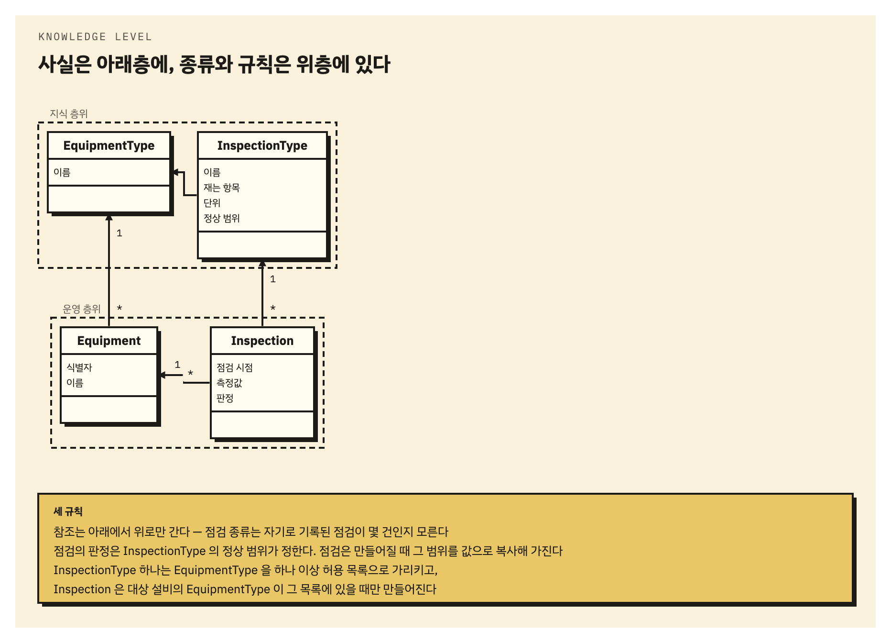

# Knowledge Level — 사실을 해석하는 규칙을 사실과 다른 층에 인스턴스로 세운다

## 한눈에 보는 개요

건물 관리 회사의 설비 점검 프로그램을 생각해 봅시다. 승강기는 제동거리를 재고 보일러는 배기 CO 농도를 재는데, 점검 결과가 정상인지 이상인지 가르는 코드가 한곳에 모여 있어요. 점검 항목이 하나 늘면 그 한곳에 가지가 하나 더 붙습니다.

```text
Before — 판정 코드가 점검 종류로 갈라지는 모델

  판정 판정하기(점검 기록 ins) {
    if (ins.종류 == 승강기정기점검) {
      if (ins.값 > 60) return 이상;        // 제동거리 mm
    } else if (ins.종류 == 보일러연소점검) {
      if (ins.값 > 400) return 이상;       // 배기 CO ppm
    } else if (ins.종류 == ...) { ... }
    return 정상;
  }

  새 점검 항목이 생기면      → if 가 한 갈래 더 붙고, 그 갈래를 배포해야 한다
  보일러에 승강기 점검을?     → 막는 자리가 없다. 제동거리 0 mm 가 「정상」으로 남는다
  작년 기준으로 다시 보려면   → 그때의 숫자가 어디에도 없다. 코드를 되돌려야 한다
```

세 줄 가운데 가운데 줄이 이 모델의 급소예요. 보일러에 승강기 점검을 기록하는 일을 막는 자리가 어디에도 없습니다. 판정 코드는 「종류가 승강기정기점검인가」만 묻고 대상이 무엇인지는 묻지 않으니까요. 그래서 보일러 BL-01 에 제동거리 0 mm 가 「정상」으로 남고, 그 기록은 형식상 아무 데도 어긋나지 않습니다.

Knowledge Level 이 두는 한 수는 **「이 사실이 어떤 종류이고 무엇을 지켜야 하는가」를 사실과 다른 층의 객체 인스턴스에 담는 것**입니다. 무엇을 재는지, 어떤 설비에 쓸 수 있는지, 어디까지가 정상인지가 모두 그 인스턴스의 데이터예요. 그러면 점검 항목을 늘리는 일이 코드를 고치는 일이 아니라 위층에 인스턴스를 하나 만들어 잇는 일이 됩니다.

```text
After — 종류가 인스턴스가 되고, 판정이 조회가 된 모델

  지식 층위 — 종류와 규칙
    ET-EV 승강기          ET-BL 보일러          ET-FS 소방설비
    IT-1 승강기 정기점검   제동거리 0..60 mm    허용 [ET-EV]
    IT-2 보일러 연소점검   배기CO  0..400 ppm   허용 [ET-BL]
    IT-4 안전표지         훼손개수 0..0 개     허용 [ET-EV, ET-BL, ET-FS]

  운영 층위 — 매일 생기는 사실
    EV-01 ET-EV 를 IT-1 로 2026-03-05 에 48 mm → 판정 정상, 적용 범위 0..60

  새 점검 항목이 생기면      → 위층에 인스턴스 하나. 판정 코드는 한 글자도 안 바뀐다
  보일러에 승강기 점검을?     → ET-BL 이 IT-1 의 허용 목록에 없어 기록이 만들어지지 않는다
  작년 기준으로 다시 보려면   → 그때 적용한 범위가 기록에 박혀 있다
```

> 기억법 — 규칙을 실은 것이 **클래스가 아니라 인스턴스**다. 새 종류가 코드가 아니라 데이터로 들어오면 그것이 지식 층위다.

분류는 Fowler 『Analysis Patterns』 의 책임 관계를 다루는 장에 뿌리를 둡니다. 1997년 원서에 「Knowledge Level」이라는 독립 절은 없고, 책임 관계 장의 한 절이 이 층위를 세운 자리예요. 저자가 뒤에 낸 개정 초안이 그것을 독립 패턴으로 다시 세웠고, Evans 도 대규모 구조 쪽에 같은 것을 담았습니다 (근거: Analysis Patterns 2장 「Accountability」 §2.5 「Accountability Knowledge Level」 · Pearson 목차 PDF 에 독립 「Knowledge Level」 절 없음 · Fowler 개정 초안 Organization Structures 의 「Knowledge Level (32)」 · Evans DDD Reference 의 「Knowledge Level」). 함께 쓰는 패턴은 [Party](../party/party-guide_v1.0.0.md)(사람과 조직을 한 이름으로 받는 기반 추상)와 [Posting Rule](../posting-rule/posting-rule-guide_v1.0.0.md)(이 층위를 회계에 적용한 것), 그리고 두 Party 사이의 책임 관계를 다루는 Accountability 입니다. 시나리오 셋을 따라갑니다. 점검 한 건이 판정과 함께 기록되는 길, 법이 바뀌어 점검 종류가 늘어나는 길, 그리고 규칙을 어기면 어느 단계에서 어떤 값이 어긋나는지요.

## 패턴 자세히 들여다보기

### 시나리오 1 — 3월 5일의 승강기 점검 한 건이 판정과 함께 기록되기까지

건물 관리 회사가 점검 프로그램을 막 열었습니다. 위층에는 설비 종류 둘과 점검 종류 둘이 등록돼 있어요. 설비 종류는 승강기(`ET-EV`)와 보일러(`ET-BL`)이고, 점검 종류는 승강기 정기점검(`IT-1`, 제동거리를 mm 로 재고 0~60 이 정상, 승강기에만 쓸 수 있음)과 보일러 연소점검(`IT-2`, 배기 CO 를 ppm 으로 재고 0~400 이 정상, 보일러에만 쓸 수 있음)입니다. 아래층에는 설비 두 대 EV-01 과 BL-01 이 있고요. 점검원이 3월 5일에 EV-01 의 제동거리를 재서 48 mm 를 얻었습니다. 나와야 하는 답은 하나예요. 판정 「정상」이 붙은 점검 기록 한 건입니다. 이 장면에 여섯 이름이 나와요. 지식 층위는 사실을 해석하는 종류와 규칙이 사는 곳이고 운영 층위는 매일 생기는 사실이 사는 곳입니다. 설비 종류와 점검 종류가 위층 주민이고, 설비와 점검이 아래층 주민이에요. 이름은 여기서 한 구절씩만 소개합니다. 정식 정의는 개념 정리가 맡아요.

```text
들어오는 것                          나가야 하는 것
설비        EV-01                    점검 INS-1
점검 종류   IT-1                       대상      EV-01
점검 시점   2026-03-05                 점검 종류 IT-1
측정값      48 mm                      측정값    48 mm
                                       판정      정상, 적용 범위 0..60
```

1. 점검원이 **무엇을 재야 하는지** 묻습니다. IT-1 이 「제동거리를 mm 로」라고 답해요. 재는 항목이 점검 기록의 필드가 아니라 점검 종류의 속성인 이유는, 필드로 두면 점검 항목이 하나 늘 때마다 아래층의 기록 구조가 바뀌기 때문입니다. 위층에 두면 항목이 늘어도 아래층은 「값 하나와 단위 하나」라는 모양 그대로예요.
2. **허용 조합**을 검사합니다. EV-01 의 설비 종류는 `ET-EV` 이고, IT-1 의 허용 목록에 `ET-EV` 가 있으니 통과해요. 이 검사가 위층 객체 **둘 사이의** 규칙인 것이 중요합니다. 「어떤 종류의 점검을 어떤 종류의 설비에 할 수 있는가」는 설비 한 대의 성질도 점검 한 건의 성질도 아니라서, 아래층 어디에도 적을 자리가 없어요. 이 검사를 빼면 무슨 값이 나오는지는 시나리오 3 의 1단계가 보입니다.
3. **단위를 대조**합니다. 측정값이 들고 온 단위 `mm` 와 IT-1 이 요구한 단위 `mm` 가 같아요. 측정값이 자기 단위를 들고 오는 이유는 대조할 상대가 위층에 있기 때문입니다. 단위를 들지 않은 숫자는 위층이 요구한 것과 같은 것을 잰 값인지 물어볼 방법이 없어요.
4. **판정**을 냅니다. IT-1 의 정상 범위 0~60 이 48 을 담으므로 「정상」이에요. 판정하는 주체가 점검 기록이 아니라 점검 종류가 쥔 범위인 것이 이 패턴의 요점입니다. 점검 기록이 스스로 판정하면 그 판정 코드가 다시 종류로 갈리고, 개요의 Before 로 되돌아가요.
5. 판정을 **기록에 고정해** 저장합니다. 저장되는 것은 「정상」이라는 답만이 아니라 그때 적용한 범위 0~60 까지예요. 범위를 함께 남기는 이유는 나중에 범위가 바뀌어도 이 기록이 왜 정상이었는지 답할 수 있어야 하기 때문입니다. 남기지 않으면 어떻게 되는지는 시나리오 3 의 2단계가 보입니다.

```text
단계  누가 답하는가        묻는 것                     그 단계에서 지켜지는 것
 1    점검 종류(위층)      무엇을 재는가                아래층 기록의 모양은 안 바뀜
 2    점검 종류 + 설비 종류  이 설비에 쓸 수 있는가        허용 목록에 있는 조합만 기록됨
 3    점검 종류(위층)      요구한 단위와 같은가          다른 단위의 값이 섞이지 않음
 4    점검 종류(위층)      정상 범위 안인가             판정이 코드가 아니라 데이터로 정해짐
 5    점검 기록(아래층)     이 답을 무엇으로 남기는가      판정과 적용 범위가 함께 박힘
```

잠깐, 확인 하나만 해 볼까요? 같은 EV-01 을 IT-2 로 점검하려 하면 어떻게 될까요? 2단계에서 EV-01 의 설비 종류 `ET-EV` 를 IT-2 의 허용 목록 `[ET-BL]` 에서 찾지 못해 기록이 만들어지지 않습니다. 승강기에 배기 CO 를 재려 한 것이니까요. 그리고 그것을 막은 것은 어떤 `if` 문이 아니라 위층에 적힌 목록 한 줄입니다.

이 시나리오가 보여 준 것은 **어느 층이 무엇에 답하는가**입니다. 「무엇을 재는가」(1단계) · 「어디에 쓸 수 있는가」(2단계) · 「어떤 단위인가」(3단계) · 「어디까지가 정상인가」(4단계)는 모두 위층이 답했어요. 아래층이 들고 있는 것은 「언제 · 어느 설비를 · 얼마로 쟀고 · 그 답이 무엇이었는가」뿐입니다. 여기서 나온 이름들이 개념 정리로 모입니다.

### 시나리오 2 — 법이 바뀌어 점검 종류가 둘 늘고, 하나가 설비 종류 셋에 걸릴 때

4월 1일부터 두 가지가 더해집니다. 승강기에 비상통화 점검이 생겨요. 응답 시간을 초로 재고 0~10 초가 정상입니다. 그리고 안전표지 점검이 생기는데 이쪽은 승강기와 보일러 **둘 다**에 걸려요. 훼손 개수를 세고 0개만 정상입니다. 게다가 4월에 소방설비라는 새 설비 종류가 들어오고 FS-01 한 대가 등록되는데, 안전표지 점검은 소방설비에도 걸립니다. 나와야 하는 답은 점검 세 건이에요. EV-01 의 비상통화 7초, BL-01 의 안전표지 1개, FS-01 의 안전표지 0개입니다. 이 시나리오에서 새로 나오는 이름은 하나예요. 한 점검 종류가 쓸 수 있는 설비 종류를 모아 둔 **허용 목록**입니다.

1. 비상통화 점검 `IT-3` 을 등록합니다. 허용 목록은 `[ET-EV]` 하나예요. 늘어난 것은 위층의 인스턴스 하나이고, 판정하는 코드도 점검 기록의 모양도 바뀌지 않습니다. 이것이 이 패턴을 쓴 보람이 처음으로 값으로 나오는 자리예요 — 새 점검 항목이 클래스가 아니라 인스턴스로 들어왔습니다.
2. 안전표지 점검 `IT-4` 를 등록합니다. 허용 목록이 `[ET-EV, ET-BL]` 둘이에요. 허용 목록이 **목록**인 이유가 여기서 드러납니다. 한 점검 종류가 설비 종류 하나에만 걸린다면 목록 대신 칸 하나로 충분한데, 안전표지처럼 여러 종류에 공통으로 걸리는 점검이 있으면 칸 하나로는 담을 수 없어요. 그때 점검 종류를 설비 종류 수만큼 복사하면 훼손 개수 0개라는 규칙이 사본 수만큼 생깁니다.
3. 소방설비 종류 `ET-FS` 를 등록하고, IT-4 의 허용 목록에 `ET-FS` 를 더해 `[ET-EV, ET-BL, ET-FS]` 로 만듭니다. 위층을 고치는 이 일이 아래층 기록을 하나도 건드리지 않는 이유는 참조가 아래에서 위로만 가기 때문이에요. 이미 기록된 점검은 자기가 어느 종류였는지만 들고 있고, 그 종류의 허용 목록이 늘어난 것은 앞으로 만들어질 기록에만 영향을 줍니다.
4. 설비 FS-01 을 등록하고 점검 셋을 기록합니다. EV-01 을 IT-3 으로 재서 7초 — 0~10 안이니 정상이에요. BL-01 을 IT-4 로 재서 훼손 1개 — 0~0 밖이니 이상입니다. FS-01 을 IT-4 로 재서 0개 — 정상이고요. 같은 점검 종류 IT-4 가 설비 종류가 다른 두 설비에 같은 규칙을 적용한 것이 3단계에서 목록을 늘린 값입니다.
5. 무엇이 바뀌었는지 셉니다. 늘어난 것은 지식 층위 인스턴스 셋(`IT-3` · `IT-4` · `ET-FS`)과 운영 층위 인스턴스 하나(FS-01)예요. 판정하는 코드 · 점검 기록의 구조 · 설비의 구조는 한 글자도 바뀌지 않았습니다. 이 셈을 마지막에 두는 이유는 이 패턴의 값이 바로 여기서 나오기 때문이에요 — 정책이 바뀔 때 손대는 자리가 코드 쪽에서 데이터 쪽으로 옮겨 갔는가입니다.

| 무엇 | 4월 1일 전 | 4월 1일 후 |
| --- | --- | --- |
| 지식 층위 인스턴스 | 설비 종류 2 · 점검 종류 2 | 설비 종류 3 · 점검 종류 4 |
| 운영 층위 인스턴스 | 설비 2 · 점검 2 | 설비 3 · 점검 5 |
| 승강기에 걸리는 점검 종류 | IT-1 | IT-1 · IT-3 · IT-4 |
| 보일러에 걸리는 점검 종류 | IT-2 | IT-2 · IT-4 |
| 판정 코드 | — | 그대로 |
| 점검 기록 · 설비의 구조 | — | 그대로 |

이 시나리오가 보여 준 것은 변화가 들어올 때 움직이는 것과 안 움직이는 것입니다. 새 점검 항목은 위층 인스턴스의 추가로 들어오고(1·2단계), 위층을 고치는 일이 아래층 기록을 건드리지 않으며(3단계), 한 지식 객체가 여러 종류의 대상에 같은 규칙을 적용할 수 있다는 것이 허용 목록의 값이었어요(2·4단계). 마지막 5단계의 셈이 이 패턴을 쓸지 말지를 가르는 저울입니다 — 늘어난 인스턴스 넷 가운데 코드 변경을 부른 것이 하나도 없었는가요.

### 시나리오 3 — 규칙을 어기면 어느 단계에서 어떤 값이 어긋나는가

같은 프로그램에 규칙을 어기는 일이 다섯 들어옵니다. 허용 조합을 검사하지 않는 것, 판정을 기록에 고정하지 않는 것, 정상 범위를 위층이 아니라 판정 코드에 두는 것, 참조를 위에서 아래로 두는 것, 그리고 단위를 대조하지 않는 것이에요. 아래 값은 모두 Java 21 로 실제 컴파일해 실행하거나, 코드를 그렇게 고쳐 실행해 확인한 것입니다.

1. **허용 조합을 검사하지 않습니다.** BL-01 을 IT-1 로 점검해 제동거리 0 mm 를 넣으면, 0 은 IT-1 의 정상 범위 0~60 안이라 판정이 「정상」으로 붙고 기록이 그대로 남아요. 점검이 6건에서 7건이 됩니다. 원래 코드는 `점검 종류 IT-1 은 설비 종류 ET-BL 을 허용하지 않습니다` 로 거절합니다. 눈여겨볼 것은 검사를 뺐을 때도 기록의 형식이 완벽하다는 점이에요 — 단위도 맞고 범위 안이고 판정도 붙어 있습니다. 깨지는 것은 형식이 아니라 **그 기록이 말이 되는가**예요. 보일러에는 제동거리라는 것이 없으니까요.
2. **판정을 기록에 고정하지 않고** 읽을 때마다 지금의 정상 범위로 다시 계산합니다. 4월에 IT-1 의 정상 범위를 0~60 에서 0~40 으로 좁히면, 3월 5일에 잰 48 mm 의 판정이 「정상」에서 「이상」으로 뒤집혀요. 실행 출력 18번째 줄의 `INS-1 판정 그대로: 정상 (적용 범위 0..60)` 이 `이상 (적용 범위 0..40)` 이 됩니다. 기록은 한 글자도 고치지 않았는데 과거가 바뀐 거예요. 같은 프로그램이 새로 기록한 INS-6 은 같은 48 mm 인데 「이상」인 것이 정상입니다 — 4월 3일의 점검이니까요.
3. **정상 범위를 위층이 아니라 판정 코드의 분기에 둡니다.** 점검 종류가 넷이니 분기도 넷이에요. 시나리오 2 의 5단계가 센 값이 여기서 뒤집힙니다 — 4월에 늘어난 점검 종류 둘이 인스턴스 둘이 아니라 분기 둘이 되고, 그 둘을 배포해야 해요. 그리고 점검 종류 목록을 물으면 데이터가 아니라 그 판정 함수를 처음부터 읽어야 답이 나옵니다.
4. **참조를 위에서 아래로** 둡니다. 점검 종류가 자기로 기록된 점검 목록을 들고 있는 모양이에요. IT-1 의 정상 범위를 좁히려면 IT-1 로 기록된 점검을 함께 불러와 저장하게 됩니다. 그 시점에 걸려 오는 것은 INS-1 한 건이고, 뒤에 INS-6 이 기록되고 나면 두 건이에요. 이 예제는 값이 작아 보이지만, 같은 모양이 점검 6만 건이면 위층 한 줄을 고치는 일이 6만 건을 여는 일이 됩니다. 눈여겨볼 것은 이 모양도 뒤에 나올 **필수 조건 셋을 모두 만족한다**는 점입니다 — 조건 어디에도 참조의 방향을 요구하는 문장이 없어요.
5. **단위를 대조하지 않습니다.** 보일러를 IT-2 로 점검하면서 mm 로 잰 48 을 넣으면 그 48 이 배기 CO 의 정상 범위 0~400 으로 판정돼 「정상」이 돼요. 기록에 남는 줄은 `48 mm, 판정 정상 (적용 범위 0..400)` 입니다 — 단위는 mm 인데 배기 CO 의 기준으로 재어 놓은 줄이에요. 원래 코드는 `점검 종류 IT-2 는 ppm 을 요구하는데 측정값이 mm 입니다` 로 거절합니다. 이것도 1단계와 같은 종류의 어긋남이에요.

```text
어긴 규칙                  막히는 자리              막히지 않으면 어긋나는 값
허용 조합                  점검을 만드는 자리        BL-01 에 제동거리 0 mm 「정상」 1건이 남음
판정을 기록에 고정하기       점검을 만드는 자리        범위를 0..40 으로 좁히면 INS-1 이 정상 → 이상
규칙을 위층에 두기          없음 (설계 자체)         점검 종류 4개에 분기 4갈래, 새 종류마다 배포
참조는 아래에서 위로        없음 (설계 자체)         IT-1 한 줄을 고칠 때 그 시점의 점검 1건을 함께 여는 저장
단위 대조                  점검을 만드는 자리        IT-2 에 mm 로 잰 48 이 0..400 으로 판정돼 「정상」으로 남음
```

이 시나리오가 보여 준 것은 **기계가 막아 주는 자리와 그렇지 않은 자리가 갈린다**는 것입니다. 허용 조합 · 단위 · 판정 고정은 점검을 만드는 한 자리에서 막히고, 코드가 실제로 거절 메시지를 냅니다. 그런데 3단계와 4단계에는 막는 자리가 없어요. 규칙을 판정 코드에 둔 프로그램도, 참조를 위에서 아래로 둔 프로그램도 컴파일되고 돌아가고 옳은 답을 냅니다. 기계가 잡아 주지 않는 자리는 사람이 기준으로 들고 있어야 하고, 그래서 그 둘이 다음 절의 조건으로 올라갑니다.

### 개념 정리

먼저 두 층의 이름부터 세울게요. **지식 층위**(knowledge level)는 다른 객체 무리가 어떻게 행동해야 하는지를 기술하는 객체 무리입니다. 종류 · 분류 · 규칙 · 허용 조합이 여기 살아요. 이 층이 지는 책임은 운영 층위의 사실이 성립하는지, 그 사실을 어떻게 해석하는지를 자기 인스턴스의 데이터로 답하는 것입니다. 개별 사실은 하나도 들고 있지 않아요. 협력 상대는 둘입니다. 아래층이 자기를 가리키고, 같은 층 안의 다른 지식 객체를 가리켜 조합 규칙을 만들어요.

**운영 층위**(operational level)는 매일 생기는 개별 사실이 사는 객체 무리입니다. 언제 · 무엇이 · 얼마였는가가 여기 살아요. 이 층은 사실 하나를 그대로 나르고 자기가 어느 종류인지를 데이터로 답할 뿐, 규칙은 쥐지 않습니다. 그리고 자기를 규정하는 지식 객체에 이어져 있어요. 이 글의 예제는 그 연결을 아래층이 위층을 가리키는 참조로 두었습니다.

```text
이 글의 예제에서 두 층의 주민

  지식 층위   EquipmentType (설비 종류)   InspectionType (점검 종류)
  ──────────── 참조는 아래에서 위로 · 위는 아래의 개별 사실을 모른다 ────────────
  운영 층위   Equipment (설비)             Inspection (점검)
```

그 아래 도메인 개념 넷을 정식으로 정의합니다. 이 절이 정하는 것은 개념이 무엇을 책임지고 누구와 협력하는가까지예요. 그 책임을 코드의 어느 객체가 지는지, 무엇이 aggregate 의 root 인지는 뒤의 「상황 설정」 표가 정합니다.

- **EquipmentType**(설비 종류) — 설비를 가르는 분류입니다. 이 글의 예제에서는 승강기 · 보일러 · 소방설비 셋이에요.
  - 책임: 설비 한 대의 성질이 아니라 그 **종류**에 붙는 것을 담습니다. 이 예제에서는 이름뿐이지만, 종류마다 다른 법정 점검 주기 같은 것이 붙는 자리예요.
  - 협력: 설비가 자기 종류 하나를 가리키고, 점검 종류가 허용 목록으로 여럿을 가리킵니다.
- **InspectionType**(점검 종류) — 무엇을 재고 · 어디에 쓸 수 있고 · 어디까지가 정상인지를 한 벌로 담은 규칙입니다.
  - 책임: 셋을 자기 속성으로 쥐고, 측정값 하나를 받아 판정을 내놓습니다. 저장은 하지 않아요(시나리오 1 의 1·4단계).
  - **재는 항목과 단위** — 이 종류의 점검이 무엇을 어떤 단위로 재는지예요. 이 글의 예제에는 넷이 나옵니다 — 제동거리 mm · 배기 CO ppm · 응답 시간 초 · 훼손 개수 개.
  - **정상 범위** — 정상으로 보는 수치 구간입니다. 양 끝을 포함해요. 안전표지 점검처럼 0~0 인 경우도 있습니다.
  - **허용 목록** — 이 점검 종류를 쓸 수 있는 설비 종류의 목록이에요. 비어 있을 수 없고, 둘 이상일 수 있습니다(시나리오 2 의 2단계).
  - 협력: 설비 종류를 허용 목록으로 하나 이상 가리키고, 점검이 자기를 가리킵니다.
- **Equipment**(설비) — 현장에 있는 설비 한 대입니다. 이 글의 예제에서는 EV-01 · BL-01 · FS-01 셋이에요.
  - 책임: 식별자로 자기를 구별하고, 자기가 어느 설비 종류인지를 답합니다.
  - 협력: 설비 종류 하나를 가리키고, 점검이 자기를 대상으로 가리킵니다.
- **Inspection**(점검) — 점검 한 건의 사실입니다. 어느 설비를 어느 점검 종류로 언제 재서 얼마였고 판정이 무엇이었는가예요.
  - 책임: 만들어질 때 허용 조합과 단위를 확인하고 판정을 받아 고정합니다. 그 뒤로는 바꾸지 않아요(시나리오 1 의 5단계).
  - **측정값** — 수치와 단위를 묶은 값입니다. 단위를 들고 오는 이유는 위층이 요구한 단위와 대조하기 위해서예요. 금액처럼 단위를 가진 값 일반은 [Quantity 가이드](../quantity/quantity-guide_v1.1.0.md)가 풀어요.
  - **판정** — 정상인지 이상인지와, 그때 적용한 정상 범위를 함께 담습니다. 범위를 같이 담는 것이 시나리오 3 의 2단계가 지키는 것이에요.
  - 협력: 설비 하나와 점검 종류 하나를 가리킵니다.



그림에서 눈여겨볼 곳은 점선으로 나뉜 두 띠와 그 사이를 가로지르는 화살표 둘입니다. 화살표는 둘 다 아래에서 위로 가고 위에서 아래로 내려오는 선은 없어요. 그래서 위층은 자기로 기록된 사실이 몇 건인지 모릅니다. 같은 층 안에도 선이 둘 있는데, 위층의 선은 점검 종류가 자기를 쓸 수 있는 설비 종류를 하나 이상 가리키는 것이고 아래층의 선은 점검 한 건이 자기 대상 설비를 가리키는 것이에요. 위층의 그 선 하나가 아래층 사실의 성립 여부를 가릅니다. 그리고 분석 모델은 연관만 정할 뿐 누가 누구를 소유하는지는 정하지 않아요 — 소유는 설계가 정하고, 그 선택지는 「상황이 달라지면」에서 나란히 봅니다.

## 사용 목적

Knowledge Level 을 꺼낼 때 요구서나 기존 모델에서 보이는 단서가 있어요. 셋을 차례로 봅시다.

**단서 1. 새 종류가 배포 없이 추가돼야 한다고 요구서에 적혀 있고, 종류마다 규칙이 다릅니다.** 「새 점검 항목은 관리자가 직접 추가할 수 있어야 한다」 같은 문장과 「점검 항목마다 정상 범위가 다르다」 같은 문장이 같은 요구서에 함께 있으면 이 패턴 자리예요. 두 문장이 함께 있다는 것은 **종류만 데이터로 빼서는 모자란다**는 뜻입니다 — 종류와 함께 그 규칙도 데이터로 내려가야 하니까요.

```text
요구서의 두 문장                          종류 목록만 데이터로 빼면 되는가
──────────────────────────────────       ────────────────────────────────
새 점검 항목은 관리자가 추가할 수 있어야 함   예 — 목록에 한 줄 더하면 됨
점검 항목마다 정상 범위가 다름              아니오 — 그 범위도 함께 데이터여야 함
점검 항목마다 쓸 수 있는 설비가 다름         아니오 — 허용 조합도 함께 데이터여야 함
```

**단서 2. 같은 데이터와 같은 행동을 가진 클래스가 조립 규칙만 달라서 늘어납니다.** 승강기 점검 클래스와 보일러 점검 클래스가 따로 있는데 안을 열어 보면 필드도 메서드도 같고 상수 두 개만 다른 상황이요. Evans 는 이 증상을 이 패턴의 문제 서술로 적었고, 늘어나는 이유가 역할과 관계가 상황마다 달라지는 데 있다고 봤어요. 클래스가 늘어나는 것 자체보다, **늘어난 클래스들이 서로 다른 점이 값뿐**이라는 것이 신호입니다.

```text
늘어난 클래스 셋의 안을 열어 보면

  ElevatorInspection   필드 { 대상, 시점, 값 }   판정 { 값 <= 60  }   쓸 수 있는 설비 { 승강기 }
  BoilerInspection     필드 { 대상, 시점, 값 }   판정 { 값 <= 400 }   쓸 수 있는 설비 { 보일러 }
  SignageInspection    필드 { 대상, 시점, 값 }   판정 { 값 <= 0   }   쓸 수 있는 설비 { 승강기, 보일러 }
                       └ 같음                   └ 숫자만 다름        └ 목록만 다름
```

**단서 3. 종류를 보고 갈리는 분기가 여러 곳에 복제돼 있고, 종류가 하나 늘 때 그 여러 곳을 함께 고칩니다.** 판정하는 곳 · 입력을 검증하는 곳 · 화면에 표시하는 곳이 각각 같은 `switch` 를 들고 있는 모양이에요. 셋 가운데 하나만 고치고 배포하는 일이 실제로 일어나고, 그때 어긋나는 것은 컴파일러가 잡아 주지 않습니다.

반대로 아래 두 경우에는 쓰면 잃는 것이 더 큽니다.

| 쓰지 말아야 할 상황 | 쓰면 잃는 것 |
| --- | --- |
| 종류가 둘 셋으로 닫혀 있고 몇 년째 안 바뀜 (승강기만 있는 건물의 점검 프로그램) | 등록부 · 타입 객체 · 조회라는 간접 층을 얻고, 읽는 사람은 「이 점검이 어떻게 판정되는가」를 알려고 데이터까지 열어야 함. 분기 두 줄이 하는 일을 세 개념이 함 |
| 지식 층위의 설정을 시험 · 디버깅 · 형상관리할 도구를 갖출 여력이 없음 | 컴파일러가 막아 주던 것. 규칙이 데이터로 내려가면 잘못된 조합은 돌려 봐야 드러나고, 「어제 이 설정이 무엇이었는가」를 묻는 도구를 직접 만들게 됨. 원전도 이 비용을 가볍게 쓸 패턴이 아니게 만드는 심각한 단서로 적습니다 |

비슷한 단서에서 다른 모델을 고르게 되는 자리가 둘 더 있어요. 종류 목록만 자주 바뀌고 규칙은 고정이면 코드 테이블 쪽을 먼저 보고, 규칙의 **종류 자체**가 계속 새로 생긴다면 지식 층위만으로는 감당이 안 됩니다. 차이는 다음 절에서 풀어요.

## 패턴의 경계

### 디자인 패턴을 충족하는 최소 조건

어떤 모델을 Knowledge Level 패턴이라고 불러도 되는지 가르는 기준입니다. 클래스 모양이 아니라 개념이 맡는 책임과 모델이 늘 지키는 불변식으로 판정해요. `[필수]` 에는 원전이 이 패턴의 성립 요건으로 든 것만 올렸고, 원전이 흔한 관례나 한 가지 형태로 든 것과 이 가이드 예제의 정책은 번호 순서와 무관하게 `[선택]` 입니다.

1. [필수] 사실과 그 사실을 규정하는 것이 **다른 객체 무리**로 갈라져 있습니다 — 매일 생기는 개별 사실을 담는 객체와, 그 사실이 어떤 종류이고 무엇을 지켜야 하는지를 담는 객체가 서로 다른 객체이고, 한 객체가 둘을 겸하지 않습니다. 시나리오 1 의 1단계에서 「무엇을 재는가」를 점검 기록이 아니라 점검 종류가 답한 자리가 이것이에요 (근거: Fowler 개정 초안 Organization Structures 의 「Knowledge Level」 의도문이 이 패턴을 다른 객체 무리가 어떻게 행동해야 하는지 기술하는 객체 무리로 정의하고, 같은 절의 요점 선언도 지식 객체 무리와 운영 객체 무리를 나란히 세웁니다 · Evans DDD Reference 의 「Knowledge Level」 해법이 기본 모델의 구조와 행동을 기술하고 제약하는 별도 객체 집합을 만들어 두 층으로 갈라 두라고 적습니다).
   - 빠지면: 점검 기록 객체 안에 판정 메서드와 정상 범위 상수가 들어갑니다. 규칙을 한 번 바꾸면 이미 저장된 사실을 다시 쓰게 되고, 사실 하나를 더할 때 규칙 코드를 고치게 돼요. 시나리오 3 의 3단계가 그 값입니다.
   - 위 근거 괄호가 받쳐 주는 것은 **두 무리가 따로 서고 한쪽이 다른 쪽을 기술한다**까지입니다. 무엇을 「사실」로 보고 무엇을 「규칙」으로 볼지 그 경계를 어디에 긋는가는 원전도 정하지 않아요. 이 글은 변화의 속도로 갈랐고, 그 판단은 상황 설정이 밝힙니다.
2. [필수] 지식 객체가 운영 객체의 **행동이나 구조를 제약하거나 결정합니다** — 이름표가 아니라 규칙을 쥡니다. 「이 사실이 성립하는가」와 「이 사실을 어떻게 해석하는가」의 답이 지식 객체 안이나 그것이 가리키는 것에 있고, 운영 쪽에는 종류를 보고 갈리는 분기가 남지 않습니다. 시나리오 1 의 2단계와 4단계가 허용 여부와 판정을 둘 다 점검 종류에서 받아 온 자리예요 (근거: 같은 의도문이 지식 객체를 다른 객체 무리가 어떻게 행동해야 하는지 **기술하는** 것으로 적고, Evans DDD Reference 의 「Knowledge Level」 해법이 기술하고 **제약한다**를 함께 적습니다).
   - 빠지면: 이름만 든 코드 테이블입니다. 종류 목록은 데이터인데 정상 범위와 허용 조합은 `if` 로 흩어져 있어, 새 종류를 더할 때 고치는 자리가 데이터 한 줄이 아니라 그 분기예요. 시나리오 3 의 3단계가 그 자리이고 비교 절의 둘째 행이 같은 이야기입니다.
   - 위 근거 괄호가 받쳐 주는 것은 **지식 쪽이 운영 쪽의 행동을 기술하고 제약한다**까지입니다. 이 조건이 성립하려면 운영 사실 하나에 대해 어느 지식 객체가 그것을 규정하는지가 모델 안에서 하나로 정해져야 하는데, **그 답이 어떤 모양으로 정해지는지는 이 조건이 묻지 않아요.** 아래층이 참조를 들어도 되고 조회가 답해도 됩니다 — 그 자리가 조건 4 입니다.
3. [필수] 규칙을 실은 것이 지식 객체의 클래스가 아니라 그 **인스턴스**입니다 — 같은 지식 클래스의 인스턴스 둘이 서로 다른 규칙을 실을 수 있고, 운영 객체가 어느 인스턴스를 따르느냐로 행동이 갈립니다. 시나리오 2 의 1·2단계에서 새 점검 종류 둘이 클래스가 아니라 인스턴스로 들어온 자리예요 (근거: Fowler 개정 초안 「Knowledge Level」 의 요점 선언이 이 패턴을 가진 상태를 「그 **인스턴스들이** 운영 객체 무리의 행동에 영향을 주는 객체 무리를 가졌을 때」로 적습니다 · 같은 절의 예시 그림 설명도 시스템을 설정하는 일을 지식 객체의 새 인스턴스를 만들어 이어 붙이는 일로 적습니다).
   - 빠지면: 종류마다 클래스를 하나씩 만든 다형 계층입니다. 승강기용 판정 클래스와 보일러용 판정 클래스가 서고 팩토리가 종류로 골라 주죠. 규칙이 코드에 있으니 새 점검 종류는 컴파일 단위의 추가가 되고, 인스턴스를 더해도 아무것도 바뀌지 않아요. 시나리오 2 의 5단계가 센 값이 여기서 뒤집힙니다 — 늘어나는 것이 인스턴스 셋이 아니라 클래스 셋이에요.
   - 위 근거 괄호가 받쳐 주는 것은 **인스턴스가 행동에 영향을 준다**와 **설정이 인스턴스를 만들어 잇는 일이다**까지입니다. 그 인스턴스를 **누가 언제** 만드는지 — 배포 없이, 비개발자가, 돌아가는 중에 — 는 같은 문장이 「대개」로 적은 부분이라 조건 7 로 내렸어요.
4. [선택] 운영 사실이 자기를 규정하는 지식 객체를 **가리킵니다** — 연결을 「사실」과 「사실의 종류」 사이의 연관으로 두고, 그 참조를 운영 쪽이 듭니다. 시나리오 1 의 2단계에서 설비가 자기 설비 종류를 들고 있어 허용 조합을 바로 물을 수 있었던 자리예요 (근거: Fowler 개정 초안 「Knowledge Level」 의 용어 절이 이 연결 방식을 **흔한 관례**라고 적고, 하도 널리 퍼져서 다른 이름 규약을 쓰기 전에 망설인다고까지 적습니다 — 관례로 적은 것이지 성립 요건으로 적은 것이 아닙니다).
   - 빠지면 잃는 것: 사실 하나를 손에 들고 바로 그 규칙으로 찾아가는 길입니다. 그 길이 없으면 조회 키와, 그 키로 규칙 하나를 골라 주는 자리가 따로 필요해요.
   - **왜 `[필수]` 가 아닌가** — 이것을 필수로 올리면 이미 발행된 [Posting Rule 가이드](../posting-rule/posting-rule-guide_v1.0.0.md)의 모델이 이 패턴에서 탈락합니다. 그 모델에서 원천 사건은 규칙을 가리키지 않아요. 사건은 자기 종류와 발생 시점만 들고 있고, 어느 규칙이 그 사건을 맡는지는 등록부 조회가 답합니다. 그런데 그 편은 Posting Rule 을 지식 층위의 예라고 분명히 적었고, 원전도 이 연결 방식을 관례로만 적었어요. 그러니 필수는 조건 2 가 요구하는 「어느 지식 객체가 규정하는지가 하나로 정해진다」까지이고, 그것을 아래층의 참조로 푸는 것은 흔한 한 가지 방법입니다. 참고 문서 「복식부기와 회계 모델」이 「참조는 운영 층위에서 지식 층위로만 올라갑니다」라고 적은 것도 같은 자리예요 — 그 문장은 그 회계 모델이 어떤 모양인지를 말한 것이지, 이 패턴이 성립하려면 참조가 그래야 한다는 뜻이 아닙니다.
5. [선택] 허용 조합을 **지식 객체끼리의 규칙**으로 둡니다 — 어떤 종류의 사실이 어떤 종류의 대상에 붙을 수 있는지를 지식 층위 안의 연관으로 적고, 운영 사실을 만들 때 그 연관을 검사합니다. 시나리오 1 의 2단계가 이 조건이 있을 때, 시나리오 3 의 1단계가 없을 때의 값이에요 (근거: Fowler 개정 초안이 연결 규칙을 지식 층위의 **한 형태**로 소개하면서 단순하지만 아주 유연한 형태라고 적고, 같은 장의 Levelled Accountability Type 절이 연결 규칙을 가장 흔한 방식이라 적으면서 더 단순한 대안을 나란히 둡니다 · Analysis Patterns 2장 「Accountability」 §2.5 의 그림 2.9 에 붙은 OCL 제약이 같은 규칙을 적습니다 — 원전이 여러 형태 가운데 하나로 늘어놓은 자리라 성립 요건이 아닙니다).
   - 빠지면 잃는 것: 보일러에 승강기 점검을 기록하는 길이 열립니다. 시나리오 3 의 1단계가 그 값이에요 — 제동거리 0 mm 가 판정 「정상」으로 남습니다.
6. [선택] 지식 객체가 **다른 지식 객체를 이어 붙여 조합을 만듭니다** — 새 종류를 만드는 일이 이미 있는 지식 객체들을 골라 잇는 일이 됩니다. 시나리오 2 의 2단계에서 안전표지 점검이 설비 종류 둘을 골라 이은 자리예요 (근거: Fowler 개정 초안 「Knowledge Level」 의 예시가 직원 유형을 급여 방식과 퇴직 제도의 조합으로 만들고, 그 고르고 이어 붙이는 일이 시스템을 설정하는 방법이라고 적습니다).
   - 빠지면 잃는 것: 조합의 수만큼 지식 객체가 늘어납니다. 안전표지 점검을 설비 종류마다 하나씩 복사하면 훼손 개수 0개라는 규칙이 사본 셋으로 갈라져요.
7. [선택] 「프로그래밍 없이」 — 지식 객체를 돌아가는 중에 만들고 이어 붙여 시스템의 행동을 바꿉니다. 시나리오 2 전체가 배포 없이 도는 모양이에요 (근거: 같은 요점 선언이 이것을 「대개」로 적고, 같은 절의 사용 시점 설명은 비개발자가 프로그래밍 없이 바꾸리라는 기대를 엘도라도라고 부르며 시험이 더 중요해지고 더 어려워진다고, 디버깅과 형상관리 도구를 직접 만들게 된다고 경고합니다 — 성립 요건이 아니라 흔한 기대이자 비용입니다).
   - 빠지면 잃는 것: 정책이 바뀔 때의 배포 한 번입니다. 인스턴스를 코드 안에서 만들어도 조건 1·2·3 은 그대로 서고, 시나리오 2 의 5단계가 센 「고친 자리」도 여전히 한 곳이에요.
8. [선택] 지식 층위를 **시험하고 형상 관리할 자리**를 따로 둡니다 — 규칙이 데이터로 내려간 만큼 그 데이터의 조합을 검증하는 시험과, 어제 그 설정이 무엇이었는지 답하는 기록이 필요합니다. 시나리오 2 에서 늘어난 지식 인스턴스 셋이 서로 모순되지 않는지 무엇이 답하는가가 이 조건이에요 (근거: Fowler 개정 초안의 사용 시점 설명이 지식 층위에서는 시험이 더 중요해지고 더 어려워진다고 적고, 지식 층위용 그래픽 편집기를 만드는 것을 흔히 보지만 정작 어려운 부분은 편집이 아니라고 적습니다).
   - 빠지면 잃는 것: 잘못된 설정이 배포 전에 걸릴 기회입니다. 허용 목록이 빈 점검 종류나 위아래가 뒤집힌 정상 범위는 컴파일러가 잡아 주지 않아요.
9. [선택] 이미 기록된 사실의 해석을 **기록 시점에 고정합니다** — 지식 객체가 바뀌어도 이미 남은 사실의 판정은 그대로입니다. 시나리오 3 의 2단계가 이 조건이 없을 때의 값이에요 (근거: 이 가이드의 정책 — 지식 층위가 바뀔 때 기존 운영 인스턴스를 어떻게 다룰지에 대한 원전의 권고를 찾지 못했습니다. 점검 기록이 감사 대상이라는 이 예제의 전제에서 나온 판단입니다).
   - 빠지면 잃는 것: 과거 기록이 왜 그 답이었는지 설명할 근거입니다. 범위를 0~60 에서 0~40 으로 좁히면 3월 5일의 48 mm 가 오늘 「이상」이 돼요.

> 필수는 셋이다 — 두 무리로 갈라졌는가, 지식 쪽이 규칙을 쥐었는가, 그 규칙이 클래스가 아니라 인스턴스에 실렸는가.

### 비슷한 패턴·안티패턴과의 차이

Knowledge Level 과 닮아 보이거나 같은 단서에서 떠오르는 일곱을 구분 기준부터 모았어요. 먼저 이 표가 무엇을 하지 않는지 밝혀 둘게요. 표의 기준은 **이웃과 갈리는 자리만** 봅니다. 그래서 이 표만으로 「이 패턴이다」가 확정되지는 않아요. 표는 이웃을 지우는 일을 하고, 확정은 최소 조건이 합니다.

| 대상 | 구분 기준 | Knowledge Level 을 고르면 얻는 것 | 포기하는 것 |
| --- | --- | --- | --- |
| 종류를 열거형으로 두고 판정을 분기로 둔 모델 (규칙이 자주 바뀌는 곳에 쓰면 안티패턴) | 새 종류가 하나 늘 때 늘어나는 것이 **데이터 한 줄**인가 **코드 한 갈래**인가 | 정책 목록이 데이터로 나와 있고, 종류를 늘려도 판정 코드가 안 바뀜 | 흐름을 한 화면에서 읽는 직관. 종류가 끝까지 둘이면 그냥 비용 |
| 이름만 든 코드 테이블 | 종류가 데이터인 것까지는 같다 — 갈리는 것은 **규칙이 어디 있는가**: 종류 객체 안인가, 그 표를 읽는 코드의 분기인가 (조건 2) | 종류와 그 규칙이 한 인스턴스에 있어 같이 바뀌는 둘이 같이 움직임 | 표만 있으면 되는 곳에 규칙을 담을 구조가 따라옴 |
| 종류마다 클래스를 만든 다형 계층 | 규칙을 실은 것이 **클래스**인가 **인스턴스**인가 (조건 3) | 새 종류가 컴파일 단위를 늘리지 않음 | 타입 검사. 종류마다 다른 필드를 두거나 컴파일러에 규칙을 맡길 수 없음 |
| 설정 파일 | 설정을 읽어 만든 것이 **규칙을 쥔 객체**인가, 값만 담은 표이고 해석은 코드가 하는가 (조건 2) | 규칙과 그 규칙의 적용이 한 자리에 모임 | 설정만 두면 되는 단순한 값에도 객체가 따라옴 |
| Type Object | 대체가 아니라 축척 — 「사실–사실의 종류」 **한 쌍**의 구현 기법인가, 그런 쌍들이 모여 규칙까지 담은 **층위 전체**인가 | 쌍 하나가 아니라 층 전체를 설계 단위로 다룸 | 쌍 하나면 충분한 곳에서의 가벼움 |
| Posting Rule | 대체가 아니라 포함 — 지식 층위 객체가 사건에 반응해 **기록을 만드는가**, 운영 층위의 타입과 제약만 기술하는가 | 회계 밖의 어떤 도메인에도 같은 모양을 씀 | 회계에 맞춘 구체적인 출력 규약. 계정 · 금액 · 균형은 이 층위만으로는 안 나옴 |
| Adaptive Object Model | 범위 — 한 모델 안의 **두 층**인가, 시스템 전체를 그렇게 세운 **아키텍처 스타일**인가 | 필요한 곳에만 층을 얹고 나머지는 평범한 모델로 둠 | 모델 전체를 돌아가는 중에 해석하는 유연함 |

가장 헷갈리기 쉬운 한 쌍은 **이름만 든 코드 테이블**입니다. 종류가 데이터 테이블에 있으면 이미 지식 층위를 쓴 것처럼 보이거든요. 아래는 점검 종류가 테이블에 있는데도 이 패턴이 아닌 모양이에요.

```java no-compile
// 지식 층위처럼 보이지만 종류 객체가 쥔 것이 이름뿐인 모델
class InspectionTypeRow {
    String id;            // "IT-1"
    String name;          // "승강기 정기점검"
}

class InspectionService {
    Verdict judge(String typeId, long value) {
        switch (typeId) {                                  // 어디까지가 정상인가: 이 코드에 박혀 있음
            case "IT-1": return value <= 60 ? 정상 : 이상;
            case "IT-2": return value <= 400 ? 정상 : 이상;
            default: throw new IllegalArgumentException();
        }
    }
    void record(String equipmentId, String typeId, long value) {
        // 어떤 설비에 쓸 수 있는가: 묻는 자리가 없음
        log.add(new Inspection(equipmentId, typeId, value, judge(typeId, value)));
    }
}
```

`InspectionTypeRow` 가 있으니 조건 1 은 만족한 것처럼 보이고, 실제로 사실과 종류가 서로 다른 객체인 것은 맞습니다. 갈리는 곳은 조건 2 예요. 정상 범위가 종류 객체가 아니라 `switch` 에 있어서, 새 점검 종류를 더하면 테이블 한 줄과 `switch` 한 갈래 **두 곳**을 맞춰 고쳐야 하고 한쪽만 고친 상태가 유효한 상태처럼 보입니다. 시나리오 2 의 5단계가 센 「고친 자리 하나」가 여기서는 둘이 돼요. 거꾸로, 그 `switch` 의 숫자를 `InspectionTypeRow` 의 필드로 옮기고 판정을 그 객체의 메서드로 옮기면 그때부터는 지식 층위입니다 — **이름이 테이블이어도 상관없어요.**

```text
무엇을 쥐었는가              종류 목록   정상 범위   허용 조합   판정  →  확인 결과
이름만 든 행                 데이터      코드         없음       코드     코드 테이블 (조건 2 빠짐)
이름 + 범위 + 허용 목록 + 판정  데이터      데이터       데이터     데이터   Knowledge Level
```

**다형 계층과의 차이.** 구분 기준은 규칙을 실은 것이 클래스인가 인스턴스인가입니다. 종류마다 판정 클래스를 만들고 팩토리가 골라 주는 모델을 생각해 보세요. 사실과 규칙은 다른 객체이고(조건 1), 규칙이 판정을 결정하니(조건 2) 둘은 만족합니다. 그런데 조건 3 에서 갈려요 — 4월에 점검 종류가 둘 늘면 시나리오 2 의 5단계가 센 값이 인스턴스 셋이 아니라 클래스 둘과 팩토리의 분기 둘이 됩니다. 판별하는 방법은 하나예요. **같은 지식 클래스의 인스턴스 둘이 서로 다른 규칙을 실을 수 있는가**를 물어보면 됩니다. 다형 계층에서는 각 클래스의 인스턴스가 하나뿐이고 둘을 만들어도 똑같이 행동해요.

**Posting Rule 과의 관계 — 견주는 관계가 아니라 포개지는 관계입니다.** 이미 발행된 [Posting Rule 가이드](../posting-rule/posting-rule-guide_v1.0.0.md)가 그 편에서 같은 말을 먼저 했고, 이 글은 반대쪽에서 그것을 그대로 받습니다. 지식 층위는 사실을 해석하는 규칙을 사실과 다른 층에 두라는 일반적인 모양이고, Posting Rule 은 그것을 회계에 적용해 출력 규약까지 정한 것이에요. **그러니 Posting Rule 은 이 패턴의 사례입니다.** 필수 셋을 그 편의 모델에 그대로 적용해 보면 셋 다 섭니다. 규칙 객체와 원천 사건이 다른 객체이고(조건 1), 규칙이 얼마를 어느 계정에 적을지를 결정하며(조건 2), R1·R2·R3 이 같은 규칙 클래스의 인스턴스 셋으로 서로 다른 요율과 대상 계정을 쥡니다(조건 3). 거꾸로 이 글의 점검 종류는 Posting Rule 이 아니에요. 점검 종류는 판정을 내놓을 뿐 균형 잡힌 기록 묶음을 만들지 않으니까요. 회계 쪽에서 두 층이 어떻게 놓이는지는 [참고 문서 「복식부기와 회계 모델」](../../reference/accounting-model/accounting-model-ref_v1.0.1.md)이 계정 종류와 전기 규칙으로 풀어 두었습니다.

```text
                        지식 층위 일반            Posting Rule
무엇을 기술하는가         운영 객체의 종류와 제약     사건에 대한 반응
출력이 있는가            없음 — 기술할 뿐           있음 — 합 0 인 기록 묶음
도메인                   아무 도메인               회계 원장
이 글의 점검 종류         해당                     해당 없음 (기록을 만들지 않음)
그 편의 전기 규칙         해당 (필수 셋을 만족)      해당
```

**Party 편이 남겨 둔 자리도 이 조건들로 받습니다.** 그 편은 행위 주체의 분류를 값이 아니라 지식 층위의 개념으로 따로 두는 것을 선택 조건으로 올려 두었어요. 이쪽에서 보면 그 일은 조건 1 을 세우는 것이고, 분류를 가리키는 참조까지 두면 조건 4 도 함께 섭니다. 딱 거기까지예요. 그런데 **그것만으로는 조건 2 가 서지 않아요.** 분류 객체가 이름만 들고 있으면 앞에서 본 코드 테이블이고, 지식 층위라는 말은 아직 자리 이름일 뿐입니다. 그 편도 같은 곳을 가리켜 두었어요 — 분류가 셋 이상으로 늘거나 분류마다 규칙이 달라지면 값으로는 감당이 안 된다고 적은 대목이 바로 조건 2 가 필요해지는 지점입니다.

```text
분류를 따로 둔 정도              조건 1   조건 2   조건 4   확인 결과
값으로 둠 (참·거짓 칸 하나)         ✗        ✗        ✗       분류가 아직 사실의 속성
분류 객체를 따로 두되 이름만          ✓        ✗        ✓       코드 테이블
분류 객체가 규칙·허용 조합을 쥠       ✓        ✓        ✓       Knowledge Level
```

**설정 파일과의 차이는 겉모양이 아니라 어디서 해석하느냐입니다.** 정상 범위를 JSON 에 적어 두고 배포 없이 고칠 수 있게 했다고 해서 그 자체가 탈락 사유는 아니에요. 그 파일을 읽어 만든 것이 규칙을 쥔 점검 종류 인스턴스라면 조건 1·2·3 이 모두 서고, 파일은 그 인스턴스를 만드는 입력일 뿐입니다. 갈리는 곳은 파일에 숫자만 있고 그 숫자를 읽어 판정하는 코드가 종류마다 갈릴 때예요 — 그때는 저장 위치만 바뀌었을 뿐 시나리오 3 의 3단계와 같은 모양입니다.

필수 셋을 **다 만족하고도** 이 패턴으로 쓰면 곤란한 모양이 있어요. 목록은 열려 있습니다. 이 글의 시나리오가 값으로 보인 것 둘만 적고, 이 둘이 전부라고 보지는 마세요. 하나는 지식 층위의 인스턴스가 사실상 하나뿐이거나 종류가 닫힌 채 몇 년째 안 바뀌는 모델입니다. 조건 셋이 다 서는데 얻는 것은 간접 층뿐이에요 — 사용 목적의 「쓰지 말아야 할 상황」 첫 행이 그 경우입니다. 다른 하나는 참조를 위에서 아래로 둔 모델이고, 시나리오 3 의 4단계가 그 값이에요. 조건 셋 어디에도 참조의 방향을 요구하는 문장이 없어서 최소 조건으로는 걸러지지 않아요. 그것을 드러내는 것은 선택 조건 4 입니다.

## 구현 예시

### 상황 설정

예시 도메인은 시나리오가 쓴 그 점검 프로그램입니다. 건물 여러 채를 관리하는 회사의 설비 점검 기록 시스템이고, 점검 종류와 설비 종류를 지식 층위로 두고 그 지식이 허용한 조합의 점검만 받아 판정과 함께 기록해요. 설비 · 점검 종류 · 값 · 날짜는 시나리오 1~3 의 것 그대로입니다 — 설비 종류 `ET-EV`·`ET-BL`·`ET-FS`, 점검 종류 `IT-1`~`IT-4`, 설비 EV-01·BL-01·FS-01, 점검 INS-1~INS-6 이요.

```text
고정된 것
  · 측정값은 정수와 단위 문자열이다 (제동거리 mm · 배기CO ppm · 응답시간 s · 훼손개수 개)
  · 정상 범위는 양 끝을 포함하는 정수 구간이다
  · 점검 기록은 만들어진 뒤 바뀌지 않는다
  · 한 점검은 점검 종류 하나와 설비 하나만 가리킨다
변하는 것
  · 점검 종류와 설비 종류가 계속 늘어난다
  · 한 점검 종류가 허용하는 설비 종류의 수가 정책에 따라 달라진다
  · 정상 범위가 법령 개정으로 좁아지거나 넓어진다
```

고정된 것의 세 번째 줄이 경계를 가릅니다. 점검 기록이 바뀌지 않는다는 전제가 있어서 판정을 기록 시점에 고정할 수 있어요. 기록을 언제든 다시 계산해도 되는 도메인이라면 판정을 저장하지 않고 조회 시점에 파생해도 되고, 그 경우의 경계는 「상황이 달라지면」의 마지막 행입니다. 예시 타입이 어느 개념을 맡는지는 이렇습니다.

```text
예시 타입           개념
─────────────────   ──────────────────────────────────────────────────────
EquipmentType       EquipmentType (설비 종류) — 지식 층위
EquipmentTypeId     EquipmentType 의 식별자
InspectionType      InspectionType (점검 종류) — 지식 층위
InspectionTypeId    InspectionType 의 식별자
NormalRange         정상 범위 — 값
InspectionRule      점검 종류가 내놓는 규칙 한 벌 — 값 (구현 전용)
Equipment           Equipment (설비) — 운영 층위
EquipmentId         Equipment 의 식별자
Inspection          Inspection (점검) — 운영 층위
InspectionId        Inspection 의 식별자
Reading             측정값 — 값
Verdict             판정 — 값
TypeCatalog         지식 층위 등록부 — 등록 서비스이자 저장소 (구현 전용)
SiteLog             운영 층위 장부 — 기록 서비스이자 저장소 (구현 전용)
```

아래 표는 DDD(Domain-Driven Design, 도메인 주도 설계)의 전술 용어를 씁니다. Bounded Context · Aggregate · Aggregate Root · Entity · Value Object · id 참조 · 불변식 일곱은 이 가이드의 주제 밖이라 [참고 문서 「DDD 전술 용어」](../../reference/ddd-tactical-terms/ddd-tactical-terms-ref_v1.0.1.md)가 풀어 두었어요. 그 문서에 없는 낱말 둘만 여기서 한 줄씩 펴 둡니다.

- **Factory**(팩토리) — 불변식을 검사한 뒤에만 aggregate 를 만들어 돌려주는 생성 책임이에요. 여기서는 `Inspection.record` 입니다.
- **도메인 서비스** — 한 aggregate 에 속하지 않고 여러 aggregate 를 식별자로 찾아 함께 다루는 작업이에요. 여기서는 기록 서비스 `SiteLog.record` 와 등록 서비스 `TypeCatalog` 의 등록 메서드가 그 자리입니다.

| 항목 | 이 가이드의 설정 |
| --- | --- |
| bounded context | 설비 점검 기록 컨텍스트 — 점검 종류와 설비 종류를 지식 층위로 두고, 그 지식이 허용한 조합의 점검만 받아 판정과 함께 남김 |
| 불변식의 위치 | ① 점검은 자기 점검 종류가 허용한 설비 종류의 설비만 대상으로 함 → `Inspection` root 의 Factory `Inspection.record`, 동기 ② 측정값의 단위가 점검 종류가 요구한 단위와 같음 → 같은 Factory, 동기 ③ 판정은 기록 시점의 정상 범위로 한 번 정해지고 그 뒤 바뀌지 않음 → `Inspection` root 가 판정과 적용 범위를 값으로 품어 지킴, 동기 ④ 점검 종류의 허용 설비 종류 목록은 비어 있지 않음 → `InspectionType` root 의 생성자, 동기 |
| root·entity·VO 배정 | `InspectionType` = aggregate root, 지식 층위 (이름 · 재는 항목 · 단위 · 정상 범위 · 허용 `EquipmentTypeId` 목록) · `EquipmentType` = 별도 aggregate root, 지식 층위 · `Equipment` = 별도 aggregate root, 운영 층위 · `Inspection` = 별도 aggregate root, 운영 층위 (child entity 없음) · `NormalRange` · `Reading` · `Verdict` · `InspectionRule` = VO · `TypeCatalog` · `SiteLog` = 등록·기록 서비스이자 저장소 (aggregate 아님) |
| 타 aggregate 참조 방식 | id 참조 — `Equipment` → `EquipmentType` 은 `EquipmentTypeId`, `Inspection` → `Equipment` 는 `EquipmentId`, `Inspection` → `InspectionType` 은 `InspectionTypeId`, `InspectionType` → `EquipmentType` 은 `EquipmentTypeId` 목록. 어느 aggregate 도 다른 aggregate 의 객체를 필드나 메서드 시그니처에 두지 않음 |

불변식 ①과 ②가 `Inspection` 의 Factory 에 있는 것이 이 표에서 가장 설명이 필요한 자리예요. 둘 다 지식 층위 두 객체를 읽어야 판정되는데, aggregate 끼리 객체로 참조하지 않으므로 그 지식을 **값으로** 건네받습니다. 점검 종류가 `InspectionRule` 이라는 VO 를 내놓고 Factory 가 그것만 받는 모양이에요. 그래서 ③ 이 저절로 따라옵니다. Factory 가 받은 범위를 판정에 그대로 실어 두면, 나중에 점검 종류가 그 범위를 좁혀도 이미 만들어진 판정은 옛 범위를 들고 있으니까요. bounded context 가 코드에서 드러나는 자리는 파일 하나입니다 — 세 언어 모두 지식 층위와 운영 층위가 같은 파일 안에 있고, 그 경계 밖으로 나가는 타입이 없어요. 위 네 불변식과 네 id 참조를 각각 다른 곳에 두거나 바꾸면 어느 동작에서 무엇이 어긋나는지 전부 따라가 보면 이렇습니다.

| 규칙(불변식) 또는 참조 | 다른 곳에 두거나 바꾸면 | 어느 동작에서 무엇이 어긋나는가 |
| --- | --- | --- |
| ① 허용 조합 | 기록 서비스가 검사 | 검사 자체는 한곳이지만 `Inspection` **객체**는 만들어진 뒤라, 다른 경로로 그것을 저장하는 코드가 하나라도 생기면 검사를 지나침 |
| ① | 아무도 검사하지 않음 | BL-01 에 IT-1 로 제동거리 0 mm 가 판정 「정상」으로 남고 점검이 6건에서 7건이 됨. 실행 출력 7번째 줄의 거절 `점검 종류 IT-1 은 설비 종류 ET-BL 을 허용하지 않습니다` 가 사라짐. 시나리오 3 의 1단계가 이 자리 |
| ② 단위 일치 | 아무도 검사하지 않음 | IT-2 에 mm 로 잰 48 이 배기 CO 의 범위 0..400 으로 판정돼 `48 mm, 판정 정상 (적용 범위 0..400)` 으로 남음. 실행 출력 8번째 줄의 거절이 사라지고 점검이 7건이 됨. 시나리오 3 의 5단계 |
| ② | 측정값을 단위 없는 숫자로 둠 | 대조할 상대가 없어져 검사 자체가 불가능해짐. 점검 종류가 요구한 단위는 위층에 그대로 있는데 아래층이 무엇으로 쟀는지 말하지 않음 |
| ③ 판정 고정 | 판정을 저장하지 않고 읽을 때마다 현재 범위로 계산 | 범위를 0..60 에서 0..40 으로 좁힌 뒤 INS-1 의 판정이 정상에서 이상으로 뒤집힘. 실행 출력 18번째 줄이 `이상 (적용 범위 0..40)` 이 됨. 시나리오 3 의 2단계 |
| ③ | 판정은 저장하되 적용 범위는 안 남김 | 판정은 안 뒤집히지만 INS-1 이 왜 정상이었는지 답할 근거가 사라짐. 감사에서 「그때 기준이 얼마였나」에 답하려면 지식 층위의 변경 이력을 따로 뒤져야 함 |
| ④ 허용 목록 비지 않음 | 생성자의 검사를 빼고, 그렇게 만든 점검 종류를 등록까지 함 | 허용 목록이 빈 점검 종류 IT-9 가 `점검 종류 IT-9 미정 점검: 미정 0..1 회, 허용 설비 종류 []` 로 등록되고, 그것으로는 어떤 점검도 만들어지지 않는데 목록에는 보임. 실행 출력 9번째 줄의 거절이 사라지고 마지막 줄의 점검 종류가 4개에서 5개가 됨. 검사만 빼서는 거절 줄만 사라져요 — 정본의 그 자리는 점검 종류를 만들기만 하고 등록하지 않으니까요 |
| ④ | 점검을 기록할 때 검사 | 잘못된 지식이 등록된 뒤 운영 쪽에서 드러남. 고치는 자리가 지식 층위인데 증상이 나오는 자리는 현장 기록이라 원인을 찾는 데 한 겹이 더 듦 |
| `Equipment` → `EquipmentType` 을 `EquipmentTypeId` 로 | `EquipmentType` 객체를 듦 | 설비 3대가 각자 설비 종류 사본을 들어, 종류 이름을 바꾸면 사본 셋이 어긋남. 설비를 저장할 때마다 종류까지 함께 써서 그 사이의 종류 변경이 되돌려짐 |
| `Inspection` → `InspectionType` 을 `InspectionTypeId` 로 | `InspectionType` 객체를 듦 | 점검 저장이 점검 종류까지 함께 써서, 좁혀 둔 범위 0..40 이 옛 범위 0..60 으로 되돌아감. 점검 화면에서 범위를 좁히는 메서드에 닿는 경로도 열림 |
| `Inspection` → `Equipment` 를 `EquipmentId` 로 | `Equipment` 객체를 듦 | 점검 6건이 저장될 때마다 설비 사본도 저장돼, 그 사이 바뀐 설비 정보가 되돌아감. 점검 한 건을 만드는 일이 설비 aggregate 를 함께 잠그는 일이 됨 |
| `InspectionType` → `EquipmentType` 을 `EquipmentTypeId` 목록으로 | `EquipmentType` 객체 목록을 듦 | IT-4 의 허용 목록에 ET-FS 를 더하는 일이 설비 종류 aggregate 셋을 함께 불러와 저장하는 일이 됨. 시나리오 2 의 3단계가 인스턴스 하나만 건드린 이유가 여기 |
| 참조 방향 (아래 → 위) | 지식 객체가 운영 사실 목록을 듦 | IT-1 의 범위를 좁히는 그 시점에 IT-1 이 든 점검 1건(INS-1)을 함께 불러와 저장하고, INS-6 까지 기록된 뒤에는 2건이 됨. 점검이 6만 건이면 위층 한 줄을 고치는 일이 6만 건을 여는 일이 됨. 시나리오 3 의 4단계 |

뒤의 세 언어 구현은 이 설정을 그대로 옮긴 것이고, 돌리면 셋이 아래 20줄을 글자까지 같게 냅니다. 가이드 폴더의 `code/expected-output.txt` 와 같은 내용이고 이 글의 실행 수치가 전부 여기서 와요.

```text
[지식] 설비 종류 ET-EV 승강기 · ET-BL 보일러
[지식] 점검 종류 IT-1 승강기 정기점검: 제동거리 0..60 mm, 허용 설비 종류 [ET-EV]
[지식] 점검 종류 IT-2 보일러 연소점검: 배기CO 0..400 ppm, 허용 설비 종류 [ET-BL]
[운영] 설비 EV-01 승강기 (ET-EV) · BL-01 보일러 (ET-BL)
INS-1 2026-03-05 EV-01 을 IT-1 로 -> 48 mm, 판정 정상 (적용 범위 0..60)
INS-2 2026-03-06 BL-01 을 IT-2 로 -> 520 ppm, 판정 이상 (적용 범위 0..400)
거절(허용 조합 아님): 점검 종류 IT-1 은 설비 종류 ET-BL 을 허용하지 않습니다
거절(단위 다름): 점검 종류 IT-2 는 ppm 을 요구하는데 측정값이 mm 입니다
거절(허용 설비 종류 없음): 점검 종류 IT-9 의 허용 설비 종류가 비어 있습니다
[지식] 점검 종류 IT-3 승강기 비상통화: 응답시간 0..10 s, 허용 설비 종류 [ET-EV]
[지식] 점검 종류 IT-4 안전표지: 훼손개수 0..0 개, 허용 설비 종류 [ET-EV, ET-BL]
[지식] 설비 종류 ET-FS 소방설비 · 점검 종류 IT-4 의 허용 설비 종류에 ET-FS 를 더함 -> [ET-EV, ET-BL, ET-FS]
[운영] 설비 FS-01 소방설비 (ET-FS)
INS-3 2026-04-02 EV-01 을 IT-3 로 -> 7 s, 판정 정상 (적용 범위 0..10)
INS-4 2026-04-02 BL-01 을 IT-4 로 -> 1 개, 판정 이상 (적용 범위 0..0)
INS-5 2026-04-02 FS-01 을 IT-4 로 -> 0 개, 판정 정상 (적용 범위 0..0)
[지식] 점검 종류 IT-1 의 정상 범위를 0..60 에서 0..40 으로 좁힘
INS-1 판정 그대로: 정상 (적용 범위 0..60)
INS-6 2026-04-03 EV-01 을 IT-1 로 -> 48 mm, 판정 이상 (적용 범위 0..40)
점검 6건 · 점검 종류 4개 · 설비 종류 3개 · 설비 3대
```

### 구현

```java
import java.util.ArrayList;
import java.util.LinkedHashMap;
import java.util.List;
import java.util.Map;

record EquipmentTypeId(String value) {}
record InspectionTypeId(String value) {}
record EquipmentId(String value) {}
record InspectionId(String value) {}

// VO: 정상으로 보는 수치 구간. 양 끝을 포함한다
record NormalRange(long low, long high) {
    boolean contains(long amount) { return low <= amount && amount <= high; }
    @Override public String toString() { return low + ".." + high; }
}

// VO: 수치와 단위를 묶은 측정값 — 단위를 들고 오는 이유는 대조할 상대가 지식 층위에 있기 때문이다
record Reading(long amount, String unit) {
    @Override public String toString() { return amount + " " + unit; }
}

// VO: 기록 시점에 적용한 범위와 그 결과. 한 번 정해지면 바뀌지 않는다
record Verdict(String label, NormalRange applied) {
    @Override public String toString() { return label + " (적용 범위 " + applied + ")"; }
}

// VO: 점검 종류가 내놓는 규칙 한 벌 — 운영 층위가 지식 객체에서 받는 것은 이 값뿐이다
record InspectionRule(InspectionTypeId typeId, String unit, NormalRange range,
                      List<EquipmentTypeId> allowed) {
    boolean allows(EquipmentTypeId typeId) { return allowed.contains(typeId); }
    Verdict judge(Reading reading) {
        return new Verdict(range.contains(reading.amount()) ? "정상" : "이상", range);
    }
}

// aggregate root, 지식 층위: 설비를 가르는 분류
final class EquipmentType {
    private final EquipmentTypeId id;
    private final String name;
    EquipmentType(EquipmentTypeId id, String name) { this.id = id; this.name = name; }
    EquipmentTypeId id() { return id; }
    String name() { return name; }
}

// aggregate root, 지식 층위: 무엇을 재고 · 어디에 쓸 수 있고 · 어디까지가 정상인지 셋을 한 인스턴스가 쥔다
final class InspectionType {
    private final InspectionTypeId id;
    private final String name;
    private final String item;
    private final String unit;
    private NormalRange range;
    private final List<EquipmentTypeId> allowed = new ArrayList<>();

    InspectionType(InspectionTypeId id, String name, String item, String unit,
                   NormalRange range, List<EquipmentTypeId> allowed) {
        if (allowed.isEmpty())
            throw new IllegalArgumentException(
                    "점검 종류 " + id.value() + " 의 허용 설비 종류가 비어 있습니다");
        this.id = id; this.name = name; this.item = item; this.unit = unit; this.range = range;
        this.allowed.addAll(allowed);
    }

    InspectionTypeId id() { return id; }
    InspectionRule rule() { return new InspectionRule(id, unit, range, List.copyOf(allowed)); }
    void allow(EquipmentTypeId typeId) { if (!allowed.contains(typeId)) allowed.add(typeId); }
    NormalRange range() { return range; }
    void narrowTo(NormalRange narrower) { this.range = narrower; }

    String describe() {
        return "점검 종류 " + id.value() + " " + name + ": " + item + " " + range + " " + unit
                + ", 허용 설비 종류 " + labels(allowed);
    }

    static String labels(List<EquipmentTypeId> ids) {
        List<String> out = new ArrayList<>();
        for (EquipmentTypeId each : ids) out.add(each.value());
        return out.toString();
    }

    List<EquipmentTypeId> allowedTypes() { return List.copyOf(allowed); }
}

// aggregate root, 운영 층위: 현장에 있는 설비 한 대
final class Equipment {
    private final EquipmentId id;
    private final String name;
    private final EquipmentTypeId typeId;
    Equipment(EquipmentId id, String name, EquipmentTypeId typeId) {
        this.id = id; this.name = name; this.typeId = typeId;
    }
    EquipmentId id() { return id; }
    String name() { return name; }
    EquipmentTypeId typeId() { return typeId; }
}

// aggregate root, 운영 층위: 점검 한 건의 사실. 규칙은 하나도 들고 있지 않다
final class Inspection {
    private final InspectionId id;
    private final EquipmentId equipmentId;
    private final InspectionTypeId typeId;
    private final String date;
    private final Reading reading;
    private final Verdict verdict;

    private Inspection(InspectionId id, EquipmentId equipmentId, InspectionTypeId typeId,
                       String date, Reading reading, Verdict verdict) {
        this.id = id; this.equipmentId = equipmentId; this.typeId = typeId;
        this.date = date; this.reading = reading; this.verdict = verdict;
    }

    static Inspection record(InspectionId id, EquipmentId equipmentId, EquipmentTypeId equipmentTypeId,
                             String date, Reading reading, InspectionRule rule) {
        if (!rule.allows(equipmentTypeId))
            throw new IllegalArgumentException("점검 종류 " + rule.typeId().value()
                    + " 은 설비 종류 " + equipmentTypeId.value() + " 을 허용하지 않습니다");
        if (!rule.unit().equals(reading.unit()))
            throw new IllegalArgumentException("점검 종류 " + rule.typeId().value()
                    + " 는 " + rule.unit() + " 을 요구하는데 측정값이 " + reading.unit() + " 입니다");
        return new Inspection(id, equipmentId, rule.typeId(), date, reading, rule.judge(reading));
    }

    Verdict verdict() { return verdict; }

    String line() {
        return id.value() + " " + date + " " + equipmentId.value() + " 을 " + typeId.value()
                + " 로 -> " + reading + ", 판정 " + verdict;
    }
}

// 지식 층위 등록부 — 등록 서비스이자 저장소 (aggregate 아님)
final class TypeCatalog {
    private final Map<String, EquipmentType> equipmentTypes = new LinkedHashMap<>();
    private final Map<String, InspectionType> inspectionTypes = new LinkedHashMap<>();

    void register(EquipmentType type) { equipmentTypes.put(type.id().value(), type); }
    void register(InspectionType type) { inspectionTypes.put(type.id().value(), type); }
    InspectionType inspectionType(InspectionTypeId id) { return inspectionTypes.get(id.value()); }
    InspectionRule ruleOf(InspectionTypeId id) { return inspectionTypes.get(id.value()).rule(); }
    int equipmentTypeCount() { return equipmentTypes.size(); }
    int inspectionTypeCount() { return inspectionTypes.size(); }
}

// 운영 층위 장부 — 기록 서비스이자 저장소 (aggregate 아님)
final class SiteLog {
    private final Map<String, Equipment> equipments = new LinkedHashMap<>();
    private final List<Inspection> inspections = new ArrayList<>();

    void add(Equipment equipment) { equipments.put(equipment.id().value(), equipment); }

    Inspection record(TypeCatalog catalog, InspectionId id, EquipmentId equipmentId,
                      InspectionTypeId typeId, String date, Reading reading) {
        Equipment equipment = equipments.get(equipmentId.value());
        Inspection inspection = Inspection.record(
                id, equipmentId, equipment.typeId(), date, reading, catalog.ruleOf(typeId));
        inspections.add(inspection);
        return inspection;
    }

    int equipmentCount() { return equipments.size(); }
    int inspectionCount() { return inspections.size(); }
}

public class KnowledgeLevelExample {
    static final EquipmentTypeId EV = new EquipmentTypeId("ET-EV");
    static final EquipmentTypeId BL = new EquipmentTypeId("ET-BL");
    static final EquipmentTypeId FS = new EquipmentTypeId("ET-FS");
    static final InspectionTypeId IT1 = new InspectionTypeId("IT-1");
    static final InspectionTypeId IT2 = new InspectionTypeId("IT-2");
    static final InspectionTypeId IT3 = new InspectionTypeId("IT-3");
    static final InspectionTypeId IT4 = new InspectionTypeId("IT-4");
    static final EquipmentId EV01 = new EquipmentId("EV-01");
    static final EquipmentId BL01 = new EquipmentId("BL-01");
    static final EquipmentId FS01 = new EquipmentId("FS-01");

    static void reject(String what, Runnable body) {
        try { body.run(); } catch (RuntimeException e) {
            System.out.println("거절(" + what + "): " + e.getMessage());
        }
    }

    public static void main(String[] args) {
        TypeCatalog catalog = new TypeCatalog();
        SiteLog log = new SiteLog();

        catalog.register(new EquipmentType(EV, "승강기"));
        catalog.register(new EquipmentType(BL, "보일러"));
        System.out.println("[지식] 설비 종류 ET-EV 승강기 · ET-BL 보일러");
        catalog.register(new InspectionType(IT1, "승강기 정기점검", "제동거리", "mm",
                new NormalRange(0, 60), List.of(EV)));
        catalog.register(new InspectionType(IT2, "보일러 연소점검", "배기CO", "ppm",
                new NormalRange(0, 400), List.of(BL)));
        System.out.println("[지식] " + catalog.inspectionType(IT1).describe());
        System.out.println("[지식] " + catalog.inspectionType(IT2).describe());

        log.add(new Equipment(EV01, "승강기", EV));
        log.add(new Equipment(BL01, "보일러", BL));
        System.out.println("[운영] 설비 EV-01 승강기 (ET-EV) · BL-01 보일러 (ET-BL)");

        Inspection first = log.record(catalog, new InspectionId("INS-1"), EV01, IT1,
                "2026-03-05", new Reading(48, "mm"));
        System.out.println(first.line());
        System.out.println(log.record(catalog, new InspectionId("INS-2"), BL01, IT2,
                "2026-03-06", new Reading(520, "ppm")).line());

        reject("허용 조합 아님", () -> log.record(catalog, new InspectionId("INS-X"), BL01, IT1,
                "2026-03-06", new Reading(0, "mm")));
        reject("단위 다름", () -> log.record(catalog, new InspectionId("INS-X"), BL01, IT2,
                "2026-03-06", new Reading(48, "mm")));
        reject("허용 설비 종류 없음", () -> new InspectionType(new InspectionTypeId("IT-9"),
                "미정 점검", "미정", "회", new NormalRange(0, 1), List.of()));

        catalog.register(new InspectionType(IT3, "승강기 비상통화", "응답시간", "s",
                new NormalRange(0, 10), List.of(EV)));
        catalog.register(new InspectionType(IT4, "안전표지", "훼손개수", "개",
                new NormalRange(0, 0), List.of(EV, BL)));
        System.out.println("[지식] " + catalog.inspectionType(IT3).describe());
        System.out.println("[지식] " + catalog.inspectionType(IT4).describe());

        catalog.register(new EquipmentType(FS, "소방설비"));
        catalog.inspectionType(IT4).allow(FS);
        System.out.println("[지식] 설비 종류 ET-FS 소방설비 · 점검 종류 IT-4 의 허용 설비 종류에 ET-FS 를 더함 -> "
                + InspectionType.labels(catalog.inspectionType(IT4).allowedTypes()));
        log.add(new Equipment(FS01, "소방설비", FS));
        System.out.println("[운영] 설비 FS-01 소방설비 (ET-FS)");

        System.out.println(log.record(catalog, new InspectionId("INS-3"), EV01, IT3,
                "2026-04-02", new Reading(7, "s")).line());
        System.out.println(log.record(catalog, new InspectionId("INS-4"), BL01, IT4,
                "2026-04-02", new Reading(1, "개")).line());
        System.out.println(log.record(catalog, new InspectionId("INS-5"), FS01, IT4,
                "2026-04-02", new Reading(0, "개")).line());

        NormalRange before = catalog.inspectionType(IT1).range();
        catalog.inspectionType(IT1).narrowTo(new NormalRange(0, 40));
        System.out.println("[지식] 점검 종류 IT-1 의 정상 범위를 " + before + " 에서"
                + " " + catalog.inspectionType(IT1).range() + " 으로 좁힘");
        System.out.println("INS-1 판정 그대로: " + first.verdict());
        System.out.println(log.record(catalog, new InspectionId("INS-6"), EV01, IT1,
                "2026-04-03", new Reading(48, "mm")).line());

        System.out.println("점검 " + log.inspectionCount() + "건 · 점검 종류 "
                + catalog.inspectionTypeCount() + "개 · 설비 종류 "
                + catalog.equipmentTypeCount() + "개 · 설비 " + log.equipmentCount() + "대");
    }
}
```

```typescript
// 브랜드 타입: 구조적 타이핑이라 그냥 string 이면 id 네 종류가 서로 섞인다
type EquipmentTypeId = string & { readonly __brand: "EquipmentTypeId" };
type InspectionTypeId = string & { readonly __brand: "InspectionTypeId" };
type EquipmentId = string & { readonly __brand: "EquipmentId" };
type InspectionId = string & { readonly __brand: "InspectionId" };

const equipmentTypeId = (value: string): EquipmentTypeId => value as EquipmentTypeId;
const inspectionTypeId = (value: string): InspectionTypeId => value as InspectionTypeId;
const equipmentId = (value: string): EquipmentId => value as EquipmentId;
const inspectionId = (value: string): InspectionId => value as InspectionId;

// VO: 정상으로 보는 수치 구간. 양 끝을 포함한다
class NormalRange {
  constructor(readonly low: number, readonly high: number) {}
  contains(amount: number): boolean { return this.low <= amount && amount <= this.high; }
  toString(): string { return `${this.low}..${this.high}`; }
}

// VO: 수치와 단위를 묶은 측정값 — 단위를 들고 오는 이유는 대조할 상대가 지식 층위에 있기 때문이다
class Reading {
  constructor(readonly amount: number, readonly unit: string) {}
  toString(): string { return `${this.amount} ${this.unit}`; }
}

// VO: 기록 시점에 적용한 범위와 그 결과. 한 번 정해지면 바뀌지 않는다
class Verdict {
  constructor(readonly label: string, readonly applied: NormalRange) {}
  toString(): string { return `${this.label} (적용 범위 ${this.applied})`; }
}

// VO: 점검 종류가 내놓는 규칙 한 벌 — 운영 층위가 지식 객체에서 받는 것은 이 값뿐이다
class InspectionRule {
  constructor(
    readonly typeId: InspectionTypeId,
    readonly unit: string,
    readonly range: NormalRange,
    readonly allowed: readonly EquipmentTypeId[],
  ) {}
  allows(typeId: EquipmentTypeId): boolean { return this.allowed.includes(typeId); }
  judge(reading: Reading): Verdict {
    return new Verdict(this.range.contains(reading.amount) ? '정상' : '이상', this.range);
  }
}

// aggregate root, 지식 층위: 설비를 가르는 분류
class EquipmentType {
  constructor(readonly id: EquipmentTypeId, readonly name: string) {}
}

// aggregate root, 지식 층위: 무엇을 재고 · 어디에 쓸 수 있고 · 어디까지가 정상인지 셋을 한 인스턴스가 쥔다
class InspectionType {
  private range: NormalRange;
  private readonly allowed: EquipmentTypeId[];

  constructor(
    readonly id: InspectionTypeId,
    private readonly name: string,
    private readonly item: string,
    private readonly unit: string,
    range: NormalRange,
    allowed: readonly EquipmentTypeId[],
  ) {
    if (allowed.length === 0) {
      throw new Error(`점검 종류 ${id} 의 허용 설비 종류가 비어 있습니다`);
    }
    this.range = range;
    this.allowed = [...allowed];
  }

  rule(): InspectionRule {
    return new InspectionRule(this.id, this.unit, this.range, [...this.allowed]);
  }

  allow(typeId: EquipmentTypeId): void {
    if (!this.allowed.includes(typeId)) this.allowed.push(typeId);
  }

  currentRange(): NormalRange { return this.range; }
  narrowTo(narrower: NormalRange): void { this.range = narrower; }
  allowedTypes(): readonly EquipmentTypeId[] { return [...this.allowed]; }

  describe(): string {
    return `점검 종류 ${this.id} ${this.name}: ${this.item} ${this.range} ${this.unit}`
      + `, 허용 설비 종류 ${labels(this.allowed)}`;
  }
}

function labels(ids: readonly EquipmentTypeId[]): string {
  return `[${ids.join(', ')}]`;
}

// aggregate root, 운영 층위: 현장에 있는 설비 한 대
class Equipment {
  constructor(readonly id: EquipmentId, readonly name: string, readonly typeId: EquipmentTypeId) {}
}

// aggregate root, 운영 층위: 점검 한 건의 사실. 규칙은 하나도 들고 있지 않다
class Inspection {
  private constructor(
    readonly id: InspectionId,
    private readonly equipmentId: EquipmentId,
    private readonly typeId: InspectionTypeId,
    private readonly date: string,
    private readonly reading: Reading,
    readonly verdict: Verdict,
  ) {}

  static record(
    id: InspectionId,
    equipmentId: EquipmentId,
    equipmentTypeId: EquipmentTypeId,
    date: string,
    reading: Reading,
    rule: InspectionRule,
  ): Inspection {
    if (!rule.allows(equipmentTypeId)) {
      throw new Error(`점검 종류 ${rule.typeId} 은 설비 종류 ${equipmentTypeId} 을 허용하지 않습니다`);
    }
    if (rule.unit !== reading.unit) {
      throw new Error(`점검 종류 ${rule.typeId} 는 ${rule.unit} 을 요구하는데 측정값이 ${reading.unit} 입니다`);
    }
    return new Inspection(id, equipmentId, rule.typeId, date, reading, rule.judge(reading));
  }

  line(): string {
    return `${this.id} ${this.date} ${this.equipmentId} 을 ${this.typeId} 로 -> `
      + `${this.reading}, 판정 ${this.verdict}`;
  }
}

// 지식 층위 등록부 — 등록 서비스이자 저장소 (aggregate 아님)
class TypeCatalog {
  private readonly equipmentTypes = new Map<string, EquipmentType>();
  private readonly inspectionTypes = new Map<string, InspectionType>();

  registerEquipmentType(type: EquipmentType): void { this.equipmentTypes.set(type.id, type); }
  registerInspectionType(type: InspectionType): void { this.inspectionTypes.set(type.id, type); }

  inspectionType(id: InspectionTypeId): InspectionType {
    const found = this.inspectionTypes.get(id);
    if (found === undefined) throw new Error(`점검 종류 ${id} 가 없습니다`);
    return found;
  }

  ruleOf(id: InspectionTypeId): InspectionRule { return this.inspectionType(id).rule(); }
  equipmentTypeCount(): number { return this.equipmentTypes.size; }
  inspectionTypeCount(): number { return this.inspectionTypes.size; }
}

// 운영 층위 장부 — 기록 서비스이자 저장소 (aggregate 아님)
class SiteLog {
  private readonly equipments = new Map<string, Equipment>();
  private readonly inspections: Inspection[] = [];

  add(equipment: Equipment): void { this.equipments.set(equipment.id, equipment); }

  record(
    catalog: TypeCatalog,
    id: InspectionId,
    target: EquipmentId,
    typeId: InspectionTypeId,
    date: string,
    reading: Reading,
  ): Inspection {
    const equipment = this.equipments.get(target);
    if (equipment === undefined) throw new Error(`설비 ${target} 가 없습니다`);
    const inspection = Inspection.record(
      id, target, equipment.typeId, date, reading, catalog.ruleOf(typeId),
    );
    this.inspections.push(inspection);
    return inspection;
  }

  equipmentCount(): number { return this.equipments.size; }
  inspectionCount(): number { return this.inspections.length; }
}

const EV = equipmentTypeId('ET-EV');
const BL = equipmentTypeId('ET-BL');
const FS = equipmentTypeId('ET-FS');
const IT1 = inspectionTypeId('IT-1');
const IT2 = inspectionTypeId('IT-2');
const IT3 = inspectionTypeId('IT-3');
const IT4 = inspectionTypeId('IT-4');
const EV01 = equipmentId('EV-01');
const BL01 = equipmentId('BL-01');
const FS01 = equipmentId('FS-01');

function reject(what: string, body: () => void): void {
  try { body(); } catch (caught) {
    console.log(`거절(${what}): ${(caught as Error).message}`);
  }
}

const catalog = new TypeCatalog();
const log = new SiteLog();

catalog.registerEquipmentType(new EquipmentType(EV, '승강기'));
catalog.registerEquipmentType(new EquipmentType(BL, '보일러'));
console.log('[지식] 설비 종류 ET-EV 승강기 · ET-BL 보일러');
catalog.registerInspectionType(new InspectionType(
  IT1, '승강기 정기점검', '제동거리', 'mm', new NormalRange(0, 60), [EV]));
catalog.registerInspectionType(new InspectionType(
  IT2, '보일러 연소점검', '배기CO', 'ppm', new NormalRange(0, 400), [BL]));
console.log(`[지식] ${catalog.inspectionType(IT1).describe()}`);
console.log(`[지식] ${catalog.inspectionType(IT2).describe()}`);

log.add(new Equipment(EV01, '승강기', EV));
log.add(new Equipment(BL01, '보일러', BL));
console.log('[운영] 설비 EV-01 승강기 (ET-EV) · BL-01 보일러 (ET-BL)');

const first = log.record(catalog, inspectionId('INS-1'), EV01, IT1, '2026-03-05', new Reading(48, 'mm'));
console.log(first.line());
console.log(log.record(catalog, inspectionId('INS-2'), BL01, IT2, '2026-03-06', new Reading(520, 'ppm')).line());

reject('허용 조합 아님', () =>
  log.record(catalog, inspectionId('INS-X'), BL01, IT1, '2026-03-06', new Reading(0, 'mm')));
reject('단위 다름', () =>
  log.record(catalog, inspectionId('INS-X'), BL01, IT2, '2026-03-06', new Reading(48, 'mm')));
reject('허용 설비 종류 없음', () => new InspectionType(
  inspectionTypeId('IT-9'), '미정 점검', '미정', '회', new NormalRange(0, 1), []));

catalog.registerInspectionType(new InspectionType(
  IT3, '승강기 비상통화', '응답시간', 's', new NormalRange(0, 10), [EV]));
catalog.registerInspectionType(new InspectionType(
  IT4, '안전표지', '훼손개수', '개', new NormalRange(0, 0), [EV, BL]));
console.log(`[지식] ${catalog.inspectionType(IT3).describe()}`);
console.log(`[지식] ${catalog.inspectionType(IT4).describe()}`);

catalog.registerEquipmentType(new EquipmentType(FS, '소방설비'));
catalog.inspectionType(IT4).allow(FS);
console.log('[지식] 설비 종류 ET-FS 소방설비 · 점검 종류 IT-4 의 허용 설비 종류에 ET-FS 를 더함 -> '
  + labels(catalog.inspectionType(IT4).allowedTypes()));
log.add(new Equipment(FS01, '소방설비', FS));
console.log('[운영] 설비 FS-01 소방설비 (ET-FS)');

console.log(log.record(catalog, inspectionId('INS-3'), EV01, IT3, '2026-04-02', new Reading(7, 's')).line());
console.log(log.record(catalog, inspectionId('INS-4'), BL01, IT4, '2026-04-02', new Reading(1, '개')).line());
console.log(log.record(catalog, inspectionId('INS-5'), FS01, IT4, '2026-04-02', new Reading(0, '개')).line());

const before = catalog.inspectionType(IT1).currentRange();
catalog.inspectionType(IT1).narrowTo(new NormalRange(0, 40));
console.log(`[지식] 점검 종류 IT-1 의 정상 범위를 ${before} 에서 ${catalog.inspectionType(IT1).currentRange()} 으로 좁힘`);
console.log(`INS-1 판정 그대로: ${first.verdict}`);
console.log(log.record(catalog, inspectionId('INS-6'), EV01, IT1, '2026-04-03', new Reading(48, 'mm')).line());

console.log(`점검 ${log.inspectionCount()}건 · 점검 종류 ${catalog.inspectionTypeCount()}개 · `
  + `설비 종류 ${catalog.equipmentTypeCount()}개 · 설비 ${log.equipmentCount()}대`);
```

```rust
use std::fmt;

// 뉴타입 id — 다른 aggregate 는 객체가 아니라 이 값으로만 가리킨다
#[derive(Clone, PartialEq, Eq)] struct EquipmentTypeId(String);
#[derive(Clone, PartialEq, Eq)] struct InspectionTypeId(String);
#[derive(Clone, PartialEq, Eq)] struct EquipmentId(String);
#[derive(Clone, PartialEq, Eq)] struct InspectionId(String);

fn text(value: &str) -> String { value.to_string() }

// VO: 정상으로 보는 수치 구간. 양 끝을 포함한다
#[derive(Clone, PartialEq, Eq)] struct NormalRange { low: i64, high: i64 }

impl NormalRange {
    fn new(low: i64, high: i64) -> Self { NormalRange { low, high } }
    fn contains(&self, amount: i64) -> bool { self.low <= amount && amount <= self.high }
}
impl fmt::Display for NormalRange {
    fn fmt(&self, f: &mut fmt::Formatter<'_>) -> fmt::Result { write!(f, "{}..{}", self.low, self.high) }
}

// VO: 수치와 단위를 묶은 측정값 — 단위를 들고 오는 이유는 대조할 상대가 지식 층위에 있기 때문이다
#[derive(Clone)] struct Reading { amount: i64, unit: String }

impl Reading {
    fn new(amount: i64, unit: &str) -> Self { Reading { amount, unit: text(unit) } }
}
impl fmt::Display for Reading {
    fn fmt(&self, f: &mut fmt::Formatter<'_>) -> fmt::Result { write!(f, "{} {}", self.amount, self.unit) }
}

// VO: 기록 시점에 적용한 범위와 그 결과. 한 번 정해지면 바뀌지 않는다
#[derive(Clone)] struct Verdict { label: String, applied: NormalRange }

impl fmt::Display for Verdict {
    fn fmt(&self, f: &mut fmt::Formatter<'_>) -> fmt::Result {
        write!(f, "{} (적용 범위 {})", self.label, self.applied)
    }
}

// VO: 점검 종류가 내놓는 규칙 한 벌 — 운영 층위가 지식 객체에서 받는 것은 이 값뿐이다
#[derive(Clone)]
struct InspectionRule {
    type_id: InspectionTypeId,
    unit: String,
    range: NormalRange,
    allowed: Vec<EquipmentTypeId>,
}

impl InspectionRule {
    fn allows(&self, type_id: &EquipmentTypeId) -> bool { self.allowed.contains(type_id) }
    fn judge(&self, reading: &Reading) -> Verdict {
        let label = if self.range.contains(reading.amount) { "정상" } else { "이상" };
        Verdict { label: text(label), applied: self.range.clone() }
    }
}

// aggregate root, 지식 층위: 설비를 가르는 분류
struct EquipmentType { id: EquipmentTypeId, name: String }

impl EquipmentType {
    fn describe(&self) -> String { format!("{} {}", self.id.0, self.name) }
}

// aggregate root, 지식 층위: 무엇을 재고 · 어디에 쓸 수 있고 · 어디까지가 정상인지 셋을 한 인스턴스가 쥔다
struct InspectionType {
    id: InspectionTypeId,
    name: String,
    item: String,
    unit: String,
    range: NormalRange,
    allowed: Vec<EquipmentTypeId>,
}

impl InspectionType {
    fn new(key: &str, name: &str, item: &str, unit: &str, range: NormalRange,
           allowed: Vec<EquipmentTypeId>) -> Result<Self, String> {
        if allowed.is_empty() {
            return Err(format!("점검 종류 {} 의 허용 설비 종류가 비어 있습니다", key));
        }
        Ok(InspectionType { id: InspectionTypeId(text(key)), name: text(name), item: text(item),
                            unit: text(unit), range, allowed })
    }
    fn rule(&self) -> InspectionRule {
        InspectionRule { type_id: self.id.clone(), unit: self.unit.clone(),
                         range: self.range.clone(), allowed: self.allowed.clone() }
    }
    fn allow(&mut self, type_id: EquipmentTypeId) {
        if !self.allowed.contains(&type_id) { self.allowed.push(type_id); }
    }
    fn narrow_to(&mut self, narrower: NormalRange) { self.range = narrower; }
    fn describe(&self) -> String {
        format!("점검 종류 {} {}: {} {} {}, 허용 설비 종류 {}", self.id.0, self.name, self.item,
                self.range, self.unit, labels(&self.allowed))
    }
}

fn labels(ids: &[EquipmentTypeId]) -> String {
    format!("[{}]", ids.iter().map(|each| each.0.clone()).collect::<Vec<String>>().join(", "))
}

// aggregate root, 운영 층위: 현장에 있는 설비 한 대
struct Equipment { id: EquipmentId, name: String, type_id: EquipmentTypeId }

impl Equipment {
    fn describe(&self) -> String { format!("{} {} ({})", self.id.0, self.name, self.type_id.0) }
}

// aggregate root, 운영 층위: 점검 한 건의 사실. 규칙은 하나도 들고 있지 않다
struct Inspection {
    id: InspectionId,
    equipment_id: EquipmentId,
    type_id: InspectionTypeId,
    date: String,
    reading: Reading,
    verdict: Verdict,
}

impl Inspection {
    fn record(key: &str, equipment_id: EquipmentId, equipment_type_id: &EquipmentTypeId,
              date: &str, reading: Reading, rule: &InspectionRule) -> Result<Self, String> {
        if !rule.allows(equipment_type_id) {
            return Err(format!("점검 종류 {} 은 설비 종류 {} 을 허용하지 않습니다",
                               rule.type_id.0, equipment_type_id.0));
        }
        if rule.unit != reading.unit {
            return Err(format!("점검 종류 {} 는 {} 을 요구하는데 측정값이 {} 입니다",
                               rule.type_id.0, rule.unit, reading.unit));
        }
        let verdict = rule.judge(&reading);
        Ok(Inspection { id: InspectionId(text(key)), equipment_id, type_id: rule.type_id.clone(),
                        date: text(date), reading, verdict })
    }
    fn line(&self) -> String {
        format!("{} {} {} 을 {} 로 -> {}, 판정 {}", self.id.0, self.date, self.equipment_id.0,
                self.type_id.0, self.reading, self.verdict)
    }
}

// 지식 층위 등록부 — 등록 서비스이자 저장소 (aggregate 아님)
#[derive(Default)] struct TypeCatalog { equipment_types: Vec<EquipmentType>, inspection_types: Vec<InspectionType> }

impl TypeCatalog {
    fn add_equipment_type(&mut self, key: &str, name: &str) -> EquipmentTypeId {
        let type_id = EquipmentTypeId(text(key));
        self.equipment_types.push(EquipmentType { id: type_id.clone(), name: text(name) });
        type_id
    }
    fn add_inspection_type(&mut self, kind: InspectionType) { self.inspection_types.push(kind); }
    fn get(&self, key: &str) -> &InspectionType {
        self.inspection_types.iter().find(|each| each.id.0 == key).expect("등록된 점검 종류")
    }
    fn get_mut(&mut self, key: &str) -> &mut InspectionType {
        self.inspection_types.iter_mut().find(|each| each.id.0 == key).expect("등록된 점검 종류")
    }
}

// 운영 층위 장부 — 기록 서비스이자 저장소 (aggregate 아님)
#[derive(Default)] struct SiteLog { equipments: Vec<Equipment>, inspections: Vec<Inspection> }

impl SiteLog {
    fn add(&mut self, key: &str, name: &str, type_id: &EquipmentTypeId) -> String {
        let equipment = Equipment { id: EquipmentId(text(key)), name: text(name), type_id: type_id.clone() };
        let line = equipment.describe();
        self.equipments.push(equipment);
        line
    }
    fn record(&mut self, catalog: &TypeCatalog, key: &str, target: &str, type_key: &str,
              date: &str, reading: Reading) -> Result<String, String> {
        let found = self.equipments.iter().find(|each| each.id.0 == target)
            .map(|each| (each.id.clone(), each.type_id.clone()))
            .ok_or_else(|| format!("설비 {} 가 없습니다", target))?;
        let inspection = Inspection::record(key, found.0, &found.1, date, reading,
                                            &catalog.get(type_key).rule())?;
        let line = inspection.line();
        self.inspections.push(inspection);
        Ok(line)
    }
    fn verdict_of(&self, key: &str) -> String {
        self.inspections.iter().find(|each| each.id.0 == key).expect("기록된 점검").verdict.to_string()
    }
}

fn reject<T>(what: &str, result: Result<T, String>) {
    if let Err(message) = result { println!("거절({}): {}", what, message); }
}

fn main() {
    let mut catalog = TypeCatalog::default();
    let mut log = SiteLog::default();

    let ev = catalog.add_equipment_type("ET-EV", "승강기");
    let bl = catalog.add_equipment_type("ET-BL", "보일러");
    println!("[지식] 설비 종류 {} · {}", catalog.equipment_types[0].describe(),
             catalog.equipment_types[1].describe());
    catalog.add_inspection_type(InspectionType::new("IT-1", "승강기 정기점검", "제동거리", "mm",
                                NormalRange::new(0, 60), vec![ev.clone()]).expect("허용 목록 있음"));
    catalog.add_inspection_type(InspectionType::new("IT-2", "보일러 연소점검", "배기CO", "ppm",
                                NormalRange::new(0, 400), vec![bl.clone()]).expect("허용 목록 있음"));
    println!("[지식] {}", catalog.get("IT-1").describe());
    println!("[지식] {}", catalog.get("IT-2").describe());

    let first = log.add("EV-01", "승강기", &ev);
    let second = log.add("BL-01", "보일러", &bl);
    println!("[운영] 설비 {} · {}", first, second);

    println!("{}", log.record(&catalog, "INS-1", "EV-01", "IT-1", "2026-03-05",
                              Reading::new(48, "mm")).expect("기록됨"));
    println!("{}", log.record(&catalog, "INS-2", "BL-01", "IT-2", "2026-03-06",
                              Reading::new(520, "ppm")).expect("기록됨"));

    reject("허용 조합 아님", log.record(&catalog, "INS-X", "BL-01", "IT-1", "2026-03-06",
                                        Reading::new(0, "mm")));
    reject("단위 다름", log.record(&catalog, "INS-X", "BL-01", "IT-2", "2026-03-06",
                                   Reading::new(48, "mm")));
    reject("허용 설비 종류 없음", InspectionType::new("IT-9", "미정 점검", "미정", "회",
                                                      NormalRange::new(0, 1), vec![]));

    catalog.add_inspection_type(InspectionType::new("IT-3", "승강기 비상통화", "응답시간", "s",
                                NormalRange::new(0, 10), vec![ev.clone()]).expect("허용 목록 있음"));
    catalog.add_inspection_type(InspectionType::new("IT-4", "안전표지", "훼손개수", "개",
                                NormalRange::new(0, 0), vec![ev, bl]).expect("허용 목록 있음"));
    println!("[지식] {}", catalog.get("IT-3").describe());
    println!("[지식] {}", catalog.get("IT-4").describe());

    let fs = catalog.add_equipment_type("ET-FS", "소방설비");
    catalog.get_mut("IT-4").allow(fs.clone());
    println!("[지식] 설비 종류 ET-FS 소방설비 · 점검 종류 IT-4 의 허용 설비 종류에 ET-FS 를 더함 -> {}",
             labels(&catalog.get("IT-4").allowed));
    println!("[운영] 설비 {}", log.add("FS-01", "소방설비", &fs));

    println!("{}", log.record(&catalog, "INS-3", "EV-01", "IT-3", "2026-04-02",
                              Reading::new(7, "s")).expect("기록됨"));
    println!("{}", log.record(&catalog, "INS-4", "BL-01", "IT-4", "2026-04-02",
                              Reading::new(1, "개")).expect("기록됨"));
    println!("{}", log.record(&catalog, "INS-5", "FS-01", "IT-4", "2026-04-02",
                              Reading::new(0, "개")).expect("기록됨"));

    let before = catalog.get("IT-1").range.clone();
    catalog.get_mut("IT-1").narrow_to(NormalRange::new(0, 40));
    println!("[지식] 점검 종류 IT-1 의 정상 범위를 {} 에서 {} 으로 좁힘", before, catalog.get("IT-1").range);
    println!("INS-1 판정 그대로: {}", log.verdict_of("INS-1"));
    println!("{}", log.record(&catalog, "INS-6", "EV-01", "IT-1", "2026-04-03",
                              Reading::new(48, "mm")).expect("기록됨"));

    println!("점검 {}건 · 점검 종류 {}개 · 설비 종류 {}개 · 설비 {}대", log.inspections.len(),
             catalog.inspection_types.len(), catalog.equipment_types.len(), log.equipments.len());
}
```

시나리오의 단계가 코드의 어디인지 먼저 짚을게요. Java 는 `KnowledgeLevelExample.java`, TypeScript 는 `main.ts`, Rust 는 `main.rs` 기준입니다.

| 시나리오 단계 | Java | TypeScript | Rust |
| --- | --- | --- | --- |
| 1 의 1단계 — 점검 종류가 재는 항목과 단위를 쥔다 | 46~50행 | 51~62행 | 66~73행 |
| 1 의 2단계 — 허용 조합 검사 | 113~115행 | 116~118행 | 122~125행 |
| 1 의 3단계 — 단위 대조 | 116~118행 | 119~121행 | 126~129행 |
| 1 의 4단계 — 판정 | 31~33행 | 40~42행 | 52~55행 |
| 1 의 5단계 — 판정과 적용 범위를 함께 고정 | 119행 | 122행 | 130~132행 |
| 2 의 1·2단계 — 새 점검 종류가 인스턴스로 들어옴 | 212~217행 | 223~228행 | 219~224행 |
| 2 의 3단계 — 허용 목록에 설비 종류를 더함 | 220행 | 231행 | 227행 |
| 3 의 2단계 — 범위를 좁힌 뒤에도 INS-1 판정 그대로 | 233~237행 | 241~244행 | 239~242행 |

| 상황 설정 표의 칸 | 코드의 어디 (Java 기준) |
| --- | --- |
| 불변식 ① 허용 조합 | `Inspection.record` 안 — 113~115행 |
| 불변식 ② 단위 일치 | 같은 Factory 안 — 116~118행 |
| 불변식 ③ 판정 고정 | 판정이 적용 범위를 값으로 품음 — 23행, 고정되는 자리는 119행 |
| 불변식 ④ 허용 목록 비지 않음 | `InspectionType` 생성자 안 — 56~58행 |
| 배정 — 지식 객체가 값으로만 나감 | `InspectionType.rule()` 이 VO 를 만듦 — 64행 |
| 참조 — 점검이 설비를 id 로 | `EquipmentId` 필드 — 99행 |
| 참조 — 점검 종류가 설비 종류를 id 목록으로 | `List<EquipmentTypeId> allowed` — 52행 |

여기서 가장 중요한 줄은 `InspectionType.rule()` 입니다(Java 64행). 이 한 줄이 두 층 사이의 문이에요. 아래층은 위층의 객체를 받지 않고 이 VO 만 받습니다. 직접 뜯어서 확인해 봤어요. `Inspection.record` 의 마지막 매개변수 타입을 `InspectionRule` 에서 `InspectionType` 으로 바꾸고, 그러려면 필요한 만큼 — `allows` · `unit` · `judge` 를 `InspectionType` 에 열고 호출부가 `ruleOf` 대신 `inspectionType` 을 넘기게 — 고치면 **컴파일도 통과하고 실행 출력 20줄도 글자 단위로 같습니다.** 기계는 아무것도 막지 않아요. 그런데 그 순간 점검을 만드는 자리에서 `narrowTo` 같은 지식 변경 메서드에 닿을 수 있게 되고, 판정이 든 범위도 값 사본이 아니라 살아 있는 객체의 현재 값이 됩니다. 불변식 ③ 이 조용히 사라지는 자리예요.

언어 차이는 셋입니다. 무엇이 다르고 그 차이가 무엇을 막아 주는지 표로 접을게요.

| 언어 | 무엇이 다른가 | 무엇을 막아 주는가 |
| --- | --- | --- |
| TypeScript | id 넷을 `string & { readonly __brand: … }` 브랜드 타입으로 둠 | 설비 id 를 점검 종류 id 자리에 넘기는 줄을 넣고 네 조합을 돌려 봤어요. **막아 주는 것은 받는 쪽 브랜드 하나뿐입니다** — 받는 쪽 `InspectionTypeId` 의 브랜드만 떼면 진단이 1건에서 0건이 되고, 반대로 넘기는 쪽 `EquipmentId` 만 떼면 `TS2345` 1건 그대로이고 메시지의 타입 이름만 `EquipmentId` 에서 `string` 으로 바뀝니다 |
| Rust | 지식 객체를 `Vec` 에 담고 `get` 과 `get_mut` 을 나눠 둠 | 조회와 변경이 타입으로 갈립니다. `narrow_to` 를 부르려면 `get_mut` 을 지나야 하고, 그동안 등록부 전체가 빌려진 상태예요. 같은 구간에서 다른 지식 객체를 읽는 줄을 끼워 넣어 보니 `E0502` 로 막혔습니다 |
| Java | 지식 객체가 `record` 가 아니라 `final class` 이고 규칙은 `record InspectionRule` 로 나감 | 가변인 것과 불변인 것이 선언에서 갈립니다. 세 언어 모두 규칙을 값으로 내보내지만 그것을 언어의 값 타입으로 적은 것은 Java 판이에요 |

### 상황이 달라지면

경계를 고를 자리가 둘입니다. 지식 층위를 어디까지 한 덩어리로 묶는가, 그리고 판정을 기록에 고정하는가요. 네 줄로 견줘 봅니다.

| 상황 | 경계 | 이유 |
| --- | --- | --- |
| **이 가이드** — 점검 종류와 설비 종류가 각각 독립적으로 편집되고, 지켜야 할 것은 한 점검 종류 안의 허용 목록뿐 | 지식 객체 하나가 aggregate 하나. `InspectionType` 과 `EquipmentType` 이 각각 root 이고, 허용 목록은 `EquipmentTypeId` 목록 | aggregate 가 작아 점검 종류 하나를 고칠 때 그 하나만 불러오면 됨. 대가는 허용 조합 검사가 두 지식 객체를 함께 읽어야 한다는 것이고, 그래서 검사가 값으로 건네받는 자리로 내려감 |
| 점검 종류 묶음이 법령 개정 단위로 통째로 바뀌고, 개정 안에서 종류끼리 겹치거나 빠지는 곳이 없어야 함 | 점검 체계가 aggregate root 이고 점검 종류 목록과 설비 종류 목록을 품음 | 종류끼리의 정합성을 root 안에서 동기로 지킴. 대가는 점검 종류 하나를 바꾸는 요청 둘이 같은 체계를 두고 경합하고, 개정 한 건을 편집할 때 체계 전체를 불러온다는 것 |
| 지식을 편집하는 조직과 현장이 다르고 배포 주기가 다름 (본사 기준팀이 점검 체계를 정하고 현장 법인이 기록만 함) | 지식 층위를 별도 bounded context 로 빼고, 현장 컨텍스트는 번역된 사본을 받음 | 현장 모델이 기준 모델의 변화에 덜 흔들리고, 기준이 바뀌는 시점을 현장이 고를 수 있음. 대가는 동기화와 번역 계층, 그리고 두 사본이 어긋난 동안의 처리 |
| 감사 기준이 「언제나 지금 기준으로 다시 보라」여서 과거 기록도 현재 규칙으로 판정해야 함 | 점검은 측정값만 들고, 판정은 조회 시점에 파생 | 규칙을 고치면 과거 판정이 함께 갱신됨. 대가는 시나리오 3 의 2단계가 보인 뒤집힘이고, 「어제 이 점검은 정상이었다」는 문장이 성립하지 않게 됨 |

```text
지식 층위 한 번의 편집이 저장하는 것

두 번째 행 (점검 체계가 품음)          맨 윗 행 (이 가이드)
체계 aggregate 1건을 통째로 고침        점검 종류 aggregate 1건만 고침
  → 편집 요청 둘이 경합                  → 다른 종류를 고치는 요청과 경합 없음
  → 종류끼리의 정합성을 root 가 봄        → 정합성은 등록 서비스가 봄
허용 목록을 안쪽 참조로 둘 수 있음       허용 목록이 id 목록이라 검사에 조회가 한 번 낌
```

### 실제 사례

- **HL7 FHIR R5 Observation** — [Observation 자원 문서](https://hl7.org/fhir/R5/observation.html)
  - InspectionType ↔ `code`. 카디널리티 `1..1`, 타입 `CodeableConcept`, 설명이 `Type of observation (code / type)` 이고, 무엇을 관찰했는지를 기술한다고 적혀 있어요. 관찰 항목이 자원의 필드가 아니라 코드로 표현되는 구조라 조건 1 과 조건 4 가 확인됩니다.
  - 다만 그 코드가 규칙까지 쥐는지 — 조건 2 — 는 이 문서만으로 확인되지 않아요. 정상 범위에 해당하는 것은 관찰 자원 쪽의 참조 구간이고, 그것이 코드에 붙어 있는지 관찰마다 따로 실리는지는 코드 체계 쪽 문서를 봐야 합니다. 이 사례는 조건 1·4 까지 확인된 것으로 둡니다.
- **Apache OFBiz `PartyRelationshipType`** — [party-entitymodel.xml](https://github.com/apache/ofbiz-framework/blob/trunk/applications/datamodel/entitydef/party-entitymodel.xml)
  - InspectionType 의 허용 목록 ↔ `roleTypeIdValidFrom` 과 `roleTypeIdValidTo`. 관계 종류 한 줄이 양 끝에 올 수 있는 역할 종류를 각각 가리켜요. 「어떤 종류의 관계에 어떤 종류의 당사자가 올 수 있는가」가 데이터로 나와 있는 모양이고, 조건 5 의 허용 조합이 그대로 보입니다.
  - 지식 객체끼리의 연관 ↔ `parentTypeId`. 관계 종류가 자기 상위 종류를 가리켜 지식 층위 안에서 계층을 이룹니다. 조건 6 에 해당해요.
  - 운영 → 지식 참조 ↔ `PartyRelationship` 이 `partyRelationshipTypeId` 로 자기 종류를 가리킵니다. 조건 4 예요. 다만 그 허용 역할을 실제로 **검사하는** 코드가 어디 있는지는 데이터 모델만 보고는 알 수 없어서, 조건 2 는 이 파일로 확인되지 않습니다.
- **Agreement Dispatcher** — [eaaDev Agreement Dispatcher](https://martinfowler.com/eaaDev/AgreementDispatcher.html)
  - InspectionType ↔ 계약이 담은 시점별 규칙. 계약 객체가 사건 종류마다 어느 규칙을 쓸지를 데이터로 쥐고, 저자가 이 구조를 Adaptive Object Model 의 한 예라고 적습니다. 조건 3 과 조건 6 이 함께 보이는 사례예요.
  - 운영 사실이 규칙을 가리키지 않는 쪽의 사례이기도 합니다. 사건은 자기 종류와 시점만 들고 오고 규칙은 조회로 정해져요 — 선택 조건 4 를 쓰지 않는 모델입니다.

## 스스로 점검하기

**1. 경계 판정.** 아래 모델이 Knowledge Level 패턴인지 필수 조건 1 · 2 · 3 으로 판정해 보세요.

```java
class SensorType {
    final String id;
    final String unit;
    final long low, high;
    Verdict judge(long value) { return low <= value && value <= high ? 정상 : 이상; }
}

class SensorReadingService {
    private final Map<String, SensorType> types;          // 종류 id → 종류 객체

    Reading record(String sensorId, String typeId, long value) {
        SensorType type = types.get(typeId);
        Verdict verdict = type.judge(value);
        return new Reading(sensorId, typeId, value, verdict);
    }
}
```

> 풀이 — 조건 1 은 충족합니다. 측정 사실인 `Reading` 과 종류이자 규칙인 `SensorType` 이 다른 객체예요. 조건 2 도 충족합니다. 판정이 `SensorType.judge` 안에 있고 서비스에는 종류로 갈리는 분기가 없어요. 조건 3 도 충족합니다 — `SensorType` 은 클래스 하나이고 `low`·`high`·`unit` 이 인스턴스 필드라, 같은 클래스의 인스턴스 둘이 서로 다른 규칙을 실을 수 있으니까요. 새 센서 종류는 `types` 에 인스턴스 하나를 넣는 일로 끝납니다. **그러니 이 모델은 Knowledge Level 입니다.** 다만 선택 조건 다섯이 빠져 있어요. 단위는 들고 있는데 `record` 가 대조하지 않으니 조건 5 쪽의 허용 조합에 해당하는 검사가 없고, 판정이 `Reading` 에 붙긴 하지만 적용한 구간이 함께 남지 않아 조건 9 가 빠집니다. 구간을 좁히면 이 기록이 왜 정상이었는지 답할 근거가 사라져요 — 시나리오 3 의 2단계와 같은 자리입니다.

**2. 비교 판별.** 모델 둘이 있습니다. 어느 쪽이 Knowledge Level 이고 어느 쪽이 다형 계층인지, 구분 기준을 근거로 골라 보세요.

- (가) `InspectionRule` 인터페이스를 두고 `ElevatorBrakeRule`·`BoilerCoRule`·`SignageRule` 세 구현 클래스를 만든 뒤, 점검 종류 id 로 그중 하나를 돌려주는 팩토리를 둔 모델
- (나) `InspectionType` 클래스 하나를 두고 `IT-1`·`IT-2`·`IT-4` 세 인스턴스를 만들어 각자 다른 항목 · 단위 · 범위 · 허용 목록을 실은 모델

> 풀이 — 구분 기준은 규칙을 실은 것이 클래스인가 인스턴스인가입니다. (가)는 다형 계층이에요. 각 클래스의 인스턴스는 하나뿐이고 둘을 만들어도 똑같이 행동하니, 규칙을 실은 것은 인스턴스가 아니라 클래스입니다. 새 점검 종류는 네 번째 클래스와 팩토리의 분기 하나를 부르고요. (나)가 Knowledge Level 이고, 시나리오 2 의 1·2단계가 그 모양입니다. 주의할 것은 (가)도 조건 1 과 조건 2 는 만족한다는 점이에요 — 갈리는 것은 조건 3 하나입니다. 그리고 (가)의 세 클래스를 「계산 방법」 정도로만 남기고 항목 · 단위 · 범위 · 허용 목록을 (나)의 인스턴스가 쥔 채 그중 하나를 가리키게 하면, 그때는 다시 Knowledge Level 이에요. 계산 방법의 종류가 닫혀 있고 자주 바뀌는 것은 값뿐일 때 실제로 쓰는 모양입니다.

**3. 책임 옮기기.** 시나리오 1 의 4단계에서 판정을 내는 것은 점검 종류가 쥔 정상 범위였습니다. 그 대신 `Inspection` 이 점검 종류에서 범위 숫자 둘만 받아 스스로 비교하도록 바꿨다고 해 봅시다. 실행 출력의 20줄은 어떻게 바뀌고, 어떤 불변식이 조용히 깨질까요?

> 풀이 — 출력 20줄은 한 글자도 바뀌지 않습니다. 같은 숫자를 같은 방식으로 비교하니까요. 조용히 깨지는 것은 **판정의 뜻이 한곳에서 정해진다는 성질**입니다. 지금은 「정상인가」의 정의가 `InspectionRule.judge` 한 자리에 있는데, 옮기고 나면 그 정의가 `Inspection` 안으로 들어가요. 그러면 다음에 「경계값을 포함할지 말지」나 「측정값이 없을 때는 무엇으로 볼지」 같은 결정이 들어올 때 고치는 자리가 위층이 아니라 아래층이 됩니다. 점검 종류를 늘려도 판정 코드가 안 바뀌던 성질, 곧 시나리오 2 의 5단계가 센 값이 거기서 무너져요. 불변식으로 말하면 ③ 이 먼저 위태로워집니다 — 판정의 규칙이 아래층에 있으면 그 규칙을 고칠 때 이미 남은 기록의 판정도 함께 바뀌는 길이 열리거든요. 상황 설정의 경계 반례 표에서 ③ 의 두 행이 그 자리입니다.

## 참고 자료

웹 자료는 모두 2026-09-29 에 확인했습니다. 원서 본문은 직접 열람하지 못했고, 원서의 위치는 목차 PDF 와 저자가 공개한 그림 PDF 로 확인했어요.

- Martin Fowler, 『Analysis Patterns: Reusable Object Models』, Addison-Wesley, 1997 — Chapter 2 「Accountability」 §2.5 「Accountability Knowledge Level」. 이 제목이 원서에서 knowledge level 이라는 말이 절 제목으로 확인되는 유일한 자리이고, 독립된 「Knowledge Level」 절은 없습니다. 장·절 위치는 [Pearson 목차 PDF](https://www.pearson.de/media/muster/toc/toc_9780134271439.pdf)와 [InformIT 목차](https://www.informit.com/store/analysis-patterns-reusable-object-models-9780201895421)로 교차 확인 — 패턴의 원전 위치와 최소 조건 5 의 근거 일부
- [Organization Structures 개정 초안 (accountability.pdf)](https://martinfowler.com/apsupp/accountability.pdf) — 저자가 공개한 개정 초안이고 여기에 「Knowledge Level (32)」 이 독립 패턴으로 섭니다. 의도문, 「이 패턴을 가진 상태」를 규정하는 요점 선언, 직원 유형 예시 그림 0.14 와 그 설명, 용어 절의 관례 서술(그림 위아래 배치는 개인 관례 · thing 과 thing type 의 연관은 흔한 관례), 연결 규칙을 지식 층위의 한 형태로 소개하는 그림 0.10, 사용 시점 절의 엘도라도·낙하산 경고. **최소 조건 1 · 2 · 3 · 4 · 5 · 6 · 7 · 8 의 근거**이고, 개요의 문제 서술과 사용 목적의 「쓰지 말아야 할 상황」 둘째 행도 여기서 왔습니다
- [UML Diagrams for Chapter 2 (apchap2.pdf)](https://martinfowler.com/apsupp/apchap2.pdf) — 그림 2.9 · 2.10 의 knowledge level · operational level 구분선과, 운영 인스턴스가 지식 층위가 허용한 조합만 가질 수 있음을 적은 OCL 제약. 최소 조건 5 의 근거이고, 두 층을 점선으로 가르는 이 글의 도식도 같은 모양입니다
- [Domain-Driven Design Reference (Evans, 2015)](https://www.domainlanguage.com/wp-content/uploads/2016/05/DDD_Reference_2015-03.pdf) — 51쪽 「Knowledge Level」 의 문제와 해법. 기본 모델의 구조와 행동을 기술하고 제약하는 별도 객체 집합을 만들어 두 층으로 갈라 두라는 해법 문장, 같은 데이터와 행동을 가진 클래스가 조립 규칙 때문에 늘어난다는 문제 서술, 그리고 출처로 Fowler 1997 을 거는 자리. 최소 조건 1 · 2 의 근거와 사용 목적의 단서 2
- [The Type Object Pattern (Johnson & Woolf)](http://www.cs.ox.ac.uk/jeremy.gibbons/dpa/typeobject.pdf) — 인스턴스를 그 클래스에서 떼어 내 클래스를 인스턴스로 구현하게 한다는 의도문과, Fowler 가 그 둘을 knowledge level 과 operational level 이라 부른다고 적은 자리. 비교 절의 Type Object 행
- [The Adaptive Object-Model Architectural Style (Yoder & Johnson)](https://adaptiveobjectmodel.com/WICSA3/ArchitectureOfAOMsWICSA3.pdf) — Type Object · Property · Strategy 를 핵심으로 사용자 객체 모델을 돌아가는 중에 해석하는 아키텍처 스타일. 비교 절의 Adaptive Object Model 행
- [Agreement Dispatcher (eaaDev)](https://martinfowler.com/eaaDev/AgreementDispatcher.html) — 계약이 사건 종류별·시점별 규칙을 담는 구조와, 저자가 그것을 Adaptive Object Model 의 예라고 적은 자리. 실제 사례와 선택 조건 4 를 쓰지 않는 모델의 예
- [HL7 FHIR R5 Observation](https://hl7.org/fhir/R5/observation.html) — `code` 의 카디널리티 `1..1`, 타입 `CodeableConcept`, 설명 `Type of observation (code / type)`. 실제 사례
- [OFBiz party-entitymodel.xml](https://github.com/apache/ofbiz-framework/blob/trunk/applications/datamodel/entitydef/party-entitymodel.xml) — `PartyRelationshipType` 의 `roleTypeIdValidFrom` · `roleTypeIdValidTo` · `parentTypeId` 필드와 `RoleType` 으로 가는 두 관계. 실제 사례
- [Effective Aggregate Design Part I (Vernon)](https://www.dddcommunity.org/wp-content/uploads/files/pdf_articles/Vernon_2011_1.pdf) — 진짜 불변식만 한 일관성 경계에, 작은 aggregate, 트랜잭션 하나에 aggregate 인스턴스 하나. 「상황이 달라지면」 의 위 두 행
- [Effective Aggregate Design Part II (Vernon)](https://www.dddcommunity.org/wp-content/uploads/files/pdf_articles/Vernon_2011_2.pdf) — id 참조와 경계 밖의 결과적 일관성. 상황 설정의 참조 칸과 그것을 뒤집어 본 경계 반례 표
- [참고 문서 「DDD 전술 용어」](../../reference/ddd-tactical-terms/ddd-tactical-terms-ref_v1.0.1.md) — Bounded Context · Aggregate · Aggregate Root · Entity · Value Object · id 참조 · 불변식. 상황 설정 표의 네 행을 읽는 데 필요한 용어
- [참고 문서 「복식부기와 회계 모델」](../../reference/accounting-model/accounting-model-ref_v1.0.1.md) — 회계 모델에서 계정 종류와 전기 규칙이 지식 층위에 놓이는 배치. 비교 절의 Posting Rule 문단이 기대는 사전 지식
- [Posting Rule 가이드](../posting-rule/posting-rule-guide_v1.0.0.md) — 지식 층위를 회계에 적용해 출력 규약까지 정한 편. 비교 절의 포개짐 문단과 최소 조건 4 를 `[선택]` 에 둔 근거
- [Party 가이드](../party/party-guide_v1.0.0.md) — 사람과 조직을 한 이름으로 받는 기반 추상. 개요의 함께 쓰는 패턴
- [Quantity 가이드](../quantity/quantity-guide_v1.1.0.md) — 단위를 가진 수량과 그 연산. 개념 정리의 측정값
