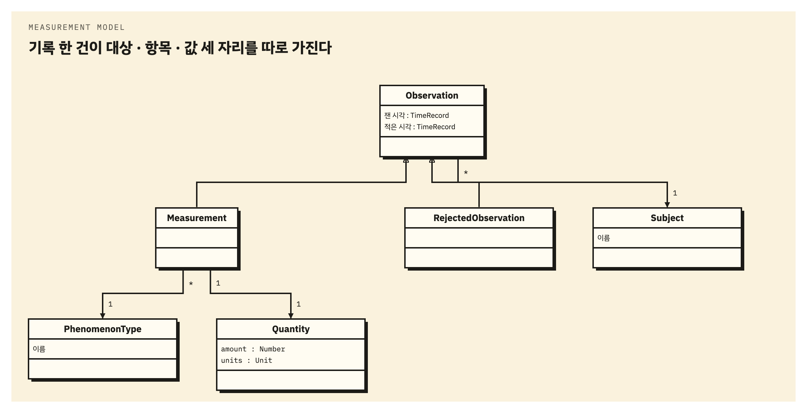

# Measurement — 값 하나를 누구의 무엇으로 만드는 기록 한 층

## 한눈에 보는 개요

병원 기록 프로그램이 환자 한 사람을 `Patient { systolic, pulse }` 처럼 담고 있다고 해 봅시다. 9월 1일에 잰 수축기 혈압 118 mmHg 가 `systolic` 칸에 들어가요. 그런데 검사 항목은 계속 늘어납니다. 혈당이 붙고, 산소포화도가 붙고, 다음 분기에는 스무 개가 더 붙어요. 항목 하나마다 칸 하나를 더하고 배포를 한 번 합니다. 더 큰 문제는 그다음이에요. 9월 3일에 다시 재서 120 을 넣으면 118 은 사라집니다. 9월 2일에 우리가 알던 이 환자의 혈압이 얼마였는지 물으면 답할 자리가 아예 없어요.

Measurement 의 해법은 **값을 대상의 칸에서 꺼내 「누구를 · 무엇을 · 얼마」 세 자리를 가진 기록 한 건으로 만드는 것**입니다. 항목이 칸 이름이 아니라 데이터 값이 되고, 기록은 덮어쓰는 것이 아니라 쌓이는 것이 돼요.

```text
Before — 측정값이 대상의 칸일 때
  Patient { systolic: 118, pulse: 72, ... }
  새 검사 항목 하나  ──▶  칸 하나 추가 + 배포 한 번
  9/3 에 120 을 넣음  ──▶  118 은 사라진다

After — 측정값이 기록일 때
  Measurement(환자 A · systolic · 118 mmHg · 9/1)
  Measurement(환자 A · systolic · 120 mmHg · 9/3)
  새 검사 항목 하나  ──▶  항목 데이터 한 줄
  9/3 에 120 을 적음  ──▶  118 도 그대로 남는다
```

분류는 Fowler 『Analysis Patterns』(1997)의 관측·측정 계열이고, 함께 쓰는 패턴은 [Quantity](../quantity/quantity-guide_v1.2.0.md) · [Knowledge Level](../knowledge-level/knowledge-level-guide_v1.1.0.md) · [Observation](../observation/observation-guide_v1.1.0.md) 입니다(근거: Fowler *Analysis Patterns* 3장 「Observations and Measurements」 §3.4~§3.9).

이웃 개념들이 서로 어떻게 놓이는지는 [참고 문서 「수량·측정·관측 모델」](../../reference/observation-model/observation-model-ref_v1.0.2.md)에 따로 정리돼 있고, 이 글이 파고드는 것은 그중 기록 한 층입니다. 이 글의 병동 기록에서는 측정 기록 한 건이 따로 있고, 환자와 측정 항목은 번호로만 가리켜요. 기록을 만들고 「그날 알던 값」을 답하는 일은 기록과 항목 밖의 **창구**가 맡고, 기록은 창구의 **장부**에 쌓입니다. 값의 단위를 항목의 허용 단위와 대조하는 것도 창구이고, 「그날 알던 값」은 어디에도 적어 두지 않은 채 물을 때마다 적은 날과 거부한 날을 보고 골라요. 기록을 누가 담을지 다른 선택지 셋은 「상황이 달라지면」에서 나란히 봅니다.

```text
이 글이 고른 경계
  Measurement ──── 대상과 항목은 번호로만 가리킴 · 값과 두 시각 · 거부 표시를 가짐
  PhenomenonType ── 이름과 허용 단위만 앎 (자기를 쓰는 기록은 모름)
  환자 ──────────── 이 글 밖 · 번호로만 등장 (자기에게 붙은 기록을 모름)
  단위 대조 ──────── 기록 혼자서는 항목을 못 봄 → 창구가 기록을 만들기 전에 확인
  그날 알던 값 ────── 어디에도 적어 두지 않음 → 창구가 물을 때마다 적은 날 · 거부한 날로 골라 답함
```

이 글은 시나리오 셋을 따라갑니다. 측정 한 건이 기록되고 되읽히는 길, 검사 항목이 늘고 잰 날과 적은 날이 다를 때 무엇이 바뀌는가, 잘못 적은 값을 덮어쓰거나 지우면 처방의 근거가 어디서 사라지는가. 끝까지 읽으면 어떤 기록을 Measurement 라고 불러도 되는지 필수 조건 넷으로 판정할 수 있고, Quantity · 범주형 관측 · 계획된 값과 무엇이 다른지도 가릴 수 있어요. 그 기록을 누가 담는지와 두 시각을 따로 둘 때 조회가 어떻게 달라지는지도 세 언어 코드에서 짚을 수 있게 됩니다.

## 패턴 자세히 들여다보기

### 시나리오 1 — 환자 A 의 수축기 혈압 118 mmHg 한 건이 기록되고 되읽히기까지

병동 간호사가 9월 1일에 환자 A(기록 위의 id 는 `p-7`)의 수축기 혈압을 재서 118 mmHg 를 얻었습니다. 같은 날 바로 단말에 입력해요. 나와야 하는 답은 둘입니다. 기록 한 건이 남는 것, 그리고 "환자 A 의 수축기 혈압은 얼마인가" 에 118 mmHg 가 돌아오는 것. 이 장면에는 넷이 등장해요. 잰 값을 대상·항목과 묶는 **Measurement**, 무엇을 쟀는지 답하는 **PhenomenonType**, 수치와 단위를 한 값으로 묶은 Quantity, 그리고 둘을 id 로 찾아 조립하는 창구입니다. 이름은 여기서 한 구절씩만 소개하고 정식 정의는 개념 정리에서 해요.

1. **간호사 쪽이 수치와 단위를 함께 넘겨 `Quantity(118, mmHg)` 를 만듭니다.** 수치 118 만 넘기면 받는 쪽이 단위를 짐작해야 하고, 같은 칸에 mmHg 와 kPa 가 섞여 들어옵니다. 단위를 값 안에 두는 이유와 단위가 다를 때의 처리는 [Quantity 가이드](../quantity/quantity-guide_v1.2.0.md)의 몫이고, 이 글은 그 값을 **받아서 어디에 묶는가**를 봅니다.
2. **창구가 항목 id `pt-1` 로 PhenomenonType 을 찾습니다.** 항목을 코드의 이름이 아니라 데이터로 두었기 때문에 이 단계가 조회예요. 여기서 찾아 온 항목이 "systolic" 이라는 이름과 "mmHg" 라는 허용 단위를 가지고 있습니다. 순서를 뒤집어 기록부터 만들면, 없는 항목에 붙은 기록이 장부에 남고 나서야 발견됩니다.
3. **창구가 대상 id `p-7` 과 항목 id `pt-1` 과 값을 넘겨 Measurement 한 건을 만듭니다.** 세 자리가 다 채워진 채로만 만들어지게 하는 것이 여기서 지켜지는 불변식이에요. 셋 중 하나라도 비어 있으면 그 기록은 나중에 "누구의 것인지 모르는 118 mmHg" 가 되는데, 그때는 고칠 근거가 남아 있지 않습니다.
4. **만들어지기 직전에 값의 단위가 항목의 허용 단위와 같은지 대조합니다.** 이 검사는 Measurement 안이 아니라 창구에 있어요. 기록은 항목을 번호로만 가리켜서, 기록 혼자서는 상대편 항목의 허용 단위를 볼 수 없기 때문입니다. `Quantity(72, bpm)` 을 systolic 자리에 넣으려 하면 이 단계가 막아요.
5. **조회가 대상 id 와 항목 id 로 기록을 골라 답합니다.** 답은 값 하나가 아니라 **기록 하나**예요. 값만 돌려주면 그 값이 언제 잰 것인지 되물을 자리가 없어집니다.

```text
단계   부르는 쪽 → 받는 쪽                 넘기는 것                       돌아오는 것
 1     간호사 → (new)                      118 · mmHg                      Quantity(118, mmHg)
 2     창구 → PhenomenonType               pt-1                            systolic · 허용 단위 mmHg
 3     창구 → (new Measurement)            p-7 · pt-1 · 118 mmHg · 9/1     기록 m-1
 4     창구 → PhenomenonType.allows        Quantity(118, mmHg)             같다 → 통과
 5     조회 → 창구                          p-7 · pt-1                      기록 m-1 (118 mmHg)
```

이 시나리오가 보여 준 것은 **기록 한 건이 세 자리를 따로 가진다**는 것입니다. 값(118 mmHg)은 그 자체로 완전하지만 누구의 무엇인지는 모르고, 그 두 가지를 기록이 채워요. 값은 그대로 남습니다. 그리고 항목이 코드가 아니라 데이터라서 2단계가 조회가 됐습니다. 4단계의 단위 대조가 창구에 있는 것은 경계 때문인데, 이 자리는 「상황 설정」 표가 다시 짚습니다.

### 시나리오 2 — 검사 항목이 늘고, 잰 날과 적은 날이 다를 때

같은 병동에 맥박(pulse, 단위 bpm)을 기록해 달라는 요구가 들어왔습니다. 그리고 이번에는 현장에서 바로 입력하지 못했어요. 9월 1일에 잰 72 bpm 을 9월 3일에야 단말에 넣습니다. 나와야 하는 답은 셋입니다. 항목 추가로 고친 코드가 0 줄일 것, 9월 2일에 "지금 이 환자의 맥박은?" 을 물으면 "없음" 이 나올 것, 9월 4일에 같은 질문을 하면 72 bpm 이 나올 것.

1. **맥박을 PhenomenonType 인스턴스 하나로 등록합니다.** 클래스도 enum 상수도 늘지 않아요. `PhenomenonType.of("pulse", "bpm")` 한 줄이 데이터로 들어가고, 기록 쪽 타입은 그대로입니다. 항목을 칸 이름으로 두었다면 이 단계가 필드 추가와 배포였습니다.
2. **기록을 만드는 길은 시나리오 1 과 똑같습니다.** 창구가 `pt-2` 로 항목을 찾고, 허용 단위 bpm 과 값의 단위 bpm 을 대조하고, 세 자리를 채워 기록을 만들어요. 항목이 늘어도 이 길이 변하지 않는 것이 이 패턴이 주는 이득입니다.
3. **기록이 시각을 둘 답니다 — 잰 날 9/1 과 적은 날 9/3.** 하나만 두면 둘 중 하나를 포기하게 돼요. 잰 날만 두면 "9월 2일에 우리가 알던 값" 을 물을 수 없고, 적은 날만 두면 그 값이 언제의 몸 상태인지 알 수 없습니다. 두 날이 같은 경우가 흔하다고 해서 한 칸으로 합치면, 두 날이 달라지는 순간 되돌릴 방법이 없어요.
4. **9월 2일 기준 조회가 "없음" 을 답합니다.** 조회가 보는 것은 잰 날이 아니라 **적은 날**이에요. 9/1 에 잰 값이라도 9/3 에 적혔으니 9/2 에는 우리 손에 없었습니다. 순서를 바꿔 잰 날로 걸렀다면 9/2 에 72 bpm 이 돌아오는데, 그날 의사가 그 값을 본 적이 없으니 사실과 다른 답이 됩니다.
5. **9월 4일 기준 조회가 72 bpm 을 답합니다.** 같은 질문, 다른 기준 날짜예요. 조회 하나가 "지금 아는 값" 과 "그때 알던 값" 을 함께 답하는 것이 두 시각을 따로 둔 이득입니다.

```text
                9/1 잰 날        9/2 그날 알던 값      9/3 적은 날        9/4 그날 알던 값
맥박 72 bpm      유효 시작        없음 (아직 안 적힘)     기록됨            72 bpm
                applicability                          recording time
```

이 시나리오가 보여 준 것은 둘입니다. 하나는 **항목이 데이터라서 새 항목을 더해도 배포하지 않는다**는 것이고, 다른 하나는 **시각이 둘이라야 답할 수 있는 질문이 있다**는 것이에요. 4단계와 5단계는 같은 조회를 기준 날짜만 바꿔 부른 것인데 답이 달랐습니다. 여기서 헷갈리기 쉬운 포인트는 두 시각을 "정확도" 문제로 보는 것입니다. 정확도가 아니라 답할 수 있는 질문의 종류가 달라져요. 적은 날이 없으면 9/2 의 결정이 어떤 정보 위에서 내려졌는지 다시 확인할 길 자체가 없습니다.

### 시나리오 3 — 잘못 적은 1200 mmHg 를 덮어쓰거나 지우면 처방의 근거가 어디서 사라지는가

9월 3일에 수축기 혈압을 입력하다가 120 을 1200 으로 잘못 쳤습니다. 기록 `m-3` 이 1200 mmHg 로 남았고, 의사가 그 값을 보고 처방을 바꿨어요. 9월 4일에 오기를 발견합니다. 나와야 하는 답은 "지금 환자 A 의 수축기 혈압은 120 mmHg" 이면서, 동시에 "9월 3일에는 1200 이 있었다" 가 남아 있는 것입니다.

1. **값만 고치려 하면 — 기록의 값 자리를 1200 에서 120 으로 바꿉니다.** 조회는 곧바로 맞는 답을 냅니다. 그런데 9월 3일의 처방 기록 옆에 남은 근거가 120 mmHg 가 되어, 정상 범위 값을 보고 처방을 바꾼 꼴이 돼요. 무엇이 왜 일어났는지 설명할 수 없는 상태가 조용히 만들어집니다.
2. **지우려 하면 — 기록 `m-3` 을 통째로 없앱니다.** 이번에는 근거가 아예 사라져요. 1단계보다 나은 것 같지만 같은 문제입니다. 처방은 남아 있는데 그 처방의 근거가 된 값이 어디에도 없어요.
3. **거부로 남기면 — 값은 그대로 두고 기록에 거부 표시를 붙입니다.** 사유("오기")와 거부한 날(9/4)이 함께 붙고, `m-3` 의 값은 1200 mmHg 그대로예요. 그리고 다시 잰 120 mmHg 는 `m-3` 을 고친 것이 아니라 **새 기록 `m-4`** 로 남습니다. 거부 표시가 값이 아니라 기록 자체에 붙기 때문에, 수축기 혈압이든 혈액형이든 같은 방식으로 거부됩니다.
4. **아직 재지 않은 목표 혈압 120 mmHg 를 같은 표에 표시 없이 적으면** — 대상 하나 · 항목 하나 · 크기 하나를 갖춘 줄이 하나 더 생깁니다. 모양만 보면 3단계의 `m-4` 와 구별되지 않아요. 그러면 "환자 A 의 수축기 혈압" 조회가 잰 값과 맞추려는 값을 섞어서 답합니다. 기록에 **관찰한 값인지 계획한 값인지 표시**가 있어야 조회가 둘을 가릅니다.
5. **그 날 기준 조회가 거부 시각까지 봅니다.** 9/3 기준으로 물으면 1200 mmHg 가 돌아와요 — 그날은 아직 거부되기 전이니까요. 9/30 기준으로 물으면 120 mmHg 가 돌아옵니다. 거부를 삭제로 처리했다면 9/3 기준 조회가 1200 mmHg 대신 그 전에 잰 118 mmHg(`m-1`)를 답해서, 그날 실제로 있었던 일과 어긋납니다(직접 바꿔 실행해 확인).

```text
지우는 방식    9/3 1200 mmHg ──삭제──▶ (없음)                     처방의 근거가 사라진다
고치는 방식    9/3 1200 mmHg ──수정──▶ 120 mmHg                   처방이 정상 값에서 나온 꼴이 된다
거부하는 방식  9/3 1200 mmHg ──거부──▶ 거부 표시(오기 · 9/4)        "그때는 이 값이 있었다" 가 남는다
                                       9/3 120 mmHg (m-4)         다시 잰 값은 새 기록으로 남는다
```

이 시나리오가 보여 준 것은 **고친 흔적이 모델의 일부**라는 것입니다. 값을 덮어쓰거나 지우는 순간, 그 값을 쓴 다른 기록이 설명을 잃어요. 그리고 4단계에서 확인된 것이 하나 더 있습니다 — 세 자리를 갖춘 모양만으로는 **이미 잰 값과 앞으로 맞출 값이 구별되지 않아요.** 그 구별은 자리를 하나 더 두어서 하는데, 최소 조건 절이 그 자리를 다시 짚습니다.

### 개념 정리

시나리오에 나온 분석 층위의 개념 여섯을 정식으로 정의합니다. 이 절이 정하는 것은 개념이 무엇을 책임지고 누구와 협력하는가까지예요. 그 책임을 코드의 어느 객체가 지는지, 무엇이 aggregate 의 root 인지는 뒤의 「상황 설정」 표가 정합니다.

- **Measurement**(측정 기록) — 대상 하나에 대해 항목 하나를 재서 얻은 값 하나를 묶은 사실 한 건입니다.
  - 책임: 누구를 · 무엇을 · 얼마 세 자리를 채운 채로 만들어지고, 만들어진 뒤에는 그 세 자리를 바꾸지 않습니다(시나리오 1 의 3단계, 시나리오 3 의 1단계).
  - 협력: 대상 하나와 PhenomenonType 하나를 가리키고, Quantity 하나를 담아요. 같은 대상·항목·값을 가진 기록 둘도 서로 다른 사실입니다 — 같은 날 두 번 쟀으면 기록도 두 건이에요.
- **PhenomenonType**(측정 항목) — 무엇을 재는가를 답하는 개념입니다. 수축기 혈압 · 맥박 · 혈당이 각각 하나씩이에요.
  - 책임: 항목의 이름을 가지고, 이 예제에서는 그 항목이 어떤 단위로 적히는지도 함께 가집니다. 매일 생기는 사실이 아니라 사실을 해석하는 쪽이라 기록과는 따로 바뀌어요(시나리오 2 의 1단계).
  - 협력: 항목 하나에 Measurement 가 여럿 붙습니다. 이렇게 "사실" 과 "사실의 종류" 를 두 무리로 가르는 방식 자체는 [Knowledge Level 가이드](../knowledge-level/knowledge-level-guide_v1.1.0.md)가 패턴으로 다뤄요.
- **Quantity**(측정값) — 수치와 단위를 한 값으로 묶은 것입니다. 118 mmHg 가 하나예요.
  - 책임: 수치가 무엇으로 셌는지를 값 안에 담습니다. 단위가 다른 값끼리의 계산과 환산은 [Quantity 가이드](../quantity/quantity-guide_v1.2.0.md)의 몫이고, 이 글에서는 값 자리에 오는 것이 그것이라는 데까지가 필요합니다(시나리오 1 의 1단계).
  - 협력: Measurement 하나가 Quantity 하나를 담습니다. 같은 118 mmHg 를 담은 기록이 여럿일 수 있어요.
- **Subject**(대상) — 재어지는 쪽입니다. 이 예제에서는 환자이고, 원전의 그림은 사람으로 그려 두었어요.
  - 책임: 식별자로 자기를 구별합니다. 자기에게 붙은 기록을 자기가 가지고 있을 필요는 없어요 — 그 선택지는 「상황이 달라지면」이 나란히 둡니다.
  - 협력: 대상 하나에 기록이 여럿 붙습니다.
- **Observation**(관측) — 대상에 대한 사실 하나를 나타내는 상위 개념이고, Measurement 는 그 한 종류입니다.
  - 책임: 대상과 항목, 그리고 잰 시각·적은 시각처럼 **값의 종류와 무관한 것**을 답니다. 그래서 수치 사실과 범주 사실이 그것을 함께 물려받아요(시나리오 2 의 3단계).
  - 협력: 값 자리에 크기가 오면 Measurement 이고, 범주가 오면 범주 관측입니다. 두 시각과 거부 표시가 왜 이 층에 붙는지는 [참고 문서 「수량·측정·관측 모델」](../../reference/observation-model/observation-model-ref_v1.0.2.md)의 「Observation」 절이 풀어요.
- **RejectedObservation**(거부된 관측) — 틀렸다고 판정된 관측입니다. 지우는 대신 거부됐다는 표시가 붙은 종류로 바뀌어요.
  - 책임: 값을 그대로 둔 채 사유와 거부한 시각을 답니다. 한 번 거부된 것은 다시 거부되지 않아요(시나리오 3 의 3단계).
  - 협력: Observation 의 한 종류라서, 수치 관측이든 범주 관측이든 같은 방식으로 거부됩니다. 지우지 않는 이유는 [참고 문서 「수량·측정·관측 모델」](../../reference/observation-model/observation-model-ref_v1.0.2.md)의 「Rejected Observation」 절에 있어요.



그림에서 Measurement 는 세 방향으로 선을 냅니다. 위로는 Observation 의 한 종류라는 선, 아래로는 항목 하나와 값 하나를 가리키는 선이에요. 대상으로 가는 선이 Measurement 가 아니라 Observation 에 붙어 있는 것이 눈에 띌 텐데, 그래서 범주 관측도 같은 대상 연결을 씁니다. 두 시각이 Observation 칸 안에 적혀 있는 것도 같은 이유예요(근거: Fowler *Analysis Patterns* 3장 §3.4 의 그림 3.6 과 §3.5 의 그림 3.7 · §3.8 의 그림 3.11 · §3.9 의 그림 3.12). 분석 모델은 연관만 정할 뿐 누가 기록을 소유하는지는 정하지 않아요. 소유는 설계가 정하고, 그 선택지 넷은 「상황이 달라지면」에서 나란히 봅니다.

## 사용 목적

이 패턴이 필요하다는 단서는 업무 요구나 기존 모델에서 **눈으로 보이는 것**이어야 합니다. 아래 넷 중 하나라도 보이면 값을 대상의 칸에서 꺼낼 때예요.

#### 단서 1 — 분기마다 「이 항목도 기록해 주세요」가 오고, 그때마다 테이블에 컬럼을 하나 붙이고 배포합니다

이것이 가장 흔한 단서입니다. 항목 목록이 업무의 변수인데 모델에서는 상수로 박혀 있는 상태예요.

#### 단서 2 — 화면에 「최근 값」만 있고, 지난달에 무엇을 봤는지 물으면 답할 자리가 없습니다

값이 덮어써지고 있다는 뜻입니다. 시나리오 1 의 5단계가 기록을 돌려준 이유가 이것이에요.

#### 단서 3 — 같은 값을 두 화면이 다르게 보여 줍니다

한쪽은 잰 날 기준, 한쪽은 입력 날 기준이에요. 두 시각이 모델에 없어서 화면마다 하나를 골라 쓰고 있는 상태입니다.

#### 단서 4 — 잘못 입력한 값을 지웠는데, 그 값을 보고 내린 결정이 그대로 남아 있습니다

시나리오 3 의 2단계가 그 장면이에요.

#### 쓰지 말아야 할 경우

반대로 **쓰지 말아야 할 때**도 있습니다. 항목이 두셋으로 고정돼 있고 앞으로 늘 계획이 없으며 이력도 필요 없다면, 대상의 칸으로 두는 편이 낫습니다. 이 패턴을 적용하면 조회 하나가 두 단계(항목 조회 + 기록 조회)로 늘고, 항목 데이터를 관리할 자리가 새로 생기는데 그 대가로 막아 주는 것이 없어요. 그럴 때는 칸이 정답입니다. 다만 "늘 계획이 없다" 를 확인할 때는 업무 담당자에게 물어보는 편이 안전합니다. 항목이 늘지 않는 측정 도메인은 생각보다 드뭅니다(판단 — 원전은 이 질문을 던지되 답을 적어 두지 않았고, 이 문단은 이 가이드의 판단입니다).

```text
보이는 단서                               고를 모델
항목이 몇 개로 고정이고 이력도 필요 없다     대상의 칸
항목이 계속 늘거나 지난 값을 되읽어야 한다    기록으로 만든다(Measurement)
값 자리에 크기가 아니라 범주가 온다          범주형 관측
기록들이 합해져 잔액을 만든다                Account 의 Entry
```

비슷한 단서에서 다른 모델을 고르게 되는 경우도 있어요. 값 자리에 크기가 아니라 범주가 오거나, 기록들이 합해져서 잔액 하나를 설명해야 한다면 다른 패턴입니다. 그 차이는 바로 다음 절에서 풉니다.

## 패턴의 경계

### 디자인 패턴을 충족하는 최소 조건

어떤 기록을 Measurement 라고 불러도 되는지 가르는 기준입니다. 클래스 모양이 아니라 개념이 맡는 책임과 모델이 늘 지키는 불변식으로 판정해요. `[필수]` 에는 **원전이 이 패턴의 성립 요건으로 적어 둔 것만** 올렸고, 원전이 한 가지 형태로 든 것과 이 가이드 예제의 정책은 번호 순서와 무관하게 `[선택]` 입니다. 이 패턴의 원전 근거는 대부분 **모델 그림**이라, 조건마다 그림이 무엇을 선언한 것인지(전후 대조 · 연관 · 다중도 · 속성 타입)를 함께 적었어요.

1. [필수] **측정 한 건이 대상의 칸이 아니라 독립된 기록이고, 누구를 쟀는지를 자기 안에 담는다** — 측정을 하나 남기는 일이 대상 객체의 값을 덮어쓰는 일이 아니고, 기록만 가지고도 그것이 누구의 것인지 답할 수 있습니다. 시나리오 1 의 3단계 (근거: Fowler *Analysis Patterns* 3장 §3.1 과 §3.4 — §3.1 의 그림 3.1 과 3.2 가 키·몸무게·혈당을 Person 의 속성으로 두었던 모델을, §3.4 의 그림 3.6 이 Person 과 Measurement 를 잇는 연관으로 바꾸고 Person 에서 그 속성들을 지웁니다. 세 그림이 잇달아 놓인 **모델의 전후 대조**가 이 조건의 자격입니다)
   - 빠지면: `Patient.systolic` 칸이 됩니다. 시나리오 3 의 1단계처럼 새 값이 옛 값을 덮어써서, 9/1 에 잰 118 mmHg 를 9/3 에 물으면 답이 없어요.
   - 근거의 범위: 위 근거 괄호가 받쳐 주는 것은 **측정값이 대상의 속성 자리에서 나와 자기 기록이 된다**까지입니다. 그 기록을 어느 aggregate 가 담는지 — 대상 안에 있는지 따로 있는지 — 는 그림이 정하지 않아요. 그 선택지는 「상황이 달라지면」이 나란히 둡니다.
2. [필수] **무엇을 쟀는가가 기록의 모양이 아니라 기록이 가진 값이다** — 새 검사 항목을 하나 더하는 일이 타입·칸·enum 상수를 더하는 일이 아니라 데이터를 하나 더하는 일입니다. 시나리오 2 의 1·2단계 (근거: Fowler *Analysis Patterns* 3장 §3.4 — 그림 3.6 이 Phenomenon Type 을 Measurement 의 **연관 상대**로 두고 항목 하나에 측정 여럿이 붙게 하며, 같은 그림의 지식·운영 구분선이 그 항목을 지식 쪽에 올립니다. 속성이던 것이 연관 상대가 된 **구조 선언**이 자격입니다)
   - 빠지면: `enum Kind { SYSTOLIC, PULSE }` 나 항목마다 칸 하나인 표가 됩니다. 시나리오 2 의 1단계에서 고친 코드가 0 줄이었던 자리가 여기서는 배포 한 번이 돼요.
   - 근거의 범위: 위 근거 괄호가 받쳐 주는 것은 **항목이 기록의 상대편 자리에 놓인다**까지입니다. 그 자리에 오는 것이 규칙을 가진 통제된 객체여야 하는지 이름 문자열 한 줄이어도 되는지는 그림이 정하지 않아요 — 그 자리가 `[선택]` 5 입니다.
3. [필수] **얼마인가를 수치와 단위가 한 값으로 붙은 크기로 담는다** — 값 자리에 오는 것이 더하거나 크기를 비교하는 것이 도메인에서 뜻이 있는 수치이고, 단위가 칸 이름이나 주석이 아니라 그 값 안에 있습니다. 시나리오 1 의 1·4단계 (근거: Fowler *Analysis Patterns* 3장 §3.4 — 그림 3.6 이 Measurement 의 속성을 `quantity : Quantity` 로 적어 값 자리의 타입을 정하고, 같은 장 §3.1 의 그림 3.2 가 그 Quantity 를 `amount : Number` 와 `units : Unit` 을 가진 값으로 정의하고, **같은 칸에 `+ - * / = > <` 를 적어** 더하고 비교하는 것이 그 값의 연산임을 밝힙니다 — 조건 문면의 「더하거나 크기를 비교하는 것이 뜻이 있는」이 이 연산 목록에서 옵니다. **속성 타입 선언**이 자격입니다)
   - 빠지면: `value: 118` 만 남은 기록이 됩니다. 시나리오 1 의 4단계에서 막힌 `72 bpm` 이 수축기 혈압 자리에 그대로 들어가고, mmHg 와 kPa 가 같은 칸에 섞여요.
   - 근거의 범위: 위 근거 괄호가 받쳐 주는 것은 **값 자리가 수치와 단위를 함께 담은 Quantity 다**까지입니다. 단위가 다를 때 거부할지 환산할지, 자릿수를 어떻게 다룰지는 [Quantity 가이드](../quantity/quantity-guide_v1.2.0.md)의 조건이 정합니다.
4. [필수] **한 기록은 대상 하나 · 항목 하나 · 값 하나다** — 세 자리가 각각 하나로 정해지고, 한 기록이 항목 둘이나 값 둘을 담지 않습니다. 시나리오 1 의 3·5단계 (근거: Fowler *Analysis Patterns* 3장 §3.4 — 그림 3.6 이 Person 과 Measurement, Phenomenon Type 과 Measurement 를 각각 하나 대 여럿으로 잇고 값은 속성 하나로 둡니다. **다중도 선언**이 자격입니다)
   - 빠지면: 한 기록이 수축기와 이완기를 함께 담습니다. 시나리오 1 의 5단계가 답한 "환자 A 의 수축기 혈압은 얼마인가" 에 값 둘이 돌아와서, 무엇이 수축기인지를 자리 순서로 다시 약속해야 해요.
   - 근거의 범위: 위 근거 괄호가 받쳐 주는 것은 **한 기록에 세 자리가 하나씩**까지입니다. 여러 측정을 한 묶음으로 함께 확정해야 하는 상황이라면 묶음을 따로 두는데, 그 선택지는 「상황이 달라지면」 3행입니다.
5. [선택] **항목을 통제된 지식 층위 객체로 둔다** — 항목이 이름만이 아니라 규칙을 가지고, 기록은 그것을 id 로 가리킵니다. 시나리오 1 의 4단계(이 예제의 항목이 가진 허용 단위를 물음) (근거: Fowler *Analysis Patterns* 3장 §3.4 — 그림 3.6 의 지식·운영 구분선이 Phenomenon Type 을 지식 쪽에 올려 둡니다. 다만 그 항목이 **허용 단위를 제약한다**는 규칙은 그림에 없어요 — 이 가이드가 예제 정책으로 보탠 것이고, 원전이 그 제약을 적었는지는 확인하지 못했습니다)
   - 빠지면 잃는 것: 시나리오 1 의 4단계가 막아 준 자리입니다. 항목이 자유 문자열이면 "systolic" 과 "Systolic" 과 "수축기 혈압" 이 세 항목이 되고, bpm 으로 적힌 수축기 혈압을 막아 줄 자리도 없어요.
6. [선택] **잰 시각과 적은 시각을 따로 둔다** — 사실이 유효한 시각과 그 사실을 적은 시각을 두 자리로 둡니다. 시나리오 2 의 3~5단계 (근거: Fowler *Analysis Patterns* 3장 §3.8 Dual Time Record — 그림 3.11 이 Observation 에서 Time Record 로 가는 연관을 **둘** 그리고 각각에 recording time · applicability 이름을 붙입니다)
   - 빠지면 잃는 것: "그때 알던 값" 을 묻는 길입니다. 시나리오 2 의 4단계가 답한 9/2 의 "없음" 이 72 bpm 으로 바뀌어, 그날 아무도 본 적 없는 값이 그날의 답이 돼요.
7. [선택] **잘못 잰 값을 지우지 않고 거부 표시로 남긴다** — 틀린 기록의 값을 그대로 둔 채 거부 표시를 붙이고, 다시 잰 값은 새 기록으로 남깁니다. 시나리오 3 의 3단계 (근거: Fowler *Analysis Patterns* 3장 §3.9 Rejected Observation — 그림 3.12 가 Rejected Observation 을 Observation 의 하위 타입으로 두고 그 일반화에 «dynamic» 표기를 붙입니다. **이 글은 그 표기를** 관측이 나중에 그 종류로 옮겨 간다는 뜻**으로 읽었습니다** — UML(Unified Modeling Language) 관례상 무리한 읽기는 아니지만 원전이 그 낱말로 적어 둔 것은 아니고, [참고 문서 「수량·측정·관측 모델」](../../reference/observation-model/observation-model-ref_v1.0.2.md)도 같은 완충으로 적습니다)
   - 빠지면 잃는 것: 그 값을 쓴 다른 기록의 설명입니다. 시나리오 3 의 1·2단계가 그 경우예요 — 1200 mmHg 를 보고 바꾼 처방이 정상 값에서 나온 꼴이 되거나, 근거가 아예 사라집니다.
8. [선택] **관찰한 값인지 계획한 값인지를 기록이 표시한다** — 이미 잰 값과 앞으로 맞추려는 값이 같은 모양으로 쌓이므로, 둘을 가르는 표시를 기록에 답니다. 시나리오 3 의 4단계(표시가 없을 때) (근거: Fowler *Analysis Patterns* 4장 「Observations for Corporate Finance」 — 그림 4.11 이 Observation 에 Status Type 을 붙이고 그 하위 타입을 Actual 과 Planned 로 둡니다. 같은 그림에서 Measurement 가 Observation 의 하위 타입이라 그 표시를 함께 물려받아요)
   - 빠지면 잃는 것: 조회의 신뢰입니다. 시나리오 3 의 4단계처럼 "환자 A 의 수축기 혈압" 하나가 잰 값과 목표 값을 섞어서 답해요.
9. [선택] **범주형 사실과 공통 상위 아래 둔다** — 수치로 적히지 않는 사실(혈액형이 A 라는 것)도 대상·항목·시각 구조를 함께 쓰게 상위 개념을 둡니다. 시나리오 3 의 3단계(거부 표시가 값이 아니라 기록 자체에 붙음) (근거: Fowler *Analysis Patterns* 3장 §3.5 — 그림 3.7 이 Observation 을 대상·항목과 잇고, Measurement 와 Category Observation 을 그 하위 타입으로 나란히 둡니다)
   - 빠지면 잃는 것: "이 환자에 대해 기록된 사실 전부" 조회입니다. 수치 사실과 범주 사실이 서로 다른 두 모델에 있으면 그 조회가 둘을 합쳐야 하고, 두 시각과 거부 표시도 두 벌이 돼요.

> 필수는 넷이다 — 기록이 대상의 칸에서 떨어져 나왔는가, 항목이 값 자리에 있는가, 값이 단위를 단 크기인가, 세 자리가 하나씩인가.

위 조건 넷이 가려 주는 것은 **기록이 측정 기록의 모양을 갖췄는가**까지입니다. 그 모양을 갖춘 기록이 **이미 잰 값인지 앞으로 맞출 값인지**는 조건 넷이 묻지 않아요 — 목표 수축기 혈압 120 mmHg 를 적은 줄도 대상 하나 · 항목 하나 · 크기 하나를 갖춥니다. 원전은 그 둘을 다른 패턴으로 가르지 않고 기록에 표시를 하나 더 붙여 가르는데, 그 자리가 `[선택]` 8 이에요. 표시가 없으면 시나리오 3 의 4단계처럼 조회 하나가 둘을 섞어서 답합니다.

### 비슷한 패턴·안티패턴과의 차이

| 비교 대상 | 구분 기준 | Measurement 를 고르면 얻는 것 | 포기하는 것 |
| --- | --- | --- | --- |
| Quantity | 대상과 측정 항목을 가진 기록 계층이 필요한가 | 같은 값이 누구의 무엇인지가 값 밖의 자리에 남는다 | 조회가 두 단계로 늘고, 값만 필요한 자리에는 과한 층이 된다 |
| 대상의 칸으로 둔 측정 필드 | 새 항목이 늘 때 타입이 바뀌는가, 데이터가 늘어나는가 | 새 항목을 더해도 배포하지 않고, 옛 값이 덮어써지지 않는다 | 한 대상의 값을 읽는 일이 칸 읽기에서 조회로 바뀐다 |
| 범주형 관측(Category Observation) | 값 자리에 오는 것이 크기인가 범주인가 | 더하고 비교하는 것이 뜻을 갖는 값만 이 자리에 온다 | 혈액형·소견 같은 사실은 이 모델로 못 담아 나란한 모델이 따로 필요하다 |
| 계획된 값(Planned) | 기록이 이미 잰 값인지 앞으로 맞출 값인지를 표시하는가 | 조회가 관측과 계획을 섞지 않는다 | 기록마다 표시가 하나 더 붙고, 표시를 안 붙인 옛 기록의 해석이 애매해진다 |
| EAV(Entity–Attribute–Value) 표 | 항목과 값이 뜻을 가진 모델 요소인가, 이름 칸과 문자열 칸인가 | 항목이 규칙을 가질 수 있고 값이 단위를 단 크기다 | 한 표에 아무거나 담는 자유를 잃는다 |
| Account 의 Entry | 기록들이 합해져 잔액 하나를 설명하는가, 건마다 독립한 사실인가 | 기록 하나하나가 그것만으로 완결된 사실이다 | 기록들을 합한 값이 따로 뜻을 갖는 도메인에는 맞지 않는다 |

#### Quantity 와의 차이

구분 기준은 대상과 측정 항목을 가진 기록 계층이 필요한가입니다. 여기서 헷갈리기 쉬운 포인트는 둘을 **고르는 관계**로 보는 것이에요. Measurement 는 Quantity 의 대안이 아니라 Quantity 를 담는 기록입니다. 층이 쌓이는 거죠. 같은 120 mmHg 를 두 층으로 나누면 이렇게 보입니다.

```text
Quantity       120 mmHg                                     얼마인가
Measurement    환자 A · 수축기 혈압 · 120 mmHg               누구를 · 무엇을 · 얼마
                 │        │             └─ Quantity
                 │        └─ 무엇을 쟀는가(측정 항목)
                 └─ 누구를 쟀는가
```

그림의 120 mmHg 는 시나리오 3 의 4단계에서 다시 잰 값이에요. 값만 필요한 자리(재고 보유량이나 가격)에서는 Quantity 만으로 충분하고, 대상과 항목을 함께 기록해야 하면 Quantity 를 버리는 것이 아니라 그 위에 Measurement 한 층을 더 둡니다. Quantity 편의 「비슷한 패턴·안티패턴과의 차이」가 같은 기준을 반대 방향에서 적어 두었어요. 그쪽은 값만 필요한 자리에 기록 계층 없이 쓰는 것을 얻는 것으로 꼽고, 이쪽은 같은 기록 계층을 얻는 것으로 꼽습니다. 대가는 조회예요. 한 번에 끝나던 것이 두 단계가 되고, 시나리오 1 의 2단계와 5단계가 그 둘입니다.

#### 대상의 칸으로 둔 측정 필드와의 차이

구분 기준은 새 항목이 늘 때 바뀌는 것이 타입인가 데이터인가입니다. 아래 코드는 시나리오 2 의 요구(맥박 추가)를 칸으로 받은 모양이에요.

```java no-compile
class Patient {
    int systolic;   // mmHg 라고 이름에만 적혀 있다
    int pulse;      // 맥박이 늘면서 이 줄이 추가됐다
    // 혈당이 늘면 또 한 줄, 산소포화도가 늘면 또 한 줄
}
```

칸 하나가 늘 때마다 타입이 바뀌고 배포가 한 번 붙어요. 시나리오 2 의 1단계는 같은 요구를 데이터 한 줄로 받았죠. 이 모양은 조건 1 도 함께 놓칩니다 — `systolic` 에 120 을 넣는 순간 118 이 사라지니까요. 잃는 것도 있습니다. Measurement 를 고르면 한 대상의 값을 읽는 일이 칸 읽기에서 조회로 바뀌어요.

#### 범주형 관측과의 차이

구분 기준은 값 자리에 오는 것이 크기인가 범주인가입니다. 혈액형이 A 라는 사실은 대상(환자 A)도 있고 항목(혈액형)도 있는데 값이 크기가 아니에요 — A 형과 B 형을 더하거나 크기를 비교하는 것은 도메인에서 뜻이 없습니다. 그래서 조건 3 에서 구분돼요. 여기서 헷갈리기 쉬운 포인트는 범주에 번호를 붙여 이 자리에 억지로 넣는 것입니다.

```java no-compile
// 혈액형을 코드 숫자로 적어 Measurement 모양에 맞춘 것
record BloodTypeRow(String patientId, String item, int amount, String unit) {}
// new BloodTypeRow("p-7", "혈액형", 1, "code")  →  1 + 1 = 2 는 무엇인가?
```

모양은 네 자리를 다 갖췄지만 `1` 은 크기가 아니라 A 형을 가리키는 표예요. 둘을 더한 `2` 가 어떤 혈액형도 아니라는 것이 판정의 근거입니다. 이런 사실은 값 자리에 범주가 오는 나란한 모델이 받고, 둘이 상위 개념을 공유하는 것이 `[선택]` 9 예요.

#### 계획된 값과의 차이

구분 기준은 기록이 이미 잰 값인지 앞으로 맞출 값인지를 표시하는가입니다. 시나리오 3 의 4단계가 표시 없이 섞었을 때의 결과를 보여 줬어요. 원전은 이 둘을 다른 패턴으로 가르지 않고 기록에 상태 표시를 붙여 가릅니다. 그러니 "목표 혈압 120 mmHg" 를 적은 줄을 보고 "이건 Measurement 가 아니다" 라고 말하는 것은 절반만 맞아요 — 모양은 Measurement 이고, 빠진 것은 상태 표시입니다. 아래 두 줄이 그 자리예요. 둘 다 대상 하나 · 항목 하나 · 크기 하나를 똑같이 갖춰 `[필수]` 넷을 다 통과하고, 다른 것은 기록이 스스로 붙인 표시뿐입니다.

```text
p-7 · systolic · 120 mmHg · 2026-09-03    간호사가 재서 적음    관측한 값
p-7 · systolic · 120 mmHg · 2026-12-31    의사가 맞추려는 목표   계획한 값
└──────────── 여기까지가 같다 ───────────┘                     └ 여기서만 다르다
```

#### EAV 표와의 차이

구분 기준은 항목과 값이 뜻을 가진 모델 요소인가, 이름 칸과 문자열 칸인가입니다. `(entity_id, attribute_name, value_text)` 세 칸짜리 표는 구조가 닮았어요. 다른 점은 둘입니다. 하나는 항목이 규칙을 가질 수 있는가입니다. 시나리오 1 의 4단계가 허용 단위를 물어본 자리가 EAV 에는 없어요. 다른 하나는 값이 단위를 단 크기인가입니다. EAV 의 값 칸은 보통 문자열이라 `"118"` 과 `"118mmHg"` 와 `"높음"` 이 같은 칸에 들어갑니다(판단 — EAV 를 규정한 1차 출처는 확인하지 못했고, 이 비교는 그 이름으로 흔히 불리는 세 칸 표를 대상으로 합니다).

#### Account 의 Entry 와의 차이

구분 기준은 기록들이 합해져 잔액 하나를 설명하는가, 건마다 독립한 사실인가입니다. 둘 다 "값이 붙은 사실 한 건" 이 쌓이는 모양이라 닮아 보여요. 그런데 Entry 는 합해지려고 모입니다 — 어느 시점의 잔액은 그 시점까지의 Entry 합이고, Entry 하나는 그 합의 재료예요([Account 가이드](../account/account-guide_v1.2.0.md)). Measurement 는 반대로 건마다 독립한 사실이라, 환자 A 의 수축기 혈압 기록 셋을 더한 값은 아무것도 뜻하지 않습니다. 그래서 Entry 에는 항목 자리가 따로 없고(무엇인지는 계정이 답합니다) 조건 2 에서 이미 구분돼요.

## 구현 예시

### 상황 설정

시나리오 1·2·3 의 병동 기록 장면을 세 언어로 똑같이 구현합니다. 도메인은 그대로예요. 병원 한 곳의 활력징후 기록 프로그램이고, 검사 항목마다 항목 정의가 하나 있으며 측정 한 건마다 기록 하나가 생겨요. 요청마다 달라지는 것은 항목과 단위, 그리고 잰 날과 적은 날입니다. 수축기 혈압은 mmHg 로, 맥박은 bpm 으로 적고, 현장에서 바로 입력하지 못한 값은 며칠 뒤에 들어옵니다.

고정인 것도 정해 둡니다. 값은 정수이고(이 도메인의 두 항목이 정수로 적혀요), 항목은 허용 단위를 하나만 가지며, 날짜는 `2026-09-01` 같은 ISO 8601(국제표준화기구 ISO 의 날짜 표기 표준) 하루 표기입니다. 이 표기를 고른 이유는 **문자열 순서가 날짜 순서와 같기 때문**이고, 그래서 세 언어가 달력 라이브러리 없이 같은 비교를 씁니다. 기록은 만들어진 뒤 세 자리와 두 시각이 바뀌지 않고, 바뀔 수 있는 것은 거부 표시 하나뿐이에요. 거부는 한 번만 되고 되돌릴 수 없습니다.

| 예제 타입 | 대응하는 개념 |
| --- | --- |
| `Measurement` · `PhenomenonType` · `Quantity` | 같은 이름의 개념 그대로 |
| `TimePoint` | 잰 시각·적은 시각·거부한 시각에 쓰는 하루 단위 시점 |
| `Rejection` | 거부된 관측을 나타내는 표시(사유 + 거부한 날) |
| `MeasurementDesk` | 창구 — 패턴 밖의 타입. aggregate 가 아니라 두 aggregate 를 id 로 찾아 조립하고 조회에 답하는 자리이고, 기록은 그 안의 장부(`book`)에 쌓인다 |
| `SubjectId` · `PhenomenonTypeId` · `MeasurementId` | 패턴 밖의 식별자. 대상·항목·기록을 가리킨다 |
| (예제에 없음) | Observation · RejectedObservation 을 타입으로 두는 것, 계획/관측 상태 표시 |

아래 표에서 쓰는 DDD(Domain-Driven Design, 도메인 주도 설계) 전술 용어(Bounded Context · Aggregate · Aggregate Root · Entity · Value Object(VO) · id 참조 · 불변식)는 이 가이드의 주제 밖 사전 지식이라 [참고 문서 「DDD 전술 용어」](../../reference/ddd-tactical-terms/ddd-tactical-terms-ref_v1.0.2.md)가 한 자리에 모아 둡니다. 표를 읽기 전에 그 문서를 한 번 읽고 오시면 네 행이 각각 무엇을 정하는지 바로 읽혀요.

| 항목 | 이 가이드의 설정 |
| --- | --- |
| bounded context | 임상 관측 기록 — 환자에 대한 측정 사실을 항목 정의에 따라 남기고, 어느 시점 기준으로든 되읽는다 |
| 불변식의 위치 | 기록이 대상 하나·항목 하나·값 하나를 모두 갖춘 채로만 만들어진다는 것, 잰 날이 적은 날보다 뒤일 수 없다는 것, 만들어진 뒤 세 자리와 두 시각이 바뀌지 않는다는 것, 거부는 한 번만이고 사유를 달며 적은 날보다 앞선 날짜로는 남기지 않는다는 것, 거부해도 값은 지워지지 않는다는 것은 Measurement root 가 지킨다. 항목이 이름과 허용 단위를 하나씩 갖는다는 것은 PhenomenonType root 가 지킨다. 값의 단위가 항목의 허용 단위와 같아야 한다는 것과, 그 날 기준 조회가 적은 날이 지났고 아직 거부되지 않은 기록만 본다는 것은 두 aggregate 를 함께 봐야 하므로 MeasurementDesk 가 aggregate 밖에서 지킨다 |
| root·entity·VO 배정 | aggregate 둘. Measurement 는 root(entity, `MeasurementId` 로 식별)이고 그 안의 Quantity · TimePoint · Rejection 은 VO. PhenomenonType 은 또 하나의 root(entity, `PhenomenonTypeId` 로 식별)이고 이름과 허용 단위는 그 안의 값이다. 대상(환자)은 이 예제 밖의 aggregate 라 `SubjectId` 로만 등장하고, `MeasurementDesk` 는 aggregate 가 아니라 조립과 조회를 맡는 자리다 |
| 타 aggregate 참조 방식 | Measurement 가 대상을 `SubjectId` 로, 항목을 `PhenomenonTypeId` 로 가리킨다. 두 id 로 상대를 찾아 오는 일은 Measurement 가 아니라 MeasurementDesk 가 하고, 그래서 항목의 허용 단위를 보는 검사도 거기 있다 |

코드에서 그 경계를 확인할 수 있는 자리는 Rust 판의 `MeasurementDesk` 입니다. `book` 과 `types` 가 그 구조체 안에 함께 있고, `Measurement` 구조체에는 `PhenomenonType` 타입이 한 번도 나오지 않아요 — 항목은 `PhenomenonTypeId` 로만 들어 있죠. 그게 경계입니다. 표가 "어디에 두었는가" 를 말했다면, 다음 표는 "다른 곳에 두면 무엇이 어긋나는가" 를 불변식과 id 참조 전부에 대해 적은 것이에요. 호출자는 기록을 부르는 바깥 코드로, 병동 단말·검사실 배치 작업·통계 화면이 있다고 칩니다.

| 규칙(불변식) 또는 참조 | 다른 곳에 두거나 바꾸면 | 어느 동작에서 무엇이 어긋나는가 |
| --- | --- | --- |
| 기록은 세 자리를 모두 갖춘 채로만 만들어진다 | 기록을 빈 자리로 먼저 만들고 호출자가 채운다 | 병동 단말이 항목을 고르기 전에 값부터 넣으면 항목 없는 118 mmHg 가 저장됩니다. 나중에 그 기록을 보면 무엇을 잰 것인지 물을 자리가 없어요 |
| 잰 날은 적은 날보다 뒤일 수 없다 | 호출자가 두 날짜의 순서를 확인한다 | 검사실 배치가 잰 날을 9/5, 적은 날을 9/4 로 넣으면 아직 재지 않은 값이 이미 적힌 것이 됩니다. 9/4 기준 조회가 미래의 값을 답해요 |
| 만들어진 뒤 세 자리와 두 시각은 바뀌지 않는다 | root 가 값 교체 메서드를 연다 | 통계 화면이 1200 을 120 으로 고치면 시나리오 3 의 1단계가 됩니다. 9/3 의 처방이 정상 값에서 나온 꼴이 돼요 |
| 거부는 한 번만이고 사유를 단다 | 호출자가 이미 거부됐는지 보고 부른다 | 두 화면이 같은 기록을 거의 동시에 거부하면 거부 사유와 거부한 날이 나중 것으로 덮입니다. "왜 거부됐나" 의 답이 바뀌어요 |
| 거부한 날은 적은 날보다 앞설 수 없다 | 검사를 빼고 호출자가 넘긴 날짜를 그대로 쓴다 | 9/3 에 적힌 `m-3` 에 9/1 거부를 달면 9/3 기준 조회가 "적히기도 전에 거부된 값" 을 만나 그 기록을 건너뛰고, 1200 mmHg 대신 118 mmHg 를 답합니다(직접 바꿔 실행해 확인). 그날 실제로 보이던 값이 조회에서 사라져요 |
| 거부해도 값은 지워지지 않는다 | 거부할 때 값 자리를 비운다 | 9/3 기준 조회가 1200 mmHg 대신 빈 값을 답합니다. 시나리오 3 의 2단계처럼 처방의 근거가 된 값이 사라져, 거부로 바꾼 뜻이 없어져요 |
| 항목은 이름과 허용 단위를 하나씩 갖는다 | 허용 단위를 비워 둘 수 있게 한다 | 허용 단위가 빈 항목이 등록됩니다. 이 코드의 대조는 두 단위가 같은 문자열인지 보므로 그 항목에는 mmHg 도 bpm 도 들어가지 못하고(직접 바꿔 실행해 확인), 대조를 「비었으면 통과」로 고치면 거꾸로 mmHg 와 bpm 이 같은 항목에 섞여 쌓여요 |
| 값의 단위는 항목의 허용 단위와 같다 | Measurement 가 항목 객체를 가지고 스스로 검사한다 | 기록이 항목을 객체로 가지면 통계 화면이 `measurement.type.allowedUnit` 를 거쳐 허용 단위를 kPa 로 고칠 수 있게 됩니다. 그 항목을 쓰는 다른 기록 전부의 대조 기준이 함께 바뀌어요 |
| 그 날 기준 조회는 적은 날이 지났고 아직 거부되지 않은 기록만 본다 | 화면마다 걸러 낸다 | 병동 단말은 적은 날과 거부를 다 보고 통계 화면은 잰 날만 보면, 같은 9/2 맥박 질문에 한쪽은 「없음」, 다른 쪽은 72 bpm 을 답합니다(직접 바꿔 실행해 확인 — 시나리오 2 의 4단계가 이 자리). 거부된 기록을 빼는 것만 잊은 화면은 이 데이터에서는 9/30 에도 120 mmHg 를 답하는데, 잰 날이 같은 `m-3` 과 `m-4` 가운데 나중에 적힌 `m-4` 를 고르는 순서 덕일 뿐이에요 |
| Measurement 가 대상을 `SubjectId` 로 가리킨다 | 환자 객체를 기록의 자리에 둔다 | 검사실 배치가 `measurement.subject` 를 거쳐 환자 이름을 고칠 수 있게 됩니다. 기록 한 건을 다루는 코드가 환자 aggregate 를 바꾸는 길이 열려요 |
| Measurement 가 항목을 `PhenomenonTypeId` 로 가리킨다 | 항목 객체를 기록의 자리에 둔다 | 항목 이름을 "systolic" 에서 "SBP"(수축기 혈압의 약어) 로 바꾸는 일이 기록 한 건을 통해 일어납니다. 이미 쌓인 기록들이 가리키던 이름이 조용히 바뀌어요 |

뒤의 세 언어 구현은 이 설정을 그대로 옮긴 것이고, 실행하면 셋이 아래 열네 줄을 글자까지 같게 냅니다. 가이드 폴더의 `code/expected-output.txt` 와 같은 내용이고, 이 글의 실행 수치는 전부 여기서 와요. 무엇이 나오는지 먼저 보아 두면 뒤의 코드와 해설을 따라가기 쉽습니다.

```text
항목 systolic — 허용 단위 mmHg
기록 m-1 — 환자 p-7 · systolic · 118 mmHg · 잰 날 2026-09-01 · 적은 날 2026-09-01
거부 — 항목 systolic 의 허용 단위는 mmHg 인데 값의 단위는 bpm 입니다
항목 추가 pulse — 허용 단위 bpm (고친 코드 없음)
기록 m-2 — 환자 p-7 · pulse · 72 bpm · 잰 날 2026-09-01 · 적은 날 2026-09-03
2026-09-02 에 알던 p-7 의 pulse — 없음
2026-09-04 에 알던 p-7 의 pulse — 72 bpm
기록 m-3 — 환자 p-7 · systolic · 1200 mmHg · 잰 날 2026-09-03 · 적은 날 2026-09-03
m-3 거부 — 사유 오기 · 거부한 날 2026-09-04
m-3 의 값은 그대로 1200 mmHg
기록 m-4 — 환자 p-7 · systolic · 120 mmHg · 잰 날 2026-09-03 · 적은 날 2026-09-04
2026-09-30 에 알던 p-7 의 systolic — 120 mmHg (잰 날 2026-09-03) · 전체 3건 중 거부 1건 제외
거부 — m-3 은 이미 거부된 기록입니다
거부 — 잰 날 2026-09-05 는 적은 날 2026-09-04 보다 뒤입니다
```

### 구현

```java
import java.util.ArrayList;
import java.util.HashMap;
import java.util.List;
import java.util.Map;
import java.util.Optional;

/** 값 — 수치와 단위를 한 값으로 묶는다. 단위끼리의 환산과 산술은 Quantity 패턴의 몫이다. */
record Quantity(long amount, String unit) {
    @Override public String toString() { return amount + " " + unit; }
}

/** 값 — ISO yyyy-mm-dd 하루. 이 표기는 문자열 순서가 날짜 순서와 같다. */
record TimePoint(String iso) implements Comparable<TimePoint> {
    static TimePoint of(String iso) {
        if (iso == null || !iso.matches("\\d{4}-\\d{2}-\\d{2}")) {
            throw new IllegalArgumentException("날짜 꼴이 아닙니다: " + iso);
        }
        return new TimePoint(iso);
    }

    @Override public int compareTo(TimePoint other) { return iso.compareTo(other.iso); }
    @Override public String toString() { return iso; }
}

record SubjectId(String value) {}
record PhenomenonTypeId(String value) {}
record MeasurementId(String value) {}

/** 값 — 거부 표시. 값을 지우는 대신 이것이 붙는다. */
record Rejection(String reason, TimePoint rejectedOn) {}

/** 지식 층위 aggregate root — 무엇을 재는가. 새 항목은 인스턴스 하나이지 타입 하나가 아니다. */
final class PhenomenonType {
    private final String name;
    private final String allowedUnit;

    static PhenomenonType of(String name, String allowedUnit) {
        if (name == null || name.isBlank() || allowedUnit == null || allowedUnit.isBlank()) {
            throw new IllegalArgumentException("항목은 이름과 허용 단위를 하나씩 가집니다");
        }
        return new PhenomenonType(name, allowedUnit);
    }

    private PhenomenonType(String name, String allowedUnit) {
        this.name = name;
        this.allowedUnit = allowedUnit;
    }

    String name() { return name; }
    String allowedUnit() { return allowedUnit; }
    boolean allows(Quantity q) { return allowedUnit.equals(q.unit()); }
}

/** 운영 층위 aggregate root — 대상 하나 · 항목 하나 · 값 하나를 묶은 기록 한 건. */
final class Measurement {
    private final MeasurementId id;
    private final SubjectId subjectId;
    private final PhenomenonTypeId typeId;
    private final Quantity quantity;
    private final TimePoint takenOn;
    private final TimePoint recordedOn;
    private Rejection rejection;

    Measurement(MeasurementId id, SubjectId subjectId, PhenomenonTypeId typeId, Quantity quantity,
                TimePoint takenOn, TimePoint recordedOn) {
        if (id == null || subjectId == null || typeId == null || quantity == null) {
            throw new IllegalArgumentException("기록은 대상 하나 · 항목 하나 · 값 하나를 모두 가집니다");
        }
        if (takenOn.compareTo(recordedOn) > 0) {
            throw new IllegalArgumentException("잰 날 " + takenOn + " 는 적은 날 " + recordedOn + " 보다 뒤입니다");
        }
        this.id = id;
        this.subjectId = subjectId;
        this.typeId = typeId;
        this.quantity = quantity;
        this.takenOn = takenOn;
        this.recordedOn = recordedOn;
    }

    MeasurementId id() { return id; }
    SubjectId subjectId() { return subjectId; }
    PhenomenonTypeId typeId() { return typeId; }
    Quantity quantity() { return quantity; }
    TimePoint takenOn() { return takenOn; }
    TimePoint recordedOn() { return recordedOn; }
    Optional<Rejection> rejection() { return Optional.ofNullable(rejection); }

    void reject(String reason, TimePoint on) {
        if (rejection != null) throw new IllegalStateException(id.value() + " 은 이미 거부된 기록입니다");
        if (on.compareTo(recordedOn) < 0 || reason == null || reason.isBlank()) {
            throw new IllegalArgumentException("거부는 사유를 달고, 적은 날보다 앞선 날짜로는 남기지 않습니다");
        }
        this.rejection = new Rejection(reason, on);
    }

    /** asOf 시점에 이 기록이 유효한 것으로 읽혔는가 — 적은 날이 지났고, 아직 거부되지 않았는가. */
    boolean validAsOf(TimePoint asOf) {
        if (recordedOn.compareTo(asOf) > 0) return false;
        return rejection == null || rejection.rejectedOn().compareTo(asOf) > 0;
    }
}

/** aggregate 가 아니다 — 두 aggregate 를 id 로 찾아 조립하고 조회에 답하는 자리. */
final class MeasurementDesk {
    private final Map<String, PhenomenonType> types = new HashMap<>();
    private final List<Measurement> book = new ArrayList<>();

    void addType(PhenomenonTypeId id, PhenomenonType type) { types.put(id.value(), type); }

    int record(String id, SubjectId subjectId, PhenomenonTypeId typeId,
               Quantity quantity, String takenOn, String recordedOn) {
        PhenomenonType type = types.get(typeId.value());
        if (type == null) throw new IllegalArgumentException("등록되지 않은 항목입니다: " + typeId.value());
        if (!type.allows(quantity)) {
            throw new IllegalArgumentException("항목 " + type.name() + " 의 허용 단위는 " + type.allowedUnit()
                    + " 인데 값의 단위는 " + quantity.unit() + " 입니다");
        }
        book.add(new Measurement(new MeasurementId(id), subjectId, typeId, quantity,
                TimePoint.of(takenOn), TimePoint.of(recordedOn)));
        return book.size() - 1;
    }

    int indexOf(String id) {
        for (int i = 0; i < book.size(); i++) {
            if (book.get(i).id().value().equals(id)) return i;
        }
        throw new IllegalArgumentException("없는 기록입니다: " + id);
    }

    void reject(String id, String reason, String on) { book.get(indexOf(id)).reject(reason, TimePoint.of(on)); }

    Measurement at(int index) { return book.get(index); }

    String typeName(PhenomenonTypeId typeId) {
        PhenomenonType type = types.get(typeId.value());
        return type == null ? "" : type.name();
    }

    List<Measurement> rows(SubjectId subjectId, PhenomenonTypeId typeId) {
        return book.stream()
                .filter(m -> m.subjectId().equals(subjectId) && m.typeId().equals(typeId)).toList();
    }

    /** 그 날 기준으로 알고 있던 값 — 두 시각을 따로 두면 이 질문 하나로 과거와 현재를 함께 답한다. */
    Optional<Measurement> knownOn(String asOf, SubjectId subjectId, PhenomenonTypeId typeId) {
        TimePoint day = TimePoint.of(asOf);
        return rows(subjectId, typeId).stream().filter(m -> m.validAsOf(day))
                .reduce((best, m) -> best.takenOn().compareTo(m.takenOn()) > 0 ? best : m);
    }
}

public class Main {
    static void show(MeasurementDesk desk, int at) {
        Measurement m = desk.at(at);
        System.out.println("기록 " + m.id().value() + " — 환자 " + m.subjectId().value() + " · "
                + desk.typeName(m.typeId()) + " · " + m.quantity()
                + " · 잰 날 " + m.takenOn() + " · 적은 날 " + m.recordedOn());
    }

    static void attempt(Runnable action) {
        try {
            action.run();
        } catch (RuntimeException e) {
            System.out.println("거부 — " + e.getMessage());
        }
    }

    public static void main(String[] args) {
        MeasurementDesk desk = new MeasurementDesk();
        SubjectId patient = new SubjectId("p-7");
        PhenomenonTypeId systolic = new PhenomenonTypeId("pt-1");
        desk.addType(systolic, PhenomenonType.of("systolic", "mmHg"));
        System.out.println("항목 systolic — 허용 단위 mmHg");

        show(desk, desk.record("m-1", patient, systolic, new Quantity(118, "mmHg"), "2026-09-01", "2026-09-01"));
        attempt(() -> desk.record("m-x", patient, systolic, new Quantity(72, "bpm"), "2026-09-01", "2026-09-01"));

        PhenomenonTypeId pulse = new PhenomenonTypeId("pt-2");
        desk.addType(pulse, PhenomenonType.of("pulse", "bpm"));
        System.out.println("항목 추가 pulse — 허용 단위 bpm (고친 코드 없음)");
        show(desk, desk.record("m-2", patient, pulse, new Quantity(72, "bpm"), "2026-09-01", "2026-09-03"));
        for (String day : List.of("2026-09-02", "2026-09-04")) {
            Optional<Measurement> seen = desk.knownOn(day, patient, pulse);
            System.out.println(day + " 에 알던 p-7 의 pulse — "
                    + seen.map(m -> m.quantity().toString()).orElse("없음"));
        }

        show(desk, desk.record("m-3", patient, systolic, new Quantity(1200, "mmHg"), "2026-09-03", "2026-09-03"));
        desk.reject("m-3", "오기", "2026-09-04");
        Measurement wrong = desk.at(desk.indexOf("m-3"));
        Rejection mark = wrong.rejection().orElseThrow();
        System.out.println("m-3 거부 — 사유 " + mark.reason() + " · 거부한 날 " + mark.rejectedOn());
        System.out.println("m-3 의 값은 그대로 " + wrong.quantity());
        show(desk, desk.record("m-4", patient, systolic, new Quantity(120, "mmHg"), "2026-09-03", "2026-09-04"));

        List<Measurement> rows = desk.rows(patient, systolic);
        long rejected = rows.stream().filter(m -> m.rejection().isPresent()).count();
        Measurement latest = desk.knownOn("2026-09-30", patient, systolic).orElseThrow();
        System.out.println("2026-09-30 에 알던 p-7 의 systolic — " + latest.quantity()
                + " (잰 날 " + latest.takenOn() + ") · 전체 " + rows.size() + "건 중 거부 " + rejected + "건 제외");
        attempt(() -> desk.reject("m-3", "또 오기", "2026-09-05"));
        attempt(() -> desk.record("m-5", patient, systolic, new Quantity(119, "mmHg"), "2026-09-05", "2026-09-04"));
    }
}
```

```typescript
/** 값 — 수치와 단위를 한 값으로 묶는다. 단위끼리의 환산과 산술은 Quantity 패턴의 몫이다. */
class Quantity {
  constructor(readonly amount: number, readonly unit: string) {
    Object.freeze(this);
  }
  toString(): string {
    return `${this.amount} ${this.unit}`;
  }
}

/** 값 — ISO yyyy-mm-dd 하루. 이 표기는 문자열 순서가 날짜 순서와 같다. */
class TimePoint {
  private constructor(readonly iso: string) {
    Object.freeze(this);
  }
  static of(iso: string): TimePoint {
    if (!/^\d{4}-\d{2}-\d{2}$/.test(iso)) throw new Error(`날짜 꼴이 아닙니다: ${iso}`);
    return new TimePoint(iso);
  }
  compareTo(other: TimePoint): number {
    return this.iso < other.iso ? -1 : this.iso > other.iso ? 1 : 0;
  }
  toString(): string {
    return this.iso;
  }
}

class SubjectId {
  constructor(readonly value: string) {
    Object.freeze(this);
  }
}
class PhenomenonTypeId {
  constructor(readonly value: string) {
    Object.freeze(this);
  }
}
class MeasurementId {
  constructor(readonly value: string) {
    Object.freeze(this);
  }
}

/** 값 — 거부 표시. 값을 지우는 대신 이것이 붙는다. */
class Rejection {
  constructor(readonly reason: string, readonly rejectedOn: TimePoint) {
    Object.freeze(this);
  }
}

/** 지식 층위 aggregate root — 무엇을 재는가. 새 항목은 인스턴스 하나이지 타입 하나가 아니다. */
class PhenomenonType {
  private constructor(readonly name: string, readonly allowedUnit: string) {
    Object.freeze(this);
  }
  static of(name: string, allowedUnit: string): PhenomenonType {
    if (name.trim() === '' || allowedUnit.trim() === '') {
      throw new Error('항목은 이름과 허용 단위를 하나씩 가집니다');
    }
    return new PhenomenonType(name, allowedUnit);
  }
  allows(q: Quantity): boolean {
    return this.allowedUnit === q.unit;
  }
}

/** 운영 층위 aggregate root — 대상 하나 · 항목 하나 · 값 하나를 묶은 기록 한 건. */
class Measurement {
  private rejectionMark: Rejection | null = null;

  constructor(
    readonly id: MeasurementId,
    readonly subjectId: SubjectId,
    readonly typeId: PhenomenonTypeId,
    readonly quantity: Quantity,
    readonly takenOn: TimePoint,
    readonly recordedOn: TimePoint,
  ) {
    if (takenOn.compareTo(recordedOn) > 0) {
      throw new Error(`잰 날 ${takenOn} 는 적은 날 ${recordedOn} 보다 뒤입니다`);
    }
  }

  get rejection(): Rejection | null {
    return this.rejectionMark;
  }

  reject(reason: string, on: TimePoint): void {
    if (this.rejectionMark !== null) throw new Error(`${this.id.value} 은 이미 거부된 기록입니다`);
    if (on.compareTo(this.recordedOn) < 0 || reason.trim() === '') {
      throw new Error('거부는 사유를 달고, 적은 날보다 앞선 날짜로는 남기지 않습니다');
    }
    this.rejectionMark = new Rejection(reason, on);
  }

  /** asOf 시점에 이 기록이 유효한 것으로 읽혔는가 — 적은 날이 지났고, 아직 거부되지 않았는가. */
  validAsOf(asOf: TimePoint): boolean {
    if (this.recordedOn.compareTo(asOf) > 0) return false;
    return this.rejectionMark === null || this.rejectionMark.rejectedOn.compareTo(asOf) > 0;
  }
}

/** aggregate 가 아니다 — 두 aggregate 를 id 로 찾아 조립하고 조회에 답하는 자리. */
class MeasurementDesk {
  private readonly types = new Map<string, PhenomenonType>();
  private readonly book: Measurement[] = [];

  addType(id: PhenomenonTypeId, type: PhenomenonType): void {
    this.types.set(id.value, type);
  }

  record(id: string, subjectId: SubjectId, typeId: PhenomenonTypeId,
         quantity: Quantity, takenOn: string, recordedOn: string): number {
    const type = this.types.get(typeId.value);
    if (type === undefined) throw new Error(`등록되지 않은 항목입니다: ${typeId.value}`);
    if (!type.allows(quantity)) {
      throw new Error(
        `항목 ${type.name} 의 허용 단위는 ${type.allowedUnit} 인데 값의 단위는 ${quantity.unit} 입니다`,
      );
    }
    this.book.push(new Measurement(new MeasurementId(id), subjectId, typeId, quantity,
      TimePoint.of(takenOn), TimePoint.of(recordedOn)));
    return this.book.length - 1;
  }

  indexOf(id: string): number {
    const at = this.book.findIndex((m) => m.id.value === id);
    if (at < 0) throw new Error(`없는 기록입니다: ${id}`);
    return at;
  }

  reject(id: string, reason: string, on: string): void {
    this.at(this.indexOf(id)).reject(reason, TimePoint.of(on));
  }

  at(index: number): Measurement {
    const found = this.book[index];
    if (found === undefined) throw new Error(`없는 자리입니다: ${index}`);
    return found;
  }

  typeName(typeId: PhenomenonTypeId): string {
    return this.types.get(typeId.value)?.name ?? '';
  }

  rows(subjectId: SubjectId, typeId: PhenomenonTypeId): Measurement[] {
    return this.book.filter((m) => m.subjectId.value === subjectId.value && m.typeId.value === typeId.value);
  }

  /** 그 날 기준으로 알고 있던 값 — 두 시각을 따로 두면 이 질문 하나로 과거와 현재를 함께 답한다. */
  knownOn(asOf: string, subjectId: SubjectId, typeId: PhenomenonTypeId): Measurement | null {
    const day = TimePoint.of(asOf);
    return this.rows(subjectId, typeId)
      .filter((m) => m.validAsOf(day))
      .reduce<Measurement | null>(
        (best, m) => (best !== null && best.takenOn.compareTo(m.takenOn) > 0 ? best : m),
        null,
      );
  }
}

function show(desk: MeasurementDesk, at: number): void {
  const m = desk.at(at);
  console.log(
    `기록 ${m.id.value} — 환자 ${m.subjectId.value} · ${desk.typeName(m.typeId)} · ${m.quantity}` +
      ` · 잰 날 ${m.takenOn} · 적은 날 ${m.recordedOn}`,
  );
}

function attempt(action: () => void): void {
  try {
    action();
  } catch (thrown) {
    console.log(`거부 — ${thrown instanceof Error ? thrown.message : String(thrown)}`);
  }
}

const desk = new MeasurementDesk();
const patient = new SubjectId('p-7');
const systolic = new PhenomenonTypeId('pt-1');
desk.addType(systolic, PhenomenonType.of('systolic', 'mmHg'));
console.log('항목 systolic — 허용 단위 mmHg');

show(desk, desk.record('m-1', patient, systolic, new Quantity(118, 'mmHg'), '2026-09-01', '2026-09-01'));
attempt(() => desk.record('m-x', patient, systolic, new Quantity(72, 'bpm'), '2026-09-01', '2026-09-01'));

const pulse = new PhenomenonTypeId('pt-2');
desk.addType(pulse, PhenomenonType.of('pulse', 'bpm'));
console.log('항목 추가 pulse — 허용 단위 bpm (고친 코드 없음)');
show(desk, desk.record('m-2', patient, pulse, new Quantity(72, 'bpm'), '2026-09-01', '2026-09-03'));
for (const day of ['2026-09-02', '2026-09-04']) {
  const seen = desk.knownOn(day, patient, pulse);
  console.log(`${day} 에 알던 p-7 의 pulse — ${seen === null ? '없음' : seen.quantity.toString()}`);
}

show(desk, desk.record('m-3', patient, systolic, new Quantity(1200, 'mmHg'), '2026-09-03', '2026-09-03'));
desk.reject('m-3', '오기', '2026-09-04');
const wrong = desk.at(desk.indexOf('m-3'));
const mark = wrong.rejection;
if (mark === null) throw new Error('거부 표시가 없습니다');
console.log(`m-3 거부 — 사유 ${mark.reason} · 거부한 날 ${mark.rejectedOn}`);
console.log(`m-3 의 값은 그대로 ${wrong.quantity}`);
show(desk, desk.record('m-4', patient, systolic, new Quantity(120, 'mmHg'), '2026-09-03', '2026-09-04'));

const rows = desk.rows(patient, systolic);
const rejected = rows.filter((m) => m.rejection !== null).length;
const latest = desk.knownOn('2026-09-30', patient, systolic);
if (latest === null) throw new Error('유효한 기록이 없습니다');
console.log(
  `2026-09-30 에 알던 p-7 의 systolic — ${latest.quantity} (잰 날 ${latest.takenOn})` +
    ` · 전체 ${rows.length}건 중 거부 ${rejected}건 제외`,
);
attempt(() => desk.reject('m-3', '또 오기', '2026-09-05'));
attempt(() => desk.record('m-5', patient, systolic, new Quantity(119, 'mmHg'), '2026-09-05', '2026-09-04'));
```

```rust
use std::collections::HashMap;
use std::fmt;

/// 값 — 수치와 단위를 한 값으로 묶는다. 단위끼리의 환산과 산술은 Quantity 패턴의 몫이다.
#[derive(Clone, PartialEq, Eq)]
struct Quantity {
    amount: i64,
    unit: String,
}

impl Quantity {
    fn new(amount: i64, unit: &str) -> Quantity {
        Quantity { amount, unit: unit.to_string() }
    }
}

impl fmt::Display for Quantity {
    fn fmt(&self, f: &mut fmt::Formatter) -> fmt::Result {
        write!(f, "{} {}", self.amount, self.unit)
    }
}

/// 값 — ISO yyyy-mm-dd 하루. 이 표기는 문자열 순서가 날짜 순서와 같다.
#[derive(Clone, PartialEq, Eq, PartialOrd, Ord)]
struct TimePoint(String);

impl TimePoint {
    fn of(iso: &str) -> Result<TimePoint, String> {
        let b = iso.as_bytes();
        let shaped = b.len() == 10
            && b[4] == b'-'
            && b[7] == b'-'
            && (0..10).all(|i| i == 4 || i == 7 || b[i].is_ascii_digit());
        if !shaped {
            return Err(format!("날짜 꼴이 아닙니다: {}", iso));
        }
        Ok(TimePoint(iso.to_string()))
    }
}

impl fmt::Display for TimePoint {
    fn fmt(&self, f: &mut fmt::Formatter) -> fmt::Result {
        write!(f, "{}", self.0)
    }
}

#[derive(Clone, PartialEq, Eq)]
struct SubjectId(String);
#[derive(Clone, PartialEq, Eq)]
struct PhenomenonTypeId(String);
#[derive(Clone, PartialEq, Eq)]
struct MeasurementId(String);

/// 값 — 거부 표시. 값을 지우는 대신 이것이 붙는다.
#[derive(Clone)]
struct Rejection {
    reason: String,
    rejected_on: TimePoint,
}

/// 지식 층위 aggregate root — 무엇을 재는가. 새 항목은 인스턴스 하나이지 타입 하나가 아니다.
struct PhenomenonType {
    name: String,
    allowed_unit: String,
}

impl PhenomenonType {
    fn of(name: &str, allowed_unit: &str) -> Result<PhenomenonType, String> {
        if name.trim().is_empty() || allowed_unit.trim().is_empty() {
            return Err("항목은 이름과 허용 단위를 하나씩 가집니다".to_string());
        }
        Ok(PhenomenonType { name: name.to_string(), allowed_unit: allowed_unit.to_string() })
    }

    fn allows(&self, q: &Quantity) -> bool {
        self.allowed_unit == q.unit
    }
}

/// 운영 층위 aggregate root — 대상 하나 · 항목 하나 · 값 하나를 묶은 기록 한 건.
struct Measurement {
    id: MeasurementId,
    subject_id: SubjectId,
    type_id: PhenomenonTypeId,
    quantity: Quantity,
    taken_on: TimePoint,
    recorded_on: TimePoint,
    rejection: Option<Rejection>,
}

impl Measurement {
    fn of(id: MeasurementId, subject_id: SubjectId, type_id: PhenomenonTypeId, quantity: Quantity,
          taken_on: TimePoint, recorded_on: TimePoint) -> Result<Measurement, String> {
        if taken_on > recorded_on {
            return Err(format!("잰 날 {} 는 적은 날 {} 보다 뒤입니다", taken_on, recorded_on));
        }
        Ok(Measurement { id, subject_id, type_id, quantity, taken_on, recorded_on, rejection: None })
    }

    fn is_rejected(&self) -> bool {
        self.rejection.is_some()
    }

    fn reject(&mut self, reason: &str, on: TimePoint) -> Result<(), String> {
        if self.rejection.is_some() {
            return Err(format!("{} 은 이미 거부된 기록입니다", self.id.0));
        }
        if on < self.recorded_on || reason.trim().is_empty() {
            return Err("거부는 사유를 달고, 적은 날보다 앞선 날짜로는 남기지 않습니다".to_string());
        }
        self.rejection = Some(Rejection { reason: reason.to_string(), rejected_on: on });
        Ok(())
    }

    /// as_of 시점에 이 기록이 유효한 것으로 읽혔는가 — 적은 날이 지났고, 아직 거부되지 않았는가.
    fn valid_as_of(&self, as_of: &TimePoint) -> bool {
        if self.recorded_on > *as_of {
            return false;
        }
        match &self.rejection {
            None => true,
            Some(r) => r.rejected_on > *as_of,
        }
    }
}

/// aggregate 가 아니다 — 두 aggregate 를 id 로 찾아 조립하고 조회에 답하는 자리.
struct MeasurementDesk {
    types: HashMap<String, PhenomenonType>,
    book: Vec<Measurement>,
}

impl MeasurementDesk {
    fn new() -> MeasurementDesk {
        MeasurementDesk { types: HashMap::new(), book: Vec::new() }
    }

    fn add_type(&mut self, id: &PhenomenonTypeId, type_of: PhenomenonType) {
        self.types.insert(id.0.clone(), type_of);
    }

    fn record(&mut self, id: &str, subject_id: &SubjectId, type_id: &PhenomenonTypeId,
              quantity: Quantity, taken_on: &str, recorded_on: &str) -> Result<usize, String> {
        let type_of = self.types.get(&type_id.0).ok_or(format!("등록되지 않은 항목입니다: {}", type_id.0))?;
        if !type_of.allows(&quantity) {
            return Err(format!(
                "항목 {} 의 허용 단위는 {} 인데 값의 단위는 {} 입니다",
                type_of.name, type_of.allowed_unit, quantity.unit
            ));
        }
        self.book.push(Measurement::of(
            MeasurementId(id.to_string()), subject_id.clone(), type_id.clone(), quantity,
            TimePoint::of(taken_on)?, TimePoint::of(recorded_on)?,
        )?);
        Ok(self.book.len() - 1)
    }

    fn index_of(&self, id: &str) -> Result<usize, String> {
        self.book.iter().position(|m| m.id.0 == id).ok_or(format!("없는 기록입니다: {}", id))
    }

    fn reject(&mut self, id: &str, reason: &str, on: &str) -> Result<(), String> {
        let at = self.index_of(id)?;
        let on = TimePoint::of(on)?;
        self.book[at].reject(reason, on)
    }

    fn type_name(&self, type_id: &PhenomenonTypeId) -> String {
        self.types.get(&type_id.0).map_or(String::new(), |t| t.name.clone())
    }

    fn rows(&self, subject_id: &SubjectId, type_id: &PhenomenonTypeId) -> Vec<&Measurement> {
        self.book.iter().filter(|m| m.subject_id == *subject_id && m.type_id == *type_id).collect()
    }

    /// 그 날 기준으로 알고 있던 값 — 두 시각을 따로 두면 이 질문 하나로 과거와 현재를 함께 답한다.
    fn known_on(&self, as_of: &str, subject_id: &SubjectId, type_id: &PhenomenonTypeId) -> Option<&Measurement> {
        let day = TimePoint::of(as_of).ok()?;
        self.rows(subject_id, type_id)
            .into_iter()
            .filter(|m| m.valid_as_of(&day))
            .fold(None, |best: Option<&Measurement>, m| match best {
                Some(b) if b.taken_on > m.taken_on => Some(b),
                _ => Some(m),
            })
    }
}

fn show(desk: &MeasurementDesk, at: usize) {
    let m = &desk.book[at];
    println!(
        "기록 {} — 환자 {} · {} · {} · 잰 날 {} · 적은 날 {}",
        m.id.0, m.subject_id.0, desk.type_name(&m.type_id), m.quantity, m.taken_on, m.recorded_on
    );
}

fn attempt<T>(outcome: Result<T, String>) {
    if let Err(message) = outcome {
        println!("거부 — {}", message);
    }
}

fn main() -> Result<(), String> {
    let mut desk = MeasurementDesk::new();
    let patient = SubjectId("p-7".to_string());
    let systolic = PhenomenonTypeId("pt-1".to_string());
    desk.add_type(&systolic, PhenomenonType::of("systolic", "mmHg")?);
    println!("항목 systolic — 허용 단위 mmHg");

    let at = desk.record("m-1", &patient, &systolic, Quantity::new(118, "mmHg"), "2026-09-01", "2026-09-01")?;
    show(&desk, at);
    attempt(desk.record("m-x", &patient, &systolic, Quantity::new(72, "bpm"), "2026-09-01", "2026-09-01"));

    let pulse = PhenomenonTypeId("pt-2".to_string());
    desk.add_type(&pulse, PhenomenonType::of("pulse", "bpm")?);
    println!("항목 추가 pulse — 허용 단위 bpm (고친 코드 없음)");
    let at = desk.record("m-2", &patient, &pulse, Quantity::new(72, "bpm"), "2026-09-01", "2026-09-03")?;
    show(&desk, at);
    for day in ["2026-09-02", "2026-09-04"] {
        let seen = desk.known_on(day, &patient, &pulse);
        let text = seen.map_or("없음".to_string(), |m| m.quantity.to_string());
        println!("{} 에 알던 p-7 의 pulse — {}", day, text);
    }

    let at = desk.record("m-3", &patient, &systolic, Quantity::new(1200, "mmHg"), "2026-09-03", "2026-09-03")?;
    show(&desk, at);
    desk.reject("m-3", "오기", "2026-09-04")?;
    let wrong = &desk.book[desk.index_of("m-3")?];
    let mark = wrong.rejection.clone().ok_or("거부 표시가 없습니다")?;
    println!("m-3 거부 — 사유 {} · 거부한 날 {}", mark.reason, mark.rejected_on);
    println!("m-3 의 값은 그대로 {}", wrong.quantity);
    let at = desk.record("m-4", &patient, &systolic, Quantity::new(120, "mmHg"), "2026-09-03", "2026-09-04")?;
    show(&desk, at);

    let rows = desk.rows(&patient, &systolic);
    let total = rows.len();
    let rejected = rows.iter().filter(|m| m.is_rejected()).count();
    let latest = desk.known_on("2026-09-30", &patient, &systolic).ok_or("유효한 기록이 없습니다")?;
    println!(
        "2026-09-30 에 알던 p-7 의 systolic — {} (잰 날 {}) · 전체 {}건 중 거부 {}건 제외",
        latest.quantity, latest.taken_on, total, rejected
    );
    attempt(desk.reject("m-3", "또 오기", "2026-09-05"));
    attempt(desk.record("m-5", &patient, &systolic, Quantity::new(119, "mmHg"), "2026-09-05", "2026-09-04"));
    Ok(())
}
```

세 언어가 같은 자리에서 같은 일을 합니다. 시나리오의 단계가 코드의 어느 줄인지부터 짚을게요.

| 시나리오 단계 | 하는 일 | Java | TypeScript | Rust |
| --- | --- | --- | --- | --- |
| 1 의 2단계 | 항목 id 로 항목을 찾는다 | 112 | 114 | 144 |
| 1 의 3단계 | 세 자리를 갖춘 채로만 기록이 만들어진다 | 66 | (타입이 막는다) | (타입이 막는다) |
| 1 의 4단계 | 값의 단위와 항목의 허용 단위를 대조한다 | 114 | 116 | 145 |
| 2 의 1단계 | 새 항목을 인스턴스 하나로 등록한다 | 108 | 108 | 138 |
| 2 의 3단계 | 잰 날이 적은 날보다 뒤가 아닌지 본다 | 69 | 79 | 94 |
| 2 의 4·5단계 | 그 날 기준으로 알던 값을 고른다 | 145 | 151 | 177 |
| 3 의 3단계 | 거부 표시를 붙이고 값은 그대로 둔다 | 93 | 93 | 111 |
| 3 의 5단계 | 적은 날과 거부한 날을 함께 보고 거른다 | 97 | 97 | 116 |

상황 설정 표의 네 칸도 코드에 자리가 있습니다. `불변식의 위치` 칸이 Measurement root 몫이라고 적은 것들은 전부 그 타입 안에 있어요. 생성자(Java 64 · TypeScript 71 · Rust 92)와 `reject`(Java 88 · TypeScript 88 · Rust 104) 둘뿐이에요. 그 바깥에 적은 둘은 `MeasurementDesk.record`(Java 110 · TypeScript 112 · Rust 142)와 `knownOn`(Java 145 · TypeScript 151 · Rust 177)에 있고요. `타 aggregate 참조 방식` 칸은 Measurement 의 필드 선언에서 바로 보입니다(Java 57~58 · TypeScript 73~74 · Rust 83~84) — `SubjectId` 와 `PhenomenonTypeId` 뿐이고 `PhenomenonType` 은 없어요.

여기서 가장 중요한 줄은 거부를 붙이는 줄입니다(Java 93 · TypeScript 93 · Rust 111). 이 줄이 하는 일은 표시를 **더하는 것**뿐이에요. 값 자리도 두 시각도 건드리지 않습니다. 이 줄이 맡는 것이 `[선택]` 7, 잘못 잰 값을 지우지 않고 거부 표시로 남기는 일이에요. 이 줄을 값을 지우는 쪽으로 바꾸는 순간 시나리오 3 의 2단계처럼 처방의 근거가 사라지고, 9/3 기준 조회가 그날 실제로 있던 1200 mmHg 대신 빈 값을 답해요(직접 바꿔 실행해 확인). 언어 차이는 셋뿐입니다.

- 세 자리가 다 있어야 한다는 규칙 — Java 는 생성자가 실행 시점에 검사하고(66행), TypeScript 는 타입이 `null` 을 막으며, Rust 는 소유된 값을 받아 빈 자리가 생기지 않습니다. 같은 규칙이 한쪽에서는 검사이고 다른 쪽에서는 타입이에요.
- 날짜 — Java 에는 `java.time` 이 있지만 TypeScript 의 `Date` 는 가변이라 값으로 쓰기 어렵고 Rust 표준 라이브러리에는 달력이 없어서, 세 판 모두 ISO 하루 표기를 값 객체 `TimePoint` 로 감쌌어요.
- 세 자리를 밖에서 못 바꾸게 막는 층 — Java 는 `private final` 필드가 막고(리플렉션을 쓰지 않는 한), Rust 는 필드를 모듈 밖에 열지 않는데 이 예제는 파일 하나가 모듈 하나라 `main` 도 `&mut` 만 있으면 필드를 바로 고칩니다(직접 바꿔 컴파일해 확인) — 이 예제에서 막는 것은 `&mut` 요구뿐이에요. TypeScript 의 `readonly` 와 `private` 은 컴파일 시점까지만 막아서, 거부 표시를 담은 `private` 필드도 실행 중에는 바깥에서 읽고 쓸 수 있어요(직접 실행해 확인). 그래서 값 객체와 `PhenomenonType` 은 `Object.freeze` 로 얼렸고, `Measurement` 는 거부 표시가 바뀌어야 해서 얼리지 않았습니다.

### 상황이 달라지면

기록을 어느 aggregate 가 담을지는 무엇을 함께 확정해야 하는지에 따라 달라집니다. 이 가이드가 고른 경계를 첫 행에 두고 나란히 비교해 봅시다.

| 상황 | 경계 | 이유 |
| --- | --- | --- |
| 측정이 대량으로 쌓이고 기록 하나하나가 따로 거부되거나 다른 기록의 근거로 지목된다(이 가이드) | Measurement 하나가 aggregate 하나. 대상과 항목을 id 로 가리키고, 둘을 함께 보는 일은 aggregate 밖이 맡는다 | aggregate 가 작아 동시 기록이 서로를 막지 않고, 거부가 기록 한 건 안에서 끝난다. 대신 "한 대상·한 항목·한 시점에 유효 기록은 하나" 같은 집합 규칙은 경계 밖이라 따로 지켜야 한다 |
| 한 대상의 기록 수가 적고, 대상 단위로 함께 읽고 함께 고친다 | 대상 aggregate 가 측정 기록을 child 로 갖는다 | 대상 하나를 부르면 그 기록이 함께 와서 집합 규칙을 root 가 지킬 수 있다. 대신 기록이 무한히 늘어나는 도메인에서는 대상 하나를 읽는 일이 기록 전부를 읽는 일이 된다 |
| 검사 패널처럼 여러 측정을 묶음 단위로 확정하거나 함께 거부한다 | 묶음 aggregate 가 여러 측정을 child 로 갖는다 | 묶음 불변식(세 항목이 다 채워져야 확정)을 root 가 지킨다. 대신 한 측정이 여러 묶음에 속하는 도메인에는 맞지 않는다 |
| 센서가 초 단위로 값을 쏟고 기록 하나를 따로 지목할 일이 없다 | 측정을 식별자 없는 VO(시점 + 값)로 두고 시계열 저장소에 쌓는다 | 식별자와 aggregate 관리 비용이 사라진다. 대신 기록 하나를 거부하거나 근거로 지목하는 길이 없어져 `[선택]` 7 을 포기하게 된다 |

어느 행이든 세 자리는 그대로입니다. 달라지는 것은 그 세 자리를 담은 기록을 누가 가지는가이고, 2행부터는 상황 설정 표의 `타 aggregate 참조 방식` 칸에서 `SubjectId` 참조가 사라지거나(2행) 묶음 id 가 더해집니다(3행).

### 실제 사례

측정 기록의 세 자리는 의료 데이터 표준에서 이름을 바꿔 가며 나타납니다. 아래 표의 HL7(Health Level Seven, 의료 정보 표준 단체) FHIR(Fast Healthcare Interoperability Resources)는 의료 데이터 교환 표준이고, UCUM(Unified Code for Units of Measure)은 단위 코드 체계예요.

| 사례 | 사례 쪽 이름 | 이 글의 개념 |
| --- | --- | --- |
| [HL7 FHIR R5](https://hl7.org/fhir/R5/observation.html) Observation 리소스 | `code` (1..1) | PhenomenonType — 무엇을 쟀는가 |
| 〃 | `subject` (0..1) | Subject — 누구를 쟀는가 |
| 〃 | `valueQuantity` | Quantity — 얼마인가 |
| 〃 | `effective[x]` (dateTime · Period · Timing · instant) | 잰 시각(applicability) |
| 〃 | `hasMember` · `derivedFrom` | 묶음과 계산의 재료 — 「상황이 달라지면」 3행, 그리고 다른 측정에서 계산한 측정 |
| [HL7 FHIR R5 데이터 타입](https://hl7.org/fhir/R5/datatypes.html) Quantity | `value` · `unit` · `system` · `code` | Quantity 의 수치와 단위. `code` 는 [UCUM](https://ucum.org/ucum) 코드를 권고한다 |

FHIR 이 이 패턴과 특히 닮은 자리는 **값 자리를 선택형으로 둔 것**이에요. `valueQuantity` 말고도 범주 값을 담는 자리가 같은 리소스에 있어서, 수치 사실과 범주 사실이 한 구조를 공유합니다 — `[선택]` 9 가 말한 공통 상위와 같은 방향이고, 방법만 달라요(상속 대신 값 자리의 선택형). 그리고 FHIR 은 `value` 를 **적힌 자릿수에 정밀도가 담긴** 수치로 정의합니다. 이 예제가 값을 정수로 둔 것은 두 항목이 정수로 적히는 도메인이라서이고, 소수 자릿수가 측정 정밀도를 뜻하는 항목을 다룬다면 그 자릿수를 지우지 않는 편이 맞습니다.

관측과 측정을 개념 스키마로 표준화한 문서로 [OGC Abstract Specification Topic 20](https://docs.ogc.org/as/20-082r4/20-082r4.html)(OGC 는 Open Geospatial Consortium, 지리 공간 정보 표준 단체)(OGC 는 Open Geospatial Consortium, ISO 19156:2023 과 공동)도 있습니다. 다만 그 본문에서 Fowler 계보를 밝힌 문장은 찾지 못했어요 — 계보를 적은 것은 보조 출처인 [Wikipedia 문서](https://en.wikipedia.org/wiki/Observations_and_Measurements)이고, 이 글은 그 계보를 단정하지 않습니다.

## 스스로 점검하기

**1. 경계 판정.** 병원 시스템이 아래 JSON(JavaScript Object Notation) 한 줄을 저장합니다. 이 기록은 Measurement 일까요? 최소 조건의 `[필수]` 넷을 하나씩 적용해 판정해 보세요.

```json
{ "subjectId": "p-7", "item": "systolic", "takenOn": "2026-09-01", "amount": 118, "unit": "mmHg" }
```

> 풀이 — 최소 조건의 `[필수]` 넷으로 봅니다. 조건 1 은 충족합니다. 이 줄은 환자 객체의 칸이 아니라 독립된 한 줄이고, `subjectId` 로 누구의 것인지 답해요. 조건 2 도 충족합니다. `item` 이 칸 이름이 아니라 값이라, 맥박을 더하는 일이 `"pulse"` 라는 값 하나를 넣는 일이에요. 조건 3 도 충족합니다. `amount` 와 `unit` 이 함께 있고 118 mmHg 는 더하고 비교하는 것이 뜻을 갖는 크기예요. 조건 4 도 충족합니다 — 대상 하나, 항목 하나, 값 하나입니다. 그래서 이 기록은 Measurement 를 나타냅니다. 다만 JSON 은 연산이 없는 직렬화 형식이라 그 자체가 규칙을 검사할 자리는 없어요. 읽어 들여 항목의 허용 단위와 대조하고 세 자리를 갖춘 채로만 만들어지는 타입으로 바꿀 때 비로소 시나리오 1 의 3·4단계가 생깁니다. `[선택]` 쪽을 보면 적은 시각이 없어서 6 이 빠졌고, 그래서 이 데이터로는 "9월 2일에 알던 값" 을 물을 수 없어요. Quantity 편의 「스스로 점검하기」 2번이 같은 모양의 기록을 놓고 같은 판정을 냅니다.

**2. 비교 판별.** 아래 두 줄은 같은 표에 나란히 쌓여 있습니다. 둘 다 Measurement 일까요? 비교 절의 구분 기준으로 답해 보세요.

```text
p-7 · systolic · 120 mmHg · 2026-09-03   (간호사가 재서 적음)
p-7 · systolic · 120 mmHg · 2026-12-31   (의사가 연말까지 맞추려는 목표)
```

> 풀이 — 모양만 보면 둘은 구별되지 않습니다. 둘 다 대상 하나 · 항목 하나 · 크기 하나를 갖췄고 조건 1~4 를 모두 통과해요. 그래서 "아래쪽은 Measurement 가 아니다" 라고 답하면 절반만 맞습니다. 비교 절 「계획된 값과의 차이」가 든 구분 기준은 **모양이 아니라 표시**예요 — 기록이 이미 잰 값인지 앞으로 맞출 값인지를 스스로 밝히는가입니다. 원전도 둘을 다른 패턴으로 가르지 않고 상태 표시를 붙여 가르고, 그 자리가 `[선택]` 8 이에요. 표시가 없는 지금 상태에서 "환자 A 의 수축기 혈압" 을 물으면 잰 값과 목표 값이 섞여 돌아옵니다. 시나리오 3 의 4단계가 그 장면이에요.

**3. 책임 옮기기.** 누군가 거부 처리를 아래처럼 줄였습니다. 기록 `m-3` 을 9/4 에 거부한 뒤, 9/3 기준으로 "그날 알던 수축기 혈압" 을 물으면 무엇이 돌아올까요? 그리고 그 답이 왜 틀렸을까요?

```java
void reject(String reason, TimePoint on) {
    this.quantity = null;
    this.rejection = new Rejection(reason, on);
}
```

> 풀이 — 9/3 기준 조회는 `m-3` 을 고릅니다. 적은 날 9/3 이 지났고, 거부한 날 9/4 는 9/3 보다 뒤라서 그날 기준으로는 아직 유효하거든요(Java 97행의 판정이 이것입니다). 그런데 값 자리가 비어 있어서 돌아오는 것은 1200 mmHg 가 아니라 빈 값이에요. 답이 틀린 이유는 **그날 실제로 있던 것과 다르기** 때문입니다. 9/3 에 의사가 본 것은 1200 mmHg 였고 그 값을 보고 처방을 바꿨는데, 모델은 그날에 대해 "값이 없었다" 고 답해요. 시나리오 3 의 2단계가 지적한 문제와 같습니다 — 거부의 뜻은 값을 없애는 것이 아니라 표시를 더하는 것이고, 상황 설정 표의 「거부해도 값은 지워지지 않는다」 행이 그래서 있습니다.

## 참고 자료

- Martin Fowler, *Analysis Patterns: Reusable Object Models*, Addison-Wesley, 1997 — Chapter 3 「Observations and Measurements」(35쪽부터) §3.1 Quantity · §3.4 Measurement · §3.5 Observation · §3.8 Dual Time Record · §3.9 Rejected Observation, Chapter 4 「Observations for Corporate Finance」. 이 글의 원전으로, 최소 조건 1·2·3·4 와 `[선택]` 6·7·8·9 의 근거 괄호가 여기를 가리킵니다.
- [Analysis Patterns 목차 (Pearson PDF)](https://www.pearson.de/media/muster/toc/toc_9780134271439.pdf) — 3장·4장의 절 번호와 제목 확인. 근거 괄호가 든 §3.4·§3.5·§3.8·§3.9 가 실제 그 제목인지 여기서 대조했습니다.
- [UML Diagrams for Chapter 3 (apchap3.pdf)](https://martinfowler.com/apsupp/apchap3.pdf) — 그림 3.1·3.2(측정값이 대상의 속성이던 모델), 3.6(Measurement 의 대상·항목 연관과 `quantity : Quantity`, 지식·운영 구분선), 3.7(Observation 의 하위 타입), 3.11(두 Time Record 와 각각의 이름), 3.12(Rejected Observation 의 «dynamic» 표기). 최소 조건 1·2·3·4 와 `[선택]` 6·7·9 의 근거가 이 그림들입니다.
- [UML Diagrams for Chapter 4 (apchap4.pdf)](https://martinfowler.com/apsupp/apchap4.pdf) — 그림 4.11(Observation 의 Status Type 과 그 하위 타입 Actual · Planned). `[선택]` 8 의 근거입니다.
- [참고 문서 「수량·측정·관측 모델」](../../reference/observation-model/observation-model-ref_v1.0.2.md) — Quantity · Unit · Measurement · Observation · Rejected Observation 이 서로 어떻게 놓이는지를 정리한 문서. 개념 정리 절이 두 시각과 거부 표시의 자리를 이 문서로 보냅니다.
- [참고 문서 「DDD 전술 용어」](../../reference/ddd-tactical-terms/ddd-tactical-terms-ref_v1.0.2.md) — 상황 설정 표가 쓰는 Bounded Context · Aggregate · Entity · Value Object · id 참조의 뜻.
- [Quantity 가이드](../quantity/quantity-guide_v1.2.0.md) — 값 자리에 오는 Quantity 의 최소 조건과 단위 환산. 조건 3 이 값의 내부 규칙을 이 글로 넘깁니다.
- [Knowledge Level 가이드](../knowledge-level/knowledge-level-guide_v1.1.0.md) — 사실과 사실의 종류를 두 무리로 가르는 방식 자체. 개념 정리의 PhenomenonType 항목이 여기를 가리킵니다.
- [Account 가이드](../account/account-guide_v1.2.0.md) — 기록들이 합해져 잔액을 설명하는 모델. 비교 절의 마지막 행이 이 글과 대조합니다.
- [HL7 FHIR R5 Observation](https://hl7.org/fhir/R5/observation.html) · [HL7 FHIR R5 데이터 타입](https://hl7.org/fhir/R5/datatypes.html) — 실제 사례 표의 요소 이름과 `value` 의 정밀도 서술.
- [UCUM](https://ucum.org/ucum) — FHIR 이 단위 코드로 권고하는 체계. 실제 사례 표의 `code` 행이 가리킵니다.
- [OGC Abstract Specification Topic 20 (20-082r4)](https://docs.ogc.org/as/20-082r4/20-082r4.html) · [Observations and Measurements (Wikipedia, 보조 출처)](https://en.wikipedia.org/wiki/Observations_and_Measurements) — 관측·측정의 표준화 문서와, Fowler 계보를 적은 것이 보조 출처뿐이라는 확인.
