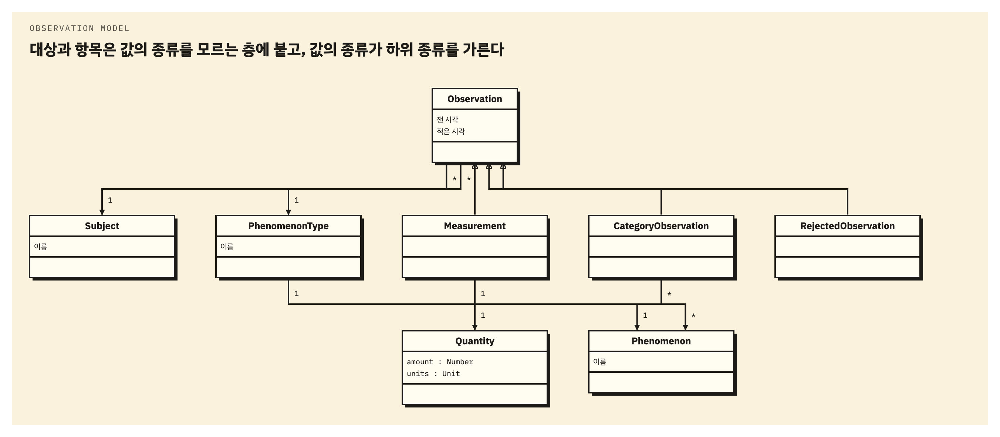

# Observation — 값이 무엇이든 사실 한 벌로 다루는 층 하나

## 한눈에 보는 개요

병동 기록 프로그램이 환자 한 사람의 수축기 혈압은 기록 한 건으로 잘 남기고 있다고 해 봅시다. 9월 1일 118 mmHg 가 기록 `o-1` 로 저장됐고, 잰 날과 적은 날이 따로 붙어 있고, 잘못 적은 값은 지우지 않고 거부 표시로 남겨요. 그런데 같은 환자의 혈액형은 `Patient.bloodType` 칸에 문자열 `"A"` 로 들어 있습니다. 흡연 여부도 칸 하나예요. 문제는 셋입니다. "이 환자에 대해 우리가 아는 사실 전부" 를 물으면 기록 쪽과 칸 쪽을 따로 읽어 합쳐야 하고, 잘못 적은 혈액형은 거부할 자리가 없어 덮어쓰게 되고, 9월 2일에 우리가 알던 혈액형이 무엇이었는지는 아예 답이 없습니다.

Observation 의 해법은 **대상과 항목, 그리고 시각과 거부 같은 「값의 종류와 상관없는 것」을 한 층으로 올리고, 값의 생김새만 그 아래에서 나뉘게 하는 것**입니다. 크기가 오면 수치 관측이고 범주가 오면 범주형 관측인데, 둘이 같은 층을 쓰니까 조회도 거부도 한 벌로 끝나요.

```text
Before — 사실의 종류마다 모델이 따로일 때
  Measurement(p-7 · systolic · 118 mmHg · 잰 날 9/1 · 적은 날 9/1)    수치는 기록으로
  Patient { bloodType: "A" }                                        범주는 칸으로
  "이 환자에 대해 아는 것 전부?"   ──▶  두 곳을 따로 읽어 합친다
  잘못 적은 값을 거부              ──▶  기록 쪽에만 있다. 칸은 덮어쓴다

After — 값의 종류를 모르는 층이 하나 있을 때
  Observation(p-7 · systolic · [크기] 118 mmHg · 잰 날 9/1 · 적은 날 9/1)
  Observation(p-7 · abo      · [범주] A        · 잰 날 9/1 · 적은 날 9/1)
  "이 환자에 대해 아는 것 전부?"   ──▶  한 목록으로 돌아온다
  잘못 적은 값을 거부              ──▶  둘 다 같은 방식으로 거부된다
```

분류는 Fowler 『Analysis Patterns』(1997)의 관측·측정 계열이고, 함께 쓰는 패턴은 Measurement · Knowledge Level · Quantity 입니다(근거: Fowler *Analysis Patterns* 3장 「Observations and Measurements」 — 이 계열의 절들이 여기 모여 있습니다). 이웃 개념들이 서로 어떻게 놓이는지는 [참고 문서 「수량·측정·관측 모델」](../../reference/observation-model/observation-model-ref_v1.0.2.md)에 따로 정리돼 있어요. 이 글이 파고드는 것은 그 정리에서 맨 위에 놓인 **사실 한 층**입니다.

이 글은 시나리오 셋을 따라갑니다. 범주 사실 한 건이 기록되고 수치 사실과 함께 되읽히는 길, 항목이 늘고 잰 날과 적은 날이 다를 때 무엇이 바뀌는가, 잘못 적은 혈액형을 고치려 할 때 어느 단계에서 무엇이 어긋나는가. 끝까지 읽으면 어떤 모델을 Observation 이라고 불러도 되는지 필수 조건 다섯으로 판정할 수 있고, 그 조건을 다 갖추고도 관측이 아닌 기록이 무엇인지까지 가를 수 있게 됩니다.

## 패턴 자세히 들여다보기

### 시나리오 1 — 환자 p-7 의 혈액형이 A 라는 사실이 기록되고, 혈압과 함께 되읽히기까지

병동에 환자 p-7 이 있습니다. 9월 1일에 잰 수축기 혈압 118 mmHg 는 이미 관측 `o-1` 로 남아 있어요. 같은 날 혈액형 검사 결과가 A 로 나와서 이것도 남겨야 합니다. 나와야 하는 답은 둘입니다. 혈액형 사실이 기록 한 건으로 남는 것, 그리고 "환자 p-7 에 대해 우리가 아는 사실 전부" 조회가 **두 건을 한 목록으로** 답하는 것. 이 장면에는 다섯이 등장해요. 대상에 대한 사실 한 건인 Observation, 무엇에 대한 사실인지 답하는 PhenomenonType, 그 항목이 가진 통제된 범주 값 Phenomenon, 값 자리에 오는 크기 Quantity, 그리고 둘을 id 로 찾아 조립하는 창구 역할의 ObservationDesk 입니다. 이름은 여기서 한 구절씩만 소개하고 정식 정의는 개념 정리에서 해요.

1. **창구가 항목 id `pt-abo` 로 관측 항목을 찾습니다.** 항목을 코드의 이름이 아니라 데이터로 두었기 때문에 이 단계가 조회예요. 찾아 온 항목이 "abo" 라는 이름과 **이 항목의 값은 범주다** 라는 것, 그리고 그 범주 넷(A · B · O · AB)을 갖고 있습니다. 순서를 뒤집어 기록부터 만들면 없는 항목에 붙은 사실이 장부에 남고 나서야 걸려요.
2. **창구가 값의 생김새와 항목이 정한 종류를 맞춰 봅니다.** abo 는 범주 항목이라 값 자리에 범주가 와야 해요. 여기에 118 같은 크기를 넣으려 하면 이 단계가 막습니다. 값 자리가 아무거나 받는 한 칸이었다면 막을 기준 자체가 없었을 거예요.
3. **그 범주가 그 항목이 가진 범주인지 대조합니다.** `ph-A` 는 abo 의 범주 목록 안에 있으니 통과예요. 범주를 자유 문자열로 두었다면 이 대조가 없고, "A형" 과 "a형" 과 "Type A" 가 서로 다른 값으로 쌓입니다.
4. **창구가 대상 id `p-7` 과 항목 id `pt-abo` 와 값을 넘겨 관측 한 건을 만듭니다.** 세 자리가 다 채워진 채로만 만들어지게 하는 것이 여기서 지켜지는 불변식이에요. 값 자리에 온 것이 범주라서 이 관측은 **범주형 관측**이고, 크기가 왔다면 같은 자리에서 **수치 관측**이 됐을 겁니다. 달라지는 것은 값 자리 하나뿐이고 대상·항목·시각 자리는 그대로예요.
5. **조회가 대상 id 로 그 환자의 사실 전부를 모읍니다.** 돌아오는 것은 `abo A` 와 `systolic 118 mmHg` 두 줄이에요. 종류별로 두 번 묻지 않습니다. 대상으로 가는 연결이 값의 종류를 모르는 자리에 있으니, 한 번의 조회가 둘을 함께 답해요.

```text
단계   부르는 쪽 → 받는 쪽              넘기는 것                        돌아오는 것
 1     창구 → PhenomenonType            pt-abo                           abo · 범주 항목 · A B O AB
 2     창구 → PhenomenonType            값의 생김새(범주)                 항목이 정한 종류와 같다 → 통과
 3     창구 → PhenomenonType            ph-A                             abo 의 범주다 → 통과
 4     창구 → (new Observation)         p-7 · pt-abo · [범주] A · 9/1     관측 o-2
 5     조회 → 창구                       p-7                              abo A · systolic 118 mmHg
```

이 시나리오가 보여 준 것은 **값의 생김새만 다르고 나머지는 한 벌**이라는 것입니다. 4단계에서 범주가 왔기 때문에 범주형 관측이 됐지만, 그 판단이 바꾼 것은 값 자리 하나예요. 대상 연결도 항목 연결도 시각도 그대로입니다. 그래서 5단계의 조회가 두 종류를 함께 답할 수 있었어요. 그리고 1~3단계가 전부 조회와 대조였다는 점도 기억해 두면 좋습니다 — 항목과 범주를 데이터로 두었기 때문에 생긴 단계이고, 그 비용을 나중에 뒤의 「상황 설정」 표가 다시 짚습니다.

### 시나리오 2 — 항목이 하나 늘고, 잰 날과 적은 날이 다를 때

같은 병동에 흡연 여부(smoking)를 기록해 달라는 요구가 들어왔습니다. 값은 흡연함(smoker) 아니면 흡연하지 않음(non-smoker) 둘 중 하나예요. 그리고 이번에는 현장에서 바로 입력하지 못했습니다. 9월 1일에 확인한 "흡연하지 않음" 을 9월 3일에야 단말에 넣어요. 나와야 하는 답은 셋입니다. 항목 추가로 고친 타입이 0 개일 것, 9월 2일에 "지금 이 환자는 흡연자인가" 를 물으면 "없음" 이 나올 것, 9월 4일에 같은 질문을 하면 non-smoker 가 나올 것.

1. **새 항목 smoking 과 그 범주 둘을 데이터로 등록합니다.** 클래스도 enum 상수도 늘지 않아요. 항목 하나와 범주 둘이 값으로 들어가고, 관측 쪽 타입은 손대지 않습니다. 항목을 칸 이름으로 두었다면 이 단계가 필드 추가와 배포였어요.
2. **"흡연하지 않음" 을 값으로 적습니다.** 빈 칸으로 두는 것과 다릅니다. 빈 칸은 "아직 안 물어봤다" 와 "물어봤고 아니다" 를 가르지 못해요. 없음을 값 하나로 두어야 그 둘이 구분됩니다.
3. **관측이 시각을 둘 답니다 — 잰 날 9/1 과 적은 날 9/3.** 하나만 두면 둘 중 하나를 포기하게 돼요. 여기서 중요한 것은 이 두 자리가 **값의 종류를 모르는 층에 있다**는 것입니다. 그래서 범주 사실도 수치 사실과 똑같은 시각 구조를 씁니다. 시각을 수치 쪽에만 두었다면 범주 쪽에 같은 것을 한 벌 더 만들어야 했어요.
4. **9월 2일 기준 조회가 "없음" 을 답합니다.** 조회가 보는 것은 잰 날이 아니라 **적은 날**이에요. 9/1 에 확인한 값이라도 9/3 에 적혔으니 9/2 에는 우리 손에 없었습니다. 순서를 바꿔 잰 날로 걸렀다면 9/2 에 non-smoker 가 돌아오는데, 그날 아무도 그 값을 본 적이 없으니 거짓말이 돼요.
5. **9월 4일 기준 조회가 non-smoker 를 답합니다.** 같은 질문, 다른 기준 날짜입니다. 조회 하나가 "지금 아는 값" 과 "그때 알던 값" 을 함께 답하는 것이 두 시각을 따로 둔 이점이에요.

```text
                9/1 확인한 날    9/2 그날 알던 값       9/3 적은 날      9/4 그날 알던 값
smoking          유효 시작       없음 (아직 안 적힘)      기록됨          non-smoker
non-smoker       잰 날                                  적은 날
```

이 시나리오가 보여 준 것은 둘입니다. 하나는 **항목과 범주가 데이터라서 새 항목에 배포가 필요하지 않다**는 것이고, 다른 하나는 **값의 종류를 모르는 층에 시각을 두면 종류마다 그것을 다시 만들지 않아도 된다**는 것이에요. 여기서 헷갈리기 쉬운 포인트는 두 시각을 수치 사실만의 문제로 보는 것입니다. 혈액형처럼 좀처럼 바뀌지 않는 사실도 "그때 우리가 알던 혈액형" 을 물을 수 있어야 해요. 9/2 에 수혈을 결정했다면 그날 손에 있던 값이 무엇이었는지가 그 결정의 근거니까요.

### 시나리오 3 — 잘못 적은 혈액형 B 를 고치려 할 때 어느 단계에서 무엇이 어긋나는가

9월 3일에 혈액형을 다시 검사해 입력하다가 B 로 잘못 적었습니다. 관측 `o-4` 가 B 로 남았고, 그 값을 보고 수혈 준비가 바뀌었어요. 9월 4일에 오기를 발견합니다. 나와야 하는 답은 "지금 환자 p-7 의 혈액형은 A" 이면서, 동시에 "9월 3일에는 B 가 있었다" 가 남아 있는 것입니다.

1. **값만 고치려 하면 — 관측의 범주 참조를 B 에서 A 로 바꿉니다.** 조회는 곧바로 맞는 답을 냅니다. 그런데 9월 3일의 수혈 준비 기록 옆에 남은 근거가 A 형이 되어, 맞는 값을 보고 준비를 바꾼 꼴이 돼요. 무엇이 왜 일어났는지 설명할 수 없는 상태가 조용히 만들어집니다.
2. **지우려 하면 — 관측 `o-4` 를 통째로 없앱니다.** 이번에는 근거가 아예 사라져요. 1단계보다 나은 것 같지만 같은 문제입니다.
3. **거부로 남기면 — 값은 그대로 두고 관측에 거부 표시를 붙입니다.** 사유("오기")와 거부한 날(9/4)이 함께 붙고, `o-4` 의 값은 B 그대로예요. 다시 확인한 A 형은 `o-4` 를 고친 것이 아니라 **새 관측 `o-5`** 로 기록됩니다. 여기서 눈여겨볼 것은 거부 표시가 **값이 아니라 관측 자체에** 붙는다는 점이에요. 그래서 혈액형이든 수축기 혈압이든 같은 코드로 거부됩니다.
4. **대상 연결을 종류마다 따로 두면 — 수치 사실과 범주 사실이 각각 자기 대상 연결·시각·거부 표시를 갖게 됩니다.** 그러면 시나리오 1 의 5단계가 한 번에 답했던 "이 환자의 사실 전부" 가 두 모델을 합치는 일이 되고, 거부 판정도 두 벌이 돼요. 한쪽만 고치면 같은 9/30 질문에 병동 단말은 A 를, 통계 화면은 B 를 답합니다.
5. **아직 이루지 않은 목표를 같은 표에 표시 없이 적으면** — "smoking = non-smoker" 줄이 하나 더 생기는데, 이건 확인한 사실이 아니라 연말까지 맞추려는 목표예요. 모양만 보면 3단계의 관측과 구별되지 않습니다. 그러면 "이 환자는 흡연자인가" 조회가 확인한 사실과 맞추려는 목표를 섞어서 답해요. 관측한 값인지 계획한 값인지를 기록이 스스로 밝혀야 조회가 둘을 가릅니다.
6. **항목 밖의 범주를 넣으려 하면 — smoker 를 혈액형 자리에 넣습니다.** 시나리오 1 의 3단계가 이것을 막아요. 막지 않으면 "혈액형 = smoker" 라는 줄이 남고, 그 줄은 어느 조회에서도 뜻이 없습니다.
7. **그 날 기준 조회가 거부 시각까지 봅니다.** 9/3 기준으로 물으면 B 가 돌아와요 — 그날은 아직 거부되기 전이니까요. 9/30 기준으로 물으면 A 가 돌아옵니다. 거부를 삭제로 처리했다면 9/3 기준 조회가 "없음" 을 답해서, 그날 실제로 있었던 일과 어긋나요.

```text
지우는 방식    9/3 abo B ──삭제──▶ (없음)                     수혈 준비의 근거가 사라진다
고치는 방식    9/3 abo B ──수정──▶ A                          준비가 맞는 값에서 나온 꼴이 된다
거부하는 방식  9/3 abo B ──거부──▶ 거부 표시(오기 · 9/4)        "그때는 이 값이 있었다" 가 남는다
                                  9/3 abo A (o-5)            다시 확인한 값은 새 관측으로 기록된다
```

이 시나리오가 보여 준 것은 **고친 흔적도 값의 종류를 가리지 않는다**는 것입니다. 3단계의 거부 표시는 혈액형에 붙었지만 수축기 혈압에 붙는 것과 같은 표시예요. 4단계가 그 이유를 거꾸로 보여 줬고요 — 대상 연결·시각·거부 표시가 값의 종류를 모르는 한 자리에 있기 때문입니다. 그리고 5단계에서 확인된 것이 하나 더 있습니다. 세 자리를 갖춘 모양만으로는 확인한 사실과 맞추려는 목표가 구별되지 않아요. 그 구별은 자리를 하나 더 두어서 하는데, 최소 조건 절이 그 자리를 다시 짚습니다.

### 개념 정리

시나리오에 나온 분석 층위의 개념 여덟을 정식으로 정의합니다. 이 절이 정하는 것은 개념이 무엇을 책임지고 누구와 협력하는가까지예요. 그 책임을 코드의 어느 객체가 지는지, 무엇이 aggregate 의 root 인지는 뒤의 「상황 설정」 표가 정합니다.

- **Observation**(관측) — 대상 하나에 대한 사실 한 건이고, 이 글이 다루는 층입니다.
  - 책임: 누구에 대한 사실인가, 무엇에 대한 사실인가, 그리고 언제의 사실이고 언제 적혔으며 거부됐는가를 답합니다. **값이 어떻게 생겼는지는 이 층의 일이 아니에요**(시나리오 1 의 4단계, 시나리오 3 의 4단계).
  - 협력: 대상 하나와 PhenomenonType 하나를 가리킵니다. 같은 대상·항목·값을 가진 관측 둘도 서로 다른 사실이에요 — 같은 날 두 번 확인했으면 관측도 두 건입니다.
- **Measurement**(수치 관측) — 값 자리에 크기가 온 관측입니다. `p-7 · systolic · 118 mmHg` 가 하나예요.
  - 책임: 크기 하나를 값으로 가집니다. 그 값이 무엇으로 셌는지를 값 안에 두는 것과 단위가 다를 때의 처리는 [Measurement 가이드](../measurement/measurement-guide_v1.0.1.md)와 [Quantity 가이드](../quantity/quantity-guide_v1.1.1.md)의 몫이에요(시나리오 1 의 5단계).
  - 협력: Observation 의 한 종류라서 대상 연결·항목 연결·시각을 물려받고, 값 자리로 Quantity 하나를 담습니다.
- **CategoryObservation**(범주형 관측 · 원전이 적은 이름은 Category Observation) — 값 자리에 범주가 온 관측입니다. `p-7 · abo · A` 가 하나예요.
  - 책임: 통제된 범주 값 하나를 값으로 가집니다. 더하거나 크기를 비교하는 것이 뜻이 없는 사실이 여기로 와요(시나리오 1 의 4단계).
  - 협력: Observation 의 한 종류이고, 값 자리로 Phenomenon 하나를 가리킵니다.
- **RejectedObservation**(거부된 관측) — 틀렸다고 판정된 관측입니다. 지우는 대신 거부됐다는 표시가 붙은 종류로 바뀌어요.
  - 책임: 값을 그대로 둔 채 사유와 거부한 시각을 답니다. 한 번 거부된 것은 다시 거부되지 않아요(시나리오 3 의 3단계).
  - 협력: Observation 의 한 종류라서 수치 관측이든 범주 관측이든 같은 방식으로 거부됩니다. 지우지 않는 이유는 [참고 문서 「수량·측정·관측 모델」](../../reference/observation-model/observation-model-ref_v1.0.2.md)의 「Rejected Observation」 절에 있어요.
- **Subject**(대상) — 사실이 그것에 대해 적히는 쪽입니다. 이 예제에서는 환자예요.
  - 책임: 식별자로 자기를 구별합니다. 자기에게 붙은 관측을 자기가 갖고 있을 필요는 없어요 — 그 선택지는 「상황이 달라지면」이 나란히 둡니다.
  - 협력: 대상 하나에 관측이 여럿 붙습니다. 그 연결이 값의 종류를 모르는 층에 붙어 있다는 것이 이 패턴의 핵심이에요(시나리오 1 의 5단계).
- **PhenomenonType**(관측 항목) — 무엇에 대한 사실인가를 답하는 개념입니다. 혈액형 · 흡연 여부 · 수축기 혈압이 각각 하나씩이에요.
  - 책임: 항목의 이름을 갖고, 그 항목의 값이 크기인지 범주인지를 정합니다. 크기 항목이면 허용 단위를, 범주 항목이면 그 항목이 쓰는 범주 목록을 가져요(시나리오 2 의 1단계).
  - 협력: 항목 하나에 관측이 여럿 붙습니다. 이렇게 "사실" 과 "사실의 종류" 를 두 무리로 가르는 방식 자체는 [Knowledge Level 가이드](../knowledge-level/knowledge-level-guide_v1.0.1.md)가 패턴으로 다뤄요.
- **Phenomenon**(범주 값) — 범주 항목이 쓰는 값 하나입니다. 혈액형의 A · B · O · AB 가 각각 하나예요.
  - 책임: 통제된 값으로 자기를 구별합니다. 문자열이 아니라 모델이 가진 값이라서, 같은 것을 두 이름으로 적는 일이 생기지 않아요(시나리오 1 의 3단계).
  - 협력: 범주 값 하나는 항목 하나에 속하고, 항목 하나가 범주 값 여럿을 가집니다.
- **Quantity**(크기) — 수치와 단위를 한 값으로 묶은 것입니다. 118 mmHg 가 하나예요.
  - 책임: 수치가 무엇으로 셌는지를 값 안에 담습니다. 단위가 다른 값끼리의 계산과 환산은 [Quantity 가이드](../quantity/quantity-guide_v1.1.1.md)의 몫이고, 이 글에서는 값 자리에 오는 것이 그것이라는 데까지가 필요해요(시나리오 1 의 2단계).
  - 협력: 수치 관측 하나가 크기 하나를 담습니다.



그림의 한가운데 위에 있는 Observation 칸에서 선이 아래로 여러 갈래 나갑니다. 왼쪽 둘은 대상과 항목으로 가는 연관이고, 오른쪽 셋은 하위 종류입니다. 여기서 봐야 할 것은 **대상으로 가는 선과 항목으로 가는 선이 Measurement 나 CategoryObservation 이 아니라 Observation 에 붙어 있다**는 것이에요. 두 시각이 Observation 칸 안에 속성으로 적혀 있는 것도 같은 이유고요. 값을 가리키는 선만 아래쪽 두 칸에서 각각 나갑니다 — 수치 관측은 Quantity 로, 범주형 관측은 Phenomenon 으로(근거: Fowler *Analysis Patterns* 3장 §3.5 의 그림 3.7 과 그림 3.9 · §3.8 의 그림 3.11 · §3.9 의 그림 3.12). 맨 아래 줄의 Phenomenon 에는 선이 둘 들어옵니다. 하나는 그것을 값으로 쓰는 범주형 관측에서, 다른 하나는 그것을 소유한 항목에서요. 분석 모델은 연관만 정할 뿐 누가 관측을 소유하는지는 정하지 않아요. 소유는 설계가 정하고, 그 선택지 넷은 「상황이 달라지면」에서 나란히 봅니다.

## 사용 목적

이 패턴이 필요하다는 단서는 업무 요구나 기존 모델에서 **눈으로 확인할 수 있는 것**이어야 합니다. 아래 넷 중 하나라도 보이면 사실의 층을 하나로 모을 때예요.

- **측정값은 기록으로 잘 쌓고 있는데, 소견·등급·상태 같은 범주 사실은 대상의 칸이거나 다른 표에 따로 있다.** 이것이 가장 흔한 단서입니다. 시나리오 1 의 5단계가 답한 조회를 두 번 던지고 있는 상태예요.
- **"이 대상에 대해 아는 것 전부" 를 내는 코드가 두 곳을 읽어 합치고, 그 합치는 코드가 화면마다 조금씩 다르다.** 시나리오 3 의 4단계가 그 장면입니다.
- **잘못 적은 수치는 거부 표시로 남기는데, 잘못 적은 범주는 덮어쓴다.** 거부가 값에 붙어 있고 사실에 붙어 있지 않다는 뜻이에요.
- **범주 값이 화면마다 다른 문자열로 저장돼 있고, 목록을 만들려면 `DISTINCT` 로 뽑아 봐야 한다.** 범주가 통제되지 않고 있다는 뜻입니다.

반대로 **쓰지 말아야 할 때**도 있습니다. 다루는 사실이 한 종류뿐이고 앞으로도 그럴 계획이면, 그 종류에 맞는 기록 한 층으로 충분해요. 수치만 다룬다면 [Measurement 가이드](../measurement/measurement-guide_v1.0.1.md)의 모델이 그것이고, 이 패턴을 적용하면 값 자리가 합타입이나 하위 타입이 되면서 값을 꺼내 쓰는 자리마다 종류를 가르는 분기가 하나씩 붙습니다. 그 대가로 막아 주는 것이 아직 없으면 손해예요. 범주가 두셋으로 고정이고 이력도 근거도 필요 없다면 그냥 enum 필드가 낫습니다.

```text
보이는 단서                                      고를 모델
사실이 한 종류(수치)뿐이고 늘 계획이 없다            기록 한 층(Measurement)
범주가 두셋 고정이고 이력·근거가 필요 없다           enum 필드
값의 종류가 둘 이상이고 조회·거부를 함께 해야 한다    사실 한 층(Observation)
기록들이 합해져 잔액을 만든다                       Account 의 Entry
```

비슷한 단서에서 다른 모델을 고르게 되는 경우도 있어요. 기록들이 합해져서 잔액 하나를 설명해야 하거나, 기록이 "대상이 지금 어떠한가" 가 아니라 일어난 일이나 해야 할 일을 말한다면 다른 패턴입니다. 그 차이는 바로 다음 절에서 풉니다.

## 패턴의 경계

### 디자인 패턴을 충족하는 최소 조건

어떤 모델을 Observation 이라고 불러도 되는지 가르는 기준입니다. 클래스 모양이 아니라 개념이 맡는 책임과 모델이 늘 지키는 불변식으로 판정해요. `[필수]` 에는 **원전이 이 패턴의 성립 요건으로 적어 둔 것만** 올렸고, 원전이 따로 절을 떼어 다룬 것과 이 가이드 예제의 정책은 번호 순서와 무관하게 `[선택]` 입니다. 이 패턴의 근거는 대부분 **모델 그림**이라, 조건마다 그림이 무엇을 선언한 것인지(모델의 전후 대조 · 구조 선언 · 속성 타입 선언 · 다중도 선언)를 함께 적었어요.

1. [필수] **대상에 대한 사실 하나가 대상의 속성이 아니라 독립된 기록이다** — 사실 하나를 남기는 일이 대상 객체의 칸을 덮어쓰는 일이 아니고, 기록 하나만으로도 그것이 누구에 대한 것인지 답할 수 있습니다. 시나리오 1 의 4단계가 이 자리예요. (근거: Fowler *Analysis Patterns* 3장 §3.1 과 §3.5 — §3.1 의 그림 3.1 과 3.2 가 키·몸무게·혈당을 Person 의 속성으로 두었던 모델을, §3.5 의 그림 3.7 이 Person 과 Observation 을 잇는 연관으로 바꾸고 Person 에서 그 속성들을 지웁니다. 그림이 잇달아 놓인 **모델의 전후 대조**가 이 조건의 자격입니다)
   - 빠지면: `Patient.bloodType` 칸이 됩니다. 시나리오 3 의 1단계처럼 새 값이 옛 값을 덮어써서, 9/3 에 있던 B 를 9/30 에 물으면 답이 없어요.
   - 위 근거 괄호가 받쳐 주는 것은 **사실이 대상의 속성 자리에서 나와 자기 기록이 된다**까지입니다. 그 기록을 어느 aggregate 가 소유하는지는 그림이 정하지 않아요 — 그 선택지는 「상황이 달라지면」이 나란히 둡니다.
2. [필수] **대상 연결이 값의 종류를 고정하지 않는 자리에 붙는다** — 「누구에 대한 사실인가」를 답하는 자리가 값이 크기인지 범주인지를 정하지 않아서, 값의 종류가 하나 더 늘어도 대상 연결을 한 벌 더 만들지 않습니다. 시나리오 1 의 5단계와 시나리오 3 의 4단계가 이 자리예요. (근거: Fowler *Analysis Patterns* 3장 §3.5 — 그림 3.7 이 Person 에서 오는 연관 `1` — `*` 를 **상위 타입 Observation** 에 연결하고, 값(`quantity : Quantity`)은 하위 타입 Measurement 에만 둡니다. 대상 연결을 위에, 값을 아래에 나눠 그린 **구조 선언**과 그 **다중도 선언**이 자격입니다)
   - 빠지면: 수치 사실과 범주 사실이 각각 자기 대상 연결을 가진 두 모델이 됩니다. 시나리오 3 의 4단계처럼 "이 환자의 사실 전부" 조회가 둘을 합쳐야 하고, 거부 판정도 두 벌이 돼요. 값이 **크기** 한 종류뿐인 모델이라면 그것은 [Measurement 가이드](../measurement/measurement-guide_v1.0.1.md)가 다루는 기록 한 층이고, 아직 이 패턴은 아닙니다. 범주 한 종류뿐인 모델도 같은 자리에서 걸리는데, 그쪽은 그 편이 다루지 않아요.
   - 판정하는 법: 값을 가진 타입을 찾고, 대상 연결이 **그 타입이 값의 종류를 고정하는지**를 봅니다. 값 자리가 크기로 고정된 타입에 대상 연결이 함께 있으면 미충족이에요.
   - 위 근거 괄호가 받쳐 주는 것은 **대상 연결이 값의 종류를 고정하지 않는 자리에 붙는다**까지입니다. 그 자리를 상속 계층으로 만들지 값 자리를 합타입으로 둘지는 그림이 정하지 않아요 — 둘 다 이 조건을 채웁니다.
3. [필수] **값 자리가 아무거나 받는 한 칸이 아니라 종류마다 다른 자리다** — 크기는 크기 자리에, 범주는 범주 자리에 옵니다. 값의 생김새가 그 사실을 어느 종류로 볼지를 정해요. 시나리오 1 의 2단계가 이 자리입니다. (근거: Fowler *Analysis Patterns* 3장 §3.5 — 그림 3.7 이 Measurement 의 값 자리를 `quantity : Quantity` 라는 속성으로, Category Observation 의 값 자리를 Category 로 가는 `*` — `1` 연관으로 **서로 다르게** 선언합니다. **속성 타입 선언**과 **연관 선언**이 자격입니다)
   - 빠지면: `value_text` 한 칸에 `"118"` 과 `"A"` 와 `"높음"` 이 같이 들어갑니다. 시나리오 1 의 2단계에서 막힌 크기 값이 혈액형 자리에 그대로 들어가고, 값을 꺼내 쓰는 쪽마다 문자열을 다시 해석해야 해요.
   - 위 근거 괄호가 받쳐 주는 것은 **값 자리가 종류마다 다른 자리다**까지입니다. 종류를 정확히 둘로 두어야 하는지는 그림이 정하지 않아요 — 종류가 셋 이상인 모델도 이 조건을 채웁니다.
4. [필수] **범주 값이 통제된 지식 층위 객체다** — 범주 자리에 오는 것이 자유 문자열이 아니라 모델이 가진 값이고, 그 값이 어느 항목의 것인지를 모델이 답합니다. 시나리오 1 의 3단계와 시나리오 3 의 6단계가 이 자리예요. (근거: Fowler *Analysis Patterns* 3장 §3.5 — 그림 3.7 이 Category Observation 을 Category 클래스와 `*` — `1` 로 잇고, 같은 장의 그림 3.9 가 그 자리를 Phenomenon 으로 정교화하면서 Phenomenon Type `1` — `*` Phenomenon 을 둡니다. **연관 선언**과 **다중도 선언**이 자격입니다)
   - 빠지면: "A형" 과 "a형" 과 "Type A" 가 섞인 문자열 칸이 됩니다. 시나리오 3 의 6단계가 막아 준 "혈액형 = smoker" 도 그대로 들어가요.
   - 위 근거 괄호가 받쳐 주는 것은 **범주 값이 모델이 가진 객체이고 항목에 속한다**까지입니다. 그 객체를 어디에 둘지 — 이 경계 안에 둘지 외부 코드 체계에 맡길지 — 는 그림이 정하지 않아요. 그 선택지는 「상황이 달라지면」 4행입니다.
5. [필수] **무엇에 대한 사실인가가 기록의 모양이 아니라 지식 층위의 데이터다** — 새 항목을 하나 더하는 일이 타입·칸·enum 상수를 더하는 일이 아니라 데이터를 하나 더하는 일입니다. 시나리오 2 의 1단계가 이 자리예요. (근거: Fowler *Analysis Patterns* 3장 §3.4 와 §3.5 — §3.5 의 그림 3.7 이 Phenomenon Type 을 Observation 의 **연관 상대**로 두어 항목 하나에 관측 여럿이 붙게 하고, §3.4 의 그림 3.6 이 지식·운영 구분선을 그어 그 항목을 지식 쪽에 올립니다. **구조 선언**과 **다중도 선언**이 자격입니다)
   - 빠지면: 혈액형 칸·흡연 칸·혈압 칸이 늘어나는 표가 됩니다. 시나리오 2 의 1단계에서 고친 타입이 0 개였던 자리가 여기서는 배포 한 번이 돼요.
   - 위 근거 괄호가 받쳐 주는 것은 **항목이 지식 층위의 데이터다**까지입니다. 그 항목 연결이 상위 층에 붙는지 종류마다 따로 붙는지는 그림이 한 가지로 정하지 않아요 — 뒤 그림들은 그 선을 하위 종류 쪽으로 내려 그리기도 합니다. 이 예제가 상위 층에 둔 것은 이 가이드의 배치예요.
6. [선택] **없음도 사실로 적는다** — "흡연하지 않음" 처럼 부재를 빈 칸이 아니라 값 하나로 둡니다. 시나리오 2 의 2단계가 이 자리예요. (근거: Fowler *Analysis Patterns* 3장 「Observations and Measurements」 — 그림 3.10 이 Category Observation 의 하위 타입으로 Absence 와 Presence 를 둡니다. 그 그림이 3장의 어느 절에 속하는지는 확인하지 못해 절 번호를 대지 않습니다)
   - 빠지면 잃는 것: "아직 안 물어봤다" 와 "물어봤고 아니다" 의 구별입니다. 둘 다 빈 칸이 되면 통계가 분모를 잘못 잡아요.
7. [선택] **잰 시각과 적은 시각을 따로 둔다** — 사실이 유효한 시각과 그 사실을 적은 시각을 두 자리로 둡니다. 시나리오 2 의 3~5단계 전체가 이 조건이 있을 때의 모양이에요. (근거: Fowler *Analysis Patterns* 3장 §3.8 Dual Time Record — 그림 3.11 이 Observation 에서 Time Record 로 가는 연관을 **둘** 그리고 각각에 recording time · applicability 이름을 붙입니다. 그 연관이 하위 종류가 아니라 Observation 에 붙어 있다는 것이 이 자리가 이 층인 이유예요)
   - 빠지면 잃는 것: "그때 알던 값" 을 묻는 길입니다. 시나리오 2 의 4단계가 답한 9/2 의 "없음" 이 non-smoker 로 바뀌어, 그날 아무도 본 적 없는 값이 그날의 답이 돼요.
8. [선택] **잘못 적은 사실을 지우지 않고 거부 표시로 남긴다** — 틀린 관측의 값을 그대로 둔 채 거부 표시를 붙이고, 다시 확인한 값은 새 관측으로 만듭니다. 시나리오 3 의 3단계와 7단계가 이 자리예요. (근거: Fowler *Analysis Patterns* 3장 §3.9 Rejected Observation — 그림 3.12 가 Rejected Observation 을 Observation 의 하위 타입으로 두고 그 일반화에 «dynamic» 표기를 붙여, 관측이 나중에 그 종류로 옮겨 가는 것으로 그립니다. 하위 타입이 되는 자리가 Observation 이라서 수치 관측과 범주 관측이 같은 방식으로 거부돼요)
   - 빠지면 잃는 것: 그 값을 쓴 다른 기록의 설명입니다. 시나리오 3 의 1·2단계가 그 값이에요.
9. [선택] **관측한 값인지 계획한 값인지를 기록이 밝힌다** — 이미 확인한 사실과 앞으로 맞추려는 목표가 같은 모양으로 쌓이므로, 둘을 가르는 표시를 관측에 답니다. 시나리오 3 의 5단계가 표시가 없을 때의 모양이에요. (근거: Fowler *Analysis Patterns* 4장 「Observations for Corporate Finance」 — 그림 4.11 이 Observation 에 Status Type 을 `*` — `1` 로 붙이고 그 하위 타입을 Actual 과 Planned **둘로** 둡니다. 같은 그림에서 Measurement 가 Observation 의 하위 타입이라 그 표시를 함께 물려받아요)
   - 빠지면 잃는 것: 조회의 신뢰입니다. 시나리오 3 의 5단계처럼 "이 환자는 흡연자인가" 하나가 확인한 사실과 목표를 섞어서 답해요.
10. [선택] **관측이 다른 관측의 근거로 지목된다** — 어떤 사실이 어떤 사실들을 보고 내려졌는지를 모델이 답합니다. 시나리오 3 의 1단계가 그 연결이 없을 때의 모양이에요 — 수혈 준비는 모델 밖이라, 어떤 관측을 보고 바뀌었는지 모델이 답하지 못합니다. (근거: Fowler *Analysis Patterns* 3장 §3.11 Associated Observation — 그림 3.14 가 Associated Observation 에 evidence `1..*` Observation 을 붙이고, 같은 장의 그림 3.8 이 Observation 사이에 evidence 와 assessment 두 연관을 둡니다)
    - 빠지면 잃는 것: 거부가 번질 자리입니다. 근거 하나가 거부됐을 때 그 근거로 내려진 판정을 다시 볼 길이 없어요.
11. [선택] **측정값에서 범주를 도출한다** — 범주를 사람이 고르는 대신 크기가 어느 범위에 드는지로 정합니다. 시나리오 1 의 5단계가 함께 답한 118 mmHg 옆에 "정상" 이라는 범주 사실을 사람이 또 적어 넣지 않아도 돼요. (근거: Fowler *Analysis Patterns* 4장 §4.4 Phenomenon with Range — 그림 4.22 가 Phenomenon 에 Range 를 `0..1` 로 붙이고, 같은 항목의 범위들이 서로 겹치지 않으며 그 항목의 모든 값을 덮어야 한다는 제약 둘을 답니다)
    - 빠지면 잃는 것: 두 사실이 어긋날 자리를 막는 것입니다. 118 mmHg 는 그대로인데 등급만 "높음" 으로 남는 일이 생겨요. 범위 자체를 값으로 다루는 법은 [Range 가이드](../range/range-guide_v1.0.1.md)가 맡습니다.

> 필수는 다섯이다 — 사실이 독립된 기록인가, 대상 연결이 값의 종류를 고정하지 않는 자리에 있는가, 값 자리가 종류마다 다른가, 범주가 통제된 객체인가, 항목이 지식 층위 데이터인가. 다섯을 다 갖추고도 관측이 아닌 것이 있으니, 비교 절의 마지막 기준을 함께 본다.

```text
판정 순서                                       아니면 그것은
1  사실이 대상의 칸이 아니라 독립된 기록인가?   ──▶  대상의 속성
2  대상 연결이 값의 종류를 고정하지 않는가?     ──▶  기록 한 층(수치만 다루는 모델)
3  값 자리가 종류마다 다른 자리인가?            ──▶  아무거나 담는 한 칸
4  범주가 통제된 지식 객체인가?                 ──▶  자유 문자열 범주
5  항목이 지식 층위 데이터인가?                 ──▶  항목마다 칸 하나인 표
다섯을 다 지나도 — 대상에 대한 서술이 아니면    ──▶  이벤트 · 감사 로그 · 지시
```

조건 1 과 5 는 [Measurement 가이드](../measurement/measurement-guide_v1.0.1.md)의 조건 1·2 와 같은 것을 한 층 위에서 말합니다 — 상위 개념의 조건이니 그 하위 종류도 같이 져요. 이 편에서 새로 생기는 조건은 2·3·4 이고, 그중 **2 가 Measurement 하나만 있는 모델과 이 패턴을 가릅니다.** 그 편이 `[선택]` 으로 둔 「범주형 사실과 공통 상위」가 여기서는 `[필수]` 가 된 것이고, 두 편이 어긋난 것이 아니라 각자 자기 층의 성립 요건을 적은 거예요.

그리고 조건 다섯이 가려 주는 것은 **기록이 관측의 모양을 갖췄는가**까지입니다. 그 모양을 갖추고도 관측이 아닌 것이 있어요. 이벤트 소싱의 이벤트 한 줄이 그렇습니다 — 대상 id 와 종류와 두 시각을 갖고, 종류마다 다른 페이로드를 담은 합타입이고, 종류 목록이 데이터로 관리되기도 합니다. 조건 다섯을 그대로 통과해요. 다른 점은 **그 기록이 대상에 대한 서술인가**입니다. 관측은 "대상이 이러하다" 를 말하고, 이벤트는 "무슨 일이 일어났다" 를, 지시는 "무엇을 해야 한다" 를 말해요. 그래서 같은 대상·같은 항목의 관측 둘은 같은 것을 두 번 확인한 것이지만, 같은 대상·같은 종류의 이벤트 둘은 서로 다른 두 사건입니다. 이 구분은 조건으로 기계가 가를 수 없어서 비교 절이 맡고, 아래 첫 표의 마지막 행이 그 자리예요.

### 비슷한 패턴·안티패턴과의 차이

| 비교 대상 | 구분 기준 | Observation 을 고르면 얻는 것 | 포기하는 것 |
| --- | --- | --- | --- |
| 수치만 다루는 기록 한 층(Measurement 단독) | 대상 연결을 가진 자리가 값의 종류를 고정하는가 | 범주 사실이 같은 조회·같은 거부를 쓴다 | 값을 꺼내는 자리마다 종류를 가르는 분기가 하나씩 붙는다 |
| 범주에 코드 번호를 붙여 크기 자리에 넣은 표 | 값 자리의 것이 더하고 비교하는 것이 뜻을 갖는가 | 더할 수 없는 것을 더하는 코드가 생기지 않는다 | 값 자리가 하나로 통일되지 않아 저장 스키마가 복잡해진다 |
| enum 상수나 자유 문자열로 둔 범주 | 범주 값이 지식 층위의 데이터인가 코드의 이름인가 | 범주가 늘어도 배포가 없고, 같은 것을 두 이름으로 적지 않는다 | 범주 하나를 쓰는 데 조회가 한 번 더 붙는다 |
| EAV(Entity–Attribute–Value) 표 | 항목과 값이 뜻을 가진 모델 요소인가, 이름 칸과 문자열 칸인가 | 항목이 규칙을 가질 수 있고 값이 종류를 가진다 | 한 표에 아무거나 담는 자유를 잃는다 |
| 대상에 대한 서술이 아닌 기록(도메인 이벤트 · 감사 로그 · 지시) | 기록이 「대상이 이러하다」를 말하는가, 일어난 일이나 해야 할 일을 말하는가 | 같은 대상·항목의 기록들이 한 질문의 답 후보로 모인다 | 무엇이 그 사실을 만들었는지도, 무엇을 해야 하는지도 이 모델이 답하지 않는다 |

**수치만 다루는 기록 한 층과의 차이.** 구분 기준은 대상 연결을 가진 자리가 값의 종류를 고정하는가입니다. 이것이 이 편에서 가장 헷갈리는 자리예요. 수치 관측 하나는 그 자체로 관측이지만, **수치 관측만 있는 모델은 아직 이 패턴이 아닙니다.** 개념과 층을 구분하면 알 수 있습니다 — 118 mmHg 기록이 관측이라는 것은 그 기록이 이미 가진 성질이고, 모델이 이 패턴을 갖췄는지는 그 성질이 **놓일 자리가 모델에 있는가**의 문제예요. 아래 두 모양이 그 차이입니다.

```text
아직 아니다    Measurement { subjectId, typeId, quantity: Quantity, 잰 날, 적은 날 }
              └ 대상 연결이 「값은 크기다」 를 고정한 타입에 함께 있다
              └ 범주 사실을 들이려면 subjectId·시각·거부를 한 벌 더 만든다

이 패턴이다    Observation { subjectId, typeId, value: 크기 | 범주, 잰 날, 적은 날 }
              └ 대상 연결이 값의 종류를 모르는 자리에 있다
              └ 값 종류를 하나 더 들이는 일이 value 자리의 일로 끝난다
```

시나리오 3 의 4단계가 위쪽 모양으로 갔을 때 무엇이 어긋나는지를 보여 줬어요. 얻는 것은 조회와 거부가 한 벌이라는 것이고, 포기하는 것은 값을 꺼내는 자리마다 종류를 가르는 분기예요. 수치만 다루는 도메인이라면 그 분기는 순수한 손해입니다.

**범주에 코드 번호를 붙인 표와의 차이.** 구분 기준은 값 자리의 것이 더하고 크기를 비교하는 것이 뜻을 갖는가입니다. 이 모양은 값 자리를 하나로 통일하고 싶어서 나와요.

```java no-compile
// 혈액형을 코드 숫자로 적어 크기 자리에 맞춘 것
record BloodTypeRow(String patientId, String item, int amount, String unit) {}
// new BloodTypeRow("p-7", "abo", 1, "code")  →  1 + 1 = 2 는 어떤 혈액형인가?
```

네 자리를 다 갖췄지만 `1` 은 크기가 아니라 A 형을 가리키는 표예요. 둘을 더한 `2` 가 어떤 혈액형도 아니라는 것이 판정의 근거입니다. 조건 3 을 충족하지 못해요 — 값 자리가 종류마다 다른 자리가 아니라 크기 자리 하나뿐이니까요. 시나리오 1 의 2단계가 막아 준 것이 정확히 이것입니다.

**enum 상수나 자유 문자열로 둔 범주와의 차이.** 구분 기준은 범주 값이 지식 층위의 데이터인가 코드의 이름인가입니다. `enum BloodType { A, B, O, AB }` 는 시나리오 1 의 3단계가 한 대조를 컴파일러가 대신 해 주므로 안전해 보여요. 차이는 범주가 늘어날 때 생깁니다. 혈액형은 넷으로 끝나지만 소견 코드는 수천 개이고 해마다 바뀌어요. enum 은 그때마다 배포이고, 자유 문자열은 배포가 없는 대신 통제가 없습니다. 얻는 것은 배포 없는 확장과 통제를 함께 갖는 것이고, 포기하는 것은 범주 하나를 쓰는 데 조회가 한 번 더 붙는 것이에요.

```text
범주를 어디에 두는가           범주가 늘 때      통제하는 쪽
enum 상수                     배포 한 번        컴파일러
자유 문자열 칸                 배포 없음         없다
지식 층위 데이터(이 패턴)        행 하나          항목이 가진 범주 목록
```

**EAV 표와의 차이.** 구분 기준은 항목과 값이 뜻을 가진 모델 요소인가, 이름 칸과 문자열 칸인가입니다. `(entity_id, attribute_name, value_text)` 세 칸짜리 표는 구조가 닮았어요. 다른 점은 둘입니다. 하나는 항목이 규칙을 가질 수 있는가예요. 시나리오 1 의 1~3단계가 항목에게 종류와 범주를 물어본 자리가 EAV 에는 없습니다. 다른 하나는 값이 종류를 갖는가고요. 같은 첫 기준을 항목이 칸 이름인 표에 대 봐도 결과는 같아요. 거기서는 항목이 뜻을 가진 모델 요소가 아닐뿐더러 값조차 아니니까요(판단 — EAV 를 규정한 1차 출처는 확인하지 못했고, 이 비교는 그 이름으로 흔히 불리는 세 칸 표를 대상으로 합니다).

**대상에 대한 서술이 아닌 기록과의 차이.** 구분 기준은 기록이 "대상이 이러하다" 를 말하는가, 일어난 일이나 해야 할 일을 말하는가입니다. 앞 절이 예고한 반대 방향이 여기예요 — **필수 다섯을 다 통과하는데 관측이 아닌 기록**입니다.

```text
관측     p-7 · abo · A · 잰 날 9/1 · 적은 날 9/1      "이 환자의 혈액형은 A 다"
이벤트   p-7 · BloodTypeRecorded · {A} · 9/1 · 9/1    "9/1 에 혈액형이 기록되는 일이 일어났다"
지시     p-7 · transfusion · {A} · 9/1 · 9/1          "A 형을 투여하라"

같은 대상·항목의 관측 둘   ──▶  같은 질문의 답 후보. 나중 것이 앞선다
같은 대상·종류의 이벤트 둘 ──▶  서로 다른 두 사건. 둘 다 일어났다
```

모양으로는 구분되지 않습니다. 구분 기준은 그 기록이 대답하는 질문이에요. 관측은 "지금 이 대상은 어떠한가" 에 답 하나를 내는 후보로 쌓이고, 이벤트는 그 답을 내는 것이 목적이 아니라 일어난 일을 빠짐없이 남기는 것이 목적입니다. 그래서 관측 모델에는 그 날 기준으로 하나를 고른다는 개념이 있고(시나리오 2 의 4·5단계가 그것이었어요) 이벤트 로그에는 없습니다. 감사 로그도 같은 갈래예요. 누가 무엇을 했다는 것은 대상에 대한 사실이 아니라 행위의 기록이니까요. 지시나 처방도 마찬가지입니다. "A 형을 투여하라" 는 환자가 어떠한지를 말하지 않고 누군가가 무엇을 해야 하는지를 말해요 — 관측한 값인지 계획한 값인지를 밝히는 `[선택]` 9 로도 안 덮입니다. 계획한 값은 여전히 대상이 앞으로 어떠할 것이라는 서술이지만, 지시는 대상이 아니라 행위자를 향하니까요. 얻는 것과 포기하는 것이 정확히 맞바꿔집니다. 관측을 고르면 지금 아는 값이 무엇이냐는 물음에 모델이 답해 주고, 무엇이 그 사실을 만들었는지는 모델 밖으로 나가요.

## 구현 예시

### 상황 설정

시나리오 1·2·3 의 병동 장면을 세 언어로 똑같이 구현합니다. 도메인은 그대로예요. 병원 한 곳의 임상 관측 기록 프로그램이고, 관측 항목마다 항목 정의가 하나 있으며 사실 한 건마다 관측 하나가 생겨요. 항목은 값이 크기인지 범주인지를 정하고, 크기 항목은 허용 단위 하나를, 범주 항목은 그 항목이 쓰는 범주 목록을 가집니다. 요청마다 달라지는 것은 항목과 값, 그리고 잰 날과 적은 날이에요.

고정인 것도 정해 둡니다. 크기의 수치는 정수이고, 날짜는 `2026-09-01` 같은 ISO 하루 표기입니다. 이 표기를 고른 이유는 **문자열 순서가 날짜 순서와 같기 때문**이고, 그래서 세 언어가 달력 라이브러리 없이 같은 비교를 써요. 관측은 만들어진 뒤 세 자리와 두 시각이 바뀌지 않고, 바뀔 수 있는 것은 거부 표시 하나뿐입니다. 거부는 한 번만 되고 되돌릴 수 없어요. 그리고 값 자리는 **합타입**으로 두었습니다 — 상속 계층으로 만들어도 조건 2·3 을 똑같이 채우는데, 합타입 쪽이 세 언어에서 같은 모양으로 쓰이고 공통 자리가 한 번만 적혀서 이 예제가 그쪽을 골랐어요.

| 예제 타입 | 대응하는 개념 |
| --- | --- |
| `Observation` · `PhenomenonType` · `Phenomenon` · `Quantity` | 같은 이름의 개념 그대로 |
| `ObservedValue` 의 `Magnitude` 갈래 | Measurement — 값 자리에 크기가 온 관측 |
| `ObservedValue` 의 `Category` 갈래 | CategoryObservation — 값 자리에 범주가 온 관측 |
| `Rejection` 이 붙은 `Observation` | RejectedObservation — 거부 표시가 붙은 관측 |
| `ItemKind` | 항목이 정하는 값의 종류. 패턴 밖의 타입이다 |
| `TimePoint` | 잰 시각·적은 시각·거부한 시각에 쓰는 하루 단위 시점 |
| `ObservationDesk` | 패턴 밖의 타입. aggregate 가 아니라 두 aggregate 를 id 로 찾아 조립하고 조회에 답하는 자리 |
| `SubjectId` · `PhenomenonTypeId` · `PhenomenonId` · `ObservationId` | 패턴 밖의 식별자 |
| (예제에 없음) | Absence/Presence 를 타입으로 두는 것, 관측/계획 상태 표시, 근거 연결, 범위에서 범주 도출 |

아래 표에서 쓰는 DDD(Domain-Driven Design, 도메인 주도 설계) 전술 용어(Bounded Context · Aggregate · Aggregate Root · Entity · Value Object · id 참조 · 불변식)는 이 가이드의 주제 밖 사전 지식이라 [참고 문서 「DDD 전술 용어」](../../reference/ddd-tactical-terms/ddd-tactical-terms-ref_v1.0.2.md)가 한 자리에 모아 둡니다. 표를 읽기 전에 그 문서를 한 번 읽고 오시면 네 행이 각각 무엇을 정하는지 바로 읽혀요.

| 항목 | 이 가이드의 설정 |
| --- | --- |
| bounded context | 임상 관측 기록 — 환자에 대한 사실을 값의 종류와 상관없이 한 벌로 남기고, 어느 시점 기준으로든 되읽는다 |
| 불변식의 위치 | 관측이 대상 하나·항목 하나·값 하나를 모두 갖춘 채로만 만들어진다는 것, 잰 날이 적은 날보다 뒤일 수 없다는 것, 만들어진 뒤 세 자리와 두 시각이 바뀌지 않는다는 것, 거부는 한 번만이고 사유를 달며 적은 날보다 앞선 날짜로는 남기지 않는다는 것, 거부해도 값은 지워지지 않는다는 것은 Observation root 가 지킨다. 항목이 이름을 갖고 값의 종류를 하나 정한다는 것 — 크기 항목은 허용 단위 하나, 범주 항목은 범주 하나 이상 — 은 PhenomenonType root 가 지킨다. 값의 종류가 항목이 정한 종류와 같고 크기면 단위가, 범주면 그 범주가 그 항목의 것이어야 한다는 것과, 그 날 기준 조회가 적은 날이 지났고 아직 거부되지 않은 관측만 본다는 것은 두 aggregate 를 함께 봐야 하므로 ObservationDesk 가 aggregate 밖에서 지킨다 |
| root·entity·VO 배정 | aggregate 둘. Observation 은 root(entity, `ObservationId` 로 식별)이고 그 안의 `ObservedValue` · `Quantity` · `TimePoint` · `Rejection` 은 VO. PhenomenonType 은 또 하나의 root(entity, `PhenomenonTypeId` 로 식별)이고 그 안의 `Phenomenon` 은 `PhenomenonId` 로 식별되는 entity, `ItemKind` 는 VO. 대상(환자)은 이 예제 밖의 aggregate 라 `SubjectId` 로만 등장하고, `ObservationDesk` 는 aggregate 가 아니라 조립과 조회를 맡는 자리다 |
| 타 aggregate 참조 방식 | Observation 이 대상을 `SubjectId` 로, 항목을 `PhenomenonTypeId` 로, 범주 값을 `PhenomenonId` 로 가리킨다. 범주 값은 PhenomenonType aggregate 안의 entity 라 그 id 도 밖에서는 참조로만 쓴다. 세 id 로 상대를 찾아 오는 일은 Observation 이 아니라 ObservationDesk 가 하고, 그래서 항목의 종류·단위·범주를 보는 검사도 거기 있다 |

코드에 그 경계가 나타나는 자리는 Rust 판의 `ObservationDesk` 입니다. `types` 와 `book` 이 그 구조체 안에 함께 있고, `Observation` 구조체에는 `PhenomenonType` 타입도 `Phenomenon` 타입도 한 번도 나오지 않아요 — 항목은 `PhenomenonTypeId` 로, 범주는 `PhenomenonId` 로만 들어 있죠. 그게 경계입니다. 표가 "어디에 두었는가" 를 말했다면, 다음 표는 "다른 곳에 두면 무엇이 어긋나는가" 를 불변식과 id 참조 전부에 대해 적은 것이에요. 호출자는 관측을 부르는 바깥 코드로, 병동 단말·검사실 배치 작업·통계 화면이 있다고 칩니다.

| 규칙(불변식) 또는 참조 | 다른 곳에 두거나 바꾸면 | 어느 동작에서 무엇이 어긋나는가 |
| --- | --- | --- |
| 관측은 세 자리를 모두 갖춘 채로만 만들어진다 | 관측을 빈 자리로 먼저 만들고 호출자가 채운다 | 병동 단말이 항목을 고르기 전에 값부터 넣으면 항목 없는 A 형이 저장됩니다. 나중에 그 줄을 보면 무엇에 대한 사실인지 물을 자리가 없어요 |
| 잰 날은 적은 날보다 뒤일 수 없다 | 호출자가 두 날짜의 순서를 확인한다 | 검사실 배치가 잰 날을 9/5, 적은 날을 9/4 로 넣으면 아직 확인하지 않은 값이 이미 적힌 것이 됩니다. 9/4 기준 조회가 미래의 값을 답해요 |
| 만들어진 뒤 세 자리와 두 시각은 바뀌지 않는다 | root 가 값 교체 메서드를 연다 | 통계 화면이 `o-4` 의 범주 참조를 B 에서 A 로 고치면 시나리오 3 의 1단계가 됩니다. 9/3 의 수혈 준비가 맞는 값에서 나온 꼴이 돼요 |
| 거부는 한 번만이고 사유를 단다 | 호출자가 이미 거부됐는지 보고 부른다 | 두 화면이 같은 관측을 거의 동시에 거부하면 사유와 거부한 날이 나중 것으로 덮입니다. "왜 거부됐나" 의 답이 바뀌어요 |
| 거부한 날은 적은 날보다 앞설 수 없다 | 검사를 빼고 호출자가 넘긴 날짜를 그대로 쓴다 | 9/3 에 적힌 관측에 9/1 거부를 달면 9/2 기준 조회가 "적히기도 전에 거부된 값" 을 만나 그 관측을 건너뜁니다. 그날 실제로 보이던 값이 조회에서 사라져요 |
| 거부해도 값은 지워지지 않는다 | 거부할 때 값 자리를 비운다 | 9/3 기준 조회가 B 대신 빈 값을 답합니다. 시나리오 3 의 2단계와 결과가 같아져, 거부로 바꾼 뜻이 없어져요 |
| 항목은 이름을 갖고 값의 종류를 하나 정한다 | 종류를 비워 둘 수 있게 하거나 둘 다 받게 한다 | 종류가 없는 항목이 등록되면 그 항목의 관측은 값을 대조할 기준이 없습니다. 같은 항목에 118 mmHg 와 A 형이 섞여 쌓여요 |
| 값의 종류는 항목이 정한 종류와 같다 | 호출자가 맞춰서 넣는다고 믿는다 | 검사실 배치가 혈액형 자리에 크기를 넣으면 "abo = 1 code" 가 저장됩니다. 그 줄은 어느 조회에서도 뜻이 없어요 |
| 범주는 그 항목의 범주여야 한다 | 범주 id 만 맞으면 받는다 | smoker 가 혈액형 자리에 들어가 "abo = smoker" 가 남습니다. 혈액형 목록을 만드는 조회가 흡연 상태를 함께 세요 |
| 그 날 기준 조회는 적은 날이 지났고 아직 거부되지 않은 관측만 본다 | 화면마다 걸러 낸다 | 병동 단말은 거부된 관측을 빼고 통계 화면은 빼지 않으면, 같은 9/30 질문에 한쪽은 A 다른 쪽은 B 를 답합니다 |
| Observation 이 대상을 `SubjectId` 로 가리킨다 | 환자 객체를 관측의 자리에 둔다 | 검사실 배치가 `observation.subject` 를 거쳐 환자 이름을 고칠 수 있게 됩니다. 사실 한 건을 다루는 코드가 환자 aggregate 를 바꾸는 길이 열려요 |
| Observation 이 항목을 `PhenomenonTypeId` 로 가리킨다 | 항목 객체를 관측의 자리에 둔다 | 항목 이름을 "abo" 에서 "ABO" 로 바꾸는 일이 관측 한 건을 통해 일어납니다. 이미 쌓인 관측들이 가리키던 이름이 조용히 바뀌어요 |
| Observation 이 범주 값을 `PhenomenonId` 로 가리킨다 | 범주 객체를 관측의 자리에 둔다 | 통계 화면이 `observation.phenomenon.label` 을 "A" 에서 "A형" 으로 고치면 그 범주를 쓰는 모든 관측의 표시가 함께 바뀝니다. 항목 aggregate 밖에서 그 aggregate 의 child 가 바뀌는 자리예요 |

뒤의 세 언어 구현은 이 설정을 그대로 옮긴 것이고, 실행하면 셋이 아래 스물두 줄을 글자까지 같게 냅니다. 가이드 폴더의 `code/expected-output.txt` 와 같은 내용이고, 이 글의 실행 수치는 전부 여기서 와요. 무엇이 나오는지 먼저 보아 두면 뒤의 코드와 해설을 따라가기 쉽습니다.

```text
항목 abo — 범주 항목 · 범주 A · B · O · AB
항목 systolic — 크기 항목 · 허용 단위 mmHg
관측 o-1 — p-7 · systolic · 118 mmHg · 잰 날 2026-09-01 · 적은 날 2026-09-01
관측 o-2 — p-7 · abo · A · 잰 날 2026-09-01 · 적은 날 2026-09-01
2026-09-01 에 알던 p-7 의 사실 2건 — abo A · systolic 118 mmHg
항목 smoking — 범주 항목 · 범주 smoker · non-smoker (고친 타입 없음)
관측 o-3 — p-7 · smoking · non-smoker · 잰 날 2026-09-01 · 적은 날 2026-09-03
2026-09-02 에 알던 p-7 의 smoking — 없음
2026-09-04 에 알던 p-7 의 smoking — non-smoker
관측 o-4 — p-7 · abo · B · 잰 날 2026-09-03 · 적은 날 2026-09-03
o-4 거부 — 사유 오기 · 거부한 날 2026-09-04
o-4 의 값은 그대로 B
관측 o-5 — p-7 · abo · A · 잰 날 2026-09-03 · 적은 날 2026-09-04
2026-09-03 에 알던 p-7 의 abo — B
2026-09-30 에 알던 p-7 의 abo — A
2026-09-30 에 알던 p-7 의 사실 3건 — abo A · systolic 118 mmHg · smoking non-smoker
거부 — 범주 항목 abo 에 크기 값을 넣었습니다
거부 — 범주 ph-smoker 는 항목 abo 의 범주가 아닙니다
거부 — 크기 항목 systolic 에 범주 값을 넣었습니다
거부 — 항목 systolic 의 허용 단위는 mmHg 인데 값의 단위는 bpm 입니다
거부 — o-4 는 이미 거부된 관측입니다
거부 — 잰 날 2026-09-05 는 적은 날 2026-09-04 보다 뒤입니다
```

### 구현

```java
import java.util.ArrayList;
import java.util.List;
import java.util.Optional;

/** 값 — 수치와 단위를 한 값으로 묶는다. 환산과 산술은 Quantity 패턴의 몫이다. */
record Quantity(long amount, String unit) {
    @Override public String toString() { return amount + " " + unit; }
}

/** 값 — ISO yyyy-mm-dd 하루. 이 표기는 문자열 순서가 날짜 순서와 같다. */
record TimePoint(String iso) implements Comparable<TimePoint> {
    @Override public int compareTo(TimePoint other) { return iso.compareTo(other.iso); }
    @Override public String toString() { return iso; }
}

record SubjectId(String value) {}
record PhenomenonTypeId(String value) {}
record PhenomenonId(String value) {}
record ObservationId(String value) {}

/** 값 — 거부 표시. 값을 지우는 대신 이것이 붙는다. */
record Rejection(String reason, TimePoint rejectedOn) {}

/** 값 — 관측의 값 자리. 크기가 오면 수치 관측이고 범주가 오면 범주형 관측이다. */
sealed interface ObservedValue permits Magnitude, Category {}
record Magnitude(Quantity quantity) implements ObservedValue {}
record Category(PhenomenonId phenomenonId) implements ObservedValue {}

/** entity — 항목이 든 통제된 범주 값 하나. 항목 aggregate 안에 산다. */
record Phenomenon(PhenomenonId id, String label) {}

/** 값 — 항목이 정하는 값의 종류. 크기 항목은 허용 단위를, 범주 항목은 범주 목록을 든다. */
sealed interface ItemKind permits MagnitudeItem, CategoryItem {}
record MagnitudeItem(String allowedUnit) implements ItemKind {}
record CategoryItem(List<Phenomenon> phenomena) implements ItemKind {}

/** 지식 층위 aggregate root — 무엇에 대한 사실인가. 새 항목은 인스턴스 하나이지 타입 하나가 아니다. */
final class PhenomenonType {
    private final PhenomenonTypeId id;
    private final String name;
    private final ItemKind kind;

    static PhenomenonType magnitude(String id, String name, String allowedUnit) {
        if (allowedUnit.isBlank()) throw new IllegalArgumentException("크기 항목은 허용 단위를 하나 가집니다");
        return new PhenomenonType(id, name, new MagnitudeItem(allowedUnit));
    }

    static PhenomenonType category(String id, String name, String... labels) {
        if (labels.length == 0) throw new IllegalArgumentException("범주 항목은 범주를 하나 이상 가집니다");
        List<Phenomenon> ps = new ArrayList<>();
        for (String label : labels) ps.add(new Phenomenon(new PhenomenonId("ph-" + label), label));
        return new PhenomenonType(id, name, new CategoryItem(List.copyOf(ps)));
    }

    private PhenomenonType(String id, String name, ItemKind kind) {
        if (name.isBlank()) throw new IllegalArgumentException("항목은 이름을 가집니다");
        this.id = new PhenomenonTypeId(id);
        this.name = name; this.kind = kind;
    }

    PhenomenonTypeId id() { return id; }
    String name() { return name; }

    /** 값이 이 항목이 정한 종류·단위·범주에 맞는가. 어긋나면 왜 어긋나는지를 돌려준다. */
    Optional<String> check(ObservedValue value) {
        if (kind instanceof MagnitudeItem m) {
            if (value instanceof Magnitude q) {
                return m.allowedUnit().equals(q.quantity().unit()) ? Optional.empty()
                        : Optional.of("항목 " + name + " 의 허용 단위는 " + m.allowedUnit()
                                + " 인데 값의 단위는 " + q.quantity().unit() + " 입니다");
            }
            return Optional.of("크기 항목 " + name + " 에 범주 값을 넣었습니다");
        }
        if (!(value instanceof Category cat)) return Optional.of("범주 항목 " + name + " 에 크기 값을 넣었습니다");
        return labelOf(cat.phenomenonId()).isPresent() ? Optional.empty()
                : Optional.of("범주 " + cat.phenomenonId().value() + " 는 항목 " + name + " 의 범주가 아닙니다");
    }

    Optional<String> labelOf(PhenomenonId pid) {
        if (!(kind instanceof CategoryItem c)) return Optional.empty();
        return c.phenomena().stream().filter(p -> p.id().equals(pid)).map(Phenomenon::label).findFirst();
    }

    String describe() {
        if (kind instanceof MagnitudeItem m) return "항목 " + name + " — 크기 항목 · 허용 단위 " + m.allowedUnit();
        List<String> labels = ((CategoryItem) kind).phenomena().stream().map(Phenomenon::label).toList();
        return "항목 " + name + " — 범주 항목 · 범주 " + String.join(" · ", labels);
    }
}

/** 운영 층위 aggregate root — 대상에 대한 사실 한 건. 값의 종류를 모르는 층이 여기다. */
final class Observation {
    private final ObservationId id;
    private final SubjectId subjectId;
    private final PhenomenonTypeId typeId;
    private final ObservedValue value;
    private final TimePoint takenOn;
    private final TimePoint recordedOn;
    private Rejection rejection;

    Observation(ObservationId id, SubjectId subjectId, PhenomenonTypeId typeId, ObservedValue value,
                TimePoint takenOn, TimePoint recordedOn) {
        if (id == null || subjectId == null || typeId == null || value == null) {
            throw new IllegalArgumentException("관측은 대상 하나 · 항목 하나 · 값 하나를 모두 가집니다");
        }
        if (takenOn.compareTo(recordedOn) > 0) {
            throw new IllegalArgumentException("잰 날 " + takenOn + " 는 적은 날 " + recordedOn + " 보다 뒤입니다");
        }
        this.id = id; this.subjectId = subjectId; this.typeId = typeId;
        this.value = value; this.takenOn = takenOn; this.recordedOn = recordedOn;
    }

    ObservationId id() { return id; }
    SubjectId subjectId() { return subjectId; }
    PhenomenonTypeId typeId() { return typeId; }
    ObservedValue value() { return value; }
    TimePoint takenOn() { return takenOn; }
    TimePoint recordedOn() { return recordedOn; }
    Optional<Rejection> rejection() { return Optional.ofNullable(rejection); }

    /** 거부는 표시를 더하는 일이다 — 값 자리도 두 시각도 건드리지 않는다. */
    void reject(String reason, TimePoint on) {
        if (rejection != null) throw new IllegalStateException(id.value() + " 는 이미 거부된 관측입니다");
        if (reason.isBlank() || on.compareTo(recordedOn) < 0) {
            throw new IllegalArgumentException("거부는 사유를 달고, 적은 날보다 앞선 날짜로는 남기지 않습니다");
        }
        this.rejection = new Rejection(reason, on);
    }

    /** asOf 시점에 이 사실이 유효한 것으로 읽혔는가 — 적은 날이 지났고, 아직 거부되지 않았는가. */
    boolean validAsOf(TimePoint asOf) {
        if (recordedOn.compareTo(asOf) > 0) return false;
        return rejection == null || rejection.rejectedOn().compareTo(asOf) > 0;
    }
}

/** aggregate 가 아니다 — 두 aggregate 를 id 로 찾아 조립하고 조회에 답하는 자리. */
final class ObservationDesk {
    private final List<PhenomenonType> types = new ArrayList<>();
    private final List<Observation> book = new ArrayList<>();

    PhenomenonType register(PhenomenonType type) { types.add(type); return type; }

    private PhenomenonType type(PhenomenonTypeId id) {
        return types.stream().filter(t -> t.id().equals(id)).findFirst()
                .orElseThrow(() -> new IllegalArgumentException("없는 항목입니다: " + id.value()));
    }

    Observation find(ObservationId id) {
        return book.stream().filter(o -> o.id().equals(id)).findFirst()
                .orElseThrow(() -> new IllegalArgumentException("없는 관측입니다: " + id.value()));
    }

    ObservationId record(String obsId, SubjectId subject, PhenomenonTypeId typeId, ObservedValue value,
                         TimePoint takenOn, TimePoint recordedOn) {
        Optional<String> bad = type(typeId).check(value);
        if (bad.isPresent()) throw new IllegalArgumentException(bad.get());
        Observation o = new Observation(new ObservationId(obsId), subject, typeId, value, takenOn, recordedOn);
        book.add(o);
        return o.id();
    }

    void reject(ObservationId id, String reason, TimePoint on) { find(id).reject(reason, on); }

    /** 그 날 기준으로 알던 사실 — 적은 날이 지났고 아직 거부되지 않은 것 중 가장 나중에 잰 것. */
    Optional<Observation> knownOn(TimePoint asOf, SubjectId subject, PhenomenonTypeId typeId) {
        Observation best = null;
        for (Observation o : book) {
            if (!o.subjectId().equals(subject) || !o.typeId().equals(typeId) || !o.validAsOf(asOf)) continue;
            if (best == null || o.takenOn().compareTo(best.takenOn()) >= 0) best = o;
        }
        return Optional.ofNullable(best);
    }

    String knownLabel(TimePoint asOf, SubjectId subject, PhenomenonTypeId typeId) {
        return knownOn(asOf, subject, typeId).map(o -> show(o.value())).orElse("없음");
    }

    /** 대상에 대해 그 날 알던 사실 전부 — 값의 종류로 갈라 묻지 않는다. */
    String allKnownOn(TimePoint asOf, SubjectId subject) {
        List<String> out = new ArrayList<>();
        for (PhenomenonType t : types) knownOn(asOf, subject, t.id()).ifPresent(o -> out.add(t.name() + " " + show(o.value())));
        return asOf + " 에 알던 " + subject.value() + " 의 사실 " + out.size() + "건 — " + String.join(" · ", out);
    }

    String show(ObservedValue value) {
        if (value instanceof Magnitude m) return m.quantity().toString();
        PhenomenonId pid = ((Category) value).phenomenonId();
        return types.stream().flatMap(t -> t.labelOf(pid).stream()).findFirst().orElse(pid.value());
    }

    String describe(ObservationId id) {
        Observation o = find(id);
        return "관측 " + id.value() + " — " + o.subjectId().value() + " · " + type(o.typeId()).name()
                + " · " + show(o.value()) + " · 잰 날 " + o.takenOn() + " · 적은 날 " + o.recordedOn();
    }
}

public class Main {
    static TimePoint d(String iso) { return new TimePoint(iso); }

    static void attempt(Runnable r) {
        try { r.run(); } catch (RuntimeException e) { System.out.println("거부 — " + e.getMessage()); }
    }

    public static void main(String[] args) {
        ObservationDesk desk = new ObservationDesk();
        SubjectId p7 = new SubjectId("p-7");
        PhenomenonTypeId abo = new PhenomenonTypeId("pt-abo");
        PhenomenonTypeId sbp = new PhenomenonTypeId("pt-systolic");
        PhenomenonTypeId smk = new PhenomenonTypeId("pt-smoking");
        ObservationId o4 = new ObservationId("o-4");

        System.out.println(desk.register(PhenomenonType.category("pt-abo", "abo", "A", "B", "O", "AB")).describe());
        System.out.println(desk.register(PhenomenonType.magnitude("pt-systolic", "systolic", "mmHg")).describe());
        desk.record("o-1", p7, sbp, new Magnitude(new Quantity(118, "mmHg")), d("2026-09-01"), d("2026-09-01"));
        System.out.println(desk.describe(new ObservationId("o-1")));
        desk.record("o-2", p7, abo, new Category(new PhenomenonId("ph-A")), d("2026-09-01"), d("2026-09-01"));
        System.out.println(desk.describe(new ObservationId("o-2")));
        System.out.println(desk.allKnownOn(d("2026-09-01"), p7));

        System.out.println(desk.register(PhenomenonType.category("pt-smoking", "smoking", "smoker", "non-smoker"))
                .describe() + " (고친 타입 없음)");
        desk.record("o-3", p7, smk, new Category(new PhenomenonId("ph-non-smoker")), d("2026-09-01"), d("2026-09-03"));
        System.out.println(desk.describe(new ObservationId("o-3")));
        System.out.println("2026-09-02 에 알던 p-7 의 smoking — " + desk.knownLabel(d("2026-09-02"), p7, smk));
        System.out.println("2026-09-04 에 알던 p-7 의 smoking — " + desk.knownLabel(d("2026-09-04"), p7, smk));

        desk.record("o-4", p7, abo, new Category(new PhenomenonId("ph-B")), d("2026-09-03"), d("2026-09-03"));
        System.out.println(desk.describe(o4));
        desk.reject(o4, "오기", d("2026-09-04"));
        Rejection r = desk.find(o4).rejection().orElseThrow();
        System.out.println("o-4 거부 — 사유 " + r.reason() + " · 거부한 날 " + r.rejectedOn());
        System.out.println("o-4 의 값은 그대로 " + desk.show(desk.find(o4).value()));
        desk.record("o-5", p7, abo, new Category(new PhenomenonId("ph-A")), d("2026-09-03"), d("2026-09-04"));
        System.out.println(desk.describe(new ObservationId("o-5")));
        System.out.println("2026-09-03 에 알던 p-7 의 abo — " + desk.knownLabel(d("2026-09-03"), p7, abo));
        System.out.println("2026-09-30 에 알던 p-7 의 abo — " + desk.knownLabel(d("2026-09-30"), p7, abo));
        System.out.println(desk.allKnownOn(d("2026-09-30"), p7));

        attempt(() -> desk.record("x-1", p7, abo, new Magnitude(new Quantity(1, "code")), d("2026-09-05"), d("2026-09-05")));
        attempt(() -> desk.record("x-2", p7, abo, new Category(new PhenomenonId("ph-smoker")), d("2026-09-05"), d("2026-09-05")));
        attempt(() -> desk.record("x-3", p7, sbp, new Category(new PhenomenonId("ph-A")), d("2026-09-05"), d("2026-09-05")));
        attempt(() -> desk.record("x-4", p7, sbp, new Magnitude(new Quantity(72, "bpm")), d("2026-09-05"), d("2026-09-05")));
        attempt(() -> desk.reject(o4, "중복", d("2026-09-05")));
        attempt(() -> desk.record("x-5", p7, sbp, new Magnitude(new Quantity(120, "mmHg")), d("2026-09-05"), d("2026-09-04")));
    }
}
```

```typescript
/** 값 — 식별자. 브랜드가 달려 있어 대상 id 를 항목 id 자리에 넣으면 컴파일이 막힌다. */
type Id<K extends string> = { readonly brand: K; readonly value: string };
const makeId = <K extends string>(brand: K, value: string): Id<K> => ({ brand, value });
type SubjectId = Id<'subject'>;
type PhenomenonTypeId = Id<'phenomenonType'>;
type PhenomenonId = Id<'phenomenon'>;
type ObservationId = Id<'observation'>;

/** 값 — 수치와 단위를 한 값으로 묶는다. 환산과 산술은 Quantity 패턴의 몫이다. */
type Quantity = { readonly amount: number; readonly unit: string };
const quantity = (amount: number, unit: string): Quantity => ({ amount, unit });
const showQuantity = (q: Quantity): string => `${q.amount} ${q.unit}`;

/** 값 — ISO yyyy-mm-dd 하루. 이 표기는 문자열 순서가 날짜 순서와 같다. */
type TimePoint = { readonly iso: string };
const day = (iso: string): TimePoint => ({ iso });

/** 값 — 거부 표시. 값을 지우는 대신 이것이 붙는다. */
type Rejection = { readonly reason: string; readonly rejectedOn: TimePoint };

/** 값 — 관측의 값 자리. 크기가 오면 수치 관측이고 범주가 오면 범주형 관측이다. */
type ObservedValue =
  | { readonly kind: 'magnitude'; readonly quantity: Quantity }
  | { readonly kind: 'category'; readonly phenomenonId: PhenomenonId };
const magnitude = (q: Quantity): ObservedValue => ({ kind: 'magnitude', quantity: q });
const category = (label: string): ObservedValue =>
  ({ kind: 'category', phenomenonId: makeId('phenomenon', `ph-${label}`) });

/** entity — 항목이 든 통제된 범주 값 하나. 항목 aggregate 안에 산다. */
type Phenomenon = { readonly id: PhenomenonId; readonly label: string };

/** 값 — 항목이 정하는 값의 종류. 크기 항목은 허용 단위를, 범주 항목은 범주 목록을 든다. */
type ItemKind =
  | { readonly kind: 'magnitude'; readonly allowedUnit: string }
  | { readonly kind: 'category'; readonly phenomena: readonly Phenomenon[] };

/** 지식 층위 aggregate root — 무엇에 대한 사실인가. 새 항목은 인스턴스 하나이지 타입 하나가 아니다. */
class PhenomenonType {
  private constructor(
    readonly id: PhenomenonTypeId,
    readonly name: string,
    private readonly itemKind: ItemKind,
  ) {
    if (name.trim() === '') throw new Error('항목은 이름을 가집니다');
  }

  static magnitude(id: string, name: string, allowedUnit: string): PhenomenonType {
    if (allowedUnit.trim() === '') throw new Error('크기 항목은 허용 단위를 하나 가집니다');
    return new PhenomenonType(makeId('phenomenonType', id), name, { kind: 'magnitude', allowedUnit });
  }

  static category(id: string, name: string, ...labels: string[]): PhenomenonType {
    if (labels.length === 0) throw new Error('범주 항목은 범주를 하나 이상 가집니다');
    const phenomena = labels.map((label) => ({ id: makeId('phenomenon', `ph-${label}`), label }));
    return new PhenomenonType(makeId('phenomenonType', id), name, { kind: 'category', phenomena });
  }

  /** 값이 이 항목이 정한 종류·단위·범주에 맞는가. 어긋나면 왜 어긋나는지를 돌려준다. */
  check(value: ObservedValue): string | null {
    if (this.itemKind.kind === 'magnitude') {
      if (value.kind !== 'magnitude') return `크기 항목 ${this.name} 에 범주 값을 넣었습니다`;
      return this.itemKind.allowedUnit === value.quantity.unit
        ? null
        : `항목 ${this.name} 의 허용 단위는 ${this.itemKind.allowedUnit} 인데 값의 단위는 ${value.quantity.unit} 입니다`;
    }
    if (value.kind !== 'category') return `범주 항목 ${this.name} 에 크기 값을 넣었습니다`;
    return this.labelOf(value.phenomenonId) !== null
      ? null
      : `범주 ${value.phenomenonId.value} 는 항목 ${this.name} 의 범주가 아닙니다`;
  }

  labelOf(pid: PhenomenonId): string | null {
    if (this.itemKind.kind !== 'category') return null;
    return this.itemKind.phenomena.find((p) => p.id.value === pid.value)?.label ?? null;
  }

  describe(): string {
    if (this.itemKind.kind === 'magnitude') {
      return `항목 ${this.name} — 크기 항목 · 허용 단위 ${this.itemKind.allowedUnit}`;
    }
    return `항목 ${this.name} — 범주 항목 · 범주 ${this.itemKind.phenomena.map((p) => p.label).join(' · ')}`;
  }
}

/** 운영 층위 aggregate root — 대상에 대한 사실 한 건. 값의 종류를 모르는 층이 여기다. */
class Observation {
  private mark: Rejection | null = null;

  constructor(
    readonly id: ObservationId,
    readonly subjectId: SubjectId,
    readonly typeId: PhenomenonTypeId,
    readonly value: ObservedValue,
    readonly takenOn: TimePoint,
    readonly recordedOn: TimePoint,
  ) {
    if (takenOn.iso > recordedOn.iso) {
      throw new Error(`잰 날 ${takenOn.iso} 는 적은 날 ${recordedOn.iso} 보다 뒤입니다`);
    }
  }

  get rejection(): Rejection | null {
    return this.mark;
  }

  /** 거부는 표시를 더하는 일이다 — 값 자리도 두 시각도 건드리지 않는다. */
  reject(reason: string, on: TimePoint): void {
    if (this.mark !== null) throw new Error(`${this.id.value} 는 이미 거부된 관측입니다`);
    if (reason.trim() === '' || on.iso < this.recordedOn.iso) {
      throw new Error('거부는 사유를 달고, 적은 날보다 앞선 날짜로는 남기지 않습니다');
    }
    this.mark = { reason, rejectedOn: on };
  }

  /** asOf 시점에 이 사실이 유효한 것으로 읽혔는가 — 적은 날이 지났고, 아직 거부되지 않았는가. */
  validAsOf(asOf: TimePoint): boolean {
    if (this.recordedOn.iso > asOf.iso) return false;
    return this.mark === null || this.mark.rejectedOn.iso > asOf.iso;
  }
}

/** aggregate 가 아니다 — 두 aggregate 를 id 로 찾아 조립하고 조회에 답하는 자리. */
class ObservationDesk {
  private readonly types: PhenomenonType[] = [];
  private readonly book: Observation[] = [];

  register(type: PhenomenonType): PhenomenonType {
    this.types.push(type);
    return type;
  }

  private type(id: PhenomenonTypeId): PhenomenonType {
    const found = this.types.find((t) => t.id.value === id.value);
    if (found === undefined) throw new Error(`없는 항목입니다: ${id.value}`);
    return found;
  }

  find(id: ObservationId): Observation {
    const found = this.book.find((o) => o.id.value === id.value);
    if (found === undefined) throw new Error(`없는 관측입니다: ${id.value}`);
    return found;
  }

  record(obsId: string, subject: SubjectId, typeId: PhenomenonTypeId, value: ObservedValue,
         takenOn: TimePoint, recordedOn: TimePoint): ObservationId {
    const bad = this.type(typeId).check(value);
    if (bad !== null) throw new Error(bad);
    const o = new Observation(makeId('observation', obsId), subject, typeId, value, takenOn, recordedOn);
    this.book.push(o);
    return o.id;
  }

  reject(id: ObservationId, reason: string, on: TimePoint): void {
    this.find(id).reject(reason, on);
  }

  /** 그 날 기준으로 알던 사실 — 적은 날이 지났고 아직 거부되지 않은 것 중 가장 나중에 잰 것. */
  knownOn(asOf: TimePoint, subject: SubjectId, typeId: PhenomenonTypeId): Observation | null {
    let best: Observation | null = null;
    for (const o of this.book) {
      if (o.subjectId.value !== subject.value || o.typeId.value !== typeId.value || !o.validAsOf(asOf)) continue;
      if (best === null || o.takenOn.iso >= best.takenOn.iso) best = o;
    }
    return best;
  }

  knownLabel(asOf: TimePoint, subject: SubjectId, typeId: PhenomenonTypeId): string {
    const found = this.knownOn(asOf, subject, typeId);
    return found === null ? '없음' : this.show(found.value);
  }

  /** 대상에 대해 그 날 알던 사실 전부 — 값의 종류로 갈라 묻지 않는다. */
  allKnownOn(asOf: TimePoint, subject: SubjectId): string {
    const out: string[] = [];
    for (const t of this.types) {
      const o = this.knownOn(asOf, subject, t.id);
      if (o !== null) out.push(`${t.name} ${this.show(o.value)}`);
    }
    return `${asOf.iso} 에 알던 ${subject.value} 의 사실 ${out.length}건 — ${out.join(' · ')}`;
  }

  show(value: ObservedValue): string {
    if (value.kind === 'magnitude') return showQuantity(value.quantity);
    for (const t of this.types) {
      const label = t.labelOf(value.phenomenonId);
      if (label !== null) return label;
    }
    return value.phenomenonId.value;
  }

  describe(id: ObservationId): string {
    const o = this.find(id);
    return `관측 ${id.value} — ${o.subjectId.value} · ${this.type(o.typeId).name} · ${this.show(o.value)}`
      + ` · 잰 날 ${o.takenOn.iso} · 적은 날 ${o.recordedOn.iso}`;
  }
}

const attempt = (fn: () => void): void => {
  try {
    fn();
  } catch (thrown) {
    console.log(`거부 — ${thrown instanceof Error ? thrown.message : String(thrown)}`);
  }
};

const desk = new ObservationDesk();
const p7 = makeId('subject', 'p-7');
const abo = makeId('phenomenonType', 'pt-abo');
const sbp = makeId('phenomenonType', 'pt-systolic');
const smk = makeId('phenomenonType', 'pt-smoking');
const o4 = makeId('observation', 'o-4');

console.log(desk.register(PhenomenonType.category('pt-abo', 'abo', 'A', 'B', 'O', 'AB')).describe());
console.log(desk.register(PhenomenonType.magnitude('pt-systolic', 'systolic', 'mmHg')).describe());
desk.record('o-1', p7, sbp, magnitude(quantity(118, 'mmHg')), day('2026-09-01'), day('2026-09-01'));
console.log(desk.describe(makeId('observation', 'o-1')));
desk.record('o-2', p7, abo, category('A'), day('2026-09-01'), day('2026-09-01'));
console.log(desk.describe(makeId('observation', 'o-2')));
console.log(desk.allKnownOn(day('2026-09-01'), p7));

console.log(`${desk.register(PhenomenonType.category('pt-smoking', 'smoking', 'smoker', 'non-smoker'))
  .describe()} (고친 타입 없음)`);
desk.record('o-3', p7, smk, category('non-smoker'), day('2026-09-01'), day('2026-09-03'));
console.log(desk.describe(makeId('observation', 'o-3')));
console.log(`2026-09-02 에 알던 p-7 의 smoking — ${desk.knownLabel(day('2026-09-02'), p7, smk)}`);
console.log(`2026-09-04 에 알던 p-7 의 smoking — ${desk.knownLabel(day('2026-09-04'), p7, smk)}`);

desk.record('o-4', p7, abo, category('B'), day('2026-09-03'), day('2026-09-03'));
console.log(desk.describe(o4));
desk.reject(o4, '오기', day('2026-09-04'));
const mark = desk.find(o4).rejection;
console.log(`o-4 거부 — 사유 ${mark?.reason ?? ''} · 거부한 날 ${mark?.rejectedOn.iso ?? ''}`);
console.log(`o-4 의 값은 그대로 ${desk.show(desk.find(o4).value)}`);
desk.record('o-5', p7, abo, category('A'), day('2026-09-03'), day('2026-09-04'));
console.log(desk.describe(makeId('observation', 'o-5')));
console.log(`2026-09-03 에 알던 p-7 의 abo — ${desk.knownLabel(day('2026-09-03'), p7, abo)}`);
console.log(`2026-09-30 에 알던 p-7 의 abo — ${desk.knownLabel(day('2026-09-30'), p7, abo)}`);
console.log(desk.allKnownOn(day('2026-09-30'), p7));

attempt(() => desk.record('x-1', p7, abo, magnitude(quantity(1, 'code')), day('2026-09-05'), day('2026-09-05')));
attempt(() => desk.record('x-2', p7, abo, category('smoker'), day('2026-09-05'), day('2026-09-05')));
attempt(() => desk.record('x-3', p7, sbp, category('A'), day('2026-09-05'), day('2026-09-05')));
attempt(() => desk.record('x-4', p7, sbp, magnitude(quantity(72, 'bpm')), day('2026-09-05'), day('2026-09-05')));
attempt(() => desk.reject(o4, '중복', day('2026-09-05')));
attempt(() => desk.record('x-5', p7, sbp, magnitude(quantity(120, 'mmHg')), day('2026-09-05'), day('2026-09-04')));
```

```rust
use std::fmt;

/// 값 — 수치와 단위를 한 값으로 묶는다. 환산과 산술은 Quantity 패턴의 몫이다.
#[derive(Clone, PartialEq, Eq)]
struct Quantity { amount: i64, unit: String }

impl Quantity {
    fn new(amount: i64, unit: &str) -> Quantity { Quantity { amount, unit: unit.to_string() } }
}

impl fmt::Display for Quantity {
    fn fmt(&self, f: &mut fmt::Formatter) -> fmt::Result { write!(f, "{} {}", self.amount, self.unit) }
}

/// 값 — ISO yyyy-mm-dd 하루. 이 표기는 문자열 순서가 날짜 순서와 같다.
#[derive(Clone, PartialEq, Eq, PartialOrd, Ord)]
struct TimePoint(String);

impl TimePoint {
    fn new(iso: &str) -> TimePoint { TimePoint(iso.to_string()) }
}

impl fmt::Display for TimePoint {
    fn fmt(&self, f: &mut fmt::Formatter) -> fmt::Result { write!(f, "{}", self.0) }
}

#[derive(Clone, PartialEq, Eq)]
struct SubjectId(String);
#[derive(Clone, PartialEq, Eq)]
struct PhenomenonTypeId(String);
#[derive(Clone, PartialEq, Eq)]
struct PhenomenonId(String);
#[derive(Clone, PartialEq, Eq)]
struct ObservationId(String);

/// 값 — 거부 표시. 값을 지우는 대신 이것이 붙는다.
#[derive(Clone)]
struct Rejection { reason: String, rejected_on: TimePoint }

/// 값 — 관측의 값 자리. 크기가 오면 수치 관측이고 범주가 오면 범주형 관측이다.
#[derive(Clone)]
enum ObservedValue { Magnitude(Quantity), Category(PhenomenonId) }

/// entity — 항목이 든 통제된 범주 값 하나. 항목 aggregate 안에 산다.
struct Phenomenon { id: PhenomenonId, label: String }

/// 값 — 항목이 정하는 값의 종류. 크기 항목은 허용 단위를, 범주 항목은 범주 목록을 든다.
enum ItemKind { Magnitude { allowed_unit: String }, Category { phenomena: Vec<Phenomenon> } }

/// 지식 층위 aggregate root — 무엇에 대한 사실인가. 새 항목은 인스턴스 하나이지 타입 하나가 아니다.
struct PhenomenonType { id: PhenomenonTypeId, name: String, kind: ItemKind }

impl PhenomenonType {
    fn magnitude(id: &str, name: &str, allowed_unit: &str) -> PhenomenonType {
        assert!(!allowed_unit.is_empty(), "크기 항목은 허용 단위를 하나 가집니다");
        PhenomenonType::new(id, name, ItemKind::Magnitude { allowed_unit: allowed_unit.to_string() })
    }

    fn category(id: &str, name: &str, labels: &[&str]) -> PhenomenonType {
        assert!(!labels.is_empty(), "범주 항목은 범주를 하나 이상 가집니다");
        let phenomena = labels.iter()
            .map(|l| Phenomenon { id: PhenomenonId(format!("ph-{}", l)), label: l.to_string() })
            .collect();
        PhenomenonType::new(id, name, ItemKind::Category { phenomena })
    }

    fn new(id: &str, name: &str, kind: ItemKind) -> PhenomenonType {
        assert!(!name.is_empty(), "항목은 이름을 가집니다");
        PhenomenonType { id: PhenomenonTypeId(id.to_string()), name: name.to_string(), kind }
    }

    /// 값이 이 항목이 정한 종류·단위·범주에 맞는가. 어긋나면 왜 어긋나는지를 돌려준다.
    fn check(&self, value: &ObservedValue) -> Option<String> {
        match (&self.kind, value) {
            (ItemKind::Magnitude { allowed_unit }, ObservedValue::Magnitude(q)) => (allowed_unit != &q.unit).then(
                || format!("항목 {} 의 허용 단위는 {} 인데 값의 단위는 {} 입니다", self.name, allowed_unit, q.unit)),
            (ItemKind::Category { .. }, ObservedValue::Category(pid)) => self.label_of(pid).is_none().then(
                || format!("범주 {} 는 항목 {} 의 범주가 아닙니다", pid.0, self.name)),
            (ItemKind::Magnitude { .. }, _) => Some(format!("크기 항목 {} 에 범주 값을 넣었습니다", self.name)),
            (ItemKind::Category { .. }, _) => Some(format!("범주 항목 {} 에 크기 값을 넣었습니다", self.name)),
        }
    }

    fn label_of(&self, pid: &PhenomenonId) -> Option<&str> {
        match &self.kind {
            ItemKind::Category { phenomena } => phenomena.iter().find(|p| &p.id == pid).map(|p| p.label.as_str()),
            ItemKind::Magnitude { .. } => None,
        }
    }

    fn describe(&self) -> String {
        match &self.kind {
            ItemKind::Magnitude { allowed_unit } => format!("항목 {} — 크기 항목 · 허용 단위 {}", self.name, allowed_unit),
            ItemKind::Category { phenomena } => {
                let labels: Vec<&str> = phenomena.iter().map(|p| p.label.as_str()).collect();
                format!("항목 {} — 범주 항목 · 범주 {}", self.name, labels.join(" · "))
            }
        }
    }
}

/// 운영 층위 aggregate root — 대상에 대한 사실 한 건. 값의 종류를 모르는 층이 여기다.
struct Observation {
    id: ObservationId, subject_id: SubjectId, type_id: PhenomenonTypeId, value: ObservedValue,
    taken_on: TimePoint, recorded_on: TimePoint, rejection: Option<Rejection>,
}

impl Observation {
    fn new(id: &str, subject_id: SubjectId, type_id: PhenomenonTypeId, value: ObservedValue,
           taken_on: TimePoint, recorded_on: TimePoint) -> Result<Observation, String> {
        if taken_on > recorded_on { return Err(format!("잰 날 {} 는 적은 날 {} 보다 뒤입니다", taken_on, recorded_on)); }
        Ok(Observation { id: ObservationId(id.to_string()), subject_id, type_id, value,
                         taken_on, recorded_on, rejection: None })
    }

    /// 거부는 표시를 더하는 일이다 — 값 자리도 두 시각도 건드리지 않는다.
    fn reject(&mut self, reason: &str, on: TimePoint) -> Result<(), String> {
        if self.rejection.is_some() { return Err(format!("{} 는 이미 거부된 관측입니다", self.id.0)); }
        if reason.is_empty() || on < self.recorded_on {
            return Err("거부는 사유를 달고, 적은 날보다 앞선 날짜로는 남기지 않습니다".to_string());
        }
        self.rejection = Some(Rejection { reason: reason.to_string(), rejected_on: on });
        Ok(())
    }

    /// as_of 시점에 이 사실이 유효한 것으로 읽혔는가 — 적은 날이 지났고, 아직 거부되지 않았는가.
    fn valid_as_of(&self, as_of: &TimePoint) -> bool {
        if &self.recorded_on > as_of { return false; }
        self.rejection.as_ref().map_or(true, |r| &r.rejected_on > as_of)
    }
}

/// aggregate 가 아니다 — 두 aggregate 를 id 로 찾아 조립하고 조회에 답하는 자리.
struct ObservationDesk { types: Vec<PhenomenonType>, book: Vec<Observation> }

impl ObservationDesk {
    fn new() -> ObservationDesk { ObservationDesk { types: Vec::new(), book: Vec::new() } }

    fn register(&mut self, t: PhenomenonType) -> &PhenomenonType { self.types.push(t); self.types.last().expect("방금") }

    fn type_of(&self, id: &PhenomenonTypeId) -> &PhenomenonType {
        self.types.iter().find(|t| &t.id == id).expect("없는 항목입니다")
    }

    fn find(&self, id: &ObservationId) -> &Observation {
        self.book.iter().find(|o| &o.id == id).expect("없는 관측입니다")
    }

    fn record(&mut self, obs_id: &str, subject: &SubjectId, type_id: &PhenomenonTypeId, value: ObservedValue,
              taken_on: TimePoint, recorded_on: TimePoint) -> Result<(), String> {
        if let Some(bad) = self.type_of(type_id).check(&value) { return Err(bad); }
        self.book.push(Observation::new(obs_id, subject.clone(), type_id.clone(), value, taken_on, recorded_on)?);
        Ok(())
    }

    fn reject(&mut self, id: &ObservationId, reason: &str, on: TimePoint) -> Result<(), String> {
        self.book.iter_mut().find(|o| &o.id == id).expect("없는 관측입니다").reject(reason, on)
    }

    /// 그 날 기준으로 알던 사실 — 적은 날이 지났고 아직 거부되지 않은 것 중 가장 나중에 잰 것.
    fn known_on(&self, as_of: &TimePoint, subject: &SubjectId, type_id: &PhenomenonTypeId) -> Option<&Observation> {
        let mut best: Option<&Observation> = None;
        for o in &self.book {
            if &o.subject_id != subject || &o.type_id != type_id || !o.valid_as_of(as_of) { continue; }
            if best.is_none() || o.taken_on >= best.expect("검사함").taken_on { best = Some(o); }
        }
        best
    }

    fn known_label(&self, as_of: &TimePoint, subject: &SubjectId, type_id: &PhenomenonTypeId) -> String {
        self.known_on(as_of, subject, type_id).map_or("없음".to_string(), |o| self.show(&o.value))
    }

    /// 대상에 대해 그 날 알던 사실 전부 — 값의 종류로 갈라 묻지 않는다.
    fn all_known_on(&self, as_of: &TimePoint, subject: &SubjectId) -> String {
        let mut out: Vec<String> = Vec::new();
        for t in &self.types {
            if let Some(o) = self.known_on(as_of, subject, &t.id) {
                out.push(format!("{} {}", t.name, self.show(&o.value)));
            }
        }
        format!("{} 에 알던 {} 의 사실 {}건 — {}", as_of, subject.0, out.len(), out.join(" · "))
    }

    fn show(&self, value: &ObservedValue) -> String {
        match value {
            ObservedValue::Magnitude(q) => q.to_string(),
            ObservedValue::Category(pid) => self.types.iter().find_map(|t| t.label_of(pid)).unwrap_or(&pid.0).to_string(),
        }
    }

    fn describe(&self, id: &ObservationId) -> String {
        let o = self.find(id);
        format!("관측 {} — {} · {} · {} · 잰 날 {} · 적은 날 {}", id.0, o.subject_id.0,
                self.type_of(&o.type_id).name, self.show(&o.value), o.taken_on, o.recorded_on)
    }
}

fn attempt(result: Result<(), String>) {
    if let Err(message) = result { println!("거부 — {}", message); }
}

fn main() {
    let mut desk = ObservationDesk::new();
    let p7 = SubjectId("p-7".to_string());
    let abo = PhenomenonTypeId("pt-abo".to_string());
    let sbp = PhenomenonTypeId("pt-systolic".to_string());
    let smk = PhenomenonTypeId("pt-smoking".to_string());
    let o4 = ObservationId("o-4".to_string());
    let obs = |id: &str| ObservationId(id.to_string());
    let d = TimePoint::new;
    let mag = |amount: i64, unit: &str| ObservedValue::Magnitude(Quantity::new(amount, unit));
    let cat = |label: &str| ObservedValue::Category(PhenomenonId(format!("ph-{}", label)));

    println!("{}", desk.register(PhenomenonType::category("pt-abo", "abo", &["A", "B", "O", "AB"])).describe());
    println!("{}", desk.register(PhenomenonType::magnitude("pt-systolic", "systolic", "mmHg")).describe());
    desk.record("o-1", &p7, &sbp, mag(118, "mmHg"), d("2026-09-01"), d("2026-09-01")).expect("통과");
    println!("{}", desk.describe(&obs("o-1")));
    desk.record("o-2", &p7, &abo, cat("A"), d("2026-09-01"), d("2026-09-01")).expect("통과");
    println!("{}", desk.describe(&obs("o-2")));
    println!("{}", desk.all_known_on(&d("2026-09-01"), &p7));

    println!("{} (고친 타입 없음)", desk
        .register(PhenomenonType::category("pt-smoking", "smoking", &["smoker", "non-smoker"])).describe());
    desk.record("o-3", &p7, &smk, cat("non-smoker"), d("2026-09-01"), d("2026-09-03")).expect("통과");
    println!("{}", desk.describe(&obs("o-3")));
    println!("2026-09-02 에 알던 p-7 의 smoking — {}", desk.known_label(&d("2026-09-02"), &p7, &smk));
    println!("2026-09-04 에 알던 p-7 의 smoking — {}", desk.known_label(&d("2026-09-04"), &p7, &smk));

    desk.record("o-4", &p7, &abo, cat("B"), d("2026-09-03"), d("2026-09-03")).expect("통과");
    println!("{}", desk.describe(&o4));
    desk.reject(&o4, "오기", d("2026-09-04")).expect("통과");
    let mark = desk.find(&o4).rejection.clone().expect("거부함");
    println!("o-4 거부 — 사유 {} · 거부한 날 {}", mark.reason, mark.rejected_on);
    println!("o-4 의 값은 그대로 {}", desk.show(&desk.find(&o4).value));
    desk.record("o-5", &p7, &abo, cat("A"), d("2026-09-03"), d("2026-09-04")).expect("통과");
    println!("{}", desk.describe(&obs("o-5")));
    println!("2026-09-03 에 알던 p-7 의 abo — {}", desk.known_label(&d("2026-09-03"), &p7, &abo));
    println!("2026-09-30 에 알던 p-7 의 abo — {}", desk.known_label(&d("2026-09-30"), &p7, &abo));
    println!("{}", desk.all_known_on(&d("2026-09-30"), &p7));

    attempt(desk.record("x-1", &p7, &abo, mag(1, "code"), d("2026-09-05"), d("2026-09-05")));
    attempt(desk.record("x-2", &p7, &abo, cat("smoker"), d("2026-09-05"), d("2026-09-05")));
    attempt(desk.record("x-3", &p7, &sbp, cat("A"), d("2026-09-05"), d("2026-09-05")));
    attempt(desk.record("x-4", &p7, &sbp, mag(72, "bpm"), d("2026-09-05"), d("2026-09-05")));
    attempt(desk.reject(&o4, "중복", d("2026-09-05")));
    attempt(desk.record("x-5", &p7, &sbp, mag(120, "mmHg"), d("2026-09-05"), d("2026-09-04")));
}
```

세 언어가 같은 자리에서 같은 일을 합니다. 시나리오의 단계가 코드의 어느 줄인지부터 짚을게요.

| 시나리오 단계 | 하는 일 | Java | TypeScript | Rust |
| --- | --- | --- | --- | --- |
| 1 의 1단계 | 항목 id 로 관측 항목을 찾는다 | 156 | 146 | 151 |
| 1 의 2단계 | 값의 생김새가 항목이 정한 종류와 같은지 본다 | 65 | 59 | 73 |
| 1 의 3단계 | 그 범주가 이 항목의 범주인지 대조한다 | 75 | 67 | 77 |
| 1 의 4단계 | 세 자리를 갖춘 채로만 관측이 만들어진다 | 103 | (타입이 막는다) | (타입이 막는다) |
| 1 의 5단계 | 값의 종류를 가리지 않고 한 대상의 사실을 모은다 | 180 | 173 | 175 |
| 2 의 1단계 | 새 항목과 그 범주를 인스턴스 하나로 등록한다 | 222 | 221 | 224 |
| 2 의 3단계 | 잰 날이 적은 날보다 뒤가 아닌지 본다 | 106 | 97 | 111 |
| 2 의 4·5단계 | 그 날 기준으로 알던 값을 고른다 | 131 | 116 | 127 |
| 3 의 3단계 | 거부 표시를 붙이고 값은 그대로 둔다 | 127 | 112 | 122 |

가장 중요한 줄은 값 자리를 선언한 줄입니다(Java 25~27 · TypeScript 22~24 · Rust 42). 이 한 자리가 두 종류를 만들어요. 그 위아래를 보면 대상과 항목, 두 시각이 그 종류를 모르는 자리에 나란히 적혀 있습니다(Java 93~99 · TypeScript 89~96 · Rust 103~106). 조건 2 가 말한 것이 이 배치이고, 여기서 값 자리 하나를 `Quantity` 로 고정하면 그 줄들이 범주 쪽에 한 벌 더 필요해집니다. 상황 설정 표의 네 칸도 코드에 자리가 있어요. `불변식의 위치` 칸이 Observation root 몫이라고 적은 것들은 전부 그 타입 안에 있습니다. 생성자(Java 101 · TypeScript 89 · Rust 109)와 `reject`(Java 122 · TypeScript 107 · Rust 117) 둘뿐이에요. 하나만 예외인데, 「만들어진 뒤 바뀌지 않는다」는 메서드가 아니라 필드 선언이 집니다(Java 93~98 의 `final` · TypeScript 90~95 의 `readonly` · Rust 는 `&mut` 가 없으면 못 바꿉니다). 그 바깥에 적은 둘은 `ObservationDesk.record`(Java 154 · TypeScript 144 · Rust 149)와 `knownOn`(Java 166 · TypeScript 158 · Rust 161)에 있고요. `타 aggregate 참조 방식` 칸은 Observation 의 필드 선언에서 바로 확인되고요. `SubjectId` 와 `PhenomenonTypeId` 뿐이고, 범주는 값 자리 안에서 `PhenomenonId` 로만 들어 있어요.

언어 차이는 셋인데, 앞의 둘부터 나란히 봅시다.

| 같은 규칙 | Java | TypeScript | Rust |
| --- | --- | --- | --- |
| 값 자리가 종류마다 다르다 | `sealed interface` 와 그것을 구현한 record 둘 | 구별 필드 `kind` 를 가진 유니온 | `enum` 의 두 변형 |
| 세 자리가 다 있어야 한다 | 생성자가 실행 시점에 검사한다(103행) | 타입이 `null` 을 막는다 | 소유된 값을 받아 빈 자리가 생기지 않는다 |
| 날짜를 무엇으로 담는가 | `java.time` 이 있다 | `Date` 가 가변이라 값으로 쓰기 어렵다 | 표준 라이브러리에 달력이 없다 |

같은 규칙이 한쪽에서는 검사고 다른 쪽에서는 타입이에요. 날짜는 셋이 제각각이라, 같은 모양으로 맞추려고 ISO 하루 표기를 값 객체로 감쌌습니다. 남은 하나는 식별자를 섞어 넣지 못하게 막는 층이에요.

| 언어 | 대상 id 를 항목 id 자리에 넣으면 | 실패 시점 |
| --- | --- | --- |
| Java | `SubjectId` 와 `PhenomenonTypeId` 가 서로 다른 record 라 안 들어간다 | 컴파일 |
| TypeScript | 브랜드 필드가 달라 안 들어간다 — 브랜드를 안 달면 둘 다 `{ value: string }` 이라 그냥 통과한다 | 컴파일. 브랜드가 없으면 실패 자체가 없다 |
| Rust | 서로 다른 튜플 구조체라 안 들어간다 | 컴파일 |

가운데 줄이 이 예제가 TypeScript 에서 한 줄을 더 쓴 이유입니다. 구조가 같으면 같은 타입으로 보는 언어라, 이름만 다른 래퍼는 섞여 들어가는 것을 못 막아요. 그래서 `Id<K>` 에 브랜드를 달았고, 그 브랜드는 **값을 받는 쪽에서만** 일합니다 — 만드는 쪽은 `makeId` 한 곳이라 실수할 자리가 없고, 막아 주는 것은 `record` 나 `knownOn` 의 인자 자리예요.

### 상황이 달라지면

관측을 어느 aggregate 가 소유할지, 그리고 항목·범주 체계를 어디에 둘지는 무엇을 함께 확정해야 하는지에 따라 달라집니다. 이 가이드가 고른 경계를 첫 행에 두고 나란히 비교해 봅시다.

| 상황 | 경계 | 이유 |
| --- | --- | --- |
| 관측이 대량으로 쌓이고 하나하나가 따로 거부되거나 다른 관측의 근거로 지목된다(이 가이드) | Observation 하나가 aggregate 하나. 대상·항목·범주를 id 로 가리키고, 함께 보는 일은 aggregate 밖이 맡는다 | aggregate 가 작아 동시 기록이 서로를 막지 않고, 거부가 관측 한 건 안에서 끝난다. 대신 "한 대상·한 항목·한 시점에 유효 관측은 하나" 같은 집합 규칙은 경계 밖이라 따로 지켜야 한다 |
| 한 대상의 사실 수가 적고, 대상 단위로 함께 읽고 함께 고친다 | 대상 aggregate 가 관측을 child 로 갖는다 | 대상 하나를 부르면 그 사실이 함께 와서 집합 규칙을 root 가 지킬 수 있다. 대신 관측이 무한히 늘어나는 도메인에서는 대상 하나를 읽는 일이 사실 전부를 읽는 일이 된다 |
| 진단 하나가 근거 관측들과 함께 확정되고 함께 거부되며, 그 근거가 그 진단 전용이다 | 진단(근거에서 도출한 관측)이 근거 관측들을 child 로 갖는다 | 진단과 근거를 한 번에 확정·거부할 수 있다. 대신 근거 하나가 여러 진단에 공유되는 도메인에는 맞지 않는다 — 공유가 있으면 첫 행으로 돌아가고 `[선택]` 10 을 id 목록으로 푼다 |
| 항목·범주 체계를 기관 밖의 표준 코드 체계가 관리한다 | 지식 층위가 이 경계 밖으로 나가고, Observation 은 코드 참조만 갖는다 | 체계의 무결성을 우리가 지지 않고 표준이 진다. 대신 시나리오 1 의 2·3단계가 한 대조를 우리 모델이 못 하므로, 그 검사를 외부 조회에 맡기거나 자주 쓰는 부분만 복제해 두어야 한다 |

어느 행이든 조건 다섯은 그대로입니다. 달라지는 것은 그 사실들을 누가 소유하는가와 항목·범주를 누가 관리하는가이고, 2행부터는 상황 설정 표의 `타 aggregate 참조 방식` 칸에서 `SubjectId` 참조가 사라지거나(2행) 진단 id 가 더해지고(3행) 항목·범주 참조가 외부 코드 참조로 바뀝니다(4행).

### 실제 사례

관측의 세 자리와 값 자리의 선택형은 의료 데이터 표준에서 이름을 바꿔 가며 나타납니다. 아래 표의 HL7 FHIR(Fast Healthcare Interoperability Resources)는 의료 데이터 교환 표준이에요. 괄호 안의 숫자는 그 표준이 적은 다중도입니다.

| 사례 | 사례 쪽 이름 | 이 글의 개념 |
| --- | --- | --- |
| [HL7 FHIR R5](https://hl7.org/fhir/R5/observation.html) Observation 리소스 | `value[x]` — Quantity · CodeableConcept · string · boolean · integer · Range · Ratio 등 열세 가지 | 값 자리 — 크기가 오면 수치 관측, 범주가 오면 범주형 관측. 조건 3 이 말한 자리 |
| 〃 | `code` (1..1) | PhenomenonType — 무엇에 대한 사실인가 |
| 〃 | `subject` (0..1) | Subject — 누구에 대한 사실인가 |
| 〃 | `status` (1..1) — registered · preliminary · final · amended 등 | 관측이 자기 확정 정도를 밝히는 자리. `[선택]` 9 와 같은 방향이되 가르는 갈래가 다르다 |
| 〃 | `dataAbsentReason` | 값이 빠진 **이유**. `[선택]` 6 과 다르다 — 이쪽은 "값이 없다" 이고 저쪽은 "없음이라는 사실" 이다 |
| 〃 | `derivedFrom` (0..\*) · `hasMember` (0..\*) | 근거와 묶음 — `[선택]` 10 이 말한 연결 |
| 〃 | `interpretation` (0..\*) | 값에서 옮겨 온 판정이 놓이는 자리 — `[선택]` 11 과 같은 방향 |

이 표준이 이 패턴과 특히 닮은 자리는 **값 자리를 열세 가지 중 하나로 둔 것**입니다. 수치 사실과 범주 사실이 한 리소스를 공유하고, 대상·항목·시각은 그 선택과 무관하게 한 벌이에요. 조건 2·3 이 말한 배치와 같은 방향이고, 방법만 다릅니다(상속 대신 값 자리의 선택형). 다만 두 자리는 이 글과 어긋나요. 하나는 `subject` 가 `0..1` 이라 대상 없는 관측이 표준상 허용된다는 것이고, 다른 하나는 `status` 가 확정 정도를 기록의 수명 주기로 가른다는 것입니다. 이 글의 `[선택]` 9 는 확인한 사실과 맞추려는 목표를 가르는 갈래라 둘이 같지 않아요. 확인하지 못한 것도 적어 둡니다 — 이 표준이 Fowler 의 모델을 계보로 삼는다고 밝힌 문장은 찾지 못했습니다.

## 스스로 점검하기

**문제 1.** 병원 시스템이 아래 두 줄을 같은 표에 저장합니다. 이 모델은 Observation 일까요? 최소 조건의 `[필수]` 다섯을 하나씩 적용해 판정해 보세요.

```json
{ "subjectId": "p-7", "typeId": "pt-systolic", "value": { "amount": 118, "unit": "mmHg" }, "takenOn": "2026-09-01" }
{ "subjectId": "p-7", "typeId": "pt-abo",      "value": { "phenomenonId": "ph-A" },        "takenOn": "2026-09-01" }
```

> 풀이 — 조건 1 은 충족합니다. 두 줄 다 환자 객체의 칸이 아니라 독립된 줄이고 `subjectId` 로 누구에 대한 것인지 답해요. 조건 2 도 충족합니다. 같은 모양의 줄이 값 자리만 다르게 채워져 있고, `subjectId` 와 `typeId` 와 `takenOn` 은 값이 크기든 범주든 같은 자리예요 — 범주 사실을 들이느라 두 번째 줄 구조를 새로 만들지 않았습니다. 조건 3 도 충족해요. 값 자리가 `amount`+`unit` 이거나 `phenomenonId` 이고, 아무 문자열이나 받는 한 칸이 아닙니다. 조건 4 는 절반만입니다 — `ph-A` 는 자유 문자열이 아니라 id 지만, 그 id 가 가리키는 범주가 실제로 `pt-abo` 의 것인지는 이 데이터만으로 알 수 없어요. 그 대조를 하는 쪽이 어딘가에 있어야 충족입니다. 조건 5 도 충족해요. 항목이 `typeId` 라는 값이라, 항목을 더하는 일이 줄 하나를 더하는 일이에요. 그래서 판정은 **조건 4 의 대조 자리를 확인해야 하는 것만 빼면 Observation** 입니다. 다만 JSON 은 연산이 없는 직렬화 형식이라 그 자체가 규칙을 검사할 자리는 없어요. 읽어 들여 시나리오 1 의 1~3단계를 하는 타입으로 만들 때 비로소 조건 4 가 확정됩니다. `[선택]` 쪽을 보면 적은 시각이 없어서 7 이 빠졌고, 그래서 이 데이터로는 "9월 2일에 알던 값" 을 물을 수 없습니다.

**문제 2.** 어떤 팀이 아래 줄들을 쌓고 있습니다. 최소 조건 다섯을 다 통과하는데, 이 모델을 Observation 이라고 부르면 안 되는 이유는 무엇일까요? 비교 절의 구분 기준으로 답해 보세요.

```text
p-7 · BloodTypeRecorded · {A}       · 일어난 날 2026-09-01 · 적은 날 2026-09-01
p-7 · BloodTypeRecorded · {A}       · 일어난 날 2026-09-03 · 적은 날 2026-09-03
p-7 · SmokingStatusSet  · {smoker}  · 일어난 날 2026-09-03 · 적은 날 2026-09-03
```

> 풀이 — 조건을 하나씩 대 보면 전부 통과합니다. 줄이 독립된 기록이고(1), 대상 연결이 페이로드의 종류를 고정하지 않는 자리에 있고(2), 페이로드가 종류마다 다른 모양이고(3), `{A}` 와 `{smoker}` 가 통제된 값이며(4), 종류가 데이터로 관리됩니다(5). 그런데도 아닌 이유는 **이 줄들이 대답하는 질문이 다르기 때문**이에요. 비교 절의 마지막 행이 든 기준이 그것입니다 — 대상에 대한 서술인가, 일어난 일이나 해야 할 일인가. 앞의 두 줄을 보세요. 관측이라면 같은 대상·같은 항목의 두 줄은 같은 질문의 답 후보라서 나중 것이 앞서지만, 이벤트라면 둘 다 일어난 일이라 어느 쪽도 대체되지 않아요. 그래서 지금 이 환자의 혈액형이 무엇이냐는 물음에 이 모델은 답을 고르지 못합니다. 고르려면 나중 것이 앞선다는 규칙을 밖에서 더해야 하는데, 그 규칙을 더하는 순간 그건 관측 모델을 따로 만든 것이에요.

**문제 3.** 누군가 거부 표시를 Observation 이 아니라 값 쪽으로 옮겼습니다. 크기 값에만 `rejected` 플래그를 두고, 범주 값에는 안 두었어요. 시나리오 3 의 상황(9/3 에 혈액형 B 를 잘못 적음)을 그대로 따라가면 어느 단계에서 무엇이 어긋날까요?

> 풀이 — 3단계에서 어긋납니다. 거부할 자리가 범주 값 쪽에 없으니 `o-4` 를 거부하지 못하고, 남은 길은 1단계(값만 고치기)나 2단계(지우기)뿐이에요. 둘 다 9/3 의 수혈 준비가 왜 그렇게 됐는지 설명할 근거를 없앱니다. 이어서 7단계도 어긋나요 — 9/3 기준 조회가 B 를 답해야 하는데, 값을 고쳤으면 A 가 돌아오고 지웠으면 "없음" 이 돌아옵니다. 원인은 `[선택]` 8 이 말한 배치예요 — 거부 표시가 값이 아니라 관측에 붙는다는 것입니다. 필수 다섯은 이 모델도 그대로 통과해요. 거부는 값이 무엇이냐와 상관없는 성질인데 그것을 값 쪽에 두면, 값의 종류마다 한 벌씩 만들어야 하고 한쪽에 빠뜨리는 순간 이렇게 됩니다. 상황 설정 표의 「거부해도 값은 지워지지 않는다」 행이 Observation root 몫으로 적힌 것이 그래서예요.

**문제 4.** 병원이 표준 코드 체계를 도입해 혈액형 범주를 외부 코드로 바꾸기로 했습니다. 「상황이 달라지면」 4행입니다. 이때 시나리오 1 의 3단계는 어떻게 되고, 조건 4 는 여전히 충족될까요?

> 풀이 — 3단계의 대조가 우리 모델 안에서 사라집니다. 범주 목록을 항목이 더 이상 갖고 있지 않으니 "이 범주가 이 항목의 것인가" 를 우리가 물을 수 없어요. 조건 4 는 그래도 충족됩니다 — 조건이 요구하는 것은 범주 값이 **통제된 객체이고 어느 항목에 속하는지를 모델이 답하는 것**이지, 그 모델이 우리 경계 안에 있어야 한다는 것은 아니니까요. 조건 4 의 세 번째 하위 항목이 그 범위를 밝혀 둔 자리입니다. 다만 대가가 있어요. 대조가 외부 조회로 나가면 그 조회가 느리거나 끊겼을 때 관측을 못 만들게 되고, 그래서 자주 쓰는 코드만 우리 쪽에 복제해 두는 절충이 따라옵니다. 그 복제본이 낡으면 조건 4 는 충족한 채로 시나리오 3 의 6단계가 막지 못하는 값이 들어와요.

## 참고 자료

- Martin Fowler, *Analysis Patterns: Reusable Object Models*, Addison-Wesley, 1997 — Chapter 3 「Observations and Measurements」 §3.1 Quantity · §3.4 Measurement · §3.5 Observation · §3.8 Dual Time Record · §3.9 Rejected Observation · §3.11 Associated Observation, Chapter 4 「Observations for Corporate Finance」 §4.4 Phenomenon with Range. 이 글의 원전으로, 최소 조건 1~5 와 `[선택]` 6~11 의 근거 괄호가 여기를 가리킵니다.
- [Analysis Patterns 목차 (Pearson PDF)](https://www.pearson.de/media/muster/toc/toc_9780134271439.pdf) — 3장·4장의 절 번호와 제목 확인. 근거 괄호가 든 §3.1·§3.4·§3.5·§3.8·§3.9·§3.11·§4.4 가 실제 그 제목인지 여기서 대조했습니다. 그림 3.10 이 3장의 어느 절에 속하는지는 이 목차로 가를 수 없었습니다.
- [UML Diagrams for Chapter 3 (apchap3.pdf)](https://martinfowler.com/apsupp/apchap3.pdf) — 그림 3.1·3.2(사실이 대상의 속성이던 모델), 3.6(지식·운영 구분선이 항목을 지식 쪽에 올린다), 3.7(Observation 에 붙은 Person·Phenomenon Type 연관과 두 하위 타입), 3.8(evidence·assessment), 3.9(Phenomenon 과 Phenomenon Type 의 다중도), 3.10(Absence·Presence), 3.11(두 Time Record 와 각각의 이름), 3.12(«dynamic» 표기), 3.14(Associated Observation 의 evidence). 최소 조건 1~5 와 `[선택]` 6·7·8·10 의 근거가 이 그림들입니다.
- [UML Diagrams for Chapter 4 (apchap4.pdf)](https://martinfowler.com/apsupp/apchap4.pdf) — 그림 4.11(Observation 의 Status Type 과 그 하위 타입 Actual · Planned), 4.22(Phenomenon 에 붙은 Range 와 겹치지 않음·전부 덮음 제약). `[선택]` 9·11 의 근거입니다.
- [참고 문서 「수량·측정·관측 모델」](../../reference/observation-model/observation-model-ref_v1.0.2.md) — Quantity · Unit · Measurement · Observation · Rejected Observation 이 서로 어떻게 놓이는지의 개념 지도. 개념 정리 절이 거부를 지우지 않는 이유를 이 문서로 보냅니다.
- [참고 문서 「DDD 전술 용어」](../../reference/ddd-tactical-terms/ddd-tactical-terms-ref_v1.0.2.md) — 상황 설정 표가 쓰는 Bounded Context · Aggregate · Entity · Value Object · id 참조의 뜻.
- [Measurement 가이드](../measurement/measurement-guide_v1.0.1.md) — 값 자리에 크기가 온 하위 종류. 조건 2 가 그 편의 모델과 이 편을 가르고, 조건 1·5 는 그 편의 조건 1·2 와 같은 것을 한 층 위에서 말합니다.
- [Quantity 가이드](../quantity/quantity-guide_v1.1.1.md) — 값 자리에 오는 크기의 최소 조건과 단위 환산. 개념 정리의 Quantity 항목이 여기를 가리킵니다.
- [Range 가이드](../range/range-guide_v1.0.1.md) — 범위를 값 하나로 다루는 법. `[선택]` 11 이 쓰는 범위가 그것입니다.
- [Knowledge Level 가이드](../knowledge-level/knowledge-level-guide_v1.0.1.md) — 사실과 사실의 종류를 두 무리로 가르는 방식 자체. 개념 정리의 PhenomenonType 항목이 여기를 가리킵니다.
- [HL7 FHIR R5 Observation](https://hl7.org/fhir/R5/observation.html) — 실제 사례 표의 요소 이름과 다중도, `value[x]` 의 열세 가지 타입, `status` 의 코드, `dataAbsentReason` 의 용도(2026-09-29 조회).
