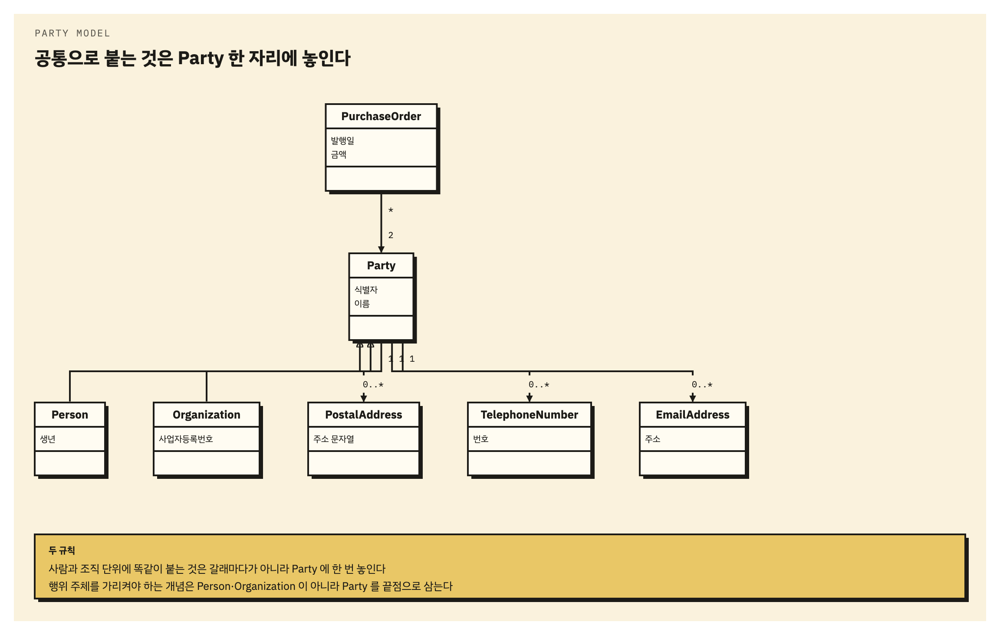

# Party — 사람이든 회사든 한 이름으로 받아 두기

## 한눈에 보는 개요

자재를 사들이는 회사의 구매 시스템을 만든다고 해 봅시다. 공급자는 개인 사업자일 때도 있고 법인일 때도 있어요. 그래서 모델에 `Person` 과 `Organization` 을 각각 두고, 발송에 쓸 주소·전화번호·이메일을 양쪽에 똑같이 붙였습니다. 발주서에는 `공급자개인` 과 `공급자법인` 두 칸을 두고 둘 중 하나만 채우기로 했어요.

```text
Before — 갈래마다 같은 것을 한 벌씩 더 붙인 모델

  Person ─── 주소 · 전화 · 이메일          이메일 형식 검사 ①
  Organization ─── 주소 · 전화 · 이메일     이메일 형식 검사 ②

  PurchaseOrder
    공급자개인   : Person 또는 비어 있음     ┐ "둘 중 하나만" 규칙을
    공급자법인   : Organization 또는 비어 있음 ┘ 발주서가 따로 지켜야 함

  발송지를 뽑는 코드        → 갈래를 먼저 물어보고 두 갈래로 분기함
  이메일 규칙이 바뀌면      → 고칠 자리 2곳 (한 곳만 고치면 조용히 어긋남)
  공급자에 부서를 넣고 싶으면 → 칸이 하나 더 필요
```

문제는 갈래가 둘이라는 사실 자체가 아니라, **갈래가 둘이라는 것을 모델의 모든 자리가 알아야 한다**는 데 있습니다. 연락 수단도 두 벌, 검사도 두 벌, 참조도 두 칸이에요. 갈래가 셋이 되면 전부 세 벌이 됩니다.

Party 패턴의 해법은 **사람과 조직을 담는 이름을 하나 만들고, 공통인 것을 전부 그 이름 쪽으로 올리는 것**이에요. 사람이냐 회사냐는 그 이름 아래의 갈래로 남기고, 바깥에서 행위 주체를 가리켜야 하는 개념은 갈래가 아니라 그 이름 하나를 가리킵니다.

```text
After — 공통인 것이 Party 한 자리에 놓이는 모델

  Party ─── 주소 · 전화 · 이메일            이메일 형식 검사 ① 하나뿐
    ├── Person        생년
    └── Organization  사업자등록번호

  PurchaseOrder
    공급자   : Party            ┐ 칸이 하나라 "둘 중 하나만" 규칙이
    요청 부서 : Party           ┘ 아예 생기지 않음

  발송지를 뽑는 코드        → 갈래를 묻지 않음 (한 갈래)
  이메일 규칙이 바뀌면      → 고칠 자리 1곳
  공급자에 부서를 넣고 싶으면 → 부서도 Party 라서 칸을 더하지 않음
```

> 기억법 — 갈래를 없애는 패턴이 아니라, **갈래를 아는 자리를 하나로 줄이는** 패턴.

분류는 Fowler 『Analysis Patterns』 의 책임 관계 장에 속한 기반 추상이고(근거: Analysis Patterns 2장 「Accountability」 §2.1 Party), 함께 쓰는 패턴은 [Accountability](../accountability/accountability-guide_v1.1.0.md) · [Knowledge Level](../knowledge-level/knowledge-level-guide_v1.1.0.md) 입니다.

이 글의 예제는 자재를 사들이는 회사의 거래처 관리예요. 여기서 Party 한 건은 이름 · 연락 수단 · 갈래별 속성을 스스로 갖고, 발주서는 공급자와 요청 부서를 Party 번호(id)로만 가리킵니다. 발주서를 낼 때 그 번호가 **거래처 장부**에 있는지 보는 일과 발송지를 뽑는 일은 **발주 서비스**가 맡고, 발송지는 발주서에 적어 두지 않고 물을 때마다 장부에서 Party 를 찾아 주소를 읽어요. 사람과 조직을 따로 두거나, 연락 수단을 따로 떼거나, 갈래를 아예 두지 않는 다른 선택지 셋은 「상황이 달라지면」에서 나란히 봅니다.

```text
이 글이 고른 경계
  Party ──────── 이름 · 연락 수단 · 갈래별 속성을 스스로 가짐
  발주서 ─────── 공급자 · 요청 부서를 Party 번호로만 가리킴 (주소를 적어 두지 않음)
  거래처 장부 ── 등록된 Party 를 번호로 찾아 줌
  발주 서비스 ── 발주서를 낼 때 번호가 장부에 있는지 봄 · 물을 때마다 주소를 읽음
```

이 글은 시나리오 셋을 따라갑니다. 발주서 둘이 개인 사업자와 법인에게 같은 길로 나가는 흐름, 사내 부서가 새 행위 주체로 들어오고 법인에만 적용되는 규칙이 생길 때 무엇이 바뀌는지, 그리고 연락 수단을 갈래마다 붙이거나 공급자를 두 칸으로 나누면 어떤 값이 어긋나는지요. 끝까지 읽으면 어떤 모델을 Party 패턴이라고 불러도 되는지 필수 조건 셋으로 판정할 수 있고, 그 셋을 다 만족하는데도 이 패턴으로 쓰면 곤란한 모양 둘까지 가릴 수 있습니다.

## 패턴 자세히 들여다보기

### 시나리오 1 — 발주서 둘이 개인 사업자와 법인에게 같은 길로 나가기

구매팀이 2026년 3월에 발주서를 둘 냅니다. 3월 3일 PO-1001 은 강판 가공을 맡기는 개인 사업자 Han Jiwoo 에게 4,800,000 KRW, 3월 5일 PO-1002 는 같은 품목을 법인 Daehan Steel 에 5,200,000 KRW 예요. 나와야 하는 답은 하나입니다. 두 발주서의 발송지 주소를 받는 쪽이 사람인지 회사인지 묻지 않는 **같은 한 줄**로 뽑는 것이에요. 이 장면에 일곱 이름이 나옵니다. 행위 주체를 담는 이름이 Party 이고 그 아래 사람 갈래가 Person, 조직 갈래가 Organization 입니다. Party 에는 연락 수단 셋이 붙어요. PostalAddress · TelephoneNumber · EmailAddress 입니다. 마지막으로 Party 를 가리키는 쪽이 PurchaseOrder 예요. 이름은 여기서 한 구절씩만 소개하고 정식 정의는 개념 정리가 맡습니다.

```text
거래처 장부
  P-1001  Han Jiwoo        사람    Seoul Mapo-gu Yanghwa-ro 12       02-300-1001
  P-1002  Daehan Steel     조직    Incheon Namdong-gu Namdong-ro 77  032-500-2002
  P-1003  Purchasing Team  조직    Seoul Mapo-gu Yanghwa-ro 12       02-300-9000
  P-1004  Han Jiwoo        사람    Busan Haeundae-gu Haeun-daero 30  051-700-1004
```

1. 거래처를 등록합니다. Han Jiwoo 는 사람 갈래로, Daehan Steel 은 조직 갈래로 들어오지만 **둘 다 같은 등록 흐름을 지나 같은 종류의 식별자**를 받아요. 등록이 갈래보다 먼저 하나로 묶여야 하는 이유는, 뒤에서 발주서가 가리킬 대상의 종류가 하나여야 발주 쪽이 갈래를 몰라도 되기 때문입니다. 이 단계에서 지켜지는 것은 하나의 이름이 사람과 조직을 함께 담는다는 것이에요(최소 조건 1).
2. 연락 수단을 **Party 쪽에** 붙입니다. 주소·전화·이메일 셋을 갈래마다 한 벌씩 두지 않고 Party 한 자리에 둬요. 여기에 두는 이유는 발송에 필요한 것이 사람에게나 회사에게나 똑같아서입니다. 갈래마다 두면 같은 이메일 형식 검사가 두 벌이 되고, 한쪽만 고쳤을 때 아무도 알려 주지 않아요(시나리오 3 의 1단계가 그 값을 보입니다). 이 단계가 지키는 것이 최소 조건 2 입니다.
3. 발주서가 공급자를 **Party 식별자 하나로** 가리킵니다. `공급자개인`·`공급자법인` 두 칸이 아니라 `공급자` 한 칸이에요. 한 칸이어야 하는 이유는, 두 칸이면 "둘 중 하나만 채운다"는 규칙이 새로 생기고 그 규칙을 지킬 자리가 Party 바깥으로 나가기 때문입니다. 칸이 하나면 그 규칙 자체가 생기지 않아요. 이 단계가 최소 조건 3 입니다.
4. 발주 서비스가 발송지를 뽑으려고 식별자로 Party 를 찾아 주소를 읽습니다. **갈래를 묻지 않아요.** 묻지 않는 것이 중요한 이유는, 여기서 갈래를 물으면 2단계에서 없앤 분기가 조회 쪽에 그대로 되살아나기 때문입니다. 없앤 자리와 되살아나는 자리가 다르면 없앴다고 말할 수 없어요.
5. 답이 나옵니다. PO-1001 은 Han Jiwoo 의 주소로, PO-1002 는 Daehan Steel 의 주소로 갑니다. 두 줄을 낸 것은 같은 한 줄의 코드예요. 요청 부서인 Purchasing Team 도 같은 줄로 주소가 나옵니다 — 부서 역시 Party 로 등록돼 있으니까요.
6. 같은 이름의 거래처가 하나 더 등록됩니다. P-1004 도 이름이 Han Jiwoo 예요. 둘은 **식별자가 달라서 다른 Party** 입니다. 이름으로 가리키지 않는 이유가 여기 있어요 — 이름은 같을 수 있으므로, 발주서가 이름으로 공급자를 적으면 PO-1001 이 누구에게 가는지 모델이 답할 수 없습니다. 이 단계가 선택 조건 4 입니다.

| 단계 | 누가 → 누구에게 | 넘기는 것 | 그 단계에서 지켜지는 것 |
| --- | --- | --- | --- |
| 1 | 등록 흐름 → Party | 이름 · 갈래 · 연락 수단 | 한 이름이 사람과 조직을 함께 담음 |
| 2 | Party → 연락 수단 | 주소 · 전화 · 이메일 | 공통인 것은 Party 한 자리에만 |
| 3 | 발주 서비스 → PurchaseOrder | 공급자 식별자 · 요청 부서 식별자 | 참조의 끝점이 Party 하나 |
| 4 | 발주 서비스 → Party | 식별자 하나 | 갈래를 묻지 않고 공통 속성만 읽음 |
| 5 | Party → 발주 서비스 | 주소 | — |
| 6 | 등록 흐름 → Party | 같은 이름, 다른 식별자 | 속성이 같아도 다른 Party |

잠깐 확인 하나 해 볼까요? 3단계에서 발주서의 `요청 부서` 칸에는 무엇이 들어갈까요? Purchasing Team 은 회사가 아니라 사내 부서인데요. 답은 `공급자` 칸과 똑같은 것 — Party 식별자입니다. 부서도 주소와 전화를 갖는 조직 단위라 Party 로 등록돼 있어서, 참조 형식을 새로 만들지 않아도 돼요. 그래서 위 표의 3단계가 두 칸을 한 줄로 처리합니다.

이 시나리오가 보여 준 것은 **갈래를 아는 자리가 어디까지 줄어드는가**입니다. 갈래는 없어지지 않았어요. Han Jiwoo 는 여전히 사람이고 Daehan Steel 은 회사입니다. 달라진 것은 그 사실을 아는 자리가 등록하는 1단계 하나로 줄었다는 것이에요. 연락 수단도(2단계), 발주서도(3단계), 발송지 조회도(4단계) 갈래를 모릅니다. 그리고 6단계가 덧붙인 것이 하나 있어요. 한 이름 아래 여럿을 담으려면 담긴 것들을 서로 가를 수단이 필요하고, 그것이 식별자입니다. 여기서 나온 일곱 이름이 개념 정리로 모입니다.

### 시나리오 2 — 사내 부서가 들어오고 법인에만 적용되는 규칙이 생길 때

3월 10일에 요구가 둘 들어옵니다. 하나는 발주서에 **요청 부서**를 적어야 한다는 것이고(감사에서 누가 요청했는지 묻습니다), 다른 하나는 **거래 상대인 조직은 사업자등록번호 10자리를 반드시 가져야 한다**는 것이에요. 개인 사업자에게는 그 번호를 받지 않고, 사내 부서에는 애초에 없는 값입니다. 이 시나리오에서 새로 나오는 이름은 없고, 바뀌는 것과 안 바뀌는 것을 셉니다.

1. 부서 Purchasing Team 을 **조직 갈래로 등록**합니다. 회사가 아니지만 주소와 전화를 갖는 조직 단위라 Party 로 들어와요. 부서를 Party 로 받는 이유는, 발주서가 요청 부서를 가리키려면 그 끝점도 Party 여야 하기 때문입니다. 부서만 다른 종류로 두면 발주서에 참조 형식이 하나 더 생기고, 시나리오 1 의 3단계에서 없앤 "칸이 둘" 문제가 다른 이름으로 돌아와요(최소 조건 7).
2. 발주서에 **요청 부서 칸 하나**를 더합니다. 공급자 칸과 같은 형식이에요. 형식이 같아서 발송지 조회는 한 줄도 바뀌지 않습니다 — 4단계의 조회가 공급자 식별자를 받든 요청 부서 식별자를 받든 같은 일을 해요.
3. 사업자등록번호는 **조직 갈래에만** 둡니다. Party 쪽에 올리지 않는 이유는, 모든 행위 주체가 갖는 값이 아니어서예요. Party 에 올리면 사람 Party 두 건과 부서 Party 한 건에 빈 칸이 생기고, "거래 상대면 반드시 있어야 한다"는 규칙을 Party 가 지려면 Party 안에 갈래를 묻는 분기가 도로 생깁니다.
4. 그 규칙을 **조직 갈래를 만드는 자리**가 집니다. 거래 상대이면 10자리인지 보고, 사내 부서이면 값이 비어 있는지 봐요. 만드는 자리에서 보는 이유는 시나리오 1 의 1단계와 같습니다 — 한 번이라도 규칙을 어긴 Party 가 만들어지면 그것을 쓰는 자리마다 같은 검사를 되풀이해야 하니까요.
5. 무엇이 안 바뀌었는지 셉니다. 연락 수단 연관도, 이메일 형식 검사도, 발송지 조회도, 공급자 참조도 그대로예요. 새 요구가 둘 다 갈래 쪽에만 해당했기 때문입니다.

| 무엇 | 요구가 들어오기 전 | 들어온 뒤 |
| --- | --- | --- |
| Party 에 붙은 속성 | 식별자 · 이름 · 연락 수단 | 그대로 |
| 사람 갈래의 속성 | 생년 | 그대로 |
| 조직 갈래의 속성 | — | 거래 상대 여부 · 사업자등록번호 |
| 이메일 형식 검사 | 1곳 | 1곳 |
| 발주서의 Party 참조 | 공급자 1칸 | 공급자 · 요청 부서 2칸 (형식은 같음) |
| 발송지 조회 | 갈래를 묻지 않음 | 그대로 |

3단계의 판단을 뒤집어 보면 왜 그렇게 두는지가 더 분명해집니다. 사업자등록번호를 Party 에 올렸다면 장부는 이렇게 돼요.

```text
사업자등록번호를 Party 에 올렸을 때
  P-1001 Han Jiwoo        사업자등록번호: (빈 칸)   ← 사람이라 뜻이 없음
  P-1002 Daehan Steel     사업자등록번호: 1234567890
  P-1003 Purchasing Team  사업자등록번호: (빈 칸)   ← 부서라 뜻이 없음
  P-1004 Han Jiwoo        사업자등록번호: (빈 칸)

  Party 4건 중 3건이 빈 칸 · "비어 있으면 사람이거나 부서" 라는 암묵 규칙이 생김
  → 갈래를 묻지 않기로 한 4단계의 조회가 빈 칸을 걸러야 함
```

이 시나리오가 보여 준 것은 **새 요구가 어디에 해당하는지에 따라 바뀌는 범위가 정해진다**는 것입니다. 요청 부서는 "행위 주체를 하나 더 가리킨다"는 요구라 Party 쪽에 이미 있던 형식을 그대로 썼고(1·2단계), 사업자등록번호는 한 갈래에만 뜻이 있는 요구라 그 갈래 안에서 끝났어요(3·4단계). 시나리오 1 이 갈래를 아는 자리를 하나로 줄였기 때문에, 여기서 바뀐 자리도 그 하나뿐입니다.

### 시나리오 3 — 갈래마다 붙인 연락 수단 · 두 칸 공급자 · 갈래가 된 역할 · 이름 참조는 어떤 값을 어긋나게 하는가

같은 거래처 장부에 규칙을 어기는 일이 넷 들어옵니다. 상위 이름은 두되 **연락 수단을 갈래마다 한 벌씩 붙이는 것**, 발주서의 공급자를 **개인용·법인용 두 칸으로 나누는 것**, 공급자·발주처 같은 **역할을 갈래로 두는 것**, 그리고 공급자를 식별자가 아니라 이름으로 가리키는 것이에요. 아래 값은 모두 실제로 컴파일해 실행하거나, 코드를 그렇게 고쳐 실행해 확인한 것이에요. 고친 범위를 단계마다 함께 적습니다 — 값만 옮겨 적으면 같은 수치를 다른 입력에서 얻게 되니까요.

1. 상위 이름을 **비워 두고** 연락 수단을 갈래에 붙입니다. `Party` 라는 이름은 있지만 아무것도 담지 않고, 주소·전화·이메일이 사람 갈래와 조직 갈래에 한 벌씩 붙어요. 이메일 형식 검사도 두 벌이 됩니다. 이제 사람 쪽 검사만 고쳐 `@` 가 없는 주소를 막으면, 조직 쪽은 그대로 통과해요. 실행으로 확인하면 같은 잘못된 값 `jiwoo(at)example.com` 이 사람 갈래에서는 거절되고 조직 갈래에서는 등록됩니다 — 거절 1건, 통과 1건. 모델이 이름만 상위 개념이고 개요의 Before 그대로인 상태예요.
2. 공급자를 **두 칸으로** 나눕니다. `공급자개인` 과 `공급자법인` 이 생기고 "둘 중 하나만 채운다"는 규칙이 발주서에 붙어요. 그 규칙을 빠뜨리면 두 칸이 다 빈 발주서와 두 칸이 다 찬 발주서가 그대로 통과합니다. 발주서 4건을 **개인 칸만 채운 것 · 법인 칸만 채운 것 · 두 칸을 다 비운 것 · 두 칸을 다 채운 것** 으로 하나씩 넣어 보면 발송지가 **0개인 것 1건, 2개인 것 1건**이 나와요. 4건의 구성이 답을 정하므로 구성을 달리 잡으면 건수도 달라집니다. 갈래가 셋이 되면 칸도 셋이 되고 규칙은 "셋 중 하나만"이 됩니다.
3. 역할을 **갈래로** 둡니다. `Party` 아래에 `Customer` 와 `Supplier` 를 두면, Han Jiwoo 가 강판을 납품하면서 설계 용역을 받기도 하는 순간 한 사람에 Party 레코드가 둘 생겨요. 공급자 쪽은 장부의 P-1001 이고, 발주처 쪽은 그때 새로 등록되는 P-1005 입니다. 같은 사람인데 식별자가 다릅니다. 주소가 바뀌어 한쪽만 고치면 같은 사람에게 가는 발주서의 발송지가 서로 달라져요 — 하나는 Yeouido, 다른 하나는 Yanghwa-ro 입니다.
4. 이름으로 가리킵니다. 발주서가 공급자를 `"Han Jiwoo"` 로 적으면 장부에 그 이름이 둘이라(P-1001·P-1004) 발송지가 2개 나와요. 선택 조건 4 가 없으면 1·2·3단계를 다 지켜도 답이 하나로 정해지지 않습니다.

```text
어긴 규칙              막히는 자리 (제대로 뒀을 때)   막히지 않으면 어긋나는 값
공통은 Party 한 자리    Party 의 연락 수단 검사 1곳    같은 잘못된 이메일이 한쪽만 거절 (거절 1 · 통과 1)
참조 끝점은 Party 하나  발주서의 칸이 하나             발송지 0개 1건 · 2개 1건
역할은 갈래가 아님      역할을 Party 밖에 둠            한 사람에 Party 2건 · 발송지가 둘로 나뉨
속성이 같아도 다른 Party 식별자로 가리킴                이름 "Han Jiwoo" 로 발송지 2개
```

이 시나리오가 보여 준 것은 **네 규칙이 서로 다른 자리에서 다른 것을 지킨다**는 점입니다. 1단계는 중복이 조용히 어긋나는 것을, 2단계는 모델 밖으로 나간 규칙을, 3단계는 한 주체가 여럿으로 쪼개지는 것을, 4단계는 답이 하나로 정해지지 않는 것을 막아요. 눈여겨볼 것은 1단계와 2단계가 서로를 대신하지 못한다는 것입니다. 연락 수단을 Party 에 제대로 올려도(1단계 통과) 발주서는 여전히 두 칸일 수 있고, 그때 어긋나는 값은 발송지 개수예요. 그래서 최소 조건 2 와 3 이 따로 있습니다.

### 개념 정리

시나리오에 나온 분석 층위의 개념 일곱을 정식으로 정의합니다. 이 절이 정하는 것은 개념이 무엇을 책임지고 누구와 협력하는가까지예요. 그 책임을 코드의 어느 객체가 지는지, 무엇이 aggregate 의 root 인지는 뒤의 「상황 설정」 표가 정합니다.

- **Party**(당사자) — 사람과 조직 단위를 함께 담는 이름이고, 이 모델에서 "행위 주체"라고 부를 수 있는 것 전부입니다.
  - 책임: 식별자로 자기를 구별하고, 이름과 연락 수단처럼 **모든 행위 주체가 똑같이 갖는 것**을 답니다. 갈래를 묻지 않고도 쓸 수 있는 것만 여기 있어요(시나리오 1 의 2·4단계).
  - 협력: 갈래로 Person 과 Organization 을 갖습니다. 연락 수단을 답니다. 행위 주체를 가리켜야 하는 개념(이 글에서는 PurchaseOrder)이 Party 를 끝점으로 잡아요.
- **Person**(사람) — Party 의 사람 갈래입니다.
  - 책임: 사람에게만 뜻이 있는 것을 담습니다. 이 글의 예제에서는 생년이에요.
  - 협력: Party 로서 연락 수단을 갖습니다. 사람에게만 있는 값을 Party 쪽에 올리지 않는 것이 이 갈래가 있는 이유예요(시나리오 2 의 3단계).
- **Organization**(조직 단위) — Party 의 조직 갈래입니다. 법인만이 아니라 부서·팀처럼 **주소와 연락처를 갖는 조직 단위**를 두루 담아요.
  - 책임: 조직에만 뜻이 있는 것을 담습니다. 이 글의 예제에서는 거래 상대인지 여부와 사업자등록번호이고, 거래 상대이면 번호가 10자리여야 한다는 규칙도 이 갈래의 몫이에요(시나리오 2 의 4단계).
  - 협력: Party 로서 연락 수단을 갖습니다. 회사가 아닌 부서도 여기 들어오므로 발주서가 요청 부서를 가리킬 수 있어요(시나리오 2 의 1단계).
- **PostalAddress**(우편 주소) — 우편물이 가는 자리를 적은 값입니다.
  - 책임: 발송지를 나타냅니다. 누구의 주소인지는 자기가 모르고, 붙은 Party 가 압니다.
  - 협력: Party 에 붙습니다. 사람 갈래에도 조직 갈래에도 따로 붙지 않아요.
- **TelephoneNumber**(전화번호) — 전화로 연락할 곳을 적은 값입니다.
  - 책임: 연락처를 나타내고, 모양이 맞는지는 Party 가 받을 때 봅니다.
  - 협력: PostalAddress 와 같은 자리에서 Party 에 붙습니다.
- **EmailAddress**(이메일 주소) — 전자우편으로 연락할 곳을 적은 값입니다.
  - 책임: 연락처를 나타냅니다. 형식 검사가 한 자리에만 있어야 하는 대표적인 값이에요(시나리오 3 의 1단계).
  - 협력: PostalAddress · TelephoneNumber 와 같은 자리에서 Party 에 붙습니다.
- **PurchaseOrder**(발주서) — 행위 주체를 가리켜야 하는 쪽을 대표하는 개념입니다. 원전이 Party 와 함께 그린 개념은 아니고, **Party 를 참조하는 자리가 있어야 이 패턴의 쓸모를 확인할 수 있기 때문에** 이 글이 예제로 넣었어요.
  - 책임: 무엇을 누구에게 주문했고 누가 요청했는지를 담습니다. 공급자와 요청 부서를 각각 Party 하나로 가리켜요(시나리오 1 의 3단계).
  - 협력: Party 둘을 가리킵니다. 그 둘이 사람인지 조직인지는 알지 못해요.



그림에서 눈여겨볼 것은 **선이 어디에 붙어 있는가**입니다. 연락 수단 셋은 갈래가 아니라 Party 에 붙어 있고, 발주서에서 나온 선도 갈래가 아니라 Party 로 이어져요. Person 과 Organization 에서 Party 로 올라가는 선은 일반화이고, 갈래에 적힌 속성은 그 갈래에만 뜻이 있는 것뿐입니다(근거: Analysis Patterns 2장 「Accountability」 §2.1 Party 의 그림 2.1 과 2.2 — 앞은 연락 수단이 Person·Organization 에 각각 붙은 모델, 뒤는 그 연관을 Party 로 올린 모델). 연락 수단 쪽 다중도를 `0..*` 로 둔 것은 이 글의 모델이고, 한 Party 가 주소를 몇 개까지 갖느냐는 패턴이 정하는 것이 아니라 업무가 정합니다.

## 사용 목적

Party 가 필요하다는 단서는 코드나 요구에서 눈으로 셀 수 있는 모양으로 나타납니다.

#### 단서 1 — 같은 연관이 갈래마다 한 벌씩 있습니다

`Person.address` 와 `Company.address` 가 나란히 있고, 이메일 형식 검사 같은 것이 두 클래스에 복사돼 있어요. 부서·팀·외국 법인 같은 갈래를 하나 더 들이라는 요구가 오면 한 벌을 더 만들어야 합니다.

#### 단서 2 — 「둘 중 하나만 채운다」는 규칙이 붙은 칸 쌍이 있습니다

`공급자개인`·`공급자법인` 처럼요. 이 규칙은 데이터베이스(DB) 제약으로도, 코드 검사로도 표현되지만 어느 쪽이든 **모델이 아니라 모델 바깥이 지키는 규칙**이라 빠뜨리기 쉽습니다(시나리오 3 의 2단계가 빠뜨렸을 때의 값입니다).

#### 단서 3 — 「고객이 개인일 수도 사업자일 수도 있다」는 문장이 요구서에 있습니다

그 문장 뒤에 "어느 쪽이든 송장 처리는 같다"가 따라오면 거의 확실해요. 앞은 갈래가 둘이라는 뜻이고 뒤는 공통 행위가 있다는 뜻인데, 그 둘이 Party 의 성립 조건이기도 합니다.

#### 단서 4 — 주소나 연락처가 사람에게도 부서에도 붙습니다

조직도를 다루는 시스템에서 "부서 대표 전화"가 필요해지는 순간이 그렇습니다.

#### 쓰지 말아야 할 경우

쓰지 말아야 할 때도 분명합니다.

- **행위 주체가 한 종류뿐일 때.** 사내 직원만 다루는 근태 시스템에 Party 를 두면 `Person` 하나짜리 갈래 위에 빈 상위 이름이 하나 더 생깁니다. 잃는 것은 직접성이에요 — `Employee.address` 로 끝날 일을 `Party` 를 거쳐 읽게 되고, 그 우회로 얻는 것이 없습니다. 조직이 나중에 들어올 것 같다는 예상만으로 미리 두면, 들어오지 않았을 때 그 빈 층이 그대로 남아요.
- **갈래는 둘인데 공통이 이름과 식별자뿐일 때.** 소송 사건을 다루는 시스템이 당사자에게 보내는 것을 전부 대리인을 거쳐 처리한다고 해 봅시다. 자연인과 법인을 한 이름으로 담아도 그 이름에 올릴 것이 식별자와 상호뿐이에요. 사람과 조직이 둘 다 있으니 조건 1 은 지나가지만 **조건 2 에서 걸립니다** — 식별자와 이름 말고 올릴 공통이 없으니까요. 시나리오 1 의 2단계에서 올릴 것이 없고, 4단계의 조회가 갈래를 묻지 않고 읽어 봐야 그 둘뿐이라 조회로 얻는 것도 없어요. 잃는 것은 층 하나를 거치는 비용이고, 더 나쁜 것은 "상위 개념이 있으니 공통일 것"이라는 잘못된 기대가 생기는 거예요.
- **가르고 싶은 것이 "누구인가"가 아니라 "무엇을 하는가"일 때.** 고객과 공급자를 나누고 싶은 것이라면 Party 의 갈래로 풀면 안 됩니다. 차이는 다음 절에서 풀어요.

## 패턴의 경계

### 디자인 패턴을 충족하는 최소 조건

어떤 모델을 Party 패턴이라고 불러도 되는지 가르는 기준입니다. 클래스 모양이 아니라 **개념이 맡는 책임**과 **모델이 늘 지키는 규칙**으로 판정해요 — 상속으로 풀든 열거형으로 풀든 테이블 한 장으로 풀든 같은 기준으로 가려야 하니까요. `[필수]` 에는 원전이 Party 의 성립 요건으로 적은 것만 올렸고, 원전이 구현 지침이나 선택지로 적은 것과 이 글 예제의 정책은 `[선택]` 입니다. 조건마다 그것을 보여 준 시나리오의 단계를 함께 적었어요.

1. [필수] 한 이름이 사람과 조직 단위를 함께 담음 — 이 컨텍스트가 행위 주체로 받는 것에 사람도 조직 단위도 있고, 모델이 그 둘을 한 이름으로 받습니다. 시나리오 1 의 1단계 (근거: Fowler 개정 초안 Organization Structures 의 「Party」 — 의도문이 이 패턴을 사람과 조직 단위를 하나로 묶은 추상이라고 적고, 그 상위 타입에 Party 라는 이름을 붙이는 것이 이 패턴의 요점이라고 적습니다)
   - 경계 사례: 갈래를 실제로 나누는지는 이 조건이 아니라 조건 5 가 정해요.
   - 빠지면: 사람만 담는 사용자 테이블이거나, Person 과 Organization 이 나란히 있고 둘을 함께 가리킬 이름이 없는 모델이 됩니다. 뒤쪽이 개요의 Before 이고, 이 상태에서는 조건 2 와 3 을 만족시킬 자리 자체가 없어요.
   - 근거의 범위: 위 근거 괄호가 받쳐 주는 것은 **조건 문면 전부**입니다. 의도문이 무엇을 무엇으로 추상하는지를 그대로 적고 있어서 "사람과 조직 단위"도 "하나의 이름"도 원전의 말이에요. 갈래를 조건 5 로 미룬 것도 원전을 따른 것입니다 — 초안이 갈래를 두지 않는 모델을 같은 패턴으로 인정하니까요.
2. [필수] 식별자와 이름 말고도 공통이 있고, 그것이 그 이름 한 자리에 모임 — 사람에게나 조직에게나 똑같이 붙는 속성·연관·행위가 실제로 있고, 그것이 갈래마다 되풀이되지 않고 상위 개념 쪽에 한 번만 있습니다. 시나리오 1 의 2단계 (근거: Fowler 개정 초안 Organization Structures 의 「Party」 — 「When to use it」 이 사람과 조직이 모델에 있고 공통 행위가 보일 때 이 패턴을 쓴다고 적으면서 이 패턴의 요점이 공통 행위가 있는지 살피는 데 있다고 적고, 「Making it work」 가 사람과 조직 단위에 공통인 행위를 Party 에 두라고 적습니다. 공통 연관 쪽은 Analysis Patterns 2장 「Accountability」 §2.1 Party 의 해법 그림이 연락 수단 연관을 Person·Organization 각각에서 떼어 Party 에 붙입니다)
   - 경계 사례: 식별자와 이름은 어떤 상위 타입에나 붙는 껍데기라 여기서 세지 않아요.
   - 빠지면: 어긋나는 길이 둘입니다. 공통이 있는데 올리지 않으면 이름만 상위 개념이고 속은 빈 타입이 되어, 주소·전화·이메일이 갈래마다 한 벌씩 그대로 남아요. 시나리오 3 의 1단계가 그 값입니다 — 같은 잘못된 이메일이 한쪽에서는 거절되고 한쪽에서는 통과합니다. 공통이 애초에 식별자와 이름뿐이면 이 조건이 요구하는 공통이 **아예 없는 것이라 불충족**이에요. 그때는 상위 이름이 이름으로만 남고, 시나리오 1 의 4단계 조회가 갈래를 묻지 않고 읽어 봐야 식별자와 이름뿐이라 그 조회로 얻는 것이 없습니다. 사용 목적의 「쓰지 말아야 할 경우」에서 공통이 이름과 식별자뿐인 항목이 그 경우예요.
   - 근거의 범위: 위 근거 괄호가 받쳐 주는 것은 **조건 문면 전부**입니다. 공통이 있어야 한다는 것은 초안이 이 패턴을 쓰는 조건으로 적은 말이고, 공통인 것이 Party 에 모인다는 것은 같은 초안의 구현 지침과 원서의 해법 그림이 함께 받쳐요. 식별자와 이름을 공통에서 뺀 것도 근거 안에 있습니다 — 초안이 말한 것은 공통 **행위**이지 어느 상위 타입에나 붙는 껍데기가 아니니까요. 다만 그 반대 방향, 곧 공통이 아닌 것을 갈래로 내려야 한다는 요구는 같은 지침의 뒷부분인데 초안이 갈래를 두지 않는 모델도 인정하므로 성립 요건이 아닙니다. 그쪽은 조건 6 에 `[선택]` 으로 두었어요.
3. [필수] 행위 주체를 가리키는 개념은 갈래가 아니라 그 이름을 끝점으로 잡음 — "사람일 수도 조직일 수도 있는 상대"를 가리키는 자리의 참조가 갈래 수만큼이 아니라 상위 개념 하나로 갑니다. 시나리오 1 의 3단계 (근거: 같은 절의 해법 그림에서 연락 수단이 Person·Organization 각각이 아니라 Party 를 끝점으로 잡는 자리, Fowler 개정 초안 「Party」 의 예시가 통신 회사의 고객이 개인일 수도 사업자일 수도 있는데 다루는 방식이 같은 부분에서는 그들을 party 로 다루고 다른 부분에서만 하위 타입으로 다룬다고 적는 자리, 그리고 같은 초안의 「Object Graph」 절이 Accountability 를 두 Party 사이의 연관 객체로 두는 자리)
   - 빠지면: `공급자개인`·`공급자법인` 두 칸에 "둘 중 하나만 채운다"는 규칙이 붙고, 그 규칙이 빠지면 발송지가 0개이거나 2개인 발주서가 통과합니다. 시나리오 3 의 2단계가 그 건수예요.
   - 근거의 범위: 위 근거 괄호가 받쳐 주는 것은 **원전이 그린 자리에서 끝점이 갈래가 아니라 Party 였다**까지, 그리고 예시가 다루는 방식이 같은 부분에서는 party 로 다룬다고 적은 만큼까지입니다. 그것을 "가리켜야 하는 개념이라면 언제나"로 넓힌 것은 이 글의 읽기예요. 추상은 그것이 대신하는 것들의 자리에 쓰이라고 있는 것이라 이 확장이 무리는 아니지만, 원전이 규칙 문장으로 적어 둔 것은 아니라는 점을 밝혀 둡니다. 그리고 이것은 조건 2 와 다른 조건이에요. 연락 수단을 Party 에 제대로 올려 둔 모델도 발주서 칸은 둘일 수 있고, 시나리오 3 의 2단계가 바로 그 경우입니다.
4. [선택] 속성이 같아도 서로 다른 것으로 구별하고 식별자로 가리킴 — 이름·주소·연락처가 모두 같은 두 행위 주체도 같은 Party 가 아니며, 가리키는 쪽은 그 식별자를 씁니다. 시나리오 1 의 6단계 (근거: 이 가이드의 정책 — Evans 『Domain-Driven Design Reference』 의 Entity 정의를 Party 에 적용한 DDD(Domain-Driven Design, 도메인 주도 설계) 매핑 판단이고, 이 조건이 본래 사는 자리는 상황 설정 표의 배정 칸입니다)
   - 빠지면 잃는 것: 답이 하나로 정해지는 성질입니다. 발주서가 공급자를 이름으로 적게 되고, 장부에 같은 이름이 둘이면 발송지가 2개 나와요. 시나리오 3 의 4단계입니다. 필수 조건 셋은 그대로 지켜진 채 이 일이 일어나므로, 원전을 기준으로 보면 여전히 Party 패턴이고 다만 쓸 수 없는 모델이에요.
   - 왜 `[필수]` 가 아닌가: Evans 는 Party 를 말한 적이 없고, Entity 정의는 모든 도메인 객체에 적용되는 일반 규칙입니다. Fowler 쪽 자료에도 Party 의 식별성을 요구하는 문장이 없어요. 그러니 이것은 원전이 Party 의 성립 요건으로 적은 것이 아니라 이 글이 DDD 로 옮기며 내린 판단이고, 그런 것은 `[선택]` 에 둡니다. 두 Party 사이에 관계를 두는 Accountability 는 이 조건을 사실상 전제하게 되는데, 그 전제는 Party 쪽이 아니라 Accountability 쪽이 자기 성립 요건으로 둘 몫이에요.
5. [선택] 사람과 조직을 하위 타입으로 나눔 — 사람 갈래와 조직 갈래를 실제 하위 타입으로 나눕니다. 시나리오 1 의 1단계 (근거: Fowler 개정 초안이 사람과 조직을 구분할 필요가 없으면 하위 타입 없이 Party 하나만 두는 경우도 고려하라고 적으므로, 나누는 것은 성립 요건이 아니라 선택입니다)
   - 빠지면 잃는 것: 갈래별 속성을 둘 자리입니다. 조건 6 도 함께 쓸 수 없게 돼요. 다만 갈래별로 다를 것이 없는 모델이면 잃는 것이 없습니다.
6. [선택] 한쪽 갈래에만 뜻이 있는 것은 그 갈래로 내림 — 한쪽 갈래에만 뜻이 있는 속성·행위는 Party 가 아니라 그 갈래에 둡니다. 시나리오 2 의 3단계 (근거: Fowler 개정 초안의 구현 지침이 한쪽에만 해당하는 것을 하위 타입에 두라고 적습니다. 갈래를 두지 않는 모델도 원전이 인정하므로 성립 요건이 아니라 지침으로 읽었습니다)
   - 빠지면 잃는 것: 빈 칸이 없는 상태입니다. 시나리오 2 의 표처럼 Party 4건 중 3건이 빈 칸이 되고, "비어 있으면 사람이거나 부서"라는 암묵 규칙이 생겨요. 조건 5 를 쓰지 않는 모델이라면 애초에 내릴 자리가 없으므로 이 조건도 해당하지 않습니다.
7. [선택] 회사가 아닌 조직 단위도 같은 이름으로 담음 — 부서·비공식 팀처럼 회사가 아닌 조직 단위도 Party 로 받습니다. 시나리오 2 의 1단계 (근거: Fowler 개정 초안이 부서나 비공식 팀도 Party 로서 주소와 전화번호를 가질 수 있다고 적습니다 — 할 수 있다는 말이지 해야 한다는 말이 아니라 선택으로 둡니다)
   - 빠지면 잃는 것: 조직 안쪽을 가리킬 수단입니다. 발주서의 요청 부서 칸에 넣을 것이 없어져 참조 형식이 하나 더 생겨요. 두 Party 사이의 책임 관계를 다루는 Accountability 를 더할 때도 조직 안쪽이 Party 가 아니면 관계의 한쪽 끝이 비게 됩니다.
8. [선택] 역할은 갈래가 아니라 Party 밖에 둠 — 공급자·발주처 같은 역할을 Party 의 갈래로 두지 않고 Party 밖의 개념으로 둡니다. 시나리오 3 의 3단계(역할을 갈래로 두었을 때) (근거: Fowler 개정 초안 Organization Structures 의 「Party」 가 역할이 여럿이면 Role Object 를 보되 무턱대고 고를 것은 아니라고 적고, 같은 저자의 보충 자료 Dealing with Roles 가 역할 표현을 다섯 갈래로 나누어 둡니다. 원전이 여러 선택지를 나란히 두었으므로 특정 표현을 성립 요건으로 삼지 않고 선택으로 둡니다)
   - 빠지면 잃는 것: 한 주체가 여러 역할을 겸할 때의 일관성입니다. Han Jiwoo 가 공급자이면서 발주처이면 Party 레코드가 둘로 나뉘고 주소도 따로 바뀝니다. **주의할 것은 이 조건이 `[선택]` 이라는 점이에요** — 역할을 갈래로 둔 모델도 필수 조건 셋은 모두 만족할 수 있습니다. 비교 절이 그 경우를 따로 다룹니다.
9. [선택] Party 의 분류는 지식 층위의 개념으로 따로 둠 — Party 의 분류를 값이 아니라 지식 층위의 개념으로 둡니다. 시나리오 2 의 1단계 (근거: Analysis Patterns 2장 「Accountability」 §2.5 「Accountability Knowledge Level」 의 그림이 Party Type 을 Party 와 따로 둔 개념으로 그립니다)
   - 필요해지는 자리: 시나리오 2 의 1단계에서 "조직 단위"라는 갈래 안에 법인과 부서가 함께 들어온 자리가 이 조건이 필요해지는 지점이에요.
   - 빠지면 잃는 것: 분류를 데이터로 다룰 능력입니다. 이 글의 예제는 거래 상대인지 여부를 조직 갈래의 참·거짓 값으로 두었는데, 분류가 셋 이상으로 늘거나 분류마다 규칙이 달라지면 그 값으로는 감당이 안 돼요.

> 필수는 셋이다 — 한 이름에 담았는가, 갈래를 묻지 않고 쓸 공통이 있고 그것이 그 이름에 모였는가, 가리키는 쪽이 그 이름을 잡는가.

### 비슷한 패턴·안티패턴과의 차이

Party 와 닮아 보이거나 같은 단서에서 떠오르는 넷을 구분 기준부터 모았어요.

| 대상 | 구분 기준 (모델에서 확인) | Party 를 고르면 얻는 것 | 포기하는 것 |
| --- | --- | --- | --- |
| 역할 패턴 (Role Object · Role Relationship 등) | 그 타입이 "누구인가"에 답하는가 "어떤 맥락에서 무엇을 하는가"에 답하는가. 한 주체가 두 역할을 겸할 때 레코드가 둘로 나뉘는지로 확인 | 주체가 하나로 남아 연락처·식별이 한 곳에 모임 | 역할별 속성과 규칙을 담을 자리. 그건 Party 밖에 따로 둬야 함 |
| 갈래 둘을 나란히 둔 모델 (감사·공통 처리가 필요한 곳에 쓰면 안티패턴) | 공통으로 붙는 것이 한 자리에 있는가, 갈래마다 한 벌씩인가 | 공통 규칙을 고칠 자리가 하나. 갈래가 늘어도 참조·조회가 안 바뀜 | 갈래별 값을 읽을 때 한 번 거치는 단계. 갈래가 끝까지 하나면 그냥 비용 |
| Accountability | 그 개념을 지웠을 때 남는 것이 노드인가 링크인가. Party 는 혼자 존재하지만 Accountability 는 두 Party 가 있어야 성립 | 관계를 둘 자리. 관계의 양 끝이 같은 종류라 링크 하나로 표현됨 | 관계 자체의 종류·기간·권한. Party 만으로는 "누가 누구를 관리하는가"에 답하지 못함 |
| 조직 계층을 재귀 연관으로 둔 모델 | 조직끼리의 관계가 한 종류뿐인가 여러 종류인가 | 사람과 조직을 같은 자리에서 다룰 수 있음 | 계층이 한 종류뿐이라면 재귀 연관 한 줄로 끝날 일을 Party 를 거쳐 표현하게 됨 |

#### 역할 패턴과의 차이

구분 기준은 그 타입이 "누구인가"에 답하는가 "어떤 맥락에서 무엇을 하는가"에 답하는가입니다. 표의 네 대상 가운데 가장 헷갈리는 쌍이에요. **역할을 상위 개념의 이름으로 써 버린 모델**이 특히 그렇습니다. 아래는 `Customer` 를 상위 개념으로 두고 개인 고객과 법인 고객을 갈래로 나눈 것입니다. 시나리오 1 의 2·3단계가 요구하는 모양을 그대로 갖췄어요. 연락 수단이 상위 개념에 한 번 있고, 송장은 `CustomerId` 하나를 가리킵니다.

```java no-compile
// 필수 조건 셋을 모두 만족하지만, 이름이 역할이다
abstract class Customer {                  // 사람과 조직을 함께 담음      (조건 1)
    final CustomerId id;                   // 속성이 같아도 구별됨     (선택 조건 4)
    ContactMeans contact;                  // 공통인 것이 한 자리           (조건 2)
    Customer(CustomerId id, ContactMeans contact) { this.id = id; this.contact = contact; }
}
final class IndividualCustomer extends Customer { int birthYear; }
final class CorporateCustomer extends Customer { String registrationNumber; }

final class Invoice {
    CustomerId customerId;                 // 참조의 끝점이 하나            (조건 3)
}
```

이 모델은 **필수 조건 셋을 다 만족합니다.** 그런데 Han Jiwoo 가 고객이면서 공급자이기도 한 순간 `Customer` 와 별도로 `Supplier` 계층이 생기고, 같은 사람에 레코드가 둘 생겨요. 시나리오 3 의 3단계가 잰 값 그대로입니다. 주소를 한쪽만 고치면 발송지가 Yeouido 와 Yanghwa-ro 로 나뉩니다. 최소 조건만으로는 이 형태가 걸러지지 않으니 여기서 밝혀 둡니다. 필수 조건 셋을 다 만족해도 상위 개념의 이름이 맥락에 묶인 역할이면, 그 맥락이 하나로 유지되는 동안만 Party 처럼 동작해요. 가르는 기준은 최소 조건이 아니라 역할 패턴 행의 기준, 곧 "한 주체가 두 역할을 겸할 때 레코드가 둘로 나뉘는가"입니다. 조건 8 이 `[선택]` 인 이유도 같아요. 원전이 역할 표현을 여러 선택지로 두었으므로 이 글이 그것을 성립 요건으로 올릴 수는 없고, 대신 구분 기준으로 세웁니다.

필수 조건 셋을 **다 만족하고도** 이 패턴으로 쓰면 곤란한 모양은 둘입니다. 문제가 생기는 순간도 다릅니다. 둘 다 최소 조건으로는 걸러지지 않습니다.

| 곤란한 모양 | 문제가 생기는 순간 | 무엇이 가르는가 |
| --- | --- | --- |
| 방금 본 `Customer` 처럼 상위 이름이 역할인 모델 | 한 주체가 맥락을 둘 갖는 순간 레코드가 둘로 나뉨 | 이 절의 역할 패턴 행 |
| 선택 조건 4 를 버려 식별자 없이 이름으로 가리키는 모델 | 같은 이름이 둘 생기는 순간 답이 정해지지 않음 | 선택 조건 4 |

#### 갈래 둘을 나란히 둔 모델과의 차이

구분 기준은 공통으로 붙는 것이 한 자리에 있는가, 갈래마다 한 벌씩인가입니다. 갈래마다 한 벌씩인 쪽이 개요의 Before 예요. 시나리오 3 의 1단계가 그 모델에서 같은 잘못된 이메일이 한쪽에서만 거절되는 값을 보였습니다. Party 를 고르면 공통 규칙을 고칠 자리가 하나로 줄고, 갈래가 늘어도 참조와 조회가 바뀌지 않습니다. 대신 갈래별 값을 읽을 때 한 단계를 거치고, 갈래가 끝까지 하나뿐이면 그 단계는 그냥 비용이에요.

```text
갈래 둘을 나란히 둔 모델   Person · Organization 이 각자 주소 · 전화 · 이메일과 그 검사를 가짐   → 검사 2곳
Party                       연락 수단과 그 검사가 Party 한 자리에 있음                          → 검사 1곳
확인할 곳                   같은 연관과 검사가 갈래마다 한 벌씩 있는가
```

앞에서 본 두 모양 말고도, 조건 2 에는 읽기를 잘못하면 빠져나가는 모양이 하나 있습니다. **공통이 식별자와 이름뿐인 모델**이에요. 사람과 조직을 한 이름으로 담고(조건 1), 가리키는 쪽도 그 이름 하나를 잡는데(조건 3), 정작 그 이름에 올라간 것이 식별자와 상호뿐인 경우입니다. 조건 2 는 식별자와 이름을 빼고 공통이 있을 것을 요구하므로 **문면대로 읽으면 여기서 걸려요.** 빠져나가는 것은 조건 2 를 「있는 것을 위에 둔다」는 배치 규칙으로만 읽을 때입니다 — 그렇게 읽으면 올릴 것이 없으니 어긴 적도 없는 셈이 되거든요. 가려내는 방법은 시나리오 1 의 4단계를 실제로 실행해 보는 것이에요. 갈래를 묻지 않는 조회가 읽어 낼 것이 식별자와 이름뿐이면 상위 이름이 이름으로만 남아 있는 겁니다. 사용 목적의 「쓰지 말아야 할 경우」에서 공통이 이름과 식별자뿐인 항목이 그 경우이고, 원전이 이 패턴의 요점을 공통 행위가 있는지 살피는 데 둔 것도 같은 이유예요.

**그런데 이 대상의 구분 기준은 두 자리에서 틀린 답을 냅니다.** 그 기준은 갈래 둘을 나란히 둔 모델과 가르는 데 쓰는 것이고, 두 자리를 가르는 것은 최소 조건입니다.

| 이 기준이 틀린 답을 내는 자리 | 「공통으로 붙는 것이 한 자리에 있는가」만 물으면 | 실제로 가르는 것 |
| --- | --- | --- |
| 방금 본 모델 | Party 쪽으로 답함 | 조건 2 |
| 시나리오 3 의 2단계처럼 연락 수단은 Party 에 올려 두고 발주서 칸만 둘로 나눈 모델 | Party 쪽으로 답함 | 조건 3 |

기준 하나로 전부 가리려 하지 않는 것이 이 표를 쓰는 법입니다.

#### Accountability 와의 차이

구분 기준은 그 개념을 지웠을 때 남는 것이 노드인가 링크인가입니다. Accountability 와의 경계는 훨씬 또렷합니다. Party 는 혼자 존재할 수 있어요. Han Jiwoo 는 아무 관계가 없어도 Party 입니다. 반면 "Purchasing Team 이 Han Jiwoo 를 관리한다"는 것은 Party 둘이 있어야 성립하고, 지우면 두 Party 는 남습니다. 시나리오 2 의 1단계에서 부서를 Party 로 등록해 둔 것이 그 관계를 둘 자리를 미리 만든 것이에요 — 관계의 양 끝이 모두 Party 라야 링크를 한 종류로 표현할 수 있으니까요.

#### 조직 계층을 재귀 연관으로 둔 모델과의 차이

구분 기준은 조직끼리의 관계가 한 종류뿐인가 여러 종류인가입니다. 조직마다 상위 조직 하나를 가리키는 계층 한 종류가 전부라면 조직 쪽에 재귀 연관 한 줄을 두면 끝나고, 그 일을 Party 를 거쳐 표현하면 한 단계를 돌아가게 돼요. Party 를 고르면 얻는 것은 사람과 조직을 같은 자리에서 다루는 것입니다. 시나리오 2 의 1단계에서 사내 부서를 공급자와 같은 형식으로 가리킬 수 있었던 것이 그 덕분이에요.

## 구현 예시

### 상황 설정

예시 도메인은 시나리오가 쓴 그 거래처 장부입니다. 자재를 사들이는 회사의 **거래처 관리 컨텍스트**이고, 발주서가 가리킬 행위 주체를 등록하고 그 연락 수단을 관리해요. 거래처도 발주서도 금액도 날짜도 시나리오 1~3 의 값 그대로입니다 — P-1001 Han Jiwoo · P-1002 Daehan Steel · P-1003 Purchasing Team · P-1004 Han Jiwoo, 그리고 PO-1001 과 PO-1002 요. 단가 협상이나 발주 금액 승인은 이 컨텍스트가 하지 않습니다.

```text
고정된 것
  · 행위 주체의 갈래는 사람과 조직 단위 둘
  · 연락 수단은 주소 · 전화 · 이메일 셋이고 Party 에 붙음
  · 거래 상대인 조직은 사업자등록번호 10자리, 사내 부서는 갖지 않음
  · 발주 금액 승인과 단가 계약은 이 컨텍스트 밖
변하는 것
  · 거래처가 새로 등록되고 연락 수단이 바뀜
  · 발주서가 계속 쌓임
  · 등록된 Party 가 지워질 수 있음 (발주서는 남음)
```

예시 타입이 어느 개념을 맡는지는 이렇습니다. 갈래 이름이 개념과 조금 다른데, 코드의 `Individual` · `OrganizationUnit` 은 **Party 전체가 아니라 그 갈래에만 있는 속성 묶음**이라서 이름을 달리했어요.

```text
예시 타입               개념
────────────────────    ──────────────────────────────────────────────────
Party                   Party
PartyId                 Party 의 식별자
Individual              Person 의 갈래별 속성 묶음 (Party 안의 값)
OrganizationUnit        Organization 의 갈래별 속성 묶음 (Party 안의 값)
PartyKind               두 갈래 중 하나를 담는 자리
PostalAddress           PostalAddress
PhoneNumber             TelephoneNumber
EmailAddress            EmailAddress
ContactMeans            연락 수단 셋을 한 벌로 묶은 값 (구현 편의)
PurchaseOrder           PurchaseOrder
PurchaseOrderId         PurchaseOrder 의 식별자
PartyRegistry           거래처 장부 (구현 전용)
PurchasingService       발주 서비스 — 발주와 발송지 조회를 맡음 (구현 전용)
```

아래 표는 DDD(Domain-Driven Design, 도메인 주도 설계)의 전술 용어를 씁니다. Bounded Context · Aggregate · Aggregate Root · Entity · Value Object(VO) · id 참조 · 불변식 · Repository 여덟은 이 가이드의 주제 밖이라 [참고 문서 「DDD 전술 용어」](../../reference/ddd-tactical-terms/ddd-tactical-terms-ref_v1.0.2.md)가 풀어 두었어요. 그 문서에 없는 낱말 둘만 여기서 한 줄씩 설명합니다.

- **Factory**(팩토리) — 불변식을 검사한 뒤에만 aggregate 를 만들어 돌려주는 생성 책임이에요. 여기서는 `Party.individual` 과 `Party.organization` 이 그 자리입니다.
- **도메인 서비스** — 한 aggregate 에 속하지 않고 여러 aggregate 를 식별자로 찾아 함께 다루는 작업이에요. 여기서는 발주와 발송지 조회, 곧 `PurchasingService` 입니다.

| 항목 | 이 가이드의 설정 |
| --- | --- |
| bounded context | 거래처 관리 컨텍스트 — 발주서가 가리킬 행위 주체의 정체와 연락 수단을 등록·관리하고, 발주 금액 승인과 단가 계약은 맡지 않음 |
| 불변식의 위치 | ① Party 는 비어 있지 않은 이름 하나와 갈래 하나를 갖고, 만든 뒤 갈래가 바뀌지 않음 → `Party` root 의 Factory `Party.individual` · `Party.organization`, 동기 (갈래를 바꾸는 메서드가 없음) ② 연락 수단은 `Party` root 를 거쳐서만 들어오고, 이메일·전화·주소의 모양 검사는 갈래와 무관하게 `Party` 안의 한 자리에서만 이뤄짐 → `Party` root 의 Factory 둘과 `changeContact`, 동기 ③ 거래 상대인 조직 Party 는 사업자등록번호 10자리를 갖고, 사내 부서 Party 는 그 값을 갖지 않음 → `Party` root 의 `Party.organization`, 동기 ④ 발주서의 공급자와 요청 부서는 등록된 Party 를 가리킴 → 이것은 aggregate 하나 안에서 지킬 수 없는 집합 규칙이라 `PurchaseOrder` root 는 자기 안에서 확인할 수 있는 것만 보고(금액이 양수인지), 등록 여부는 발주 서비스가 저장 전에 거래처 장부로 확인, 동기 (확인과 저장 사이에 Party 가 지워지는 경합은 허용) |
| root·entity·VO 배정 | `Party` = aggregate root (식별자·이름·연락 수단·갈래) · `PartyKind` 와 그 두 형태 `Individual` · `OrganizationUnit` = `Party` 안의 불변 VO (식별자 없음, 값으로 같음을 판단) · `ContactMeans` · `PostalAddress` · `PhoneNumber` · `EmailAddress` = VO · `PurchaseOrder` = 별도 aggregate root · `PartyId` · `PurchaseOrderId` = 식별자 VO · `PartyRegistry` = `Party` 의 Repository · `PurchasingService` = 도메인 서비스 (aggregate 아님) |
| 타 aggregate 참조 방식 | id 참조 — `PurchaseOrder` → 공급자 `Party` 는 `PartyId`, `PurchaseOrder` → 요청 부서 `Party` 는 `PartyId`. 어느 aggregate 도 다른 aggregate 의 객체를 필드나 메서드 시그니처에 두지 않고, 발송지를 뽑는 흐름은 aggregate 밖의 `PurchasingService` 가 `PartyId` 로 거래처 장부에서 찾아 조립함 |

bounded context 가 코드에 나타나는 자리는 파일 경계입니다 — 세 판 모두 한 파일 안이 이 컨텍스트이고, 발주 승인이나 단가는 어느 타입에도 없어요. 표의 불변식 넷과 id 참조 둘을 다른 곳에 두면 어느 동작에서 무엇이 어긋나는지, 전부 따라가 보면 이렇습니다.

| 규칙(불변식) 또는 참조 | 다른 곳에 두거나 바꾸면 | 어느 동작에서 무엇이 어긋나는가 |
| --- | --- | --- |
| ① 이름·갈래가 있고 갈래가 안 바뀜 | 갈래를 바꾸는 메서드를 `Party` 에 둠 | P-1002 Daehan Steel 을 사람 갈래로 바꾸면 사업자등록번호 1234567890 이 갈 곳이 없어짐. 값이 조용히 사라지거나 사람 갈래에 뜻 없는 칸으로 남음 |
| ① | 이름 검사를 호출자가 함 | 등록 경로가 둘 이상이 되는 순간 한쪽만 빠뜨림. 이름이 빈 Party 가 장부에 등록되고, 발송지 조회가 `" (individual) ships to …"` 를 냄 |
| ② 연락 수단 검사가 Party 안 한 자리 | 갈래마다 검사를 둠 | 시나리오 3 의 1단계 그대로. 같은 `jiwoo(at)example.com` 이 한 갈래에서는 거절 1건, 다른 갈래에서는 통과 1건 |
| ② | 연락 수단을 `Party` 밖에서 직접 갈아 끼움 | 검사를 지나지 않은 값이 들어옴. `changeContact` 를 거치지 않으면 형식이 틀린 이메일이 저장되고, 그 Party 를 가리키는 발주서 전부의 발송지가 함께 잘못됨 |
| ③ 거래 상대 조직은 등록번호 10자리 | 검사를 발주 서비스로 옮김 | 등록은 통과하고 발주할 때만 걸림. 장부에는 번호 없는 거래 상대 조직이 남고, 그 Party 를 쓰지 않는 한 아무도 모름 |
| ③ | 등록번호를 `Party` 쪽 속성으로 올림 | 시나리오 2 의 표 그대로. Party 4건 중 3건이 빈 칸이 되고 "비어 있으면 사람이거나 부서"라는 암묵 규칙이 생김 |
| ④ 가리킨 Party 가 등록돼 있음 | 확인을 빼거나 저장 뒤로 옮김 | `P-9999` 를 공급자로 쓴 PO-1003 이 발주 서비스에 저장되고, 발송지를 물으면 `no party registered as P-9999` 로 끝남. 이미 저장된 발주서라 되돌릴 자리가 없음 |
| `PurchaseOrder.supplierId : PartyId` | `Party` 객체를 갖게 함 | 발주서를 저장할 때 갖고 있던 Party 사본까지 함께 저장됨. PO-1001 저장이 방금 바뀐 Han Jiwoo 의 주소를 옛 사본으로 되돌려, 발송지가 Yeouido 에서 Yanghwa-ro 로 되돌아감 |
| `PurchaseOrder.requesterId : PartyId` | `Party` 객체를 갖게 함 | 발주서 코드에서 요청 부서의 `changeContact` 를 부를 수 있게 됨. 발주 한 번이 aggregate 둘을 고치고, 부서 연락처가 발주서 쪽에서 바뀜 |

세 줄로 줄이면 이렇습니다. 검사를 root 밖으로 내보내면 경로가 늘어날 때마다 빠뜨릴 자리가 생기고, 갈래별 값을 위로 올리면 빈 칸이 생기며, 참조를 객체로 바꾸면 한 aggregate 를 저장하는 일이 다른 aggregate 를 덮어쓰는 경로를 엽니다. 마지막 줄이 특히 조용해요 — 아무도 주소를 되돌리라고 하지 않았는데 되돌아가니까요.

뒤의 세 언어 구현은 이 설정을 그대로 옮긴 것이고, 실행하면 셋이 아래 11줄을 글자까지 같게 냅니다. 가이드 폴더의 `code/expected-output.txt` 와 같은 내용이고 이 글의 실행 수치가 전부 여기서 와요.

```text
PO-1001 supplier Han Jiwoo (individual) ships to Seoul Mapo-gu Yanghwa-ro 12
PO-1002 supplier Daehan Steel (organization) ships to Incheon Namdong-gu Namdong-ro 77
PO-1002 requester Purchasing Team (organization) ships to Seoul Mapo-gu Yanghwa-ro 12
same name, different party: P-1001 vs P-1004 -> true
Daehan Steel registration number: 1234567890
Han Jiwoo registration number: none
Purchasing Team registration number: none
rejected (bad email): email must contain one @: jiwoo(at)example.com
rejected (missing registration number): trading organization needs a 10-digit registration number
rejected (unknown supplier): no party registered as P-9999
after contact change PO-1001 Han Jiwoo (individual) ships to Seoul Yeongdeungpo-gu Yeouido-ro 5
```

### 구현

```java
import java.util.ArrayList;
import java.util.HashMap;
import java.util.List;
import java.util.Map;

/** 거래처 관리 컨텍스트 — Party 하나가 사람과 조직 단위를 함께 담는다. */
public final class PartyExample {

    /* ── 값 객체 ────────────────────────────────────────────────── */

    record PartyId(String value) {
        PartyId {
            if (value == null || value.isBlank()) throw new IllegalArgumentException("party id is empty");
        }
        @Override public String toString() { return value; }
    }

    record PurchaseOrderId(String value) {
        PurchaseOrderId {
            if (value == null || value.isBlank()) throw new IllegalArgumentException("order id is empty");
        }
        @Override public String toString() { return value; }
    }

    record PostalAddress(String text) {}

    record PhoneNumber(String digits) {}

    record EmailAddress(String value) {}

    record ContactMeans(PostalAddress address, PhoneNumber phone, EmailAddress email) {}

    /** 종류별 속성만 담는 불변 값 — 식별자가 없고 Party 안에서만 산다. */
    sealed interface PartyKind permits Individual, OrganizationUnit {
        String label();
    }

    record Individual(int birthYear) implements PartyKind {
        @Override public String label() { return "individual"; }
    }

    record OrganizationUnit(boolean tradingPartner, String registrationNumber) implements PartyKind {
        @Override public String label() { return "organization"; }
    }

    /* ── aggregate root ────────────────────────────────────────── */

    static final class Party {
        private final PartyId id;
        private final String name;
        private final PartyKind kind;
        private ContactMeans contact;

        private Party(PartyId id, String name, PartyKind kind, ContactMeans contact) {
            this.id = id;
            this.name = name;
            this.kind = kind;
            this.contact = contact;
        }

        static Party individual(PartyId id, String name, int birthYear, ContactMeans contact) {
            requireName(name);
            requireContact(contact);
            return new Party(id, name, new Individual(birthYear), contact);
        }

        static Party organization(PartyId id, String name, boolean tradingPartner,
                                  String registrationNumber, ContactMeans contact) {
            requireName(name);
            requireContact(contact);
            if (tradingPartner && !registrationNumber.matches("\\d{10}")) {
                throw new IllegalArgumentException("trading organization needs a 10-digit registration number");
            }
            if (!tradingPartner && !registrationNumber.isEmpty()) {
                throw new IllegalArgumentException("internal unit must not carry a registration number");
            }
            return new Party(id, name, new OrganizationUnit(tradingPartner, registrationNumber), contact);
        }

        private static void requireName(String name) {
            if (name == null || name.isBlank()) throw new IllegalArgumentException("party name is empty");
        }

        /** 연락 수단 검사는 종류와 무관하게 이 한 자리에서만 돈다. */
        private static void requireContact(ContactMeans contact) {
            String email = contact.email().value();
            if (email.chars().filter(c -> c == '@').count() != 1) {
                throw new IllegalArgumentException("email must contain one @: " + email);
            }
            if (!contact.phone().digits().matches("[0-9-]{9,13}")) {
                throw new IllegalArgumentException("phone has an unexpected shape: " + contact.phone().digits());
            }
            if (contact.address().text().isBlank()) {
                throw new IllegalArgumentException("postal address is empty");
            }
        }

        void changeContact(ContactMeans next) {
            requireContact(next);
            this.contact = next;
        }

        PartyId id() { return id; }

        String name() { return name; }

        String kindLabel() { return kind.label(); }

        PostalAddress address() { return contact.address(); }

        String registrationNumber() {
            if (kind instanceof OrganizationUnit unit && unit.tradingPartner()) return unit.registrationNumber();
            return "none";
        }
    }

    /** 발주서 — 별도 aggregate root. Party 를 객체가 아니라 PartyId 로만 가리킨다. */
    record PurchaseOrder(PurchaseOrderId id, PartyId supplierId, PartyId requesterId,
                         long amount, String currency, String issuedOn) {
        PurchaseOrder {
            if (amount <= 0) throw new IllegalArgumentException("order amount must be positive");
        }
    }

    /* ── 저장소와 도메인 서비스 (구현 전용) ────────────────────── */

    static final class PartyRegistry {
        private final Map<String, Party> byId = new HashMap<>();

        void save(Party party) { byId.put(party.id().value(), party); }

        Party require(PartyId id) {
            Party found = byId.get(id.value());
            if (found == null) throw new IllegalArgumentException("no party registered as " + id);
            return found;
        }
    }

    static final class PurchasingService {
        private final PartyRegistry registry;
        private final List<PurchaseOrder> orders = new ArrayList<>();

        PurchasingService(PartyRegistry registry) { this.registry = registry; }

        PurchaseOrder issue(PurchaseOrderId id, PartyId supplierId, PartyId requesterId,
                            long amount, String currency, String issuedOn) {
            registry.require(supplierId);
            registry.require(requesterId);
            PurchaseOrder order = new PurchaseOrder(id, supplierId, requesterId, amount, currency, issuedOn);
            orders.add(order);
            return order;
        }

        /** 종류를 묻지 않는다 — PartyId 로 찾아 공통 속성만 읽는다. */
        String shipsTo(PartyId partyId) {
            Party party = registry.require(partyId);
            return party.name() + " (" + party.kindLabel() + ") ships to " + party.address().text();
        }
    }

    public static void main(String[] args) {
        PartyRegistry registry = new PartyRegistry();

        ContactMeans jiwooContact = new ContactMeans(new PostalAddress("Seoul Mapo-gu Yanghwa-ro 12"),
                new PhoneNumber("02-300-1001"), new EmailAddress("jiwoo@example.com"));
        Party hanJiwoo = Party.individual(new PartyId("P-1001"), "Han Jiwoo", 1988, jiwooContact);
        registry.save(hanJiwoo);

        ContactMeans steelContact = new ContactMeans(new PostalAddress("Incheon Namdong-gu Namdong-ro 77"),
                new PhoneNumber("032-500-2002"), new EmailAddress("sales@daehansteel.example"));
        Party daehanSteel = Party.organization(new PartyId("P-1002"), "Daehan Steel", true, "1234567890",
                steelContact);
        registry.save(daehanSteel);

        ContactMeans teamContact = new ContactMeans(new PostalAddress("Seoul Mapo-gu Yanghwa-ro 12"),
                new PhoneNumber("02-300-9000"), new EmailAddress("purchasing@example.com"));
        Party purchasingTeam = Party.organization(new PartyId("P-1003"), "Purchasing Team", false, "",
                teamContact);
        registry.save(purchasingTeam);

        ContactMeans namesakeContact = new ContactMeans(new PostalAddress("Busan Haeundae-gu Haeun-daero 30"),
                new PhoneNumber("051-700-1004"), new EmailAddress("jiwoo.han@example.net"));
        Party namesake = Party.individual(new PartyId("P-1004"), "Han Jiwoo", 1995, namesakeContact);
        registry.save(namesake);

        PurchasingService purchasing = new PurchasingService(registry);
        PurchaseOrder po1001 = purchasing.issue(new PurchaseOrderId("PO-1001"), hanJiwoo.id(),
                purchasingTeam.id(), 4_800_000L, "KRW", "2026-03-03");
        PurchaseOrder po1002 = purchasing.issue(new PurchaseOrderId("PO-1002"), daehanSteel.id(),
                purchasingTeam.id(), 5_200_000L, "KRW", "2026-03-05");

        System.out.println("PO-1001 supplier " + purchasing.shipsTo(po1001.supplierId()));
        System.out.println("PO-1002 supplier " + purchasing.shipsTo(po1002.supplierId()));
        System.out.println("PO-1002 requester " + purchasing.shipsTo(po1002.requesterId()));
        System.out.println("same name, different party: " + hanJiwoo.id() + " vs " + namesake.id()
                + " -> " + !hanJiwoo.id().equals(namesake.id()));
        System.out.println("Daehan Steel registration number: " + daehanSteel.registrationNumber());
        System.out.println("Han Jiwoo registration number: " + hanJiwoo.registrationNumber());
        System.out.println("Purchasing Team registration number: " + purchasingTeam.registrationNumber());

        try {
            Party.individual(new PartyId("P-9001"), "Bad Contact", 1990,
                    new ContactMeans(new PostalAddress("Seoul Jung-gu Sejong-daero 1"),
                            new PhoneNumber("02-000-0001"), new EmailAddress("jiwoo(at)example.com")));
        } catch (IllegalArgumentException e) {
            System.out.println("rejected (bad email): " + e.getMessage());
        }
        try {
            Party.organization(new PartyId("P-9002"), "Nowhere Trading", true, "12345", teamContact);
        } catch (IllegalArgumentException e) {
            System.out.println("rejected (missing registration number): " + e.getMessage());
        }
        try {
            purchasing.issue(new PurchaseOrderId("PO-1003"), new PartyId("P-9999"), purchasingTeam.id(),
                    1_000_000L, "KRW", "2026-03-06");
        } catch (IllegalArgumentException e) {
            System.out.println("rejected (unknown supplier): " + e.getMessage());
        }

        hanJiwoo.changeContact(new ContactMeans(new PostalAddress("Seoul Yeongdeungpo-gu Yeouido-ro 5"),
                new PhoneNumber("02-300-1001"), new EmailAddress("jiwoo@example.com")));
        System.out.println("after contact change PO-1001 " + purchasing.shipsTo(po1001.supplierId()));
    }
}
```

```typescript
// 거래처 관리 컨텍스트 — Party 하나가 사람과 조직 단위를 함께 담는다.

/* ── 값 객체 ────────────────────────────────────────────────── */

// 브랜드 타입 — 구조적 타이핑에서 PartyId 자리에 다른 id 문자열이 들어가는 것을 막는다.
type PartyId = string & { readonly __brand: "PartyId" };
type PurchaseOrderId = string & { readonly __brand: "PurchaseOrderId" };

function partyId(value: string): PartyId {
  if (value.trim() === "") throw new Error("party id is empty");
  return value as PartyId;
}

function purchaseOrderId(value: string): PurchaseOrderId {
  if (value.trim() === "") throw new Error("order id is empty");
  return value as PurchaseOrderId;
}

interface PostalAddress { readonly text: string }

interface PhoneNumber { readonly digits: string }

interface EmailAddress { readonly value: string }

interface ContactMeans {
  readonly address: PostalAddress;
  readonly phone: PhoneNumber;
  readonly email: EmailAddress;
}

function contactMeans(address: string, digits: string, email: string): ContactMeans {
  return { address: { text: address }, phone: { digits }, email: { value: email } };
}

// 종류별 속성만 담는 불변 값 — 식별자가 없고 Party 안에서만 산다.
interface Individual {
  readonly label: "individual";
  readonly birthYear: number;
}

interface OrganizationUnit {
  readonly label: "organization";
  readonly tradingPartner: boolean;
  readonly registrationNumber: string;
}

type PartyKind = Individual | OrganizationUnit;

/* ── aggregate root ────────────────────────────────────────── */

class Party {
  private constructor(
    readonly id: PartyId,
    readonly name: string,
    private readonly kind: PartyKind,
    private contact: ContactMeans,
  ) {}

  static individual(id: PartyId, name: string, birthYear: number, contact: ContactMeans): Party {
    Party.requireName(name);
    Party.requireContact(contact);
    return new Party(id, name, { label: "individual", birthYear }, contact);
  }

  static organization(id: PartyId, name: string, tradingPartner: boolean,
                      registrationNumber: string, contact: ContactMeans): Party {
    Party.requireName(name);
    Party.requireContact(contact);
    if (tradingPartner && !/^\d{10}$/.test(registrationNumber)) {
      throw new Error("trading organization needs a 10-digit registration number");
    }
    if (!tradingPartner && registrationNumber !== "") {
      throw new Error("internal unit must not carry a registration number");
    }
    return new Party(id, name, { label: "organization", tradingPartner, registrationNumber }, contact);
  }

  private static requireName(name: string): void {
    if (name.trim() === "") throw new Error("party name is empty");
  }

  // 연락 수단 검사는 종류와 무관하게 이 한 자리에서만 돈다.
  private static requireContact(contact: ContactMeans): void {
    const email = contact.email.value;
    if (email.split("@").length !== 2) {
      throw new Error(`email must contain one @: ${email}`);
    }
    if (!/^[0-9-]{9,13}$/.test(contact.phone.digits)) {
      throw new Error(`phone has an unexpected shape: ${contact.phone.digits}`);
    }
    if (contact.address.text.trim() === "") {
      throw new Error("postal address is empty");
    }
  }

  changeContact(next: ContactMeans): void {
    Party.requireContact(next);
    this.contact = next;
  }

  kindLabel(): string {
    return this.kind.label;
  }

  address(): PostalAddress {
    return this.contact.address;
  }

  registrationNumber(): string {
    if (this.kind.label === "organization" && this.kind.tradingPartner) {
      return this.kind.registrationNumber;
    }
    return "none";
  }
}

// 발주서 — 별도 aggregate root. Party 를 객체가 아니라 PartyId 로만 가리킨다.
class PurchaseOrder {
  constructor(
    readonly id: PurchaseOrderId,
    readonly supplierId: PartyId,
    readonly requesterId: PartyId,
    readonly amount: number,
    readonly currency: string,
    readonly issuedOn: string,
  ) {
    if (amount <= 0) throw new Error("order amount must be positive");
  }
}

/* ── 저장소와 도메인 서비스 (구현 전용) ────────────────────── */

class PartyRegistry {
  private readonly byId = new Map<string, Party>();

  save(party: Party): void {
    this.byId.set(party.id, party);
  }

  require(id: PartyId): Party {
    const found = this.byId.get(id);
    if (found === undefined) throw new Error(`no party registered as ${id}`);
    return found;
  }
}

class PurchasingService {
  private readonly orders: PurchaseOrder[] = [];

  constructor(private readonly registry: PartyRegistry) {}

  issue(id: PurchaseOrderId, supplierId: PartyId, requesterId: PartyId,
        amount: number, currency: string, issuedOn: string): PurchaseOrder {
    this.registry.require(supplierId);
    this.registry.require(requesterId);
    const order = new PurchaseOrder(id, supplierId, requesterId, amount, currency, issuedOn);
    this.orders.push(order);
    return order;
  }

  // 종류를 묻지 않는다 — PartyId 로 찾아 공통 속성만 읽는다.
  shipsTo(id: PartyId): string {
    const party = this.registry.require(id);
    return `${party.name} (${party.kindLabel()}) ships to ${party.address().text}`;
  }
}

function message(error: unknown): string {
  return error instanceof Error ? error.message : String(error);
}

function main(): void {
  const registry = new PartyRegistry();

  const hanJiwoo = Party.individual(
    partyId("P-1001"),
    "Han Jiwoo",
    1988,
    contactMeans("Seoul Mapo-gu Yanghwa-ro 12", "02-300-1001", "jiwoo@example.com"),
  );
  registry.save(hanJiwoo);

  const daehanSteel = Party.organization(
    partyId("P-1002"),
    "Daehan Steel",
    true,
    "1234567890",
    contactMeans("Incheon Namdong-gu Namdong-ro 77", "032-500-2002", "sales@daehansteel.example"),
  );
  registry.save(daehanSteel);

  const teamContact = contactMeans("Seoul Mapo-gu Yanghwa-ro 12", "02-300-9000", "purchasing@example.com");
  const purchasingTeam = Party.organization(partyId("P-1003"), "Purchasing Team", false, "", teamContact);
  registry.save(purchasingTeam);

  const namesake = Party.individual(
    partyId("P-1004"),
    "Han Jiwoo",
    1995,
    contactMeans("Busan Haeundae-gu Haeun-daero 30", "051-700-1004", "jiwoo.han@example.net"),
  );
  registry.save(namesake);

  const purchasing = new PurchasingService(registry);
  const po1001 = purchasing.issue(
    purchaseOrderId("PO-1001"), hanJiwoo.id, purchasingTeam.id, 4_800_000, "KRW", "2026-03-03");
  const po1002 = purchasing.issue(
    purchaseOrderId("PO-1002"), daehanSteel.id, purchasingTeam.id, 5_200_000, "KRW", "2026-03-05");

  console.log(`PO-1001 supplier ${purchasing.shipsTo(po1001.supplierId)}`);
  console.log(`PO-1002 supplier ${purchasing.shipsTo(po1002.supplierId)}`);
  console.log(`PO-1002 requester ${purchasing.shipsTo(po1002.requesterId)}`);
  console.log(
    `same name, different party: ${hanJiwoo.id} vs ${namesake.id} -> ${hanJiwoo.id !== namesake.id}`);
  console.log(`Daehan Steel registration number: ${daehanSteel.registrationNumber()}`);
  console.log(`Han Jiwoo registration number: ${hanJiwoo.registrationNumber()}`);
  console.log(`Purchasing Team registration number: ${purchasingTeam.registrationNumber()}`);

  try {
    Party.individual(partyId("P-9001"), "Bad Contact", 1990,
      contactMeans("Seoul Jung-gu Sejong-daero 1", "02-000-0001", "jiwoo(at)example.com"));
  } catch (error) {
    console.log(`rejected (bad email): ${message(error)}`);
  }
  try {
    Party.organization(partyId("P-9002"), "Nowhere Trading", true, "12345", teamContact);
  } catch (error) {
    console.log(`rejected (missing registration number): ${message(error)}`);
  }
  try {
    purchasing.issue(
      purchaseOrderId("PO-1003"), partyId("P-9999"), purchasingTeam.id, 1_000_000, "KRW", "2026-03-06");
  } catch (error) {
    console.log(`rejected (unknown supplier): ${message(error)}`);
  }

  hanJiwoo.changeContact(
    contactMeans("Seoul Yeongdeungpo-gu Yeouido-ro 5", "02-300-1001", "jiwoo@example.com"));
  console.log(`after contact change PO-1001 ${purchasing.shipsTo(po1001.supplierId)}`);
}

main();
```

```rust
// 거래처 관리 컨텍스트 — Party 하나가 사람과 조직 단위를 함께 담는다.
#![allow(dead_code)]

use std::collections::HashMap;
use std::fmt;

/* ── 값 객체 ────────────────────────────────────────────────── */
// newtype — PartyId 자리에 다른 id 가 들어가면 컴파일이 막는다.
#[derive(Clone, PartialEq, Eq, Hash, Debug)]
struct PartyId(String);
#[derive(Clone, PartialEq, Eq, Hash, Debug)]
struct PurchaseOrderId(String);

impl PartyId {
    fn new(value: &str) -> Result<Self, String> {
        if value.trim().is_empty() { return Err("party id is empty".to_string()); }
        Ok(PartyId(value.to_string()))
    }
}

impl PurchaseOrderId {
    fn new(value: &str) -> Result<Self, String> {
        if value.trim().is_empty() { return Err("order id is empty".to_string()); }
        Ok(PurchaseOrderId(value.to_string()))
    }
}

impl fmt::Display for PartyId {
    fn fmt(&self, f: &mut fmt::Formatter<'_>) -> fmt::Result { write!(f, "{}", self.0) }
}

#[derive(Clone)]
struct PostalAddress { text: String }
#[derive(Clone)]
struct PhoneNumber { digits: String }
#[derive(Clone)]
struct EmailAddress { value: String }
#[derive(Clone)]
struct ContactMeans { address: PostalAddress, phone: PhoneNumber, email: EmailAddress }

fn contact_means(address: &str, digits: &str, email: &str) -> ContactMeans {
    ContactMeans {
        address: PostalAddress { text: address.to_string() },
        phone: PhoneNumber { digits: digits.to_string() },
        email: EmailAddress { value: email.to_string() },
    }
}

// 종류별 속성만 담는 불변 값 — 식별자가 없고 Party 안에서만 산다.
#[derive(Clone)]
struct Individual { birth_year: u16 }
#[derive(Clone)]
struct OrganizationUnit { trading_partner: bool, registration_number: String }
#[derive(Clone)]
enum PartyKind { Person(Individual), Organization(OrganizationUnit) }

impl PartyKind {
    fn label(&self) -> &'static str {
        match self {
            PartyKind::Person(_) => "individual",
            PartyKind::Organization(_) => "organization",
        }
    }
}

/* ── aggregate root ────────────────────────────────────────── */
struct Party { id: PartyId, name: String, kind: PartyKind, contact: ContactMeans }

impl Party {
    fn individual(id: PartyId, name: &str, birth_year: u16, contact: ContactMeans) -> Result<Self, String> {
        Party::require_name(name)?;
        Party::require_contact(&contact)?;
        let kind = PartyKind::Person(Individual { birth_year });
        Ok(Party { id, name: name.to_string(), kind, contact })
    }

    fn organization(id: PartyId, name: &str, trading_partner: bool, registration_number: &str,
                    contact: ContactMeans) -> Result<Self, String> {
        Party::require_name(name)?;
        Party::require_contact(&contact)?;
        let digits_only = registration_number.chars().all(|c| c.is_ascii_digit());
        if trading_partner && !(registration_number.len() == 10 && digits_only) {
            return Err("trading organization needs a 10-digit registration number".to_string());
        }
        if !trading_partner && !registration_number.is_empty() {
            return Err("internal unit must not carry a registration number".to_string());
        }
        let registration_number = registration_number.to_string();
        let kind = PartyKind::Organization(OrganizationUnit { trading_partner, registration_number });
        Ok(Party { id, name: name.to_string(), kind, contact })
    }

    fn require_name(name: &str) -> Result<(), String> {
        if name.trim().is_empty() { return Err("party name is empty".to_string()); }
        Ok(())
    }

    // 연락 수단 검사는 종류와 무관하게 이 한 자리에서만 돈다.
    fn require_contact(contact: &ContactMeans) -> Result<(), String> {
        let email = &contact.email.value;
        if email.matches('@').count() != 1 {
            return Err(format!("email must contain one @: {email}"));
        }
        let digits = &contact.phone.digits;
        let shaped = (9..=13).contains(&digits.len())
            && digits.chars().all(|c| c.is_ascii_digit() || c == '-');
        if !shaped { return Err(format!("phone has an unexpected shape: {digits}")); }
        if contact.address.text.trim().is_empty() {
            return Err("postal address is empty".to_string());
        }
        Ok(())
    }

    fn change_contact(&mut self, next: ContactMeans) -> Result<(), String> {
        Party::require_contact(&next)?;
        self.contact = next;
        Ok(())
    }

    fn address(&self) -> &PostalAddress { &self.contact.address }
    fn registration_number(&self) -> &str {
        match &self.kind {
            PartyKind::Organization(unit) if unit.trading_partner => &unit.registration_number,
            _ => "none",
        }
    }
}

// 발주서 — 별도 aggregate root. Party 를 객체가 아니라 PartyId 로만 가리킨다.
struct PurchaseOrder {
    id: PurchaseOrderId, supplier_id: PartyId, requester_id: PartyId,
    amount: i64, currency: String, issued_on: String,
}

impl PurchaseOrder {
    fn issue(id: PurchaseOrderId, supplier_id: PartyId, requester_id: PartyId, amount: i64,
             currency: &str, issued_on: &str) -> Result<Self, String> {
        if amount <= 0 { return Err("order amount must be positive".to_string()); }
        let (currency, issued_on) = (currency.to_string(), issued_on.to_string());
        Ok(PurchaseOrder { id, supplier_id, requester_id, amount, currency, issued_on })
    }
}

/* ── 저장소와 도메인 서비스 (구현 전용) ────────────────────── */
struct PartyRegistry { by_id: HashMap<PartyId, Party> }

impl PartyRegistry {
    fn new() -> Self { PartyRegistry { by_id: HashMap::new() } }
    fn save(&mut self, party: Party) { self.by_id.insert(party.id.clone(), party); }

    fn require(&self, id: &PartyId) -> Result<&Party, String> {
        self.by_id.get(id).ok_or_else(|| format!("no party registered as {id}"))
    }

    fn require_mut(&mut self, id: &PartyId) -> Result<&mut Party, String> {
        self.by_id.get_mut(id).ok_or_else(|| format!("no party registered as {id}"))
    }
}

struct PurchasingService { orders: Vec<PurchaseOrder> }

impl PurchasingService {
    fn new() -> Self { PurchasingService { orders: Vec::new() } }
    fn issue(&mut self, registry: &PartyRegistry, id: PurchaseOrderId, supplier_id: PartyId,
             requester_id: PartyId, amount: i64, currency: &str, issued_on: &str) -> Result<usize, String> {
        registry.require(&supplier_id)?;
        registry.require(&requester_id)?;
        let order = PurchaseOrder::issue(id, supplier_id, requester_id, amount, currency, issued_on)?;
        self.orders.push(order);
        Ok(self.orders.len() - 1)
    }

    // 종류를 묻지 않는다 — PartyId 로 찾아 공통 속성만 읽는다.
    fn ships_to(&self, registry: &PartyRegistry, id: &PartyId) -> Result<String, String> {
        let party = registry.require(id)?;
        Ok(format!("{} ({}) ships to {}", party.name, party.kind.label(), party.address().text))
    }
}

fn main() -> Result<(), String> {
    let mut registry = PartyRegistry::new();

    let jiwoo = PartyId::new("P-1001")?;
    let jiwoo_contact =
        contact_means("Seoul Mapo-gu Yanghwa-ro 12", "02-300-1001", "jiwoo@example.com");
    registry.save(Party::individual(jiwoo.clone(), "Han Jiwoo", 1988, jiwoo_contact)?);

    let steel = PartyId::new("P-1002")?;
    let steel_contact = contact_means(
        "Incheon Namdong-gu Namdong-ro 77", "032-500-2002", "sales@daehansteel.example");
    registry.save(Party::organization(
        steel.clone(), "Daehan Steel", true, "1234567890", steel_contact)?);

    let team = PartyId::new("P-1003")?;
    let team_contact =
        contact_means("Seoul Mapo-gu Yanghwa-ro 12", "02-300-9000", "purchasing@example.com");
    registry.save(Party::organization(
        team.clone(), "Purchasing Team", false, "", team_contact.clone())?);

    let namesake = PartyId::new("P-1004")?;
    let namesake_contact = contact_means(
        "Busan Haeundae-gu Haeun-daero 30", "051-700-1004", "jiwoo.han@example.net");
    registry.save(Party::individual(namesake.clone(), "Han Jiwoo", 1995, namesake_contact)?);

    let mut purchasing = PurchasingService::new();
    purchasing.issue(&registry, PurchaseOrderId::new("PO-1001")?, jiwoo.clone(), team.clone(),
                     4_800_000, "KRW", "2026-03-03")?;
    purchasing.issue(&registry, PurchaseOrderId::new("PO-1002")?, steel.clone(), team.clone(),
                     5_200_000, "KRW", "2026-03-05")?;

    let po1001_supplier = purchasing.orders[0].supplier_id.clone();
    let po1002_supplier = purchasing.orders[1].supplier_id.clone();
    let po1002_requester = purchasing.orders[1].requester_id.clone();
    println!("PO-1001 supplier {}", purchasing.ships_to(&registry, &po1001_supplier)?);
    println!("PO-1002 supplier {}", purchasing.ships_to(&registry, &po1002_supplier)?);
    println!("PO-1002 requester {}", purchasing.ships_to(&registry, &po1002_requester)?);
    println!("same name, different party: {} vs {} -> {}", jiwoo, namesake, jiwoo != namesake);
    let rn = |id: &PartyId| -> Result<String, String> {
        Ok(registry.require(id)?.registration_number().to_string())
    };
    println!("Daehan Steel registration number: {}", rn(&steel)?);
    println!("Han Jiwoo registration number: {}", rn(&jiwoo)?);
    println!("Purchasing Team registration number: {}", rn(&team)?);

    let bad_contact =
        contact_means("Seoul Jung-gu Sejong-daero 1", "02-000-0001", "jiwoo(at)example.com");
    match Party::individual(PartyId::new("P-9001")?, "Bad Contact", 1990, bad_contact) {
        Ok(_) => println!("rejected (bad email): not rejected"),
        Err(message) => println!("rejected (bad email): {message}"),
    }
    match Party::organization(
        PartyId::new("P-9002")?, "Nowhere Trading", true, "12345", team_contact.clone()) {
        Ok(_) => println!("rejected (missing registration number): not rejected"),
        Err(message) => println!("rejected (missing registration number): {message}"),
    }
    match purchasing.issue(&registry, PurchaseOrderId::new("PO-1003")?, PartyId::new("P-9999")?,
                           team.clone(), 1_000_000, "KRW", "2026-03-06") {
        Ok(_) => println!("rejected (unknown supplier): not rejected"),
        Err(message) => println!("rejected (unknown supplier): {message}"),
    }

    let moved = contact_means(
        "Seoul Yeongdeungpo-gu Yeouido-ro 5", "02-300-1001", "jiwoo@example.com");
    registry.require_mut(&jiwoo)?.change_contact(moved)?;
    println!("after contact change PO-1001 {}", purchasing.ships_to(&registry, &po1001_supplier)?);
    Ok(())
}
```

시나리오의 단계가 코드의 어디인지부터 짚을게요. 줄 번호는 위 세 펜스의 줄 번호이고, `code/` 의 파일과 같습니다.

| 시나리오 1 의 단계 | Java | TypeScript | Rust |
| --- | --- | --- | --- |
| 1 거래처 등록 (갈래 둘, 같은 흐름) | 61 · 67 | 59 · 65 | 70 · 77 |
| 2 연락 수단을 Party 에, 검사는 한 자리 | 85 | 83 | 99 |
| 3 발주서가 식별자 하나로 가리킴 | 118 | 118 | 130 |
| 4 갈래를 묻지 않고 주소를 읽음 | 155 | 162 | 174 |
| 6 같은 이름, 다른 식별자 | 11 | 6 | 10 |

상황 설정 표의 네 칸도 같은 방식으로 코드에 나타납니다. 마지막 행대로 세 판 어디에도 `Party` 타입이 `PurchaseOrder` 의 필드나 시그니처에 없어요.

| 표의 칸 | 코드에서 그 자리 | Java | TypeScript | Rust |
| --- | --- | --- | --- | --- |
| `불변식의 위치` ① | 갈래를 바꾸는 메서드가 **없다**는 것으로 지켜짐 | `kind` 를 `final` 로 둠 — 48~51 부근의 필드 선언 | `private readonly kind` — 55 | `kind` 를 바꾸는 메서드를 아예 두지 않음 |
| `불변식의 위치` ② | `requireContact` 가 Factory 둘과 `changeContact` 세 자리에서만 불리고, 갈래를 보는 분기가 그 안에 없다는 점이 핵심 | `requireContact` 85 · `changeContact` 98 | 83 · 96 | 99 · 114 |
| `불변식의 위치` ③ | 조직 Factory 안에서만 검사 | 67 | 65 | 77 |
| `불변식의 위치` ④ | `issue` 가 저장 전에 `require` 를 두 번 부름 | 145 | 152 | 164 |
| `타 aggregate 참조 방식` | `PurchaseOrder` 가 Party 를 가리키는 필드를 전부 식별자 타입으로 두었음 | 118 | 118 | 130 |

여기서 가장 중요한 줄은 `Party` 의 필드 선언에서 연락 수단이 갈래 옆에 따로 놓인 줄입니다(Java 51~52 · TypeScript 55~56 · Rust 67). 연락 수단이 `Individual` · `OrganizationUnit` 안이 아니라 `Party` 에 있으니, 검사는 `requireContact` 한 자리에서만 이뤄지고 `shipsTo` 는 갈래를 묻지 않고 주소를 읽어요. 이 줄이 맡는 것이 최소 조건 2 입니다. 연락 수단을 갈래 안으로 내리면 검사가 갈래마다 한 벌씩 생겨 시나리오 3 의 1단계처럼 같은 잘못된 이메일이 한쪽에서만 거절될 수 있고, 주소를 읽는 코드도 갈래마다 하나씩 필요해집니다.

언어 차이는 셋만 짚습니다. 갈래 집합을 Java 는 `sealed interface PartyKind`(34행)로 닫고, TypeScript 는 `label` 리터럴을 가진 유니온(47행)으로 좁히며, Rust 는 `enum PartyKind`(55행)로 담아요. 상속이 없는 Rust 에서도 패턴이 그대로 성립하는 것은 최소 조건이 상속이 아니라 공통이 한 자리에 있기만을 요구하기 때문입니다. 식별자는 Java 가 서로 다른 record(11 · 18행), Rust 가 newtype 둘(10 · 12행)이라 섞으면 컴파일이 막지만, TypeScript 는 구조적 타이핑이라 문자열에 브랜드를 붙였어요(6~7행). 막아 주는 것은 받는 쪽 `PartyId` 의 브랜드입니다 — 발주서 식별자를 Party 식별자 자리에 넘기면 `PartyId` 에 브랜드가 있을 때만 TS2345 로 멈추고, `PurchaseOrderId` 에만 브랜드를 남기면 그대로 통과해요(직접 컴파일해 확인).

### 상황이 달라지면

분석 모델에서 Party 는 갈래 둘과 연락 수단 셋에 이어져 있었어요. DDD 로 옮길 때 그 덩어리를 어디서 자르느냐는 상황마다 다른데, 무엇을 고를지는 **한 트랜잭션에서 함께 지켜야 할 규칙이 어디 있느냐**로 정해집니다. 아래 네 갈래 가운데 이 가이드는 첫 행을 골랐어요.

| 상황 | 경계 | 이유 |
| --- | --- | --- |
| **이 가이드** — 사람과 조직을 같은 등록·수정 흐름으로 다루고, 가리키는 쪽은 갈래를 몰라도 됨 | `Party` 하나가 root 이고 갈래는 root 안의 불변 VO. 연락 수단도 그 안의 VO | 참조 형식이 `PartyId` 하나이고 거래처 장부도 하나라, 시나리오 1 의 4단계가 갈래를 묻지 않고 끝남. 갈래별 규칙(사업자등록번호)도 같은 root 의 Factory 안에서 지켜짐. 대가는 갈래별 절차가 커질 때 root 가 무거워지는 것 |
| 사람과 조직의 수명주기·불변식·담당 팀이 다름 (개인 실명 확인과 법인 등기 확인이 각각 큰 절차) | `Person` 과 `Organization` 을 별도 aggregate root 로 두고, 공통은 `PartyId` 와 읽기용 인터페이스로만 둠 | aggregate 가 작아지고 갈래별 절차가 서로를 건드리지 않음. 대가가 큼 — `PartyId` 에 갈래 태그가 필요해지고, 가리키는 쪽이 어느 저장소를 볼지 알아야 해서 최소 조건 3 은 **충족**이지만 — 가리키는 쪽의 칸은 여전히 하나니까요 — 시나리오 1 의 4단계가 갈래를 도로 묻게 됨. 조건 위반이 아니라 이 경계 선택이 치르는 대가임. "모든 Party 조회"도 두 저장소를 합쳐야 함 |
| 여러 Party 가 같은 주소를 쓰고, 주소가 바뀌면 쓰는 쪽 모두에 반영돼야 함 (한 사업장에 담당자 여럿) | 연락 수단을 별도 entity 로 올리고 `Party` 는 `ContactId` 로 가리킴 | 한 번만 고치면 모두 반영됨. 대가는 공유 참조의 삭제·변경 규칙과, 불변식 ②의 검사 자리가 `Party` 에서 연락 수단 쪽으로 옮겨 가는 것. 이 예제처럼 주소가 Party 마다 따로면 얻는 것 없이 aggregate 만 하나 늘어남 |
| 사람과 조직을 **구분할 필요가 없음** — 공통 속성만 쓰고 갈래별 속성도 규칙도 없음 | `Party` 하나만 두고 갈래를 아예 두지 않음 (최소 조건 5·6 을 쓰지 않는 모델) | 원전이 인정하는 형태이고 필수 조건 셋을 그대로 만족함. 조건 1 이 묻는 것은 이 컨텍스트가 사람과 조직을 둘 다 행위 주체로 받는가이지 갈래를 나눴는가가 아니므로, 갈래가 없어도 충족임. 갈래가 없으니 시나리오 2 의 3단계 같은 요구가 들어오면 그때 갈래를 나눔. 대가는 갈래별 규칙이 생기는 순간 모든 속성이 Party 에 빈 칸으로 쌓인다는 것 |

넷째 행이 이 패턴의 성격을 잘 보여 줍니다. **갈래가 없어도 Party 패턴이에요.** 이 패턴이 요구하는 것은 갈래를 나누는 것이 아니라 사람과 조직을 한 이름으로 받는 것이고, 갈래는 그 이름 아래에서 필요할 때 나누는 것입니다. 그래서 조건 5 와 6 이 `[선택]` 에 있어요.

### 실제 사례

- **OASIS(구조화 정보 표준 단체) UBL(Universal Business Language, 전자 거래 문서 표준) 2.4** — [UBL 2.4 표준 문서](https://docs.oasis-open.org/ubl/os-UBL-2.4/UBL-2.4.html)
  - Party ↔ UBL 의 `Party`. 표준은 UBL 에서 party 를 업무 기능 안에서 역할을 갖는 개인·집단·단체로 정의한다고 적습니다. 사람과 조직을 한 이름으로 받는 자리가 최소 조건 1 그대로예요.
  - 역할 ↔ `Party Roles`. 역할을 Party 의 갈래로 두지 않고 따로 목록으로 두었고, 표준은 업무 절차에 따라 한 Party 가 여러 역할을 맡을 수 있다고 적습니다. 최소 조건 8 과 비교 절의 역할 패턴 행이 말하는 모양입니다.
- **Apache OFBiz** — [party-entitymodel.xml](https://github.com/apache/ofbiz-framework/blob/trunk/applications/datamodel/entitydef/party-entitymodel.xml)
  - Party ↔ `Party` 엔터티(`partyId`, `partyTypeId`). 식별자가 여기 한 곳에 있고, `Person` 과 `PartyGroup` 이 같은 `partyId` 를 기본 키로 공유합니다 — 갈래가 별도 레코드지만 식별자는 Party 쪽 하나예요. 선택 조건 4 를 관계형 스키마로 푼 모양입니다.
  - Person · Organization ↔ `Person` 과 `PartyGroup`. `PartyGroup` 이 회사만이 아니라 부서·팀 같은 집단을 담는 자리라, 최소 조건 7 에 해당합니다.
  - 역할 ↔ `PartyRole`(`partyId`, `roleTypeId`). 역할이 갈래가 아니라 별도 엔터티로 분리돼 있어요. 한 `partyId` 에 역할 행이 여럿 붙으므로 시나리오 3 의 3단계에서 본 레코드 분열이 생기지 않습니다.
  - Party 의 분류 ↔ `partyTypeId`. 분류를 값이 아니라 타입 테이블로 둔 것이라 최소 조건 9 에 해당해요.

## 스스로 점검하기

**1. 경계 판정.** 아래 모델이 Party 패턴인지 필수 조건 1 · 2 · 3 으로 판정해 보세요.

```java
abstract class Contact {
    final ContactId id;
    Contact(ContactId id) { this.id = id; }
}

final class PersonContact extends Contact {
    String address; String phone; String email;         // 사람 쪽 연락 수단
    PersonContact(ContactId id) { super(id); }
}

final class CompanyContact extends Contact {
    String address; String phone; String email;         // 회사 쪽 연락 수단
    CompanyContact(ContactId id) { super(id); }
}

final class Shipment {
    ContactId receiverId;
}
```

> 풀이 — 조건 1 은 충족합니다. `Contact` 가 사람과 회사를 함께 담는 이름이에요. 조건 3 도 충족해요. `Shipment` 가 갈래가 아니라 `ContactId` 하나를 가리킵니다. 선택 조건 4 도 `ContactId` 가 있으니 충족이고요. 충족하지 못하는 곳은 **조건 2** 입니다. 주소·전화·이메일이 갈래마다 한 벌씩 그대로 있어요 — 상위 이름은 식별자만 갖고 있고 공통인 것이 올라오지 않았습니다. 개요의 Before 에 상위 이름만 더한 모양이고, 시나리오 3 의 1단계가 잰 값이 그대로 나옵니다. 이메일 형식 검사를 붙이면 두 벌이 되고, 한쪽만 고치면 같은 잘못된 값이 한쪽에서만 거절돼요. 고치려면 세 필드를 `Contact` 로 올리면 됩니다. 그러면 갈래에 남는 것이 없어져 조건 5·6 을 쓰지 않는 모델, 곧 「상황이 달라지면」 넷째 행이 되는데 그것도 이 패턴입니다.

**2. 비교 판별.** 요구가 두 가지 있습니다. 어느 쪽이 Party 이고 어느 쪽이 역할 패턴인지, 구분 기준을 근거로 골라 보세요.

- (가) 발주서·계약서·감사 기록이 모두 "상대가 누구인지"를 같은 방식으로 가리켜야 하고, 그 상대는 개인일 수도 법인일 수도 부서일 수도 있다
- (나) 같은 업체가 이번 분기에는 공급자였다가 다음 분기에는 도급사가 되고, 두 자격에 각각 계약 기간과 평가 등급이 따로 붙는다

> 풀이 — 구분 기준은 그 타입이 "누구인가"에 답하는지 "어떤 맥락에서 무엇을 하는가"에 답하는지입니다(비교 절 「역할 패턴과의 차이」). (가)는 가리켜야 할 것이 상대의 정체 하나뿐이고 가리키는 쪽이 셋이라 Party 예요 — 최소 조건 3 이 요구하는 그 모양입니다. (나)는 같은 업체에 자격별 속성이 따로 붙고 자격이 시간에 따라 바뀌니 역할입니다. (나)를 Party 갈래로 풀면 시나리오 3 의 3단계처럼 한 업체에 Party 레코드가 둘 생기고 연락처가 서로 달라져요. 둘은 함께 쓰는 관계예요 — Party 로 업체를 한 번 등록하고, 역할은 그 Party 를 가리키는 별도 개념으로 둡니다.

**3. 책임 옮기기.** 시나리오 1 의 2단계에서 연락 수단 검사를 `Party` 안에 한 자리로 둔 것을, 갈래를 만드는 자리로 옮겼다고 해 봅시다. 사람 갈래와 조직 갈래가 각각 자기 검사를 갖고, `changeContact` 는 검사를 부르지 않습니다. 이때 구현의 실행 출력 11줄 가운데 어느 줄이 어떻게 바뀔까요? 그리고 최소 조건 1 · 3 은 어떻게 될까요?

> 풀이 — 11줄 가운데 바뀌는 줄은 없습니다(그렇게 고친 코드로 실행해 확인). 여덟째 줄의 `rejected (bad email)` 은 사람 갈래를 만드는 경우라 검사가 그 갈래 안으로 옮겨 가도 그대로 걸려요. 정말 달라지는 것은 **출력에 없는 경로**입니다. 같은 잘못된 이메일로 조직을 만들면 조직 갈래의 검사가 따로 있어야 걸리고, 그 검사를 한쪽만 고치는 순간 한쪽은 거절 다른 쪽은 통과가 돼요 — 시나리오 3 의 1단계입니다. 그리고 `changeContact` 가 검사를 부르지 않으므로 마지막 줄의 주소 변경 경로로 형식이 틀린 값이 들어갈 수 있습니다. 진입점이 넘기는 새 연락 수단은 형식이 맞아서 열한째 줄은 그대로지만, 같은 자리에 `jiwoo(at)example.com` 을 넘기면 거절 없이 저장돼요. 최소 조건 1 · 3 은 **어긋나지 않습니다.** 갈래는 여전히 한 이름 아래 있고, 발주서는 여전히 식별자 하나를 가리켜요. 선택 조건 4 도 그대로입니다. 어긋나는 것은 필수 조건 가운데 2 하나뿐이고, 그래서 조건 2 가 따로 있어야 합니다.

## 참고 자료

웹 자료는 모두 2026-09-29 에 확인했습니다. 원서 본문은 직접 열람하지 못했고, 장·절 위치는 아래 목차 자료로 확인했습니다.

- Martin Fowler, 『Analysis Patterns: Reusable Object Models』, Addison-Wesley, 1997 — Chapter 2 「Accountability」 §2.1 Party, §2.5 Accountability Knowledge Level. 절 단위 쪽은 확인하지 못했습니다. 장·절 위치는 [Pearson 목차 PDF](https://www.pearson.de/media/muster/toc/toc_9780134271439.pdf)와 [InformIT 목차](https://www.informit.com/store/analysis-patterns-reusable-object-models-9780201895421)로 교차 확인 — 패턴 이름과 원전 위치, 최소 조건 2 · 9 의 자리
- [UML Diagrams for Chapter 2 (apchap2.pdf)](https://martinfowler.com/apsupp/apchap2.pdf) — 그림 2.1(연락 수단이 Person·Organization 에 각각 붙은 모델)과 그림 2.2(그 연관을 Party 로 올린 모델), 그림 2.9(Party Type). 개요의 Before·After, 개념 정리의 연관 설명, 최소 조건 2 · 3 · 9 의 근거
- [Organization Structures 개정 초안 (accountability.pdf)](https://martinfowler.com/apsupp/accountability.pdf) — 「Party」 의도문, 주소록 예, 공통 행위를 Party 에 두라는 구현 지침, 부서·비공식 팀도 Party 가 될 수 있다는 서술, 하위 타입 없이 Party 만 두는 선택지, 「Object Graph」 절의 Accountability 표현. 최소 조건 1 · 2 · 5 · 6 · 7 과 조건 3 의 둘째 근거
- [Dealing with Roles (roles.pdf)](https://martinfowler.com/apsupp/roles.pdf) — 역할 표현을 다섯 갈래로 나눈 정리와, 한 주체가 여러 역할을 겸하거나 수명 중에 역할이 바뀌는 경우. 최소 조건 8 과 비교 절의 역할 패턴 행
- [Domain-Driven Design Reference (Evans, 2015)](https://www.domainlanguage.com/wp-content/uploads/2016/05/DDD_Reference_2015-03.pdf) — Entity 정의(속성이 같아도 구별돼야 하는 객체). 선택 조건 4 의 DDD 매핑 근거
- [참고 문서 「DDD 전술 용어」](../../reference/ddd-tactical-terms/ddd-tactical-terms-ref_v1.0.2.md) — Bounded Context · Aggregate · Aggregate Root · Entity · Value Object · id 참조 · 불변식 · Repository. 상황 설정 표의 네 행을 읽는 데 필요한 용어
- [Effective Aggregate Design Part II (Vernon)](https://www.dddcommunity.org/wp-content/uploads/files/pdf_articles/Vernon_2011_2.pdf) — id 참조와 경계 밖 결과적 일관성. 상황 설정의 참조 칸과 경계 반례 표의 마지막 두 행
- [TypeScript Handbook: Narrowing](https://www.typescriptlang.org/docs/handbook/2/narrowing.html) — 리터럴 속성을 가진 유니온을 좁히는 방법. 구현 해설의 TypeScript 갈래 표현
- [JEP 409: Sealed Classes](https://openjdk.org/jeps/409) — Java 17 정식. 구현 해설의 Java 갈래 집합 닫기
- [The Rust Programming Language: Advanced Traits](https://doc.rust-lang.org/book/ch20-02-advanced-traits.html) — newtype 패턴. 구현 해설의 Rust 식별자 표현
- [UBL 2.4 (OASIS)](https://docs.oasis-open.org/ubl/os-UBL-2.4/UBL-2.4.html) — Party 정의 문장과 Party Roles. 실제 사례
- [OFBiz party-entitymodel.xml](https://github.com/apache/ofbiz-framework/blob/trunk/applications/datamodel/entitydef/party-entitymodel.xml) — `Party` · `Person` · `PartyGroup` · `PartyRole` 의 필드와 기본 키. 실제 사례
