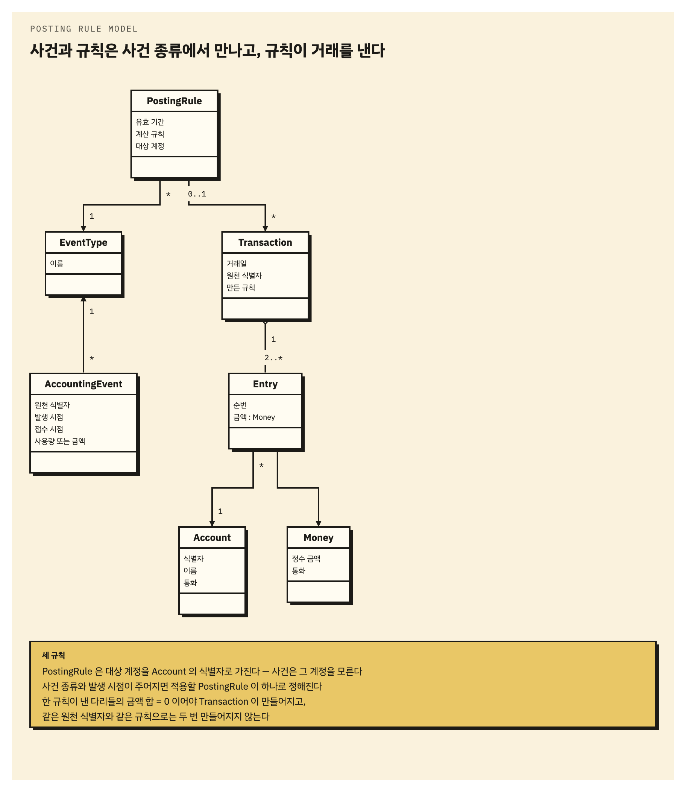

# Posting Rule — 무엇에 반응해 얼마를 어디에 적을지를 규칙 하나가 정한다

## 한눈에 보는 개요

전기를 파는 작은 회사의 원장 프로그램을 생각해 봅시다. 고객이 쓴 전기량이 사용량 사건으로 들어오면 그 금액을 원장에 적어야 해요. 3월 초에는 1 kWh 에 15원이었는데 3월 14일부터 18원으로 올랐고, 같은 날부터 사용료에 10% 부가세가 붙게 됐습니다. 전기하는 코드 한 곳이 사건 종류로 분기하고, 그 안에서 다시 날짜로 분기합니다.

```text
Before — 전기 코드가 사건 종류와 날짜로 분기하는 모델

  void 전기(사건 e) {
    if (e.종류 == 사용량) {
      if (e.?날짜 >= 3/14) 금액 = e.사용량 * 18;
      else                 금액 = e.사용량 * 15;
      미수금 += 금액;  사용료수익 -= 금액;
      if (e.?날짜 >= 3/14) { 세금 = 금액 / 10; 미수금 += 세금; 예수부가세 -= 세금; }
    } else if (e.종류 == 위약금) { ... }
  }

  요율이 또 바뀌면      → if 가 한 겹 더 붙는다
  세금이 특정 기간만이면 → 안쪽 if 에 또 한 겹
  e.?날짜 는 무엇인가    → 코드를 읽어야 안다. 그게 이 모델의 진짜 문제다
```

마지막 줄이 이 모델의 약점이에요. 3월 22일에 「3월 7일에 120 kWh 를 썼다」는 사실이 뒤늦게 도착하면 금액은 1,800원(120 × 15)이어야 합니다. 그런데 분기가 오늘 날짜를 보고 있으면 2,160원(120 × 18)이 되고, 세금 216원까지 따라 붙어 미수금이 2,376원으로 적힙니다. 576원이 조용히 어긋나는데, 어긋난 자리는 요율표가 아니라 `if` 하나예요.

Posting Rule 의 해법은 **「무엇에 반응해 · 얼마를 · 어디에」 셋을 규칙 인스턴스 하나에 담는 것**입니다. 어떤 사건 종류에 반응하는지와 언제부터 언제까지 유효한지도 그 인스턴스의 데이터예요. 그러면 규칙을 고르는 일이 분기가 아니라 조회가 됩니다. 그리고 그 조회의 열쇠를 사건의 **발생 시점**으로 정해 두면 늦게 도착한 사실이 그때의 규칙으로 계산돼요. 열쇠 하나가 정책 전체의 시간축을 정합니다.

```text
After — 규칙이 객체가 되고, 고르는 일이 조회가 된 모델

  규칙 등록부
    R1  USAGE  2026-03-01 ~ 2026-03-13   사용량 × 15원   미수금 / 사용료수익
    R2  USAGE  2026-03-14 ~              사용량 × 18원   미수금 / 사용료수익  → 과세 사건을 낸다
    R3  TAX    2026-03-14 ~              금액 × 10%      미수금 / 예수부가세

  전기 서비스가 하는 일 (정책을 하나도 모른다)
    사건 종류 + 발생 시점 ─▶ 규칙 하나 조회 ─▶ 규칙이 계산 ─▶ 합이 0 인 거래 한 건

  요율이 또 바뀌면       → 등록부에 줄 하나. 전기 서비스는 한 글자도 안 바뀐다
  3/7 사건이 3/22 에 오면 → 발생 시점으로 조회하므로 R1, 1,800원
```

> 기억법 — 규칙은 **무엇에 반응해 · 얼마를 · 어디에** 셋을 가진다. 하나라도 밖에 있으면 분기가 그 자리에 다시 생긴다.

분류는 Fowler 『Analysis Patterns』 의 회계 패턴이고(근거: Analysis Patterns 6장 「Inventory and Accounting」 §6.5 Posting Rules), 함께 쓰는 패턴은 [Account](../account/account-guide_v1.2.0.md) · [Transaction](../transaction/transaction-guide_v1.1.0.md) · [Quantity](../quantity/quantity-guide_v1.2.0.md) 입니다.

이 글의 예제는 전기를 파는 작은 회사의 총계정원장이에요. 차변·대변의 부호 규약과 원장·전기 같은 회계 기초는 [참고 문서 「복식부기와 회계 모델」](../../reference/accounting-model/accounting-model-ref_v1.0.2.md)이 풀어 두었고, 이 글은 그 위에서 3월 사용량의 값으로만 말합니다. 이 원장에서 규칙 한 벌은 사건 종류 · 유효 기간 · 계산 · 대상 계정을 스스로 갖고 계정은 번호(id)로만 가리키며, 한 번 실행해 내놓은 다리들은 **거래 팩토리**에서 합이 0 인지 확인받아 거래 한 건이 돼요. 그 거래가 자기 Entry 를 갖고, 자기를 만든 규칙과 원천 사건은 번호로만 가리킵니다. 같은 사건을 같은 규칙으로 두 번 전기하지 않는지는 **전기 서비스**가 전기 키로, 같은 사건 종류에 기간이 겹치는 규칙이 없는지는 **규칙 등록부**가 보고, 계정 잔액은 규칙이 보지 않는 값이라 거래가 전기된 뒤 따로 파생돼요. 규칙을 어디까지 한 덩어리로 묶을지, Entry 를 누가 가질지의 다른 선택지는 「상황이 달라지면」에서 나란히 봅니다.

```text
이 글이 고른 경계
  규칙 ──────── 사건 종류 · 유효 기간 · 계산 · 대상 계정을 스스로 가짐 (계정은 번호로만)
  거래 ──────── 자기 Entry 를 가짐 (합 = 0) · 규칙과 원천 사건은 번호로만 가리킴
  거래 팩토리 ── 다리가 2개 이상이고 합이 0 일 때만 거래를 만듦
  계정 ──────── 번호로만 등장
  전기 서비스 ── 전기 키 (원천 사건, 규칙) 로 두 번 전기를 막음
  규칙 등록부 ── 같은 사건 종류에 기간이 겹치는 규칙을 막음
  잔액 ──────── 규칙이 보지 않음 · 거래가 전기된 뒤 따로 파생
```

이 글은 시나리오 셋을 따라갑니다. 사용량 한 건이 거래가 되는 길, 요율이 오르고 늦은 사실이 도착하는 길, 그리고 조회 열쇠를 접수 시점으로 바꾸거나 Entry 하나짜리 거래를 내는 식으로 규칙을 어기면 어디서 막히고 무엇이 남는지요. 끝까지 읽으면 어떤 모델을 Posting Rule 패턴이라고 불러도 되는지 필수 조건 셋으로 판정할 수 있고, Strategy 나 이벤트 핸들러로 짠 코드와도 구분할 수 있게 됩니다.

## 패턴 자세히 들여다보기

### 시나리오 1 — 3월 7일의 사용량 한 건이 균형 잡힌 거래가 되기까지

원장을 막 연 회사에 사용량 사건 하나가 들어옵니다. 계정은 미수금(1200) · 사용료수익(4100) · 예수부가세(2200) 셋이고 통화는 모두 KRW 예요. 고객이 3월 7일에 120 kWh 를 썼고, 계량 시스템이 그 사실을 3월 9일에 보내 왔습니다. 나와야 하는 답은 하나예요. 미수금 +1,800 KRW 와 사용료수익 −1,800 KRW 두 다리를 가진 거래 한 건입니다. 이 장면에 여섯 이름이 나와요. 원천 사건은 이 원장 밖에서 일어난 사실 한 건이고 사건 종류는 그것이 무슨 일인지를 가르는 분류예요. PostingRule 은 사건을 기록으로 바꾸는 규칙이고 Transaction 은 한 업무 사건이 만든 기록 묶음입니다. Entry 는 계정 하나에 금액 하나가 오간 기록이고 Money 는 금액과 통화를 묶은 값이에요. 이름은 여기서 한 구절씩만 소개합니다. 정식 정의는 개념 정리가 맡아요.

```text
들어오는 것                              나가야 하는 것
원천 식별자 U-7731                       거래 T1
사건 종류   USAGE                          #1 미수금(1200)     +1,800 KRW
발생 시점   2026-03-07                      #2 사용료수익(4100) -1,800 KRW
접수 시점   2026-03-09                    합 = 0
사용량      120 kWh                       전기 키 = (U-7731, R1)
```

1. 원천 사건이 도착합니다. 이 컨텍스트가 받는 것은 위 왼쪽 다섯 칸뿐이에요 — 계정 이름도 금액도 들어오지 않습니다. 계정이 안 들어오는 이유는 사용량을 잰 쪽이 어느 계정에 적힐지 모르고, 알 필요도 없기 때문이에요. 사건이 계정을 지목하는 순간 요율표나 계정 과목표를 고칠 때마다 사건을 만드는 쪽까지 따라 고쳐야 합니다.
2. 사건 종류와 **발생 시점**으로 규칙을 고릅니다. `USAGE` 이고 2026-03-07 이니 유효 기간이 3월 1일부터 3월 13일까지인 R1 이에요. 고르는 코드는 규칙 이름을 모르고, 등록부에 「이 종류에 이 시점」으로 물을 뿐입니다. 접수 시점 3월 9일이 아니라 발생 시점으로 묻는 이유는 값이 「그때의 요율」이어야 하기 때문이에요. 이 선택이 어긋나면 어떻게 되는지는 시나리오 2 의 5단계와 시나리오 3 의 1단계가 보입니다.
3. 규칙이 계정별 금액을 계산합니다. R1 은 요율 15원과 대상 계정 둘(미수금 · 사용료수익)을 자기가 가지고 있어서, 120 × 15 = 1,800 을 구한 뒤 미수금 +1,800 과 사용료수익 −1,800 두 다리를 만들어 내놓아요. 계산과 대상 계정이 한 인스턴스에 같이 있는 이유는 둘이 **같이 바뀌기** 때문입니다. 요율만 바꾸고 계정은 그대로인 경우도 있지만, 새 수익 과목이 생기면 요율표와 계정이 한 벌로 바뀌어요. 따로 두면 두 곳을 맞춰 고쳐야 하고, 한쪽만 고친 상태가 유효한 상태처럼 보입니다.
4. 거래 팩토리가 다리들의 합이 0 인지 검사하고 거래를 만듭니다. +1,800 − 1,800 = 0 이라 T1 이 만들어져요. 이 판정을 규칙이 아니라 거래가 맡는 이유는 합 0 이 **한 거래에 속한 다리들 사이의** 규칙이기 때문입니다. 규칙마다 스스로 검사하게 두면 판정하는 자리가 규칙 수만큼 늘어나고, 새 규칙을 쓴 사람이 한 번 빠뜨리면 불균형 거래가 원장에 남아요.
5. 전기 서비스가 전기 키로 이미 전기했는지 보고 저장합니다. 키는 원천 식별자와 규칙 식별자를 묶은 `(U-7731, R1)` 이에요. 같은 키가 이미 있으면 새 거래를 만들지 않고 그 거래를 돌려줍니다. 이 검사를 규칙이 아니라 저장하는 자리에 두는 이유는 「이 사건을 이 규칙으로 처리한 적이 있는가」가 규칙 인스턴스 하나가 볼 수 있는 범위를 넘기 때문이에요. 규칙은 자기가 몇 번 불렸는지 모릅니다.

```text
단계  누가 → 누구에게            넘기는 것                   그 단계에서 지켜지는 것
 1    바깥 시스템 → 전기 서비스   종류 · 시점 · 사용량         계정은 넘어오지 않음
 2    전기 서비스 → 규칙 등록부   USAGE · 2026-03-07           적용 규칙이 하나로 정해짐 (R1)
 3    전기 서비스 → PostingRule   사건                        얼마를 · 어디에 는 규칙이 정함
 4    PostingRule → 거래 팩토리   다리 목록                    합 = 0, 다리 2개 이상
 5    전기 서비스 → 원장          거래 · 전기 키               같은 키로 두 번 전기되지 않음
```

잠깐, 확인 하나만 해 볼까요? 같은 120 kWh 를 3월 20일에 썼다면 금액은 얼마일까요? 2단계가 `USAGE` 와 2026-03-20 으로 묻고, 그 시점에 유효한 규칙은 3월 14일부터인 R2(요율 18원)예요. 그러니 120 × 18 = 2,160 KRW 입니다. 바뀐 것은 사건의 날짜 하나뿐이고 전기 서비스의 코드는 그대로예요.

이 시나리오가 보여 준 것은 책임이 어디서 나뉘는가입니다. 「무엇에 반응하는가」는 규칙의 속성이라 등록부가 조회로 답하고(2단계), 「얼마를 · 어디에」는 규칙 안에 있으며(3단계), 「이 묶음이 말이 되는가」는 거래가(4단계), 「이 처리를 한 적이 있는가」는 원장에 적기 직전의 전기 서비스가 전기 키로(5단계) 봅니다. 전기 서비스는 요율도 계정도 모르고, 앞의 세 자리를 순서대로 부른 뒤 이 확인 하나만 스스로 해요. 여기서 나온 이름들이 개념 정리로 모입니다.

### 시나리오 2 — 요율이 오르고, 사흘 뒤 사실이 보름 늦게 도착할 때

3월 14일부터 두 가지가 바뀝니다. 요율이 15원에서 18원으로 오르고, 같은 날부터 사용료에 10% 부가세가 붙어요. 그리고 사건 둘이 들어옵니다. 3월 20일에 쓴 120 kWh 가 3월 21일에(U-7732), 3월 7일에 쓴 120 kWh 가 3월 22일에 뒤늦게(U-7733) 도착해요. 나와야 하는 답은 셋입니다. U-7732 는 2,160 KRW 에 세금 216 KRW 가 붙고요. U-7733 은 1,800 KRW 이고 세금은 없습니다. 이 시나리오에서 새로 나오는 이름은 둘이에요. 규칙이 언제부터 언제까지 유효한지를 적은 유효 기간과, 규칙이 자기 결과를 담아 내보내는 파생 사건입니다.

1. 새 요율의 규칙 R2 를 3월 14일부터 유효하게 등록하고, 옛 규칙 R1 의 유효 기간은 3월 13일에서 끝납니다. R1 의 요율 숫자를 고치지 않는 이유는 고치는 순간 이미 R1 으로 전기한 거래들이 왜 그 금액인지 답할 근거가 사라지기 때문이에요. 규칙은 지우거나 덮어쓰는 것이 아니라 **기간으로 끝내고 다음 규칙을 잇는** 것입니다. 등록부는 같은 사건 종류에 기간이 겹치는 규칙이 둘 생기는 것을 이 자리에서 막아요(시나리오 3 의 5단계).
2. 세금 규칙 R3 을 **새 사건 종류** `TAX` 로 등록합니다. `USAGE` 에 규칙을 하나 더 붙이지 않는 이유는 같은 종류에 기간이 겹치는 규칙이 둘이면 시나리오 1 의 2단계가 답을 하나로 낼 수 없기 때문이에요. 대신 R2 에 「과세 대상」 표시를 두어, R2 가 실행될 때 자기가 구한 금액을 담은 `TAX` 사건을 하나 내보내게 합니다. 규칙이 다른 규칙을 직접 부르지 않는 이유도 같아요 — 부르는 순간 R2 안에 「세금 규칙은 R3」 이라는 이름이 들어가고, 그 이름을 바꾸려면 다시 코드를 고쳐야 합니다.
3. U-7732(발생 3/20, 접수 3/21)가 들어옵니다. 발생 시점으로 고른 규칙은 R2 이고, 120 × 18 = 2,160 이라 T2 가 만들어져요. 이어서 R2 가 내보낸 파생 사건 — 원천 식별자는 그대로 `U-7732`, 종류는 `TAX`, 금액은 2,160 — 이 같은 흐름을 한 번 더 거쳐 R3 으로 계산되고, 2,160 의 10% 인 216 이 T3 이 됩니다. 파생 사건이 원천 식별자를 그대로 물려받는 이유는 그 세금이 **어느 사실 때문에 생겼는지**가 기록에 남아야 해서예요.
4. 여기서 전기 키가 왜 **쌍**인지가 확인됩니다. T2 의 키는 `(U-7732, R2)`, T3 의 키는 `(U-7732, R3)` 이에요. 만약 원천 식별자 하나만 키로 썼다면 T3 을 저장하려는 순간 「U-7732 는 이미 전기됨」이 되어 예수부가세 216 이 영영 생기지 않습니다. 이 시나리오가 끝났을 때 거래는 T1~T4 넷인데 원천 식별자는 U-7731 · U-7732 · U-7733 셋이고(직접 실행해 확인), 줄어든 하나가 바로 세금 거래 T3 이에요.
5. U-7733(발생 3/7, 접수 3/22)이 들어옵니다. 조회의 열쇠가 발생 시점이므로 2026-03-07 로 묻고, 답은 R1 이에요. 120 × 15 = 1,800 이 되어 T4 가 만들어지고, R1 에는 과세 대상 표시가 없으니 파생 사건도 없습니다. 접수 시점 2026-03-22 로 물었다면 R2 가 나와 2,160 이 되고 세금 216 까지 붙었을 거예요(시나리오 3 의 1단계). 늦게 온 사실을 그때의 규칙으로 처리하는 것이 이 패턴이 유효 기간을 두는 이유입니다.
6. 무엇이 바뀌었는지 셉니다. 늘어난 것은 규칙 등록부의 줄 둘(R2 · R3)과 R1 의 종료일 하나예요. 거래 팩토리 · Entry · Account · 전기 서비스는 한 글자도 바뀌지 않았습니다. 이 셈을 마지막에 두는 이유는 패턴의 효과가 나타나는 자리가 바로 여기이기 때문이에요 — 정책이 바뀔 때 손대는 곳이 데이터 쪽으로 옮겨 갔는지가 이 패턴을 쓴 보람입니다.

| 무엇 | 3월 14일 전 | 3월 14일 후 |
| --- | --- | --- |
| 규칙 등록부 | R1 하나 | R1(3/13 까지) · R2 · R3 |
| 3/20 사용 120 kWh | 1,800 KRW | 2,160 KRW + 세금 216 KRW |
| 3/7 사용 120 kWh (3/22 접수) | 1,800 KRW | 1,800 KRW (그대로) |
| 전기 서비스 코드 | — | 그대로 |
| 거래 팩토리 · Entry · Account | — | 그대로 |

이 시나리오가 보여 준 것은 변화가 들어올 때 움직이는 것과 안 움직이는 것입니다. 정책은 규칙 인스턴스의 추가로 들어오고(1·2단계), 규칙을 고르는 열쇠가 발생 시점이라 지난 사실의 답이 오늘 바뀌지 않으며(5단계), 한 사건이 규칙 둘을 부르게 되면서 전기 키가 쌍이어야 할 이유가 처음으로 값으로 확인됐어요(4단계). 파생 사건은 규칙끼리의 호출을 사건 흐름 하나로 되돌려 놓는 장치이고(2·3단계), 덕분에 규칙 둘은 서로의 이름을 모른 채 이어집니다.

### 시나리오 3 — 접수 시점 조회 · 다리 하나 · 어긋난 금액 · 다시 전기 · 겹친 기간은 어디서 막히고 무엇을 남기는가

같은 원장에 규칙을 어기는 일이 다섯 들어옵니다. 조회의 열쇠를 접수 시점으로 바꾸는 것, 규칙이 다리를 하나만 내는 것, 두 다리의 금액이 어긋나는 것, 같은 사건을 같은 규칙으로 다시 전기하는 것, 그리고 기간이 겹치는 규칙을 등록하는 것이에요. 아래 값은 모두 Java 21 로 실제 컴파일해 실행하거나, 코드를 그렇게 고쳐 실행해 확인한 것입니다.

1. 조회의 열쇠를 **접수 시점**으로 바꿉니다. U-7733 은 3월 7일에 일어난 일인데 3월 22일로 조회되어 R2 가 선택되고, 1,800 대신 2,160 이 됩니다. R2 는 과세 대상이라 세금 216 까지 따라 붙어 미수금에 적히는 값이 2,376 이 돼요 — 1,800 에서 576 이 벌어집니다. 눈여겨볼 것은 이때도 거래는 균형이 맞고 전기 키도 유일하다는 점이에요. 어긋나는 것은 모델의 형식이 아니라 **금액의 근거**입니다. 3월 7일에 유효하지 않았던 요율로 3월 7일의 사실을 계산했으니까요.
2. 규칙이 **다리를 하나만** 냅니다. 미수금 +1,800 만 내놓으면 거래 팩토리가 `Entry 는 2개 이상이어야 합니다` 로 거절하고 거래 객체 자체가 생기지 않아요. 만드는 자리에서 막는 이유는 한 번이라도 다리 하나짜리 기록이 원장에 들어가면 그 1,800원이 어디서 왔는지 답할 상대가 없기 때문입니다. 원전의 규칙 예제가 바로 이 모양 — 계정 하나에 항목 하나 — 이고, 이 가이드가 출력 단위를 다르게 정했기 때문에 여기서 거절됩니다. 그 차이는 상황 설정에서 따로 밝힐게요.
3. 규칙이 두 다리를 내되 한쪽 금액이 어긋납니다. 차변에 +1,800 을 쓰고 대변에 요율을 12원으로 잘못 넣어 계산한 −1,440(120 × 12)을 쓰면 `KRW 합이 0 이 아닙니다: 360` 으로 거절돼요. 2단계와 이 단계의 차이가 중요합니다 — 2단계는 다리 수가 모자란 것이고, 여기는 다리 수는 맞는데 금액이 어긋난 것이에요. 검사가 둘 다 필요한 이유가 그것이고, 규칙을 새로 쓰는 사람이 실제로 자주 내는 실수는 뒤쪽입니다.
4. 같은 사건을 같은 규칙으로 다시 전기합니다. U-7733 을 R1 으로 한 번 더 넣으면 전기 키 `(U-7733, R1)` 이 이미 있으니 새 거래를 만들지 않고 T4 를 돌려주고, 거래 수는 4 그대로예요. 멱등 검사를 뺀 코드로 실행해 보면 T5 가 새로 생겨 거래 수가 5 가 되고 미수금 +1,800 KRW 이 한 번 더 쌓입니다. 재전송이나 재시도는 드문 일이 아니라서, 이 검사가 없으면 청구서가 두 배로 나가는 길이 늘 열려 있어요.
5. 기간이 겹치는 규칙을 등록합니다. 3월 20일부터 유효한 요율 20원짜리 R9 를 등록하려 하면 `USAGE 사건 종류에 유효 기간이 겹치는 규칙이 있습니다: R2` 로 등록 시점에 거절돼요. 이 검사를 빼고, R9 등록을 사건 루프 **앞으로 옮겨** 실행해 보면 3월 20일 사건의 금액이 등록 순서에 따라 달라집니다. R2 를 먼저 등록하면 2,160, R9 를 먼저 등록하면 2,400 이 나왔어요. 검사만 빼서는 값이 안 바뀌어요 — 원래 코드에서는 R9 등록이 사건 처리가 끝난 뒤에 오니까 거절 메시지만 사라져요. 같은 입력에 두 답이 나오는데 어느 쪽이 맞는지 모델 안에 정한 것이 없습니다.

```text
어긴 규칙                  막히는 자리          막히지 않으면 어긋나는 값
발생 시점으로 조회          없음 (조회의 열쇠)    U-7733 미수금 1,800 → 2,376 (세금 216 포함)
다리 2개 이상              거래를 만드는 자리    상대 없는 미수금 +1,800 이 원장에 남음
다리 금액 합 = 0           거래를 만드는 자리    원장에 합 +360 인 거래
전기 키가 유일             저장하는 자리        거래 수 4 → 5, 미수금 +1,800 이 한 번 더
같은 종류에 기간 비중첩     규칙 등록 시점       3/20 사건이 2,160 또는 2,400, 등록 순서에 따라 달라짐
```

이 시나리오가 보여 준 것은 규칙마다 지켜지는 자리가 다르다는 것입니다. 다리 수와 합은 거래를 만드는 자리에서, 중복 전기는 저장하는 자리에서, 기간 겹침은 규칙을 등록하는 자리에서 막혀요. 뒤 셋은 코드가 실제로 거절 메시지를 냅니다. 그런데 1단계에는 막는 자리가 없어요 — 접수 시점으로 조회해도 만들어지는 거래는 형식이 완벽합니다. 이것이 조회의 열쇠를 코드의 한 줄이 아니라 패턴의 조건으로 적어 두어야 하는 이유예요. 기계가 잡아 주지 않는 자리는 사람이 기준으로 지켜야 합니다.

### 개념 정리

시나리오에 나온 분석 층위의 개념 일곱을 정식으로 정의합니다. 이 절이 정하는 것은 개념이 무엇을 책임지고 누구와 협력하는가까지예요. 그 책임을 코드의 어느 객체가 지는지, 무엇이 aggregate 의 root 인지는 뒤의 「상황 설정」 표가 정합니다.

- **PostingRule**(전기 규칙) — 어떤 종류의 업무 사건이 일어났을 때 얼마를 어느 계정에 적을지를 담은 규칙 한 벌입니다.
  - 책임: 자기가 반응할 사건 종류와 유효 기간을 속성으로 갖고, 사건 하나를 받아 계정별 금액 목록을 계산해 내놓습니다. 대상 계정을 자기가 가지고, 저장은 하지 않아요(시나리오 1 의 3단계).
  - **유효 기간** — 그 규칙이 적용되는 날짜 구간이에요. 사건의 **발생** 시점이 이 구간 안일 때만 그 사건을 맡습니다. 접수 시점과 발생 시점이 다를 수 있다는 것이 이 구분의 전부이고, 둘이 늘 같은 도메인이면 이 속성은 필요 없어요.
  - **계산 규칙** — 사건의 수량이나 금액을 결과 금액으로 바꾸는 식입니다. 이 글의 예제에는 둘이 나와요 — 단위당 요율을 곱하는 것과 기준 금액의 비율을 잡는 것.
  - 협력: 사건 종류 하나를 가리키고, 대상 계정을 Account 의 식별자로 가리키며, 실행 결과가 Transaction 하나가 됩니다.
- **AccountingEvent**(원천 사건) — 이 원장 밖에서 일어난 업무 사실 한 건입니다. 사용량 측정, 청구, 결제 같은 것이에요.
  - 책임: 자기가 무슨 종류인지, 언제 일어났고 언제 접수됐는지, 수량이나 금액이 얼마인지를 전달합니다. 어느 계정에 적힐지는 모르고, 스스로 기록을 만들지도 않아요(시나리오 1 의 1단계).
  - 협력: 사건 종류 하나에 속하고, 자기 때문에 생긴 Transaction 에 원천 식별자로 남습니다. 규칙이 과세 같은 후속 처리를 낼 때는 같은 원천 식별자를 가진 파생 사건이 새로 생겨요(시나리오 2 의 3단계).
- **EventType**(사건 종류) — 사건을 가르는 분류입니다. 이 글의 예제에서는 사용량(`USAGE`)과 과세(`TAX`) 둘이에요.
  - 책임: 사건과 규칙이 서로를 모른 채 만나는 접점이 됩니다. 규칙을 고르는 조회가 이 분류를 열쇠로 써요(시나리오 1 의 2단계).
  - 협력: 사건이 자기 종류 하나를 가리키고, 규칙도 자기가 반응할 종류 하나를 가리킵니다. 사건과 규칙은 서로를 직접 가리키지 않아요.
- **Transaction**(거래) — 한 업무 사건이 만든 Entry 묶음이고, 묶인 Entry 금액의 합은 통화별로 0 입니다.
  - 책임: 거래일을 갖고, 다리들의 합이 0 인지 판정하고, 자기를 만든 원천 사건과 규칙을 식별자로 가리킵니다(시나리오 1 의 4·5단계). 거래 자체의 규칙은 별도 가이드가 맡고, 이 글은 규칙의 출력이 어떤 모양이어야 하는지를 말하는 만큼만 다뤄요.
  - 협력: Entry 를 2개 이상 묶고, 원천 식별자와 규칙 식별자의 쌍이 그 거래의 전기 키가 됩니다.
- **Entry**(항목) — 계정 하나에 금액 하나가 오간 사실 한 건입니다.
  - 책임: 어느 Account 에 얼마가 기록됐는지를 담습니다. 같은 거래 안에서는 순번으로 서로 구별돼요.
  - 협력: 정확히 한 Account 에 속하고, 금액은 Money 입니다. 계정 쪽에서 본 Entry 의 뜻은 [Account 가이드](../account/account-guide_v1.2.0.md)가 풀어요.
- **Account**(계정) — 금액 기록을 모으는 기준이 되고, 그 합인 잔액에 답하는 개념입니다.
  - 책임: 식별자로 자기를 구별하고 받을 금액의 통화를 정합니다. 이 글에서는 규칙이 가리키는 대상이자 Entry 가 속하는 자리로만 나와요.
  - 협력: 규칙이 대상 계정으로 가리키고, Entry 가 속합니다.
- **Money**(금액) — 금액과 통화를 묶은 값입니다. 이 글의 예제는 금액을 정수 최소 단위로 적어요(KRW 는 1원).
  - 책임: 통화가 다른 금액끼리는 더하지 않습니다. 부호가 방향이에요.
  - 협력: Entry 의 금액과 규칙의 계산 결과가 Money 입니다. 금액을 단위를 가진 수량의 한 종류로 보는 관점은 [Quantity 가이드](../quantity/quantity-guide_v1.2.0.md)가 풀어요.



그림에서 눈여겨볼 곳은 PostingRule 과 AccountingEvent 사이에 **선이 없다**는 점이에요. 둘은 EventType 이라는 같은 지점을 각자 가리킬 뿐이고, 그래서 사건을 만드는 쪽이 규칙을 몰라도 되고 규칙을 늘려도 사건 쪽이 바뀌지 않습니다. 오른쪽 부분은 규칙의 산출물이에요 — 규칙 하나가 거래를 여럿 만들 수 있고(같은 규칙이 사건마다 한 번씩 실행되니까요), 거래마다 붙는 규칙은 없거나 하나입니다. 사람이 손으로 넣은 거래에는 규칙이 없어서 `0..1` 이에요(근거: Analysis Patterns 그림 6.27 의 creator 연관). 그리고 분석 모델은 연관만 정할 뿐 누가 누구를 소유하는지는 정하지 않습니다. 소유는 설계가 정하고, 그 선택지는 「상황이 달라지면」에서 나란히 봅니다.

## 사용 목적

Posting Rule 이 필요할 때는 요구서나 코드에서 보이는 단서가 있어요. 셋을 차례로 봅시다.

#### 단서 1 — 요율·수수료 정책이 날짜마다 바뀌는데, 지난 날짜의 사실이 뒤늦게 들어옵니다

「3월 14일부터 요율 인상」 같은 문장과 「사용량은 최대 2주까지 늦게 도착할 수 있음」 같은 문장이 같은 요구서에 함께 있으면 이 패턴 자리예요. 두 문장이 함께 있다는 것은 **오늘 날짜로 계산하면 틀린다**는 뜻이고, 그러면 계산식마다 「어느 날짜의 정책인가」를 함께 가지고 있어야 합니다.

```text
요구서의 두 문장                            현재 요율 하나로 답할 수 있는가
────────────────────────────────────       ──────────────────────────────
3/14 부터 kWh 당 18원                       예
사용량은 최대 2주 늦게 도착할 수 있음         아니오 — 발생 시점의 요율이 필요
3/14 부터 사용료에 부가세 10%                아니오 — 그 전 사건에는 붙으면 안 됨
```

#### 단서 2 — 사건 종류에 따른 분기가 한곳에 쌓이고, 종류가 늘 때마다 그 한곳을 고칩니다

개요의 Before 처럼 `if (e.종류 == …)` 가 늘어서 있고, 새 과금 항목이 생길 때마다 그 메서드에 분기를 하나 더 넣는 상황이에요. 분기 자체가 나쁜 것은 아니지만, **고치는 자리가 늘 같은 한 곳**이면 그 코드가 정책의 목록이 돼 버린 것입니다.

```text
전기 코드 한 곳이 정책의 목록이 되어 가는 모양

  과금 항목이 늘어난 이력       그때마다 고친 자리
  기본요금 추가                 post() 의 if 사슬
  사용량 과금 추가              post() 의 if 사슬
  부가세 추가                   post() 의 if 사슬 안쪽
  "지금 어떤 과금이 있나요?"     → post() 를 처음부터 읽어야 답이 나옴
```

#### 단서 3 — 한 업무 사실이 여러 기록을 낳고, 그 조합이 정책마다 다릅니다

사용료만 적는 계약도 있고 사용료와 부가세를 함께 적는 계약도 있는 식이요. 조합이 고정이면 코드 한 줄로 충분한데, 조합이 정책의 일부라면 그 조합도 데이터로 나와 있어야 해요.

#### 쓰지 말아야 할 경우

반대로 아래 두 경우에는 쓰면 잃는 것이 더 큽니다.

| 쓰지 말아야 할 상황 | 쓰면 잃는 것 |
| --- | --- |
| 규칙이 둘뿐이고 몇 년째 안 바뀜 (고정 수수료 원장) | 조회 · 등록부 · 유효 기간이라는 간접 층을 얻고, 읽는 사람은 「이 사건에 무슨 일이 일어나는가」를 알려고 등록부의 데이터까지 열어야 함. 분기 두 줄이 하는 일을 세 개념이 함
| 사건이 이미 계정과 금액을 다 정해서 옴 (다른 시스템이 분개를 만들어 보냄) | 규칙이 정할 「얼마를 · 어디에」가 없어 빈 껍데기가 되고, 규칙 조회는 사건을 그대로 옮겨 적는 일로만 남음. 이때 필요한 것은 규칙이 아니라 검증과 전기 키 |

비슷한 단서에서 다른 모델을 고르게 되는 자리가 둘 더 있어요. 계산식은 그대로인데 계수와 대상 계정만 자주 바뀌면 매핑 테이블 쪽을 먼저 보고, 계산 방법만 갈아 끼우면 되는 상황이면 Strategy 를 봅니다. 차이는 다음 절에서 풀어요.

## 패턴의 경계

### 디자인 패턴을 충족하는 최소 조건

어떤 모델을 Posting Rule 패턴이라고 불러도 되는지 가르는 기준입니다. 클래스 모양이 아니라 개념이 맡는 책임과 모델이 늘 지키는 불변식으로 판정해요 — 규칙을 클래스 계층으로 짜든 데이터 한 줄로 짜든 같은 기준으로 판정할 수 있어야 하니까요. `[필수]` 에는 원전이 Posting Rule 의 성립 요건으로 든 것만 올렸고, 원전이 흔한 규칙이나 구현 선택지로 든 것과 이 가이드 예제의 정책은 번호 순서와 무관하게 `[선택]` 입니다.

1. [필수] 규칙은 독립된 객체 — 어떤 사건에 반응해 얼마를 계산하고 어느 계정에 내보낼지가 코드의 분기가 아니라 규칙 인스턴스 하나에 담기고, 규칙을 더하거나 갈아 끼우는 일이 그 인스턴스를 더하거나 바꾸는 일로 끝납니다. 시나리오 2 의 1단계 (근거: Analysis Patterns 그림 6.7 이 Posting Rule 을 계수를 가진 독립 타입으로 두고 트리거·출력 계정과 연관시킨다 · apsupp accounting.pdf 의 `PostingRule` 추상 클래스와 그 하위 클래스들)
   - 빠지면: 사건 종류로 분기하는 `if` 사슬을 가진 전기 서비스가 됩니다. 개요의 Before 가 그 모양이고, 정책이 하나 늘 때마다 고치는 자리는 규칙이 아니라 그 서비스예요.
2. [필수] 규칙을 고르는 기준은 규칙에 붙은 데이터 — 어떤 입력에 반응하는가(사건 종류, 또는 트리거가 되는 계정)가 규칙의 속성이고, 고르는 쪽은 그 속성으로 조회할 뿐 규칙의 이름을 알지 못합니다. 시나리오 1 의 2단계 (근거: Analysis Patterns 그림 6.7 의 트리거 Account — Posting Rule 연관 · apsupp accounting.pdf 의 `getRule(EventType, Date)` · eaaDev Agreement Dispatcher 가 사건 타입을 키로 하는 맵에서 처리기를 찾는 구조)
   - 빠지면: 규칙 객체는 있는데 고르는 곳이 `switch (사건.종류) { case USAGE: return 사용료규칙; … }` 입니다. 규칙을 하나 더 만들 때 그 `switch` 를 반드시 함께 고쳐야 하니, 규칙을 객체로 뺀 이득이 그 한 줄 때문에 사라져요.
3. [필수] 대상 계정은 규칙이 가지고 원천 사건은 모름 — 어느 계정에 얼마가 가는지는 규칙이 정하고, 사건은 자기가 무슨 일이었는지와 수량·금액만 전달합니다. 시나리오 1 의 1·3단계 (근거: apsupp accounting.pdf 의 `PostingRule.makeEntry` 가 규칙이 가진 항목 종류로 Entry 를 만든다 · eaaDev Agreement Dispatcher 의 `PostingRule(AccountType type, …)` 생성자와 `makeEntry` · Analysis Patterns 그림 6.7 의 출력 Account — Posting Rule 연관)
   - 빠지면: 사용량 사건 객체가 「사용료수익 계정」을 직접 지목해 넣습니다. 계정 과목표를 바꾸면 사건을 만드는 쪽 — 이 원장 **밖** 의 시스템 — 까지 함께 고쳐야 해요.
4. [선택] 한 원천 사건은 같은 처리로 두 번 전기되지 않음 — 같은 사실이 두 번 도착해도 기록은 한 번만 남고, 두 번째 시도는 새 기록을 만들지 않습니다. 시나리오 3 의 4단계 (근거: 이 가이드의 정책 — [회계 배경 확정안](../../research/accounting-context.md) 의 불변식 I3)
   - 빠지면 잃는 것: 재전송 한 번에 청구액이 두 배가 됩니다. 멱등 검사를 뺀 코드로 실행해 보니 같은 사건·같은 규칙 재시도가 T5 를 새로 만들어 거래 수가 4 에서 5 로 늘고, 미수금 +1,800 KRW 이 한 번 더 쌓였어요.
   - 왜 `[선택]` 인가: **원전에서 이것을 성립 요건으로 적은 자리를 찾지 못해 `[선택]` 에 둡니다.** 저자 보충 자료의 예제 코드에 같은 사건을 두 번 처리하지 못하게 막는 단언이 있기는 해요. 그런데 저자가 그 예제에서만 사건 클래스를 처리기로 삼았다고 스스로 밝혔고, 단언이 붙은 클래스도 규칙이 아니라 사건입니다. 규범 쪽 서술에는 중복 처리 이야기가 없어요. 그러니 이 조건은 복식부기 원장을 전제한 이 가이드의 판단입니다. 「같은 처리」의 단위를 (원천 사건, 규칙) 쌍으로 잡은 것도 같은 판단이고, 그 자리는 조건 7 에 따로 두었어요.
5. [선택] 유효 기간과 발생 시점 조회 — 규칙마다 적용 기간을 두고, 늦게 도착한 사건은 접수 시점이 아니라 **발생 시점**에 유효했던 규칙으로 계산합니다. 시나리오 2 의 5단계(있을 때) · 시나리오 3 의 1단계(없을 때) (근거: Analysis Patterns 그림 6.7 의 단순 Posting Rule 에는 유효 기간이 없고, JAOO(덴마크에서 열리던 소프트웨어 개발 학회) 1999 튜토리얼이 규칙이 시점마다 바뀌는 문제의 해법으로 `effectivity: Date Range` 를 뒤에 더한다 — 원전이 성립 요건이 아니라 규칙이 바뀌는 상황에 더하는 장치로 적은 자리다. apsupp accounting.pdf 의 `getRule(EventType, Date)` 와 eaaDev Agreement Dispatcher 의 늦게 도착한 사건 예가 그 형태)
6. [선택] 출력 단위는 균형 잡힌 거래 한 건 — 규칙 한 번의 실행이 금액 합 0 인 Entry 묶음 한 건을 냅니다. 시나리오 1 의 4단계 (근거: 이 가이드의 정책 — [회계 배경 확정안](../../research/accounting-context.md) 10절. 원서 그림 6.27 은 Posting Rule 을 Transaction 의 creator 로 두지만 apsupp accounting.pdf 와 eaaDev 의 규칙 코드는 계정 하나에 항목 하나를 만든다. 원전만으로는 출력 단위가 하나로 정해지지 않는다)
   - 경계 사례: 시나리오 3 의 2단계가 이 정책 때문에 항목 하나짜리 출력이 거절되는 자리예요.
7. [선택] 전기 키는 (원천 사건, 규칙) 쌍 — 조건 4 의 「같은 처리」를 사건 식별자 하나가 아니라 사건과 규칙의 쌍으로 셉니다. 시나리오 2 의 4단계 (근거: 이 가이드의 정책 — [회계 배경 확정안](../../research/accounting-context.md) 의 불변식 I3 과 확정 항목 5. 한 사건이 규칙 여럿을 부를 수 있어서 사건 식별자 하나로는 두 번째 전기가 막힌다)
8. [선택] 규칙마다 자기 계산을 가짐 — 계산을 규칙 바깥의 공통 코드가 아니라 규칙 인스턴스가 가지고 있어, 새 계산 방식이 규칙을 더하는 일로 들어옵니다. 시나리오 2 의 2단계 (근거: JAOO 1999 튜토리얼의 Individual Instance Method, 그리고 Analysis Patterns 그림 6.9 · 6.10 · 6.12 · 6.13 이 주별 세금 계산을 싱글톤 하위 클래스 · 계산 전략 객체 · `case` 문 · 요율 매개변수 넷 중 무엇으로 둘지 나란히 비교한다 — 원전이 선택지로 늘어놓은 자리라 성립 요건이 아니다)
   - 예: 시나리오 2 의 2단계에서 비율 계산의 R3 이 요율 계산의 R1·R2 옆에 그냥 놓인 것이 이 조건이에요.
9. [선택] 규칙은 다른 규칙을 부르지 않고 파생 사건을 냄 — 후속 처리가 필요하면 규칙이 그 규칙을 직접 부르는 대신 새 사건을 내보내 같은 흐름에 올립니다. 시나리오 2 의 2·3단계 (근거: apsupp accounting.pdf 의 규칙이 과세 대상이면 세금 사건을 따로 만들어 같은 처리 흐름에 올린다)
10. [선택] 산출물이 원천을 가리킴 — 규칙이 만든 기록에 어느 사건과 어느 규칙 때문에 생겼는지가 남습니다. 시나리오 1 의 5단계 (근거: apsupp accounting.pdf 가 규칙이 만든 Entry 를 원천 사건에 되붙이고 사건과 Entry 사이에 원천 연관을 둔다 · Analysis Patterns 그림 6.27 의 creator 연관)
    - 예: 시나리오 1 의 5단계에서 전기 키가 그 두 식별자로 만들어진 것이 이 조건이에요.
11. [선택] 같은 사건 종류에 유효 기간이 겹치는 규칙이 없음 — 조건 5 를 두면 따라오는 짝으로, 같은 사건 종류에 기간이 겹치는 규칙을 둘 이상 두지 않습니다. 시나리오 3 의 5단계 (근거: 이 가이드의 정책 — [회계 배경 확정안](../../research/accounting-context.md) 의 불변식 I6)
    - 빠지면 잃는 것: 같은 입력에 답이 하나라는 성질입니다. 시나리오 3 의 5단계가 이 검사를 뺐을 때 같은 입력에 두 답이 나오는 것을 보인 자리예요.

> 필수는 셋이다 — 규칙이 객체인가, 고르는 기준이 데이터인가, 대상 계정을 규칙이 가지는가.

### 비슷한 패턴·안티패턴과의 차이

Posting Rule 과 닮아 보이거나 같은 단서에서 떠오르는 다섯을 구분 기준부터 모았어요. 먼저 이 표가 무엇을 하지 않는지 밝혀 둘게요. 표의 기준은 **이웃과 다른 자리만** 봅니다. 같은 사건을 두 번 전기하지 않는지(조건 4)는 어느 이웃과도 다르지 않아서 여기서는 묻지 않고 최소 조건이 혼자 봐요. 그래서 이 표만으로 「이 패턴이다」가 확정되지는 않습니다. 표는 이웃을 걸러 내는 일을 하고, 확정은 최소 조건이 해요.

| 대상 | 구분 기준 | Posting Rule 을 고르면 얻는 것 | 포기하는 것 |
| --- | --- | --- | --- |
| 서비스 코드의 조건 분기 (정책이 자주 바뀌는 곳에 쓰면 안티패턴) | 정책이 하나 늘 때 고치는 것이 데이터 한 줄인가, 코드 한 곳인가 | 정책 목록이 데이터로 나와 있고, 지난 정책이 기간과 함께 남음 | 흐름을 한 화면에서 읽는 직관. 「이 사건에 무슨 일이 일어나는가」를 알려면 등록부를 열어야 함 |
| Strategy | 정책이 바뀔 때 갈아 끼우는 객체가 가진 것이 계산뿐인가, 계산과 **선택 기준과 대상 계정**까지인가 | 고르는 코드가 없어짐 — 고르는 일이 조회가 됨 | 계산만 갈아 끼우면 되는 자리에도 사건 종류·유효 기간·대상 계정이 따라옴 |
| 이벤트 핸들러(구독자) | 반응의 결과가 **회계 항목**인가, 임의의 부수 효과인가 | 결과가 늘 같은 모양(계정과 금액)이라 균형과 멱등을 한곳에서 검사할 수 있음 | 메일 발송이나 캐시 갱신 같은 다른 반응은 담지 못함 |
| 계정 매핑 테이블 | 테이블을 읽어 **적용하는 주체**가 규칙 객체인가, 서비스 코드인가 | 계산과 매핑이 한 인스턴스에 있어 같이 바뀌는 둘이 같이 움직임 | 계산이 필요 없는 단순 매핑에는 규칙 객체가 과함 |
| Knowledge Level | 대체가 아니라 포함 — 지식 층위 객체가 사건에 반응해 **기록을 만드는가**, 운영 층위의 타입과 제약만 기술하는가 | 회계에 맞춘 구체적인 출력 규약(계정·금액·균형)을 얻음 | 회계 밖의 일반적인 타입 모델링에는 쓸 수 없음 |

#### 서비스 코드의 조건 분기와의 차이

구분 기준은 정책이 하나 늘 때 고치는 것이 데이터 한 줄인가, 코드 한 곳인가입니다. 개요의 Before 가 코드 한 곳을 고치는 쪽이고, 시나리오 2 의 6단계에서 요율 인상과 부가세가 등록부의 줄 둘과 종료일 하나로 끝난 것이 데이터 한 줄 쪽이에요. Posting Rule 을 고르면 정책 목록이 데이터로 나와 있고 지난 정책이 기간과 함께 남습니다. 대신 흐름을 한 화면에서 읽는 직관을 포기해요. 「이 사건에 무슨 일이 일어나는가」를 알려면 등록부를 열어야 합니다.

#### Strategy 와의 차이

구분 기준은 정책이 바뀔 때 갈아 끼우는 객체가 가진 것이 계산뿐인가, 계산에 더해 선택 기준과 대상 계정까지인가입니다. 여기서 헷갈리기 쉬운 포인트는 구현 수단이에요. 이 가이드의 규칙도 계산 규칙(요율 곱하기 · 비율 잡기)을 갈아 끼우는 작은 인터페이스로 두어서, 「Strategy 를 썼으니 Posting Rule 이 아니다」라고 읽기 쉽습니다. 가르는 것은 **구현 수단이 아니라 교체되는 객체가 가진 것**입니다. 아래는 계산만 가진 모양이에요.

```java no-compile
// Posting Rule 처럼 보이지만 규칙이 쥔 것이 계산뿐인 모델
interface RateCalculator { long amount(UsageEvent e); }

class BillingService {
    private final Map<String, RateCalculator> calculators = ...;
    void post(UsageEvent e) {
        long amount = calculators.get(e.kind()).amount(e);   // 얼마를: 교체 가능
        ledger.post(RECEIVABLE, amount);                     // 어디에: 이 코드에 박혀 있음
        ledger.post(USAGE_REVENUE, -amount);
    }
}
```

`calculators` 에서 꺼내 오니 조건 2 를 만족하는 것처럼 보이지만, 반응 기준이 규칙이 아니라 서비스의 맵에 있으니 조건 2 도 실은 빠져 있어요. 대상 계정 둘도 서비스 코드에 그대로 있습니다. 새 수익 과목이 생기면 고치는 자리가 계산기가 아니라 이 서비스예요 — 조건 3 이 빠진 것이고, 시나리오 1 의 3단계가 계산과 대상 계정을 왜 한 인스턴스에 두는지 보인 자리가 바로 여기입니다. 거꾸로, **대상 계정과 사건 종류까지 그 인터페이스 구현이 가지고 있다면 그것은 Strategy 로 구현한 Posting Rule 이지 다른 패턴이 아니에요.** 이름이 `RateCalculator` 여도 필수 조건 셋을 만족하면 이 패턴입니다.

```text
무엇을 가졌는가          무엇에 반응해   얼마를   어디에   판정
계산만 가진 인터페이스    서비스의 맵     자기      서비스   Strategy (조건 2·3 빠짐)
셋 다 가진 인터페이스     자기 속성       자기      자기     Posting Rule (구현이 Strategy 일 뿐)
```

#### 이벤트 핸들러와의 차이

구분 기준은 반응의 결과가 회계 항목인가입니다. 사건 종류로 등록되고, 자기 대상을 가지고, 멱등 키로 중복 처리를 막는 알림 발송기를 생각해 보세요. 필수 조건 1(핸들러 인스턴스)과 2(사건 종류로 등록)를 만족하고 조건 4 의 멱등 키까지 갖췄는데 Posting Rule 이 아닙니다. 걸러 내는 것은 조건 3 의 「대상 **계정**」이에요. 발송기가 가진 것은 수신자 목록이고, 복식부기 원장을 전제하면 그 반응은 합이 0 인 묶음을 내지도 않습니다. 조건 3 을 그냥 「대상」이라고 뭉뚱그려 적으면 이 반례가 통과해 버려요. 결과의 모양이 구분 기준입니다.

```text
알림 발송기                  Posting Rule
사건 종류로 등록됨   ✓        사건 종류로 등록됨   ✓
대상(수신자)을 가짐  ✓        대상(계정)을 가짐    ✓
멱등 키로 중복 차단  ✓        멱등 키로 중복 차단  ✓
결과 = 메일 한 통             결과 = 합이 0 인 Entry 묶음
구분 기준: 결과가 계정과 금액인가 (조건 3)
```

#### 계정 매핑 테이블과의 차이

구분 기준은 테이블을 읽어 적용하는 주체가 규칙 객체인가, 서비스 코드인가입니다. OFBiz 같은 시스템은 업무 항목 유형을 원장 계정으로 잇는 표를 데이터로 둡니다. 표만 보면 조건 2·3 을 만족한 것처럼 보이지만, 그 표를 읽어 금액을 계산하고 항목을 만드는 코드가 서비스에 있으면 조건 1 이 빠진 거예요 — 정책이 늘 때 고치는 자리가 표와 서비스 두 곳이 됩니다. 반대로 표의 한 줄을 읽어 스스로 실행하는 객체가 있으면 그 줄이 곧 규칙 인스턴스이고, 계산이 「금액을 그대로 옮김」인 규칙일 뿐이에요. **계산의 복잡함은 판정 기준이 아닙니다.**

#### Knowledge Level 과의 차이

구분 기준은 지식 층위 객체가 사건에 반응해 기록을 만드는가, 운영 층위의 타입과 제약만 기술하는가입니다. 이 둘은 견주는 관계가 아니라 포함 관계예요. 지식 층위는 사실을 해석하는 규칙을 운영 층위와 다른 층에 두라는 일반적인 모양이에요. Posting Rule 은 그것을 회계에 적용해 출력 규약까지 정한 것입니다. 그래서 Posting Rule 은 지식 층위의 예이지만, 계정 종류나 계약 종류 같은 다른 지식 층위 객체는 Posting Rule 이 아닙니다. 시나리오 2 의 1단계에서 규칙을 고치지 않고 기간으로 끝낸 것이 지식 층위 쪽의 성질이고, 3단계에서 그 규칙이 실제로 기록을 만들어 낸 것이 Posting Rule 쪽의 성질이에요.

## 구현 예시

### 상황 설정

예시 도메인은 시나리오가 쓴 그 원장입니다. 전기를 파는 작은 회사의 총계정원장(General Ledger, 모든 계정의 거래를 모아 두는 장부)이고, 계량·청구 같은 다른 시스템에서 일어난 업무 사실이 원천 사건으로 들어오면 규칙을 골라 거래로 전기해요. 계정도 금액도 날짜도 시나리오 1~3 의 값 그대로입니다 — 미수금 1200 · 예수부가세 2200 · 사용료수익 4100, 규칙 R1 · R2 · R3, 사건 U-7731 · U-7732 · U-7733 이요.

```text
고정된 것
  · 금액은 정수 최소 단위 (KRW 는 1원), 방향은 부호
  · 이 원장은 사건을 만들지 않는다 — 받기만 하고 고치지 않는다
  · 규칙 한 번의 실행이 합 0 인 거래 한 건을 낸다
  · 규칙 계산은 계정의 현재 잔액을 입력으로 쓰지 않는다 (누진·한도 요율이 없다)
변하는 것
  · 규칙이 기간으로 나뉘며 계속 늘어난다
  · 한 사건이 부르는 규칙의 수가 정책에 따라 달라진다 (사용료만 / 사용료 + 세금)
  · 사건이 늦게 도착한다 — 접수 시점과 발생 시점이 다르다
```

고정된 것의 마지막 줄이 경계를 정합니다. 규칙이 잔액을 입력으로 쓰면 잔액이 조금이라도 늦게 반영될 때 계산 자체가 틀려지므로 규칙과 잔액을 한 트랜잭션에 묶어야 해요. 이 예제에는 그런 규칙이 없어서 규칙은 계산만 하고, 잔액은 규칙이 보지 않은 채 거래가 전기된 뒤 따로 파생되는 값입니다. 예시 타입이 어느 개념을 맡는지는 이렇습니다.

```text
예시 타입           개념
─────────────────   ──────────────────────────────────────────────────────
PostingRule         PostingRule
PostingRuleId       PostingRule 의 식별자
PostingRuleBook     규칙 등록부 — 규칙을 등록받고 보관하는 곳 (구현 전용)
Calculation         계산 규칙 (PerUnitRate = 단위당 요율, Percentage = 비율)
DateRange           유효 기간
AccountingEvent     AccountingEvent (원천 사건)
SourceRef           원천 사건의 식별자 — 이 컨텍스트에서는 값
EventKind           EventType (사건 종류)
RuleOutput          규칙 한 번의 결과 — 다리 목록과 파생 사건 (구현 전용)
Transaction         Transaction
TransactionId       Transaction 의 식별자
Entry               Entry (Transaction 안에서만 쓰임)
AccountAmount       계정 id + 금액 값 — 규칙이 내놓는 한 다리
AccountId           Account 의 식별자 (Account 자체는 이 예제 코드에 없음)
Money               Money
GeneralLedger       저장소와 전기 서비스를 메모리로 흉내 낸 것 (구현 전용)
```

아래 표는 DDD(Domain-Driven Design, 도메인 주도 설계)의 전술 용어를 씁니다. Bounded Context · Aggregate · Aggregate Root · Entity · Value Object(VO) · id 참조 · 불변식 · Repository 여덟은 이 가이드의 주제 밖이라 [참고 문서 「DDD 전술 용어」](../../reference/ddd-tactical-terms/ddd-tactical-terms-ref_v1.0.2.md)가 풀어 두었어요. 그 문서에 없는 낱말 넷만 여기서 한 줄씩 풀어 둡니다.

- **도메인 서비스** — 한 aggregate 에 속하지 않고 여러 aggregate 를 식별자로 찾아 함께 다루는 작업이에요. 여기서는 전기 서비스 `GeneralLedger.post` 와 규칙 등록부의 등록 `PostingRuleBook.register` 가 그 자리입니다.
- **Factory**(팩토리) — 불변식을 검사한 뒤에만 aggregate 를 만들어 돌려주는 생성 책임이에요. 여기서는 `Transaction.create` 입니다.
- **전기 키** — 「이 사건을 이 규칙으로 처리한 적이 있는가」를 한 값으로 묶은 것이에요. 이 예제에서는 원천 식별자와 규칙 식별자의 쌍이고, 저장소가 그 쌍의 유일성을 지킵니다.
- **집합 규칙** — 인스턴스 하나만 봐서는 지킬 수 없고 저장된 것 전체를 봐야 지켜지는 규칙이에요. 전기 키의 유일성과 규칙 기간의 비중첩이 둘 다 이것이라, 지키는 자리가 aggregate 밖입니다.

이 편의 배경은 Account · Transaction · Posting Rule 세 가이드가 함께 쓰는 [회계 배경 확정안](../../research/accounting-context.md)을 따르고, 아래 표의 네 칸은 그 문서의 2절(bounded context) · 3절(불변식 I1 · I3 · I6) · 4절(배정) · 5절(참조)에서 가져왔어요. 딱 한 칸만 확정안 밖의 판단인데, 어느 칸인지는 표 바로 뒤에서 밝힐게요. 그 전에 먼저 밝혀 둘 것이 하나 더 있습니다. **원전과 이 가이드의 출력 단위가 다릅니다.** 규칙 한 번의 실행이 무엇을 내는가는 원전 안에서도 서로 달라요. 원서의 그림은 Posting Rule 을 Transaction 을 만드는 쪽으로 둡니다. 그런데 저자가 공개한 보충 자료의 규칙 코드는 고객 계정에 항목 하나를 만들고 균형을 검사하지 않아요. 2000년의 회계 패턴 개정 초안도 2005년의 eaaDev 도 같습니다(근거: Analysis Patterns 그림 6.27 의 Posting Rule 이 Transaction 의 creator · apsupp accounting.pdf 의 `makeEntry` · eaaDev Agreement Dispatcher 의 `PostingRule.process`). 이 가이드는 그중 균형 잡힌 거래 한 건을 출력 단위로 정했어요. 그 판단의 근거는 배경 확정안 10절에 있습니다. 복식부기 원장이라 합 0 을 지켜야 하는데, 그 검사를 거래 팩토리 한 곳에 두려면 규칙의 출력이 거래여야 하기 때문이에요.

```text
같은 패턴, 다른 출력 단위

원전 (2000 · 2005 의 규칙 코드)        이 가이드 (배경 확정안 10절)
규칙 실행 1회 → 항목 1건               규칙 실행 1회 → 거래 1건 (항목 2개 이상, 합 0)
균형을 검사하지 않음                    거래 팩토리가 합 0 을 검사
상대 계정은 다른 규칙이나 코드가 담당     상대 계정도 같은 규칙이 정함
Entry 소속: 홀로 또는 계정              Entry 소속: 거래
```

원전을 읽고 온 독자는 여기서 헷갈릴 수 있습니다. 이 가이드의 코드에 규칙의 출력을 항목 하나로 바꿔 넣으면 `Entry 는 2개 이상이어야 합니다` 로 거절돼요(시나리오 3 의 2단계). 그것은 원전의 모양이 틀렸다는 뜻이 아니라 **이 프로젝트가 복식부기를 전제로 배정을 달리 골랐다**는 뜻입니다. 단식 기록이라면 항목 하나짜리 출력이 맞아요. 그 경우의 경계는 「상황이 달라지면」 의 Entry 소속 표 세 번째 행입니다.

| 항목 | 이 가이드의 설정 |
| --- | --- |
| bounded context | 총계정원장 전기 컨텍스트 — 다른 컨텍스트의 업무 사건을 규칙으로 골라 균형 잡힌 거래로 전기 |
| 불변식의 위치 | ① 한 거래의 Entry 금액 합 = 0(통화별), Entry 2개 이상 → `Transaction` root 의 Factory `Transaction.create`, 동기 ② 규칙은 사건의 **발생** 시점이 자기 유효 기간 안일 때만 그 사건을 계산함 → `PostingRule` root 의 `appliesTo` 와 `apply`, 동기 ③ 같은 원천 사건을 같은 규칙으로 두 번 전기하지 않음 → 한 aggregate 인스턴스가 볼 수 없는 집합 규칙이라 전기 키 `(sourceRef, postingRuleId)` 와 저장소의 유일성 제약이 지킴, 전기 서비스 `GeneralLedger.post` 가 저장 시점에, 동기 ④ 같은 사건 종류에 유효 기간이 겹치는 `PostingRule` 이 둘 이상 없음 → 여러 규칙 인스턴스에 걸친 집합 규칙이라 규칙 등록부의 `PostingRuleBook.register` 와 저장소 제약이 등록 시점에, 동기 |
| root·entity·VO 배정 | `PostingRule` = aggregate root, 지식 층위 (사건 종류 · 유효 기간 · 계산 규칙 · 대상 `AccountId` 목록) · `Transaction` = 별도 aggregate root · `Entry` = `Transaction` 안의 불변 child entity (식별자 = 거래 id + 순번 `seq`) · `Account` = 별도 aggregate root (이 예제 코드에는 `AccountId` 로만 나타남) · `Money` · `AccountAmount` · `DateRange` · `Calculation` · `AccountingEvent` = VO · `PostingRuleBook` · `GeneralLedger` = 등록·전기 서비스이자 저장소 (aggregate 아님) |
| 타 aggregate 참조 방식 | id 참조 — `PostingRule` → `Account` 는 대상 `AccountId` 목록(이 예제에서는 둘), `Transaction` → `PostingRule` 은 `PostingRuleId`, `Transaction` → 원천 사건은 `SourceRef`, `Entry` → `Account` 는 `AccountId`. 어느 aggregate 도 다른 aggregate 의 객체를 필드나 메서드 시그니처에 두지 않음 |

불변식 칸의 ① · ③ · ④ 는 확정안의 I1 · I3 · I6 이고, **② 하나가 확정안 밖의 판단**이에요. 확정안은 규칙을 시점으로 고른다고만 적고 그 시점이 발생 시점인지 접수 시점인지는 말하지 않습니다. 이 편이 발생 시점으로 좁혔고, 그 선택이 얼마짜리인지는 시나리오 3 의 1단계가 보입니다. 확정안의 I2(전기된 거래와 그 Entry 는 수정·삭제하지 않음)와 I4(잔액 = Entry 합) · I5(계정이 있고 열려 있음)는 각각 Transaction · Account 가이드가 맡고, 이 표에는 Posting Rule 이 관여하는 불변식만 올렸어요. bounded context 가 코드에서 나타나는 자리는 모듈 경계입니다 — Rust 판은 `mod ledger` 하나가 그 경계이고, Java 와 TypeScript 판은 파일 하나가 그 몫을 해요. 위 네 불변식과 네 id 참조를 각각 다른 곳에 두거나 바꾸면 어느 동작에서 무엇이 어긋나는지 전부 따라가 보면 이렇습니다.

| 규칙(불변식) 또는 참조 | 다른 곳에 두거나 바꾸면 | 어느 동작에서 무엇이 어긋나는가 |
| --- | --- | --- |
| ① 합 0 · Entry 2개 이상 | 규칙이 스스로 검사 | 규칙마다 검사 자리가 생겨 새 규칙이 한 번 빠뜨리면 불균형 거래가 저장됨. 시나리오 3 의 3단계의 `KRW 합이 0 이 아닙니다: 360` 이 아무 데서도 나지 않고, 미수금 +1,800 과 사용료수익 −1,440 이 그대로 남음 |
| ① | 전기 서비스가 저장 직전에 검사 | 검사 자체는 한곳이지만 불균형 거래 **객체**가 만들어진 뒤라, 그 객체를 다른 경로로 저장하는 코드가 하나라도 생기면 검사를 거치지 않음 |
| ② 발생 시점 기준 적용 | 전기 서비스가 「오늘 유효한 규칙」을 넘겨 줌 | U-7733(발생 3/7, 접수 3/22)이 R2 로 계산돼 1,800 대신 2,160 이 되고 세금 216 까지 붙어 2,376. 시나리오 3 의 1단계가 이 자리 |
| ② | 규칙이 기간을 갖지 않고 등록부가 「현재 규칙」 하나만 보관 | 지난 규칙이 남지 않아 이미 전기된 T1 의 1,800 이 왜 그 값인지 답할 근거가 사라짐. 시나리오 2 의 1단계가 규칙을 덮어쓰지 않는 이유 |
| ③ 전기 키 유일 | 규칙이 「이미 처리했는지」를 스스로 기억 | 규칙 인스턴스는 자기가 몇 번 불렸는지만 알 뿐 어느 사건이었는지 모름. 같은 규칙에 다른 사건이 오면 막히고, 같은 사건이 다른 인스턴스로 오면 통과함 |
| ③ | 전기 서비스가 저장 **뒤** 에 확인 | 거래가 이미 저장된 뒤라 중복을 지우는 일이 필요해지는데, 이 원장은 전기된 거래를 지우지 않으므로 지울 방법이 없음. 거래 수 4 → 5, 미수금 +1,800 이 한 번 더 (멱등 검사를 뺀 코드로 실행해 확인) |
| ④ 같은 종류에 기간 비중첩 | 조회가 겹치는 규칙 중 먼저 등록된 것을 고름 | 3/20 사건의 금액이 등록 순서에 따라 2,160 또는 2,400 으로 달라짐. 검사를 빼고 R9 등록을 사건 루프 앞으로 옮긴 코드로 두 순서를 모두 실행해 확인 |
| ④ | `PostingRule` root 안에서 검사 | 자기 기간만 아는 인스턴스는 다른 인스턴스의 기간을 모름. 규칙 전체를 한 aggregate 로 합치면 지킬 수 있으나 규칙 하나를 고칠 때마다 전체를 불러오고 잠그게 됨 |
| `PostingRule` → `Account` 를 `AccountId` 로 | `Account` 객체를 가짐 | 규칙을 저장할 때 가지고 있던 계정 사본까지 함께 저장돼, 그 사이에 이름이 바뀐 계정이 옛 이름으로 되돌아감. 규칙 편집 화면에서 `close()` 같은 계정 변경 메서드를 부르는 경로도 열림 |
| `Transaction` → `PostingRule` 을 `PostingRuleId` 로 | `PostingRule` 객체를 가짐 | 전기 한 번이 거래와 규칙 두 aggregate 를 함께 저장하게 됨. 규칙은 전기가 바꾸는 것이 아닌데 전기가 규칙의 옛 사본을 덮어씀 |
| `Transaction` → 원천 사건을 `SourceRef` 로 | 원천 사건 객체를 가짐 | 사건은 다른 컨텍스트의 것이라 이 원장이 가진 사본이 곧 낡음. 전기 키가 사본의 식별자를 읽게 되고, 사건 쪽 모델이 바뀌면 이미 전기된 거래가 함께 어긋남 |
| `Entry` → `Account` 를 `AccountId` 로 | `Account` 객체를 가짐 | 거래 저장이 계정까지 함께 써서 그 사이의 계정 변경이 되돌려짐. Account 편의 참조 표 첫 행과 같은 자리 |

뒤의 세 언어 구현은 이 설정을 그대로 옮긴 것이고, 실행하면 셋이 아래 14줄을 글자까지 같게 냅니다. 가이드 폴더의 `code/expected-output.txt` 와 같은 내용이고 이 글의 실행 수치가 전부 여기서 와요.

```text
U-7731 USAGE 발생 2026-03-07 접수 2026-03-09 -> 규칙 R1 -> T1
T1 (거래일 2026-03-09) 항목: #1 1200 +1800 KRW / #2 4100 -1800 KRW
U-7732 USAGE 발생 2026-03-20 접수 2026-03-21 -> 규칙 R2 -> T2
T2 (거래일 2026-03-21) 항목: #1 1200 +2160 KRW / #2 4100 -2160 KRW
U-7732 TAX 발생 2026-03-20 접수 2026-03-21 -> 규칙 R3 -> T3
T3 (거래일 2026-03-21) 항목: #1 1200 +216 KRW / #2 2200 -216 KRW
U-7733 USAGE 발생 2026-03-07 접수 2026-03-22 -> 규칙 R1 -> T4
T4 (거래일 2026-03-22) 항목: #1 1200 +1800 KRW / #2 4100 -1800 KRW
전기된 거래 4건, 원천 사건 식별자로만 세면 3건
같은 사건·같은 규칙 재시도: 새 거래 없이 T4 를 돌려줌 (거래 수 4)
거절(규칙이 Entry 를 하나만 냄): Entry 는 2개 이상이어야 합니다
거절(두 다리의 금액이 어긋남): KRW 합이 0 이 아닙니다: 360
거절(유효 기간 겹침): USAGE 사건 종류에 유효 기간이 겹치는 규칙이 있습니다: R2
접수 시점으로 골랐다면: 규칙 R2 -> 1200 +2160 KRW / 4100 -2160 KRW, 세금 +216 KRW 까지 붙음
```

### 구현

```java
import java.util.ArrayList;
import java.util.LinkedHashMap;
import java.util.LinkedHashSet;
import java.util.List;
import java.util.Map;
import java.util.Set;

record AccountId(String value) {}
record PostingRuleId(String value) {}
record TransactionId(String value) {}   // 거래 식별자
record SourceRef(String value) {}   // 다른 컨텍스트가 준 원천 사건 식별자 — 이 컨텍스트에서는 값이다
record EventKind(String value) {}   // 사건 종류

// VO: 금액은 정수 최소 단위(KRW 는 원)이고 부호가 방향이다
record Money(long minor, String currency) {
    static Money zero(String currency) { return new Money(0, currency); }
    Money plus(Money other) {
        if (!currency.equals(other.currency)) throw new IllegalArgumentException("통화가 다른 금액은 더할 수 없습니다");
        return new Money(Math.addExact(minor, other.minor), currency);
    }
    Money times(long factor) { return new Money(Math.multiplyExact(minor, factor), currency); }
    Money permille(long rate) { return new Money(Math.multiplyExact(minor, rate) / 1000, currency); }
    Money negate() { return new Money(Math.negateExact(minor), currency); }
    @Override public String toString() { return (minor < 0 ? "" : "+") + minor + " " + currency; }
}

// VO: 계정 id 와 금액 한 쌍 — 규칙이 내놓는 한 다리이자 거래를 만들 때의 입력
record AccountAmount(AccountId accountId, Money amount) {
    @Override public String toString() { return accountId.value() + " " + amount; }
}

// VO: 양 끝을 포함하는 날짜 구간. 날짜가 YYYY-MM-DD 라 문자열 비교가 날짜 순서와 같다
record DateRange(String from, String to) {
    boolean contains(String date) { return from.compareTo(date) <= 0 && date.compareTo(to) <= 0; }
    boolean overlaps(DateRange other) { return from.compareTo(other.to) <= 0 && other.from.compareTo(to) <= 0; }
}

// VO: 다른 컨텍스트에서 넘어온 사실. 이 컨텍스트는 사건을 고치지 않는다
record AccountingEvent(SourceRef sourceRef, EventKind kind, String occurredOn, String noticedOn,
                       long quantity, Money amount) {}

// 규칙이 쥐는 계산. 규칙마다 자기 계산을 갖는다
sealed interface Calculation permits PerUnitRate, Percentage {
    Money amountFor(AccountingEvent event);
}
record PerUnitRate(Money rate) implements Calculation {
    @Override public Money amountFor(AccountingEvent event) { return rate.times(event.quantity()); }
}
record Percentage(long permille) implements Calculation {
    @Override public Money amountFor(AccountingEvent event) { return event.amount().permille(permille); }
}

// 규칙이 한 번 실행해 내놓는 것: 거래가 될 다리 목록과, 이어서 처리할 파생 사건(없으면 null)
record RuleOutput(List<AccountAmount> lines, AccountingEvent derived) {}
// aggregate root, 지식 층위: 무엇에 반응해 · 얼마를 · 어디에 셋을 한 인스턴스가 쥔다
final class PostingRule {
    private final PostingRuleId id;
    private final EventKind eventKind;
    private final DateRange effectivity;
    private final Calculation calculation;
    private final AccountId debitAccountId;    // 다른 aggregate 는 id 로만 가리킨다
    private final AccountId creditAccountId;
    private final EventKind derives;           // 이 규칙이 내보내는 파생 사건 종류. 없으면 null

    PostingRule(PostingRuleId id, EventKind eventKind, DateRange effectivity, Calculation calculation,
                AccountId debitAccountId, AccountId creditAccountId, EventKind derives) {
        this.id = id; this.eventKind = eventKind; this.effectivity = effectivity; this.calculation = calculation;
        this.debitAccountId = debitAccountId; this.creditAccountId = creditAccountId; this.derives = derives;
    }
    PostingRuleId id() { return id; }
    EventKind eventKind() { return eventKind; }
    DateRange effectivity() { return effectivity; }

    // 사건의 발생 시점이 유효 기간 안일 때만 맡는다 — 접수 시점이 아니다
    boolean appliesTo(AccountingEvent event) {
        return eventKind.equals(event.kind()) && effectivity.contains(event.occurredOn());
    }
    RuleOutput apply(AccountingEvent event) {
        if (!appliesTo(event)) throw new IllegalStateException("이 규칙이 맡는 사건이 아닙니다: " + id.value());
        Money amount = calculation.amountFor(event);
        List<AccountAmount> lines = List.of(new AccountAmount(debitAccountId, amount),
                                            new AccountAmount(creditAccountId, amount.negate()));
        AccountingEvent next = derives == null ? null
                : new AccountingEvent(event.sourceRef(), derives, event.occurredOn(), event.noticedOn(), 0, amount);
        return new RuleOutput(lines, next);
    }
}

// 규칙 등록 서비스이자 저장소: 같은 사건 종류에 기간이 겹치는 규칙이 둘 이상 생기지 않게 막는다
final class PostingRuleBook {
    private final List<PostingRule> rules = new ArrayList<>();
    void register(PostingRule rule) {
        for (PostingRule other : rules) {
            if (other.eventKind().equals(rule.eventKind()) && other.effectivity().overlaps(rule.effectivity())) {
                throw new IllegalArgumentException(rule.eventKind().value()
                        + " 사건 종류에 유효 기간이 겹치는 규칙이 있습니다: " + other.id().value());
            }
        }
        rules.add(rule);
    }
    // 사건 종류와 시점이 주어지면 규칙이 하나로 정해진다. 없으면 오류다
    PostingRule ruleFor(EventKind kind, String date) {
        for (PostingRule rule : rules) {
            if (rule.eventKind().equals(kind) && rule.effectivity().contains(date)) return rule;
        }
        throw new IllegalStateException("적용할 규칙이 없습니다: " + kind.value() + " " + date);
    }
}

// Transaction 안의 불변 child entity: 식별자는 거래 id + 순번이다
record Entry(int seq, AccountAmount line) {}
// aggregate root: 만들 때 균형을 검사하고, 만든 뒤에는 바꾸는 메서드가 없다
final class Transaction {
    private final TransactionId id;
    private final String date;
    private final SourceRef sourceRef;
    private final PostingRuleId postingRuleId;
    private final List<Entry> entries;

    private Transaction(TransactionId id, String date, SourceRef sourceRef, PostingRuleId postingRuleId,
                        List<Entry> entries) {
        this.id = id; this.date = date; this.sourceRef = sourceRef;
        this.postingRuleId = postingRuleId; this.entries = entries;
    }
    static Transaction create(TransactionId id, String date, SourceRef sourceRef, PostingRuleId postingRuleId,
                              List<AccountAmount> lines) {
        if (lines.size() < 2) throw new IllegalArgumentException("Entry 는 2개 이상이어야 합니다");
        Map<String, Money> sums = new LinkedHashMap<>();
        List<Entry> made = new ArrayList<>();
        for (AccountAmount line : lines) {
            sums.merge(line.amount().currency(), line.amount(), Money::plus);
            made.add(new Entry(made.size() + 1, line));
        }
        for (Money sum : sums.values()) {
            if (sum.minor() != 0) throw new IllegalArgumentException(sum.currency() + " 합이 0 이 아닙니다: " + sum.minor());
        }
        return new Transaction(id, date, sourceRef, postingRuleId, List.copyOf(made));
    }
    TransactionId id() { return id; }
    String date() { return date; }
    SourceRef sourceRef() { return sourceRef; }
    // 전기 키는 거래가 스스로 답한다 — 원천 사건과 규칙의 쌍이다
    String postingKey() { return sourceRef.value() + " / " + postingRuleId.value(); }
    // Entry 객체는 내보내지 않고 순번이 붙은 글자만 내보낸다
    String entryText() {
        List<String> parts = new ArrayList<>();
        for (Entry entry : entries) parts.add("#" + entry.seq() + " " + entry.line());
        return String.join(" / ", parts);
    }
}

// 저장소이자 전기 서비스: 전기 키 (원천 사건, 규칙) 의 유일성이 중복 전기를 막는다
final class GeneralLedger {
    private final List<Transaction> posted = new ArrayList<>();
    private int next = 1;
    Transaction post(SourceRef sourceRef, PostingRuleId ruleId, String date, List<AccountAmount> lines) {
        String key = sourceRef.value() + " / " + ruleId.value();
        for (Transaction already : posted) {
            if (already.postingKey().equals(key)) return already;   // 멱등: 이미 전기된 거래를 돌려준다
        }
        Transaction made = Transaction.create(new TransactionId("T" + next), date, sourceRef, ruleId, lines);
        posted.add(made);
        next++;
        return made;
    }
    int size() { return posted.size(); }
    int distinctSources() {
        Set<String> refs = new LinkedHashSet<>();
        for (Transaction transaction : posted) refs.add(transaction.sourceRef().value());
        return refs.size();
    }
}

public class PostingRuleExample {
    static final String KRW = "KRW";
    static final AccountId RECEIVABLE = new AccountId("1200");
    static final AccountId USAGE_REVENUE = new AccountId("4100");
    static final AccountId TAX_PAYABLE = new AccountId("2200");
    static final EventKind USAGE = new EventKind("USAGE");
    static final EventKind TAX = new EventKind("TAX");

    static String join(List<AccountAmount> lines) {
        List<String> parts = new ArrayList<>();
        for (AccountAmount line : lines) parts.add(line.toString());
        return String.join(" / ", parts);
    }
    static String rejection(Runnable action) {
        try { action.run(); return "통과(예상과 다름)"; } catch (RuntimeException e) { return e.getMessage(); }
    }
    static AccountingEvent usage(String ref, String occurredOn, String noticedOn, long kwh) {
        return new AccountingEvent(new SourceRef(ref), USAGE, occurredOn, noticedOn, kwh, Money.zero(KRW));
    }

    public static void main(String[] args) {
        PostingRuleBook book = new PostingRuleBook();
        book.register(new PostingRule(new PostingRuleId("R1"), USAGE, new DateRange("2026-03-01", "2026-03-13"),
                new PerUnitRate(new Money(15, KRW)), RECEIVABLE, USAGE_REVENUE, null));
        book.register(new PostingRule(new PostingRuleId("R2"), USAGE, new DateRange("2026-03-14", "9999-12-31"),
                new PerUnitRate(new Money(18, KRW)), RECEIVABLE, USAGE_REVENUE, TAX));
        book.register(new PostingRule(new PostingRuleId("R3"), TAX, new DateRange("2026-03-14", "9999-12-31"),
                new Percentage(100), RECEIVABLE, TAX_PAYABLE, null));

        GeneralLedger ledger = new GeneralLedger();
        List<AccountingEvent> queue = new ArrayList<>();
        queue.add(usage("U-7731", "2026-03-07", "2026-03-09", 120));
        queue.add(usage("U-7732", "2026-03-20", "2026-03-21", 120));
        queue.add(usage("U-7733", "2026-03-07", "2026-03-22", 120));

        for (int i = 0; i < queue.size(); i++) {
            AccountingEvent event = queue.get(i);
            PostingRule rule = book.ruleFor(event.kind(), event.occurredOn());   // 발생 시점으로 고른다
            RuleOutput out = rule.apply(event);
            Transaction posted = ledger.post(event.sourceRef(), rule.id(), event.noticedOn(), out.lines());
            if (out.derived() != null) queue.add(i + 1, out.derived());
            System.out.println(event.sourceRef().value() + " " + event.kind().value()
                    + " 발생 " + event.occurredOn() + " 접수 " + event.noticedOn()
                    + " -> 규칙 " + rule.id().value() + " -> " + posted.id().value());
            System.out.println(posted.id().value() + " (거래일 " + posted.date() + ") 항목: " + posted.entryText());
        }
        System.out.println("전기된 거래 " + ledger.size() + "건, 원천 사건 식별자로만 세면 " + ledger.distinctSources() + "건");

        AccountingEvent retry = usage("U-7733", "2026-03-07", "2026-03-22", 120);
        PostingRule retryRule = book.ruleFor(retry.kind(), retry.occurredOn());
        Transaction again = ledger.post(retry.sourceRef(), retryRule.id(), retry.noticedOn(),
                retryRule.apply(retry).lines());
        System.out.println("같은 사건·같은 규칙 재시도: 새 거래 없이 " + again.id().value()
                + " 를 돌려줌 (거래 수 " + ledger.size() + ")");

        AccountingEvent stray = usage("U-7735", "2026-03-07", "2026-03-23", 120);
        List<AccountAmount> full = book.ruleFor(stray.kind(), stray.occurredOn()).apply(stray).lines();
        List<AccountAmount> oneLeg = List.of(full.get(0));
        System.out.println("거절(규칙이 Entry 를 하나만 냄): " + rejection(() ->
                ledger.post(stray.sourceRef(), new PostingRuleId("R1"), stray.noticedOn(), oneLeg)));
        List<AccountAmount> mismatched = List.of(full.get(0),
                new AccountAmount(USAGE_REVENUE, new Money(-1_440, KRW)));
        System.out.println("거절(두 다리의 금액이 어긋남): " + rejection(() ->
                ledger.post(stray.sourceRef(), new PostingRuleId("R1"), stray.noticedOn(), mismatched)));
        System.out.println("거절(유효 기간 겹침): " + rejection(() ->
                book.register(new PostingRule(new PostingRuleId("R9"), USAGE, new DateRange("2026-03-20", "9999-12-31"),
                        new PerUnitRate(new Money(20, KRW)), RECEIVABLE, USAGE_REVENUE, null))));

        AccountingEvent probe = usage("U-7733", "2026-03-22", "2026-03-22", 120);   // 접수 시점을 발생 시점처럼 쓴 사건
        RuleOutput wrong = book.ruleFor(probe.kind(), probe.occurredOn()).apply(probe);
        RuleOutput wrongTax = book.ruleFor(wrong.derived().kind(), wrong.derived().occurredOn()).apply(wrong.derived());
        System.out.println("접수 시점으로 골랐다면: 규칙 "
                + book.ruleFor(probe.kind(), probe.occurredOn()).id().value() + " -> " + join(wrong.lines())
                + ", 세금 " + wrongTax.lines().get(0).amount() + " 까지 붙음");
    }
}
```

```typescript
// 다른 aggregate 를 가리키는 id 는 브랜드 타입이다 — 구조적 타이핑이라 그냥 string 이면 서로 섞인다
type AccountId = string & { readonly __brand: "AccountId" };
type PostingRuleId = string & { readonly __brand: "PostingRuleId" };
type TransactionId = string & { readonly __brand: "TransactionId" };
type SourceRef = string & { readonly __brand: "SourceRef" };
type EventKind = string & { readonly __brand: "EventKind" };

// VO: 금액은 정수 최소 단위(KRW 는 원)이고 부호가 방향이다
class Money {
  constructor(readonly minor: number, readonly currency: string) {
    if (!Number.isSafeInteger(minor)) throw new Error(`금액이 안전한 정수 범위를 벗어났습니다: ${minor}`);
    Object.freeze(this);
  }
  static zero(currency: string): Money { return new Money(0, currency); }
  plus(other: Money): Money {
    if (this.currency !== other.currency) throw new Error("통화가 다른 금액은 더할 수 없습니다");
    return new Money(this.minor + other.minor, this.currency);
  }
  times(factor: number): Money { return new Money(this.minor * factor, this.currency); }
  permille(rate: number): Money { return new Money(Math.trunc((this.minor * rate) / 1000), this.currency); }
  negate(): Money { return new Money(-this.minor, this.currency); }
  toString(): string { return `${this.minor < 0 ? "" : "+"}${this.minor} ${this.currency}`; }
}

// VO: 계정 id 와 금액 한 쌍 — 규칙이 내놓는 한 다리이자 거래를 만들 때의 입력
class AccountAmount {
  constructor(readonly accountId: AccountId, readonly amount: Money) { Object.freeze(this); }
  toString(): string { return `${this.accountId} ${this.amount}`; }
}

// VO: 양 끝을 포함하는 날짜 구간. 날짜가 YYYY-MM-DD 라 문자열 비교가 날짜 순서와 같다
class DateRange {
  constructor(readonly from: string, readonly to: string) { Object.freeze(this); }
  contains(date: string): boolean { return this.from <= date && date <= this.to; }
  overlaps(other: DateRange): boolean { return this.from <= other.to && other.from <= this.to; }
}

// VO: 다른 컨텍스트에서 넘어온 사실. 이 컨텍스트는 사건을 고치지 않는다
class AccountingEvent {
  constructor(
    readonly sourceRef: SourceRef,
    readonly kind: EventKind,
    readonly occurredOn: string,
    readonly noticedOn: string,
    readonly quantity: number,
    readonly amount: Money,
  ) { Object.freeze(this); }
}

// 규칙이 쥐는 계산. 규칙마다 자기 계산을 갖는다
interface Calculation {
  amountFor(event: AccountingEvent): Money;
}
class PerUnitRate implements Calculation {
  constructor(private readonly rate: Money) {}
  amountFor(event: AccountingEvent): Money { return this.rate.times(event.quantity); }
}
class Percentage implements Calculation {
  constructor(private readonly rate: number) {}
  amountFor(event: AccountingEvent): Money { return event.amount.permille(this.rate); }
}

// 규칙이 한 번 실행해 내놓는 것: 거래가 될 다리 목록과, 이어서 처리할 파생 사건(없으면 undefined)
interface RuleOutput {
  readonly lines: readonly AccountAmount[];
  readonly derived: AccountingEvent | undefined;
}

// aggregate root, 지식 층위: 무엇에 반응해 · 얼마를 · 어디에 셋을 한 인스턴스가 쥔다
class PostingRule {
  constructor(
    readonly id: PostingRuleId,
    readonly eventKind: EventKind,
    readonly effectivity: DateRange,
    private readonly calculation: Calculation,
    private readonly debitAccountId: AccountId,    // 다른 aggregate 는 id 로만 가리킨다
    private readonly creditAccountId: AccountId,
    private readonly derives: EventKind | undefined, // 이 규칙이 내보내는 파생 사건 종류
  ) {}

  // 사건의 발생 시점이 유효 기간 안일 때만 맡는다 — 접수 시점이 아니다
  appliesTo(event: AccountingEvent): boolean {
    return this.eventKind === event.kind && this.effectivity.contains(event.occurredOn);
  }
  apply(event: AccountingEvent): RuleOutput {
    if (!this.appliesTo(event)) throw new Error(`이 규칙이 맡는 사건이 아닙니다: ${this.id}`);
    const amount = this.calculation.amountFor(event);
    const lines = [new AccountAmount(this.debitAccountId, amount),
                   new AccountAmount(this.creditAccountId, amount.negate())];
    const derived = this.derives === undefined ? undefined
      : new AccountingEvent(event.sourceRef, this.derives, event.occurredOn, event.noticedOn, 0, amount);
    return { lines: Object.freeze(lines), derived };
  }
}

// 규칙 등록 서비스이자 저장소: 같은 사건 종류에 기간이 겹치는 규칙이 둘 이상 생기지 않게 막는다
class PostingRuleBook {
  private readonly rules: PostingRule[] = [];
  register(rule: PostingRule): void {
    for (const other of this.rules) {
      if (other.eventKind === rule.eventKind && other.effectivity.overlaps(rule.effectivity)) {
        throw new Error(`${rule.eventKind} 사건 종류에 유효 기간이 겹치는 규칙이 있습니다: ${other.id}`);
      }
    }
    this.rules.push(rule);
  }
  // 사건 종류와 시점이 주어지면 규칙이 하나로 정해진다. 없으면 오류다
  ruleFor(kind: EventKind, date: string): PostingRule {
    for (const rule of this.rules) {
      if (rule.eventKind === kind && rule.effectivity.contains(date)) return rule;
    }
    throw new Error(`적용할 규칙이 없습니다: ${kind} ${date}`);
  }
}

// Transaction 안의 불변 child entity: 식별자는 거래 id + 순번이다
class Entry {
  constructor(readonly seq: number, readonly line: AccountAmount) { Object.freeze(this); }
}

// aggregate root: 만들 때 균형을 검사하고, 만든 뒤에는 바꾸는 메서드가 없다
class Transaction {
  private constructor(
    readonly id: TransactionId,
    readonly date: string,
    readonly sourceRef: SourceRef,
    readonly postingRuleId: PostingRuleId,
    private readonly entries: readonly Entry[],
  ) { Object.freeze(this); }

  static create(id: TransactionId, date: string, sourceRef: SourceRef, postingRuleId: PostingRuleId,
                lines: readonly AccountAmount[]): Transaction {
    if (lines.length < 2) throw new Error("Entry 는 2개 이상이어야 합니다");
    const sums = new Map<string, Money>();
    const entries = lines.map((line, index) => {
      const currency = line.amount.currency;
      sums.set(currency, (sums.get(currency) ?? Money.zero(currency)).plus(line.amount));
      return new Entry(index + 1, line);
    });
    for (const sum of sums.values()) {
      if (sum.minor !== 0) throw new Error(`${sum.currency} 합이 0 이 아닙니다: ${sum.minor}`);
    }
    return new Transaction(id, date, sourceRef, postingRuleId, Object.freeze(entries));
  }
  // 전기 키는 거래가 스스로 답한다 — 원천 사건과 규칙의 쌍이다
  get postingKey(): string { return `${this.sourceRef} / ${this.postingRuleId}`; }
  // Entry 객체는 내보내지 않고 순번이 붙은 글자만 내보낸다
  entryText(): string {
    return this.entries.map((entry) => `#${entry.seq} ${entry.line}`).join(" / ");
  }
}

// 저장소이자 전기 서비스: 전기 키 (원천 사건, 규칙) 의 유일성이 중복 전기를 막는다
class GeneralLedger {
  private readonly posted: Transaction[] = [];
  private next = 1;
  post(sourceRef: SourceRef, ruleId: PostingRuleId, date: string, lines: readonly AccountAmount[]): Transaction {
    const key = `${sourceRef} / ${ruleId}`;
    const already = this.posted.find((transaction) => transaction.postingKey === key);
    if (already !== undefined) return already;   // 멱등: 이미 전기된 거래를 돌려준다
    const made = Transaction.create(`T${this.next}` as TransactionId, date, sourceRef, ruleId, lines);
    this.posted.push(made);
    this.next += 1;
    return made;
  }
  get size(): number { return this.posted.length; }
  distinctSources(): number {
    const refs = new Set<string>();
    for (const transaction of this.posted) refs.add(transaction.sourceRef);
    return refs.size;
  }
}

const KRW = "KRW";
const RECEIVABLE = "1200" as AccountId;
const USAGE_REVENUE = "4100" as AccountId;
const TAX_PAYABLE = "2200" as AccountId;
const USAGE = "USAGE" as EventKind;
const TAX = "TAX" as EventKind;
const ruleId = (value: string) => value as PostingRuleId;

const join = (lines: readonly AccountAmount[]): string => lines.map((line) => line.toString()).join(" / ");
function rejection(action: () => unknown): string {
  try { action(); return "통과(예상과 다름)"; } catch (e) { return e instanceof Error ? e.message : String(e); }
}
const usage = (ref: string, occurredOn: string, noticedOn: string, kwh: number): AccountingEvent =>
  new AccountingEvent(ref as SourceRef, USAGE, occurredOn, noticedOn, kwh, Money.zero(KRW));

function main(): void {
  const book = new PostingRuleBook();
  book.register(new PostingRule(ruleId("R1"), USAGE, new DateRange("2026-03-01", "2026-03-13"),
    new PerUnitRate(new Money(15, KRW)), RECEIVABLE, USAGE_REVENUE, undefined));
  book.register(new PostingRule(ruleId("R2"), USAGE, new DateRange("2026-03-14", "9999-12-31"),
    new PerUnitRate(new Money(18, KRW)), RECEIVABLE, USAGE_REVENUE, TAX));
  book.register(new PostingRule(ruleId("R3"), TAX, new DateRange("2026-03-14", "9999-12-31"),
    new Percentage(100), RECEIVABLE, TAX_PAYABLE, undefined));

  const ledger = new GeneralLedger();
  const queue: AccountingEvent[] = [
    usage("U-7731", "2026-03-07", "2026-03-09", 120),
    usage("U-7732", "2026-03-20", "2026-03-21", 120),
    usage("U-7733", "2026-03-07", "2026-03-22", 120),
  ];
  for (let i = 0; i < queue.length; i += 1) {
    const event = queue[i]!;
    const rule = book.ruleFor(event.kind, event.occurredOn);   // 발생 시점으로 고른다
    const out = rule.apply(event);
    const posted = ledger.post(event.sourceRef, rule.id, event.noticedOn, out.lines);
    if (out.derived !== undefined) queue.splice(i + 1, 0, out.derived);
    console.log(`${event.sourceRef} ${event.kind} 발생 ${event.occurredOn} 접수 ${event.noticedOn}`
      + ` -> 규칙 ${rule.id} -> ${posted.id}`);
    console.log(`${posted.id} (거래일 ${posted.date}) 항목: ${posted.entryText()}`);
  }
  console.log(`전기된 거래 ${ledger.size}건, 원천 사건 식별자로만 세면 ${ledger.distinctSources()}건`);

  const retry = usage("U-7733", "2026-03-07", "2026-03-22", 120);
  const retryRule = book.ruleFor(retry.kind, retry.occurredOn);
  const again = ledger.post(retry.sourceRef, retryRule.id, retry.noticedOn, retryRule.apply(retry).lines);
  console.log(`같은 사건·같은 규칙 재시도: 새 거래 없이 ${again.id} 를 돌려줌 (거래 수 ${ledger.size})`);

  const stray = usage("U-7735", "2026-03-07", "2026-03-23", 120);
  const full = book.ruleFor(stray.kind, stray.occurredOn).apply(stray).lines;
  const oneLeg = [full[0]!];
  console.log(`거절(규칙이 Entry 를 하나만 냄): ${rejection(() =>
    ledger.post(stray.sourceRef, ruleId("R1"), stray.noticedOn, oneLeg))}`);
  const mismatched = [full[0]!, new AccountAmount(USAGE_REVENUE, new Money(-1_440, KRW))];
  console.log(`거절(두 다리의 금액이 어긋남): ${rejection(() =>
    ledger.post(stray.sourceRef, ruleId("R1"), stray.noticedOn, mismatched))}`);
  console.log(`거절(유효 기간 겹침): ${rejection(() =>
    book.register(new PostingRule(ruleId("R9"), USAGE, new DateRange("2026-03-20", "9999-12-31"),
      new PerUnitRate(new Money(20, KRW)), RECEIVABLE, USAGE_REVENUE, undefined)))}`);

  const probe = usage("U-7733", "2026-03-22", "2026-03-22", 120);   // 접수 시점을 발생 시점처럼 쓴 사건
  const wrongRule = book.ruleFor(probe.kind, probe.occurredOn);
  const wrong = wrongRule.apply(probe);
  const derived = wrong.derived!;
  const wrongTax = book.ruleFor(derived.kind, derived.occurredOn).apply(derived);
  console.log(`접수 시점으로 골랐다면: 규칙 ${wrongRule.id} -> ${join(wrong.lines)}`
    + `, 세금 ${wrongTax.lines[0]!.amount} 까지 붙음`);
}

main();
```

```rust
// 이 모듈 하나가 총계정원장 전기 컨텍스트의 경계다
mod ledger {
    use std::{collections::HashSet, fmt};
    // 다른 aggregate 와 다른 컨텍스트는 id 로만 가리킨다
    #[derive(Clone, Copy, Debug, PartialEq, Eq, Hash)] pub struct AccountId(pub &'static str);
    #[derive(Clone, Copy, Debug, PartialEq, Eq, Hash)] pub struct PostingRuleId(pub &'static str);
    #[derive(Clone, Copy, Debug, PartialEq, Eq, Hash)] pub struct TransactionId(pub &'static str);
    #[derive(Clone, Copy, Debug, PartialEq, Eq, Hash)] pub struct SourceRef(pub &'static str);
    #[derive(Clone, Copy, Debug, PartialEq, Eq, Hash)] pub struct EventKind(pub &'static str);
    // VO: 금액은 정수 최소 단위(KRW 는 원)이고 부호가 방향이다
    #[derive(Clone, Copy, Debug, PartialEq, Eq)]
    pub struct Money { minor: i64, currency: &'static str }
    impl Money {
        pub fn new(minor: i64, currency: &'static str) -> Money { Money { minor, currency } }
        pub fn zero(currency: &'static str) -> Money { Money::new(0, currency) }
        pub fn minor(self) -> i64 { self.minor }
        pub fn currency(self) -> &'static str { self.currency }
        pub fn plus(self, other: Money) -> Result<Money, String> {
            if self.currency != other.currency { return Err("통화가 다른 금액은 더할 수 없습니다".into()); }
            Ok(Money::new(self.minor.checked_add(other.minor).expect("금액 오버플로"), self.currency))
        }
        pub fn times(self, n: i64) -> Money { Money::new(self.minor.checked_mul(n).expect("오버플로"), self.currency) }
        pub fn permille(self, r: i64) -> Money { Money::new(self.minor * r / 1000, self.currency) }
        pub fn negate(self) -> Money { Money::new(-self.minor, self.currency) }
    }
    impl fmt::Display for Money {
        fn fmt(&self, f: &mut fmt::Formatter<'_>) -> fmt::Result {
            write!(f, "{}{} {}", if self.minor < 0 { "" } else { "+" }, self.minor, self.currency)
        }
    }
    // VO: 계정 id 와 금액 한 쌍 — 규칙이 내놓는 한 다리이자 거래를 만들 때의 입력
    #[derive(Clone, Copy, Debug, PartialEq, Eq)]
    pub struct AccountAmount { pub account_id: AccountId, pub amount: Money }
    impl fmt::Display for AccountAmount {
        fn fmt(&self, f: &mut fmt::Formatter<'_>) -> fmt::Result { write!(f, "{} {}", self.account_id.0, self.amount) }
    }
    // VO: 양 끝을 포함하는 날짜 구간. 날짜가 YYYY-MM-DD 라 문자열 비교가 날짜 순서와 같다
    #[derive(Clone, Copy, Debug)]
    pub struct DateRange { from: &'static str, to: &'static str }
    impl DateRange {
        pub fn new(from: &'static str, to: &'static str) -> DateRange { DateRange { from, to } }
        pub fn contains(&self, date: &str) -> bool { self.from <= date && date <= self.to }
        pub fn overlaps(&self, other: &DateRange) -> bool { self.from <= other.to && other.from <= self.to }
    }
    // VO: 다른 컨텍스트에서 넘어온 사실. 이 컨텍스트는 사건을 고치지 않는다
    #[derive(Clone, Copy, Debug)]
    pub struct AccountingEvent {
        pub source_ref: SourceRef, pub kind: EventKind,
        pub occurred_on: &'static str, pub noticed_on: &'static str,
        pub quantity: i64, pub amount: Money,
    }
    // 규칙이 쥐는 계산. 규칙마다 자기 계산을 갖는다
    pub trait Calculation { fn amount_for(&self, event: &AccountingEvent) -> Money; }
    pub struct PerUnitRate { pub rate: Money }
    impl Calculation for PerUnitRate {
        fn amount_for(&self, event: &AccountingEvent) -> Money { self.rate.times(event.quantity) }
    }
    pub struct Percentage { pub rate: i64 }
    impl Calculation for Percentage {
        fn amount_for(&self, event: &AccountingEvent) -> Money { event.amount.permille(self.rate) }
    }
    // 규칙이 한 번 실행해 내놓는 것: 거래가 될 다리 목록과, 이어서 처리할 파생 사건
    pub struct RuleOutput { pub lines: Vec<AccountAmount>, pub derived: Option<AccountingEvent> }
    // aggregate root, 지식 층위: 무엇에 반응해 · 얼마를 · 어디에 셋을 한 인스턴스가 쥔다
    pub struct PostingRule {
        pub id: PostingRuleId, pub event_kind: EventKind, pub effectivity: DateRange,
        pub calculation: Box<dyn Calculation>,
        pub debit_account_id: AccountId, pub credit_account_id: AccountId,
        pub derives: Option<EventKind>,   // 이 규칙이 내보내는 파생 사건 종류
    }
    impl PostingRule {
        // 사건의 발생 시점이 유효 기간 안일 때만 맡는다 — 접수 시점이 아니다
        pub fn applies_to(&self, event: &AccountingEvent) -> bool {
            self.event_kind == event.kind && self.effectivity.contains(event.occurred_on)
        }
        pub fn apply(&self, event: &AccountingEvent) -> Result<RuleOutput, String> {
            if !self.applies_to(event) { return Err(format!("이 규칙이 맡는 사건이 아닙니다: {}", self.id.0)); }
            let amount = self.calculation.amount_for(event);
            let lines = vec![
                AccountAmount { account_id: self.debit_account_id, amount },
                AccountAmount { account_id: self.credit_account_id, amount: amount.negate() },
            ];
            let derived = self.derives.map(|kind| AccountingEvent {
                source_ref: event.source_ref, kind, occurred_on: event.occurred_on,
                noticed_on: event.noticed_on, quantity: 0, amount,
            });
            Ok(RuleOutput { lines, derived })
        }
    }
    // 규칙 등록 서비스이자 저장소: 같은 사건 종류에 기간이 겹치는 규칙이 둘 이상 생기지 않게 막는다
    pub struct PostingRuleBook { rules: Vec<PostingRule> }
    impl PostingRuleBook {
        pub fn new() -> PostingRuleBook { PostingRuleBook { rules: Vec::new() } }
        pub fn register(&mut self, rule: PostingRule) -> Result<(), String> {
            for other in &self.rules {
                if other.event_kind == rule.event_kind && other.effectivity.overlaps(&rule.effectivity) {
                    return Err(format!("{} 사건 종류에 유효 기간이 겹치는 규칙이 있습니다: {}",
                                       rule.event_kind.0, other.id.0));
                }
            }
            self.rules.push(rule);
            Ok(())
        }
        // 사건 종류와 시점이 주어지면 규칙이 하나로 정해진다. 없으면 오류다
        pub fn rule_for(&self, kind: EventKind, date: &str) -> Result<&PostingRule, String> {
            for rule in &self.rules {
                if rule.event_kind == kind && rule.effectivity.contains(date) { return Ok(rule); }
            }
            Err(format!("적용할 규칙이 없습니다: {} {}", kind.0, date))
        }
    }
    // Transaction 안의 불변 child entity: 식별자는 거래 id + 순번이다
    #[derive(Clone, Copy, Debug)]
    pub struct Entry { pub seq: usize, pub line: AccountAmount }
    // aggregate root: 만들 때 균형을 검사하고, 만든 뒤에는 바꾸는 메서드가 없다
    #[derive(Clone, Debug)]
    pub struct Transaction {
        id: TransactionId, date: &'static str, source_ref: SourceRef,
        posting_rule_id: PostingRuleId, entries: Vec<Entry>,
    }
    impl Transaction {
        pub fn create(id: TransactionId, date: &'static str, source_ref: SourceRef,
                      posting_rule_id: PostingRuleId, lines: &[AccountAmount]) -> Result<Transaction, String> {
            if lines.len() < 2 { return Err("Entry 는 2개 이상이어야 합니다".into()); }
            let mut sums: Vec<Money> = Vec::new();
            let mut entries: Vec<Entry> = Vec::new();
            for line in lines {
                match sums.iter().position(|sum| sum.currency() == line.amount.currency()) {
                    Some(at) => sums[at] = sums[at].plus(line.amount)?,
                    None => sums.push(line.amount),
                }
                entries.push(Entry { seq: entries.len() + 1, line: *line });
            }
            for sum in &sums {
                if sum.minor() != 0 { return Err(format!("{} 합이 0 이 아닙니다: {}", sum.currency(), sum.minor())); }
            }
            Ok(Transaction { id, date, source_ref, posting_rule_id, entries })
        }
        pub fn id(&self) -> TransactionId { self.id }
        pub fn date(&self) -> &'static str { self.date }
        pub fn source_ref(&self) -> SourceRef { self.source_ref }
        // 전기 키는 거래가 스스로 답한다 — 원천 사건과 규칙의 쌍이다
        pub fn posting_key(&self) -> (SourceRef, PostingRuleId) { (self.source_ref, self.posting_rule_id) }
        // Entry 는 내보내지 않고 순번이 붙은 글자만 내보낸다
        pub fn entry_text(&self) -> String {
            self.entries.iter().map(|e| format!("#{} {}", e.seq, e.line)).collect::<Vec<String>>().join(" / ")
        }
    }
    // 저장소이자 전기 서비스: 전기 키 (원천 사건, 규칙) 의 유일성이 중복 전기를 막는다
    pub struct GeneralLedger { posted: Vec<Transaction>, next: usize }
    impl GeneralLedger {
        pub fn new() -> GeneralLedger { GeneralLedger { posted: Vec::new(), next: 1 } }
        pub fn post(&mut self, source_ref: SourceRef, rule_id: PostingRuleId, date: &'static str,
                    lines: &[AccountAmount]) -> Result<Transaction, String> {
            let key = (source_ref, rule_id);
            // 멱등: 이미 전기된 거래를 돌려준다
            if let Some(done) = self.posted.iter().find(|p| p.posting_key() == key) { return Ok(done.clone()); }
            let made = Transaction::create(TransactionId(ID_POOL[self.next - 1]), date, source_ref, rule_id, lines)?;
            self.posted.push(made.clone());
            self.next += 1;
            Ok(made)
        }
        pub fn size(&self) -> usize { self.posted.len() }
        pub fn distinct_sources(&self) -> usize {
            self.posted.iter().map(|posted| posted.source_ref().0).collect::<HashSet<&'static str>>().len()
        }
    }
    const ID_POOL: [&str; 8] = ["T1", "T2", "T3", "T4", "T5", "T6", "T7", "T8"];
}

use ledger::*;

const KRW: &str = "KRW";
const RECEIVABLE: AccountId = AccountId("1200");
const USAGE_REVENUE: AccountId = AccountId("4100");
const TAX_PAYABLE: AccountId = AccountId("2200");
const USAGE: EventKind = EventKind("USAGE");
const TAX: EventKind = EventKind("TAX");

fn rule(id: &'static str, kind: EventKind, from: &'static str, to: &'static str,
        calculation: Box<dyn Calculation>, credit: AccountId, derives: Option<EventKind>) -> PostingRule {
    PostingRule { id: PostingRuleId(id), event_kind: kind, effectivity: DateRange::new(from, to),
                  calculation, debit_account_id: RECEIVABLE, credit_account_id: credit, derives }
}
fn join(lines: &[AccountAmount]) -> String {
    lines.iter().map(|l| l.to_string()).collect::<Vec<String>>().join(" / ")
}
fn rejection<T>(r: Result<T, String>) -> String {
    match r { Ok(_) => "통과(예상과 다름)".to_string(), Err(message) => message }
}
fn usage(source: &'static str, occurred_on: &'static str, noticed_on: &'static str, kwh: i64) -> AccountingEvent {
    AccountingEvent { source_ref: SourceRef(source), kind: USAGE, occurred_on, noticed_on,
                      quantity: kwh, amount: Money::zero(KRW) }
}

fn main() -> Result<(), String> {
    let mut book = PostingRuleBook::new();
    book.register(rule("R1", USAGE, "2026-03-01", "2026-03-13",
        Box::new(PerUnitRate { rate: Money::new(15, KRW) }), USAGE_REVENUE, None))?;
    book.register(rule("R2", USAGE, "2026-03-14", "9999-12-31",
        Box::new(PerUnitRate { rate: Money::new(18, KRW) }), USAGE_REVENUE, Some(TAX)))?;
    book.register(rule("R3", TAX, "2026-03-14", "9999-12-31",
        Box::new(Percentage { rate: 100 }), TAX_PAYABLE, None))?;

    let mut ledger = GeneralLedger::new();
    let mut queue = vec![
        usage("U-7731", "2026-03-07", "2026-03-09", 120),
        usage("U-7732", "2026-03-20", "2026-03-21", 120),
        usage("U-7733", "2026-03-07", "2026-03-22", 120),
    ];
    let mut i = 0;
    while i < queue.len() {
        let event = queue[i];
        let chosen = book.rule_for(event.kind, event.occurred_on)?;   // 발생 시점으로 고른다
        let (rule_id, out) = (chosen.id, chosen.apply(&event)?);
        let posted = ledger.post(event.source_ref, rule_id, event.noticed_on, &out.lines)?;
        if let Some(derived) = out.derived { queue.insert(i + 1, derived); }
        println!("{} {} 발생 {} 접수 {} -> 규칙 {} -> {}", event.source_ref.0, event.kind.0,
                 event.occurred_on, event.noticed_on, rule_id.0, posted.id().0);
        println!("{} (거래일 {}) 항목: {}", posted.id().0, posted.date(), posted.entry_text());
        i += 1;
    }
    println!("전기된 거래 {}건, 원천 사건 식별자로만 세면 {}건", ledger.size(), ledger.distinct_sources());

    let retry = usage("U-7733", "2026-03-07", "2026-03-22", 120);
    let retry_rule = book.rule_for(retry.kind, retry.occurred_on)?;
    let (retry_id, retry_lines) = (retry_rule.id, retry_rule.apply(&retry)?.lines);
    let again = ledger.post(retry.source_ref, retry_id, retry.noticed_on, &retry_lines)?;
    println!("같은 사건·같은 규칙 재시도: 새 거래 없이 {} 를 돌려줌 (거래 수 {})", again.id().0, ledger.size());

    let stray = usage("U-7735", "2026-03-07", "2026-03-23", 120);
    let full = book.rule_for(stray.kind, stray.occurred_on)?.apply(&stray)?.lines;
    println!("거절(규칙이 Entry 를 하나만 냄): {}",
             rejection(ledger.post(stray.source_ref, PostingRuleId("R1"), stray.noticed_on, &[full[0]])));
    let mismatched = [full[0], AccountAmount { account_id: USAGE_REVENUE, amount: Money::new(-1_440, KRW) }];
    println!("거절(두 다리의 금액이 어긋남): {}",
             rejection(ledger.post(stray.source_ref, PostingRuleId("R1"), stray.noticed_on, &mismatched)));
    println!("거절(유효 기간 겹침): {}", rejection(book.register(rule("R9", USAGE, "2026-03-20", "9999-12-31",
             Box::new(PerUnitRate { rate: Money::new(20, KRW) }), USAGE_REVENUE, None))));

    let probe = usage("U-7733", "2026-03-22", "2026-03-22", 120);   // 접수 시점을 발생 시점처럼 쓴 사건
    let wrong_rule = book.rule_for(probe.kind, probe.occurred_on)?;
    let (wrong_id, wrong) = (wrong_rule.id, wrong_rule.apply(&probe)?);
    let derived = wrong.derived.ok_or("파생 사건이 없습니다")?;
    let wrong_tax = book.rule_for(derived.kind, derived.occurred_on)?.apply(&derived)?;
    println!("접수 시점으로 골랐다면: 규칙 {} -> {}, 세금 {} 까지 붙음",
             wrong_id.0, join(&wrong.lines), wrong_tax.lines[0].amount);
    Ok(())
}
```

시나리오의 단계가 코드의 어느 줄인지 짚어 볼게요. 줄 번호는 가이드 폴더 `code/` 의 파일 기준입니다.

| 시나리오 단계 | Java | TypeScript | Rust |
| --- | --- | --- | --- |
| 시나리오 1 의 2단계 — 사건 종류와 발생 시점으로 규칙 조회 | 104행 | 110행 | 107행 |
| 시나리오 1 의 2단계 — 그 조회를 부르는 자리 | 211행 | 206행 | 214행 |
| 시나리오 1 의 3단계 — 규칙이 계산하고 대상 계정을 붙임 | 78~86행 | 85~93행 | 76~88행 |
| 시나리오 1 의 4단계 — 다리 2개 이상과 합 0 검사 | 127·135행 | 133·141행 | 124·135행 |
| 시나리오 1 의 5단계 — 전기 키로 멱등하게 저장 | 158~159행 | 159~160행 | 156~157행 |
| 시나리오 2 의 1단계 — 같은 종류에 기간 겹치면 등록 거절 | 94행 | 101행 | 96행 |
| 시나리오 2 의 2단계 — 규칙이 파생 사건을 만들어 돌려줌 | 83~84행 | 90~91행 | 83~86행 |
| 시나리오 2 의 3단계 — 파생 사건을 다음 차례로 끼워 넣음 | 214행 | 209행 | 217행 |
| 시나리오 2 의 5단계 — 발생 시점이 유효 기간 안인지 판정 | 76행 | 83행 | 74행 |

상황 설정 표의 네 칸도 같은 방식으로 찾을 수 있어요. 불변식 넷은 각각 다른 자리에 있고, 네 자리 모두 그 불변식을 **실제로 검사**합니다. `PostingRuleBook.ruleFor` 가 `PostingRule` 을 돌려주는 것은 규칙 등록부가 그 aggregate 의 Repository 라서예요.

| 상황 설정 표의 칸 | 코드의 어디 (Java 기준) |
| --- | --- |
| 불변식 ① 합 0 · Entry 2개 이상 | 거래 팩토리 안 — 127·135행 |
| 불변식 ② 발생 시점 기준 적용 | 규칙 root 안 — 76행 |
| 불변식 ③ 전기 키 유일 | 전기 서비스 안 — 158~159행 |
| 불변식 ④ 같은 종류에 기간 비중첩 | 규칙 등록부 안 — 94행 |
| 배정 — 규칙이 대상 계정을 id 로 | `AccountId` 필드 둘 — 61~62행 |
| 배정 — 거래가 규칙을 id 로 | `PostingRuleId` 필드 — 117행 |
| 참조 — 전기 서비스로 넘어가는 것 | 객체가 아니라 `PostingRuleId` — 213행 |

여기서 가장 중요한 줄은 규칙을 고르는 호출 `book.ruleFor(event.kind(), event.occurredOn())` 입니다(Java 211행 · TypeScript 206행 · Rust 214행). 이 줄이 맡는 것이 최소 조건 5 의 발생 시점 조회예요. 열쇠를 `noticedOn`(Rust `noticed_on`)으로 바꿔도 둘 다 같은 날짜 문자열이라 세 언어 모두 컴파일은 통과합니다. 실행하면 U-7733 에서 R2 가 골라지고, 규칙 root 의 `appliesTo`(Java 76행 · TypeScript 83행 · Rust 74행)가 발생 시점 3월 7일을 다시 보고 `이 규칙이 맡는 사건이 아닙니다: R2` 로 멈춰요(세 언어 모두 직접 실행해 확인). 상황 설정 표의 불변식 ② 가 두 번째 자리에서 막은 것입니다. 그 판정까지 함께 접수 시점으로 바꾸면 거절 없이 T4 가 2,160 이 되고 세금 거래 T5(216)까지 생겨, 시나리오 3 의 1단계 값이 그대로 나와요(Java 로 직접 실행해 확인). 열쇠는 코드의 낱말 하나라서 두 자리가 함께 바뀌면 어디에서도 거절되지 않습니다. 조건 5 를 최소 조건에 적어 둔 이유가 이것이에요.

언어 차이는 셋만 짚습니다. 계산의 종류를 Java 는 `sealed interface Calculation`(43행)으로 닫아 종류가 둘뿐이라는 사실이 타입에 적히고, TypeScript 의 `interface`(51행)와 Rust 의 `trait`(53행)는 열려 있어요. Rust 는 계산을 `Box<dyn Calculation>` 으로 규칙이 소유하고 연산이 `&self` 라 `Rc` 도 `RefCell` 도 필요 없습니다. TypeScript 는 구조적 타이핑이라 id 다섯을 브랜드 타입(2~6행)으로 두었고, 계정 id 를 원천 식별자 자리에 넘기면 `TS2345` 로 멈추지만 브랜드를 모두 떼면 그대로 통과해요(직접 컴파일해 확인).

### 상황이 달라지면

경계를 고를 자리가 둘입니다. 규칙 쪽을 어디까지 한 덩어리로 묶는가, 그리고 규칙이 만든 Entry 를 누가 소유하는가요. 먼저 규칙 쪽 경계 표입니다.

| 상황 | 경계 | 이유 |
| --- | --- | --- |
| **이 가이드** — 규칙이 많고 서로 독립적으로 편집되며, 같은 사건 종류의 기간 비중첩만 지키면 됨 | 규칙 하나가 aggregate 하나. `PostingRule` 이 root 이고 계산·유효 기간·대상 계정을 포함함 | aggregate 가 작아 규칙 하나를 고칠 때 그 하나만 불러오면 됨. 대가는 기간 비중첩이 경계 밖으로 나가는 것이고, 그래서 규칙 등록부와 저장소 제약이 그 자리를 맡음(불변식 ④) |
| 계약마다 규칙 묶음이 통째로 다르고, 계약당 규칙 수가 적으며, 여러 고객이 같은 계약을 공유함 | 계약(Agreement)이 aggregate root 이고 사건 종류별 시점 규칙 목록을 포함함 | 기간 비중첩과 공백 없음을 root 안에서 동기로 지킴. 대가는 계약을 편집할 때 규칙 전체를 불러오는 것이고, 규칙 하나를 바꾸는 요청 둘이 같은 계약을 두고 경합함 |
| 계산식의 종류가 닫혀 있고, 자주 바뀌는 것은 요율과 대상 계정뿐임 | 계산식은 코드(교체 가능한 계산 객체)로 두고, 사건 종류 · 기간 · 요율 · 대상 계정만 데이터 aggregate 로 둠 | 계산식을 시험하기 쉽고 데이터가 단순해짐. 대가는 새 계산식이 배포를 요구한다는 것이고, 시나리오 2 의 2단계처럼 비율 계산이 새로 필요해지면 데이터만으로는 못 받음 |

다음은 Entry 소속 표입니다. 분석 모델에서 Entry 는 Account 와 Transaction 양쪽에 연관되는데, DDD 로 옮기면 한 Entry 를 두 root 가 함께 가질 수 없어요. 규칙의 출력 단위가 이 선택과 함께 정해집니다 — 규칙이 무엇을 내놓느냐가 곧 Entry 가 어디에 담겨 만들어지느냐니까요.

| 상황 | 경계 | 이유 |
| --- | --- | --- |
| **이 가이드** — 복식부기 원장이라 규칙 한 번의 출력이 합 0 을 지켜야 하고, 잔액 조회는 조금 늦어도 됨 | Entry 를 Transaction 이 가진다 — 규칙의 출력 단위가 거래 한 건이고, `Transaction` root 안의 불변 child entity | 균형은 한 거래 안 다리들 사이의 규칙이라 거래 팩토리 한 곳에서 동기로 지킴(시나리오 1 의 4단계). 전기 한 번이 aggregate 하나만 저장하므로 같은 계정으로 가는 두 전기가 경합하지 않음. 대가는 잔액 반영의 지연 |
| 단식 기록이고, 계정 단위 규칙이 그 계정의 Entry 전체에 적용되며, Entry 수가 작게 제한됨 (사용 횟수가 정해진 선불권) | Entry 를 Account 가 가진다 — 규칙이 계정에 항목을 직접 더하고, `Account` root 안의 child | 계정 단위 규칙을 한 경계에서 지킴. 원전의 규칙 코드가 이 모양이고, 사용량이 계속 쌓이는 원장에서는 aggregate 가 끝없이 커져 항목 한 건을 더할 때도 큰 경계를 불러오고 잠그게 됨 |
| 거래 균형 규칙이 없는 단식 기록 (포인트 적립, 활동 기록)이고 Entry 끼리 묶어 지킬 생성 규칙이 없음 | Entry 가 홀로 존재한다 — 규칙의 출력 단위가 항목 한 건이고, 그 항목이 자기 root (크기 1 aggregate) | 함께 지킬 규칙이 없으니 가장 작은 경계로 충분. 복식부기라면 균형 규칙이 여러 Entry aggregate 에 걸쳐 경계 밖으로 나가서, 여러 aggregate 를 원자적으로 묶는 장치 없이는 지킬 곳이 없음 |
| 잔액이 음수가 되면 안 된다는 규칙을 전기 순간에 지켜야 함 — 규칙 계산이 현재 잔액을 입력으로 쓰는 경우(누진·한도 요율)도 여기 | Entry 는 별도 entity 로 존재하고, Account 가 요약 VO(잔액·예약액)만 가진다 | 한도 검사에 필요한 것은 Entry 전체가 아니라 현재 잔액이라 요약 VO 로 충분. 대가는 전기 한 번에 거래와 계정 두 종류의 aggregate 를 함께 고치는 것이고, 잔액을 먼저 예약한 뒤 확정하는 두 단계로 나누는 길도 있음 |
| 계정 안에서 최근 내역을 바로 보며 규칙을 검사하고 싶음 (최근 N건 기준 한도) | Entry 는 별도 entity 로 존재하고, Account 가 Entry 내역을 투영한 VO 목록을 가진다 | 지양. 같은 사실이 두 곳에 있어 전기마다 거래와 계정을 함께 고쳐야 하고, 한쪽만 반영되면 거래 쪽 합과 계정 쪽 목록이 어긋남. 최근 N건만 두면 목록 크기는 제한되지만 동시 갱신 부담은 남음 |

위 두 행이 원전과 이 가이드가 다른 자리예요. 원전의 규칙 코드는 계정에 항목을 직접 더하는 모양이라 두 번째 행에 해당합니다. 이 가이드는 복식부기를 전제했기 때문에 맨 윗 행을 골랐어요. 두 행을 견주면 그 선택으로 무엇을 얻고 무엇을 포기했는지 알 수 있습니다. 경계는 전제에 따라 정해집니다.

```text
규칙 한 번의 실행이 저장하는 것

두 번째 행 (계정이 Entry 를 가짐)       맨 윗 행 (이 가이드)
계정 aggregate 1~2건을 고침             거래 aggregate 1건을 새로 만듦
  → 같은 계정에 오는 두 전기가 경합        → 경합 없음
  → 상대 다리가 다른 계정이면 두 건 저장    → 한 건 저장
균형 검사할 root 가 없음                거래 팩토리가 합 0 을 검사
잔액을 즉시 안다                        잔액은 이 경계 밖에서 따로 파생된다
```

### 실제 사례

- **hledger** — [hledger manual](https://hledger.org/hledger.html)
  - PostingRule ↔ 자동 posting 규칙(`=` 지시자). 규칙 하나가 쿼리(어떤 posting 에 반응하는가)와 추가할 posting 목록(어디에 · 얼마를)을 함께 담습니다. 조건 1 · 2 · 3 이 한 줄 안에 있는 모양이에요.
  - 계산 규칙 ↔ 금액에 `*` 를 붙여 적는 배수. 매칭된 posting 금액의 배수로 계산되므로 단위당 요율 대신 비율을 쓰는 이 가이드의 `Percentage` 와 같은 자리이고, 매뉴얼이 드는 쓰임도 표준 세율의 세금 posting 을 더하는 것입니다.
  - 출력 단위 ↔ **기존 거래에 posting 을 더하는 것**이라 이 가이드와도 원전과도 다릅니다. 새 거래를 만들지 않고 이미 있는 거래를 늘려요. 매뉴얼이 생성된 posting 의 수명을 문장으로 명시하지는 않지만, `--auto` 로 실행할 때만 붙는다는 점은 적혀 있습니다.
  - 조건 4 는 물을 대상을 찾을 수 없습니다. 규칙이 붙인 posting 이 원장 파일에 전기되는 것이 아니라 실행할 때 덧붙는 것이라, 같은 사실을 두 번 전기하는 장면 자체가 이 도구에는 없어요. 이 사례는 필수 조건 셋까지 확인된 것으로 둡니다.
- **Apache OFBiz** — [accounting-entitymodel.xml](https://github.com/apache/ofbiz-framework/blob/trunk/applications/datamodel/entitydef/accounting-entitymodel.xml)
  - 대상 계정 결정 ↔ `InvoiceItemTypeGlAccount`(청구 항목 유형 + 조직 → 원장 계정)와 `GlAccountTypeDefault`(계정 유형 + 조직 → 원장 계정). 「어떤 종류의 업무 항목이 어느 계정으로 가는가」가 데이터로 나와 있어 조건 2 · 3 의 매핑 부분에 해당합니다.
  - 다만 계산과 실행은 이 표 안에 없어요. 비교 절의 계정 매핑 테이블 행이 말한 자리가 여기이고, 이 데이터만으로는 조건 1 을 확인할 수 없습니다 — 표를 읽어 항목을 만드는 코드가 어디 있는지는 데이터 모델만 보고는 알 수 없어요.

## 스스로 점검하기

**1. 경계 판정.** 아래 모델이 Posting Rule 패턴인지 필수 조건 1 · 2 · 3 으로 판정해 보세요.

```java
class FeeRule {
    final String eventKind;                  // 어떤 사건에 반응하는가
    final long perUnit;                      // 얼마를
    long amount(Event e) { return e.quantity() * perUnit; }
}

class PostingService {
    private final Map<String, FeeRule> rules;                 // 사건 종류 → 규칙
    private final Map<String, AccountId> creditAccounts;      // 사건 종류 → 대변 계정

    void post(Event e) {
        FeeRule rule = rules.get(e.kind());
        long amount = rule.amount(e);
        AccountId credit = creditAccounts.get(e.kind());
        ledger.post(e.sourceRef(), List.of(line(RECEIVABLE, amount), line(credit, -amount)));
    }
}
```

> 풀이 — 조건 1 은 충족합니다. 규칙이 `FeeRule` 인스턴스로 있고 요율을 바꾸는 일이 인스턴스를 바꾸는 일로 끝나요. 조건 2 도 충족합니다. 고르는 곳이 `switch` 가 아니라 사건 종류를 키로 한 조회이고 `FeeRule` 이 자기 `eventKind` 를 갖고 있어요. 충족하지 못하는 것은 조건 3 입니다. 대상 계정이 규칙이 아니라 `creditAccounts` 라는 **다른 맵**에 있어서, 새 정책이 들어올 때 두 맵을 맞춰 고쳐야 하고 한쪽만 고친 상태가 유효한 상태처럼 보여요. 비교 절 「Strategy 와의 차이」가 말한 모양이고, 구분 기준도 같습니다 — 교체되는 객체가 계산만 가졌는가, 대상 계정까지 가졌는가. 선택 조건 4 는 `ledger.post` 가 원천 식별자만 받고 규칙 식별자를 받지 않아 확인할 수 없어요. 사건 하나가 규칙 여럿을 부르게 되는 순간 시나리오 2 의 4단계 문제가 그대로 납니다. 고치는 법은 `creditAccounts` 를 `FeeRule` 의 필드로 옮기고 `post` 에 규칙 식별자를 함께 넘기는 것이에요.

**2. 비교 판별.** 요구가 두 가지 있습니다. 어느 쪽이 Posting Rule 이고 어느 쪽이 이벤트 핸들러인지, 구분 기준을 근거로 골라 보세요.

- (가) 결제 완료 사건이 오면 계약에 따라 수수료를 계산해 미수금과 수수료수익에 적고, 과세 대상이면 예수부가세까지 적는 일
- (나) 결제 완료 사건이 오면 고객에게 영수증 메일을 보내고 추천인에게 포인트를 적립하는 일

> 풀이 — 구분 기준은 반응의 결과가 회계 항목인가입니다(비교 절 「이벤트 핸들러와의 차이」). (가)는 결과가 계정과 금액이고 합이 0 인 묶음으로 나오니 Posting Rule 이에요. 계약마다 달라지는 것도 규칙을 데이터로 둘 이유가 됩니다. (나)는 메일 한 통과 포인트 적립이라 합 0 을 물을 대상이 없고, 두 반응은 서로 상대가 아니어서 한 묶음으로 묶을 이유도 없으니 이벤트 핸들러예요. 다만 포인트 적립을 「포인트 계정에 항목을 남기는 일」로 모델링하기로 했다면 그 부분만 Posting Rule 쪽으로 넘어옵니다. 단식 기록이라 출력 단위는 항목 하나가 되고, 그 경계가 「상황이 달라지면」 의 Entry 소속 표 세 번째 행이에요.

**3. 책임 옮기기.** 시나리오 2 의 2단계에서 R2 는 세금 규칙 R3 을 직접 부르지 않고 `TAX` 파생 사건을 내보냈습니다. 그 대신 R2 가 자기 안에서 세금까지 계산해 다리 넷(미수금 +2,160 · 사용료수익 −2,160 · 미수금 +216 · 예수부가세 −216)을 한 거래로 내놓게 바꿨다고 해 봅시다. 출력의 거래 수와 「원천 사건 식별자로만 세면」 칸은 어떻게 바뀌고, 어떤 불변식이 조용히 뜻을 잃을까요?

> 풀이 — 거래 수는 4 에서 3 으로 줄고(T2 와 T3 이 한 건이 됩니다), 원천 식별자 수는 3 그대로라 두 값이 같아집니다. 합은 여전히 0 이라 불변식 ①은 그대로 지켜지고, 전기 키도 `(U-7732, R2)` 하나뿐이라 ③도 그대로 지켜져요. 조용히 일어나는 일은 **②와 ④가 세금에 대해 뜻을 잃는 것**입니다. 세율이 3월 20일에 12% 로 바뀌면 R2 를 새로 만들어야 하는데, 그러면 요율 18원도 함께 복사해 옮겨 적어야 해요. 세금의 유효 기간이 사용료 규칙의 유효 기간에 묶여 버려서, 두 정책이 따로 바뀌는데 규칙은 하나뿐인 상태가 됩니다. 비율 계산을 쓰는 규칙이 독립된 인스턴스로 존재해야 하는 이유가 그것이고, 조건 9 가 「부르지 않고 사건을 낸다」로 적힌 이유이기도 해요.

## 참고 자료

웹 자료는 모두 2026-09-29 에 확인했습니다. 원서 본문은 직접 열람하지 못했고, 원서의 위치는 목차 PDF 와 저자가 공개한 그림 PDF 로 확인했어요.

- Martin Fowler, 『Analysis Patterns: Reusable Object Models』, Addison-Wesley, 1997 — Chapter 6 「Inventory and Accounting」 §6.5 Posting Rules, 그리고 이어지는 §6.6 Individual Instance Method · §6.7 Posting Rule Execution · §6.9 Choosing Entries. 회계 모델을 전화 과금에 적용하는 Chapter 7 「Using the Accounting Models」도 그 뒤에 옵니다. 쪽 번호는 확인하지 못했고, 장·절 위치는 [Pearson 목차 PDF](https://www.pearson.de/media/muster/toc/toc_9780134271439.pdf)로 확인 — 패턴 이름과 원전 위치
- [UML Diagrams for Chapter 6 (apchap6.pdf)](https://martinfowler.com/apsupp/apchap6.pdf) — 그림 6.7(Posting Rule 이 계수를 갖고 트리거·출력 Account 와 연관), 그림 6.8(규칙마다 계산 방법), 그림 6.9 · 6.10 · 6.12 · 6.13(계산을 어디에 둘지 견준 네 선택지), 그림 6.20(계정 종류 수준으로 올린 규칙), 그림 6.27(Posting Rule 이 Transaction 의 creator). 최소 조건 1 · 2 · 3 · 5 · 6 · 8 · 10 의 근거이고, 개념 정리의 다중도도 여기서 왔습니다. 이 PDF 의 머리말은 아래 2000년 개정 초안이 원서 6장의 패턴을 대체한다고 표시해요 — 1997년 그림과 2000년 코드를 나란히 근거로 쓸 때 세대가 다르다는 뜻입니다
- [Accounting Patterns 개정 초안 (accounting.pdf)](https://martinfowler.com/apsupp/accounting.pdf) — 2000년 개정 초안이고, 위 머리말이 원서 6장의 대체로 표시한 문서입니다. 본문 텍스트를 추출할 수 없어 그림 라벨과 코드 블록만 읽었어요. 사건 → 계약 → 시점별 규칙 선택 → 규칙 → 회계 항목으로 이어지는 흐름, `PostingRule` 추상 클래스와 `makeEntry` · `process`, `getRule(EventType, Date)`, 과세 대상이면 세금 사건을 새로 만드는 코드. 최소 조건 1 · 2 · 3 · 5 · 9 · 10 의 근거
- [Agreement Dispatcher (eaaDev)](https://martinfowler.com/eaaDev/AgreementDispatcher.html) — 사건 타입을 키로 한 시점별 처리기 조회, 규칙이 자기가 게시할 계정을 가지고 있다는 서술, 늦게 도착한 사건을 발생 시점 규칙으로 처리하는 문제 설정, 그리고 이 구조가 학습 부담이 크다는 저자의 경고. 최소 조건 2 · 3 · 5 의 근거이고 사용 목적의 「쓰지 말아야 할 상황」 첫 행의 출처. 예제 안의 중복 처리 단언은 저자가 그 예제에 한정한 것이라 조건 4 의 근거로 쓰지 않았습니다
- [Analysis Patterns 튜토리얼 슬라이드 (Fowler, JAOO 1999)](http://jaoo.dk/jaoo1999/schedule/MartinFowlerAnalysisPatterns.pdf) — 절차형 접근이 날짜 조건으로 불어나는 문제, 그 해법으로 유효 기간을 더하는 전개, 그리고 규칙마다 자기 계산을 두는 방식. 개요의 Before 와 최소 조건 5 · 8 의 근거
- [Patterns for Accounting (eaaDev)](https://martinfowler.com/eaaDev/AccountingNarrative.html) — 회계 거래를 쓸지 말지가 선택이라는 서술. 출력 단위가 원전 안에서 하나로 정해지지 않는다는 판단의 근거
- [Accounting Entry (eaaDev)](https://martinfowler.com/eaaDev/AccountingEntry.html) — 항목을 그것을 만든 사건에 잇는 방식. 최소 조건 10 의 근거
- [Effective Aggregate Design Part I (Vernon)](https://www.dddcommunity.org/wp-content/uploads/files/pdf_articles/Vernon_2011_1.pdf) — 진짜 불변식만 한 일관성 경계에, 작은 aggregate, 트랜잭션 하나에 aggregate 인스턴스 하나. 「상황이 달라지면」 의 규칙 쪽 경계 표 위 두 행과 Entry 소속 표 네 번째 행
- [Effective Aggregate Design Part II (Vernon)](https://www.dddcommunity.org/wp-content/uploads/files/pdf_articles/Vernon_2011_2.pdf) — id 참조와 경계 밖의 결과적 일관성. 상황 설정의 참조 칸과 그것을 뒤집어 본 표
- [Domain-Driven Design Reference (Evans, 2015)](https://www.domainlanguage.com/wp-content/uploads/2016/05/DDD_Reference_2015-03.pdf) — 도메인 이벤트는 지난 일의 기록이라 바꾸지 않는다는 규정. 원천 사건을 이 컨텍스트가 고치지 않는 이유
- [회계 배경 확정안](../../research/accounting-context.md) — bounded context · 불변식 I1 · I3 · I6 · 배정 · 참조 방식, 그리고 출력 단위를 균형 잡힌 거래 한 건으로 정한 10절의 판단. 상황 설정 표 네 칸과 최소 조건 6 · 7 · 11
- [참고 문서 「DDD 전술 용어」](../../reference/ddd-tactical-terms/ddd-tactical-terms-ref_v1.0.2.md) — Bounded Context · Aggregate · Aggregate Root · Entity · Value Object · id 참조 · 불변식 · Repository. 상황 설정 표의 네 행을 읽는 데 필요한 용어
- [참고 문서 「복식부기와 회계 모델」](../../reference/accounting-model/accounting-model-ref_v1.0.2.md) — 차변·대변의 부호 규약, 원장과 전기, 지식 층위와 운영 층위. 개요와 시나리오가 값을 쓰기 전에 기대는 사전 지식
- [Account 가이드](../account/account-guide_v1.2.0.md) — 잔액이 Entry 의 합으로 정의된다는 것과 Entry 가 계정에 속한다는 것. 개념 정리의 Account · Entry 와 「상황이 달라지면」 의 Entry 소속 표
- [Quantity 가이드](../quantity/quantity-guide_v1.2.0.md) — 단위를 가진 수량과 그 연산. 개념 정리의 Money
- [hledger manual](https://hledger.org/hledger.html) — 자동 posting 규칙, 쿼리로 매칭하고 금액에 배수를 쓰는 방식, 생성된 posting 의 수명. 실제 사례
- [OFBiz accounting-entitymodel.xml](https://github.com/apache/ofbiz-framework/blob/trunk/applications/datamodel/entitydef/accounting-entitymodel.xml) — `InvoiceItemTypeGlAccount` · `GlAccountTypeDefault` 의 필드. 실제 사례와 비교 절의 계정 매핑 테이블
