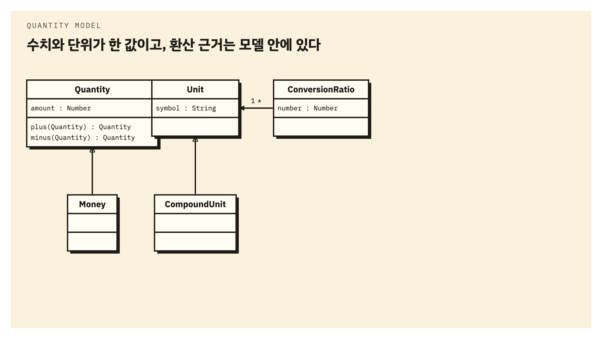

# Quantity — 숫자와 단위를 떼어 놓지 않는 값

## 한눈에 보는 개요

빵집 재고 프로그램이 이스트 보유량을 `onHandKg` 라는 숫자 필드 하나로 들고 있다고 해 봅시다. 단위는 필드 이름에만 적혀 있어요. 납품서는 kg 로 들어오는데 레시피는 사용량을 g 로 적습니다. 레시피에 적힌 100 g 이 숫자 100 으로만 `consume` 에 들어가면, 보유량 0.3 에서 100 을 빼게 되죠. 음수 검사가 있으면 300 g 을 가진 채 100 g 을 쓰려던 정상 요청이 재고 부족으로 거부되고, 검사가 없으면 −99.7 이 저장됩니다.

Quantity 는 수치와 단위를 한 값으로 묶고 계산을 그 값에게 맡깁니다. 값이 빼기 전에 두 단위를 비교하고, 다르면 환산 비율로 맞춘 뒤에 계산해요. 맞출 비율이 없으면 계산을 거부합니다.

```text
Before — 단위가 필드 이름에만 있다
  onHandKg = 0.3
  레시피 100 g ──(숫자만)──▶ consume(100) ──▶ 0.3 − 100 = −99.7
                                              단위를 확인할 곳이 없다

After — 단위가 값 안에 있다
  onHand = Quantity(0.3, kg)
  레시피 100 g ──(값째로)──▶ consume(Quantity(100, g))
                              ├─ kg 와 g 사이 비율 1000 을 찾는다
                              ├─ 0.3 kg 을 300 g 으로 옮긴다
                              └─ 300 g − 100 g = 200 g
```

이 글을 끝까지 읽으면 어떤 숫자 필드를 Quantity 로 바꿔야 하는지 가려낼 수 있어요. 그 값이 aggregate(함께 일관성을 지키는 객체 묶음) 안 어디에 놓이는지, 환산 방향에 따라 수치의 자릿수가 어떻게 달라지는지도 세 언어 코드로 확인하게 됩니다.

분류는 Fowler 『Analysis Patterns』(1997) 3장 「Observations and Measurements」의 §3.1 이고, 함께 쓰는 패턴은 Conversion Ratio(§3.2) · Compound Units(§3.3) · Measurement(§3.4) · Money 입니다. Money 는 Fowler 의 다른 책 PoEAA(『Patterns of Enterprise Application Architecture』) 18장에 있습니다.

## 패턴 자세히 들여다보기

### 등장하는 개념과 정의

개요의 After 그림에 나온 값을 조각으로 나눠 보면 이렇게 생겼어요.

```text
Quantity(0.3, kg)
  ├─ amount : 0.3          얼마나
  └─ unit   : kg ─────┐    무엇으로 셌는가
                      │
                      ▼
ConversionRatio   from kg ──▶ to g,  number = 1000
                  kg → g 로 옮길 때는 × 1000,  g → kg 로 옮길 때는 ÷ 1000
```

- **Quantity** — 수치(amount)와 단위(unit)를 묶은 값입니다. 다른 Quantity 와 만나는 연산과 비교를 스스로 수행하면서 두 값의 단위를 확인하고, 결과를 새 Quantity 로 돌려줄 책임을 집니다. Unit 하나를 가리키고, 이 가이드의 모델에서는 단위가 다르면 ConversionRatio 를 찾아 협력해요. 협력까지가 패턴의 요구는 아닙니다 — Fowler 는 [eaaDev Quantity](https://martinfowler.com/eaaDev/Quantity.html) 에서 단순한 구현은 단위가 다른 덧셈을 거부하고 환산은 호출자에게 맡긴다고 적습니다. 최소 조건에서는 [선택] 5 예요. 원서 그림은 `amount: Number`, `units: Unit` 과 연산 `+ - * / = > <` 를 적어 둡니다(Figure 3.2). 곱하기 가운데 보통의 수를 곱하는 계산은 단위를 그대로 두고, m 를 s 로 나누면 m/s 가 되듯 Quantity 끼리 곱하거나 나누면 결과 단위가 새로 생깁니다.
- **Unit** — 수치를 무엇으로 셌는지 나타냅니다. 예제에서는 g · kg · L 셋이에요. 두 Quantity 가 같은 단위인지 가르는 기준이고, 사람에게 보일 기호를 갖습니다. 여러 Quantity 가 같은 Unit 하나를 가리키고, Unit 은 ConversionRatio 의 양 끝에 놓입니다.
- **ConversionRatio** — 원서 §3.2 의 Conversion Ratio 입니다. from 단위 1 이 to 단위로 얼마인지를 수(`number`)로 적어서, 두 단위를 섞어 계산해도 되는 근거가 됩니다. 방향이 있어서 from → to 로 옮길 때는 그 수를 곱하고, to → from 으로 옮길 때는 나눕니다. 원서 그림에서 Unit 하나는 from 쪽으로도 to 쪽으로도 여러 비율에 걸려요(Figure 3.3).
- **CompoundUnit** — 원서 §3.3 의 합성 단위로, m/s² 처럼 여러 단위에 지수를 붙여 곱한 Unit 의 한 종류입니다. 원서 그림은 구성 단위 참조가 둘 이상이거나, 하나라면 지수가 음수이거나 1보다 커야 한다는 제약을 겁니다(Figure 3.4). 참조 하나에 지수 1 짜리는 원래 단위 하나와 같은 모양이라 합성 단위로 세지 않는 셈이에요. Quantity 끼리 곱하거나 나눈 결과의 단위가 이 개념으로 표현됩니다.
- **Money** — 단위 자리에 통화가 오는 Quantity 로, 금전이라는 도메인 의미를 가집니다. Fowler 의 튜토리얼 슬라이드가 Money 를 Quantity 의 한 종류로 적어서, 아래 그림도 일반화 화살표로 그렸습니다. 개념의 포함 관계를 옮긴 것이지 코드에서 상속으로 구현하라는 뜻은 아니에요. 통화마다 기본 소수 자릿수가 있어서, Java 21 에서 [`Currency`](https://docs.oracle.com/en/java/javase/21/docs/api/java.base/java/util/Currency.html)`.getInstance("KRW").getDefaultFractionDigits()` 를 실행하면 원화(KRW)는 0, 미국 달러(USD)로 바꾸면 2 가 나옵니다. 이 값은 자릿수만 알려 줄 뿐 언제 어떤 방식으로 반올림할지는 정하지 않아요. 정산·지급처럼 금액을 확정하는 시점에 10,000원을 셋으로 나누면 3,333.33…원을 원 단위로 맞춰야 하고, 3,333원 셋을 더하면 9,999원이라 남는 1원을 누구에게 붙일지 규칙이 필요합니다. PoEAA 는 이런 규칙 없이 금액을 다루면 반올림 오차로 잔돈을 잃기 쉽다고 적습니다.



그림에는 개념과 연관·다중도만 있습니다. Quantity 에서 Unit 으로 가는 선의 `*` 와 `1` 은 여러 Quantity 가 같은 Unit 하나를 가리킨다는 뜻이고, ConversionRatio 에서 Unit 으로 가는 선이 둘인 것은 from 쪽과 to 쪽 연관이 따로 있다는 뜻이에요(원서 Figure 3.3). 상자 안의 `from : Unit` · `to : Unit` 이 그 두 선의 끝입니다. CompoundUnit 이 어떤 단위를 몇 제곱으로 묶는지(원서 Figure 3.4 의 지수를 가진 단위 참조)는 Quantity 중심으로 줄이느라 뺐어요. 그림의 ConversionRatio 가 가진 `number` 는 원서 Figure 3.3 의 필드 이름을 그대로 옮긴 것이고, 뒤의 구현 예시는 같은 값을 `factor` 로 부릅니다. TypeScript 에서 `number` 가 수 타입 이름이라 필드 이름으로 두면 읽기 헷갈려서, 세 언어에 같은 이름을 쓰려고 바꾼 자리예요. 이 개념들을 코드에서 어느 묶음에 넣을지는 뒤의 구현 예시가 상황 설정 표로 정합니다.

### 동작 절차

레시피가 이스트 100 g 을 쓰겠다고 요청하고, 재고가 보유량 0.3 kg 에서 그만큼을 빼는 사건 하나를 따라가 봅시다.

1. **요청 쪽이 수치와 단위를 함께 넘겨 Quantity 를 만듭니다**(`100`, `g`). 만들 때 수치의 자릿수 규칙도 확인해요. 이 예제의 규칙은 소수점 아래 세 자리까지입니다. 수치만 넘기면 받는 쪽이 단위를 짐작해야 하고, 그 짐작이 틀린 결과가 개요의 −99.7 이에요.
2. **재고가 보유량 Quantity(0.3 kg)에게 `minus(100 g)` 을 요청합니다.** 단위 확인을 호출하는 쪽마다 따로 쓰면 한 곳만 빠뜨려도 단위가 섞인 계산이 나옵니다. 확인이 연산 안에 있으면 빠뜨릴 자리가 없어요.
3. **Quantity 가 두 Unit 을 비교합니다.** 여기서 절차가 세 갈래로 나뉩니다.
   - 3-a. 같은 단위면 환산 없이 4단계로 갑니다.
   - 3-b. 단위가 다르고 ConversionRatio 가 있으면 두 값을 맞출 공통 단위를 정합니다. 무엇을 공통 단위로 할지는 패턴이 정하지 않아요. 왼쪽 값의 단위를 유지하거나 기준 단위로 모으는 방법도 있습니다. 이 예제는 비율의 to 쪽을 고르고, 비율이 kg → g 로 적혀 있으니 g 가 됩니다. 이렇게 고른 이유는 아래 그림에서 따져 봅니다.
   - 3-c. 비율이 없으면(g 와 L) 계산을 거부합니다. 우유 1 L 가 몇 g 인지는 재료의 밀도에 달려 있어서, 단위 둘만 보고는 환산할 근거가 없기 때문이에요.
4. **공통 단위로 옮긴 뒤 계산하고, 결과를 새 Quantity 로 돌려줍니다.** 원래의 0.3 kg 과 100 g 은 그대로 남아요. 제자리에서 값을 바꾸면 같은 100 g 객체를 쓰던 레시피 쪽 값까지 바뀌기 때문입니다. 옮기는 방향에 따라 다시 두 갈래로 나뉩니다.
   - 4-a. from → to 방향이면 비율을 곱합니다. 0.3 kg × 1000 = 300 g 이고, 300 − 100 = 200 이라서 결과는 200 g 이에요. 3-b 에서 to 쪽을 공통 단위로 골랐으니 이 예제의 더하기·빼기는 늘 이 갈래로 갑니다.
   - 4-b. to → from 방향이면 비율로 나눕니다. 보유량 200 g 을 kg 로 보겠다고 `convertTo(kg)` 를 명시해 부를 때가 이 갈래예요. 200 ÷ 1000 = 0.2 라서 0.2 kg 을 돌려줍니다. 0.5 g 처럼 나눈 결과(0.0005 kg)가 자릿수 규칙을 넘으면 이 예제는 거부를 고릅니다. 원서가 정한 동작이 아니라 이 예제의 요구 전제예요. 반올림해서 0.001 kg 이나 0 kg 으로 적으면 저울로 잰 양과 장부가 달라지기 때문이에요. 금액처럼 반올림이 규칙인 도메인이라면 거부 대신 Money 정의에서 본 반올림 규칙을 이 자리에 둡니다.
5. **재고가 결과를 받아 자기 규칙(보유량은 음수가 아니다)을 확인한 다음에 보유량을 교체합니다.** 순서를 바꿔 교체부터 하면, 규칙 위반으로 거부하더라도 음수 보유량이 이미 저장돼 있습니다.

3-b 에서 이 예제가 왜 to 쪽을 고르는지 자릿수로 따져 보면 이렇습니다.

```text
전제: 수치는 소수점 아래 세 자리까지.   비율 f 는 정수(여기서는 1000).

수치 a 가 소수 k 자리(k ≤ 3)라면   a = n / 10^k    (n 은 정수)

곱셈   a × f = (n × f) / 10^k      분모가 그대로 10^k   → 소수 자리 ≤ k ≤ 3, 규칙 유지
나눗셈 a ÷ f = n / (10^k × 1000)   분모가 10^(k+3)       → 소수 자리가 최대 셋 늘어난다

  0.3 kg → g    0.3 × 1000 = 300       소수 0자리
  0.5 g  → kg   0.5 ÷ 1000 = 0.0005    소수 4자리, 규칙 위반
```

곱셈 쪽은 n × f 가 정수의 곱이라 여전히 정수이고, 분모가 10^k 에서 바뀌지 않습니다. 그래서 소수 자리가 k 를 넘을 수 없어요. 나눗셈 쪽은 분모에 1000 = 10³ 이 곱해지니 자리가 셋까지 늘고, 0.5 g 처럼 저울로 잰 정상 입고가 규칙에 걸립니다. 더하기·빼기의 공통 단위를 to 쪽으로 고르면 환산이 늘 곱셈이 되니, 두 전제(정수 비율, 자릿수 규칙)가 성립하는 이 예제에서는 입고와 사용이 자릿수 규칙에 걸리지 않아요. 비율이 정수가 아니면 곱셈도 자릿수를 늘리므로 이 논증은 그대로 옮겨 쓸 수 없습니다.

> 이 예제(정수 비율 kg → g)에서는 to 쪽으로 맞춘다. 정수를 곱하면 소수 자리가 늘지 않는다.

잠깐, 확인 하나만 해 볼까요? 보유량이 200 g 일 때 0.2 kg 을 빼면 결과는 어떤 단위로 나올까요? 답은 g 입니다. g 와 kg 사이에 비율이 있으니 3-b 갈래로 가고, 비율의 to 쪽인 g 가 공통 단위가 돼요. 0.2 kg 은 4-a 갈래에서 200 g 이 되고 200 − 200 = 0 이라서 결과는 0 g 입니다. 보유량이 0.3 kg 일 때 0.2 kg 을 뺐다면 3-a 갈래라서 결과가 0.1 kg 으로 kg 에 남습니다.

## 사용 목적

코드나 요구에서 아래 모습이 보이면 Quantity 를 꺼낼 때입니다.

- 단위가 **필드 이름이나 주석에만** 있고(`weightKg`, `// 단위: g`), 그 필드에 값을 넣는 경로가 둘 이상인데 경로마다 단위가 다릅니다. 개요의 납품서(kg)와 레시피(g)가 이 모습이에요.
- 금액에 통화가 둘 이상 섞입니다. 합계를 내는 함수마다 `if (a.currency != b.currency)` 확인이 복제돼 있고, 새로 만든 합계 함수에서 그 한 줄이 빠진 적이 있습니다.
- 자릿수와 반올림 규칙이 코드 곳곳에 흩어져 있습니다. 화면은 소수 둘째 자리에서, 저장은 셋째 자리에서 자르고 합계 함수마다 반올림을 따로 해서, 나눴다가 다시 더한 금액이 1원 모자랍니다. 이 규칙을 값 한 곳에 모을 자리가 필요하다는 신호예요.
- 검사 결과마다 단위가 다릅니다(혈압은 mmHg, 체중은 kg). 값은 Quantity 로 두고, 검사 항목이 계속 늘어나는 요구라면 Measurement 도 함께 봅니다.

쓰지 말아야 할 경우는 표로 정리합니다.

| 이런 경우 | Quantity 로 만들면 잃는 것 |
| --- | --- |
| 수가 식별자나 코드다(주문 번호, 우편번호) | 더해도 뜻이 없는 수에 `plus` 같은 연산이 열립니다. Fowler 는 정수 id 에 산술처럼 맞지 않는 행위가 붙지 않게 하려면 별도 값 객체(식별자 없이 값으로 같음을 판단하는 불변 객체)로 감싸라고 적는데, 그 자리는 Quantity 가 아니라 id 값 객체입니다 |
| 단위가 하나로 정해져 있고, 환산도 섞임도 자릿수·반올림 규칙도 없는 셈이다(게시글 조회수) | 타입과 단위 확인 코드가 늘지만 막아 줄 오류가 없습니다. 단위가 하나여도 반올림 같은 규칙이 붙으면 이 경우가 아니에요 |

두 경우를 모델로 놓으면 모양이 이렇습니다. 우편번호는 문자열을 감싼 id 값 객체이고, 조회수는 원시 정수 필드예요.

```java
record PostalCode(String value) {} // 앞자리 0 을 지켜야 하는 다섯 자리 코드, 더하거나 뺄 일이 없다

record Post(PostId id, long viewCount) {
    Post recordView() {
        return new Post(id, viewCount + 1); // 조회수를 바꾸는 연산은 이것 하나, 늘 1회씩 는다
    }
}
```

세 모델을 가르는 기준은 모델에서 네 가지를 확인하면 드러납니다.

| 모델에서 확인할 것 | 우편번호 `PostalCode` | 게시글 조회수 `Post.viewCount` | 이스트 재고 `IngredientStock.onHand` |
| --- | --- | --- | --- |
| 이 수끼리 더하거나 빼면 도메인에서 뜻이 있는가 | 없음. 두 우편번호의 합은 어느 지역도 아님 | 있음(+1) | 있음(입고·사용) |
| 값을 바꾸는 연산과 연산별 단위 | 바꾸는 연산 없음 | `recordView()` 하나, 늘 회 (생성·복원 때는 저장된 값을 그대로 받음) | `receive`(kg 납품)·`consume`(g 레시피), 연산마다 단위가 다름 |
| 단위가 다른 두 수가 한 연산에서 만나는가 | 연산이 없음 | 만나지 않음 | `consume` 에서 kg 보유량과 g 사용량이 만남 |
| 환산·자릿수 규칙이 필요한가 | 없음. 숫자로 저장하면 앞자리 0 이 사라지니 오히려 문자열로 둠 | 없음 | kg → g 비율 1000, 소수점 아래 세 자리 |
| 고를 모델 | id 값 객체 | 원시 정수 필드 | Quantity |

첫 줄이 아니오이면 산술 자체가 없으니 Quantity 가 아니라 id 값 객체로 갑니다. 첫 줄은 예인데 나머지가 모두 아니오인 조회수에 Quantity 를 씌우면 단위 비교는 늘 같은 단위 갈래(3-a)만 지나고, 막아 주는 오류 없이 타입만 늘어납니다. 값에 대상과 측정 항목이 붙으면 Measurement, 단위가 통화라면 Money 와의 차이를 봐야 하는데, 둘의 경계는 다음 절에서 가릅니다.

## 패턴의 경계

### 디자인 패턴을 충족하는 최소 조건

아래 조건은 클래스 모양이 아니라 **개념이 무엇을 책임지는가**로 판정합니다. `record` 든 `struct` 든, 필드가 하나든 둘이든 판정에는 상관없어요.

1. [필수] **Quantity 가 나타내는 양은 단위와 함께 다닌다** — 도메인 연산이 양을 주고받을 때 수치만 넘기지 않습니다. 수치만 꺼내 쓰는 일(화면 표시, 저장)은 단위를 아는 쪽이 합니다. (근거: Fowler *Analysis Patterns* 3장 — 그림 3.1 에서 Person 의 `height`·`weight` 가 `Number` 라 단위가 모델에 없던 것을, 그림 3.2 가 `amount: Number` 와 `units: Unit` 을 가진 Quantity 로 바꿉니다)
   - 빠지면 단위가 필드 이름에만 남은 `onHandKg: number` 가 됩니다. 레시피의 100 g 이 숫자 100 으로 들어가 0.3 에서 100 을 빼는 개요의 계산이 그대로 통과해요.
2. [필수] **양끼리 만나는 연산과 크기 비교가 단위를 확인한다** — Quantity 가 제공하는 더하기·빼기와 크기 비교(같은 양인가, 어느 쪽이 큰가)는 같은 단위면 계산하고, 다르면 환산 근거로 맞추고, 근거가 없으면 거부합니다. (근거: Fowler *Analysis Patterns* 3장 — 그림 3.2 가 `+ - * / = > <` 를 Quantity 자신의 연산으로 적어 산술을 값의 책임으로 두고, 그림 3.3 이 두 Unit 을 잇는 Conversion Ratio 를 모델에 둬 단위가 다른 양을 다룰 근거를 만듭니다) 단위가 다를 때 거부할지 환산할지까지는 원서가 못 박지 않아서, 둘 중 무엇을 골라도 이 조건은 갖춘 것으로 봅니다. 곱하기·나누기를 제공한다면 결과 단위를 정합니다. 보통의 수를 곱하면 단위를 유지하고, 양끼리 곱하거나 나누면 새 단위가 나옵니다. 조건 3 의 값 같음은 크기 비교와 다른 판정이라 이 규칙을 따르지 않아요.
   - 빠지면 단위를 들고만 있는 래퍼가 됩니다. `plus` 가 수치만 더해서 0.3 kg 과 100 g 의 합이 100.3 kg 으로 나와요(비교 절의 `Weight` 코드). 단위가 다를 때 거부만 하고 환산은 못 하는 래퍼라면 이 조건은 갖춘 것이고, 환산은 [선택] 5 의 몫입니다.
3. [필수] **값으로 비교하고 값으로 주고받는다** — 두 Quantity 가 같은 값인지 객체 참조가 아니라 값으로 판정하는 수단(메서드든 비교 함수든)이 있고, 한 곳의 계산이 같은 값을 쓰던 다른 곳을 바꾸지 않습니다. (근거: Fowler *Analysis Patterns* 3장 그림 3.2 가 Quantity 의 연산 목록에 `=` 를 둔 자리와, Fowler 가 martinfowler.com 의 Value Object 글에서 값 객체에는 aliasing 을 막을 장치가 필요하다고 적은 자리) Fowler 는 그 장치로 불변을 먼저 권하고, 대입할 때마다 복사하는 방법도 가능하다고 적습니다([Value Object](https://martinfowler.com/bliki/ValueObject.html)). 무엇을 같은 값으로 볼지 — 표현이 같아야 하는지, 환산해서 크기가 같으면 되는지 — 까지는 원서가 정하지 않습니다. 원서 그림은 연산 목록에 `=` 를 둘 뿐이에요. 그 선택은 [선택] 4 에 있습니다.
   - 빠지면 둘 중 하나가 생깁니다. `add` 가 자기 수치를 바꾸는데 복사도 하지 않으면, 레시피 1회분 100 g 객체를 두 재고가 함께 쓰는 순간 한쪽 계산이 레시피 값까지 바꿉니다. Fowler 가 aliasing bug 라고 부르는 문제예요. 같음을 객체 참조로 판정하면 똑같이 2.5 kg 인 두 객체가 다르다고 나옵니다.
4. [선택] **표현이 같아야 같은 값으로 본다** — 같은 값 판정이 환산을 거치지 않아서, 2.5 kg 과 2500 g 은 크기가 같아도 다른 값입니다. 대신 2.50 kg 과 2.5 kg 처럼 표기만 다른 것은 하나로 맞춰 둡니다. (근거: 이 가이드의 정책 — 장부와 실사 기록을 대조할 때 단위까지 같은지 보려는 예제 요구이고, 상황 설정의 전제로 적었습니다) 환산해서 크기로 같음을 보는 쪽을 골라도 조건 3 은 그대로 충족합니다. 그때는 크기 비교와 값 같음이 한 판정으로 합쳐지고, 단위가 다른 두 기록이 같은 값으로 지나갑니다.
5. [선택] **환산 규칙을 모델에 둔다** — 단위를 바꾸는 계산이 모델이 가진 근거를 거쳐서 일어납니다. 원서는 그 근거를 방향이 있는 비율(Conversion Ratio)로 두고, Fowler 튜토리얼 슬라이드의 `as(Unit)` 연산이 그 비율로 단위를 바꿉니다. 이 조건이 없으면 단위가 다른 양을 만났을 때 조건 2 에 따라 거부할 수밖에 없어요.
6. [선택] **자릿수와 반올림 규칙을 값이 안다** — 수치가 가질 수 있는 소수 자리와 그 자리를 넘을 때의 처리(거부 또는 반올림)가 Quantity 쪽에 있습니다. Money 에서는 자릿수 쪽을 통화의 최소 단위가 정하고, 언제 어떤 방식으로 반올림할지는 업무가 따로 정합니다.
7. [선택] **CompoundUnit 으로 단위를 합성한다** — 양끼리 곱하거나 나눈 결과를 m/s² 같은 단위로 표현합니다.
8. [선택] **문자열로 읽고 쓴다** — Fowler 튜토리얼 슬라이드의 `valueOf(String)` 과 `toString()` 처럼 `0.3 kg` 같은 표기와 값을 오갈 수 있습니다.

### 비슷한 패턴·안티패턴과의 차이

| 비교 대상 | 구분 기준 | Quantity 를 고르면 얻는 것 | 포기하는 것 |
| --- | --- | --- | --- |
| 원시 숫자 필드(Primitive Obsession) | 단위가 값 안에 있는가, 이름·주석에만 있는가 | 단위가 섞인 계산을 연산이 막고, 확인 코드가 한 곳에 모인다 | 타입 하나가 늘고, 단위가 섞이는 도메인이면 환산 규칙도 관리해야 한다 |
| 단위를 들고만 있는 래퍼 | 호환되지 않는 단위의 산술을 값이 막는가(거부하든 환산하든) | 단위가 맞지 않는 계산을 값이 거부한다 | 연산마다 단위 확인 코드가 들어간다. 래퍼는 이 코드를 아낀 대가로 틀린 합을 낸다 |
| Measurement | 대상과 측정 항목을 가진 기록 계층이 필요한가 | 값만 필요한 자리(재고·가격)에 기록 계층 없이 쓴다 | 대상·항목 기록은 없다. 필요하면 Measurement 가 Quantity 를 속성으로 품는다 |
| Money | 단위가 통화이고 통화마다 정해진 자릿수가 붙는가 | 질량·부피·금액이 같은 연산 규칙을 공유한다 | 반올림 시점·방식 같은 업무 규칙은 그 위에 따로 얹어야 한다 |

**원시 숫자 필드와의 차이.** 구분 기준은 단위가 어디에 있느냐입니다. 원시 필드는 단위를 이름과 주석에 두고, Quantity 는 값 안에 둡니다. Fowler 는 문자열 같은 흔한 원시 타입을 알맞은 값 객체로 바꾸는 편이 대개 좋다고 적고, 이점으로 타입 검사와 한곳에 모인 검증을 듭니다([Value Object](https://martinfowler.com/bliki/ValueObject.html)). Quantity 를 고르면 단위 확인이 연산 한 곳에 모이고, 대신 타입 하나와 환산 규칙을 관리해야 합니다.

여기서 헷갈리기 쉬운 포인트는 부동소수점 오차까지 Quantity 가 없애 준다고 보는 것입니다. 단위 확인과 수치 표현은 서로 다른 결정이에요. 아래 코드는 단위를 제대로 확인하는데도 수치를 TypeScript `number` 로 들었습니다.

```typescript no-compile
class Quantity {
  constructor(readonly amount: number, readonly unit: "kg" | "g") {}
  minus(other: Quantity): Quantity {
    if (this.unit !== other.unit) throw new Error("단위가 다릅니다");
    return new Quantity(this.amount - other.amount, this.unit);
  }
}
// new Quantity(0.3, "kg").minus(new Quantity(0.1, "kg")).minus(new Quantity(0.2, "kg")).amount
//   → -2.7755575615628914e-17
```

단위는 kg 로 맞았는데 0 이어야 할 수치가 음수로 남습니다(node 로 실행해 확인). `number` 는 IEEE 754(2진 부동소수점 표준) 배정밀도입니다([MDN Number](https://developer.mozilla.org/en-US/docs/Web/JavaScript/Reference/Global_Objects/Number)). 0.1 은 1/10 이고 분모 10 = 2 × 5 에 5 가 들어 있는데, 2진 소수로 유한하게 적을 수 있는 수는 분모가 2의 거듭제곱인 분수뿐이라 0.1 은 가장 가까운 2진수로 반올림된 채 저장돼요. 반대로 원시 필드라도 정수 그램이나 10진 타입으로 들면 이 오차는 생기지 않습니다. 이 글의 구현이 `BigDecimal`·`bigint`·`i64` 를 고른 것은 패턴과 별개인 예제의 결정이고, Quantity 가 보태는 것은 그 결정을 값 한 곳에서 내릴 자리입니다.

**단위를 들고만 있는 래퍼와의 차이.** 구분 기준은 호환되지 않는 단위의 산술을 값이 막는가입니다. 막는 방법이 거부든 환산이든 상관없고, 단위 필드가 있다는 것만으로는 판정이 나지 않아요. 아래 코드는 단위를 저장하지만 계산에서는 읽지 않습니다.

```java no-compile
record Weight(double value, String unit) {
    Weight plus(Weight other) {
        return new Weight(value + other.value, unit); // other.unit 을 읽지 않는다
    }
}
// new Weight(0.3, "kg").plus(new Weight(100, "g"))  →  Weight[value=100.3, unit=kg]
```

0.3 kg 과 100 g 을 더했는데 100.3 kg 이 나옵니다(Java 21 로 실행해 확인). 조건 1 은 갖췄지만 조건 2 가 빠져 Quantity 가 아니에요. 같은 래퍼라도 `plus` 가 `other.unit` 을 비교해 다르면 거부한다면 조건 2 를 갖춘 것이고, 그때 남는 차이는 환산([선택] 5)을 하느냐입니다. Quantity 를 고르면 단위가 맞지 않는 계산을 값이 거부하게 되고, 대신 연산마다 단위 확인이 들어갑니다.

**Measurement 와의 차이.** 구분 기준은 대상과 측정 항목을 가진 기록 계층이 필요한가입니다. Measurement(원서 §3.4)는 Quantity 의 대안이 아니라 Quantity 를 품는 기록이에요. 원서 그림에서 Measurement 는 사람(Person) 하나와 측정 항목(Phenomenon Type) 하나에 연결되고, 잰 값을 `quantity: Quantity` 속성으로 가집니다(Figure 3.6). 같은 120 mmHg 를 두 층으로 나누면 이렇게 보여요.

```text
Quantity       120 mmHg
Measurement    환자 A · 수축기 혈압 · 120 mmHg
                 │        │             └─ Quantity
                 │        └─ 무엇을 쟀는가(측정 항목)
                 └─ 누구를 쟀는가
```

재고 보유량이나 가격처럼 값만 필요한 자리에서는 Quantity 만으로 충분합니다. 대상과 항목을 함께 기록해야 하면 Quantity 를 버리는 것이 아니라 그 위에 Measurement 한 층을 얹어요. 측정 시각이나 잘못 잰 값의 처리는 원서가 §3.8 Dual Time Record 와 §3.9 Rejected Observation 에서 따로 다룹니다.

**Money 와의 차이.** 구분 기준은 단위 자리가 통화이고 통화마다 정해진 자릿수가 붙는가입니다. 반올림은 통화가 정해 주지 않고 업무가 고르는 정책이라 구분 기준에서 뺐어요. Fowler 튜토리얼 슬라이드는 Money 를 Quantity 의 한 종류로 적고, PoEAA 는 통화가 다른 금액을 더하는 문제와 반올림으로 잔돈을 잃는 문제를 들어 Money 를 따로 다룹니다([Money](https://martinfowler.com/eaaCatalog/money.html)). 금액까지 한 Quantity 타입으로 다루면 질량·부피·금액이 같은 연산 규칙을 공유하지만, 원 단위 반올림 같은 업무 규칙은 그 위에 따로 얹어야 해요. Money 를 별도 타입으로 두면 통화 자릿수와 업무가 고른 반올림 규칙을 그 타입 한 곳에 모으기 쉽고, 공통 연산은 위임 같은 방법으로 나눠 씁니다. 질량과 금액을 섞는 실수를 실행 중에 거부할지 컴파일 단계에서 막을지는 이 선택과 별개예요. 환산 비율도 성격이 다릅니다. kg → g 은 한 번 정하면 바뀌지 않지만 환율은 시점마다 바뀌어서, 금액끼리 통화를 맞출 때는 고정 비율 표가 아니라 그 시점의 비율을 찾아야 해요(상황이 달라지면 표 4행).

## 구현 예시

### 상황 설정

빵집 한 곳의 재료 재고 프로그램을 예제로 씁니다. 재료 하나마다 재고 기록이 하나 있고, 입고와 사용이 보유량을 바꿉니다. 요청마다 달라지는 것은 수치의 단위예요. 납품서는 kg, 레시피는 g 로 적고, 레시피 1회분을 여러 번 쓰면 사용량은 1회분에 횟수를 곱해 만듭니다. 가끔은 L 로 적힌 액체 재료가 잘못 들어옵니다.

고정인 것도 정해 둡니다. 단위는 g · kg · L 셋이고 환산 비율은 kg → g 1000 하나이며, 새 단위는 코드를 고쳐 배포할 때만 늘어요. 수치는 소수점 아래 세 자리까지 기록하고(kg 로 적으면 1 g 까지), 이 자리를 넘는 환산은 반올림하지 않고 거부합니다. 보유량은 음수가 될 수 없지만, Quantity 자체는 음수를 담을 수 있어야 해요. 사용 뒤 보유량이 음수인지 판정하려면 뺄셈 결과가 음수로 나와야 하기 때문이고, 입고·사용량이 양수라는 규칙은 재고라는 문맥의 규칙이라 root 가 지킵니다. 보유량을 kg 와 g 중 어느 단위로 적어 두는지는 요구 전제가 아니라서, 크기만 맞으면 됩니다. 같은 값인지 따지는 기준도 여기서 정합니다. 이 예제는 환산하지 않고 표현이 같은지로 봐서 2.5 kg 과 2500 g 은 크기가 같아도 다른 값이고, 2.50 kg 과 2.5 kg 은 같은 값이에요. 장부와 실사 기록을 대조할 때 단위까지 같은지 보려는 요구라서 고른 정책이고, 최소 조건에서는 [필수] 3 이 아니라 [선택] 4 에 있습니다. 크기가 같으면 같은 값으로 보는 쪽을 골라도 [필수] 3 은 그대로 충족해요. 예제 코드의 타입은 앞 절의 개념과 이렇게 짝지어집니다.

| 예제 타입 | 대응하는 개념 |
| --- | --- |
| `Quantity` · `Unit` · `ConversionRatio` | 같은 이름의 개념 그대로 |
| `IngredientStock` | 패턴 밖의 타입. Quantity 를 보유량 속성으로 가진 재료 하나의 재고 |
| `StockId` · `IngredientId` | 패턴 밖의 식별자 |
| (예제에 없음) | CompoundUnit · Money |

| 항목 | 이 가이드의 설정 |
| --- | --- |
| bounded context | 빵집 재료 재고 — 입고와 사용으로 재료별 보유량을 기록한다 |
| 불변식의 위치 | 최소 조건 1~3(양과 단위가 함께 다님, 연산의 단위 확인, 값으로 비교·전달)과 이 예제가 고른 표현 동등성([선택] 4), 소수점 아래 세 자리 규칙(역방향 환산의 자릿수 초과 거부 포함)은 root 가 아니라 Quantity 가 생성과 연산에서 지킨다. 보유량이 음수가 되지 않고 입고·사용량이 0보다 크다는 규칙은 IngredientStock root 의 `receive`·`consume` 이 지킨다 |
| root·entity·VO 배정 | IngredientStock aggregate 하나. IngredientStock 은 root(entity, `StockId` 로 식별)이고, 보유량 Quantity 와 그 안의 Unit 은 VO. ConversionRatio 는 어느 aggregate 에도 속하지 않는 불변 VO 로, 코드 상수 표 `ConversionRatio.ALL` 하나를 모든 Quantity 의 연산이 함께 조회한다. `StockId`·`IngredientId` 는 id VO |
| 타 aggregate 참조 방식 | IngredientStock 이 재료 카탈로그 aggregate(이 예제 밖)의 재료를 `IngredientId` 로 가리킨다. Quantity 는 id 없이 불변 값으로 주고받으므로, 같은 인스턴스를 함께 써도 복사한 것과 결과가 같다 |

표에 쓴 DDD(Domain-Driven Design, 도메인 주도 설계) 전술 용어는 이런 뜻입니다. 앞의 다섯은 Evans 의 [DDD Reference](https://www.domainlanguage.com/wp-content/uploads/2016/05/DDD_Reference_2015-03.pdf) 를 따르고, 마지막 id 참조는 Vernon 의 aggregate 설계 규칙에서 왔습니다.

- **Bounded Context** — 한 모델의 용어와 규칙이 같은 뜻으로 통하는 경계입니다.
- **Aggregate** — 한 번의 변경에서 함께 일관성을 지키는 객체 묶음이에요. 바깥은 묶음 전체를 한 단위로 다룹니다.
- **Aggregate Root(root)** — aggregate 의 입구가 되는 객체입니다. 바깥에서는 root 만 가리키고, 묶음 안의 변경은 root 의 메서드를 거칩니다.
- **Entity** — 속성이 바뀌어도 식별자로 같은 것을 가리키는 객체입니다.
- **Value Object(VO)** — 식별자 없이 속성 값만으로 같음을 판단하고, 불변으로 다루는 객체입니다.
- **id 참조** — 다른 aggregate 를 객체로 들지 않고 식별자 값으로만 가리키는 방식이에요. Vernon 의 규칙 "Reference Other Aggregates By Identity" 입니다([Effective Aggregate Design Part II](https://www.dddcommunity.org/wp-content/uploads/files/pdf_articles/Vernon_2011_2.pdf)).

뒤의 세 언어 구현은 이 설정을 그대로 옮긴 것이고, 실행하면 셋이 아래 열한 줄을 글자까지 같게 냅니다(Java 21 · TypeScript 를 tsc 로 변환한 뒤 Node · Rust 2021 에서 실행해 확인). 가이드 폴더의 `code/expected-output.txt` 와 같은 내용이고, 이 글의 실행 수치는 전부 여기서 옵니다. 무엇이 나오는지 먼저 보아 두면 뒤의 코드와 해설을 따라가기 쉬워요.

```text
재고 stock-1 · 재료 yeast
입고 0.3 kg → 보유 0.3 kg
사용 50 g × 2 → 보유 200 g
보유량을 kg 로 → 0.2 kg
사용 0.2 kg → 보유 0 g
거부 — 재고가 모자랍니다: 보유 0 g, 요청 1 g
거부 — 환산 비율이 없습니다: g ↔ L
거부 — kg 로 옮기면 소수점 아래 세 자리를 넘습니다: 0.5 g
같은 값인가 2.50 kg / 2.5 kg: true
같은 값인가 2.5 kg / 2500 g: false
같은 양인가 2.5 kg / 2500 g: true
```

### 구현

```java
import java.math.BigDecimal;
import java.util.List;
import java.util.Objects;
import java.util.Optional;

enum Unit {
    G("g"), KG("kg"), L("L");

    final String symbol;

    Unit(String symbol) { this.symbol = symbol; }
}

// from 1 = to factor. 방향이 있다: from → to 는 곱하고, to → from 은 나눈다.
record ConversionRatio(Unit from, Unit to, long factor) {
    static final List<ConversionRatio> ALL = List.of(new ConversionRatio(Unit.KG, Unit.G, 1000));

    static Optional<ConversionRatio> between(Unit a, Unit b) {
        return ALL.stream()
                .filter(r -> (r.from == a && r.to == b) || (r.from == b && r.to == a))
                .findFirst();
    }
}

record Quantity(BigDecimal amount, Unit unit) {
    static final int MAX_SCALE = 3;

    Quantity {
        Objects.requireNonNull(amount, "수치가 없습니다");
        Objects.requireNonNull(unit, "단위가 없습니다");
        amount = amount.stripTrailingZeros(); // 2.50 과 2.5 를 같은 표현으로 맞춘다
        if (amount.scale() > MAX_SCALE) {
            throw new IllegalArgumentException(
                    "소수점 아래 세 자리까지만 기록합니다: " + amount.toPlainString() + " " + unit.symbol);
        }
    }

    static Quantity of(String amount, Unit unit) {
        return new Quantity(new BigDecimal(amount), unit);
    }

    Quantity plus(Quantity other) {
        Unit common = commonUnit(other);
        return new Quantity(convertTo(common).amount.add(other.convertTo(common).amount), common);
    }

    Quantity minus(Quantity other) {
        Unit common = commonUnit(other);
        return new Quantity(convertTo(common).amount.subtract(other.convertTo(common).amount), common);
    }

    Quantity times(long n) {
        return new Quantity(amount.multiply(BigDecimal.valueOf(n)), unit);
    }

    // 크기 비교: 단위를 맞춘 뒤 비교한다. equals 는 수치와 단위가 둘 다 같아야 참이다.
    int compareTo(Quantity other) {
        Unit common = commonUnit(other);
        return convertTo(common).amount.compareTo(other.convertTo(common).amount);
    }

    boolean isPositive() { return amount.signum() > 0; }

    boolean isNegative() { return amount.signum() < 0; }

    Quantity convertTo(Unit target) {
        if (unit == target) {
            return this;
        }
        ConversionRatio ratio = ConversionRatio.between(unit, target).orElseThrow(() -> noRatio(unit, target));
        BigDecimal factor = BigDecimal.valueOf(ratio.factor());
        if (ratio.from() == unit) {
            return new Quantity(amount.multiply(factor), target); // 정방향: 곱셈
        }
        BigDecimal divided = amount.divide(factor); // 역방향: 나눗셈
        if (divided.stripTrailingZeros().scale() > MAX_SCALE) {
            throw new IllegalArgumentException(target.symbol + " 로 옮기면 소수점 아래 세 자리를 넘습니다: " + this);
        }
        return new Quantity(divided, target);
    }

    // 이 예제의 선택: 단위가 다르면 비율의 to 쪽(kg→g 이므로 g)으로 맞춰 곱셈만 일어나게 한다.
    private Unit commonUnit(Quantity other) {
        if (unit == other.unit) {
            return unit;
        }
        return ConversionRatio.between(unit, other.unit)
                .map(ConversionRatio::to)
                .orElseThrow(() -> noRatio(unit, other.unit));
    }

    private static IllegalArgumentException noRatio(Unit a, Unit b) {
        return new IllegalArgumentException("환산 비율이 없습니다: " + a.symbol + " ↔ " + b.symbol);
    }

    @Override
    public String toString() {
        return amount.toPlainString() + " " + unit.symbol;
    }
}

record StockId(String value) {}

record IngredientId(String value) {}

final class IngredientStock {
    private final StockId id;
    private final IngredientId ingredientId; // 재료 카탈로그 aggregate 는 id 로만 가리킨다
    private Quantity onHand;

    IngredientStock(StockId id, IngredientId ingredientId, Unit unit) {
        this.id = id;
        this.ingredientId = ingredientId;
        this.onHand = Quantity.of("0", unit);
    }

    void receive(Quantity received) {
        requirePositive(received);
        onHand = onHand.plus(received);
    }

    void consume(Quantity used) {
        requirePositive(used);
        Quantity after = onHand.minus(used);
        if (after.isNegative()) {
            throw new IllegalStateException("재고가 모자랍니다: 보유 " + onHand + ", 요청 " + used);
        }
        onHand = after;
    }

    private static void requirePositive(Quantity q) {
        if (!q.isPositive()) {
            throw new IllegalArgumentException("입고·사용량은 0보다 커야 합니다: " + q);
        }
    }

    StockId id() { return id; }

    IngredientId ingredientId() { return ingredientId; }

    Quantity onHand() { return onHand; }
}

public class Main {
    public static void main(String[] args) {
        IngredientStock stock = new IngredientStock(new StockId("stock-1"), new IngredientId("yeast"), Unit.KG);
        System.out.println("재고 " + stock.id().value() + " · 재료 " + stock.ingredientId().value());

        stock.receive(Quantity.of("0.3", Unit.KG));
        System.out.println("입고 0.3 kg → 보유 " + stock.onHand());
        stock.consume(Quantity.of("50", Unit.G).times(2));
        System.out.println("사용 50 g × 2 → 보유 " + stock.onHand());
        System.out.println("보유량을 kg 로 → " + stock.onHand().convertTo(Unit.KG));
        stock.consume(Quantity.of("0.2", Unit.KG));
        System.out.println("사용 0.2 kg → 보유 " + stock.onHand());

        attempt(() -> stock.consume(Quantity.of("1", Unit.G)));
        attempt(() -> stock.receive(Quantity.of("1", Unit.L)));
        attempt(() -> Quantity.of("0.5", Unit.G).convertTo(Unit.KG));

        Quantity kg = Quantity.of("2.5", Unit.KG);
        System.out.println("같은 값인가 2.50 kg / 2.5 kg: " + Quantity.of("2.50", Unit.KG).equals(kg));
        System.out.println("같은 값인가 2.5 kg / 2500 g: " + kg.equals(Quantity.of("2500", Unit.G)));
        System.out.println("같은 양인가 2.5 kg / 2500 g: " + (kg.compareTo(Quantity.of("2500", Unit.G)) == 0));
    }

    static void attempt(Runnable action) {
        try {
            action.run();
        } catch (RuntimeException e) {
            System.out.println("거부 — " + e.getMessage());
        }
    }
}
```

```typescript
const Unit = { G: "g", KG: "kg", L: "L" } as const;
type Unit = (typeof Unit)[keyof typeof Unit];

// from 1 = to factor. 방향이 있다: from → to 는 곱하고, to → from 은 나눈다.
class ConversionRatio {
  static readonly ALL: readonly ConversionRatio[] = Object.freeze([new ConversionRatio(Unit.KG, Unit.G, 1000n)]);

  private constructor(
    readonly from: Unit,
    readonly to: Unit,
    readonly factor: bigint,
  ) {
    Object.freeze(this);
  }

  equals(other: ConversionRatio): boolean {
    return this.from === other.from && this.to === other.to && this.factor === other.factor;
  }

  static between(a: Unit, b: Unit): ConversionRatio | undefined {
    return ConversionRatio.ALL.find((r) => (r.from === a && r.to === b) || (r.from === b && r.to === a));
  }
}

// 배열을 얼리면 원소 교체만 막힌다. 클래스까지 얼려야 ConversionRatio.ALL = [] 같은 정적 필드 재대입이 막힌다.
Object.freeze(ConversionRatio);

const ONE = 1000n; // 소수점 아래 세 자리

class Quantity {
  // scaled = 수치 × 1000. number(2진 부동소수점) 대신 bigint 정수로 들어 자릿수 규칙이 표현에 담긴다.
  private constructor(
    private readonly scaled: bigint,
    readonly unit: Unit,
  ) {
    Object.freeze(this);
  }

  static of(text: string, unit: Unit): Quantity {
    const m = /^(-?)(\d+)(?:\.(\d*?)0*)?$/.exec(text);
    if (m === null) throw new Error(`수치 형식이 아닙니다: ${text}`);
    const [, sign = "", whole = "0", fraction = ""] = m;
    if (fraction.length > 3) throw new Error(`소수점 아래 세 자리까지만 기록합니다: ${text} ${unit}`);
    const scaled = BigInt(whole) * ONE + BigInt(fraction.padEnd(3, "0"));
    return new Quantity(sign === "-" ? -scaled : scaled, unit);
  }

  plus(other: Quantity): Quantity {
    const common = this.commonUnit(other);
    return new Quantity(this.convertTo(common).scaled + other.convertTo(common).scaled, common);
  }

  minus(other: Quantity): Quantity {
    const common = this.commonUnit(other);
    return new Quantity(this.convertTo(common).scaled - other.convertTo(common).scaled, common);
  }

  times(n: bigint): Quantity {
    return new Quantity(this.scaled * n, this.unit);
  }

  equals(other: Quantity): boolean {
    return this.scaled === other.scaled && this.unit === other.unit;
  }

  // 크기 비교: 단위를 맞춘 뒤 비교한다. equals 는 수치와 단위가 둘 다 같아야 참이다.
  compareTo(other: Quantity): number {
    const common = this.commonUnit(other);
    const diff = this.convertTo(common).scaled - other.convertTo(common).scaled;
    return diff === 0n ? 0 : diff < 0n ? -1 : 1;
  }

  isPositive(): boolean { return this.scaled > 0n; }

  isNegative(): boolean { return this.scaled < 0n; }

  convertTo(target: Unit): Quantity {
    if (this.unit === target) return this;
    const ratio = ConversionRatio.between(this.unit, target);
    if (ratio === undefined) throw noRatio(this.unit, target);
    if (ratio.from === this.unit) return new Quantity(this.scaled * ratio.factor, target); // 정방향: 곱셈
    if (this.scaled % ratio.factor !== 0n) {
      throw new Error(`${target} 로 옮기면 소수점 아래 세 자리를 넘습니다: ${this}`);
    }
    return new Quantity(this.scaled / ratio.factor, target); // 역방향: 나눗셈
  }

  // 이 예제의 선택: 단위가 다르면 비율의 to 쪽(kg→g 이므로 g)으로 맞춰 곱셈만 일어나게 한다.
  private commonUnit(other: Quantity): Unit {
    if (this.unit === other.unit) return this.unit;
    const ratio = ConversionRatio.between(this.unit, other.unit);
    if (ratio === undefined) throw noRatio(this.unit, other.unit);
    return ratio.to;
  }

  toString(): string {
    const abs = this.scaled < 0n ? -this.scaled : this.scaled;
    const fraction = (abs % ONE).toString().padStart(3, "0").replace(/0+$/, "");
    return `${this.scaled < 0n ? "-" : ""}${abs / ONE}${fraction && "." + fraction} ${this.unit}`;
  }
}

function noRatio(a: Unit, b: Unit): Error {
  return new Error(`환산 비율이 없습니다: ${a} ↔ ${b}`);
}

class StockId {
  private readonly brand = "StockId"; // IngredientId 와 섞이지 않게 하는 표식
  constructor(readonly value: string) {
    Object.freeze(this);
  }

  equals(other: StockId): boolean { return this.value === other.value; }
}

class IngredientId {
  private readonly brand = "IngredientId";
  constructor(readonly value: string) {
    Object.freeze(this);
  }

  equals(other: IngredientId): boolean { return this.value === other.value; }
}

class IngredientStock {
  private onHandValue: Quantity;

  constructor(
    readonly id: StockId,
    readonly ingredientId: IngredientId, // 재료 카탈로그 aggregate 는 id 로만 가리킨다
    unit: Unit,
  ) {
    this.onHandValue = Quantity.of("0", unit);
  }

  receive(received: Quantity): void {
    requirePositive(received);
    this.onHandValue = this.onHandValue.plus(received);
  }

  consume(used: Quantity): void {
    requirePositive(used);
    const after = this.onHandValue.minus(used);
    if (after.isNegative()) {
      throw new Error(`재고가 모자랍니다: 보유 ${this.onHandValue}, 요청 ${used}`);
    }
    this.onHandValue = after;
  }

  onHand(): Quantity { return this.onHandValue; }
}

function requirePositive(q: Quantity): void {
  if (!q.isPositive()) throw new Error(`입고·사용량은 0보다 커야 합니다: ${q}`);
}

function attempt(action: () => void): void {
  try {
    action();
  } catch (e) {
    console.log(`거부 — ${e instanceof Error ? e.message : String(e)}`);
  }
}

const stock = new IngredientStock(new StockId("stock-1"), new IngredientId("yeast"), Unit.KG);
console.log(`재고 ${stock.id.value} · 재료 ${stock.ingredientId.value}`);

stock.receive(Quantity.of("0.3", Unit.KG));
console.log(`입고 0.3 kg → 보유 ${stock.onHand()}`);
stock.consume(Quantity.of("50", Unit.G).times(2n));
console.log(`사용 50 g × 2 → 보유 ${stock.onHand()}`);
console.log(`보유량을 kg 로 → ${stock.onHand().convertTo(Unit.KG)}`);
stock.consume(Quantity.of("0.2", Unit.KG));
console.log(`사용 0.2 kg → 보유 ${stock.onHand()}`);

attempt(() => stock.consume(Quantity.of("1", Unit.G)));
attempt(() => stock.receive(Quantity.of("1", Unit.L)));
attempt(() => Quantity.of("0.5", Unit.G).convertTo(Unit.KG));

const kg = Quantity.of("2.5", Unit.KG);
console.log(`같은 값인가 2.50 kg / 2.5 kg: ${Quantity.of("2.50", Unit.KG).equals(kg)}`);
console.log(`같은 값인가 2.5 kg / 2500 g: ${kg.equals(Quantity.of("2500", Unit.G))}`);
console.log(`같은 양인가 2.5 kg / 2500 g: ${kg.compareTo(Quantity.of("2500", Unit.G)) === 0}`);
```

```rust
mod inventory {
    use std::cmp::Ordering;
    use std::fmt;

    #[derive(Clone, Copy, Debug, PartialEq, Eq, Hash)]
    pub enum Unit { G, Kg, L }

    impl Unit {
        pub fn symbol(self) -> &'static str {
            match self { Unit::G => "g", Unit::Kg => "kg", Unit::L => "L" }
        }
    }

    // from 1 = to factor. 방향이 있다: from → to 는 곱하고, to → from 은 나눈다.
    #[derive(Clone, Copy, Debug, PartialEq, Eq)]
    pub struct ConversionRatio {
        from: Unit,
        to: Unit,
        factor: i64,
    }

    impl ConversionRatio {
        const ALL: [ConversionRatio; 1] = [ConversionRatio { from: Unit::Kg, to: Unit::G, factor: 1000 }];

        pub fn between(a: Unit, b: Unit) -> Option<ConversionRatio> {
            Self::ALL.iter().copied().find(|r| (r.from == a && r.to == b) || (r.from == b && r.to == a))
        }
    }

    const ONE: i64 = 1000; // 소수점 아래 세 자리

    // scaled = 수치 × 1000. f64 는 Eq 를 구현하지 않으므로 i64 정수로 든다.
    #[derive(Clone, Copy, Debug, PartialEq, Eq, Hash)]
    pub struct Quantity {
        scaled: i64,
        unit: Unit,
    }

    fn overflow() -> String {
        "수치가 표현 범위를 넘었습니다".to_string()
    }

    fn no_ratio(a: Unit, b: Unit) -> String {
        format!("환산 비율이 없습니다: {} ↔ {}", a.symbol(), b.symbol())
    }

    impl Quantity {
        pub fn of(text: &str, unit: Unit) -> Result<Quantity, String> {
            let (whole, fraction) = text.split_once('.').unwrap_or((text, ""));
            let fraction = fraction.trim_end_matches('0');
            let whole_value: i64 = whole.parse().map_err(|_| format!("수치 형식이 아닙니다: {text}"))?;
            if !fraction.bytes().all(|b| b.is_ascii_digit()) {
                return Err(format!("수치 형식이 아닙니다: {text}"));
            }
            if fraction.len() > 3 {
                return Err(format!("소수점 아래 세 자리까지만 기록합니다: {text} {}", unit.symbol()));
            }
            let fraction_value: i64 = format!("{fraction:0<3}").parse().map_err(|_| overflow())?;
            let magnitude = whole_value.checked_abs().and_then(|w| w.checked_mul(ONE)?.checked_add(fraction_value));
            let scaled = magnitude.ok_or_else(overflow)?;
            Ok(Quantity { scaled: if whole.starts_with('-') { -scaled } else { scaled }, unit })
        }

        pub fn plus(self, other: Quantity) -> Result<Quantity, String> {
            let common = self.common_unit(other)?;
            let sum = self.convert_to(common)?.scaled.checked_add(other.convert_to(common)?.scaled);
            Ok(Quantity { scaled: sum.ok_or_else(overflow)?, unit: common })
        }

        pub fn minus(self, other: Quantity) -> Result<Quantity, String> {
            let common = self.common_unit(other)?;
            let diff = self.convert_to(common)?.scaled.checked_sub(other.convert_to(common)?.scaled);
            Ok(Quantity { scaled: diff.ok_or_else(overflow)?, unit: common })
        }

        pub fn times(self, n: i64) -> Result<Quantity, String> {
            Ok(Quantity { scaled: self.scaled.checked_mul(n).ok_or_else(overflow)?, unit: self.unit })
        }

        // 크기 비교: 단위를 맞춘 뒤 비교한다. == 는 수치와 단위가 둘 다 같아야 참이다.
        pub fn compare_to(self, other: Quantity) -> Result<Ordering, String> {
            let common = self.common_unit(other)?;
            Ok(self.convert_to(common)?.scaled.cmp(&other.convert_to(common)?.scaled))
        }

        pub fn is_positive(self) -> bool { self.scaled > 0 }

        pub fn is_negative(self) -> bool { self.scaled < 0 }

        pub fn convert_to(self, target: Unit) -> Result<Quantity, String> {
            if self.unit == target {
                return Ok(self);
            }
            let ratio = ConversionRatio::between(self.unit, target).ok_or_else(|| no_ratio(self.unit, target))?;
            if ratio.from == self.unit {
                let scaled = self.scaled.checked_mul(ratio.factor).ok_or_else(overflow)?; // 정방향: 곱셈
                return Ok(Quantity { scaled, unit: target });
            }
            if self.scaled % ratio.factor != 0 {
                return Err(format!("{} 로 옮기면 소수점 아래 세 자리를 넘습니다: {self}", target.symbol()));
            }
            Ok(Quantity { scaled: self.scaled / ratio.factor, unit: target }) // 역방향: 나눗셈
        }

        // 이 예제의 선택: 단위가 다르면 비율의 to 쪽(kg→g 이므로 g)으로 맞춰 곱셈만 일어나게 한다.
        fn common_unit(self, other: Quantity) -> Result<Unit, String> {
            if self.unit == other.unit {
                return Ok(self.unit);
            }
            ConversionRatio::between(self.unit, other.unit).map(|r| r.to).ok_or_else(|| no_ratio(self.unit, other.unit))
        }
    }

    impl fmt::Display for Quantity {
        fn fmt(&self, f: &mut fmt::Formatter<'_>) -> fmt::Result {
            let abs = self.scaled.unsigned_abs();
            let fraction = format!("{:03}", abs % ONE as u64);
            let fraction = fraction.trim_end_matches('0');
            let sign = if self.scaled < 0 { "-" } else { "" };
            let dot = if fraction.is_empty() { "" } else { "." };
            write!(f, "{sign}{}{dot}{fraction} {}", abs / ONE as u64, self.unit.symbol())
        }
    }

    #[derive(Clone, Debug, PartialEq, Eq, Hash)]
    pub struct StockId(pub String);

    #[derive(Clone, Debug, PartialEq, Eq, Hash)]
    pub struct IngredientId(pub String);

    pub struct IngredientStock {
        id: StockId,
        ingredient_id: IngredientId, // 재료 카탈로그 aggregate 는 id 로만 가리킨다
        on_hand: Quantity,
    }

    fn require_positive(q: Quantity) -> Result<(), String> {
        if q.is_positive() { Ok(()) } else { Err(format!("입고·사용량은 0보다 커야 합니다: {q}")) }
    }

    impl IngredientStock {
        pub fn new(id: StockId, ingredient_id: IngredientId, unit: Unit) -> Result<IngredientStock, String> {
            Ok(IngredientStock { id, ingredient_id, on_hand: Quantity::of("0", unit)? })
        }

        pub fn receive(&mut self, received: Quantity) -> Result<(), String> {
            require_positive(received)?;
            self.on_hand = self.on_hand.plus(received)?;
            Ok(())
        }

        pub fn consume(&mut self, used: Quantity) -> Result<(), String> {
            require_positive(used)?;
            let after = self.on_hand.minus(used)?;
            if after.is_negative() {
                return Err(format!("재고가 모자랍니다: 보유 {}, 요청 {used}", self.on_hand));
            }
            self.on_hand = after;
            Ok(())
        }

        pub fn id(&self) -> &StockId { &self.id }

        pub fn ingredient_id(&self) -> &IngredientId { &self.ingredient_id }

        pub fn on_hand(&self) -> Quantity { self.on_hand }
    }
}

use inventory::{IngredientId, IngredientStock, Quantity, StockId, Unit};
use std::cmp::Ordering;

fn attempt<T>(result: Result<T, String>) {
    if let Err(message) = result {
        println!("거부 — {message}");
    }
}

fn main() -> Result<(), String> {
    let mut stock = IngredientStock::new(StockId("stock-1".into()), IngredientId("yeast".into()), Unit::Kg)?;
    println!("재고 {} · 재료 {}", stock.id().0, stock.ingredient_id().0);

    stock.receive(Quantity::of("0.3", Unit::Kg)?)?;
    println!("입고 0.3 kg → 보유 {}", stock.on_hand());
    stock.consume(Quantity::of("50", Unit::G)?.times(2)?)?;
    println!("사용 50 g × 2 → 보유 {}", stock.on_hand());
    println!("보유량을 kg 로 → {}", stock.on_hand().convert_to(Unit::Kg)?);
    stock.consume(Quantity::of("0.2", Unit::Kg)?)?;
    println!("사용 0.2 kg → 보유 {}", stock.on_hand());

    attempt(stock.consume(Quantity::of("1", Unit::G)?));
    attempt(stock.receive(Quantity::of("1", Unit::L)?));
    attempt(Quantity::of("0.5", Unit::G)?.convert_to(Unit::Kg));

    let kg = Quantity::of("2.5", Unit::Kg)?;
    println!("같은 값인가 2.50 kg / 2.5 kg: {}", Quantity::of("2.50", Unit::Kg)? == kg);
    println!("같은 값인가 2.5 kg / 2500 g: {}", kg == Quantity::of("2500", Unit::G)?);
    println!("같은 양인가 2.5 kg / 2500 g: {}", kg.compare_to(Quantity::of("2500", Unit::G)?)? == Ordering::Equal);
    Ok(())
}
```

세 코드는 같은 시나리오를 돌려 같은 열한 줄을 출력합니다. 그 열한 줄은 「상황 설정」 끝에 실어 두었고, 행마다 어느 갈래를 지나는지는 이렇습니다.

| 행 | 무엇을 보여 주는가 |
| --- | --- |
| 1 | 재고 root 의 식별자 `StockId` 와, 재료 카탈로그를 가리키는 `IngredientId` |
| 2 | 절차 3-a — 단위가 같아 환산 없이 더한다 |
| 3 | 절차 3-b·4-a — 공통 단위 g 로 곱해 맞춘 뒤 뺀다. 0.3 kg 이 300 g 이 되고 100 g 을 뺀다 |
| 4 | 절차 4-b — 역방향이라 나눈다. 200 ÷ 1000 = 0.2 kg |
| 5 | 결과가 0 이어도 단위는 공통 단위 g 로 남는다 |
| 6 | root 의 음수 검사가 보유량 교체보다 먼저다 — 거부 뒤에도 보유량이 0 g 이다 |
| 7 | 절차 3-c — 비율이 없는 g ↔ L 은 계산을 거부한다 |
| 8 | 역방향 환산이 자릿수 규칙을 넘어 거부된다(0.5 g → 0.0005 kg) |
| 9 | 생성 때 표현을 하나로 맞춰서 2.50 kg 과 2.5 kg 이 같은 값이다 |
| 10 | 표현 동등성 정책([선택] 4) — 크기가 같아도 단위가 다르면 다른 값이다 |
| 11 | 최소 조건 2 의 크기 비교 — 환산하면 같은 양이다 |

상황 설정 표의 네 칸은 코드에서 아래 자리에 나타납니다. root 몫의 핵심은 음수 검사가 보유량 교체보다 먼저 온다는 점이에요. 6행에서 1 g 사용이 거부된 뒤에도 보유량이 0 g 으로 남는 것이 그 순서 덕분입니다.

| 표의 칸 | 코드에서 보이는 곳 |
| --- | --- |
| 불변식의 위치 · Quantity 몫 | `Quantity` 생성의 자릿수 확인 · `convertTo` 의 역방향 자릿수 초과 거부 · `commonUnit` 의 비율 없음 거부 · 연산마다 새 값 반환 |
| 불변식의 위치 · root 몫 | `receive`·`consume` 첫 줄의 양수 검사 · Java·TypeScript `if (after.isNegative())` 와 Rust `if after.is_negative()` 를 통과해야 보유량을 `after` 로 교체 |
| root·entity·VO 배정 | 식별자를 가진 타입은 `IngredientStock`(`StockId`) 하나 · `Quantity` 는 수치와 단위로 같음을 판단 · `ConversionRatio.ALL` 은 어느 필드에도 없고 연산이 조회하는 공유 상수 |
| 타 aggregate 참조 방식 | `IngredientStock` 의 필드는 `IngredientId` 뿐이고 재료 카탈로그 타입은 코드에 없음 |

표의 칸을 거꾸로 바꿔 보면 각 칸이 무엇을 막고 있었는지 드러납니다. 먼저 `불변식의 위치` 칸이 든 규칙을 하나씩 다른 곳(root, 호출자, 공유 객체)으로 옮겨 봅시다. 호출자는 재고를 부르는 바깥 코드로, 납품 화면·레시피 배치 작업·실사(실제 재고를 세는 작업) 화면·폐기 화면이 있다고 칩니다.

| 규칙 | 옮긴 곳 | 어느 동작에서 무엇이 어긋나는가 |
| --- | --- | --- |
| 수치와 단위가 한 값이다 | root 가 `onHandAmount`·`onHandUnit` 두 필드로 따로 든다 | 실사 화면이 g 로 센 300 을 보정 메서드에 넘기면 수치 필드만 300 으로 바뀌고 단위 필드는 kg 로 남아, 보유량이 300 kg 이 됩니다. 한 값이면 수치만 바꾸는 길이 없어요 |
| 연산이 단위를 확인한다 | root 의 `receive`·`consume` 만 단위를 확인하고 `Quantity.plus` 는 수치만 더한다 | 레시피 배치 작업이 1회분 합계를 내려고 `plus` 를 직접 부르면 0.3 kg + 100 g 이 100.3 kg 이 됩니다. root 를 거치지 않는 계산은 확인을 받지 못해요 |
| 비율이 없으면 거부한다 | 비율이 없을 때 Quantity 는 왼쪽 단위로 간주하고, 거부는 호출자가 미리 확인한다 | 납품 화면이 확인을 빠뜨리고 우유 1 L 를 이스트 재고에 입고하면 0 g + 1 이 1 g 으로 더해집니다. 장부에는 들어오지 않은 이스트 1 g 이 생깁니다 |
| 수치와 단위가 둘 다 같아야 같은 값이다([선택] 4 의 예제 정책) | 실사 화면이 `amount` 수치만 꺼내 장부와 비교한다 | 장부 200 g 과 단위를 kg 로 잘못 적은 실사 기록 200 kg 이 같은 값으로 판정돼, 199.8 kg 차이가 조정 없이 넘어갑니다. 반대로 Java 에서 `stripTrailingZeros` 를 빼면 실사 2.50 kg 과 장부 2.5 kg 이 다르다고 나와 없는 차이를 조정합니다 |
| 한 곳의 계산이 다른 곳을 바꾸지 않는다 | 보유량을 제자리에서 바뀌는 객체로 두고, 본점과 분점의 이스트 재고가 초기값으로 같은 객체를 참조한다 | 본점 `consume` 이 공유 객체의 수치를 줄이면 분점 보유량도 함께 줄어듭니다. 분점 root 의 `consume` 은 불리지 않았으니 분점 쪽 검사는 한 번도 돌지 않고, 분점 장부가 자기 입출고 기록과 어긋나요 |
| 수치는 소수점 아래 세 자리까지다 | `Quantity.of` 는 확인하지 않고 납품 화면만 자릿수를 자른다 | 레시피 배치 작업 경로로 0.0005 kg 이 들어오면, 정수 표현을 쓰는 TypeScript·Rust 구현에서 소수 부분 `0005` 가 정수 5 로 읽혀 0.005 kg(5 g)이 됩니다(확인을 빼고 실행해 봄). 0.5 g 이 5 g 으로 열 배가 돼요 |
| 역방향 환산이 자릿수를 넘으면 거부한다 | `convertTo` 가 거부하지 않고 셋째 자리로 반올림하며, 쓸지 말지는 호출자가 판단한다 | 월말 보고서가 보유량 0.5 g 을 kg 로 옮기면 0.0005 가 0.001 kg 으로 반올림되고, 다음 달 이 값을 다시 g 재고로 들여오면 1 g 이 됩니다. 옮겼다 되돌리기만 했는데 0.5 g 이 늘어요 |
| 입고·사용량은 0보다 크다 | 레시피 배치 작업 같은 호출자가 검사한다 | 폐기 화면이 검사를 빠뜨리고 `consume(−100 g)` 을 부르면 300 g − (−100 g) = 400 g 이 됩니다. 결과가 음수가 아니라 root 의 음수 검사도 통과하므로, 폐기 기록이 재고를 늘려요 |
| 보유량은 음수가 되지 않는다 | 레시피 배치 작업 화면만 사용 전에 보유량을 확인하고 root 는 교체만 한다 | 폐기 화면이 보유량 0 g 에서 `consume(1 g)` 을 부르면 확인이 없어 −1 g 이 저장됩니다. 검사가 root 안에 있으면 어느 화면에서 부르든 같은 `consume` 을 지나요 |

다음은 코드가 고른 배치를 다른 선택으로 바꿔 보는 표입니다. 바꾼 배치가 상황 설정 표의 어느 칸과 어긋나는지 함께 적었어요.

| 코드의 배치 | 바꾼 배치 | 어긋나는 칸 | 어느 동작에서 어떤 잘못된 변경이 가능해지는가 |
| --- | --- | --- | --- |
| 재료 카탈로그를 `IngredientId` 로 가리킨다 | 재료 객체를 `IngredientStock` 필드로 든다 | 타 aggregate 참조 방식 | 재료 카탈로그가 재료마다 한 포대의 무게를 갖는다고 쳐 봅시다(「상황이 달라지면」 3행의 전제이고, 이 코드에는 없습니다). 입고 처리 작업 하나가 `stock.ingredient` 를 거쳐 그 무게를 25 kg 으로 고칠 수 있게 됩니다. 재고의 입고와 카탈로그 변경이 한 작업에 섞이고, 그 재료를 쓰는 다른 재고들의 다음 입고 환산까지 바뀌어요. id 참조여도 카탈로그를 저장소로 불러와 바꿀 수는 있지만, 재고 객체를 거쳐 바꾸는 길은 없어서 그 변경이 카탈로그 쪽 작업으로 따로 드러납니다 |
| ConversionRatio 는 모든 Quantity 가 조회하는 공유 상수 표다 | `IngredientStock` 마다 비율 목록을 필드로 갖고 연산 때 Quantity 에 넘긴다 | root·entity·VO 배정 | 분점 재고를 만들 때 kg → g 비율을 100 으로 잘못 넣으면 같은 0.3 kg 입고가 본점에는 300 g, 분점에는 30 g 으로 기록됩니다. 재고 밖의 레시피 배치 작업이 만든 Quantity 는 비율 목록이 없어 kg 와 g 를 더하지도 못해요 |
| Quantity 는 불변 값으로 주고받는다 | 레시피 aggregate 의 1회분 Quantity 를 가변 객체로 두고 재고가 같은 객체를 받는다 | 타 aggregate 참조 방식, root·entity·VO 배정 | 재고 `consume` 이 받은 객체를 제자리에서 줄이면 레시피 aggregate 의 1회분 50 g 이 바뀝니다. 레시피 root 는 불리지 않았으니 레시피 규칙 검사도 없이 다음 배치의 사용량이 달라져요 |

여기서 가장 중요한 줄은 환산 방향을 가르는 줄입니다. ConversionRatio 에는 방향이 있으니, 옮기는 값의 단위가 비율의 from 인지 확인해야 곱할지 나눌지가 정해져요.

| 언어 | 환산 방향을 가르는 줄 |
| --- | --- |
| Java | `if (ratio.from() == unit) { return new Quantity(amount.multiply(factor), target); }` |
| TypeScript | `if (ratio.from === this.unit) return new Quantity(this.scaled * ratio.factor, target);` |
| Rust | `if ratio.from == self.unit { … checked_mul(ratio.factor) … }` |

이 줄 없이 늘 곱하면 1000 g 을 kg 로 옮길 때도 1000 을 곱해 1,000,000 kg 이 나옵니다. 방향을 가르는 이 줄이 있는 본문 코드로 실행하면 1000 g 은 1 kg, 1500 g 은 1.5 kg 이 되고, 출력 3행과 4행이 곱셈 갈래와 나눗셈 갈래를 차례로 보여 줍니다. 8행은 나눗셈 갈래에서 자릿수 규칙을 넘은 경우예요.

더하기·빼기의 공통 단위를 비율의 to 쪽으로 고르는 `commonUnit` 은 이 예제의 선택이라 주석으로 표시했습니다. from 쪽(kg)을 고르면 입고·사용마다 g 값을 나눠야 하고, 0.5 g 입고가 8행과 같은 이유로 거부됩니다. 두 번째로 볼 곳은 수치를 담는 표현인데, 세 언어 모두 2진 부동소수점을 피하지만 언어마다 쓸 수 있는 정확한 수가 달라 모양이 갈립니다.

| 언어 | 수치 표현 |
| --- | --- |
| Java | `BigDecimal amount` · 생성자에서 `amount = amount.stripTrailingZeros();` 후 자릿수 확인 |
| TypeScript | `private readonly scaled: bigint` · 수치 × 1000 이라 자릿수 규칙이 표현 자체에 담김 |
| Rust | `scaled: i64` · 수치 × 1000, 계산은 `checked_add`·`checked_sub`·`checked_mul` |

Java `BigDecimal` 은 10진 수를 그대로 담지만 `equals` 가 값뿐 아니라 scale 까지 같아야 참이라서, 2.0 과 2.00 이 다르다고 나옵니다. 크기만 보는 `compareTo` 는 둘을 같게 봐요([BigDecimal](https://docs.oracle.com/en/java/javase/21/docs/api/java.base/java/math/BigDecimal.html)). record 의 `equals` 는 컴포넌트의 `equals` 를 그대로 쓰므로([JEP(JDK Enhancement Proposal) 395](https://openjdk.org/jeps/395)), 생성자에서 `stripTrailingZeros()` 로 표현을 하나로 맞춰야 9행이 `true` 가 됩니다. 같은 생성자가 `Objects.requireNonNull` 로 단위 없는 Quantity 를 막아요. 역방향 환산이 부르는 `amount.divide(factor)` 에는 한계가 하나 있습니다. 반올림 방식을 주지 않은 호출이라 몫이 유한 소수로 끝나지 않으면 자릿수 검사에 닿기도 전에 `ArithmeticException` 이 납니다. 이 예제의 비율은 1000 = 2³ × 5³ 하나뿐이라 늘 나눠떨어지지만, 1 yard = 3 ft 같은 비율을 표에 더하는 순간 1 ft 를 yard 로 옮기는 자리에서 예외가 나요(Java 21 에서 `new BigDecimal("1").divide(BigDecimal.valueOf(3))` 를 실행하면 "Non-terminating decimal expansion" 입니다). 그때는 `divide(factor, MAX_SCALE, RoundingMode.HALF_UP)` 처럼 반올림 방식을 정하거나, TypeScript·Rust 구현처럼 나눠떨어지는지를 먼저 확인해 도메인 오류로 돌려줘야 합니다. TypeScript 는 10진 타입이 없어서 수치 × 1000 을 `bigint` 정수로 듭니다. `number` 가 정수를 안전하게 표현하는 범위는 −(2⁵³−1)~2⁵³−1 이고 `bigint` 에는 그 한계가 없어요. 대신 JSON(JavaScript Object Notation)으로 바꾸는 `JSON.stringify` 에 그대로 넘기면 `TypeError` 가 나므로 저장할 때는 `toString()` 결과를 씁니다([MDN BigInt](https://developer.mozilla.org/en-US/docs/Web/JavaScript/Reference/Global_Objects/BigInt)). `readonly` 는 컴파일 시점에만 막아서([Object Types](https://www.typescriptlang.org/docs/handbook/2/objects.html)) 생성자에서 `Object.freeze(this)` 를 함께 부릅니다. freeze 는 얕게 얼리지만([MDN Object.freeze](https://developer.mozilla.org/en-US/docs/Web/JavaScript/Reference/Global_Objects/Object/freeze)) 필드가 `bigint` 와 문자열뿐이라 여기서는 충분하고, 식별자 `StockId`·`IngredientId` 도 같은 이유로 얼린 클래스로 만들었습니다. 평범한 객체 리터럴이면 생성자에 넘긴 뒤 호출자가 `value` 를 바꿔 재고의 식별자까지 바뀌거든요. 두 클래스의 `private` 표식 필드는 모양이 같은 두 id 타입이 서로 대입되지 않게 합니다([Type Compatibility](https://www.typescriptlang.org/docs/handbook/type-compatibility.html)). 그 `private` 도 컴파일 시점까지입니다. `IngredientStock` 의 `private onHandValue` 는 변환된 뒤에는 평범한 속성이라, 실행 중에 `(stock as unknown as { onHandValue: Quantity }).onHandValue = Quantity.of("-99", Unit.G)` 로 root 의 `receive`·`consume` 을 건너뛰고 보유량을 −99 g 으로 만들 수 있어요(실행해 확인). Java 의 `private` 은 리플렉션을 쓰지 않는 한 막고, Rust 는 모듈 밖 접근을 아예 컴파일에서 막습니다. TypeScript 에서 실행 시점까지 막으려면 `#onHandValue` 같은 ECMAScript private 필드를 써야 하고, 이 예제는 세 언어의 모양을 맞추려고 그러지 않았습니다. TypeScript 의 `===` 는 객체를 참조로 비교하므로 VO 로 배정한 `StockId`·`IngredientId`·`ConversionRatio` 에도 값으로 비교하는 `equals` 를 두었고, 공유 상수 표 `ConversionRatio.ALL` 은 막는 층이 셋입니다. `readonly` 가 컴파일 시점의 대입을 막고, `Object.freeze` 로 얼린 배열이 실행 중 원소 교체를 막고, 클래스를 얼리는 `Object.freeze(ConversionRatio)` 가 `ConversionRatio.ALL = []` 같은 정적 필드 재대입을 막아요. 마지막 한 줄이 없으면 앞의 둘을 다 갖추고도 표를 통째로 다른 배열로 바꿀 수 있습니다(node 로 실행해 확인). Java 의 `static final` 과 Rust 의 `const` 에는 이 구멍이 없어서, 같은 보장을 맞추느라 TypeScript 에만 줄이 하나 더 붙었어요.

Rust 의 `f64` 는 NaN(Not a Number) 때문에 `Eq` 를 구현하지 않습니다([std::cmp::Eq](https://doc.rust-lang.org/std/cmp/trait.Eq.html)). 부동소수 필드로는 `Eq`·`Hash` 를 파생할 수 없으니 `i64` 정수로 들어요. 정수 연산자는 debug 빌드에서 오버플로 때 panic 하므로([Operator expressions](https://doc.rust-lang.org/reference/expressions/operator-expr.html)), `checked_*` 가 돌려주는 `Option` 을 도메인 오류로 바꿉니다([i64](https://doc.rust-lang.org/std/primitive.i64.html)). 여기서 자릿수를 지키는 것과 표현 범위를 지키는 것은 별개예요. `i64` 의 최댓값은 9,223,372,036,854,775,807 이라, 10¹³ kg 은 수치 × 1000 = 10¹⁶ 으로 들어가지만 g 로 옮기면 10¹⁹ 이 되어 `checked_mul` 이 오류를 냅니다(실행해 확인). Java `BigDecimal` 과 TypeScript `bigint` 는 이 한계가 없어요. 9행~11행은 최소 조건 2 의 크기 비교와 조건 3 의 값 같음을 구분해 보여 줍니다. `equals`(Rust 는 `==`)는 수치와 단위가 둘 다 같아야 참이라 10행이 `false` 인데, 이 표현 동등성은 조건 3 이 요구하는 것이 아니라 이 예제가 고른 [선택] 4 예요. `compareTo`(Rust 는 `compare_to`)는 공통 단위로 옮긴 뒤 크기만 비교해서 11행이 `true` 가 되고, BigDecimal 의 `equals` 와 `compareTo` 가 갈리는 방식과 같은 모양입니다. 끝으로 문자열 입력 문법은 시나리오가 쓰는 부호 없는 10진 표기(`0.3`, `2.50`)에서만 세 언어가 같습니다. Java 의 `new BigDecimal` 은 `1e3` 같은 지수 표기와 `+5` 를 받고, Rust 의 정수 파싱도 `+5` 를 받지만, TypeScript 의 정규식은 둘 다 거부해요(세 언어에서 실행해 확인).

### 상황이 달라지면

Unit 과 ConversionRatio 를 어디에 둘지는 단위가 얼마나 자주 바뀌는지에 따라 달라집니다. 이 가이드가 고른 경계를 첫 행에 두고 나란히 비교해 봅시다.

| 상황 | 경계 | 이유 |
| --- | --- | --- |
| 단위와 비율이 g·kg 처럼 표준으로 정해져 있고, 새 단위를 넣을 일이 드물다(이 가이드) | Unit 은 Quantity 안의 VO, ConversionRatio 는 모든 Quantity 가 함께 조회하는 코드 상수 표. IngredientStock root 안의 Quantity 가 단위를 값으로 품는다 | 연산 안에서 단위 확인이 조회 없이 끝나고, 비율이 없는 경우가 컴파일된 표 하나로 정해진다. 새 단위는 배포해야 들어오고, Quantity 가 표를 직접 조회하므로 시험 때 다른 비율 표로 바꿔 끼우기 어렵다 |
| 운영 중에 단위를 추가하거나 비율을 고친다 | 단위와 비율을 단위 카탈로그 aggregate 로 따로 둔다. Quantity 에는 단위 코드 VO 만 넣고, 환산은 비율을 조회하는 도메인 서비스(어느 한 객체에 속하지 않는 도메인 연산을 맡는 객체)가 맡는다 | 배포 없이 단위가 늘어난다. 대신 Quantity 의 연산이 혼자 끝나지 않고, 조회한 비율이 없을 때 어떻게 할지를 서비스가 정해야 한다 |
| 포대(20 kg)·박스처럼 비율이 재료마다 다르다 | 포장 단위 비율을 재료 카탈로그 aggregate 가 갖는다. 재고는 `IngredientId` 로 그 비율을 찾아 g·kg 로 옮긴 뒤 자기 Quantity 에 더한다 | 같은 포대라도 재료마다 무게가 달라서 전역 상수 하나로는 맞는 비율을 줄 수 없다. 대신 입고 한 건마다 카탈로그 조회가 한 번 끼고, 카탈로그의 비율 변경이 이미 들어온 재고에는 반영되지 않는다 |
| 환율처럼 비율이 시점마다 바뀐다(Money) | 비율을 적용 시점별 이력을 가진 aggregate 로 두고, 환산 결과 옆에 적용한 비율의 id 와 시점을 남긴다 | 같은 금액을 나중에 다시 봐도 그때 쓴 비율로 결과를 설명할 수 있다. 대신 환산마다 시점으로 이력을 찾아야 하고 기록할 값이 늘어난다 |

어느 행이든 Quantity 자신은 VO 로 남습니다. 달라지는 것은 Unit 과 ConversionRatio 가 코드 상수인지, 식별자로 찾아가는 데이터인지예요. 2행부터는 상황 설정 표의 `타 aggregate 참조 방식` 칸에 단위 코드·재료 id·비율 id 로 찾아가는 조회가 더해집니다.

### 실제 사례

Quantity 의 개념은 표준과 공개 API(Application Programming Interface)에서 이름을 바꿔 가며 나타납니다. 아래 표의 HL7 FHIR(Fast Healthcare Interoperability Resources)는 의료 데이터 교환 표준이고, UCUM(Unified Code for Units of Measure)은 단위 코드 체계, JSR(Java Specification Request) 385 는 Java 의 단위·수량 API 명세입니다.

| 사례 | 사례 쪽 이름 | 이 글의 개념 |
| --- | --- | --- |
| [HL7 FHIR R5](https://hl7.org/fhir/R5/datatypes.html) Quantity 데이터 타입 | `value`(decimal) | Quantity 의 amount |
| 〃 | `unit`(사람이 읽는 표기) · `system` · `code` | Unit. `code` 는 [UCUM](https://ucum.org/ucum) 코드를 권고한다 |
| [JSR 385](https://jcp.org/en/jsr/detail?id=385) Units of Measurement API | `Quantity<Q>` 의 `getValue()` · `getUnit()` · `add` · `subtract` | Quantity 의 amount · unit · plus · minus |
| 〃 | `Unit<Q>.getConverterTo(Unit<Q>)` 가 돌려주는 `UnitConverter` | 곱셈 하나로 끝나는 배율 변환일 때 ConversionRatio. [`UnitConverter`](https://unitsofmeasurement.github.io/unit-api/site/apidocs/javax/measure/UnitConverter.html) 는 역변환(`inverse`)·합성(`concatenate`)·선형 여부(`isLinear`)까지 다루는 더 넓은 개념이다 |
| 〃 | `Quantity<Q>.isEquivalentTo(Quantity<Q>)` | 예제의 `compareTo(…) == 0` (단위를 맞춘 크기 비교) |
| [TigerBeetle](https://docs.tigerbeetle.com/coding/data-modeling/) | 부호 없는 128비트 정수 금액 · asset scale | Money 의 최소 단위 정수 표현과 자릿수 규칙 |

FHIR 은 `value` 를 적힌 자릿수에 정밀도가 담긴(implicit precision) 수치로 정의합니다. 규칙 qty-3 은 단위 `code` 가 있을 때 `system` 도 있어야 한다는 조건부 규칙이에요. 코드를 적었다면 어느 단위 체계의 코드인지도 밝히라는 뜻이고, 단위 코드 자체를 반드시 요구하지는 않습니다. 여기서 헷갈리기 쉬운 포인트는 소수 끝의 0 입니다. 예제 재고는 2.50 kg 과 2.5 kg 을 같은 값으로 맞췄지만, FHIR 은 적힌 자릿수가 측정 정밀도를 뜻한다고 보므로 측정 기록에 쓰는 Quantity 라면 끝의 0 을 지우지 않는 편이 맞습니다.

JSR 385 의 API 저장소는 자기 소개에서 JSR 385 Units of Measurement API 2.2 라고 밝힙니다([unit-api](https://github.com/unitsofmeasurement/unit-api)). [Quantity javadoc](https://unitsofmeasurement.github.io/unit-api/site/apidocs/javax/measure/Quantity.html) 은 `isEquivalentTo` 가 필요하면 단위를 변환한 뒤 비교한다고 적고, [Unit javadoc](https://unitsofmeasurement.github.io/unit-api/site/apidocs/javax/measure/Unit.html) 의 `getConverterTo` 는 변환기를 만들 수 없으면 `UnconvertibleException` 을 던집니다. 예제의 비율 없음 거부와 같은 자리예요. TigerBeetle 은 통화에서 쓸모 있는 가장 작은 단위를 1 로 삼는 정수로 금액을 두고 USD 센트를 asset scale 2 로 표현하는데, 예제가 수치 × 1000 을 정수로 든 것과 같은 방향입니다.

## 스스로 점검하기

**문제 1.** 아래 `Amount` 는 Quantity 일까요? 최소 조건의 `[필수]` 셋을 하나씩 적용해 판정해 보세요.

```typescript
class Amount {
  constructor(
    readonly value: bigint,
    readonly unit: "g" | "kg",
  ) {}

  plus(other: Amount): Amount {
    if (this.unit !== other.unit) throw new Error("단위가 다릅니다");
    return new Amount(this.value + other.value, this.unit);
  }
}
```

> 풀이 — 조건 1 은 충족합니다. 수치와 단위가 한 값으로 다녀요. 조건 2 도 충족합니다. 단위가 다르면 거부하는데, 최소 조건은 환산 근거가 없을 때 거부하는 것을 허용합니다. 환산을 못 하는 것은 `[선택]` 5 가 빠진 것이지 필수 위반이 아니에요. 조건 3 에서 판정이 갈립니다. `plus` 는 자기 값을 바꾸지 않고 새 값을 돌려주니 한 곳의 계산이 다른 곳을 바꾸지는 않지만, 두 `Amount` 가 같은 값인지 값으로 판정하는 수단이 메서드로도 비교 함수로도 없습니다. `new Amount(5n, "g") === new Amount(5n, "g")` 는 참조 비교라 `false` 예요(node 로 실행해 확인). 그래서 `[필수]` 3 을 채우지 못해 판정은 아직 Quantity 가 아닙니다. 구조는 거의 다 갖췄으니 값 비교 수단 하나만 더하면 조건 셋을 갖춰요. 그 수단이 표현이 같은지를 볼지(본문 예제의 `[선택]` 4) 환산해서 크기로 볼지는 그다음 선택이고, 조건 3 의 판정에는 어느 쪽이든 상관없습니다. 다만 `[a].includes(b)` 같은 표준 라이브러리 검색은 그 뒤에도 참조로 비교해서 `false` 이니, 본문 Quantity 처럼 목록에서 찾을 때는 `equals` 를 직접 불러야 합니다. 런타임에서 `readonly` 를 우회하는 대입까지 막으려면 본문처럼 `Object.freeze` 를 더합니다.

**문제 2.** 병원 시스템이 `{ patientId: "p-7", item: "체온", takenAt: "2026-09-17T09:00", value: 36.5, unit: "°C" }` 를 JSON 으로 저장합니다. 이 기록 전체와 그 안의 `value`·`unit` 부분은 각각 무엇을 나타낼까요? 비교 절의 구분 기준과 최소 조건으로 답해 보세요.

> 풀이 — 기록 전체는 환자(`patientId`)와 측정 항목(`item`)이 붙어 있으니 Measurement 를 나타냅니다. 비교 절의 구분 기준인 대상과 측정 항목을 가진 기록 계층이 여기 있어요. `value` 와 `unit` 을 묶은 36.5 °C 는 Quantity 를 나타내는 데이터입니다. 다만 JSON 은 연산이 없는 직렬화 형식이라 그 자체로 최소 조건 2·3 을 갖출 수 없고, 읽어 들여 단위 확인 연산과 값 같음을 가진 Quantity 로 만들 때 비로소 Quantity 가 돼요. 덧붙여 36.5 는 73/2 라서 2진 부동소수점으로 정확히 표현됩니다. 그래도 `number` 로 읽으면 36.50 과 36.5 가 구분되지 않아, 측정 정밀도를 담은 끝의 0 은 사라집니다.

**문제 3.** 누군가 `IngredientStock.consume` 을 아래처럼 줄였습니다. 보유량이 0 g 일 때 1 g 사용을 요청하면 예외는 그대로 납니다. 그런데 그 뒤에 `onHand()` 는 무엇을 돌려주고, 이어서 1 g 을 입고하면 보유량은 얼마가 될까요?

```java
void consume(Quantity used) {
    onHand = onHand.minus(used);
    if (onHand.isNegative()) {
        throw new IllegalStateException("재고가 모자랍니다");
    }
}
```

> 풀이 — 첫 줄에서 `onHand` 가 0 g − 1 g = −1 g 으로 먼저 바뀌고, 그다음에 검사가 예외를 던집니다. 예외는 이미 끝난 대입을 되돌리지 않으니 `onHand()` 는 −1 g 을 돌려줘요. 이어서 1 g 을 입고하면 −1 g + 1 g = 0 g 이 되어, 실제로 들어온 1 g 이 장부에서 사라집니다. 동작 절차 5단계가 검사 뒤에 교체하라고 한 이유가 이것이고, 표의 `불변식의 위치` 칸이 root 의 `consume` 을 가리키는 이유도 같습니다.

**문제 4.** 빵집이 밀가루를 포대로 사기 시작했습니다. A 사 밀가루는 한 포대가 20 kg 이고 B 사 밀가루는 한 포대가 25 kg 이라서, 같은 포대라도 재료에 따라 담긴 무게가 다릅니다. `ConversionRatio.ALL` 에 `포대 → kg` 상수를 하나 더하면 될까요? 아니라면 상황이 달라지면 표의 어느 행으로 가야 할까요?

> 풀이 — 맞지 않습니다. ConversionRatio 상수는 단위 두 개만 보고 비율을 하나로 정하는데, 포대의 무게는 단위가 아니라 재료에 따라 20 과 25 로 갈립니다. 상수를 20 으로 넣으면 B 사 밀가루 한 포대가 5 kg 적게 기록돼요. 상황이 달라지면 표의 3행처럼 포장 단위 비율을 재료 카탈로그 aggregate 가 갖고, 재고는 `IngredientId` 로 그 비율을 찾아 kg 로 옮긴 뒤 자기 Quantity 에 더합니다. 이때 상황 설정 표의 `타 aggregate 참조 방식` 칸에는 비율을 찾는 조회도 `IngredientId` 로 한다는 내용이 더해집니다.

## 참고 자료

- Martin Fowler, *Analysis Patterns: Reusable Object Models*, Addison-Wesley, 1997 — Chapter 3 「Observations and Measurements」(35쪽부터) §3.1 Quantity · §3.2 Conversion Ratio · §3.3 Compound Units · §3.4 Measurement · §3.8 Dual Time Record · §3.9 Rejected Observation. 이 글의 원전으로, 개념 정의와 비교 절의 Measurement 가 여기서 왔습니다.
- [Analysis Patterns 목차 (Pearson PDF)](https://www.pearson.de/media/muster/toc/toc_9780134271439.pdf) · [Google Books](https://books.google.com/books/about/Analysis_Patterns.html?id=4V8pZmpwmBYC) — 3장의 절 번호·제목과 3장이 35쪽에서 시작한다는 확인.
- [UML Diagrams for Chapter 3 (apchap3.pdf)](https://martinfowler.com/apsupp/apchap3.pdf) — Figure 3.2(Quantity 속성·연산), 3.3(Conversion Ratio 연관), 3.4(Compound Unit 제약), 3.6(Measurement 의 Person·Phenomenon Type 연관과 quantity 속성).
- [Analysis Patterns 튜토리얼 슬라이드 (Fowler, JAOO 1999)](http://jaoo.dk/jaoo1999/schedule/MartinFowlerAnalysisPatterns.pdf) — Money 가 Quantity 의 한 종류라는 서술과 `as(Unit)` · `valueOf(String)` · `toString()` 연산.
- [Quantity (Fowler, eaaDev 초안)](https://martinfowler.com/eaaDev/Quantity.html) — 단순한 구현은 단위가 다른 덧셈을 거부하고 환산을 호출자에게 맡긴다는 서술, Money 가 Quantity 의 특수한 경우라는 서술. 개념 정의에서 "환산 협력은 이 가이드 모델의 선택"이라고 한정한 근거입니다.
- Martin Fowler, *Patterns of Enterprise Application Architecture*, Addison-Wesley — 18장 Money. [요약 페이지](https://martinfowler.com/eaaCatalog/money.html)에서 통화가 다른 금액의 합산 문제와 반올림으로 잔돈을 잃는 문제를 확인.
- [Value Object (Fowler bliki)](https://martinfowler.com/bliki/ValueObject.html) — 원시 타입을 값 객체로 바꾸는 이점, aliasing bug 와 그 대책(불변 또는 대입 때 복사), 정수 id 를 값 객체로 감싸는 경우, JavaScript 에서 직접 만든 equals 를 `includes` 가 쓰지 않는다는 점.
- [Domain-Driven Design Reference (Evans, 2015)](https://www.domainlanguage.com/wp-content/uploads/2016/05/DDD_Reference_2015-03.pdf) — 상황 설정 표 아래 용어 정의(Bounded Context 2쪽 · Entity 11쪽 · Value Object 12쪽 · Aggregate 16쪽).
- [Vaughn Vernon, Effective Aggregate Design Part II (2011)](https://www.dddcommunity.org/wp-content/uploads/files/pdf_articles/Vernon_2011_2.pdf) — 규칙 "Reference Other Aggregates By Identity", 곧 id 참조의 정의.
- Java — [BigDecimal](https://docs.oracle.com/en/java/javase/21/docs/api/java.base/java/math/BigDecimal.html)(`equals` 의 scale 비교와 `compareTo` 의 차이, `stripTrailingZeros`) · [JEP 395](https://openjdk.org/jeps/395)(record `equals` 가 컴포넌트 비교) · [Currency](https://docs.oracle.com/en/java/javase/21/docs/api/java.base/java/util/Currency.html)(`getDefaultFractionDigits`).
- TypeScript·JavaScript — [MDN Number](https://developer.mozilla.org/en-US/docs/Web/JavaScript/Reference/Global_Objects/Number)(IEEE 754 배정밀도, 안전한 정수 범위) · [MDN BigInt](https://developer.mozilla.org/en-US/docs/Web/JavaScript/Reference/Global_Objects/BigInt)(`JSON.stringify` 의 `TypeError`) · [Handbook: Object Types](https://www.typescriptlang.org/docs/handbook/2/objects.html)(`readonly` 는 컴파일 시점 검사) · [Handbook: Type Compatibility](https://www.typescriptlang.org/docs/handbook/type-compatibility.html)(private 멤버가 클래스 호환성을 가름) · [MDN Object.freeze](https://developer.mozilla.org/en-US/docs/Web/JavaScript/Reference/Global_Objects/Object/freeze)(얕게 얼림).
- Rust — [std::cmp::Eq](https://doc.rust-lang.org/std/cmp/trait.Eq.html)(`f64` 는 `PartialEq` 만 구현) · [Operator expressions](https://doc.rust-lang.org/reference/expressions/operator-expr.html)(debug 빌드 오버플로 panic) · [i64](https://doc.rust-lang.org/std/primitive.i64.html)(최댓값, `checked_*` 가 `Option` 반환).
- [HL7 FHIR R5 Data Types](https://hl7.org/fhir/R5/datatypes.html) · [UCUM](https://ucum.org/ucum) — Quantity 의 `value`·`unit`·`system`·`code`, 규칙 qty-3, value 의 implicit precision, 단위 코드로 UCUM 을 권고한다는 점.
- [JSR 385](https://jcp.org/en/jsr/detail?id=385) · [unit-api (GitHub)](https://github.com/unitsofmeasurement/unit-api) · [Quantity javadoc](https://unitsofmeasurement.github.io/unit-api/site/apidocs/javax/measure/Quantity.html) · [Unit javadoc](https://unitsofmeasurement.github.io/unit-api/site/apidocs/javax/measure/Unit.html) · [UnitConverter javadoc](https://unitsofmeasurement.github.io/unit-api/site/apidocs/javax/measure/UnitConverter.html) — Units of Measurement API(Final Release 2019-08-29)와 저장소 소개, `getValue`·`getUnit`·`add`·`subtract`·`isEquivalentTo`, `getConverterTo` 와 `UnconvertibleException`, `UnitConverter` 의 `inverse`·`concatenate`·`isLinear`.
- [TigerBeetle: Data Modeling](https://docs.tigerbeetle.com/coding/data-modeling/) — 금액을 최소 단위 정수로 두고 asset scale 로 자릿수를 나타내는 방식.
