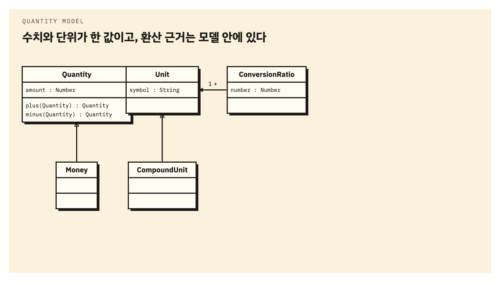

# Quantity — 숫자와 단위를 떼어 놓지 않는 값

## 한눈에 보는 개요

빵집 재고 프로그램이 이스트 보유량을 `onHandKg` 라는 숫자 필드 하나로 갖고 있다고 해 봅시다. 단위는 필드 이름에만 적혀 있어요. 납품서는 kg 로 들어오는데 레시피는 사용량을 g 로 적습니다. 레시피에 적힌 100 g 이 숫자 100 으로만 `consume` 에 들어가면 보유량 0.3 에서 100 을 빼게 되고, 결과는 −99.7 이에요(Java 21 로 실행해 확인). 음수 검사를 넣어 두면 이번에는 300 g 을 갖고 있는 재고가 100 g 사용을 재고 부족으로 거부합니다. 어느 쪽도 답이 아니죠.

Quantity 의 해법은 **수치와 단위를 한 값으로 묶고 계산을 그 값에게 맡기는 것**입니다. 값이 빼기 전에 두 단위를 비교하고, 다르면 환산 비율로 맞춘 뒤에 계산해요. 맞출 비율이 없으면 계산을 거부합니다.

```text
Before — 단위가 필드 이름에만 있다
  onHandKg = 0.3
  레시피 100 g ──(숫자만)──▶ consume(100) ──▶ 0.3 − 100 = −99.7
                                              단위를 확인할 자리가 아예 없다

After — 단위가 값 안에 있다
  onHand = Quantity(0.3, kg)
  레시피 100 g ──(값째로)──▶ consume(Quantity(100, g))
                              ├─ kg 와 g 사이 비율 1000 을 찾는다
                              ├─ 0.3 kg 을 300 g 으로 옮긴다
                              └─ 300 g − 100 g = 200 g
```

분류는 Fowler 『Analysis Patterns』(1997)의 관측·측정 계열이고(근거: Fowler *Analysis Patterns* 3장 「Observations and Measurements」 §3.1~§3.5), 함께 쓰는 패턴은 Conversion Ratio · Compound Unit · [Measurement](../measurement/measurement-guide_v1.1.0.md) · Money 입니다.

이 글의 예제는 빵집 재료 재고예요. 재료 하나의 **재고 기록**(`IngredientStock`)이 보유량 값 하나를 갖고, 재료 카탈로그는 번호(`IngredientId`)로만 가리킵니다. 단위 확인과 자릿수 규칙은 보유량 값이 스스로 지키고, 보유량이 음수가 되지 않게 하는 일은 재고 기록이 맡아요. kg → g 같은 환산 비율은 어느 재고 기록에도 속하지 않는 **비율 표** 하나에 두고 모든 값이 함께 찾아봐요. kg 로 보여 주는 보유량 같은 환산 결과는 물을 때마다 새 값으로 만들 뿐 따로 적어 두지 않습니다. 단위와 비율을 다른 곳에 두는 선택지 셋은 「상황이 달라지면」에서 나란히 봅니다.

```text
이 글이 고른 경계
  재고 기록 ──── 보유량 값 하나를 가짐 (보유량이 음수가 되지 않게 지킴)
  보유량 값 ──── 수치와 단위를 함께 가짐 (단위 확인 · 자릿수 규칙을 스스로 지킴)
  재료 카탈로그 ─ 번호(IngredientId)로만 가리킴
  비율 표 ────── 어느 재고 기록에도 속하지 않음 (모든 값이 함께 찾아봄)
  환산 결과 ──── 물을 때마다 새 값 (적어 두지 않음)
```

이 글은 시나리오 셋을 따라갑니다. 요청 하나가 재고에서 빠지는 길, 단위가 다른 요청과 실사 대조가 더해질 때 무엇이 바뀌는가, 단위를 값 밖에 두면 어느 단계에서 어긋나는가. 끝까지 읽으면 어떤 숫자 필드를 Quantity 로 바꿔야 하는지 필수 조건 셋으로 판정할 수 있고, 어느 규칙을 값이 지고 어느 규칙을 재고 기록이 지는지와 환산 방향에 따라 자릿수가 어떻게 달라지는지도 세 언어 코드에서 짚을 수 있게 됩니다.

## 패턴 자세히 들여다보기

### 시나리오 1 — 레시피가 이스트 100 g 을 쓰고 보유 0.3 kg 에서 빠지는 길

빵집의 재고 기록 `stock-1` 은 재료 `yeast` 의 보유량을 맡고 있고, 아침 납품으로 0.3 kg 이 들어왔습니다. 오후에 레시피가 1회분 50 g 을 두 번 쓰겠다고 요청해요. 나와야 하는 답은 보유 200 g 하나입니다. 이 장면에는 넷이 등장해요. 수치와 단위를 한 값으로 묶은 **Quantity** 와 그 수치를 무엇으로 셌는지 나타내는 Unit, 그리고 둘 사이를 옮길 근거인 ConversionRatio 입니다. 나머지 하나는 재료 하나의 재고를 맡아 보유량을 바꾸는 **IngredientStock** 이에요. 이름은 여기서 한 구절씩만 소개해요. 앞의 셋은 개념 정리에서 정식으로 정의하고, IngredientStock 은 개요가 재고 기록이라고 부른 패턴 밖의 타입이라 상황 설정에서 코드와 잇습니다.

1. **레시피 쪽이 수치와 단위를 함께 넘겨 `Quantity(50, g)` 를 만들고, 횟수 2 를 곱해 100 g 으로 만듭니다.** 수치만 넘기면 받는 쪽이 단위를 짐작해야 하고, 그 짐작이 틀린 결과가 개요의 −99.7 이에요(시나리오 3 의 3단계가 그 길입니다). 만들 때 자릿수 규칙(소수점 아래 세 자리)도 함께 확인합니다. 곱한 2 는 세는 횟수이지 양이 아니라서 단위는 g 그대로예요.
2. **재고 기록 `IngredientStock` 이 사용량이 0 보다 큰지 먼저 보고, 뺄셈은 보유량 Quantity 에게 맡깁니다.** 단위 확인을 부르는 쪽마다 따로 쓰면 한 곳만 빠뜨려도 섞인 계산이 나오는데, 확인이 연산 안에 있으면 빠뜨릴 자리가 없어요. 반대로 양수 검사는 값이 아니라 재고 기록 몫입니다. 값이 음수를 거부해 버리면 300 g − 400 g 같은 뺄셈 자체가 실패해서, 재고 기록이 얼마나 모자란지 판정할 결과값을 받지 못하거든요.
3. **Quantity 가 두 Unit 을 비교해 공통 단위를 정합니다.** kg 와 g 사이에는 kg 1 = g 1000 이라는 ConversionRatio 가 있고, 이 예제는 그 비율의 to 쪽인 g 를 공통 단위로 골라요. 무엇을 공통 단위로 삼을지는 패턴이 정하지 않습니다 — 왼쪽 값의 단위를 유지하거나 기준 단위로 모으는 방법도 있어요. 이 예제가 to 쪽을 고른 이유는 자릿수에 있고, 바로 아래에서 따져 봅니다.
4. **공통 단위로 옮긴 뒤 계산하고, 결과를 새 Quantity 로 돌려줍니다.** 0.3 kg × 1000 = 300 g 이고 300 − 100 = 200 g 이에요. 원래의 0.3 kg 과 레시피의 100 g 은 그대로 남습니다. 제자리에서 값을 바꾸면 같은 100 g 객체를 쓰던 레시피 쪽 1회분까지 함께 바뀌기 때문이에요.
5. **재고 기록이 결과가 음수인지 확인한 다음에 보유량을 교체합니다.** 순서를 바꿔 교체부터 하면 규칙 위반으로 거부하더라도 음수 보유량이 이미 저장돼 있어요. 「스스로 점검하기」 3번이 그 순서를 뒤집었을 때 장부에서 1 g 이 사라지는 과정을 따라갑니다.

```text
단계   부르는 쪽 → 받는 쪽            넘기는 것                   돌아오는 것
 1     레시피 → (new)                "50" · g,  × 2             Quantity(100, g)
 2     레시피 → IngredientStock      Quantity(100, g)           (5단계에서 보유 200 g)
 2     IngredientStock → Quantity    minus(100 g)               (4단계에서 200 g)
 3     Quantity → ConversionRatio    kg · g                     kg → g, 1000 → 공통 단위 g
 4     Quantity → IngredientStock    —                          Quantity(200, g)
 5     IngredientStock → 보유량      음수 확인 뒤 교체            보유 200 g
```

3단계에서 이 예제가 왜 to 쪽을 고르는지는 자릿수로 따지면 알 수 있습니다. 전제는 둘이에요. 수치는 소수점 아래 세 자리까지이고, 비율 f 는 정수(여기서는 1000)입니다.

```text
수치 a 가 소수 k 자리(k ≤ 3)라면   a = n / 10^k    (n 은 정수)

곱셈   a × f = (n × f) / 10^k      분모가 그대로 10^k   → 소수 자리 ≤ k ≤ 3, 규칙 유지
나눗셈 a ÷ f = n / (10^k × 1000)   분모가 10^(k+3)       → 소수 자리가 최대 셋 늘어난다

  0.3 kg → g    0.3 × 1000 = 300       소수 0자리
  0.5 g  → kg   0.5 ÷ 1000 = 0.0005    소수 4자리, 규칙 위반
```

곱셈 쪽은 n × f 가 정수의 곱이라 여전히 정수이고, 분모가 10^k 에서 바뀌지 않습니다. 그래서 소수 자리가 k 를 넘을 수 없어요. 나눗셈 쪽은 분모에 1000 = 10³ 이 곱해지니 자리가 셋까지 늘고, 0.5 g 처럼 저울로 잰 정상 입고가 규칙에 걸립니다. 더하기·빼기의 공통 단위를 to 쪽으로 고르면 환산이 늘 곱셈이 되니, 두 전제가 성립하는 이 예제에서는 입고와 사용이 자릿수 규칙에 걸리지 않아요. 비율이 정수가 아니면 곱셈도 자릿수를 늘리므로 이 논증은 그대로 옮겨 쓸 수 없습니다.

> 이 예제(정수 비율 kg → g)에서는 to 쪽으로 맞춘다. 정수를 곱하면 소수 자리가 늘지 않는다.

잠깐, 확인 하나만 해 볼까요? 보유량이 0.3 kg 일 때 0.2 kg 을 빼면 결과는 어떤 단위로 나올까요? 답은 kg 입니다. 두 단위가 같으니 3단계에서 비교만 하고 환산 없이 4단계로 가요. 같은 0.2 kg 이라도 보유량이 200 g 일 때는 단위가 달라 공통 단위 g 로 맞춰집니다.

```text
보유 0.3 kg − 0.2 kg   같은 단위      → 3단계는 비교만, 환산 없음   → 0.1 kg
보유 200 g  − 0.2 kg   kg 와 g 다름   → 공통 단위 g, 0.2 × 1000    → 0 g
```

이 시나리오가 보여 준 것은 책임의 경계입니다. 단위를 확인하고 맞추고 계산해 새 값을 내는 일(3·4단계)은 Quantity 가, 사용량이 양수인지와 보유량이 음수가 되지 않는지(2·5단계)는 재고 기록이 맡아요. 둘을 가르는 기준은 "누가 그 규칙을 판정할 정보를 갖고 있는가" 입니다. 단위는 값 안에 있으니 값이 보고, 보유량이 음수면 안 된다는 것은 재고라는 문맥의 규칙이라 재고 기록이 봅니다. 여기서 나온 패턴의 개념 셋이 「개념 정리」로 모여요.

### 시나리오 2 — 단위가 다른 요청과 실사 대조가 더해질 때

같은 재고가 보유 200 g 을 갖고 있습니다. 여기에 요구가 넷 더 들어와요. 납품 담당은 사용량을 kg 로 적어 `consume(0.2 kg)` 을 보내고, 창고 화면은 보유량을 kg 로 보고 싶어 하고, 저울에 0.5 g 으로 찍힌 소분량을 kg 로 적어 달라는 요청이 있고, 액체 재료가 1 L 로 적힌 채 입고 목록에 섞여 들어옵니다. 월말에는 장부의 2.5 kg 과 손으로 센 2500 g 을 대조해야 해요. 시나리오 1 의 다섯 단계 가운데 무엇이 바뀌고 무엇은 그대로인지를 봅니다.

1. **`consume(0.2 kg)` 은 3단계의 공통 단위 결정만 달라집니다.** 단위가 kg 와 g 로 다르니 비율을 찾아 to 쪽인 g 를 고르고, 0.2 kg × 1000 = 200 g 을 200 g 에서 빼 0 g 이 나와요. 결과 단위가 kg 가 아니라 g 로 남는 이유가 여기예요. 공통 단위는 요청한 쪽 단위가 아니라 비율이 정합니다.
2. **창고 화면은 `convertTo(kg)` 로 단위를 직접 지정합니다.** 이번에는 옮기는 방향이 거꾸로라 곱하지 않고 나눕니다. 200 ÷ 1000 = 0.2 kg 이에요. 방향을 가르지 않고 늘 곱하면 200 g 이 200,000 kg 이 되니, 비율에 from 과 to 가 적혀 있는 것이 이 갈래를 위한 것입니다.
3. **0.5 g 을 kg 로 옮기려는 요청은 거부합니다.** 0.5 ÷ 1000 = 0.0005 라서 소수점 아래 네 자리가 되고, 자릿수 규칙을 넘어요. 반올림해서 0.001 kg 이나 0 kg 으로 적으면 저울로 잰 양과 장부가 달라지니 이 예제는 반올림 대신 거부를 고릅니다. 금액처럼 반올림이 규칙인 도메인이라면 바로 이 자리에 반올림 규칙이 들어가요.
4. **1 L 입고는 계산 자체를 거부합니다.** g 과 L 사이에는 비율이 없어요. 우유 1 L 가 몇 g 인지는 단위가 아니라 재료의 밀도에 달려 있어서, 단위 둘만 보고는 환산할 근거가 없습니다. 근거가 없을 때 짐작으로 메우지 않고 멈추는 것이 3단계의 세 번째 갈래예요.
5. **실사 대조는 같은 값 판정과 크기 비교를 구분해 씁니다.** 표기만 다른 2.50 kg 과 2.5 kg 은 같은 값이고(만들 때 표현을 하나로 맞춥니다), 2.5 kg 과 2500 g 은 같은 값은 아니지만 같은 양입니다. 장부에 적힌 단위까지 맞는지 보려는 요구라서 값 같음은 환산하지 않고, 크기만 물을 때는 환산한 뒤 비교해요. 둘을 한 판정으로 합치면 kg 로 적힌 장부와 g 로 적힌 실사가 그냥 통과합니다.
6. **바뀌지 않는 것은 재고 기록의 검사 자리와 순서입니다.** 요청이 kg 든 g 든 L 이든 `consume` 은 양수 확인 → 뺄셈 위임 → 음수 확인 → 교체를 같은 순서로 지나요. 단위를 맞추는 일이 값 안에서 끝나니 재고 기록은 단위를 알 필요가 없고, 새 단위와 새 비율이 늘어도 재고 기록의 코드는 한 줄도 바뀌지 않습니다.

| 들어온 요구 | 지나는 갈래 | 결과 |
| --- | --- | --- |
| `consume(0.2 kg)` · 보유 200 g | 시나리오 1 의 3단계 — 비율 있음, 공통 단위 g | 0 g |
| `convertTo(kg)` · 보유 200 g | 이 시나리오의 2단계 — 역방향 나눗셈 | 0.2 kg |
| `0.5 g` 을 kg 로 | 이 시나리오의 3단계 — 역방향 나눗셈 뒤 자릿수 규칙 | 거부 |
| `receive(1 L)` | 시나리오 1 의 3단계 — 비율 없음 | 거부 |
| 2.50 kg 과 2.5 kg | 값 같음 | true |
| 2.5 kg 과 2500 g | 값 같음 / 크기 비교 | false / true |

이 시나리오가 보여 준 것은 변화가 미치는 범위입니다. 새 단위나 새 요청 형태가 들어와도 바뀌는 곳은 Quantity 의 3단계(공통 단위를 어떻게 정하는가)와 비율 표뿐이고, 재고 기록의 검사 순서와 그 자리는 그대로예요(6단계). 그리고 환산이 늘 성공하는 연산이 아니라는 것도 여기서 확인됩니다 — 비율이 없거나(4단계) 자릿수 규칙을 넘으면(3단계) 값은 짐작하지 않고 거부합니다. 같은 값과 같은 양이 다른 판정이라는 것(5단계)도 이 자리에서 구분돼요.

### 시나리오 3 — 단위를 값 밖에 두면 어느 단계에서 어긋나는가

같은 빵집의 다른 코드베이스는 보유량을 `onHandKg` 라는 `double` 필드 하나로 가집니다. 납품 화면이 0.3 을 넣고, 레시피 배치 작업이 1회분 50 을 두 번 더해 100 을 넘겨요. 오가는 값은 시나리오 1 과 똑같습니다. 단위만 값 안이 아니라 필드 이름과 주석에 있어요. 아래 수치는 Java 21 로 실제로 컴파일해 실행한 것이에요.

1. **납품 화면이 `onHandKg = 0.3` 을 씁니다.** 여기까지는 어긋난 것이 없어요. 단위는 필드 이름이 알려 주고, 그 이름을 읽는 사람은 kg 로 읽습니다. 다만 값 자신은 자기가 kg 인지 모르고, 그 사실이 뒤에서 문제가 됩니다.
2. **레시피 배치가 `consume(100)` 을 부릅니다.** 시나리오 1 의 3단계, 곧 두 Unit 을 비교하는 자리에 해당하는 코드가 여기에는 없어요. 비교할 Unit 이 값 안에 없으니 비교할 자리 자체가 생기지 않습니다. 어긋남은 이 단계에서 생겼는데 아직 아무 신호도 나오지 않아요.
3. **뺄셈이 그대로 통과해 −99.7 이 나옵니다.** 0.3 − 100 = −99.7 이에요(직접 실행해 확인). 시나리오 1 이었다면 3단계에서 300 g 과 100 g 으로 맞춰져 보유 200 g, 곧 0.2 kg 이 나왔을 계산입니다. 같은 요청인데 한쪽은 0.2 kg 을, 다른 쪽은 −99.7 kg 을 냈어요.
4. **음수 검사를 넣어도 낫지 않습니다.** −99.7 이 음수라 거부되는데, 실제로는 300 g 을 가진 재고가 100 g 사용을 거부한 것이에요. 검사는 시나리오 1 의 5단계 자리에 있고 어긋남은 2단계에서 생겼으니, 검사가 잡아낸 것은 어긋남이 아니라 그 결과입니다. 그래서 오류 메시지도 "재고 부족" 이라고 틀린 이유를 댑니다.
5. **단위 필드를 하나 더 두는 것으로는 막히지 않습니다.** `Weight(0.3, "kg")` 에 `Weight(100, "g")` 을 더하는 래퍼를 두고 `plus` 가 `other.unit` 을 읽지 않게 놔두면 결과가 `Weight[value=100.3, unit=kg]` 이에요(Java 21 로 실행해 확인). 단위를 갖고 있는 것과 연산이 그 단위를 읽는 것은 다른 일이고, 그 차이가 나는 자리가 시나리오 1 의 3단계입니다.
6. **되돌리는 길은 3단계를 만들어 주는 것입니다.** 단위를 값 안에 넣으면 시나리오 1 의 3단계가 생기고, 두 단위가 다르다는 사실을 뺄셈보다 먼저 알게 돼요. 막히는 자리가 5단계(검사)에서 3단계(비교)로 앞당겨지는 것이 이 패턴이 바꾸는 전부입니다.

```text
같은 요청 — 보유 0.3 kg 에서 100 g 사용

단위가 값 밖에 있을 때                        단위가 값 안에 있을 때
  2단계  비교할 Unit 이 없다 (자리 없음)         3단계  kg 와 g → 비율 있음 → 공통 단위 g
  3단계  0.3 − 100 = −99.7                    4단계  300 g − 100 g = 200 g
  4단계  음수라서 "재고 부족" 으로 거부           5단계  음수 아님 → 보유 200 g 으로 교체
         (검사가 없으면 −99.7 이 그대로 저장)

단위 필드만 붙인 래퍼
  Weight(0.3,"kg").plus(Weight(100,"g")) → Weight[value=100.3, unit=kg]
    other.unit 을 읽지 않으니 3단계가 여전히 없다
```

이 시나리오가 보여 준 것은 어긋남이 생기는 단계와 나타나는 단계가 다르다는 점입니다. 단위가 값 밖에 있으면 어긋남은 2단계에서 생기고, 시나리오 1 의 5단계에 해당하는 검사 자리에 가서야 엉뚱한 이름으로 나타나요(3·4단계). 단위를 값 안에 두면 같은 일이 시나리오 1 의 3단계에서 막혀요. 비율이 있으면 공통 단위로 맞춰 200 g 이 남고, 비율이 없으면(시나리오 2 의 4단계) 그 자리에서 환산 비율이 없다는 실제 이유를 대며 거부합니다. 단위 필드를 붙이는 것만으로는 부족하다는 것(5단계)이 최소 조건 1 과 2 를 나눠 두는 이유이기도 해요.

### 개념 정리

시나리오에 나온 개념을 정식으로 정의합니다. 다섯 가운데 앞의 셋은 코드에 실제로 나오고, CompoundUnit 과 Money 는 이 예제가 쓰지 않지만 Quantity 곁에 놓이는 모델을 이루는 개념이라 함께 둡니다.

- **Quantity** — 수치(amount)와 단위(unit)를 한 값으로 묶은 것입니다. 더하기·빼기와 크기 비교를 스스로 맡아, 두 값의 단위를 확인하고 결과를 새 Quantity 로 돌려줄 책임을 집니다(시나리오 1 의 3·4단계). Unit 하나를 가리키고, 단위가 다르면 ConversionRatio 를 찾아 협력해요. 협력까지가 패턴의 요구는 아닙니다 — 단순한 구현은 단위가 다른 덧셈을 거부하고 환산을 호출자에게 맡기고([Quantity, eaaDev](https://martinfowler.com/eaaDev/Quantity.html)), 그래도 최소 조건 2 는 채워요. 환산은 [선택] 5 입니다.
- **Unit** — 수치를 무엇으로 셌는지 나타냅니다. 이 예제에서는 g · kg · L 셋이에요. 두 Quantity 가 같은 단위인지 가르는 기준이고, 사람에게 보일 기호를 가집니다. 여러 Quantity 가 같은 Unit 하나를 가리키고, Unit 하나는 ConversionRatio 의 from 쪽으로도 to 쪽으로도 여러 번 놓일 수 있어요. 이 예제의 g 가 그렇습니다 — kg → g 비율에서는 to 쪽이고, g → mg 비율을 더하면 그 비율에서는 from 쪽이 돼요.
- **ConversionRatio** — from 단위 1 이 to 단위로 얼마인지를 수(`number`)로 적은 것이고, 두 단위를 섞어 계산해도 되는 근거가 됩니다. 방향이 있어서 from → to 로 옮길 때는 그 수를 곱하고 to → from 으로 올 때는 나눠요(시나리오 2 의 1·2단계). 비율 하나는 from 단위 하나와 to 단위 하나만 가집니다. 비율을 코드 곳곳에 1000 으로 적어 두면 어디는 곱하고 어디는 나누는 실수를 값이 막아 줄 수 없어서, 비율을 모델의 객체로 두고 양 끝 단위를 밝혀요.
- **CompoundUnit** — m/s² 처럼 여러 단위에 지수를 붙여 곱한 Unit 의 한 종류입니다. 나누기는 음수 지수예요. 이 종류가 따로 필요한 이유는 Quantity 끼리 곱하거나 나누면 어느 단위 목록에도 없던 단위가 생기기 때문입니다. 이스트를 하루 100 g 씩 쓴다면 사용 속도의 단위는 g/일 인데, 이건 g 도 아니고 일도 아닌 새 단위예요. 시나리오 1 의 1단계처럼 보통의 수를 곱하는 계산은 단위를 그대로 두므로 이 개념이 필요하지 않습니다.
- **Money** — 단위 자리에 통화가 오는 Quantity 로, 금전이라는 도메인 의미를 가집니다. 수치와 통화를 한 값으로 묶고, 통화가 다른 금액의 덧셈을 값이 막고, 통화 사이를 옮기려면 비율(환율)이 필요하다는 규칙이 Quantity 와 같아서 그 한 종류로 둡니다. 다른 점은 둘이에요. 환율은 kg → g 비율과 달리 시점마다 바뀌고, 통화마다 최소 단위가 있어 계산 결과를 그 단위로 반올림하는 규칙이 따로 붙습니다.



그림에는 개념과 연관·다중도만 있고 전술 분류 표기는 없습니다. Quantity 에서 Unit 으로 가는 선의 `*` 와 `1` 은 여러 Quantity 가 같은 Unit 하나를 가리킨다는 뜻이고, ConversionRatio 에서 Unit 으로 가는 선이 둘인 것은 from 쪽과 to 쪽 연관이 따로 있다는 뜻이에요. 상자 안의 `from : Unit` · `to : Unit` 이 그 두 선의 끝입니다. Money 에서 Quantity 로, CompoundUnit 에서 Unit 으로 가는 화살표는 "~의 한 종류" 를 뜻해요. 개념의 포함 관계를 옮긴 것이지 코드에서 상속으로 구현하라는 뜻은 아닙니다. CompoundUnit 이 어떤 단위를 몇 제곱으로 묶는지는 Quantity 중심으로 줄이느라 뺐고, 그림의 `number` 는 뒤의 구현 예시에서 `factor` 로 부르는 값이에요. TypeScript 에서 `number` 가 수 타입 이름이라 필드 이름으로 두면 읽기 헷갈려서 세 언어에 같은 이름을 쓰려고 바꾼 자리입니다.

Quantity 위에 대상과 측정 항목을 더한 Measurement, 그 위의 Observation, 끝점을 Quantity 로 두는 Range 까지 이 다섯이 어떤 층으로 놓이는지는 [참고 문서 「수량·측정·관측 모델」](../../reference/observation-model/observation-model-ref_v1.0.2.md)이 그림 한 장으로 정리합니다. 이 개념들을 코드에서 어느 묶음에 넣을지는 뒤의 「상황 설정」 표가 정해요.

## 사용 목적

코드나 요구에서 아래 모습이 보이면 Quantity 를 쓸 때입니다. 셋을 차례로 봅시다.

#### 단서 1 — 같은 필드에 값을 넣는 경로마다 단위가 다릅니다

값을 넣는 경로가 둘 이상인데 경로마다 단위가 다르고, 단위는 필드 이름이나 주석에만 있습니다(`weightKg`, `// 단위: g`). 개요의 납품서(kg)와 레시피(g)가 이 모습이고, 시나리오 3 이 그 코드가 어디서 어긋나는지 따라갑니다.

#### 단서 2 — 단위 확인이 복제돼 있고, 새 함수에서 그 한 줄이 빠진 적이 있습니다

합계를 내는 함수마다 `if (a.currency != b.currency)` 가 붙어 있다면 확인의 자리가 값이 아니라 호출자에 있다는 신호예요. 시나리오 2 의 6단계처럼 확인이 값 안에서 끝나야 빠뜨릴 자리가 없어집니다.

#### 단서 3 — 자릿수와 반올림 규칙이 코드 곳곳에 흩어져 있습니다

화면은 소수점 아래 두 자리에서, 저장은 세 자리에서 자르고 합계 함수마다 반올림을 따로 해서, 나눴다가 다시 더한 금액이 1원 모자랍니다. 이 규칙을 값 한 곳에 모을 자리가 필요하다는 뜻이에요(시나리오 2 의 3단계).

#### 쓰지 말아야 할 경우

검사 항목마다 단위가 다른 경우(혈압은 mmHg, 체중은 kg)도 같은 단서인데, 그때는 값을 Quantity 로 두고 검사 항목이 계속 늘어나는 요구인지를 함께 봅니다. 늘어난다면 Measurement 도 검토할 자리예요. 차이는 「비슷한 패턴·안티패턴과의 차이」에서 가릅니다. 반대로 아래 둘은 Quantity 로 만들면 잃는 것이 큽니다.

| 이런 경우 | Quantity 로 만들면 잃는 것 |
| --- | --- |
| 수가 식별자나 코드다(주문 번호, 우편번호) | 더해도 뜻이 없는 수에 `plus` 같은 연산이 열립니다. 정수 id 에 산술처럼 맞지 않는 행위가 붙지 않게 하려면 별도 값 객체로 감싸라고 Fowler 가 적는데, 그 자리는 Quantity 가 아니라 id 값 객체예요([Value Object](https://martinfowler.com/bliki/ValueObject.html)) |
| 단위가 하나로 정해져 있고 환산도 섞임도 자릿수 규칙도 없다(게시글 조회수) | 타입과 단위 확인 코드가 늘지만 막아 줄 오류가 없습니다. 단위가 하나여도 반올림 같은 규칙이 붙으면 이 경우가 아니에요 |

세 모델을 가르려면 네 가지를 확인하면 됩니다. 첫 줄이 아니오이면 산술 자체가 없으니 Quantity 가 아니라 id 값 객체로 가고, 첫 줄은 예인데 나머지가 모두 아니오인 조회수에 Quantity 를 씌우면 단위 비교가 늘 같은 단위 갈래만 지나면서 타입만 늘어납니다.

| 모델에서 확인할 것 | 우편번호 | 게시글 조회수 | 이스트 재고 보유량 |
| --- | --- | --- | --- |
| 이 수끼리 더하거나 빼면 도메인에서 뜻이 있는가 | 없음. 두 우편번호의 합은 어느 지역도 아님 | 있음(+1) | 있음(입고·사용) |
| 값을 바꾸는 연산과 연산별 단위 | 바꾸는 연산 없음 | 조회 기록 하나, 늘 1회씩 늚 | 입고는 kg, 사용은 g — 연산마다 다름 |
| 단위가 다른 두 수가 한 연산에서 만나는가 | 연산이 없음 | 만나지 않음 | 시나리오 1 의 3단계에서 kg 과 g 이 만남 |
| 환산·자릿수 규칙이 필요한가 | 없음. 숫자로 저장하면 앞자리 0 이 사라져 문자열로 둠 | 없음 | kg → g 비율 1000, 소수점 아래 세 자리 |
| 고를 모델 | id 값 객체 | 원시 정수 필드 | Quantity |

## 패턴의 경계

### 디자인 패턴을 충족하는 최소 조건

아래 조건은 클래스 모양이 아니라 **개념이 무엇을 책임지는가**로 판정합니다. `record` 든 `struct` 든, 필드가 하나든 둘이든 판정에는 상관없어요. 조건마다 그것을 보여 준 시나리오의 단계를 가리킵니다.

1. [필수] 양은 단위와 늘 함께 있음 — 도메인 연산이 양을 주고받을 때 수치만 넘기지 않습니다. 시나리오 1 의 1단계 (근거: Fowler *Analysis Patterns* 3장 「Observations and Measurements」 §3.1 — Figure 3.1 에서 Person 의 `height`·`weight` 가 `Number` 라 단위가 모델에 없던 것을, Figure 3.2 가 `amount : Number` 와 `units : Unit` 을 가진 Quantity 로 바꿉니다)
   - 경계 사례: 수치만 꺼내 쓰는 일(화면 표시, 저장)은 단위를 아는 쪽이 하면 이 조건을 어기지 않아요.
   - 빠지면: 단위가 필드 이름에만 남은 `onHandKg : double` 이 됩니다. 시나리오 3 의 3단계에서 본 −99.7 이 아무 신호 없이 통과해요.
2. [필수] 양끼리 만나는 연산과 크기 비교의 단위 확인 — Quantity 가 제공하는 더하기·빼기와 크기 비교는 같은 단위면 계산하고, 다르면 환산 근거로 맞추고, 근거가 없으면 거부합니다. 시나리오 1 의 3단계(맞춤) · 시나리오 2 의 4단계(거부) (근거: Fowler *Analysis Patterns* 3장 §3.1~§3.2 — Figure 3.2 가 `+ - * / = > <` 를 Quantity 자신의 연산으로 적어 산술을 값의 책임으로 두고, Figure 3.3 이 두 Unit 을 잇는 Conversion Ratio 를 모델에 둬 단위가 다른 양을 다룰 근거를 만듭니다)
   - 경계 사례: 거부할지 환산할지까지는 원전이 정하지 않아서, 둘 중 무엇을 골라도 이 조건은 갖춘 것으로 봅니다. 단위가 다를 때 거부만 하고 환산은 못 하는 래퍼도 이 조건은 갖춘 것이고, 환산은 [선택] 5 의 몫이에요.
   - 경계 사례: 곱하기·나누기를 제공한다면 결과 단위를 정해요 — 보통의 수를 곱하면 단위를 유지하고(시나리오 1 의 1단계), 양끼리 곱하거나 나누면 새 단위가 나옵니다. 조건 3 의 값 같음은 크기 비교와 다른 판정이라 이 규칙을 따르지 않아요.
   - 빠지면: 단위를 갖고만 있는 래퍼가 됩니다. 시나리오 3 의 5단계에서 0.3 kg 과 100 g 의 합이 100.3 kg 으로 나온 코드가 그 모양이에요.
3. [필수] 값으로 비교하고 값으로 주고받음 — 두 Quantity 가 같은 값인지 객체 참조가 아니라 값으로 판정하는 수단(메서드든 비교 함수든)이 있고, 한 곳의 계산이 같은 값을 쓰던 다른 곳을 바꾸지 않습니다. 시나리오 1 의 4단계(새 값을 돌려줌) · 시나리오 2 의 5단계(값으로 판정) (근거: Fowler *Analysis Patterns* 3장 §3.1 — Figure 3.2 가 Quantity 의 연산 목록에 `=` 를 둔 자리와, Fowler 가 martinfowler.com 의 Value Object 글에서 값 객체에는 aliasing 을 막을 장치가 필요하다고 적은 자리)
   - 경계 사례: 그 장치로 Fowler 는 불변을 먼저 권하고, 대입할 때마다 복사하는 방법도 가능하다고 적습니다([Value Object](https://martinfowler.com/bliki/ValueObject.html)). 무엇을 같은 값으로 볼지 — 표현이 같아야 하는지, 환산해서 크기가 같으면 되는지 — 까지는 원전이 정하지 않아요. 그 선택은 [선택] 4 에 있습니다.
   - 빠지면: 둘 중 하나가 생깁니다. `plus` 가 자기 수치를 바꾸는데 복사도 하지 않으면, 레시피 1회분 50 g 객체를 두 재고가 함께 쓰는 순간 한쪽 계산이 레시피 값까지 바꿔요. 같음을 객체 참조로 판정하면 똑같이 2.5 kg 인 두 객체가 다르다고 나옵니다.
4. [선택] 표현이 같아야 같은 값 — 같은 값 판정이 환산을 거치지 않아서, 2.5 kg 과 2500 g 은 크기가 같아도 다른 값입니다. 시나리오 2 의 5단계 (근거: 이 가이드의 정책 — 장부와 실사 기록을 대조할 때 단위까지 같은지 보려는 예제 요구라서)
   - 경계 사례: 2.50 kg 과 2.5 kg 처럼 표기만 다른 것은 하나로 맞춰 둬서 같은 값이에요.
5. [선택] 환산 규칙을 모델에 둠 — 단위를 바꾸는 계산이 모델이 가진 근거를 거쳐서 일어납니다. 시나리오 1 의 3단계 · 시나리오 2 의 2단계 (근거: Fowler *Analysis Patterns* 3장 §3.2 — Conversion Ratio 를 방향이 있는 비율로 두고, JAOO(덴마크에서 열리던 소프트웨어 개발 학회) 1999 튜토리얼 슬라이드의 `as(Unit)` 연산이 그 비율로 단위를 바꿉니다)
   - 빠지면: 단위가 다른 양을 만났을 때 조건 2 에 따라 거부할 수밖에 없어요.
6. [선택] 자릿수와 반올림 규칙을 값이 앎 — 수치가 가질 수 있는 소수 자리와 그 자리를 넘을 때의 처리(거부 또는 반올림)가 Quantity 쪽에 있습니다. 시나리오 2 의 3단계 (근거: 이 가이드의 정책 — 저울로 잰 양과 장부를 어긋나게 하지 않으려고 반올림 대신 거부를 골랐고, Money 에서는 자릿수 쪽을 통화의 최소 단위가 정합니다)
7. [선택] CompoundUnit 으로 단위 합성 — 양끼리 곱하거나 나눈 결과를 m/s² 나 g/일 같은 단위로 표현합니다. 시나리오 1 의 1단계 (근거: Fowler *Analysis Patterns* 3장 §3.3 — Compound Unit 을 Unit 의 하위 타입으로 두고 지수를 가진 단위 참조로 구성합니다)
   - 경계 사례: 시나리오 1 의 1단계는 보통의 수 2 를 곱해 단위가 g 그대로인 갈래만 보여 주는데, 양끼리 곱하는 연산을 열면 그 자리에서 새 단위가 필요해져요.
8. [선택] 문자열로 읽고 쓰기 — `0.3 kg` 같은 표기와 값을 오갈 수 있습니다. 시나리오 1 의 1단계(`"50"` 을 읽어 값을 만듦) · 시나리오 2 의 2단계(`0.2 kg` 으로 적어 냄) (근거: Fowler *Analysis Patterns* 3장의 JAOO 1999 튜토리얼 슬라이드 — Quantity 의 연산으로 `valueOf(String)` 과 `toString()` 을 듭니다)

### 비슷한 패턴·안티패턴과의 차이

| 비교 대상 | 구분 기준 | Quantity 를 고르면 얻는 것 | 포기하는 것 |
| --- | --- | --- | --- |
| 원시 숫자 필드(Primitive Obsession) | 단위가 값 안에 있는가, 이름·주석에만 있는가 | 단위가 섞인 계산을 연산이 막고, 확인 코드가 한 곳에 모인다 | 타입 하나가 늘고, 단위가 섞이는 도메인이면 환산 규칙도 관리해야 한다 |
| 단위를 갖고만 있는 래퍼 | 호환되지 않는 단위의 산술을 값이 막는가(거부하든 환산하든) | 단위가 맞지 않는 계산을 값이 거부한다 | 연산마다 단위 확인 코드가 들어간다. 래퍼는 그 코드를 아낀 대가로 틀린 합을 낸다 |
| Measurement | 대상과 측정 항목을 가진 기록 계층이 필요한가 | 값만 필요한 자리(재고·가격)에 기록 계층 없이 쓴다 | 대상·항목 기록은 없다. 필요하면 Measurement 가 Quantity 를 속성으로 가진다 |
| Money | 단위가 통화이고 통화마다 정해진 자릿수가 붙는가 | 질량·부피·금액이 같은 연산 규칙을 공유한다 | 반올림 시점·방식 같은 업무 규칙은 그 위에 따로 더해야 한다 |

#### 원시 숫자 필드와의 차이

구분 기준은 단위가 어디에 있느냐입니다. 원시 필드는 이름과 주석에 두고, Quantity 는 값 안에 둡니다. 자리 하나 차이예요. 그 차이를 단계별로 따라간 것이 시나리오 3 의 1~4단계이고, 같은 요청이 한쪽에서는 0.2 kg 다른 쪽에서는 −99.7 kg 으로 끝났습니다. Quantity 를 고르면 단위 확인이 연산 한 곳에 모이는 대신 타입 하나와 환산 규칙을 관리하게 돼요.

여기서 헷갈리기 쉬운 포인트는 부동소수점 오차까지 Quantity 가 없애 준다고 보는 것입니다. 단위 확인과 수치 표현은 서로 다른 결정이에요. 아래 코드는 단위를 제대로 확인하는데도 수치를 TypeScript `number` 로 두었습니다.

```typescript no-compile
class Quantity {
  constructor(readonly amount: number, readonly unit: "kg" | "g") {}
  minus(other: Quantity): Quantity {
    if (this.unit !== other.unit) throw new Error("단위가 다릅니다");
    return new Quantity(this.amount - other.amount, this.unit);
  }
}
// new Quantity(0.3, "kg").minus(new Quantity(0.1, "kg")).minus(new Quantity(0.2, "kg")).amount
//   → -2.7755575615628914e-17
```

단위는 kg 로 맞았는데 0 이어야 할 수치가 음수로 남습니다(node 로 실행해 확인). `number` 는 IEEE 754(2진 부동소수점 표준) 배정밀도예요([MDN Number](https://developer.mozilla.org/en-US/docs/Web/JavaScript/Reference/Global_Objects/Number) — MDN 은 모질라가 운영하는 웹 기술 문서). 0.1 은 1/10 이고 분모 10 = 2 × 5 에 5 가 들어 있는데, 2진 소수로 유한하게 적을 수 있는 수는 분모가 2의 거듭제곱인 분수뿐이라 0.1 은 가장 가까운 2진수로 반올림된 채 저장됩니다. 반대로 원시 필드라도 정수 그램이나 10진 타입으로 두면 이 오차는 생기지 않아요. 이 글의 구현이 `BigDecimal`·`bigint`·`i64` 를 고른 것은 패턴과 별개인 예제의 결정이고, Quantity 가 보태는 것은 그 결정을 값 한 곳에서 내릴 자리입니다.

#### 단위를 갖고만 있는 래퍼와의 차이

구분 기준은 호환되지 않는 단위의 산술을 값이 막는가입니다. 막는 방법이 거부든 환산이든 상관없고, 단위 필드가 있다는 것만으로는 판정이 나지 않아요. 아래 코드는 단위를 저장하지만 계산에서는 읽지 않습니다.

```java no-compile
record Weight(double value, String unit) {
    Weight plus(Weight other) {
        return new Weight(value + other.value, unit); // other.unit 을 읽지 않는다
    }
}
// new Weight(0.3, "kg").plus(new Weight(100, "g"))  →  Weight[value=100.3, unit=kg]
```

시나리오 3 의 5단계가 이 코드를 실행해 본 자리예요. 0.3 kg 과 100 g 을 더했는데 100.3 kg 이 나옵니다(Java 21 로 실행해 확인). 조건 1 은 갖췄지만 조건 2 가 빠져 Quantity 가 아니에요. 같은 래퍼라도 `plus` 가 `other.unit` 을 비교해 다르면 거부한다면 조건 2 를 갖춘 것이고, 그때 남는 차이는 환산([선택] 5)을 하느냐입니다. Quantity 를 고르면 단위가 맞지 않는 계산을 값이 거부하게 되고, 대신 연산마다 단위 확인이 들어가요.

#### Measurement 와의 차이

구분 기준은 대상과 측정 항목을 가진 기록 계층이 필요한가입니다. Measurement 는 Quantity 의 대안이 아니라 Quantity 를 담는 기록이에요. 같은 120 mmHg 를 두 층으로 나누면 이렇게 보입니다.

```text
Quantity       120 mmHg                                     얼마인가
Measurement    환자 A · 수축기 혈압 · 120 mmHg               누구를 · 무엇을 · 얼마
                 │        │             └─ Quantity
                 │        └─ 무엇을 쟀는가(측정 항목)
                 └─ 누구를 쟀는가
```

시나리오 1 의 재고 보유량이나 가격처럼 값만 필요한 자리에서는 Quantity 만으로 충분해요. 대상과 항목을 함께 기록해야 하면 Quantity 를 버리는 것이 아니라 그 위에 Measurement 한 층을 더합니다. Measurement 의 구조와, 잰 시각·적은 시각을 따로 두는 문제, 잘못 잰 값을 지우지 않고 거부 표시로 남기는 방식은 [참고 문서 「수량·측정·관측 모델」](../../reference/observation-model/observation-model-ref_v1.0.2.md)의 「Measurement」·「Observation」·「Rejected Observation」에 있어요.

#### Money 와의 차이

구분 기준은 단위 자리가 통화이고 통화마다 정해진 자릿수가 붙는가입니다. 반올림은 통화가 정해 주지 않고 업무가 고르는 정책이라 구분 기준에서 뺐어요. 금액까지 한 Quantity 타입으로 다루면 질량·부피·금액이 같은 연산 규칙을 공유하지만, 원 단위 반올림 같은 업무 규칙은 그 위에 따로 더해야 합니다. Money 를 별도 타입으로 두면 통화 자릿수와 업무가 고른 반올림 규칙을 그 타입 한 곳에 모으기 쉽고요. 환산 비율의 성격도 달라요. kg → g 은 한 번 정하면 바뀌지 않지만 환율은 시점마다 바뀌어서, 금액끼리 통화를 맞출 때는 시나리오 2 의 1단계가 쓰는 비율 표의 고정 비율이 아니라 그 시점의 비율을 찾아야 합니다(「상황이 달라지면」 표의 환율 행).

```text
Quantity(0.3, kg)     단위 kg      kg → g 비율 1000 은 한 번 정하면 그대로
Money(10000, KRW)     단위 KRW     KRW → USD 비율(환율)은 시점마다 다르다

10,000원을 셋으로 나누면   3,333.33…원   → 원 단위로 맞춰야 한다
3,333원 × 3 = 9,999원                    → 남는 1원을 누가 받는지 규칙이 필요하다
```

Java 21 에서 [`Currency`](https://docs.oracle.com/en/java/javase/21/docs/api/java.base/java/util/Currency.html)`.getInstance("KRW").getDefaultFractionDigits()` 를 실행하면 원화는 0, 미국 달러로 바꾸면 2 가 나옵니다(실행해 확인). 이 값은 자릿수만 알려 줄 뿐 언제 어떤 방식으로 반올림할지는 정하지 않아요. 위 그림의 마지막 두 줄에서 남는 1원을 누구에게 붙일지가 바로 업무가 따로 정해야 하는 규칙입니다([Money, PoEAA 요약](https://martinfowler.com/eaaCatalog/money.html)).

## 구현 예시

### 상황 설정

시나리오 1·2 의 재고 장면을 세 언어로 똑같이 구현합니다. 빵집 한 곳의 재료 재고 프로그램이고, 재료 하나마다 재고 기록이 하나 있으며 입고와 사용이 보유량을 바꿔요. 요청마다 달라지는 것은 수치의 단위입니다. 납품서는 kg, 레시피는 g 로 적고, 레시피 1회분을 여러 번 쓰면 사용량은 1회분에 횟수를 곱해 만들어요. 가끔은 L 로 적힌 액체 재료가 잘못 들어옵니다.

고정인 것도 정해 둡니다. 단위는 g · kg · L 셋이고 환산 비율은 kg → g 1000 하나이며, 새 단위는 코드를 고쳐 배포할 때만 늘어요. 수치는 소수점 아래 세 자리까지 기록하고(kg 로 적으면 1 g 까지), 이 자리를 넘는 환산은 반올림하지 않고 거부합니다. 보유량은 음수가 될 수 없지만 Quantity 자체는 음수를 담을 수 있어야 해요 — 시나리오 1 의 2단계에서 본 이유입니다. 보유량을 kg 와 g 중 어느 단위로 적어 두는지는 요구 전제가 아니라서 크기만 맞으면 되고, 같은 값 판정은 시나리오 2 의 5단계가 고른 표현 동등성을 씁니다.

| 예제 타입 | 대응하는 개념 |
| --- | --- |
| `Quantity` · `Unit` · `ConversionRatio` | 같은 이름의 개념 그대로 |
| `ConversionRatio.ALL` | 개요의 비율 표. 세 언어 모두 같은 이름의 상수 |
| `IngredientStock` | 패턴 밖의 타입. 개요의 재고 기록으로, Quantity 를 보유량 속성으로 가진 재료 하나의 재고 |
| `StockId` · `IngredientId` | 패턴 밖의 식별자. 재고 자신과 재료 카탈로그를 가리킨다 |
| (예제에 없음) | CompoundUnit · Money |

아래 표에서 쓰는 DDD(Domain-Driven Design, 도메인 주도 설계) 전술 용어(Bounded Context · Aggregate · Aggregate Root · Entity · Value Object(VO) · id 참조 · 불변식)는 이 가이드의 주제 밖 사전 지식이라 [참고 문서 「DDD 전술 용어」](../../reference/ddd-tactical-terms/ddd-tactical-terms-ref_v1.0.2.md)가 한 자리에 모아 둡니다. 표를 읽기 전에 그 문서를 한 번 읽고 오시면 네 행이 각각 무엇을 정하는지 바로 읽혀요.

| 항목 | 이 가이드의 설정 |
| --- | --- |
| bounded context | 빵집 재료 재고 — 입고와 사용으로 재료별 보유량을 기록한다 |
| 불변식의 위치 | 최소 조건 1~3(양과 단위가 늘 함께 있음, 연산의 단위 확인, 값으로 비교·전달)과 표현 동등성([선택] 4), 소수점 아래 세 자리 규칙(역방향 환산의 자릿수 초과 거부 포함)은 root 가 아니라 Quantity 가 생성과 연산에서 지킨다. 보유량이 음수가 되지 않고 입고·사용량이 0보다 크다는 규칙은 IngredientStock root 의 `receive`·`consume` 이 지킨다 |
| root·entity·VO 배정 | IngredientStock aggregate 하나. IngredientStock 은 root(entity, `StockId` 로 식별)이고, 보유량 Quantity 와 그 안의 Unit 은 VO. ConversionRatio 는 어느 aggregate 에도 속하지 않는 불변 VO 로, 코드 상수로 둔 비율 표 하나를 모든 Quantity 의 연산이 함께 조회한다. `StockId`·`IngredientId` 는 id VO |
| 타 aggregate 참조 방식 | IngredientStock 이 재료 카탈로그 aggregate(이 예제 밖)의 재료를 `IngredientId` 로 가리킨다. Quantity 는 id 없이 불변 값으로 주고받으므로, 같은 인스턴스를 함께 써도 복사한 것과 결과가 같다 |

코드에서 그 경계가 나타나는 자리는 Rust 판의 `mod inventory` 입니다. 모듈 밖에서는 `Quantity` 의 `scaled` 필드에 접근할 수 없어서 보유량을 만들거나 바꾸는 길이 `Quantity::of` 와 연산뿐이에요. 표가 "어디에 두었는가" 를 말했다면, 다음 표는 "다른 곳에 두면 무엇이 어긋나는가" 를 불변식과 id 참조 전부에 대해 적은 것입니다. 호출자는 재고를 부르는 바깥 코드로, 납품 화면·레시피 배치 작업·실사 화면이 있다고 칩니다.

| 규칙(불변식) 또는 참조 | 다른 곳에 두거나 바꾸면 | 어느 동작에서 무엇이 어긋나는가 |
| --- | --- | --- |
| 수치와 단위가 한 값이다 | root 가 `onHandAmount`·`onHandUnit` 두 필드로 따로 가진다 | 실사 화면이 g 로 센 300 을 보정 메서드에 넘기면 수치 필드만 300 으로 바뀌고 단위 필드는 kg 로 남아 보유량이 300 kg 이 됩니다. 한 값이면 수치만 바꾸는 길이 없어요 |
| 연산이 단위를 확인한다 | root 의 `receive`·`consume` 만 단위를 확인하고 `Quantity.plus` 는 수치만 더한다 | 레시피 배치가 1회분 합계를 내려고 `plus` 를 직접 부르면 0.3 kg + 100 g 이 100.3 kg 이 됩니다(시나리오 3 의 5단계와 같은 결과). root 를 거치지 않는 계산은 확인을 받지 못해요 |
| 값으로 비교하고 값으로 주고받는다 | 연산이 새 값을 만들지 않고 받은 Quantity 를 제자리에서 줄인다 | 재고 `consume` 이 레시피의 1회분 50 g 객체를 그대로 줄이면 레시피 쪽 1회분이 바뀌어, 다음 배치가 다른 양을 씁니다. 레시피 root 는 불리지도 않았어요 |
| 표현 동등성과 자릿수 규칙 | 호출자가 만들 때마다 자릿수를 확인하고 표기를 맞춘다 | 실사 화면만 `2.50` 을 `2.5` 로 맞추고 납품 화면은 그대로 두면, 같은 2.5 kg 인 두 기록이 대조에서 다른 값으로 판정됩니다. 0.5 g → kg 거부도 화면마다 달라져요 |
| 보유량은 음수가 되지 않는다 | 호출자가 뺀 결과를 보고 음수면 되돌린다 | 보유 0 g 에서 1 g 사용이 거부돼도 되돌리기 전까지 보유량이 −1 g 으로 남습니다. 그 사이에 1 g 입고가 들어오면 0 g 이 되어 실제로 들어온 1 g 이 장부에서 사라져요 |
| 입고·사용량은 0보다 크다 | 값이 음수를 거부하게 한다 | 300 g − 400 g 같은 뺄셈 자체가 실패해서 root 가 얼마나 모자란지 판정할 결과값을 받지 못합니다. 시나리오 1 의 2단계가 이 규칙을 root 에 둔 이유예요 |
| 재료 카탈로그를 `IngredientId` 로 가리킨다 | 재료 객체를 `IngredientStock` 필드로 가진다 | 카탈로그가 재료마다 한 포대의 무게를 갖는다고 치면(「상황이 달라지면」 3행의 전제), 입고 처리 하나가 `stock.ingredient` 를 거쳐 그 무게를 25 kg 으로 고칠 수 있게 됩니다. 그 재료를 쓰는 다른 재고들의 다음 입고 환산까지 함께 바뀌어요 |
| ConversionRatio 는 모든 Quantity 가 조회하는 비율 표 하나에 있다 | `IngredientStock` 마다 비율 목록을 필드로 갖고 연산 때 넘긴다 | 분점 재고를 만들 때 kg → g 비율을 100 으로 잘못 넣으면 같은 0.3 kg 입고가 본점에는 300 g, 분점에는 30 g 으로 기록됩니다. 재고 밖의 레시피 배치가 만든 Quantity 는 비율 목록이 없어 kg 과 g 을 더하지도 못해요 |
| Quantity 를 불변 값으로 주고받는다 | 레시피 aggregate 의 1회분 Quantity 를 가변 객체로 두고 재고가 같은 객체를 받는다 | 재고 `consume` 이 받은 객체를 제자리에서 줄이면 레시피 aggregate 의 1회분 50 g 이 바뀝니다. 두 aggregate 가 한 객체를 공유하는 순간 경계가 사실상 없어져요 |

뒤의 세 언어 구현은 이 설정을 그대로 옮긴 것이고, 실행하면 셋이 아래 열한 줄을 글자까지 같게 냅니다. 가이드 폴더의 `code/expected-output.txt` 와 같은 내용이고, 이 글의 실행 수치는 전부 여기서 와요. 무엇이 나오는지 먼저 보아 두면 뒤의 코드와 해설을 따라가기 쉽습니다.

```text
재고 stock-1 · 재료 yeast
입고 0.3 kg → 보유 0.3 kg
사용 50 g × 2 → 보유 200 g
보유량을 kg 로 → 0.2 kg
사용 0.2 kg → 보유 0 g
거부 — 재고가 모자랍니다: 보유 0 g, 요청 1 g
거부 — 환산 비율이 없습니다: g ↔ L
거부 — kg 로 옮기면 소수점 아래 세 자리를 넘습니다: 0.5 g
같은 값인가 2.50 kg / 2.5 kg: true
같은 값인가 2.5 kg / 2500 g: false
같은 양인가 2.5 kg / 2500 g: true
```

### 구현

```java
import java.math.BigDecimal;
import java.util.List;
import java.util.Objects;
import java.util.Optional;

enum Unit {
    G("g"), KG("kg"), L("L");

    final String symbol;

    Unit(String symbol) { this.symbol = symbol; }
}

// from 1 = to factor. 방향이 있다: from → to 는 곱하고, to → from 은 나눈다.
record ConversionRatio(Unit from, Unit to, long factor) {
    static final List<ConversionRatio> ALL = List.of(new ConversionRatio(Unit.KG, Unit.G, 1000));

    static Optional<ConversionRatio> between(Unit a, Unit b) {
        return ALL.stream()
                .filter(r -> (r.from == a && r.to == b) || (r.from == b && r.to == a))
                .findFirst();
    }
}

record Quantity(BigDecimal amount, Unit unit) {
    static final int MAX_SCALE = 3;

    Quantity {
        Objects.requireNonNull(amount, "수치가 없습니다");
        Objects.requireNonNull(unit, "단위가 없습니다");
        amount = amount.stripTrailingZeros(); // 2.50 과 2.5 를 같은 표현으로 맞춘다
        if (amount.scale() > MAX_SCALE) {
            throw new IllegalArgumentException(
                    "소수점 아래 세 자리까지만 기록합니다: " + amount.toPlainString() + " " + unit.symbol);
        }
    }

    static Quantity of(String amount, Unit unit) {
        return new Quantity(new BigDecimal(amount), unit);
    }

    Quantity plus(Quantity other) {
        Unit common = commonUnit(other);
        return new Quantity(convertTo(common).amount.add(other.convertTo(common).amount), common);
    }

    Quantity minus(Quantity other) {
        Unit common = commonUnit(other);
        return new Quantity(convertTo(common).amount.subtract(other.convertTo(common).amount), common);
    }

    Quantity times(long n) {
        return new Quantity(amount.multiply(BigDecimal.valueOf(n)), unit);
    }

    // 크기 비교: 단위를 맞춘 뒤 비교한다. equals 는 수치와 단위가 둘 다 같아야 참이다.
    int compareTo(Quantity other) {
        Unit common = commonUnit(other);
        return convertTo(common).amount.compareTo(other.convertTo(common).amount);
    }

    boolean isPositive() { return amount.signum() > 0; }

    boolean isNegative() { return amount.signum() < 0; }

    Quantity convertTo(Unit target) {
        if (unit == target) {
            return this;
        }
        ConversionRatio ratio = ConversionRatio.between(unit, target).orElseThrow(() -> noRatio(unit, target));
        BigDecimal factor = BigDecimal.valueOf(ratio.factor());
        if (ratio.from() == unit) {
            return new Quantity(amount.multiply(factor), target); // 정방향: 곱셈
        }
        BigDecimal divided = amount.divide(factor); // 역방향: 나눗셈
        if (divided.stripTrailingZeros().scale() > MAX_SCALE) {
            throw new IllegalArgumentException(target.symbol + " 로 옮기면 소수점 아래 세 자리를 넘습니다: " + this);
        }
        return new Quantity(divided, target);
    }

    // 이 예제의 선택: 단위가 다르면 비율의 to 쪽(kg→g 이므로 g)으로 맞춰 곱셈만 일어나게 한다.
    private Unit commonUnit(Quantity other) {
        if (unit == other.unit) {
            return unit;
        }
        return ConversionRatio.between(unit, other.unit)
                .map(ConversionRatio::to)
                .orElseThrow(() -> noRatio(unit, other.unit));
    }

    private static IllegalArgumentException noRatio(Unit a, Unit b) {
        return new IllegalArgumentException("환산 비율이 없습니다: " + a.symbol + " ↔ " + b.symbol);
    }

    @Override
    public String toString() {
        return amount.toPlainString() + " " + unit.symbol;
    }
}

record StockId(String value) {}

record IngredientId(String value) {}

final class IngredientStock {
    private final StockId id;
    private final IngredientId ingredientId; // 재료 카탈로그 aggregate 는 id 로만 가리킨다
    private Quantity onHand;

    IngredientStock(StockId id, IngredientId ingredientId, Unit unit) {
        this.id = id;
        this.ingredientId = ingredientId;
        this.onHand = Quantity.of("0", unit);
    }

    void receive(Quantity received) {
        requirePositive(received);
        onHand = onHand.plus(received);
    }

    void consume(Quantity used) {
        requirePositive(used);
        Quantity after = onHand.minus(used);
        if (after.isNegative()) {
            throw new IllegalStateException("재고가 모자랍니다: 보유 " + onHand + ", 요청 " + used);
        }
        onHand = after;
    }

    private static void requirePositive(Quantity q) {
        if (!q.isPositive()) {
            throw new IllegalArgumentException("입고·사용량은 0보다 커야 합니다: " + q);
        }
    }

    StockId id() { return id; }

    IngredientId ingredientId() { return ingredientId; }

    Quantity onHand() { return onHand; }
}

public class Main {
    public static void main(String[] args) {
        IngredientStock stock = new IngredientStock(new StockId("stock-1"), new IngredientId("yeast"), Unit.KG);
        System.out.println("재고 " + stock.id().value() + " · 재료 " + stock.ingredientId().value());

        stock.receive(Quantity.of("0.3", Unit.KG));
        System.out.println("입고 0.3 kg → 보유 " + stock.onHand());
        stock.consume(Quantity.of("50", Unit.G).times(2));
        System.out.println("사용 50 g × 2 → 보유 " + stock.onHand());
        System.out.println("보유량을 kg 로 → " + stock.onHand().convertTo(Unit.KG));
        stock.consume(Quantity.of("0.2", Unit.KG));
        System.out.println("사용 0.2 kg → 보유 " + stock.onHand());

        attempt(() -> stock.consume(Quantity.of("1", Unit.G)));
        attempt(() -> stock.receive(Quantity.of("1", Unit.L)));
        attempt(() -> Quantity.of("0.5", Unit.G).convertTo(Unit.KG));

        Quantity kg = Quantity.of("2.5", Unit.KG);
        System.out.println("같은 값인가 2.50 kg / 2.5 kg: " + Quantity.of("2.50", Unit.KG).equals(kg));
        System.out.println("같은 값인가 2.5 kg / 2500 g: " + kg.equals(Quantity.of("2500", Unit.G)));
        System.out.println("같은 양인가 2.5 kg / 2500 g: " + (kg.compareTo(Quantity.of("2500", Unit.G)) == 0));
    }

    static void attempt(Runnable action) {
        try {
            action.run();
        } catch (RuntimeException e) {
            System.out.println("거부 — " + e.getMessage());
        }
    }
}
```

```typescript
const Unit = { G: "g", KG: "kg", L: "L" } as const;
type Unit = (typeof Unit)[keyof typeof Unit];

// from 1 = to factor. 방향이 있다: from → to 는 곱하고, to → from 은 나눈다.
class ConversionRatio {
  static readonly ALL: readonly ConversionRatio[] = Object.freeze([new ConversionRatio(Unit.KG, Unit.G, 1000n)]);

  private constructor(
    readonly from: Unit,
    readonly to: Unit,
    readonly factor: bigint,
  ) {
    Object.freeze(this);
  }

  equals(other: ConversionRatio): boolean {
    return this.from === other.from && this.to === other.to && this.factor === other.factor;
  }

  static between(a: Unit, b: Unit): ConversionRatio | undefined {
    return ConversionRatio.ALL.find((r) => (r.from === a && r.to === b) || (r.from === b && r.to === a));
  }
}

// 배열을 얼리면 원소 교체만 막힌다. 클래스까지 얼려야 ConversionRatio.ALL = [] 같은 정적 필드 재대입이 막힌다.
Object.freeze(ConversionRatio);

const ONE = 1000n; // 소수점 아래 세 자리

class Quantity {
  // scaled = 수치 × 1000. number(2진 부동소수점) 대신 bigint 정수로 들어 자릿수 규칙이 표현에 담긴다.
  private constructor(
    private readonly scaled: bigint,
    readonly unit: Unit,
  ) {
    Object.freeze(this);
  }

  static of(text: string, unit: Unit): Quantity {
    const m = /^(-?)(\d+)(?:\.(\d*?)0*)?$/.exec(text);
    if (m === null) throw new Error(`수치 형식이 아닙니다: ${text}`);
    const [, sign = "", whole = "0", fraction = ""] = m;
    if (fraction.length > 3) throw new Error(`소수점 아래 세 자리까지만 기록합니다: ${text} ${unit}`);
    const scaled = BigInt(whole) * ONE + BigInt(fraction.padEnd(3, "0"));
    return new Quantity(sign === "-" ? -scaled : scaled, unit);
  }

  plus(other: Quantity): Quantity {
    const common = this.commonUnit(other);
    return new Quantity(this.convertTo(common).scaled + other.convertTo(common).scaled, common);
  }

  minus(other: Quantity): Quantity {
    const common = this.commonUnit(other);
    return new Quantity(this.convertTo(common).scaled - other.convertTo(common).scaled, common);
  }

  times(n: bigint): Quantity {
    return new Quantity(this.scaled * n, this.unit);
  }

  equals(other: Quantity): boolean {
    return this.scaled === other.scaled && this.unit === other.unit;
  }

  // 크기 비교: 단위를 맞춘 뒤 비교한다. equals 는 수치와 단위가 둘 다 같아야 참이다.
  compareTo(other: Quantity): number {
    const common = this.commonUnit(other);
    const diff = this.convertTo(common).scaled - other.convertTo(common).scaled;
    return diff === 0n ? 0 : diff < 0n ? -1 : 1;
  }

  isPositive(): boolean { return this.scaled > 0n; }

  isNegative(): boolean { return this.scaled < 0n; }

  convertTo(target: Unit): Quantity {
    if (this.unit === target) return this;
    const ratio = ConversionRatio.between(this.unit, target);
    if (ratio === undefined) throw noRatio(this.unit, target);
    if (ratio.from === this.unit) return new Quantity(this.scaled * ratio.factor, target); // 정방향: 곱셈
    if (this.scaled % ratio.factor !== 0n) {
      throw new Error(`${target} 로 옮기면 소수점 아래 세 자리를 넘습니다: ${this}`);
    }
    return new Quantity(this.scaled / ratio.factor, target); // 역방향: 나눗셈
  }

  // 이 예제의 선택: 단위가 다르면 비율의 to 쪽(kg→g 이므로 g)으로 맞춰 곱셈만 일어나게 한다.
  private commonUnit(other: Quantity): Unit {
    if (this.unit === other.unit) return this.unit;
    const ratio = ConversionRatio.between(this.unit, other.unit);
    if (ratio === undefined) throw noRatio(this.unit, other.unit);
    return ratio.to;
  }

  toString(): string {
    const abs = this.scaled < 0n ? -this.scaled : this.scaled;
    const fraction = (abs % ONE).toString().padStart(3, "0").replace(/0+$/, "");
    return `${this.scaled < 0n ? "-" : ""}${abs / ONE}${fraction && "." + fraction} ${this.unit}`;
  }
}

function noRatio(a: Unit, b: Unit): Error {
  return new Error(`환산 비율이 없습니다: ${a} ↔ ${b}`);
}

class StockId {
  private readonly brand = "StockId"; // IngredientId 와 섞이지 않게 하는 표식
  constructor(readonly value: string) {
    Object.freeze(this);
  }

  equals(other: StockId): boolean { return this.value === other.value; }
}

class IngredientId {
  private readonly brand = "IngredientId";
  constructor(readonly value: string) {
    Object.freeze(this);
  }

  equals(other: IngredientId): boolean { return this.value === other.value; }
}

class IngredientStock {
  private onHandValue: Quantity;

  constructor(
    readonly id: StockId,
    readonly ingredientId: IngredientId, // 재료 카탈로그 aggregate 는 id 로만 가리킨다
    unit: Unit,
  ) {
    this.onHandValue = Quantity.of("0", unit);
  }

  receive(received: Quantity): void {
    requirePositive(received);
    this.onHandValue = this.onHandValue.plus(received);
  }

  consume(used: Quantity): void {
    requirePositive(used);
    const after = this.onHandValue.minus(used);
    if (after.isNegative()) {
      throw new Error(`재고가 모자랍니다: 보유 ${this.onHandValue}, 요청 ${used}`);
    }
    this.onHandValue = after;
  }

  onHand(): Quantity { return this.onHandValue; }
}

function requirePositive(q: Quantity): void {
  if (!q.isPositive()) throw new Error(`입고·사용량은 0보다 커야 합니다: ${q}`);
}

function attempt(action: () => void): void {
  try {
    action();
  } catch (e) {
    console.log(`거부 — ${e instanceof Error ? e.message : String(e)}`);
  }
}

const stock = new IngredientStock(new StockId("stock-1"), new IngredientId("yeast"), Unit.KG);
console.log(`재고 ${stock.id.value} · 재료 ${stock.ingredientId.value}`);

stock.receive(Quantity.of("0.3", Unit.KG));
console.log(`입고 0.3 kg → 보유 ${stock.onHand()}`);
stock.consume(Quantity.of("50", Unit.G).times(2n));
console.log(`사용 50 g × 2 → 보유 ${stock.onHand()}`);
console.log(`보유량을 kg 로 → ${stock.onHand().convertTo(Unit.KG)}`);
stock.consume(Quantity.of("0.2", Unit.KG));
console.log(`사용 0.2 kg → 보유 ${stock.onHand()}`);

attempt(() => stock.consume(Quantity.of("1", Unit.G)));
attempt(() => stock.receive(Quantity.of("1", Unit.L)));
attempt(() => Quantity.of("0.5", Unit.G).convertTo(Unit.KG));

const kg = Quantity.of("2.5", Unit.KG);
console.log(`같은 값인가 2.50 kg / 2.5 kg: ${Quantity.of("2.50", Unit.KG).equals(kg)}`);
console.log(`같은 값인가 2.5 kg / 2500 g: ${kg.equals(Quantity.of("2500", Unit.G))}`);
console.log(`같은 양인가 2.5 kg / 2500 g: ${kg.compareTo(Quantity.of("2500", Unit.G)) === 0}`);
```

```rust
mod inventory {
    use std::cmp::Ordering;
    use std::fmt;

    #[derive(Clone, Copy, Debug, PartialEq, Eq, Hash)]
    pub enum Unit { G, Kg, L }

    impl Unit {
        pub fn symbol(self) -> &'static str {
            match self { Unit::G => "g", Unit::Kg => "kg", Unit::L => "L" }
        }
    }

    // from 1 = to factor. 방향이 있다: from → to 는 곱하고, to → from 은 나눈다.
    #[derive(Clone, Copy, Debug, PartialEq, Eq)]
    pub struct ConversionRatio {
        from: Unit,
        to: Unit,
        factor: i64,
    }

    impl ConversionRatio {
        const ALL: [ConversionRatio; 1] = [ConversionRatio { from: Unit::Kg, to: Unit::G, factor: 1000 }];

        pub fn between(a: Unit, b: Unit) -> Option<ConversionRatio> {
            Self::ALL.iter().copied().find(|r| (r.from == a && r.to == b) || (r.from == b && r.to == a))
        }
    }

    const ONE: i64 = 1000; // 소수점 아래 세 자리

    // scaled = 수치 × 1000. f64 는 Eq 를 구현하지 않으므로 i64 정수로 든다.
    #[derive(Clone, Copy, Debug, PartialEq, Eq, Hash)]
    pub struct Quantity {
        scaled: i64,
        unit: Unit,
    }

    fn overflow() -> String {
        "수치가 표현 범위를 넘었습니다".to_string()
    }

    fn no_ratio(a: Unit, b: Unit) -> String {
        format!("환산 비율이 없습니다: {} ↔ {}", a.symbol(), b.symbol())
    }

    impl Quantity {
        pub fn of(text: &str, unit: Unit) -> Result<Quantity, String> {
            let (whole, fraction) = text.split_once('.').unwrap_or((text, ""));
            let fraction = fraction.trim_end_matches('0');
            let whole_value: i64 = whole.parse().map_err(|_| format!("수치 형식이 아닙니다: {text}"))?;
            if !fraction.bytes().all(|b| b.is_ascii_digit()) {
                return Err(format!("수치 형식이 아닙니다: {text}"));
            }
            if fraction.len() > 3 {
                return Err(format!("소수점 아래 세 자리까지만 기록합니다: {text} {}", unit.symbol()));
            }
            let fraction_value: i64 = format!("{fraction:0<3}").parse().map_err(|_| overflow())?;
            let magnitude = whole_value.checked_abs().and_then(|w| w.checked_mul(ONE)?.checked_add(fraction_value));
            let scaled = magnitude.ok_or_else(overflow)?;
            Ok(Quantity { scaled: if whole.starts_with('-') { -scaled } else { scaled }, unit })
        }

        pub fn plus(self, other: Quantity) -> Result<Quantity, String> {
            let common = self.common_unit(other)?;
            let sum = self.convert_to(common)?.scaled.checked_add(other.convert_to(common)?.scaled);
            Ok(Quantity { scaled: sum.ok_or_else(overflow)?, unit: common })
        }

        pub fn minus(self, other: Quantity) -> Result<Quantity, String> {
            let common = self.common_unit(other)?;
            let diff = self.convert_to(common)?.scaled.checked_sub(other.convert_to(common)?.scaled);
            Ok(Quantity { scaled: diff.ok_or_else(overflow)?, unit: common })
        }

        pub fn times(self, n: i64) -> Result<Quantity, String> {
            Ok(Quantity { scaled: self.scaled.checked_mul(n).ok_or_else(overflow)?, unit: self.unit })
        }

        // 크기 비교: 단위를 맞춘 뒤 비교한다. == 는 수치와 단위가 둘 다 같아야 참이다.
        pub fn compare_to(self, other: Quantity) -> Result<Ordering, String> {
            let common = self.common_unit(other)?;
            Ok(self.convert_to(common)?.scaled.cmp(&other.convert_to(common)?.scaled))
        }

        pub fn is_positive(self) -> bool { self.scaled > 0 }

        pub fn is_negative(self) -> bool { self.scaled < 0 }

        pub fn convert_to(self, target: Unit) -> Result<Quantity, String> {
            if self.unit == target {
                return Ok(self);
            }
            let ratio = ConversionRatio::between(self.unit, target).ok_or_else(|| no_ratio(self.unit, target))?;
            if ratio.from == self.unit {
                let scaled = self.scaled.checked_mul(ratio.factor).ok_or_else(overflow)?; // 정방향: 곱셈
                return Ok(Quantity { scaled, unit: target });
            }
            if self.scaled % ratio.factor != 0 {
                return Err(format!("{} 로 옮기면 소수점 아래 세 자리를 넘습니다: {self}", target.symbol()));
            }
            Ok(Quantity { scaled: self.scaled / ratio.factor, unit: target }) // 역방향: 나눗셈
        }

        // 이 예제의 선택: 단위가 다르면 비율의 to 쪽(kg→g 이므로 g)으로 맞춰 곱셈만 일어나게 한다.
        fn common_unit(self, other: Quantity) -> Result<Unit, String> {
            if self.unit == other.unit {
                return Ok(self.unit);
            }
            ConversionRatio::between(self.unit, other.unit).map(|r| r.to).ok_or_else(|| no_ratio(self.unit, other.unit))
        }
    }

    impl fmt::Display for Quantity {
        fn fmt(&self, f: &mut fmt::Formatter<'_>) -> fmt::Result {
            let abs = self.scaled.unsigned_abs();
            let fraction = format!("{:03}", abs % ONE as u64);
            let fraction = fraction.trim_end_matches('0');
            let sign = if self.scaled < 0 { "-" } else { "" };
            let dot = if fraction.is_empty() { "" } else { "." };
            write!(f, "{sign}{}{dot}{fraction} {}", abs / ONE as u64, self.unit.symbol())
        }
    }

    #[derive(Clone, Debug, PartialEq, Eq, Hash)]
    pub struct StockId(pub String);

    #[derive(Clone, Debug, PartialEq, Eq, Hash)]
    pub struct IngredientId(pub String);

    pub struct IngredientStock {
        id: StockId,
        ingredient_id: IngredientId, // 재료 카탈로그 aggregate 는 id 로만 가리킨다
        on_hand: Quantity,
    }

    fn require_positive(q: Quantity) -> Result<(), String> {
        if q.is_positive() { Ok(()) } else { Err(format!("입고·사용량은 0보다 커야 합니다: {q}")) }
    }

    impl IngredientStock {
        pub fn new(id: StockId, ingredient_id: IngredientId, unit: Unit) -> Result<IngredientStock, String> {
            Ok(IngredientStock { id, ingredient_id, on_hand: Quantity::of("0", unit)? })
        }

        pub fn receive(&mut self, received: Quantity) -> Result<(), String> {
            require_positive(received)?;
            self.on_hand = self.on_hand.plus(received)?;
            Ok(())
        }

        pub fn consume(&mut self, used: Quantity) -> Result<(), String> {
            require_positive(used)?;
            let after = self.on_hand.minus(used)?;
            if after.is_negative() {
                return Err(format!("재고가 모자랍니다: 보유 {}, 요청 {used}", self.on_hand));
            }
            self.on_hand = after;
            Ok(())
        }

        pub fn id(&self) -> &StockId { &self.id }

        pub fn ingredient_id(&self) -> &IngredientId { &self.ingredient_id }

        pub fn on_hand(&self) -> Quantity { self.on_hand }
    }
}

use inventory::{IngredientId, IngredientStock, Quantity, StockId, Unit};
use std::cmp::Ordering;

fn attempt<T>(result: Result<T, String>) {
    if let Err(message) = result {
        println!("거부 — {message}");
    }
}

fn main() -> Result<(), String> {
    let mut stock = IngredientStock::new(StockId("stock-1".into()), IngredientId("yeast".into()), Unit::Kg)?;
    println!("재고 {} · 재료 {}", stock.id().0, stock.ingredient_id().0);

    stock.receive(Quantity::of("0.3", Unit::Kg)?)?;
    println!("입고 0.3 kg → 보유 {}", stock.on_hand());
    stock.consume(Quantity::of("50", Unit::G)?.times(2)?)?;
    println!("사용 50 g × 2 → 보유 {}", stock.on_hand());
    println!("보유량을 kg 로 → {}", stock.on_hand().convert_to(Unit::Kg)?);
    stock.consume(Quantity::of("0.2", Unit::Kg)?)?;
    println!("사용 0.2 kg → 보유 {}", stock.on_hand());

    attempt(stock.consume(Quantity::of("1", Unit::G)?));
    attempt(stock.receive(Quantity::of("1", Unit::L)?));
    attempt(Quantity::of("0.5", Unit::G)?.convert_to(Unit::Kg));

    let kg = Quantity::of("2.5", Unit::Kg)?;
    println!("같은 값인가 2.50 kg / 2.5 kg: {}", Quantity::of("2.50", Unit::Kg)? == kg);
    println!("같은 값인가 2.5 kg / 2500 g: {}", kg == Quantity::of("2500", Unit::G)?);
    println!("같은 양인가 2.5 kg / 2500 g: {}", kg.compare_to(Quantity::of("2500", Unit::G)?)? == Ordering::Equal);
    Ok(())
}
```

세 프로그램을 실제로 실행하면 「상황 설정」에 실은 그 열한 줄이 나옵니다. Java 는 21.0.11 로, TypeScript 는 5.9.3 으로 컴파일해 Node.js 22.22.3 에서, Rust 는 1.95.0 으로 실행했고 세 언어의 출력이 글자까지 같아요. 시나리오의 단계가 코드의 어느 줄인지부터 맞춰 봅시다. 줄 번호는 위 펜스의 첫 줄을 1 로 센 것입니다.

| 시나리오 단계 | Java | TypeScript | Rust |
| --- | --- | --- | --- |
| 시나리오 1 의 1단계 — 수치와 단위로 값을 만들고 횟수를 곱한다 | 38~40행 `of` · 52~54행 `times`, 호출은 151행 | 39~46행 · 58~60행, 호출은 170행 | 48~62행 · 76~78행, 호출은 185행 |
| 시나리오 1 의 2단계 — root 가 양수를 확인하고 뺄셈을 맡긴다 | 123행(검사는 131~135행) · 124행 | 142행(153~155행) · 143행 | 153행(137~139행) · 154행 |
| 시나리오 1 의 3단계 — 두 Unit 을 비교해 공통 단위를 정한다 | 83~90행 `commonUnit` | 89~94행 | 106~111행 `common_unit` |
| 시나리오 1 의 4단계 — 옮겨 계산하고 새 값을 돌려준다 | 47~50행 `minus` · 73행(정방향 곱셈) | 53~56행 · 81행 | 70~74행 · 96행 |
| 시나리오 1 의 5단계 — 음수 확인 뒤에 교체한다 | 125~127행 · 128행 | 144~146행 · 147행 | 155~157행 · 158행 |
| 시나리오 2 의 1단계 — 단위가 다른 요청, 공통 단위 g | 호출은 154행, 판정은 83~90행 | 173행 · 89~94행 | 188행 · 106~111행 |
| 시나리오 2 의 2단계 — 명시 환산, 역방향 나눗셈 | 호출은 153행, 나눗셈은 75행 | 172행 · 85행 | 187행 · 102행 |
| 시나리오 2 의 3단계 — 자릿수 규칙 초과 거부 | 76~78행(생성 때는 32~35행) | 82~84행(43행) | 99~101행(55~57행) |
| 시나리오 2 의 4단계 — 비율 없음 거부 | 87~89행 · 92~94행, 호출은 158행 | 91~93행 · 103~105행 · 177행 | 110행 · 43~45행 · 192행 |
| 시나리오 2 의 5단계 — 값 같음과 크기 비교를 가른다 | 31행의 표현 맞춤 · 57~60행 `compareTo`, 호출은 161~164행 | 62~64행 · 67~71행 · 180~183행 | 33행의 `PartialEq` 파생 · 81~84행 · 195~198행 |
| 시나리오 2 의 6단계 — root 의 순서는 그대로 | 122~129행에 단위 이름이 없다 | 141~148행 | 152~160행 |

상황 설정 표의 네 칸은 코드에서 아래 자리에 나타납니다. root 몫의 핵심은 음수 검사가 보유량 교체보다 먼저 온다는 점이에요. 출력 6행에서 1 g 사용이 거부된 뒤에도 보유량이 0 g 으로 남는 것이 그 순서 덕분입니다.

| 표의 칸 | 코드에서 보이는 곳 |
| --- | --- |
| bounded context | Rust 1~168행의 `mod inventory`. 모듈 밖에서는 `scaled` 필드에 접근할 수 없어 값을 만드는 길이 `of` 와 연산뿐입니다. Java·TypeScript 는 한 파일 안의 `private` 로 같은 경계를 흉내 냅니다 |
| 불변식의 위치 · Quantity 몫 | 생성 때 자릿수 확인 — Java 28~36 · TypeScript 39~46 · Rust 48~62행. 역방향 자릿수 초과 거부 — 76~78 · 82~84 · 99~101행. 비율 없음 거부 — 87~89 · 91~93 · 110행 |
| 불변식의 위치 · root 몫 | 양수 검사 — Java 123 · TypeScript 142 · Rust 153행. 음수 검사를 통과해야 교체 — 125~128 · 144~147 · 155~158행 |
| root·entity·VO 배정 | 식별자를 가진 타입은 `IngredientStock` 하나입니다(Java 107 · TypeScript 129 · Rust 132행의 `id` 필드). 비율 표는 어느 필드에도 없고 연산이 조회하는 공유 상수예요(Java 16 · TypeScript 6 · Rust 23행) |
| 타 aggregate 참조 방식 | Java 108 · TypeScript 130 · Rust 133행의 `IngredientId` 필드뿐이고, 재료 카탈로그 타입은 세 코드 어디에도 없습니다 |

여기서 가장 중요한 줄은 환산 방향을 가르는 줄입니다. ConversionRatio 에는 방향이 있으니, 옮기는 값의 단위가 비율의 from 쪽인지 확인해야 곱할지 나눌지가 정해져요. 이 줄이 맡는 것은 최소 조건 2 의 「다르면 환산 근거로 맞춘다」와 [선택] 5 입니다.

| 언어 | 환산 방향을 가르는 줄 |
| --- | --- |
| Java | 72~73행 `if (ratio.from() == unit) { return new Quantity(amount.multiply(factor), target); }` |
| TypeScript | 81행 `if (ratio.from === this.unit) return new Quantity(this.scaled * ratio.factor, target);` |
| Rust | 95~96행 `if ratio.from == self.unit { … checked_mul(ratio.factor) … }` |

이 줄 없이 늘 곱하면 시나리오 2 의 2단계에서 200 g 이 0.2 kg 이 아니라 200,000 kg 이 됩니다. 출력 3행이 곱셈 갈래를, 4행이 나눗셈 갈래를 차례로 보여 줍니다. 8행은 그 나눗셈이 자릿수 규칙을 넘은 경우예요. 공통 단위를 비율의 to 쪽으로 고르는 `commonUnit` 은 이 예제의 선택이라 주석으로 표시했습니다. from 쪽(kg)을 고르면 입고와 사용마다 g 값을 나눠야 하고, 0.5 g 입고가 8행과 같은 이유로 거부돼요. 나눗셈 갈래에는 Java 판의 한계가 하나 있습니다. 75행의 `amount.divide(factor)` 는 반올림 방식을 주지 않은 호출이라, 몫이 유한 소수로 끝나지 않으면 자릿수 검사에 이르기도 전에 `ArithmeticException` 이 나요. 이 예제의 비율은 1000 = 2³ × 5³ 하나뿐이라 늘 나눠떨어지지만, 1 yard = 3 ft 같은 비율을 표에 더하면 1 ft 를 yard 로 옮기는 자리에서 예외가 납니다(Java 21 에서 `new BigDecimal("1").divide(BigDecimal.valueOf(3))` 를 실행하면 `Non-terminating decimal expansion` 입니다). TypeScript·Rust 판은 나눠떨어지는지를 먼저 확인해 도메인 오류로 돌려줍니다.

언어 차이는 셋만 짚습니다. 수치는 세 언어 모두 2진 부동소수점을 피하는데, Java 는 10진 수를 그대로 담는 `BigDecimal` 이고 그 `equals` 가 scale 까지 비교해 2.0 과 2.00 을 다르게 보므로([BigDecimal](https://docs.oracle.com/en/java/javase/21/docs/api/java.base/java/math/BigDecimal.html)) 생성자 31행에서 표기를 맞춰야 출력 9행이 `true` 가 돼요. TypeScript 와 Rust 는 수치 × 1000 을 `bigint` · `i64` 정수로 두어 자릿수 규칙이 표현에 담기고, Rust 는 `checked_*` 연산이 돌려주는 `Option` 으로 오버플로를 도메인 오류로 바꿉니다([i64](https://doc.rust-lang.org/std/primitive.i64.html)). 그리고 TypeScript 의 `private` 은 컴파일 시점에만 막아서, `IngredientStock` 의 `onHandValue` 를 밖에서 −99 g 으로 바꿔 보니 그대로 들어갔습니다(실행해 확인). Java 의 `private` 은 리플렉션을 쓰지 않는 한 실행 중에도 막고, Rust 의 `mod inventory` 는 모듈 밖의 접근을 컴파일에서 막아요.

### 상황이 달라지면

Unit 과 ConversionRatio 를 어디에 둘지는 단위가 얼마나 자주 바뀌는지에 따라 달라집니다. 이 가이드가 고른 경계를 첫 행에 두고 나란히 비교해 봅시다.

| 상황 | 경계 | 이유 |
| --- | --- | --- |
| 단위와 비율이 g·kg 처럼 표준으로 정해져 있고, 새 단위를 넣을 일이 드물다(이 가이드) | Unit 은 Quantity 안의 VO, ConversionRatio 는 모든 Quantity 가 함께 조회하는 비율 표(코드 상수). IngredientStock root 안의 Quantity 가 단위를 값으로 담는다 | 시나리오 1 의 3단계가 조회 없이 끝나고, 비율이 없는 경우가 컴파일된 표 하나로 정해진다. 새 단위는 배포해야 들어오고, Quantity 가 표를 직접 조회하므로 시험 때 다른 비율 표로 바꿔 끼우기 어렵다 |
| 운영 중에 단위를 추가하거나 비율을 고친다 | 단위와 비율을 단위 카탈로그 aggregate 로 따로 둔다. Quantity 에는 단위 코드 VO 만 넣고, 환산은 비율을 조회하는 도메인 서비스(어느 한 객체에 속하지 않는 도메인 연산을 맡는 객체)가 맡는다 | 배포 없이 단위가 늘어난다. 대신 Quantity 의 연산이 혼자 끝나지 않고, 조회한 비율이 없을 때 어떻게 할지를 서비스가 정해야 한다 |
| 포대(20 kg)·박스처럼 비율이 재료마다 다르다 | 포장 단위 비율을 재료 카탈로그 aggregate 가 갖는다. 재고는 `IngredientId` 로 그 비율을 찾아 g·kg 로 옮긴 뒤 자기 Quantity 에 더한다 | 같은 포대라도 재료마다 무게가 달라 전역 상수 하나로는 맞는 비율을 줄 수 없다. 대신 입고 한 건마다 카탈로그 조회가 한 번 끼고, 카탈로그의 비율 변경이 이미 들어온 재고에는 반영되지 않는다 |
| 환율처럼 비율이 시점마다 바뀐다(Money) | 비율을 적용 시점별 이력을 가진 aggregate 로 두고, 환산 결과 옆에 적용한 비율의 id 와 시점을 남긴다 | 같은 금액을 나중에 다시 봐도 그때 쓴 비율로 결과를 설명할 수 있다. 대신 환산마다 시점으로 이력을 찾아야 하고 기록할 값이 늘어난다 |

어느 행이든 Quantity 자신은 VO 로 남습니다. 달라지는 것은 Unit 과 ConversionRatio 가 코드 상수인지, 식별자로 찾아가는 데이터인지예요. 2행부터는 상황 설정 표의 `타 aggregate 참조 방식` 칸에 단위 코드·재료 id·비율 id 로 찾아가는 조회가 더해집니다.

### 실제 사례

Quantity 의 개념은 표준과 공개 API(Application Programming Interface)에서 이름을 바꿔 가며 나타납니다. 아래 표의 HL7(Health Level Seven, 의료 정보 표준 단체) FHIR(Fast Healthcare Interoperability Resources)는 의료 데이터 교환 표준이고, UCUM(Unified Code for Units of Measure)은 단위 코드 체계, JSR(Java Specification Request) 385 는 Java 의 단위·수량 API 명세예요.

| 사례 | 사례 쪽 이름 | 이 글의 개념 |
| --- | --- | --- |
| [HL7 FHIR R5](https://hl7.org/fhir/R5/datatypes.html) Quantity 데이터 타입 | `value`(decimal) | Quantity 의 amount |
| 〃 | `unit`(사람이 읽는 표기) · `system` · `code` | Unit. `code` 는 [UCUM](https://ucum.org/ucum) 코드를 권고한다 |
| [JSR 385](https://jcp.org/en/jsr/detail?id=385) Units of Measurement API | `Quantity<Q>` 의 `getValue()` · `getUnit()` · `add` · `subtract` | Quantity 의 amount · unit · plus · minus |
| 〃 | `Unit<Q>.getConverterTo(Unit<Q>)` 가 돌려주는 `UnitConverter` | 곱셈 하나로 끝나는 배율 변환일 때 ConversionRatio. [`UnitConverter`](https://unitsofmeasurement.github.io/unit-api/site/apidocs/javax/measure/UnitConverter.html) 는 역변환·합성·선형 여부까지 다루는 더 넓은 개념이다 |
| 〃 | `Quantity<Q>.isEquivalentTo(Quantity<Q>)` | 시나리오 2 의 5단계가 쓰는 크기 비교 |
| [TigerBeetle](https://docs.tigerbeetle.com/coding/data-modeling/) | 부호 없는 128비트 정수 금액 · asset scale | Money 의 최소 단위 정수 표현과 자릿수 규칙 |

FHIR 은 `value` 를 적힌 자릿수에 정밀도가 담긴(implicit precision) 수치로 정의합니다. 여기서 헷갈리기 쉬운 포인트는 소수 끝의 0 이에요. 이 예제는 2.50 kg 과 2.5 kg 을 같은 값으로 맞췄지만, FHIR 은 적힌 자릿수가 측정 정밀도를 뜻한다고 보므로 측정 기록에 쓰는 Quantity 라면 끝의 0 을 지우지 않는 편이 맞습니다. 같은 패턴이라도 무엇을 같은 값으로 볼지가 도메인마다 다르다는 것이 최소 조건에서 그 판정을 [선택] 4 로 내려 둔 이유예요.

JSR 385 의 [Quantity javadoc](https://unitsofmeasurement.github.io/unit-api/site/apidocs/javax/measure/Quantity.html) 은 `isEquivalentTo` 가 필요하면 단위를 변환한 뒤 비교한다고 적고, [Unit javadoc](https://unitsofmeasurement.github.io/unit-api/site/apidocs/javax/measure/Unit.html) 의 `getConverterTo` 는 변환기를 만들 수 없으면 `UnconvertibleException` 을 던집니다. 시나리오 2 의 4단계가 비율이 없을 때 거부하는 것과 같은 자리예요. TigerBeetle 은 통화에서 쓸모 있는 가장 작은 단위를 1 로 삼는 정수로 금액을 두고 USD 센트를 asset scale 2 로 표현하는데, 이 예제가 수치 × 1000 을 정수로 둔 것과 같은 방향입니다.

## 스스로 점검하기

**1. 경계 판정.** 아래 `Amount` 는 Quantity 일까요? 최소 조건의 `[필수]` 셋을 하나씩 적용해 판정해 보세요.

```typescript
class Amount {
  constructor(
    readonly value: bigint,
    readonly unit: "g" | "kg",
  ) {}

  plus(other: Amount): Amount {
    if (this.unit !== other.unit) throw new Error("단위가 다릅니다");
    return new Amount(this.value + other.value, this.unit);
  }
}
```

> 풀이 — 아직 Quantity 가 아닙니다. 판정을 가르는 것은 최소 조건 3번이에요. 조건 1 은 충족합니다. 수치와 단위가 한 값 안에 있어요. 조건 2 도 충족합니다. 단위가 다르면 거부하는데, 최소 조건은 환산 근거가 없을 때 거부하는 것을 허용해요. 환산을 못 하는 것은 `[선택]` 5 가 빠진 것이지 필수 위반이 아닙니다. 조건 3 에서 판정이 갈려요. `plus` 는 자기 값을 바꾸지 않고 새 값을 돌려주니 시나리오 1 의 4단계는 지키지만, 두 `Amount` 가 같은 값인지 값으로 판정하는 수단이 메서드로도 비교 함수로도 없습니다. `new Amount(5n, "g") === new Amount(5n, "g")` 는 참조 비교라 `false` 예요(node 로 실행해 확인). 그래서 `[필수]` 3 을 채우지 못해요. 값 비교 수단 하나만 더하면 조건 셋을 갖춰요. 그 수단이 표현이 같은지를 볼지 환산해서 크기로 볼지는 그다음 선택이고, 조건 3 의 판정에는 어느 쪽이든 상관없습니다.

**2. 비교 판별.** 병원 시스템이 `{ patientId: "p-7", item: "체온", takenAt: "2026-09-17T09:00", value: 36.5, unit: "°C" }` 를 JSON(JavaScript Object Notation, 글자로 적는 데이터 형식) 으로 저장합니다. 이 기록 전체와 그 안의 `value`·`unit` 부분은 각각 무엇을 나타낼까요? 비교 절의 구분 기준과 최소 조건으로 답해 보세요.

> 풀이 — 기록 전체는 환자(`patientId`)와 측정 항목(`item`)이 붙어 있으니 Measurement 를 나타냅니다. 비교 절 「Measurement 와의 차이」의 구분 기준인 "대상과 측정 항목을 가진 기록 계층" 이 여기 있어요. `value` 와 `unit` 을 묶은 36.5 °C 는 Quantity 를 나타내는 데이터입니다. 다만 JSON 은 연산이 없는 직렬화 형식이라 그 자체로 최소 조건 2·3번을 갖출 수 없고, 읽어 들여 단위 확인 연산과 값 같음을 가진 Quantity 로 만들 때 비로소 Quantity 가 돼요. 덧붙여 36.5 는 73/2 라서 2진 부동소수점으로 정확히 표현됩니다. 그래도 `number` 로 읽으면 36.50 과 36.5 가 구분되지 않아, 측정 정밀도를 담은 끝의 0 은 사라져요.

**3. 책임과 순서.** 누군가 `IngredientStock.consume` 을 아래처럼 줄였습니다. 보유량이 0 g 일 때 1 g 사용을 요청하면 예외는 그대로 납니다. 그런데 그 뒤에 `onHand()` 는 무엇을 돌려주고, 이어서 1 g 을 입고하면 보유량은 얼마가 될까요?

```java
void consume(Quantity used) {
    onHand = onHand.minus(used);
    if (onHand.isNegative()) {
        throw new IllegalStateException("재고가 모자랍니다");
    }
}
```

> 풀이 — `onHand()` 는 −1 g 을, 이어지는 입고 뒤에는 0 g 을 돌려줍니다(줄인 코드로 실행해 확인). 첫 줄에서 `onHand` 가 0 g − 1 g = −1 g 으로 먼저 바뀌고, 그다음에 검사가 예외를 던집니다. 예외는 이미 끝난 대입을 되돌리지 않으니 `onHand()` 는 −1 g 을 돌려줘요. 이어서 1 g 을 입고하면 −1 g + 1 g = 0 g 이 되어, 실제로 들어온 1 g 이 장부에서 사라집니다. 시나리오 1 의 5단계가 검사 뒤에 교체하라고 한 이유가 이것이고, 상황 설정 표의 `불변식의 위치` 칸이 root 의 `consume` 을 가리키는 이유도 같아요.

## 참고 자료

- Martin Fowler, *Analysis Patterns: Reusable Object Models*, Addison-Wesley, 1997 — Chapter 3 「Observations and Measurements」(35쪽부터) §3.1 Quantity · §3.2 Conversion Ratio · §3.3 Compound Units · §3.4 Measurement · §3.5 Observation. 이 글의 원전으로, 최소 조건 1·2·3·5·7 의 근거 괄호가 여기를 가리킵니다.
- [Analysis Patterns 목차 (Pearson PDF)](https://www.pearson.de/media/muster/toc/toc_9780134271439.pdf) — 3장의 절 번호·제목과 3장이 35쪽에서 시작한다는 확인.
- [UML Diagrams for Chapter 3 (apchap3.pdf)](https://martinfowler.com/apsupp/apchap3.pdf) — Figure 3.1·3.2(Quantity 의 속성과 연산 목록), 3.3(Conversion Ratio 의 from·to 연관), 3.4(Compound Unit 의 구성과 제약). 최소 조건의 근거 괄호가 가리키는 그림들입니다.
- [Analysis Patterns 튜토리얼 슬라이드 (Fowler, JAOO 1999)](http://jaoo.dk/jaoo1999/schedule/MartinFowlerAnalysisPatterns.pdf) — `as(Unit)` · `valueOf(String)` · `toString()` 연산과 Money 가 Quantity 의 한 종류라는 서술. 최소 조건 5·8 의 근거.
- [Quantity (Fowler, eaaDev 초안)](https://martinfowler.com/eaaDev/Quantity.html) — 단순한 구현은 단위가 다른 덧셈을 거부하고 환산을 호출자에게 맡긴다는 서술. 개념 정리에서 환산 협력까지가 패턴의 요구는 아니라고 한정한 근거입니다.
- [Money (PoEAA 요약 페이지)](https://martinfowler.com/eaaCatalog/money.html) — 통화가 다른 금액의 합산 문제와 반올림으로 잔돈을 잃는 문제. Money 비교 절의 근거.
- [Value Object (Fowler bliki)](https://martinfowler.com/bliki/ValueObject.html) — 값 객체의 aliasing bug 와 그 대책(불변 또는 대입 때 복사), 정수 id 를 값 객체로 감싸는 경우. 최소 조건 3 과 사용 목적의 id 값 객체 항목.
- [참고 문서 「수량·측정·관측 모델」](../../reference/observation-model/observation-model-ref_v1.0.2.md) — 개념 정리가 가리키는 Quantity 둘레의 개념 지도, 비교 절이 가리키는 Measurement · Observation · Rejected Observation · Range.
- [Measurement 가이드](../measurement/measurement-guide_v1.1.0.md) — 개요가 함께 쓰는 패턴으로 잇는 Measurement.
- [참고 문서 「DDD 전술 용어」](../../reference/ddd-tactical-terms/ddd-tactical-terms-ref_v1.0.2.md) — 상황 설정 표의 네 행이 쓰는 Bounded Context · Aggregate · Aggregate Root · Entity · Value Object · id 참조 · 불변식.
- Java — [BigDecimal](https://docs.oracle.com/en/java/javase/21/docs/api/java.base/java/math/BigDecimal.html)(`equals` 의 scale 비교, 나눠떨어지지 않을 때의 예외) · [Currency](https://docs.oracle.com/en/java/javase/21/docs/api/java.base/java/util/Currency.html)(`getDefaultFractionDigits`).
- TypeScript·JavaScript — [MDN Number](https://developer.mozilla.org/en-US/docs/Web/JavaScript/Reference/Global_Objects/Number)(IEEE 754 배정밀도). 비교 절의 부동소수점 오차 예.
- Rust — [i64](https://doc.rust-lang.org/std/primitive.i64.html)(`checked_*` 가 `Option` 반환). 구현 해설의 언어 차이.
- [HL7 FHIR R5 Data Types](https://hl7.org/fhir/R5/datatypes.html) · [UCUM](https://ucum.org/ucum) — Quantity 의 `value`·`unit`·`system`·`code`, value 의 implicit precision, 단위 코드로 UCUM 을 권고한다는 점. 「실제 사례」 표의 첫 두 행.
- [JSR 385](https://jcp.org/en/jsr/detail?id=385) · [Quantity javadoc](https://unitsofmeasurement.github.io/unit-api/site/apidocs/javax/measure/Quantity.html) · [Unit javadoc](https://unitsofmeasurement.github.io/unit-api/site/apidocs/javax/measure/Unit.html) · [UnitConverter javadoc](https://unitsofmeasurement.github.io/unit-api/site/apidocs/javax/measure/UnitConverter.html) — `getValue`·`getUnit`·`add`·`subtract`·`isEquivalentTo`, `getConverterTo` 와 `UnconvertibleException`. 「실제 사례」 표의 JSR 385 행.
- [TigerBeetle: Data Modeling](https://docs.tigerbeetle.com/coding/data-modeling/) — 금액을 최소 단위 정수로 두고 asset scale 로 자릿수를 나타내는 방식. 「실제 사례」 표의 마지막 행.
