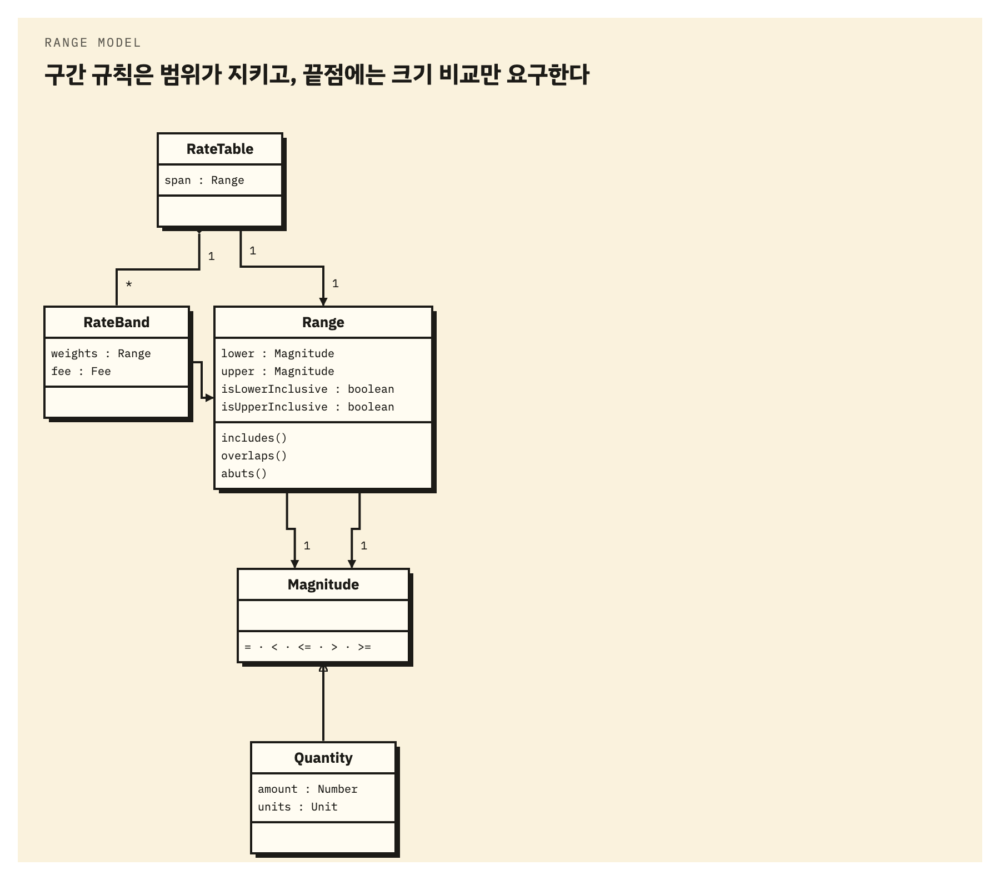

# Range — 두 끝과 「그 끝을 포함하는가」까지 한 값에 담기

## 한눈에 보는 개요

택배 회사의 요금 조회 코드가 무게 구간을 `lowerKg` · `upperKg` 두 칸으로 갖고 있다고 해 봅시다. 0 g 초과 2 kg 이하가 4000원, 2 kg 초과 5 kg 이하가 5500원이에요. 창구 화면은 `w >= lower && w <= upper` 로 구간을 찾고, 정산 배치는 `w >= lower && w < upper` 로 찾습니다. 두 줄 다 그럴듯한데 2 kg 짜리 소포가 들어오는 순간 갈려요. 창구는 첫 구간과 두 번째 구간 양쪽에 걸리는 값을 보고 먼저 만난 4000원을 내놓고, 배치는 두 번째 구간만 맞다고 보아 5500원을 냅니다. 같은 소포의 요금이 1500원 차이 나는데 어느 쪽도 예외를 던지지 않아요.

```text
Before — 끝이 두 칸으로 흩어져 있다
  band = { lowerKg: 0, upperKg: 2, fee: 4000 }
  창구   w >= lower && w <= upper   → 2 kg 이 band-1 · band-2 둘 다에 걸린다 → 먼저 만난 4000원
  배치   w >= lower && w <  upper   → 2 kg 은 band-2 하나 → 5500원
         「2 kg 을 포함하는가」의 답이 부르는 쪽마다 다르다

After — 두 끝과 포함 여부가 한 값 안에 있다
  band.weights = Range(0 g 미포함, 2 kg 포함)
  창구   band.weights.includes(2 kg) → true
  배치   band.weights.includes(2 kg) → true
         답이 한 곳에서 나오므로 갈릴 자리가 없다
```

Range 의 해법은 **두 끝점과 각 끝을 포함하는지까지 한 값으로 묶고, 「이 값이 안에 드는가」를 그 값에게 묻는 것**입니다. 끝을 포함하는지가 값의 일부라서, 부등호를 고르는 일이 호출부에서 사라져요. 부르는 쪽은 부등식을 쓰지 않고 물어보기만 합니다.

```text
요금표 rate-1        0 g < x <= 2 kg     2 kg < x <= 5 kg     5 kg < x <= 20 kg
소포 2 kg            들어옴               안 들어옴             안 들어옴
소포 2001 g          안 들어옴            들어옴                안 들어옴
소포 20 kg           안 들어옴            안 들어옴             들어옴
```

Range 는 Fowler 『Analysis Patterns』(1997)의 관측·측정 계열에 속하고, 관측값을 범주로 나누는 자리와 값 모델링 자리 양쪽에 쓰입니다(근거: Fowler *Analysis Patterns* 4장 「Observations for Corporate Finance」 §4.3 Range · §4.4 Phenomenon with Range). 함께 쓰는 패턴은 Quantity 와 Knowledge Level 이에요. 끝점에 단위가 붙으면 Quantity 가 그 자리에 오고, 구간으로 값을 분류하는 규칙 자체를 데이터로 두면 Knowledge Level 이 됩니다. Range 가 Quantity · Measurement · Observation 과 어떤 층으로 놓이는지는 [참고 문서 「수량·측정·관측 모델」](../../reference/observation-model/observation-model-ref_v1.0.2.md)이 그림 한 장으로 정리해 두었어요.

이 글은 시나리오 셋을 따라갑니다. 소포 하나가 요금표를 지나 요금이 나오는 길, 구간이 늘어날 때 무엇이 바뀌고 무엇은 그대로인가, 경계 규칙을 값 밖에 두면 어느 단계에서 얼마가 어긋나는가. 끝까지 읽으면 어떤 모델을 Range 라고 불러도 되는지 필수 조건 넷으로 판정할 수 있고, 그 구간을 누가 소유하고 겹침·빈틈 같은 집합 규칙은 어디에 두어야 하는지도 세 언어 코드에서 짚을 수 있게 됩니다.

## 패턴 자세히 들여다보기

### 시나리오 1 — 2 kg 소포 하나가 요금표를 지나 4000원이 나오기까지

택배 회사의 기본 배송 상품 `standard-parcel` 에 요금표 `rate-1` 이 붙어 있습니다. 이 표는 0 g 초과 20 kg 이하의 소포를 세 구간으로 나눠 4000원 · 5500원 · 8000원을 매겨요. 창구에 2 kg 소포가 들어오고, 나와야 하는 답은 4000원 하나입니다. 이 장면에는 다섯이 등장해요. 무게 하나를 나타내는 Quantity, 두 끝과 각 끝의 포함 여부를 가진 **Range**, 무게 구간 하나와 그 구간의 요금을 묶은 RateBand, 구간들을 모아 둔 RateTable, 그리고 끝점이 갖춰야 할 성질만 가리키는 이름 **Magnitude** 입니다. 이름은 여기서 한 구절씩만 소개하고 정식 정의는 개념 정리에서 해요.

1. **창구가 무게를 값으로 만들어 `Quantity` 2 kg 을 넘깁니다.** 수치 2 만 넘기면 받는 쪽이 kg 인지 g 인지 짐작해야 하고, 뒤 단계의 크기 비교가 그 짐작 위에 서게 돼요. 이 예제의 Quantity 는 만들 때 g 로 정규화하므로 2 kg 과 2000 g 은 같은 값입니다.
2. **요금표는 구간 하나를 Range 값 하나로 가집니다.** `RateBand` 는 `lowerKg` · `upperKg` 두 칸을 갖는 대신 `weights` 라는 Range 하나를 가리켜요. 두 칸으로 두면 그 둘이 한 구간을 이룬다는 사실이 코드에 나타나지 않고, 하한이 상한보다 큰 짝을 막을 주인도 없습니다. 개요에서 서로 달랐던 부등식이 바로 두 칸 모델에서 나온 것이에요.
3. **요금표가 먼저 적용 구간에 드는지 묻습니다.** `span.includes(2 kg)` 이 참이라야 이 표가 답할 수 있는 무게예요. 이 단계가 앞에 있어야 20001 g 처럼 표 밖의 무게에 대해 「어느 구간에도 안 든다」가 아니라 「이 표가 다루는 무게가 아니다」라고 답할 수 있습니다. 두 답은 고쳐야 할 곳이 다르니까요.
4. **구간마다 `includes` 를 물어 하나를 고릅니다.** 2 kg 은 첫 구간의 상한과 **같은 값**이에요. 첫 구간이 상한을 포함하고 두 번째 구간이 하한을 포함하지 않으므로 답은 첫 구간 하나입니다. 이 판정을 부르는 쪽이 부등식으로 하지 않고 Range 에게 묻는 이유가 여기 있어요. 경계에서 갈리는 답을 한 곳에서만 정하려는 것입니다.
5. **고른 구간의 요금을 돌려줍니다.** 4000원이에요. 구간을 고르는 일과 요금을 읽는 일을 한 단계로 합치지 않은 것은 「어느 구간이었는가」가 창구 화면과 정산 대조 양쪽에서 필요한 정보이기 때문입니다.

```text
단계   부르는 쪽 → 받는 쪽              넘기는 것              돌아오는 것
 1     창구 → (new)                    2 · kg                Quantity(2 kg)
 2     RateTable → RateBand            —                     weights: Range 하나
 3     RateTable → span(Range)         includes(2 kg)        true
 4     RateTable → weights(Range)      includes(2 kg)        band-1 만 true
 5     RateTable → 창구                 —                     band-1 · 4000원
```

4단계에서 왜 답이 하나로 떨어지는지는 경계 한 점만 따져 보면 알 수 있습니다. 2 kg 은 첫 구간의 상한이자 두 번째 구간의 하한이라 두 구간이 같은 값을 놓고 만나는 유일한 자리예요.

```text
                          2 kg 이라는 한 점
band-1  0 g < x <= 2 kg   상한과 같다 · 상한을 포함한다      → includes(2 kg) = true
band-2  2 kg < x <= 5 kg  하한과 같다 · 하한을 포함하지 않는다 → includes(2 kg) = false

포함 표시가 둘 다 「포함」이면 두 구간이 2 kg 을 함께 가진다  → 답이 둘
포함 표시가 둘 다 「미포함」이면 2 kg 이 어디에도 없다        → 답이 없음
정확히 한쪽만 포함해야 답이 하나다
```

그래서 이 예제는 세 구간을 모두 「하한 미포함 · 상한 포함」으로 맞췄습니다. 표시가 둘 다 포함이면 2 kg 이 두 구간에 들어 요금이 4000원과 5500원 둘로 나오고, 둘 다 미포함이면 2 kg 이 어느 구간에도 없어 요금이 나오지 않아요. 한쪽만 포함일 때만 경계 한 점이 정확히 한 구간에 속합니다. 이 규칙을 구간마다 따로 적지 않고 값 안에 둔 것이 Range 가 하는 일이에요.

이 시나리오가 보여 준 것은 판정의 자리입니다. 「이 무게가 이 구간에 드는가」를 값이 답하니(3·4단계), 부르는 쪽은 부등호를 고르지 않아요. 그리고 그 답이 경계에서 갈리지 않는 이유는 포함 여부가 구간마다 값으로 붙어 있기 때문입니다. 여기서 나온 개념 다섯이 「개념 정리」로 모여요.

### 시나리오 2 — 30 kg 까지 늘어난 요금표를 다시 정의하는 길

같은 요금표에 요구가 하나 들어옵니다. 20 kg 초과 30 kg 이하의 대형 소포를 11000원에 받겠다는 것이에요. 지금 표는 0 g 초과 20 kg 이하만 다루므로 25 kg 소포는 3단계에서 거부되고 있습니다. 시나리오 1 의 다섯 단계 가운데 무엇이 바뀌고 무엇은 그대로인지를 봅니다.

1. **새 구간 `20 kg < x <= 30 kg` 을 Range 로 만듭니다.** 만드는 방법이 기존 세 구간과 같아요. 끝점 타입도 같고 포함 표시도 같습니다. Range 는 끝점에 크기 비교만 요구하니, 끝점이 2 kg 이든 30 kg 이든 만드는 자리가 달라질 이유가 없어요.
2. **적용 구간 자체도 Range 라서 새로 만듭니다.** `0 g < x <= 30 kg` 이에요. 표가 다루는 무게 전체도 결국 구간 하나라, 구간을 담는 자료구조를 따로 만들지 않고 같은 값을 씁니다. 3단계의 표 밖 판정이 이 값 하나로 끝나요.
3. **root 가 구간 목록 전체를 다시 검사합니다.** 새 구간만 보지 않는 이유는 겹침과 빈틈이 **구간 하나로는 판정할 수 없는 성질**이기 때문이에요. `20 kg < x <= 30 kg` 을 혼자 놓고 보면 아무 문제가 없지만, 기존 셋과 함께 놓아야 20 kg 자리에서 맞닿는지 겹치는지가 정해집니다.
4. **검사를 통과한 뒤에 목록을 교체합니다.** 순서를 바꿔 교체부터 하면, 겹침이 발견돼 거부하더라도 어긋난 목록이 이미 들어가 있어요. 그 사이에 들어온 조회는 틀린 요금을 받습니다.
5. **바뀌지 않는 것이 더 많습니다.** Range 코드는 한 줄도 바뀌지 않아요. `includes` 도 `overlaps` 도 구간이 몇 개인지 모르고, 끝점이 kg 로 적혔는지 g 로 적혔는지도 모릅니다. 바뀐 것은 요금표가 가진 값 둘, 곧 적용 구간과 구간 목록뿐이에요.

| 들어온 요구 | 바뀌는 자리 | 그대로인 자리 | 실행 출력의 줄 |
| --- | --- | --- | --- |
| 대형 구간을 더한다 | RateTable 의 구간 목록 · 적용 구간 | Range · Quantity · RateBand 의 코드 | 9 · 10행 |
| 25 kg 소포를 조회한다 | 없음 — 3단계가 이미 통과 | 시나리오 1 의 3~5단계 그대로 | 10행 |
| 20001 g 소포를 조회한다(늘리기 전) | 없음 | 3단계에서 거부 | 8행 |

여기서 헷갈리기 쉬운 포인트는 「구간이 늘어나면 표를 가진 쪽이 커진다」고 보는 것입니다. 늘어나는 것은 목록의 길이이지 책임이 아니에요. 요금표가 맡는 일은 구간이 셋일 때나 넷일 때나 똑같이 둘입니다. 서로 겹치지 않는가, 적용 구간을 빈틈 없이 덮는가. 구간 하나가 자기 안에서 맡는 일도 그대로 둘이고요. 하한이 상한보다 크지 않은가, 어떤 값이 안에 드는가.

```text
             구간이 셋일 때              구간이 넷일 때
RateTable    겹치지 않는가               겹치지 않는가
             빈틈 없이 덮는가            빈틈 없이 덮는가
Range        하한 <= 상한인가            하한 <= 상한인가
             이 값이 안에 드는가          이 값이 안에 드는가

늘어난 것은 목록의 길이뿐이고, 맡는 일은 양쪽 다 둘씩이다
```

잠깐, 확인 하나만 해 볼까요? 20 kg 초과를 **상한 없이** 전부 11000원으로 받겠다면 무엇이 달라질까요? 끝이 하나뿐인 구간이 필요해집니다. 그것도 Range 로 표현할 수 있는데, 없는 끝을 `null` 로 두는 길과 「모든 값보다 크다」는 특별한 값을 두는 길이 있어요. 어느 쪽이든 만드는 메서드 뒤에 감추면 부르는 쪽은 달라지지 않습니다. 이 예제는 상한 30 kg 을 두는 쪽을 골랐고, 열린 끝은 [선택] 6 으로 남겨 두었어요.

이 시나리오가 보여 준 것은 변화가 미치는 범위입니다. 구간이 늘어도 값(Range)은 그대로이고 바뀌는 것은 그 값을 모아 둔 쪽뿐이에요(1·5단계). 그리고 겹침과 덮음은 구간 하나가 지키는 규칙이 아니라 **목록을 가진 쪽이 지키는 규칙**이라는 것도 여기서 구분됩니다(3단계). 이 두 규칙이 뒤의 「상황 설정」 표에서 서로 다른 칸에 적히는 이유예요.

### 시나리오 3 — 경계 규칙을 값 밖에 두면 어느 단계에서 얼마가 어긋나는가

같은 요금표를 다른 코드베이스가 `lowerKg` · `upperKg` 두 칸으로 갖고 있습니다. 구간도 요금도 시나리오 1 과 똑같고, 창구에 들어오는 소포도 2 kg 으로 같아요. 다른 것은 「끝을 포함하는가」가 값 안이 아니라 조회 코드의 부등식에 있다는 것뿐입니다. 아래 수치는 실행에서 왔어요. 세 언어로 직접 실행해 얻은 값입니다.

1. **구간을 두 칸으로 만드는 자리에 주인이 없습니다.** `{ lowerKg: 5, upperKg: 2 }` 같은 짝을 막을 곳이 없어요. Range 로 만들면 그 자리에서 거부되고, 실행 11행의 `거부 — 하한이 상한보다 큽니다: 5 kg .. 2 kg` 이 그 거부입니다. 두 칸 모델에서는 이 짝이 조용히 만들어져 `includes` 에 해당하는 검사가 언제나 거짓을 내는 구간으로 남아요.
2. **조회 코드가 부등식을 직접 씁니다.** 시나리오 1 의 4단계에 해당하는 자리가 없어요. 물어볼 상대가 없으니 부르는 쪽마다 부등호를 고르게 되고, 고르는 기준은 그 자리를 쓴 사람의 기억입니다.
3. **화면마다 부등호가 다릅니다.** 창구는 상한을 `w <= upper` 로, 정산 배치는 `w < upper` 로 읽었어요. 2 kg 은 첫 구간의 상한이자 두 번째 구간의 하한이라 정확히 이 차이가 나타나는 값입니다. 같은 소포가 한쪽에서 4000원, 다른 쪽에서 5500원이 돼요. 예시 코드의 마지막 줄이 이 차이를 값으로 보여 줍니다. 포함 표시를 뒤집은 표에 같은 2 kg 소포를 넣으면 `band-2 · 5500원` 이 나와요.
4. **구간 사이에 틈이 생겨도 아무도 모릅니다.** 두 번째 구간의 하한을 3 kg 으로 잘못 적으면 2 kg 초과 3 kg 이하가 어느 구간에도 들지 않아요. 두 칸 모델에서는 조회가 그냥 「요금 없음」을 내고, Range 와 root 를 두면 표를 정의하는 자리에서 막힙니다. 실행 13행의 `거부 — 구간 사이에 틈이 있습니다: 0 g < x <= 2 kg 다음 구간이 3 kg 부터입니다` 가 그것이에요.
5. **되돌리는 길은 포함 표시를 값 안에 넣는 것입니다.** 표시가 값의 일부가 되는 순간 부등호를 고를 자리가 사라져요. 어긋남이 생기는 단계(2단계)와 나타나는 단계(3단계)가 달랐던 것이, 아예 어긋날 자리가 없는 모양으로 바뀝니다.

```text
같은 소포 2 kg · 같은 구간표

끝이 두 칸일 때                              끝이 한 값일 때
  2단계  물어볼 상대가 없다                    4단계  weights.includes(2 kg)
  3단계  창구 4000원 / 배치 5500원            답이 한 곳에서 나온다 → 4000원
  4단계  틈이 생겨도 조회가 「요금 없음」만 낸다   표를 정의하는 자리에서 거부된다

포함 표시를 뒤집은 표(하한 포함 · 상한 미포함)에 같은 2 kg 을 넣으면
  band-2 · 5500원    — 규칙이 값 안에 있으면 바뀐 규칙도 값 하나로 나타난다
```

이 시나리오가 보여 준 것은 어긋남이 생기는 자리와 나타나는 자리가 다르다는 점입니다. 끝이 두 칸이면 어긋남은 구간을 만드는 2단계에서 생기고 3단계에 가서야 1500원 차이로 나타나요. 그리고 그때 확인되는 것은 「부등호가 달랐다」가 아니라 「요금이 이상하다」입니다. 포함 표시를 값에 넣으면 갈릴 자리 자체가 없어지고(5단계), 표시를 일부러 바꾸면 그 변화가 값 하나에 나타나요. 마지막 줄의 5500원이 그 증거입니다.

### 개념 정리

시나리오에 나온 개념을 정식으로 정의합니다. 앞의 셋은 이 패턴이 모델링하는 것이고, 뒤의 둘은 그 구간을 쓰는 쪽이에요.

- **Range** — 하한(`lower`)과 상한(`upper`), 그리고 각 끝을 포함하는지(`isLowerInclusive` · `isUpperInclusive`)를 한 값으로 묶은 구간입니다. 어떤 값이 안에 드는지 판정할 책임(`includes`)을 지고, 구간끼리 겹치는지(`overlaps`) 맞닿는지(`abuts`)도 답할 수 있어요. 끝점 타입으로 Magnitude 를 둘 가리키고, 그 구간을 쓰는 개념이 Range 하나를 가리킵니다(근거: Fowler *Analysis Patterns* 4장 §4.3 — Figure 4.20 의 Range 가 `upper : Magnitude` · `lower : Magnitude` · `isUpperInclusive : boolean` · `isLowerInclusive : boolean` 네 속성과 `includes()` · `overlaps()` · `abuts()` 세 연산을 가집니다).
- **Magnitude** — 끝점이 갖춰야 할 성질만 가리키는 이름입니다. 크기 비교가 되는 값이면 무엇이든 여기에 해당해요. 날짜도 되고 정수도 되고 무게도 됩니다. 이 이름이 따로 있는 이유는 Range 가 끝점에 요구하는 것이 딱 그것뿐이기 때문이에요. 더하거나 뺄 수 있을 필요도, 단위를 가질 필요도 없습니다. Range 는 두 끝과 물어본 값을 견주기만 하니까요(근거: Fowler *Analysis Patterns* 4장 §4.3 — Figure 4.20 이 두 끝점의 타입을 Magnitude 로 적습니다. [Range, eaaDev 초안](https://martinfowler.com/eaaDev/Range.html)의 "How it Works" 는 `<` · `>` · `=` · `<=` · `>=` 에 해당하는 비교 연산을 가진 타입이면 무엇이든 Range 와 함께 쓸 수 있다고 적습니다).
- **Quantity** — 수치와 단위를 한 값으로 묶은 것이고, Magnitude 의 한 종류입니다. 끝점에 단위가 붙어야 하는 도메인에서 이 자리에 와요. 이 예제의 무게 구간이 그렇습니다. Quantity 자체의 정의와 단위 환산 규칙은 [Quantity 가이드](../quantity/quantity-guide_v1.1.1.md)와 [참고 문서 「수량·측정·관측 모델」](../../reference/observation-model/observation-model-ref_v1.0.2.md)에 있어요.
- **RateBand** — 무게 구간 하나와 그 구간의 요금을 묶은 것입니다. Range 하나를 가리키고 요금 값 하나를 가져요. 구간을 쓰는 쪽의 자리이고, 원전이 든 예로는 나이대가 같은 자리에 놓입니다.
- **RateTable** — 한 배송 상품의 요금 구간들을 모아 둔 것입니다. 구간 여럿을 담고, 표가 다루는 무게 전체를 Range 하나(`span`)로 가져요. 구간들이 서로 겹치지 않고 적용 구간을 빈틈 없이 덮는다는 규칙을 지키는 자리이고, 소포 하나의 무게로 구간을 찾아 주는 일도 맡습니다.



그림에는 개념과 연관·다중도만 있고 전술 분류 표기는 없습니다. RateTable 에서 RateBand 로 가는 채운 마름모는 구간이 표에 속한다는 뜻이고, `1` 과 `*` 는 표 하나가 구간 여럿을 가진다는 뜻이에요. RateTable 에서 Range 로 가는 선은 표 자신이 가진 적용 구간이고, 칸 안의 `span : Range` 가 그 선의 끝입니다. RateBand 와 Range 를 잇는 가로 선에는 다중도를 적지 않았는데, 두 칸 사이 통로가 좁아 라벨이 칸에 덮이기 때문이에요. 말로 적으면 구간 여럿이 각각 Range 하나를 가리킵니다. Range 에서 Magnitude 로 가는 선이 둘인 것은 `upper` 와 `lower` 가 따로 있다는 뜻이고, 칸 안의 두 줄이 그 끝이에요. Quantity 에서 Magnitude 로 가는 빈 삼각형은 「~의 한 종류」를 뜻합니다. 개념의 포함 관계를 옮긴 것이지 코드에서 상속으로 구현하라는 뜻은 아니에요.

## 사용 목적

코드나 요구에서 아래 모습이 보이면 Range 를 쓸 때입니다.

- **한 쌍으로만 뜻이 있는 두 칸이 늘 함께 쓰이고, 그 둘을 함께 넘기는 함수가 여럿입니다.** `startDate` · `endDate`, `minWeight` · `maxWeight` 처럼요. 두 칸을 받는 함수가 셋을 넘어가면 그 둘은 이미 한 값입니다. 시나리오 1 의 2단계가 그 둘을 한 값으로 묶은 자리예요.
- **경계값 하나 때문에 화면마다 답이 다릅니다.** 개요의 2 kg 이 그렇고, 시나리오 3 의 3단계가 그 1500원 차이를 따라갑니다. 버그 리포트가 「경계에서만 틀린다」로 올라오면 포함 여부를 정하는 자리가 흩어져 있다는 신호예요.
- **구간들 사이의 관계를 묻는 요구가 있습니다.** 「예약이 겹치면 안 된다」, 「유효 기간이 1년을 빈틈 없이 나눠야 한다」, 「정상 범위 밖이면 경고한다」 같은 것들이요. 겹침과 맞닿음은 구간을 값으로 두어야 물어볼 수 있는 질문입니다. 시나리오 2 의 3단계가 그 질문을 쓰는 자리예요.
- **끝이 하나뿐인 구간과 양 끝이 있는 구간을 같이 다뤄야 합니다.** 「20 kg 초과 전부」와 「2 kg 초과 5 kg 이하」가 한 목록에 섞이는 경우요. 두 칸 모델에서는 없는 끝을 `null` 이나 아주 큰 수로 때우게 되는데, 그 둘은 비교 코드에서 서로 다른 결과를 냅니다.

반대로 아래 둘은 Range 로 만들면 잃는 것이 큽니다.

| 이런 경우 | Range 로 만들면 잃는 것 |
| --- | --- |
| 임계값이 하나이고 비교하는 자리도 한 곳이다(「재고가 10 미만이면 알림」) | 값 하나와 부등호 하나로 끝나던 자리에 타입이 하나 늘고, 하한을 무엇으로 둘지 같은 답 없는 질문이 생깁니다. 비교 자리가 여러 곳으로 퍼지거나 상한이 생기면 그때가 Range 를 쓸 때예요 |
| 끝점 타입에 순서가 없다(색상 코드, 우편번호) | 크기 비교가 없으면 `includes` 가 무엇을 답해야 하는지 정의되지 않습니다. 두 끝을 담을 수는 있지만 그 값이 구간 노릇을 못 해요. 순서가 없는 값의 묶음은 구간이 아니라 집합입니다 |

두 줄을 가르는 질문은 하나예요. **「이 값이 안에 드는가」를 묻는 자리가 하나뿐인가.** 하나뿐이고 그 답이 바뀔 일도 없다면 부등식 한 줄이 맞습니다. 비슷한 단서에서 Quantity 나 Knowledge Level 을 고르게 되는 경우도 있는데, 그 차이는 다음 절에서 가릅니다.

## 패턴의 경계

### 디자인 패턴을 충족하는 최소 조건

아래 조건은 클래스 모양이 아니라 **어떤 개념이 무엇을 책임지는가**로 판정합니다. 메서드인지 그 타입에 붙은 함수인지, 필드가 넷인지 둘인지는 판정에 상관없어요. 조건마다 그것을 보여 준 시나리오의 단계를 가리킵니다.

1. [필수] **구간이 그것을 쓰는 개념과 따로 있는 값이다** — 두 끝을 담은 값이 하나 있고, 구간을 쓰는 개념은 끝점 둘을 자기 칸으로 풀어 두지 않고 그 값 하나를 가리킵니다. 시나리오 1 의 2단계가 이 자리예요. (근거: Fowler *Analysis Patterns* 4장 §4.3 — Figure 4.19 에서 Age Band 가 두 연관으로 끝점을 따로 가지던 모양을 Figure 4.20 이 Range 클래스 하나로 바꾸고 Age Band `*` — `1` Range 로 잇습니다. [Range, eaaDev 초안](https://martinfowler.com/eaaDev/Range.html)의 도입부는 범위를 값 쌍으로 다루는 대신 범위 전체를 객체 하나로 나타내는 것이 이 패턴이라고 적습니다)
   - 위 근거 괄호가 받쳐 주는 것은 **구간이 따로 있는 값이라**는 것까지입니다. 그 값을 불변으로 둘지, 같음을 어떻게 판정할지는 여기서 정해지지 않아요. 그 둘은 [선택] 8 에 있습니다.
   - 빠지면: 예약 한 건이나 요금 구간 한 줄이 `start` · `end` 두 칸을 갖고 구간 연산까지 떠안습니다. 겹침을 물으려면 예약 객체를 통째로 넘겨야 하고, 같은 구간 규칙을 쓰는 요금표는 그 코드를 다시 씁니다. 시나리오 3 의 1단계가 그 모양이에요.
2. [필수] **끝점은 크기 비교가 되는 값이다** — 두 끝점이 같은 타입이고, 그 타입에 크기 비교가 있습니다. 시나리오 1 의 1단계가 무게를 그런 값으로 만드는 자리예요. (근거: Fowler *Analysis Patterns* 4장 §4.3 — Figure 4.20 이 `upper` 와 `lower` 의 타입을 Magnitude 로 적습니다. [Range, eaaDev 초안](https://martinfowler.com/eaaDev/Range.html)의 "How it Works" 는 `<` · `>` · `=` · `<=` · `>=` 에 해당하는 관계가 끝점 타입에 있어야 하고, 값들을 줄 세울 기본 정렬 기준이 필요하다고 적습니다)
   - 위 근거 괄호가 받쳐 주는 것은 **끝점에 크기 비교가 있어야 한다**는 것까지입니다. 끝점이 Quantity 여야 한다거나 단위를 가져야 한다는 요구는 여기 없어요. 원전이 단위를 요구한 자리는 Range 가 아니라 그것을 쓰는 쪽이고, 그 이야기는 [선택] 10 에 있습니다.
   - 빠지면: 우편번호 두 개를 끝점으로 둔 값이 생깁니다. `includes` 가 사전순을 뜻하는지 숫자 크기를 뜻하는지 정할 근거가 값 안에 없어서, 판정이 구현한 사람의 선택으로 남아요.
3. [필수] **포함 판정을 구간이 맡는다** — 「이 값이 안에 드는가」에 구간 쪽이 답하고, 부르는 쪽은 부등식을 다시 쓰지 않습니다. 시나리오 1 의 4단계가 그 자리예요. (근거: [Range, eaaDev 초안](https://martinfowler.com/eaaDev/Range.html) — "How it Works" 가 범위 객체는 값이 그 안에 드는지 시험하는 연산을 함께 제공한다고 적고, 같은 글의 Date Range 예제가 Range 를 쓰는 어느 자리에서든 반드시 둘 연산은 `includes` 라고 적습니다. Fowler *Analysis Patterns* 4장 §4.3 Figure 4.20 의 Range 연산 목록 맨 앞이 `includes()` 입니다)
   - 위 근거 괄호가 받쳐 주는 것은 **판정이 구간 쪽에 있다**는 것까지입니다. 그것이 메서드여야 한다는 요구는 없어요. 구간 타입에 붙은 함수든 모듈 안의 함수든, 부르는 쪽마다 부등식을 다시 쓰지 않으면 이 조건을 갖춘 것입니다.
   - 빠지면: `w > 2000 && w <= 5000` 이 화면 코드와 배치 코드에 따로 적히게 됩니다. 시나리오 3 의 2·3단계가 그 둘이 달라지는 과정이고, 달라진 결과가 같은 소포에 대한 4000원과 5500원이에요.
4. [필수] **각 끝을 포함하는지가 구간 쪽에 정해져 있고, 경계 판정이 그 표시를 따른다** — 끝점과 같은 값이 안에 드는지를 구간이 가진 표시가 정하고, 같은 구간을 놓고 부르는 쪽마다 답이 갈리지 않습니다. 시나리오 3 의 3단계가 답이 갈리는 모습이에요. (근거: Fowler *Analysis Patterns* 4장 §4.3 — Figure 4.20 의 Range 가 `isUpperInclusive` 와 `isLowerInclusive` 를 두 끝점과 나란히 자기 속성으로 두고, 그 속성을 가진 클래스가 `includes()` 를 함께 듭니다)
   - 위 근거 괄호가 받쳐 주는 것은 **포함 여부가 구간에 속한 규칙이고 그 구간이 포함 판정을 가진다**는 것까지입니다. 그 판정이 표시를 읽어 경계의 답을 가른다는 데까지는, 둘을 한 상자에 나란히 둔 그림에서 이 가이드가 읽어 낸 것입니다. 그것을 boolean 두 개로 담아야 한다는 뜻은 아니에요. 반열림으로 고정된 타입과 양 끝 포함으로 고정된 타입을 따로 두는 길도 규칙이 구간 쪽에 있는 것이고, 실제 사례의 Rust 표준 라이브러리가 그 모양입니다.
   - 빠지면: 같은 2 kg 이 4000원도 5500원도 됩니다. 예시 코드의 마지막 줄이 포함 표시를 뒤집은 표에서 같은 소포가 `band-2 · 5500원` 을 받는 것을 보여 줘요.
5. [선택] **구간끼리의 관계를 묻는다** — 겹치는가(`overlaps`), 맞닿는가(`abuts`), 하나가 다른 하나를 품는가, 둘 사이에 틈이 얼마인가를 구간이 답합니다. 시나리오 2 의 3단계가 쓰는 연산이에요. (근거: Fowler *Analysis Patterns* 4장 §4.3 — Figure 4.20 의 연산 목록에 `overlaps()` 와 `abuts()` 가 있고, [Range, eaaDev 초안](https://martinfowler.com/eaaDev/Range.html)의 "How it Works" 는 구간끼리 비교하는 연산을 "또한 넣을 수 있는 것" 으로 적습니다)
6. [선택] **한쪽 끝이 없는 구간을 표현한다** — 「20 kg 초과 전부」처럼 위가 열린 구간을 값으로 둡니다. 시나리오 2 의 확인 질문이 이 자리예요. (근거: [Range, eaaDev 초안](https://martinfowler.com/eaaDev/Range.html)의 "How it Works" — 없는 끝을 `null` 로 두어 무제한으로 보는 길과 양 극단을 특별한 값으로 두는 길을 나란히 들고, 어느 쪽이든 만드는 메서드 뒤에 감추라고 적습니다)
7. [선택] **하한이 상한보다 큰 짝을 어떻게 볼지 정한다** — 만들지 못하게 막든 빈 구간으로 받아들이든, 한쪽을 골라 값에 정해 둡니다. 이 예제는 막는 쪽을 골랐고 시나리오 3 의 1단계가 그 거부예요. (근거: [Range, eaaDev 초안](https://martinfowler.com/eaaDev/Range.html)의 Date Range 예제 — `isEmpty` 를 시작이 끝보다 뒤인지로 두어, 뒤집힌 짝을 오류가 아니라 빈 구간으로 다룹니다)
8. [선택] **값으로 같음을 판정하고 불변이다** — 두 구간이 같은 구간인지 참조가 아니라 값으로 가르고, 한 곳의 계산이 같은 값을 쓰던 다른 곳을 바꾸지 않습니다. 시나리오 2 의 4단계가 목록을 통째로 갈아 끼우는 것도 같은 방향이에요. (근거: [Value Object, Fowler](https://martinfowler.com/bliki/ValueObject.html) — 값 객체에는 aliasing 을 막을 장치가 필요하고 불변이 먼저 권하는 방법이라고 적습니다)
9. [선택] **시작과 길이로 적는다** — 두 끝 대신 시작과 길이, 또는 끝과 길이로 같은 구간을 나타냅니다. 시나리오 1 의 2단계가 두 끝 쪽을 고른 자리예요. (근거: [Range, eaaDev 초안](https://martinfowler.com/eaaDev/Range.html)의 "How it Works" — 시작과 길이로 두는 것도, 끝과 길이로 두는 것도 그만큼 쓸모 있다고 적습니다)
10. [선택] **끝점을 Quantity 로 두어 단위까지 맞춘다** — 끝점에 단위가 붙어 2 kg 과 2000 g 이 같은 자리에 놓입니다. 시나리오 1 의 1단계가 그 자리예요. (근거: Fowler *Analysis Patterns* 4장 §4.3 — Figure 4.20 은 이 제약을 Range 가 아니라 그것을 쓰는 Age Band 쪽에 붙여, 그 구간의 끝점이 시간 단위를 가진 quantity 여야 한다고 적습니다)

> 구간은 값 하나다. 두 끝과 「그 끝을 포함하는가」가 그 값 안에 있어 경계 판정이 그 표시를 따르고, 끝점에는 크기 비교만 요구하며, 안에 드는지는 그 값에게 묻는다.

기억법은 갖춰야 할 것을 줄인 것이지 갖추면 충분하다는 뜻이 아닙니다. 필수 넷을 모두 갖추고도 구간이 아닌 값을 만들 수 있어요. 바로 다음 절의 세 번째 비교 대상이 그 가운데 하나예요.

### 비슷한 패턴·안티패턴과의 차이

| 비교 대상 | 구분 기준 | Range 를 고르면 얻는 것 | 포기하는 것 |
| --- | --- | --- | --- |
| 시작·끝 두 칸을 가진 개념 | 구간 규칙이 그 개념에 붙어 있는가, 별도의 값에 있는가 | 같은 구간 규칙을 예약·요율·유효 기간이 함께 쓴다 | 타입이 하나 늘고, 구간을 쓰는 쪽이 값을 한 번 더 거쳐 읽는다 |
| 비교자를 붙인 값 하나 | 끝이 둘인가 하나인가 | 두 끝 사이를 묻는 질문에 값이 답한다 | 「10 초과」한 조각만 필요한 자리에 두 끝짜리 값을 만들게 된다 |
| 구간 여럿을 한 값으로 담은 것 | 「안」이 두 끝 사이인가, 여러 구간의 합인가 | 겹침·맞닿음이 두 구간 사이의 질문으로 단순해진다 | 「이 구간을 뺀 나머지」를 한 값으로 나타내지 못한다 |
| Quantity | 값 하나인가 두 끝 사이인가 | 어떤 값이 그 안에 드는지를 물을 수 있다 | 더하고 빼고 환산하는 일은 못 한다 — 끝점이 그것을 한다 |

**시작·끝 두 칸을 가진 개념과의 차이.** 구분 기준은 구간 규칙이 어디에 있는가입니다. 아래 코드는 구간을 값으로 두지 않고 예약이 직접 가집니다.

```java no-compile
record Reservation(String guest, String room, LocalDate start, LocalDate end) {
    boolean includes(LocalDate d) { return !d.isBefore(start) && !d.isAfter(end); }
    boolean overlaps(Reservation o) { return !start.isAfter(o.end) && !o.start.isAfter(end); }
}
```

겹침을 물으려면 상대 예약을 통째로 넘겨야 해서, 손님 이름과 방 번호가 구간 비교의 인자로 따라 들어갑니다. 그리고 양 끝 포함이라는 규칙이 `includes` 안에만 있어요. 요금표가 같은 규칙을 쓰려면 그 두 메서드를 다시 씁니다. 시나리오 1 의 2단계가 이 자리를 갈라 둔 지점이고, 시나리오 3 의 1단계가 그렇게 두었을 때 하한이 상한보다 큰 짝을 막을 곳이 없다는 것을 보입니다. Range 를 고르면 예약·요율·유효 기간이 같은 구간 값을 함께 쓰는 대신, 구간을 쓰는 쪽이 값을 한 번 더 거쳐 읽게 돼요.

**비교자를 붙인 값 하나와의 차이.** 구분 기준은 끝이 둘인가 하나인가입니다. 측정 결과가 「10 mg 초과」로만 보고되는 경우가 있어요. 위가 열린 Range 로 볼 수도 있어 보이지만 둘은 다릅니다. 열린 구간은 양 끝을 다 아는데 한쪽이 무제한이라는 뜻이고, 비교자를 붙인 값은 애초에 끝이 하나예요. 의료 데이터 교환 표준인 HL7 FHIR 은 이 자리를 갈라 두고, 범위를 벗어난 측정값에는 Range 대신 비교자를 붙인 Quantity 를 쓰라고 적습니다([FHIR R5 Data Types](https://hl7.org/fhir/R5/datatypes.html)). 이유는 뜻이 다르기 때문이에요. 「10 초과」는 실제 값이 얼마인지 모른다는 말이고, 열린 구간은 그 구간에 드는 값의 집합을 가리킵니다.

```text
열린 구간         Range(lower 10 mg 미포함, upper 없음)
                  끝이 둘이고 위쪽이 무제한 — includes(12 mg) 에 답한다

비교자 붙인 값    Quantity(10 mg) 에 비교자 ">" 를 붙인 것
                  끝이 하나 — 실제 값을 모른다는 표시이고 물어볼 「안」이 없다
```

**구간 여럿을 한 값으로 담은 것과의 차이.** 이 대상이 특히 헷갈리는 이유는 **필수 조건 넷을 전부 만족하기 때문**입니다. 아래 값은 두 끝을 한 값으로 담고, 끝점은 크기 비교가 되고, 판정을 자기가 맡고, 포함 여부도 자기 안에 있어 경계의 답이 그 표시를 따라요.

```typescript no-compile
class Outside {
  constructor(
    readonly lower: number,
    readonly upper: number,
    readonly lowerInclusive: boolean,
    readonly upperInclusive: boolean,
  ) {}

  // 두 끝 「사이」가 아니라 두 끝 「바깥」을 안이라고 답한다
  includes(v: number): boolean {
    return (this.lowerInclusive ? v <= this.lower : v < this.lower)
      || (this.upperInclusive ? v >= this.upper : v > this.upper);
  }
}
```

필수 넷은 「안이 두 끝 사이다」를 말하지 않습니다. 그래서 이 값은 조건만으로는 걸러지지 않아요. 차이가 나는 자리는 구간끼리의 연산입니다. `Outside(2, 5)` 는 두 구간의 합이라 다른 `Outside` 와 겹치는지 물으면 답이 구간 하나의 답으로 나오지 않고, 맞닿음은 아예 정의되지 않아요. PostgreSQL 이 구간 타입마다 「여러 구간의 합」을 담는 multirange 타입을 따로 둔 것이 같은 이유입니다([PostgreSQL: Range Types](https://www.postgresql.org/docs/current/rangetypes.html)). 두 끝 사이를 한 값으로 두면 겹침과 맞닿음이 두 구간 사이의 질문으로 단순해지고, 대신 「이 구간을 뺀 나머지」는 값 하나로 나타내지 못합니다.

**Quantity 와의 차이.** 구분 기준은 값 하나인가 두 끝 사이인가입니다. 둘은 대안이 아니라 층이 달라요. Quantity 는 Range 의 끝점 자리에 올 수 있는 값 가운데 하나이고, 그 관계가 개념 정리의 그림에서 Quantity 가 Magnitude 아래 놓인 이유입니다.

```text
Quantity   2 kg                          얼마인가
Range      0 g < x <= 2 kg               어디부터 어디까지인가
             │        └─ Quantity(상한)
             └─ Quantity(하한)
```

2 kg 에게 「3 kg 이 너 안에 드니?」라고 물을 수는 없어요. 그 질문은 구간에게만 뜻이 있습니다. 반대로 구간에게 「5 kg 을 더해 줘」라고 물을 수도 없고요. 그 일은 끝점이 합니다. Range 를 고르면 어떤 값이 안에 드는지 물을 수 있게 되는 대신, 더하고 빼고 환산하는 일은 끝점 타입이 맡아요.

## 구현 예시

### 상황 설정

시나리오 1·2·3 의 요금표 장면을 세 언어로 똑같이 구현합니다. 택배 회사 한 곳의 요금 산정 코드이고, 배송 상품 하나마다 요금표가 하나 있으며 그 표가 무게 구간별 기본 요금을 정해요. 소포 하나의 무게가 들어오면 표가 구간을 찾아 요금을 돌려줍니다.

고정인 것도 정해 둡니다. 단위는 g 와 kg 둘이고 무게는 g 단위 정수로 기록해요. 구간의 포함 규칙은 하한 미포함 · 상한 포함으로 맞추되, 그 규칙은 구간마다 값으로 붙어 있어 표가 다르면 다르게 정할 수 있습니다. 하한이 상한보다 큰 구간은 만들지 못하게 막습니다. 표를 다시 정의할 때는 구간 목록 전체를 한 번에 넘기고, 검사를 통과한 뒤에만 교체해요.

| 예제 타입 | 대응하는 개념 |
| --- | --- |
| `Range` · `Quantity` | 같은 이름의 개념 그대로. `Range` 는 끝점 타입을 매개변수로 받는다 |
| `Magnitude` | 타입으로 두지 않고 각 언어의 비교 제약으로 둔다 — Java `Comparable` · TypeScript `Ordered` · Rust `Ord` |
| `RateBand` · `RateTable` | 같은 이름의 개념 그대로 |
| `Fee` · `Unit` | 패턴 밖의 값. 요금 금액과 무게 단위 |
| `RateTableId` · `BandId` · `ProductId` | 패턴 밖의 식별자 |

아래 표에서 쓰는 DDD(Domain-Driven Design, 도메인 주도 설계) 전술 용어(Bounded Context · Aggregate · Aggregate Root · Entity · Value Object · id 참조 · 불변식)는 이 가이드의 주제 밖 사전 지식이라 [참고 문서 「DDD 전술 용어」](../../reference/ddd-tactical-terms/ddd-tactical-terms-ref_v1.0.2.md)가 한 자리에 모아 두었어요. 표를 읽기 전에 그 문서를 한 번 읽고 오시면 네 행이 각각 무엇을 정하는지 바로 읽힙니다.

| 항목 | 이 가이드의 설정 |
| --- | --- |
| bounded context | 택배 요금 산정 — 배송 상품마다 무게 구간별 기본 요금을 정하고 소포 하나의 요금을 찾는다 |
| 불변식의 위치 | 구간 하나의 규칙은 Range 가 지킨다 — ① 하한이 상한보다 클 수 없고 ② 어떤 값이 안에 드는지는 그 구간이 가진 두 포함 표시로만 정해진다. 구간들 사이의 규칙은 RateTable root 가 지킨다 — ③ 구간끼리 겹치지 않고 ④ 구간이 적용 구간을 빈틈 없이 덮으며 ⑤ 구간 목록은 ③·④ 를 통과한 뒤에만 교체된다 |
| root·entity·VO 배정 | RateTable aggregate 하나. RateTable 이 root(entity, `RateTableId` 로 식별)이고 RateBand 는 그 안의 entity(`BandId` 로 식별)다. Range · Quantity · Fee · Unit 과 세 id 는 VO |
| 타 aggregate 참조 방식 | RateTable 이 배송 상품 카탈로그 aggregate(이 예제 밖)의 상품을 `ProductId` 로 가리킨다. Range 는 식별자 없이 값으로 오가므로 두 구간이 같은 인스턴스를 나눠 써도 복사한 것과 결과가 같다 |

코드에서 그 경계가 나타나는 자리는 `RateTable` 의 `redefine` 하나입니다. 구간 목록을 바꾸는 길이 그것뿐이라, 겹침·덮음 검사를 지나지 않고 목록이 바뀔 방법이 없어요. 표가 「어디에 두었는가」를 말했다면, 다음 표는 「다른 곳에 두면 무엇이 어긋나는가」를 불변식 다섯과 id 참조 하나에 대해 적은 것입니다.

| 규칙(불변식) 또는 참조 | 다른 곳에 두거나 바꾸면 | 어느 동작에서 무엇이 어긋나는가 |
| --- | --- | --- |
| ① 하한이 상한보다 클 수 없다 | 구간을 만드는 호출자가 넘기기 전에 확인한다 | 한 곳만 빠뜨리면 `5 kg .. 2 kg` 짜리 구간이 목록에 들어갑니다. 하한 초과이면서 상한 이하인 무게는 없으므로 `includes` 가 어떤 무게에도 참을 내지 않고, 그 구간은 조회에서 끝내 안 골라져요. 실행 11행이 값을 만드는 자리에서 막은 결과입니다 |
| ② 포함 여부는 구간이 가진 두 표시로 정해진다 | 조회 코드가 부등호를 직접 고른다 | 창구가 상한을 포함으로, 배치가 상한을 미포함으로 읽으면 같은 2 kg 소포가 4000원과 5500원으로 갈립니다. 시나리오 3 의 3단계가 그 과정이고, 실행 마지막 줄이 포함 표시를 뒤집었을 때 같은 소포가 `band-2 · 5500원` 을 받는 것을 보여 줍니다 |
| ③ 구간끼리 겹치지 않는다 | 구간 하나가 스스로 확인한다 — 이때 ④ 도 함께 사라진다. 둘 다 목록을 봐야 답할 수 있는 규칙이라 구간 하나에는 판정할 정보가 없다 | `4 kg < x <= 9 kg` 을 더해도 그 구간 안에서는 어긋난 것이 없고, 조회가 먼저 만난 구간을 내놓아 9 kg 소포가 band-3 의 8000원이 아니라 band-9 의 7000원을 받습니다(두 검사를 뺀 사본을 Java 21 로 실행해 확인). 실행 12행이 표 쪽에서 막은 결과예요 |
| ④ 구간이 적용 구간을 빈틈 없이 덮는다 | 조회가 못 찾았을 때 기본 요금을 쓴다 | 2 kg 초과 3 kg 이하가 비어 있어도 조회는 기본 요금을 내고 지나갑니다. 표가 잘못 정의됐다는 사실이 요금 오류로만 나타나요. 실행 13행이 정의 자리에서 막은 결과입니다 |
| ⑤ 구간 목록은 검사를 통과한 뒤에만 교체된다 | 목록을 먼저 넣고 검사한다 | 겹치는 목록이 들어간 뒤 예외가 나면 목록은 이미 어긋난 상태로 남습니다. 그 사이에 들어온 조회가 틀린 요금을 받고, 되돌리는 코드를 따로 두어야 해요 |
| RateTable 이 상품을 `ProductId` 로 가리킨다 | 상품 객체를 `RateTable` 필드로 가진다 | 요금 조회 한 번이 `table.product` 를 거쳐 상품의 판매 상태나 이름을 고칠 수 있게 됩니다. 같은 상품을 쓰는 다른 요금표와 주문 쪽까지 그 변경을 함께 보게 돼요 |

뒤의 세 언어 구현은 이 설정을 그대로 옮긴 것이고, 실행하면 셋이 아래 열네 줄을 글자까지 같게 냅니다. 가이드 폴더의 `code/expected-output.txt` 와 같은 내용이고, 이 글의 실행 수치는 전부 여기서 와요.

```text
요금표 rate-1 · 상품 standard-parcel · 적용 0 g < x <= 20 kg
구간 band-1 · 0 g < x <= 2 kg · 4000원
구간 band-2 · 2 kg < x <= 5 kg · 5500원
구간 band-3 · 5 kg < x <= 20 kg · 8000원
2 kg 소포 → band-1 · 4000원
2001 g 소포 → band-2 · 5500원
20 kg 소포 → band-3 · 8000원
거부 — 적용 구간을 벗어납니다: 20001 g
대형 구간을 더해 적용 0 g < x <= 30 kg 으로 다시 정의
25 kg 소포 → band-4 · 11000원
거부 — 하한이 상한보다 큽니다: 5 kg .. 2 kg
거부 — 구간이 겹칩니다: band-2(2 kg < x <= 5 kg) 와 band-9(4 kg < x <= 9 kg)
거부 — 구간 사이에 틈이 있습니다: 0 g < x <= 2 kg 다음 구간이 3 kg 부터입니다
경계 포함을 뒤집은 표에서 2 kg 소포 → band-2 · 5500원
```

### 구현

```java
import java.util.ArrayList;
import java.util.Comparator;
import java.util.List;

enum Unit {
    G(1, "g"), KG(1000, "kg");

    final long grams;
    final String symbol;

    Unit(long grams, String symbol) { this.grams = grams; this.symbol = symbol; }
}

// 무게 하나. g 로 정규화해 담으므로 2 kg 과 2000 g 은 같은 값이고 크기 비교가 필드 하나로 끝난다.
record Quantity(long grams) implements Comparable<Quantity> {
    static Quantity of(long amount, Unit unit) { return new Quantity(amount * unit.grams); }

    @Override
    public int compareTo(Quantity other) { return Long.compare(grams, other.grams); }

    @Override
    public String toString() {
        return grams != 0 && grams % Unit.KG.grams == 0
                ? (grams / Unit.KG.grams) + " " + Unit.KG.symbol
                : grams + " " + Unit.G.symbol;
    }
}

// 두 끝과 각 끝을 포함하는지를 한 값으로 든 구간. 끝점 타입은 크기 비교가 되면 무엇이든 된다.
record Range<T extends Comparable<T>>(T lower, T upper, boolean lowerInclusive, boolean upperInclusive) {
    Range {
        if (lower.compareTo(upper) > 0) {
            throw new IllegalArgumentException("하한이 상한보다 큽니다: " + lower + " .. " + upper);
        }
    }

    boolean includes(T value) {
        int lo = lower.compareTo(value);
        int hi = value.compareTo(upper);
        return (lo < 0 || (lo == 0 && lowerInclusive)) && (hi < 0 || (hi == 0 && upperInclusive));
    }

    boolean overlaps(Range<T> other) { return reaches(other) && other.reaches(this); }

    // 맞닿음 — 한쪽 상한과 다른 쪽 하한이 같은 값이고, 그 자리를 정확히 한쪽만 포함한다.
    boolean abuts(Range<T> other) {
        return (upper.compareTo(other.lower) == 0 && upperInclusive != other.lowerInclusive)
                || (other.upper.compareTo(lower) == 0 && other.upperInclusive != lowerInclusive);
    }

    // 이 구간의 아래 끝이 상대의 위 끝까지 닿는가. 같은 값이면 양쪽이 그 자리를 포함해야 닿는다.
    private boolean reaches(Range<T> other) {
        int c = lower.compareTo(other.upper);
        return c < 0 || (c == 0 && lowerInclusive && other.upperInclusive);
    }

    boolean sameEdgeAsLower(T value, boolean inclusive) {
        return lower.compareTo(value) == 0 && lowerInclusive == inclusive;
    }

    boolean sameEdgeAsUpper(T value, boolean inclusive) {
        return upper.compareTo(value) == 0 && upperInclusive == inclusive;
    }

    @Override
    public String toString() {
        return lower + (lowerInclusive ? " <= x " : " < x ") + (upperInclusive ? "<= " : "< ") + upper;
    }
}

record Fee(long won) {
    @Override
    public String toString() { return won + "원"; }
}

record BandId(String value) {}

record RateTableId(String value) {}

record ProductId(String value) {}

// 요금 구간 — 무게 구간 하나와 그 구간의 요금. 표 안에서 BandId 로 지목된다.
record RateBand(BandId id, Range<Quantity> weights, Fee fee) {
    @Override
    public String toString() { return "구간 " + id.value() + " · " + weights + " · " + fee; }
}

final class RateTable {
    private final RateTableId id;
    private final ProductId productId;   // 배송 상품 aggregate 는 id 로만 가리킨다
    private Range<Quantity> span;
    private List<RateBand> bands;

    RateTable(RateTableId id, ProductId productId, Range<Quantity> span, List<RateBand> bands) {
        this.id = id;
        this.productId = productId;
        redefine(span, bands);
    }

    // 구간 목록을 바꾸는 유일한 길. 비중첩과 전 구간 덮음을 여기서 검사하고, 통과한 뒤에 교체한다.
    void redefine(Range<Quantity> span, List<RateBand> bands) {
        List<RateBand> sorted = new ArrayList<>(bands);
        sorted.sort(Comparator.comparing((RateBand b) -> b.weights().lower()));
        if (sorted.isEmpty()) {
            throw new IllegalArgumentException("구간이 하나도 없습니다: " + span);
        }
        for (int i = 0; i < sorted.size(); i++) {
            for (int j = i + 1; j < sorted.size(); j++) {
                RateBand a = sorted.get(i);
                RateBand b = sorted.get(j);
                if (a.weights().overlaps(b.weights())) {
                    throw new IllegalArgumentException("구간이 겹칩니다: " + a.id().value() + "(" + a.weights()
                            + ") 와 " + b.id().value() + "(" + b.weights() + ")");
                }
            }
        }
        RateBand first = sorted.get(0);
        RateBand last = sorted.get(sorted.size() - 1);
        if (!first.weights().sameEdgeAsLower(span.lower(), span.lowerInclusive())
                || !last.weights().sameEdgeAsUpper(span.upper(), span.upperInclusive())) {
            throw new IllegalArgumentException("구간이 적용 구간의 양 끝을 덮지 않습니다: " + span);
        }
        for (int i = 1; i < sorted.size(); i++) {
            Range<Quantity> prev = sorted.get(i - 1).weights();
            Range<Quantity> next = sorted.get(i).weights();
            if (!prev.abuts(next)) {
                throw new IllegalArgumentException("구간 사이에 틈이 있습니다: " + prev
                        + " 다음 구간이 " + next.lower() + " 부터입니다");
            }
        }
        this.span = span;
        this.bands = List.copyOf(sorted);
    }

    RateBand bandFor(Quantity weight) {
        if (!span.includes(weight)) {
            throw new IllegalArgumentException("적용 구간을 벗어납니다: " + weight);
        }
        return bands.stream().filter(b -> b.weights().includes(weight)).findFirst()
                .orElseThrow(() -> new IllegalStateException("어느 구간에도 들지 않습니다: " + weight));
    }

    RateTableId id() { return id; }

    ProductId productId() { return productId; }

    Range<Quantity> span() { return span; }

    List<RateBand> bands() { return bands; }
}

public class Main {
    public static void main(String[] args) {
        Quantity zero = Quantity.of(0, Unit.G);
        Quantity kg2 = Quantity.of(2, Unit.KG);
        Quantity kg5 = Quantity.of(5, Unit.KG);
        Quantity kg20 = Quantity.of(20, Unit.KG);
        Range<Quantity> span = new Range<>(zero, kg20, false, true);
        List<RateBand> bands = List.of(upTo("band-1", zero, kg2, 4000),
                upTo("band-2", kg2, kg5, 5500), upTo("band-3", kg5, kg20, 8000));
        RateTable table = new RateTable(new RateTableId("rate-1"), new ProductId("standard-parcel"), span, bands);
        System.out.println("요금표 " + table.id().value() + " · 상품 " + table.productId().value()
                + " · 적용 " + table.span());
        table.bands().forEach(System.out::println);

        quote(table, kg2);
        quote(table, Quantity.of(2001, Unit.G));
        quote(table, kg20);
        quote(table, Quantity.of(20001, Unit.G));

        Quantity kg30 = Quantity.of(30, Unit.KG);
        Range<Quantity> wider = new Range<>(zero, kg30, false, true);
        List<RateBand> withBig = new ArrayList<>(bands);
        withBig.add(upTo("band-4", kg20, kg30, 11000));
        table.redefine(wider, withBig);
        System.out.println("대형 구간을 더해 적용 " + table.span() + " 으로 다시 정의");
        quote(table, Quantity.of(25, Unit.KG));

        attempt(() -> new Range<>(kg5, kg2, false, true));
        List<RateBand> overlapping = new ArrayList<>(bands);
        overlapping.add(upTo("band-9", Quantity.of(4, Unit.KG), Quantity.of(9, Unit.KG), 7000));
        attempt(() -> table.redefine(span, overlapping));
        attempt(() -> table.redefine(span, List.of(upTo("band-1", zero, kg2, 4000),
                upTo("band-5", Quantity.of(3, Unit.KG), kg5, 5500), upTo("band-3", kg5, kg20, 8000))));

        RateTable flipped = new RateTable(new RateTableId("rate-2"), new ProductId("standard-parcel"),
                new Range<>(zero, kg20, true, false),
                List.of(from("band-1", zero, kg2, 4000), from("band-2", kg2, kg5, 5500),
                        from("band-3", kg5, kg20, 8000)));
        System.out.print("경계 포함을 뒤집은 표에서 ");
        quote(flipped, kg2);
    }

    // 하한 미포함 · 상한 포함
    static RateBand upTo(String id, Quantity lower, Quantity upper, long won) {
        return new RateBand(new BandId(id), new Range<>(lower, upper, false, true), new Fee(won));
    }

    // 하한 포함 · 상한 미포함
    static RateBand from(String id, Quantity lower, Quantity upper, long won) {
        return new RateBand(new BandId(id), new Range<>(lower, upper, true, false), new Fee(won));
    }

    static void quote(RateTable table, Quantity weight) {
        try {
            RateBand band = table.bandFor(weight);
            System.out.println(weight + " 소포 → " + band.id().value() + " · " + band.fee());
        } catch (RuntimeException e) {
            System.out.println("거부 — " + e.getMessage());
        }
    }

    static void attempt(Runnable action) {
        try {
            action.run();
        } catch (RuntimeException e) {
            System.out.println("거부 — " + e.getMessage());
        }
    }
}
```

```typescript
// 크기 비교가 되는 값. Range 의 끝점 타입은 이것만 요구한다.
interface Ordered<T> {
  compareTo(other: T): number;
  toString(): string;
}

const Unit = { G: { grams: 1, symbol: "g" }, KG: { grams: 1000, symbol: "kg" } } as const;
type Unit = (typeof Unit)[keyof typeof Unit];

// 무게 하나. g 로 정규화해 담으므로 2 kg 과 2000 g 은 같은 값이고 크기 비교가 필드 하나로 끝난다.
class Quantity implements Ordered<Quantity> {
  private constructor(readonly grams: number) {}

  static of(amount: number, unit: Unit): Quantity {
    return new Quantity(amount * unit.grams);
  }

  compareTo(other: Quantity): number {
    return this.grams - other.grams;
  }

  toString(): string {
    return this.grams !== 0 && this.grams % Unit.KG.grams === 0
      ? `${this.grams / Unit.KG.grams} ${Unit.KG.symbol}`
      : `${this.grams} ${Unit.G.symbol}`;
  }
}

// 두 끝과 각 끝을 포함하는지를 한 값으로 든 구간. 끝점 타입은 크기 비교가 되면 무엇이든 된다.
class Range<T extends Ordered<T>> {
  constructor(
    readonly lower: T,
    readonly upper: T,
    readonly lowerInclusive: boolean,
    readonly upperInclusive: boolean,
  ) {
    if (lower.compareTo(upper) > 0) {
      throw new Error(`하한이 상한보다 큽니다: ${lower} .. ${upper}`);
    }
  }

  includes(value: T): boolean {
    const lo = this.lower.compareTo(value);
    const hi = value.compareTo(this.upper);
    return (lo < 0 || (lo === 0 && this.lowerInclusive)) && (hi < 0 || (hi === 0 && this.upperInclusive));
  }

  overlaps(other: Range<T>): boolean {
    return this.reaches(other) && other.reaches(this);
  }

  // 맞닿음 — 한쪽 상한과 다른 쪽 하한이 같은 값이고, 그 자리를 정확히 한쪽만 포함한다.
  abuts(other: Range<T>): boolean {
    return (
      (this.upper.compareTo(other.lower) === 0 && this.upperInclusive !== other.lowerInclusive) ||
      (other.upper.compareTo(this.lower) === 0 && other.upperInclusive !== this.lowerInclusive)
    );
  }

  // 이 구간의 아래 끝이 상대의 위 끝까지 닿는가. 같은 값이면 양쪽이 그 자리를 포함해야 닿는다.
  private reaches(other: Range<T>): boolean {
    const c = this.lower.compareTo(other.upper);
    return c < 0 || (c === 0 && this.lowerInclusive && other.upperInclusive);
  }

  sameEdgeAsLower(value: T, inclusive: boolean): boolean {
    return this.lower.compareTo(value) === 0 && this.lowerInclusive === inclusive;
  }

  sameEdgeAsUpper(value: T, inclusive: boolean): boolean {
    return this.upper.compareTo(value) === 0 && this.upperInclusive === inclusive;
  }

  toString(): string {
    const lo = this.lowerInclusive ? " <= x " : " < x ";
    const hi = this.upperInclusive ? "<= " : "< ";
    return `${this.lower}${lo}${hi}${this.upper}`;
  }
}

class Fee {
  constructor(readonly won: number) {}

  toString(): string {
    return `${this.won}원`;
  }
}

class BandId {
  constructor(readonly value: string) {}
}

class RateTableId {
  constructor(readonly value: string) {}
}

class ProductId {
  constructor(readonly value: string) {}
}

// 요금 구간 — 무게 구간 하나와 그 구간의 요금. 표 안에서 BandId 로 지목된다.
class RateBand {
  constructor(
    readonly id: BandId,
    readonly weights: Range<Quantity>,
    readonly fee: Fee,
  ) {}

  toString(): string {
    return `구간 ${this.id.value} · ${this.weights} · ${this.fee}`;
  }
}

class RateTable {
  private currentSpan!: Range<Quantity>;
  private currentBands!: readonly RateBand[];

  constructor(
    readonly id: RateTableId,
    readonly productId: ProductId, // 배송 상품 aggregate 는 id 로만 가리킨다
    span: Range<Quantity>,
    bands: readonly RateBand[],
  ) {
    this.redefine(span, bands);
  }

  // 구간 목록을 바꾸는 유일한 길. 비중첩과 전 구간 덮음을 여기서 검사하고, 통과한 뒤에 교체한다.
  redefine(span: Range<Quantity>, bands: readonly RateBand[]): void {
    const sorted = [...bands].sort((a, b) => a.weights.lower.compareTo(b.weights.lower));
    const first = sorted[0];
    const last = sorted[sorted.length - 1];
    if (first === undefined || last === undefined) {
      throw new Error(`구간이 하나도 없습니다: ${span}`);
    }
    for (let i = 0; i < sorted.length; i++) {
      for (let j = i + 1; j < sorted.length; j++) {
        const a = sorted[i]!;
        const b = sorted[j]!;
        if (a.weights.overlaps(b.weights)) {
          throw new Error(`구간이 겹칩니다: ${a.id.value}(${a.weights}) 와 ${b.id.value}(${b.weights})`);
        }
      }
    }
    if (
      !first.weights.sameEdgeAsLower(span.lower, span.lowerInclusive) ||
      !last.weights.sameEdgeAsUpper(span.upper, span.upperInclusive)
    ) {
      throw new Error(`구간이 적용 구간의 양 끝을 덮지 않습니다: ${span}`);
    }
    for (let i = 1; i < sorted.length; i++) {
      const prev = sorted[i - 1]!.weights;
      const next = sorted[i]!.weights;
      if (!prev.abuts(next)) {
        throw new Error(`구간 사이에 틈이 있습니다: ${prev} 다음 구간이 ${next.lower} 부터입니다`);
      }
    }
    this.currentSpan = span;
    this.currentBands = Object.freeze(sorted);
  }

  bandFor(weight: Quantity): RateBand {
    if (!this.currentSpan.includes(weight)) {
      throw new Error(`적용 구간을 벗어납니다: ${weight}`);
    }
    const found = this.currentBands.find((b) => b.weights.includes(weight));
    if (found === undefined) {
      throw new Error(`어느 구간에도 들지 않습니다: ${weight}`);
    }
    return found;
  }

  get span(): Range<Quantity> {
    return this.currentSpan;
  }

  get bands(): readonly RateBand[] {
    return this.currentBands;
  }
}

// 하한 미포함 · 상한 포함
function upTo(id: string, lower: Quantity, upper: Quantity, won: number): RateBand {
  return new RateBand(new BandId(id), new Range(lower, upper, false, true), new Fee(won));
}

// 하한 포함 · 상한 미포함
function from(id: string, lower: Quantity, upper: Quantity, won: number): RateBand {
  return new RateBand(new BandId(id), new Range(lower, upper, true, false), new Fee(won));
}

function quote(table: RateTable, weight: Quantity): void {
  try {
    const band = table.bandFor(weight);
    console.log(`${weight} 소포 → ${band.id.value} · ${band.fee}`);
  } catch (e) {
    console.log(`거부 — ${(e as Error).message}`);
  }
}

function attempt(action: () => void): void {
  try {
    action();
  } catch (e) {
    console.log(`거부 — ${(e as Error).message}`);
  }
}

const zero = Quantity.of(0, Unit.G);
const kg2 = Quantity.of(2, Unit.KG);
const kg5 = Quantity.of(5, Unit.KG);
const kg20 = Quantity.of(20, Unit.KG);
const span = new Range(zero, kg20, false, true);
const bands = [upTo("band-1", zero, kg2, 4000), upTo("band-2", kg2, kg5, 5500), upTo("band-3", kg5, kg20, 8000)];
const table = new RateTable(new RateTableId("rate-1"), new ProductId("standard-parcel"), span, bands);
console.log(`요금표 ${table.id.value} · 상품 ${table.productId.value} · 적용 ${table.span}`);
for (const band of table.bands) console.log(`${band}`);

quote(table, kg2);
quote(table, Quantity.of(2001, Unit.G));
quote(table, kg20);
quote(table, Quantity.of(20001, Unit.G));

const kg30 = Quantity.of(30, Unit.KG);
table.redefine(new Range(zero, kg30, false, true), [...bands, upTo("band-4", kg20, kg30, 11000)]);
console.log(`대형 구간을 더해 적용 ${table.span} 으로 다시 정의`);
quote(table, Quantity.of(25, Unit.KG));

attempt(() => new Range(kg5, kg2, false, true));
attempt(() =>
  table.redefine(span, [...bands, upTo("band-9", Quantity.of(4, Unit.KG), Quantity.of(9, Unit.KG), 7000)]),
);
attempt(() =>
  table.redefine(span, [
    upTo("band-1", zero, kg2, 4000),
    upTo("band-5", Quantity.of(3, Unit.KG), kg5, 5500),
    upTo("band-3", kg5, kg20, 8000),
  ]),
);

const flipped = new RateTable(new RateTableId("rate-2"), new ProductId("standard-parcel"),
  new Range(zero, kg20, true, false),
  [from("band-1", zero, kg2, 4000), from("band-2", kg2, kg5, 5500), from("band-3", kg5, kg20, 8000)]);
process.stdout.write("경계 포함을 뒤집은 표에서 ");
quote(flipped, kg2);
```

```rust
use std::fmt;

#[derive(Clone, Copy)]
struct Unit { grams: i64, symbol: &'static str }

const G: Unit = Unit { grams: 1, symbol: "g" };
const KG: Unit = Unit { grams: 1000, symbol: "kg" };

// 무게 하나. g 로 정규화해 담으므로 2 kg 과 2000 g 은 같은 값이고 크기 비교가 필드 하나로 끝난다.
#[derive(Clone, Copy, PartialEq, Eq, PartialOrd, Ord)]
struct Quantity { grams: i64 }

impl Quantity {
    fn of(amount: i64, unit: Unit) -> Self { Self { grams: amount * unit.grams } }
}

impl fmt::Display for Quantity {
    fn fmt(&self, f: &mut fmt::Formatter) -> fmt::Result {
        if self.grams != 0 && self.grams % KG.grams == 0 {
            write!(f, "{} {}", self.grams / KG.grams, KG.symbol)
        } else {
            write!(f, "{} {}", self.grams, G.symbol)
        }
    }
}

// 두 끝과 각 끝을 포함하는지를 한 값으로 든 구간. 끝점 타입은 크기 비교가 되면 무엇이든 된다.
#[derive(Clone)]
struct Range<T: Ord> { lower: T, upper: T, lower_inclusive: bool, upper_inclusive: bool }

impl<T: Ord + fmt::Display> Range<T> {
    fn new(lower: T, upper: T, lower_inclusive: bool, upper_inclusive: bool) -> Result<Self, String> {
        if lower > upper {
            return Err(format!("하한이 상한보다 큽니다: {} .. {}", lower, upper));
        }
        Ok(Self { lower, upper, lower_inclusive, upper_inclusive })
    }

    fn includes(&self, value: &T) -> bool {
        (self.lower < *value || (self.lower == *value && self.lower_inclusive))
            && (*value < self.upper || (*value == self.upper && self.upper_inclusive))
    }

    fn overlaps(&self, other: &Self) -> bool { self.reaches(other) && other.reaches(self) }

    // 맞닿음 — 한쪽 상한과 다른 쪽 하한이 같은 값이고, 그 자리를 정확히 한쪽만 포함한다.
    fn abuts(&self, other: &Self) -> bool {
        (self.upper == other.lower && self.upper_inclusive != other.lower_inclusive)
            || (other.upper == self.lower && other.upper_inclusive != self.lower_inclusive)
    }

    // 이 구간의 아래 끝이 상대의 위 끝까지 닿는가. 같은 값이면 양쪽이 그 자리를 포함해야 닿는다.
    fn reaches(&self, other: &Self) -> bool {
        self.lower < other.upper
            || (self.lower == other.upper && self.lower_inclusive && other.upper_inclusive)
    }

    fn same_edge_as_lower(&self, v: &T, inc: bool) -> bool { self.lower == *v && self.lower_inclusive == inc }

    fn same_edge_as_upper(&self, v: &T, inc: bool) -> bool { self.upper == *v && self.upper_inclusive == inc }
}

impl<T: Ord + fmt::Display> fmt::Display for Range<T> {
    fn fmt(&self, f: &mut fmt::Formatter) -> fmt::Result {
        let lo = if self.lower_inclusive { " <= x " } else { " < x " };
        let hi = if self.upper_inclusive { "<= " } else { "< " };
        write!(f, "{}{}{}{}", self.lower, lo, hi, self.upper)
    }
}

struct Fee { won: i64 }

impl fmt::Display for Fee {
    fn fmt(&self, f: &mut fmt::Formatter) -> fmt::Result { write!(f, "{}원", self.won) }
}

struct BandId(String);

struct RateTableId(String);

struct ProductId(String);

// 요금 구간 — 무게 구간 하나와 그 구간의 요금. 표 안에서 BandId 로 지목된다.
struct RateBand { id: BandId, weights: Range<Quantity>, fee: Fee }

impl fmt::Display for RateBand {
    fn fmt(&self, f: &mut fmt::Formatter) -> fmt::Result {
        write!(f, "구간 {} · {} · {}", self.id.0, self.weights, self.fee)
    }
}

struct RateTable {
    id: RateTableId,
    product_id: ProductId, // 배송 상품 aggregate 는 id 로만 가리킨다
    span: Range<Quantity>,
    bands: Vec<RateBand>,
}

impl RateTable {
    fn new(id: RateTableId, product_id: ProductId, span: Range<Quantity>, bands: Vec<RateBand>)
        -> Result<Self, String> {
        let mut table = Self { id, product_id, span: span.clone(), bands: Vec::new() };
        table.redefine(span, bands)?;
        Ok(table)
    }

    // 구간 목록을 바꾸는 유일한 길. 비중첩과 전 구간 덮음을 여기서 검사하고, 통과한 뒤에 교체한다.
    fn redefine(&mut self, span: Range<Quantity>, bands: Vec<RateBand>) -> Result<(), String> {
        let mut sorted = bands;
        sorted.sort_by(|a, b| a.weights.lower.cmp(&b.weights.lower));
        if sorted.is_empty() {
            return Err(format!("구간이 하나도 없습니다: {}", span));
        }
        for i in 0..sorted.len() {
            for j in i + 1..sorted.len() {
                let (a, b) = (&sorted[i], &sorted[j]);
                if a.weights.overlaps(&b.weights) {
                    return Err(format!("구간이 겹칩니다: {}({}) 와 {}({})",
                        a.id.0, a.weights, b.id.0, b.weights));
                }
            }
        }
        let (first, last) = (&sorted[0].weights, &sorted[sorted.len() - 1].weights);
        if !first.same_edge_as_lower(&span.lower, span.lower_inclusive)
            || !last.same_edge_as_upper(&span.upper, span.upper_inclusive)
        {
            return Err(format!("구간이 적용 구간의 양 끝을 덮지 않습니다: {}", span));
        }
        for i in 1..sorted.len() {
            let (prev, next) = (&sorted[i - 1].weights, &sorted[i].weights);
            if !prev.abuts(next) {
                return Err(format!("구간 사이에 틈이 있습니다: {} 다음 구간이 {} 부터입니다",
                    prev, next.lower));
            }
        }
        self.span = span;
        self.bands = sorted;
        Ok(())
    }

    fn band_for(&self, weight: &Quantity) -> Result<&RateBand, String> {
        if !self.span.includes(weight) {
            return Err(format!("적용 구간을 벗어납니다: {}", weight));
        }
        self.bands.iter().find(|b| b.weights.includes(weight))
            .ok_or_else(|| format!("어느 구간에도 들지 않습니다: {}", weight))
    }
}

// 하한 미포함 · 상한 포함
fn up_to(id: &str, lower: Quantity, upper: Quantity, won: i64) -> Result<RateBand, String> {
    let weights = Range::new(lower, upper, false, true)?;
    Ok(RateBand { id: BandId(id.to_string()), weights, fee: Fee { won } })
}

// 하한 포함 · 상한 미포함
fn from_lower(id: &str, lower: Quantity, upper: Quantity, won: i64) -> Result<RateBand, String> {
    let weights = Range::new(lower, upper, true, false)?;
    Ok(RateBand { id: BandId(id.to_string()), weights, fee: Fee { won } })
}

fn quote(table: &RateTable, weight: Quantity) {
    match table.band_for(&weight) {
        Ok(band) => println!("{} 소포 → {} · {}", weight, band.id.0, band.fee),
        Err(e) => println!("거부 — {}", e),
    }
}

fn report(result: Result<(), String>) {
    if let Err(e) = result {
        println!("거부 — {}", e);
    }
}

fn base_bands(zero: Quantity, kg2: Quantity, kg5: Quantity, kg20: Quantity) -> Result<Vec<RateBand>, String> {
    Ok(vec![up_to("band-1", zero, kg2, 4000)?, up_to("band-2", kg2, kg5, 5500)?,
        up_to("band-3", kg5, kg20, 8000)?])
}

fn main() -> Result<(), String> {
    let (zero, kg2) = (Quantity::of(0, G), Quantity::of(2, KG));
    let (kg5, kg20) = (Quantity::of(5, KG), Quantity::of(20, KG));
    let span = Range::new(zero, kg20, false, true)?;
    let mut table = RateTable::new(RateTableId("rate-1".to_string()),
        ProductId("standard-parcel".to_string()), span.clone(), base_bands(zero, kg2, kg5, kg20)?)?;
    println!("요금표 {} · 상품 {} · 적용 {}", table.id.0, table.product_id.0, table.span);
    for band in &table.bands {
        println!("{}", band);
    }

    quote(&table, kg2);
    quote(&table, Quantity::of(2001, G));
    quote(&table, kg20);
    quote(&table, Quantity::of(20001, G));

    let kg30 = Quantity::of(30, KG);
    let mut wider = base_bands(zero, kg2, kg5, kg20)?;
    wider.push(up_to("band-4", kg20, kg30, 11000)?);
    table.redefine(Range::new(zero, kg30, false, true)?, wider)?;
    println!("대형 구간을 더해 적용 {} 으로 다시 정의", table.span);
    quote(&table, Quantity::of(25, KG));

    report(Range::new(kg5, kg2, false, true).map(|_| ()));
    let mut overlapping = base_bands(zero, kg2, kg5, kg20)?;
    overlapping.push(up_to("band-9", Quantity::of(4, KG), Quantity::of(9, KG), 7000)?);
    report(table.redefine(span.clone(), overlapping));
    let gapped = vec![up_to("band-1", zero, kg2, 4000)?,
        up_to("band-5", Quantity::of(3, KG), kg5, 5500)?, up_to("band-3", kg5, kg20, 8000)?];
    report(table.redefine(span, gapped));

    let flipped = RateTable::new(RateTableId("rate-2".to_string()),
        ProductId("standard-parcel".to_string()), Range::new(zero, kg20, true, false)?,
        vec![from_lower("band-1", zero, kg2, 4000)?, from_lower("band-2", kg2, kg5, 5500)?,
            from_lower("band-3", kg5, kg20, 8000)?])?;
    print!("경계 포함을 뒤집은 표에서 ");
    quote(&flipped, kg2);
    Ok(())
}
```

시나리오의 단계가 코드의 어디에 있는지부터 짚습니다. 줄 번호는 위 펜스 기준이에요.

| 시나리오 · 단계 | Java | TypeScript | Rust |
| --- | --- | --- | --- |
| 1 의 1단계 — 무게를 값으로 | 16행 `Quantity.of` | 14행 `Quantity.of` | 14행 `Quantity::of` |
| 1 의 3단계 — 적용 구간 판정 | 136행 `span.includes` | 162행 `currentSpan.includes` | 142행 `self.span.includes` |
| 1 의 4단계 — 구간 고르기 | 139행 `b.weights().includes` | 165행 `b.weights.includes` | 145행 `b.weights.includes` |
| 2 의 3단계 — 겹침·덮음 재검사 | 107~130행 | 135~156행 | 114~135행 |
| 2 의 4단계 — 통과 뒤 교체 | 131~132행 | 157~158행 | 136~137행 |
| 3 의 1단계 — 뒤집힌 짝 거부 | 31~35행 `Range` 압축 생성자 | 37~39행 `Range` 생성자 | 33~35행 `Range::new` |

여기서 가장 중요한 줄은 이겁니다.

| 언어 | 포함 판정의 본체 |
| --- | --- |
| Java | 38~40행 `return (lo < 0 \|\| (lo == 0 && lowerInclusive)) && (hi < 0 \|\| (hi == 0 && upperInclusive));` |
| TypeScript | 43~45행 `return (lo < 0 \|\| (lo === 0 && this.lowerInclusive)) && (hi < 0 \|\| (hi === 0 && this.upperInclusive));` |
| Rust | 40~41행 `(self.lower < *value \|\| (self.lower == *value && self.lower_inclusive)) && (*value < self.upper \|\| (*value == self.upper && self.upper_inclusive))` |

이 줄이 최소 조건 3 과 4 를 한자리에서 지킵니다. 물어본 값이 끝점과 **같을 때**만 포함 표시를 봐요. Java 와 TypeScript 는 비교 결과를 `lo` · `hi` 에 담아 0 인지 보고 Rust 는 `==` 로 바로 견주는데, 판정은 같습니다. 크거나 작을 때는 표시가 무엇이든 답이 정해지니까요. 이 줄이 없고 부르는 쪽이 부등식을 쓰면 시나리오 3 의 3단계가 되고, 표시를 무시하고 늘 `<=` 로 쓰면 2 kg 이 두 구간에 들어 요금이 둘로 나옵니다.

구간 사이의 규칙은 다른 자리에 있어요. 상황 설정 표의 `불변식의 위치` 칸이 Range 몫과 root 몫을 가른 그대로입니다.

| 불변식 | 지키는 자리 | Java | TypeScript | Rust |
| --- | --- | --- | --- | --- |
| ① 하한 ≤ 상한 | Range 생성 | 31~35행 | 37~39행 | 33~35행 |
| ② 포함 표시로만 판정 | Range | 37~41행 | 42~46행 | 39~42행 |
| ③ 겹치지 않는다 | RateTable | 107~116행 | 135~143행 | 114~122행 |
| ④ 빈틈 없이 덮는다 | RateTable | 117~130행 | 144~156행 | 123~135행 |
| ⑤ 통과 뒤 교체 | RateTable | 131~132행 | 157~158행 | 136~137행 |

`타 aggregate 참조 방식` 칸도 코드에 그대로 나타납니다. 세 언어 모두 `RateTable` 이 가진 상품 쪽 필드는 `ProductId` 하나뿐이고(Java 90행 · TypeScript 120행 · Rust 94행), 상품 타입은 세 코드 어디에도 없어요. `root·entity·VO 배정` 칸은 식별자로 확인됩니다. `RateTableId` 와 `BandId` 를 가진 타입은 둘뿐이고 `Range` 에는 식별자가 없어요.

언어 차이는 셋입니다. 하나는 조건 2 를 타입으로 표현하는 방법이에요. Java 는 `Range<T extends Comparable<T>>`, Rust 는 `Range<T: Ord>` 로 표준 제약을 그대로 쓰고, TypeScript 에는 그런 표준 제약이 없어서 `Ordered<T>` 인터페이스를 이 코드가 직접 선언해 `Range<T extends Ordered<T>>` 로 묶었어요. 셋 다 제약을 어긴 끝점을 컴파일에서 막습니다.

| 언어 | 끝점 제약 | 제약을 어긴 끝점 | 그때의 진단 | 그 타입에 실제로 없는 것 |
| --- | --- | --- | --- | --- |
| Java | `T extends Comparable<T>` | `Range<Object>` | `type argument Object is not within bounds of type-variable T` | `Comparable` 구현 |
| TypeScript | `T extends Ordered<T>` | `Range` 에 `number` | `Argument of type 'number' is not assignable to parameter of type 'Ordered<number>'` | `compareTo` 메서드 |
| Rust | `T: Ord` | `Range<f64>` | ``the trait bound `f64: Ord` is not satisfied`` | 전순서 — NaN 때문에 성립하지 않는다 |

마지막 열을 보면 세 제약이 막는 것이 무엇인지 알 수 있습니다. 「순서가 없는 타입」이 아니라 **「비교 연산이 붙어 있지 않은 타입」** 이에요(세 진단을 세 언어에서 실행해 확인). `f64` 에는 `1.0 < 2.0` 이 되는 순서가 있는데도 Rust 가 막는데, 없는 것은 순서가 아니라 NaN 때문에 성립하지 않는 전순서입니다. 그래서 `PartialOrd` 만 요구하는 표준 라이브러리의 `std::ops::Range` 는 `f64` 를 받아요. 거꾸로 우편번호처럼 크기 순서에 도메인 뜻이 없는 값이라도 비교만 붙여 주면 세 언어 다 통과합니다. 조건 2 의 「빠지면」이 컴파일이 아니라 「판정 근거가 값 안에 없다」를 문제로 든 이유가 이것이에요.

다음은 두 끝이 **같은 타입**이라는 데서 오는 한계입니다. 어느 언어에서도 하한과 상한을 맞바꿔 넘기는 실수를 타입으로 막을 수 없어요. TypeScript 에서 끝점에 브랜드 타입을 씌워 봐도 마찬가지예요. `type Grams = number & { readonly __unit: "g" }` 로 두 끝을 같은 브랜드로 묶고 인자 둘을 맞바꿔 넘긴 파일을 이 프로젝트의 `tsc` 설정(strict)으로 검사하면 진단이 0건입니다(실행해 확인). 브랜드는 서로 다른 타입을 가르는 장치이지 같은 타입의 두 자리를 가르지 못하니까요. 그래서 이 예제는 맞바꿈을 타입이 아니라 **값이 만들어지는 자리**에서 막습니다. 그것이 불변식 ①이고, 실행 11행의 거부가 그 장치가 동작한 결과예요.

| 넘긴 것 | 뜻 | `tsc` 5.9.3 strict 의 진단 |
| --- | --- | --- |
| `new GramSpan(lower, upper)` | 하한 2000 g · 상한 5000 g | 0건 |
| `new GramSpan(upper, lower)` | 두 끝이 맞바뀐 짝 | **0건** — 두 자리가 같은 브랜드라 가를 근거가 없다 |

남은 하나는 Java 에만 있는 차이예요. 요금 구간을 entity 로 두었는데 `record` 는 값 비교를 자동으로 만들어 줍니다. 이 예제는 구간을 서로 비교하는 자리가 없어서 그대로 두었어요. 비교가 필요해지면 `BandId` 로 판정하도록 덮어써야 하는 자리이고, TypeScript 와 Rust 는 비교가 자동으로 붙지 않아 이 차이가 없습니다.

### 상황이 달라지면

구간 목록의 겹침·덮음 규칙을 누가 지킬지는 구간이 얼마나 많고 얼마나 자주 생기는지에 따라 달라집니다. 이 가이드가 고른 경계를 첫 행에 두고 나란히 비교해 봅시다.

| 상황 | 경계 | 이유 |
| --- | --- | --- |
| 구간이 적고 함께 편집되며, 겹침과 덮음을 한 트랜잭션 안에서 보장해야 한다(이 가이드) | RateTable 이 root 이고 RateBand 와 그 Range 가 그 안에 있다. 구간 목록은 root 의 `redefine` 으로만 바뀐다 | 시나리오 2 의 3단계가 목록 전체를 한 자리에서 볼 수 있다. 대신 구간이 수만 개가 되면 표 하나를 통째로 읽어야 한 건을 고칠 수 있다 |
| 구간을 가진 항목이 아주 많고 동시에 생긴다(예약 한 건마다 기간 하나) | 항목 하나가 자기 aggregate 이고 Range 를 VO 로 갖는다. 겹침 금지는 저장소 제약이나 등록 서비스가 지킨다 | aggregate 가 작아 동시 생성이 서로 막지 않는다. 대신 겹침 금지가 도메인 코드가 아니라 저장소에 가 있어, PostgreSQL 의 배제 제약 같은 장치를 읽어야 규칙이 보인다 |
| 구간 목록이 시점마다 다르고 지난 요금을 다시 설명해야 한다 | 요금표 판(version)이 root 이고 적용 기간 Range 를 자기 값으로 갖는다. 구간 목록은 판마다 통째로 들어간다 | 「그때 그 요금이 왜 나왔는가」를 그 시점의 판으로 답할 수 있다. 대신 조회마다 시점으로 판을 먼저 찾아야 하고, 판들의 적용 기간이 겹치지 않는다는 규칙이 한 층 더 생긴다 |
| 구간이 사람이 정한 것이 아니라 계산 결과다(오늘 들어온 소포들의 최소·최대 무게) | 어디에도 저장하지 않고 조회할 때마다 만든다. Range 는 값이므로 aggregate 에 속할 필요가 없다 | 저장하면 원본이 바뀔 때마다 다시 계산해 맞춰야 하는 파생 값이 하나 늘어난다. 대신 조회가 잦으면 매번 전체를 순회하는 비용이 든다 |

어느 행이든 Range 자신은 VO 로 남습니다. 달라지는 것은 그 구간을 누가 가지는가이고, 그에 따라 **겹침·덮음 규칙을 지킬 자리**가 root 안에서 저장소로, 또는 아예 없는 쪽으로 옮겨 가요.

### 실제 사례

구간을 값으로 두는 모델은 데이터베이스와 표준, 라이브러리에서 이름을 바꿔 가며 나타납니다.

| 사례 | 사례 쪽 이름 | 이 글의 개념 |
| --- | --- | --- |
| [PostgreSQL Range Types](https://www.postgresql.org/docs/current/rangetypes.html) | `int4range` · `daterange` 등 구간 타입과 `[` `]` · `(` `)` 경계 표기 | Range 와 두 포함 표시. 이산 타입이 저장할 때 `[)` 로 정규화하는 것은 같은 구간의 표기가 달라지지 않게 값을 하나로 모으는 장치다 |
| 〃 | `EXCLUDE USING GIST (during WITH &&)` 배제 제약 | 「상황이 달라지면」 2행의 저장소 제약. `&&` 가 겹침 판정이다 |
| 〃 | multirange 타입 | 비교 절의 「구간 여럿을 한 값으로 담은 것」 |
| [HL7 FHIR R5](https://hl7.org/fhir/R5/datatypes.html) `Range` | `low` · `high`(SimpleQuantity)와 둘 다 포함이라는 규정, 규칙 `rng-2` | 끝점을 Quantity 로 둔 Range([선택] 10)와 포함 규칙의 고정, 불변식 ①. 다만 연산 없이 두 끝과 포함 규칙만 싣는 교환 포맷이라 포함 판정은 받는 쪽이 합니다 — 최소 조건 3 은 이 표현 자체가 아니라 그것을 읽어 들인 모델이 채웁니다 |
| 〃 `Period` | `start` · `end`(양 끝 포함)와 규칙 `per-1` | 시간 전용 구간. 끝점 타입만 다른 같은 모양이고, 판정 연산이 없는 것도 `Range` 와 같다 |
| [Guava Range](https://guava.dev/releases/snapshot-jre/api/docs/com/google/common/collect/Range.html) | 각 끝이 bounded / unbounded, bounded 면 open / closed | 열린 끝([선택] 6)과 두 포함 표시를 한 타입에 담은 예 |
| [ThreeTen-Extra Interval](https://www.threeten.org/threeten-extra/apidocs/org.threeten.extra/org/threeten/extra/Interval.html) | 불변 시간 구간, start 포함 · end 제외 | 포함 규칙을 타입 이름과 문서로 고정한 예 |
| [Rust std::ops::Range](https://doc.rust-lang.org/std/ops/struct.Range.html) | `start..end` 와 `start..=end` 두 타입, `contains` | 최소 조건 4 를 boolean 이 아니라 타입으로 고정한 예. `contains` 가 `includes` 다 |

여기서 헷갈리기 쉬운 포인트는 포함 표시가 반드시 값 안의 boolean 이어야 한다고 보는 것입니다. Rust 표준 라이브러리는 표시를 두지 않고 반열림 `start..end` 와 양 끝 포함 `start..=end` 를 **서로 다른 타입**으로 둬요. 표시가 사라진 것이 아니라 값의 타입이 표시를 대신하는 것이고, 최소 조건 4 가 묻는 「구간 쪽에 정해져 있고 판정이 그것을 따르는가」는 그대로 참입니다. 반대로 PostgreSQL 은 같은 타입 안에서 `[2,5)` 처럼 값마다 표기를 가지고, 이산 타입은 저장할 때 `[)` 로 정규화해요. 둘 다 부르는 쪽이 부등호를 고르지 않는다는 점에서는 같습니다.

## 스스로 점검하기

**문제 1.** 아래 `Window` 는 Range 일까요? 최소 조건의 `[필수]` 넷을 하나씩 적용해 판정해 보세요.

```typescript
class Window {
  constructor(
    readonly start: Date,
    readonly end: Date,
  ) {}

  static overlaps(a: Window, b: Window): boolean {
    return a.start.getTime() <= b.end.getTime() && b.start.getTime() <= a.end.getTime();
  }
}
```

> 풀이 — 조건 1 은 충족합니다. 두 끝이 `Window` 라는 값 하나에 들어 있고, 이 값을 쓰는 쪽은 끝을 따로 갖지 않아요. 조건 2 도 충족합니다. `Date` 는 시각으로 크기 비교가 되니까요. 조건 3 에서 갈립니다. 이 값은 구간끼리 겹치는지만 답하고 **어떤 시각이 안에 드는지는 답하지 않아요.** 「이 값이 안에 드는가」를 묻는 코드는 밖에서 부등식을 다시 써야 합니다. 조건 4 도 충족하지 못해요. `overlaps` 가 양 끝 포함으로 계산하는데 그 규칙이 값이 아니라 그 한 메서드 안에만 있어서, 다른 자리가 반열림으로 계산하면 같은 `Window` 두 개가 한쪽에서는 겹치고 한쪽에서는 안 겹칩니다. 그래서 판정은 아직 Range 가 아니에요. `includes` 를 값에 두고 포함 표시를 값의 일부로 올리면 넷을 갖춥니다.

**문제 2.** 병원 시스템이 정상 심박수를 「분당 60회 이상 80회 이하」로 두고, 측정값이 그 밖이면 경고를 냅니다. 개발자가 이것을 `{ normalLow: 60, normalHigh: 80 }` 로 둘지 Range 로 둘지 고민해요. 어느 쪽인지, 그리고 그 판단이 바뀌는 조건은 무엇인지 「사용 목적」의 단서로 답해 보세요.

```text
정상 심박수   60 <= x <= 80 (분당 회)

측정값 58     경고        측정값 60     정상 — 하한과 같고 포함
측정값 70     정상        측정값 81     경고
```

> 풀이 — 두 칸이 한 쌍으로만 뜻이 있고, 그 둘을 함께 넘기는 자리가 여럿이면 Range 입니다. 심박수 하나만 있고 비교하는 자리도 경고 판정 한 곳뿐이라면 두 칸으로 충분해요 — 「사용 목적」의 마지막 표 첫 행이 그 경우입니다. 판단이 바뀌는 조건은 둘이에요. 하나는 정상 범위 말고 서맥 · 빈맥 같은 범주가 더해져 **구간 여러 개가 한 목록에 놓이는 순간**입니다. 그때는 겹치지 않는지, 가능한 값을 빈틈 없이 덮는지를 물어야 하고 그 질문은 구간을 값으로 두어야 할 수 있어요. 나머지 하나는 항목이 심박수에서 혈압 · 체온으로 늘어나 같은 구간 규칙을 여럿이 쓰게 되는 순간입니다. 60 과 80 이 포함인지 아닌지를 항목마다 다시 정하게 되니까요.

**문제 3.** `RateTable.redefine` 에서 검사와 교체의 순서를 바꿔, 목록을 먼저 넣고 겹침을 검사하도록 고쳤다고 합시다. 예시 코드의 실행 12행에서 `band-9` 를 더하는 요청이 거부되는 것은 그대로입니다. 그런데 그 뒤에 25 kg 소포를 조회하면 무엇이 돌아올까요?

> 풀이 — 요금이 돌아오지 않고 「적용 구간을 벗어납니다」가 나옵니다. 12행의 요청은 적용 구간을 20 kg 짜리 `span` 으로 함께 넘기니까요. 교체를 먼저 하면 예외가 나기 전에 적용 구간이 30 kg 에서 20 kg 으로 이미 줄어 있고, 예외는 끝난 대입을 되돌리지 않아요. 그래서 9행에서 30 kg 으로 넓혔던 표가 조용히 20 kg 짜리로 돌아가 25 kg 소포가 거부됩니다. 구간 목록도 `band-9` 가 섞인 채로 남고요. 시나리오 2 의 4단계가 검사 뒤에 교체하라고 한 이유가 이것이고, 상황 설정 표의 불변식 ⑤ 가 가리키는 자리도 같습니다.

**문제 4.** 아래 두 값 가운데 어느 쪽이 Range 이고 어느 쪽이 아닐까요? 비교 절의 구분 기준으로 골라 보세요.

```java
record A(int lower, int upper, boolean lowerInclusive, boolean upperInclusive) {
    boolean includes(int v) {
        return (lowerInclusive ? v >= lower : v > lower) && (upperInclusive ? v <= upper : v < upper);
    }
}

record B(int lower, int upper, boolean lowerInclusive, boolean upperInclusive) {
    boolean includes(int v) {
        return (lowerInclusive ? v <= lower : v < lower) || (upperInclusive ? v >= upper : v > upper);
    }
}

record C(int threshold, boolean inclusive) {
    boolean includes(int v) { return inclusive ? v >= threshold : v > threshold; }
}
```

> 풀이 — `A` 만 Range 입니다. 셋 다 판정을 자기가 맡고 포함 표시도 자기 안에 있어서, 조건 3 과 4 만으로는 구분되지 않아요. `B` 는 필수 넷을 전부 만족하지만 「안」이 두 끝 **바깥**이라 비교 절의 세 번째 대상, 곧 구간 둘의 합입니다. `B` 두 개가 겹치는지 물으면 답이 구간 하나로 나오지 않고 맞닿음은 정의되지 않아요. `C` 는 끝이 하나뿐이라 조건 1 을 채우지 못합니다. 비교자를 붙인 값이고, 위가 열린 Range 와는 다릅니다 — 열린 구간은 양 끝을 다 알되 한쪽이 무제한인 것이고 `C` 는 애초에 반대쪽 끝이라는 개념이 없어요.

## 참고 자료

- Martin Fowler, *Analysis Patterns: Reusable Object Models*, Addison-Wesley, 1997 — Chapter 4 「Observations for Corporate Finance」 §4.3 Range · §4.4 Phenomenon with Range. 이 글의 원전으로, 최소 조건 1 · 2 · 4 · 5 · 10 의 근거 괄호가 여기를 가리킵니다.
- [Analysis Patterns 목차 (Pearson PDF)](https://www.pearson.de/media/muster/toc/toc_9780134271439.pdf) — 4장의 장 제목과 §4.3 · §4.4 의 절 번호·제목 확인.
- [UML Diagrams for Chapter 4 (apchap4.pdf)](https://martinfowler.com/apsupp/apchap4.pdf) — Figure 4.19(끝점을 두 연관으로 가진 Age Band), Figure 4.20(Range 의 네 속성과 세 연산, Age Band 의 끝점 단위 제약), Figure 4.22(구간으로 관측값을 분류할 때의 비중첩·전체 덮음 제약). 최소 조건의 근거 괄호가 가리키는 그림들입니다.
- [Range (Fowler, eaaDev 초안)](https://martinfowler.com/eaaDev/Range.html) — 범위를 값 쌍 대신 객체 하나로 나타낸다는 서술, 비교 연산을 가진 타입이면 끝점이 된다는 서술, `includes` 가 반드시 둘 연산이라는 서술, 열린 끝의 두 갈래, 실수 구간에서 하한을 6.0000000000001 로 두는 대신 포함 표시를 쓰라는 서술, 시작과 길이 표현, Date Range 예제의 빈 구간 판정. 최소 조건 1 · 2 · 3 · 5 · 6 · 7 · 9 의 근거.
- [Value Object (Fowler bliki)](https://martinfowler.com/bliki/ValueObject.html) — 값 객체의 aliasing 문제와 그 대책으로 불변을 먼저 권한다는 서술. 최소 조건 8 의 근거.
- [참고 문서 「수량·측정·관측 모델」](../../reference/observation-model/observation-model-ref_v1.0.2.md) — 개요와 개념 정리가 가리키는 Range · Quantity · Measurement · Observation 의 층 관계.
- [Quantity 가이드](../quantity/quantity-guide_v1.1.1.md) — 개념 정리가 가리키는 Quantity 의 정의와 단위 환산 규칙.
- [참고 문서 「DDD 전술 용어」](../../reference/ddd-tactical-terms/ddd-tactical-terms-ref_v1.0.2.md) — 상황 설정 표의 네 행이 쓰는 Bounded Context · Aggregate · Aggregate Root · Entity · Value Object · id 참조 · 불변식.
- [PostgreSQL: Range Types](https://www.postgresql.org/docs/current/rangetypes.html) — 구간 타입과 경계 표기, 이산 타입의 `[)` 정규형, 배제 제약, multirange. 「실제 사례」 표의 앞 세 행과 비교 절의 세 번째 대상.
- [HL7 FHIR R5 Data Types](https://hl7.org/fhir/R5/datatypes.html) — `Range` 의 `low` · `high` 와 양 끝 포함 규정 및 규칙 `rng-2`, `Period` 와 규칙 `per-1`, 범위 밖 측정값에는 비교자를 붙인 Quantity 를 쓰라는 권고. 비교 절의 두 번째 대상과 「실제 사례」 표.
- [Guava Range](https://guava.dev/releases/snapshot-jre/api/docs/com/google/common/collect/Range.html) — 각 끝의 bounded / unbounded 와 open / closed. 「실제 사례」 표.
- [ThreeTen-Extra Interval](https://www.threeten.org/threeten-extra/apidocs/org.threeten.extra/org/threeten/extra/Interval.html) — 불변 시간 구간, start 포함 · end 제외. 「실제 사례」 표.
- [Rust std::ops::Range](https://doc.rust-lang.org/std/ops/struct.Range.html) — 반열림 `start..end` 와 양 끝 포함 `start..=end` 를 다른 타입으로 두는 것과 `contains`. 「실제 사례」 표와 최소 조건 4 의 보충.
