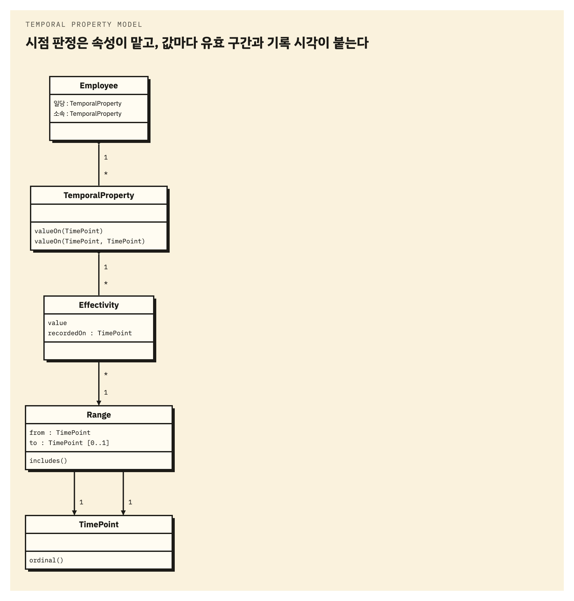

# Temporal Property — 「그때는 얼마였습니까」에 값 하나로 답하는 속성

## 한눈에 보는 개요

인사·급여 시스템에서 사원 한 명의 일당이 `payRate` 라는 칸 하나에 들어 있다고 해 봅시다. 사원 EMP-1042 는 2026년 1월 1일에 일당 200,000원으로 입사했어요. 2월 급여는 2월 28일에 그 값으로 지급됐습니다. 그런데 3월 15일에 인사팀에서 「2월 15일부터 일당 240,000원」이라는 발령이 내려와요. 담당자가 칸을 240,000으로 고치면 그 순간 두 가지가 한꺼번에 사라집니다. 2월 14일까지는 200,000원이었다는 사실이 사라지고, 2월 28일에 200,000원 기준으로 지급한 근거도 사라져요. 4월에 감사가 「2월 25일의 일당은 얼마였습니까」라고 물으면 시스템은 240,000원이라고 답하는데, 실제로 지급한 명세는 200,000원 기준입니다. 어느 쪽도 틀렸다고 말할 수 없어요 — 둘 다 맞는 답인데 묻는 시점이 다릅니다.

```text
Before — 값이 칸 하나다
  employee.payRate = 200000        (1/1 입사)
  employee.payRate = 240000        (3/15 발령 접수 · 덮어쓴다)
  「2/25 의 일당은?」 → 240000     2/28 지급 명세는 200000 기준 — 근거가 모델에 없다
  「2/28 에 우리가 알던 값은?」    → 물을 자리가 없다
```

Temporal Property 의 해법은 **속성의 값을 하나로 두지 않고 유효 기간이 붙은 값들의 이력으로 두고, 「언제의 값인가」를 그 속성에게 묻는 것**입니다. 날짜가 접근자의 인자로 들어오면 「지금 값」은 그 인자의 기본값일 뿐이 되고, 과거 어느 날의 값도 같은 한 줄로 물을 수 있어요. 여기에 시간축을 하나 더 두면 「2월 28일에 우리가 알던 2월 25일의 값」까지 답이 됩니다.

```text
After — 값이 유효 기간이 붙은 이력이다
  일당 ─┬─ 2026-01-01.. · 200000 · 기록 2026-01-01
        └─ 2026-02-15.. · 240000 · 기록 2026-03-15
  payRateOn(2026-02-25)                        → 240000   (지금 아는 전부를 반영한 답)
  payRateOn(2026-02-25, 기록 기준 2026-02-28)  → 200000   (그날 우리가 알던 답)
```

Temporal Property 는 Fowler 의 시간 관련 모델 갈래에 속하고, 원전이 둘입니다 — 『Analysis Patterns』(1997)의 관측·측정 장이 두 시간축을 다루고, martinfowler.com 의 eaaDev 초안 묶음이 속성 하나에 대한 형태를 따로 정리했어요(근거: Fowler *Analysis Patterns* Chapter 3 「Observations and Measurements」 §3.8 Dual Time Record · [Temporal Property, eaaDev 초안](https://martinfowler.com/eaaDev/TemporalProperty.html)). 함께 쓰는 패턴은 [Range](../range/range-guide_v1.0.1.md) 와 [Posting Rule](../posting-rule/posting-rule-guide_v1.0.1.md) 이에요. 유효 기간은 Range 값으로 두는 것이 원전의 권고이고, 「그 시점에 유효했던 규칙으로 계산한다」는 Posting Rule 의 요구가 이 패턴을 규칙 객체에 적용한 모습입니다.

> eaaDev 초안들은 저자가 2006년 여름 이후 손대지 않아 목록 페이지에 사실상 멈춰 있다고 적혀 있는 원고입니다([eaaDev 목록](https://martinfowler.com/eaaDev/), 조회 2026-09-30). 이 글이 그 글들을 근거로 댈 때는 「완성된 책의 서술」이 아니라 「저자가 공개한 미완의 초안」이라는 지위로 읽으시면 됩니다.

이 글은 인사·급여 한 도메인에서 시나리오 셋을 따라갑니다. 급여 담당자가 2월 25일의 일당을 물어 답이 나오기까지, 소급 발령과 감사 요구가 들어올 때 무엇이 바뀌고 무엇은 그대로인가, 그리고 규칙을 어기면 어느 단계에서 어떤 금액이 어긋나는가. 끝까지 읽으면 어떤 모델을 Temporal Property 라고 불러도 되는지 필수 조건 넷으로 판정할 수 있고, Range 와 무엇이 다른지, 유효 기간만 붙인 모델과 어디서 다른지를 세 언어 코드의 줄 번호로 짚을 수 있게 됩니다.

## 패턴 자세히 들여다보기

### 시나리오 1 — 2월 25일의 일당을 묻자 200,000원이 나오기까지

사원 EMP-1042 는 2026년 1월 1일에 입사했고, 그때 정해진 일당은 200,000원입니다. 2월 급여를 마감하는 자리에서 급여 담당자가 묻는 것은 하나예요 — 「2026년 2월 25일의 일당은 얼마입니까」. 나와야 하는 답은 금액 하나, 200,000원입니다. 이 장면에는 다섯이 등장해요. 시간에 따라 값이 바뀌는 속성인 **시간 속성**과 질문이 가리키는 하루인 시점이 둘입니다. 값 하나와 그 값이 참인 기간을 묶은 유효 기간이 붙은 값과 그 기간을 담는 구간이 그다음 둘이에요. 마지막은 이 속성들을 가진 **사원**입니다. 이름은 여기서 한 구절씩만 소개하고 정식 정의는 개념 정리에서 해요.

1. **사원이 등록될 때 일당 이력에 첫 값이 들어갑니다.** 들어가는 것은 금액만이 아니라 `2026-01-01 부터 · 200,000원` 한 쌍이에요. 유효 시작을 함께 넣지 않으면 나중에 시점 질문을 받았을 때 「이 값이 언제부터의 값인가」를 답할 자리가 없습니다. 이 단계가 빠지면 입사일부터 첫 발령 전까지가 빈 구간이 되어 조회가 답을 못 내요.
2. **급여 담당이 시점을 인자로 줍니다.** `payRateOn(2026-02-25)` 처럼 날짜를 넘겨서 묻습니다. 인자 없이 묻는 접근자는 「오늘」만 답할 수 있는데, 마감과 정정은 언제나 지난 날짜를 묻는 일이에요. 오늘이 기본값으로 쓰이는 것과 오늘밖에 못 묻는 것은 다릅니다.
3. **일당 이력이 그 시점을 덮는 값을 고릅니다.** 고르는 일을 이력 쪽이 맡아요. 부르는 쪽이 `from <= when && when <= to` 를 직접 쓰면 그 부등식이 화면 코드와 정산 코드에 따로 적히게 되고, 경계 날짜에서 답이 갈립니다. 이 차이가 어떤 모양인지는 [Range 가이드](../range/range-guide_v1.0.1.md)가 요금 구간에서 이미 보였어요.
4. **고른 값 하나를 돌려줍니다.** 200,000원이에요. 목록이 아니라 값 하나입니다. 이력을 통째로 돌려주면 「어느 것이 그날의 값인가」를 고르는 책임이 부르는 쪽으로 되돌아가고, 3단계에서 한 곳에 모아 둔 판정이 다시 흩어져요.
5. **급여 계산은 그 값을 받아 일수를 곱합니다.** 여기서부터는 이 속성의 일이 아니에요. 속성이 답하는 것은 「그때 얼마였는가」까지이고, 그 값으로 무엇을 하는지는 부르는 쪽의 몫입니다.

```text
단계   부르는 쪽 → 받는 쪽           넘기는 것              돌아오는 것
 1     입사 처리 → 사원              2026-01-01 · 200000    일당 이력에 값 하나
 2     급여 담당 → 사원              2026-02-25             (3·4 로 이어짐)
 3     사원 → 일당 이력              2026-02-25             그 날을 덮는 값 하나
 4     일당 이력 → 급여 담당         —                      200000원
 5     급여 담당 → (모델 밖)         200000원 · 일수         지급액
```

이 시나리오가 보여 준 것은 **시점이 인자로 들어오면 판정이 한 곳에 모인다**는 것입니다. 값에 유효 시작이 붙어 있고(1단계), 질문에 날짜가 붙어 있고(2단계), 고르는 일을 이력이 맡고(3단계), 답이 값 하나로 나옵니다(4단계). 이 넷이 이 패턴의 골격이고, 뒤의 최소 조건 넷이 정확히 이 넷이에요. 아직 나오지 않은 것은 「우리가 그것을 언제 알았는가」인데, 그것은 다음 시나리오에서 요구로 들어옵니다.

### 시나리오 2 — 3월 15일에 도착한 2월 15일자 발령, 그리고 4월의 감사 질문

3월 15일에 인사팀이 발령을 전달합니다 — 「2026년 2월 15일부터 일당 240,000원」. 그런데 2월 급여는 이미 2월 28일에 200,000원 기준으로 지급됐어요. 4월에는 감사가 들어와서 「2월 28일 지급 당시 시스템이 알던 2월 25일의 일당은 얼마였습니까」라고 묻고, 4월 4일에는 「사실은 260,000원이었다」는 정정까지 도착합니다. 이 시나리오에서 새로 나오는 이름은 둘이에요. 일이 실제로 일어난 때인 **사건 시각**과, 우리가 그것을 알게 된 때인 **기록 시각** 입니다.

1. **발효일 2026-02-15 로 값을 하나 더합니다.** 오늘이 3월 15일인데 넣는 날짜는 2월 15일이에요. 유효 시작은 「언제부터 참인가」이고 기록일은 「언제 알았는가」라서 둘이 같을 이유가 없습니다. 이 둘을 갈라 두면 소급·당일·예정 변경이 한 연산으로 처리돼요 — 과거 날짜를 주면 소급이고, 오늘이면 당장, 미래면 예정입니다.
2. **조회는 한 줄도 바뀌지 않습니다.** `payRateOn(2026-02-25)` 는 그대로이고 답만 240,000원으로 바뀌어요. 시점 판정이 속성 쪽에 있기 때문입니다. 만약 급여 화면이 직접 이력을 순회하고 있었다면, 값이 둘이 된 순간 그 코드부터 고쳐야 했어요.
3. **2월분 차액이 나옵니다.** 2월 15일부터 28일까지 14일이고 일당 차이가 40,000원이니 560,000원입니다. 이 값은 뒤의 구현 예시를 실제로 실행해 나온 것이에요.
4. **감사의 질문에 한 시간축 모델은 답하지 못합니다.** 「2월 28일에 우리가 알던 값」을 물었는데, 이력이 가진 날짜는 「언제부터 유효한가」뿐이라 답이 오늘 기준으로 하나밖에 없어요. 모델은 240,000원이라고 답하고 지급 명세는 200,000원 기준이라, 대조하는 사람이 어느 쪽을 믿어야 할지 모릅니다.
5. **값마다 기록 시각을 함께 답니다.** 1월 1일에 알게 된 200,000원, 3월 15일에 알게 된 240,000원 — 이렇게 두 축이 생겨요. 기록 시각을 값에 다는 이유는 「언제 알았는가」가 그 값의 성질이지 이력 전체의 성질이 아니기 때문입니다.
6. **조회가 날짜를 둘 받습니다.** 「어느 날의 값인가」와 「어느 시점의 지식으로 보는가」예요. 기록 기준 2026-02-28 로 2월 25일을 물으면 200,000원, 기록 기준 2026-03-15 로 물으면 240,000원입니다. 같은 하루에 대한 답이 둘인데 모순이 아니에요 — 묻는 지식 시점이 다릅니다.
7. **4월 4일의 정정은 앞 기록을 지우지 않습니다.** 260,000원을 기록 시각 2026-04-04 로 더할 뿐이에요. 그래서 기록 기준 3월 15일로 물으면 여전히 240,000원이 나오고, 기록 기준 4월 4일로 물으면 260,000원이 나옵니다. 3월 15일에 만든 정산 문서가 왜 그 금액이었는지를 모델이 계속 설명할 수 있어요.

```text
                          사건 시각(언제부터 참인가) →
기록 시각      │ 2026-01-20    2026-02-25
(언제 알았나)  │
  ↓           │
2026-02-28    │ 200000        200000        ← 2월 급여를 지급한 시점의 지식
2026-03-15    │ 200000        240000        ← 소급 발령을 접수한 뒤
2026-04-04    │ 200000        260000        ← 정정을 접수한 뒤
```

이 시나리오가 보여 준 것은 **두 시간축이 서로 독립이라는 것**입니다. 유효 시작은 업무가 정하고(1단계), 기록 시각은 우리가 알게 된 순서가 정해요(5단계). 둘은 서로를 모릅니다. 그래서 「지금 아는 답」(2단계)과 「그때 알던 답」(6단계)이 따로 성립하고, 정정이 들어와도 앞의 답이 남습니다(7단계). 한 축만 가진 모델은 4단계에서 막혀요 — 틀린 답을 내는 것이 아니라 **물을 자리가 없습니다.**

### 시나리오 3 — 규칙을 어기면 어느 단계에서 어떤 금액이 어긋나는가

같은 사원 이력에 규칙을 어기는 일이 넷 들어옵니다. 값을 칸 하나로 되돌리는 것, 시점 판정을 부르는 쪽이 하는 것, 같은 기록일에 기간이 겹치는 값을 넣는 것, 그리고 기록 시각을 뒤로 되돌리는 것이에요. 아래 값은 모두 구현 예시를 그렇게 고친 사본을 Java 21 로 실제 컴파일·실행해 확인한 것입니다.

1. **값을 칸 하나로 되돌립니다.** 3월 15일에 `payRate = 240000` 으로 덮으면 2월 25일을 물어도 240,000원이 나오고, 2월 14일을 물어도 240,000원이 나와요. 2월 급여 명세의 200,000원 × 14일을 설명할 근거가 모델 어디에도 없습니다. 문제가 되는 것은 형식이 아니라 **금액의 근거**예요 — 덮어쓴 모델도 예외 하나 던지지 않고 잘 돌아갑니다.
2. **시점 판정을 급여 화면이 직접 합니다.** 이력은 그대로 두되 화면이 `if (from <= when && when <= to)` 를 직접 써요. 값이 하나일 때는 잘 돌아가는데, 2단계에서 값이 둘이 되는 순간 「겹치는 후보 중 어느 것을 고르는가」를 화면이 정하게 됩니다. 정산 배치가 다르게 정하면 같은 2월 25일에 대해 화면은 240,000원, 배치는 200,000원을 내고 둘 다 예외를 던지지 않아요.
3. **같은 기록일에 기간이 겹치는 값을 넣습니다.** 기록 시각 2026-04-04 에 이미 `2026-02-15..` 의 260,000원이 있는데 같은 날짜로 `2026-02-01..2026-03-31` 의 210,000원을 더하면, 2월 25일을 덮는 값이 둘이 됩니다. 검사를 뺀 사본에서 같은 질문에 260,000원이 나왔고, 두 값을 넣는 **순서만 바꾸자** 같은 질문에 210,000원이 나왔어요. 같은 입력에 두 답이 나오는데 어느 쪽이 맞는지 모델 안에 정한 것이 없습니다.
4. **기록 시각을 뒤로 되돌립니다.** 4월 4일까지 기록한 뒤에 기록 시각 2026-03-16 으로 250,000원을 끼워 넣으면, 「기록 기준 2026-03-20 에서 본 2월 25일의 일당」이 240,000원에서 250,000원으로 바뀝니다. 이미 끝난 질문의 답이 나중에 달라지는 것이고, 그러면 기록 축을 둔 이유 자체가 사라져요.

```text
어긴 규칙                      막는 자리            어긋나는 값
값을 칸 하나로 되돌림           없음(모델 형태)      2/25 · 2/14 둘 다 240000 — 2월 명세 200000 의 근거 소멸
시점 판정을 부르는 쪽이 함       없음(호출 규율)      같은 2/25 에 화면 240000 · 배치 200000
같은 기록일에 기간 겹침          값을 더하는 자리     같은 2/25 에 260000 또는 210000, 넣는 순서가 정함
기록 시각 되돌리기              값을 더하는 자리     기록 기준 3/20 의 답이 240000 → 250000 으로 바뀜
```

이 시나리오가 보여 준 것은 **막는 자리가 규칙마다 다르다**는 것입니다. 뒤 둘은 값을 더하는 자리에서 거절 메시지가 나오지만, 앞 둘에는 막는 자리가 없어요. 그쪽이 더 위험합니다. 1단계는 모델을 어떻게 만들었는가의 문제이고 2단계는 누가 판정을 맡는가의 문제라, 둘 다 코드가 잘 돌아가는 채로 틀린 값을 냅니다. 기계가 잡아 주지 않는 자리는 사람이 기준으로 알고 있어야 해서, 이 둘이 뒤 절의 필수 조건 1번과 4번이 됐어요.

### 개념 정리

시나리오에 나온 이름 다섯을 정의합니다. 각 개념이 무엇을 책임지고 누구와 협력하는지를 함께 적었어요. DDD(Domain-Driven Design, 도메인 주도 설계) 전술 분류(Entity·Value Object·Aggregate)는 여기서 매기지 않습니다 — 그것은 상황 설정 표의 몫이고, 같은 개념이라도 경계를 어떻게 잡느냐에 따라 분류가 달라져요.

- **Temporal Property (시간 속성)** — 시간에 따라 값이 바뀌는 속성 하나를 나타냅니다.
  - 책임: 유효 기간이 붙은 값들을 모아 두고, 시점 하나를 받아 그 시점의 값 하나를 돌려줍니다. 어느 값이 그날의 답인지를 고르는 판정이 이 개념의 것이에요(시나리오 1 의 3·4단계).
  - 협력: 값을 더하는 요청은 이 속성을 가진 객체를 거쳐 들어옵니다. 값 하나하나는 유효 기간이 붙은 값이 맡고, 기간 비교는 구간에게 물어요.
- **Effectivity (유효 기간이 붙은 값)** — 값 하나와 그 값이 참인 기간을 묶은 짝입니다. 두 시간축을 쓰면 우리가 그 값을 알게 된 날도 여기 함께 붙어요.
  - 책임: 「이 값은 언제부터 언제까지 참인가」와 「우리는 이것을 언제 알았는가」를 자기 안에 가지고 있습니다(시나리오 2 의 1·5단계).
  - 협력: 기간은 구간에게 맡기고, 시간 속성이 이것들을 모아 둡니다. 이 짝을 하나만 떼어 쓰면 그것이 원전이 Effectivity 라고 부른 모양이고, 그때는 고르는 일을 부르는 쪽이 해야 해요.
- **Range (구간)** — 두 끝과 각 끝을 포함하는지를 한 값에 담은 것입니다. 위 끝이 없으면 「추후 통지까지」를 뜻해요.
  - 책임: 「이 시점이 안에 드는가」에 답하고, 다른 구간과 겹치는지에도 답합니다(시나리오 1 의 3단계, 시나리오 3 의 3단계).
  - 협력: 유효 기간이 붙은 값의 부품입니다. 끝점 자리에 시점이 와요. 구간 자체의 규칙은 [Range 가이드](../range/range-guide_v1.0.1.md)가 따로 다룹니다.
- **Time Point (시점)** — 질문과 기록이 가리키는 하루입니다. 이 개념은 두 역할로 나타나요 — 값이 언제부터 참인지를 말하는 **사건 시각**과, 우리가 그것을 언제 알았는지를 말하는 **기록 시각**입니다.
  - 책임: 크기 비교가 되는 값이어야 합니다. 구간의 끝점이 되고 조회의 인자가 되는데, 둘 다 「이 날이 저 날보다 앞인가」에 답할 수 있어야 성립해요(시나리오 1 의 2단계).
  - 협력: 구간의 끝점이자 시간 속성 접근자의 인자입니다. 두 역할의 이름이 다른 것은 자리가 다르다는 뜻이지 타입이 다르다는 뜻은 아니에요.
- **Employee (사원)** — 시간 속성을 가진 대상입니다. 이 예제에서는 일당과 소속 둘이 그 속성이에요.
  - 책임: 자기 시간 속성에 값이 들어오는 길을 자기 메서드로만 열어 두고, 이력이 지켜야 할 규칙이 그 자리에서 검사되게 합니다(시나리오 3 의 3·4단계).
  - 협력: 바깥은 사원에게 시점을 물어 값을 받습니다. 소속 속성이 담는 값은 부서를 가리키는데, 부서 자체는 이 모델 밖에 있어요.



그림이 말하는 다중도를 말로 옮기면 이렇습니다. 사원 하나가 시간 속성을 여럿 가지고, 시간 속성 하나가 유효 기간이 붙은 값을 여럿 모아 둡니다. **이 두 번째 다중도가 이 패턴의 전부**예요 — 속성의 값이 하나가 아니라 여럿이라는 것이 바로 「이력」입니다. 그리고 값 하나는 구간 하나를 가리키고, 구간은 끝점 자리에 시점을 둘 둬요. 기록 시각은 값 쪽에 한 줄로 붙어 있습니다.

## 사용 목적

이 패턴이 필요하다는 단서는 업무 요구나 기존 모델에서 찾을 수 있습니다. 아래 셋 중 하나라도 보이면 이 패턴이 답일 가능성이 높아요.

- **마감·정산 코드가 「그때 값」을 구하려고 변경 로그를 뒤집니다.** 급여 재계산 함수가 `payRateChangeLog` 를 최신순으로 순회하면서 대상 날짜보다 앞선 첫 항목을 찾는 코드가 보이면, 그 함수는 지금 시간 속성의 조회를 손으로 다시 구현하고 있는 것이에요. 같은 코드가 세 곳에 복제돼 있으면 셋의 답이 경계 날짜에서 달라집니다.
- **업무가 「발효일」과 「접수일」을 다른 칸으로 부릅니다.** 인사 발령서에 발효일과 결재일이 따로 있고, 보험 약관에 효력 발생일과 청약일이 따로 있으면 두 시간축이 이미 업무 언어에 있는 것입니다. 모델에 칸이 하나뿐이면 그 둘이 한 칸에 합쳐져 있어요.
- **감사·대사 요구가 「그 시점에 우리가 알던 값」을 묻습니다.** 지난달 마감 문서의 숫자를 오늘 다시 계산했을 때 같은 값이 나와야 한다는 요구가 그것입니다. 오늘의 지식으로만 답하는 모델은 이 요구를 만족시킬 수 없어요.

```text
관찰되는 것                                     떠올릴 것
「그때 값」을 구하려고 로그를 순회하는 함수      시점 인자 접근자 하나로 모은다
발효일 칸과 접수일 칸이 따로 있다               두 시간축(사건 시각 · 기록 시각)
지난 마감 문서를 오늘 재현해야 한다             기록 시각 기준 조회
값이 바뀌어도 과거 명세는 그대로여야 한다        이력에 값을 더하고 지우지 않는다
```

반대로 **쓰면 손해인 경우**도 분명합니다. 속성의 과거 값을 아무도 묻지 않는 자리예요. 사원의 현재 연락처처럼 「지금 값」만 필요한 속성에 이력을 붙이면, 값 하나를 읽는 데 날짜를 만들어 넘겨야 하고 저장소에는 절대 조회되지 않는 행이 쌓입니다. 기록만 남기면 충분한 자리에는 변경 로그 한 줄이면 되고, 그 로그를 쓰는 비용은 이력을 조회 가능한 구조로 유지하는 비용보다 훨씬 작아요. 판단 기준은 하나입니다 — **과거 값을 정말로 조회하는가, 아니면 남겨 두기만 하는가.**

한 가지 더 있어요. 한 클래스의 속성 대부분이 시간에 따라 바뀐다면 속성마다 이력을 다는 대신 객체 전체를 시간으로 다루는 쪽이 낫습니다. 원전도 그 자리를 따로 갈라 두었어요(근거: [Temporal Property, eaaDev 초안](https://martinfowler.com/eaaDev/TemporalProperty.html)의 "When to Use It" — 클래스에 시간성을 띠는 속성이 **몇 개** 있을 때 이 패턴을 쓰라고 적고, 대부분의 속성이 그렇다면 Temporal Object 로 가라고 적습니다). 이 구분을 포함해 이웃과의 차이는 다음 절에서 풉니다.

## 패턴의 경계

### 디자인 패턴을 충족하는 최소 조건

아래 조건은 클래스 모양이 아니라 **어떤 개념이 무엇을 책임지는가**와 **모델이 늘 지키는 규칙**으로 판정합니다. 메서드인지 그 타입에 붙은 함수인지, 이력을 목록으로 담았는지 맵으로 담았는지는 판정에 상관없어요.

조건을 적용하기 전에 **속성을 먼저 지목해야 합니다** — 「누구의 어떤 속성인가」. 이 예제에서는 「사원 EMP-1042 의 일당」이고, 지목한 뒤에 아래 넷을 그 속성에 대해 묻습니다. 순서가 중요해요. 지목할 속성이 없는 모델은 이 패턴이 아니라 다른 것이에요(비교 절의 네 번째 대상이 그 자리입니다). 그리고 조건 4 에서 말하는 **「이 속성을 읽는 자리」는 그 속성의 값을 얻어 쓰는 코드 전부**입니다. 화면·배치·보고서·다른 서비스 어느 하나라도 예외가 되면 그 조건은 빠져요.

1. [필수] **속성의 값이 하나가 아니라 이력이다** — 새 값이 옛 값을 덮어쓰지 않고, 과거 어느 시점의 값도 모델 안에 남아 있습니다. 시나리오 1 의 1단계와 시나리오 2 의 1단계가 값을 더하는 자리예요. (근거: [Temporal Property, eaaDev 초안](https://martinfowler.com/eaaDev/TemporalProperty.html) — 글의 한 줄 부제가 "A property that changes over time" 이고, 도입부가 보통의 속성은 지금을 묻는 질문이지만 과거의 어느 시점에 대해서도 같은 질문을 하고 싶을 때가 있다고 적습니다. 자격은 **의도문**입니다)
   - 위 근거 괄호가 받쳐 주는 것은 **과거 시점의 값을 물을 수 있어야 한다**는 것까지입니다. 그 이력을 목록으로 담을지 맵으로 담을지, 옛 값의 끝을 닫을지 열어 둘지는 여기서 정해지지 않아요.
   - 빠지면: 칸 하나짜리 속성이 됩니다. 시나리오 3 의 1단계처럼 3월 15일에 덮어쓴 뒤로 2월 25일과 2월 14일이 똑같이 240,000원을 내고, 2월 명세의 200,000원 × 14일을 설명할 근거가 사라져요.
2. [필수] **값마다 언제부터 유효한지가 값 쪽에 붙어 있다** — 이력의 항목이 「언제 적었는가」가 아니라 「언제부터 참인가」를 자기 안에 가집니다. 시나리오 2 의 1단계가 3월 15일에 2월 15일자 값을 넣는 자리예요. (근거: [Effectivity, eaaDev 초안](https://martinfowler.com/eaaDev/Effectivity.html) — 글의 한 줄 의도가 "Add a time period to an object to show when it is effective" 이고, "How it Works" 가 어떤 사실이 일정 기간에만 참이라면 그 기간을 사실에 달아 두는 것이 당연한 방법이라고 적습니다. 자격은 **의도문**입니다)
   - 위 근거 괄호가 받쳐 주는 것은 **유효한 기간이 값 쪽에 붙는다**는 것까지입니다. 그 기간을 Range 값으로 둘지 날짜 두 칸으로 둘지, 끝을 명시할지 다음 값의 시작으로 대신할지는 여기서 정해지지 않아요 — 앞의 선택은 [선택] 5 에 있습니다.
   - 빠지면: 순서만 있는 변경 로그가 됩니다. 시나리오 2 의 1단계에서 3월 15일에 들어온 값이 3월 15일부터의 값으로 읽혀, 2월 15일부터 2월 28일까지의 차액 560,000원이 아예 계산되지 않아요.
3. [필수] **시점을 인자로 받는 접근자가 그 시점의 값 하나를 돌려준다** — 「2026년 2월 25일에 얼마였는가」를 물으면 금액 하나가 나오고, 이력이나 후보 목록이 나오지 않습니다. 시나리오 1 의 2·4단계가 이 자리예요. (근거: [Temporal Property, eaaDev 초안](https://martinfowler.com/eaaDev/TemporalProperty.html)의 "How it Works" — 이 패턴의 핵심이 접근자에 있고, 시점을 인자로 받는 접근자를 **항상** 보게 된다고 적으며 "1998년 2월 2일에 주소가 무엇이었나" 를 그 질문의 예로 듭니다. 자격은 **요점 선언**입니다)
   - 위 근거 괄호가 받쳐 주는 것은 **시점을 인자로 받는 접근자가 있어야 한다**는 것까지입니다. 인자 없는 접근자를 함께 둘지는 여기서 정해지지 않아요 — [선택] 6 에 있습니다.
   - 빠지면: 이력을 돌려주는 조회가 됩니다. 시나리오 1 의 4단계에서 한 곳에 모아 둔 판정이 부르는 쪽마다 다시 흩어지고, 시나리오 3 의 2단계처럼 화면과 배치가 같은 날에 다른 금액을 내요.
4. [필수] **시점 판정을 그 속성이 맡고, 속성을 읽는 자리 가운데 어느 하나도 유효 기간을 꺼내 비교하지 않는다** — 읽는 자리는 날짜를 넘기고 값을 받을 뿐이고, 기간 비교 코드를 자기 안에 두지 않습니다. 시나리오 2 의 2단계가 이 조건이 있을 때의 모습이고, 시나리오 3 의 2단계가 없을 때의 모습이에요. (근거: [Effectivity, eaaDev 초안](https://martinfowler.com/eaaDev/Effectivity.html)의 "When to Use It" — 유효 기간만 붙이는 방식의 주된 단점이 부르는 쪽이 시간성을 알아야 하고 조회마다 유효 기간을 시험하는 절을 넣어야 한다는 것이라고 적은 뒤, 그 책임을 걷어 내는 구조로 속성 하나에는 Temporal Property 를, 객체 전체에는 Temporal Object 를 듭니다. 자격은 **사용 조건**입니다)
   - 위 근거 괄호가 받쳐 주는 것은 **시간 판정의 책임이 부르는 쪽에서 속성 쪽으로 옮겨 온다**는 것까지입니다. 그 판정이 메서드여야 한다거나 속성이 독립된 클래스여야 한다는 요구는 없어요.
   - 빠지면: 유효 기간만 붙인 모델, 곧 원전이 Effectivity 라고 부른 자리에 머뭅니다. 값이 하나일 때는 잘 돌아가다가 시나리오 2 의 1단계에서 값이 둘이 되는 순간 부르는 쪽마다 고르는 규칙을 따로 정하게 돼요.
5. [선택] **유효 기간을 날짜 두 칸이 아니라 Range 값 하나로 둔다** — 시작과 끝, 그리고 각 끝을 포함하는지가 한 값 안에 있고 「이 시점이 안에 드는가」를 그 값에게 묻습니다. 시나리오 1 의 3단계가 그 자리예요. (근거: [Effectivity, eaaDev 초안](https://martinfowler.com/eaaDev/Effectivity.html)의 "When to Use It" — 객체로 구현한다면 유효 기간에 Range 를 실제로 쓰라고 권하고, 그 이유로 날짜 짝을 쓰는 것보다 훨씬 쉽다는 것을 듭니다. 자격은 **구현 지침**이고 이유가 편의라 성립 요건이 아니라 권고입니다)
6. [선택] **인자 없는 접근자를 함께 둔다** — 「오늘의 값」을 묻는 짧은 길을 하나 더 둡니다. 시나리오 1 의 2단계가 날짜를 꼭 넘겨야 하는 이유를 보인 자리이고, 이 조건은 그 위에 기본값 하나를 더하는 것이에요. (근거: [Temporal Property, eaaDev 초안](https://martinfowler.com/eaaDev/TemporalProperty.html)의 "How it Works" — 인자를 받지 않는 접근자도 **대개** 함께 보게 되고 그것은 어떤 기본값, 보통 오늘에 대한 질문이라고 적습니다. 자격은 **흔한 관례**라 [선택] 입니다)
7. [선택] **끝이 열린 구간으로 「추후 통지까지」를 나타낸다** — 종료일이 정해지지 않은 값을 끝 없는 구간으로 둡니다. 시나리오 2 의 1단계가 그 모양이에요. (근거: [Effectivity, eaaDev 초안](https://martinfowler.com/eaaDev/Effectivity.html)의 "How it Works" — 시작일만 받는 생성 메서드가 끝이 열린 Range 를 써서 종료일이 없음을 나타내고, 나중에 통지가 오면 더 이상 유효하지 않게 만드는 메서드를 둘 수 있다고 적습니다. 자격은 **구현 지침**입니다)
8. [선택] **유효 시작을 과거·현재·미래 어디로든 준다** — 소급·당일·예정 변경이 같은 연산 하나로 처리됩니다. 시나리오 2 의 1단계가 과거를 준 자리예요. (근거: [Temporal Property, eaaDev 초안](https://martinfowler.com/eaaDev/TemporalProperty.html)의 "How it Works" — 넘긴 날짜가 과거면 소급 변경, 현재면 당장의 변경, 미래면 예정된 변경을 뜻한다고 적습니다. 자격은 **허용**이라 [선택] 입니다)
9. [선택] **이미 넣은 값의 유효 기간을 직접 고치는 길을 둔다** — 「1998년 1월로 적은 이사 날짜를 1997년 12월로 고친다」처럼 이력의 항목 자체를 손봅니다. 시나리오 2 의 7단계가 그 대신 값을 하나 더 더해서 같은 일을 해낸 자리예요. (근거: [Temporal Property, eaaDev 초안](https://martinfowler.com/eaaDev/TemporalProperty.html)의 "How it Works" — 끝에 값을 더하는 갱신과 기존 항목을 고치는 갱신 둘을 나란히 들고, 값이 값 객체라면 더하는 갱신만으로도 해낼 수 있다고 적습니다. 자격은 **선택지 나열**이라 [선택] 입니다. 이 예제는 더하는 쪽만 두었어요)
10. [선택] **사건 시각과 기록 시각 두 축을 둔다** — 값마다 우리가 그것을 알게 된 날이 따로 붙고, 조회가 날짜를 둘 받습니다. 시나리오 2 의 5·6·7단계가 이 자리예요. (근거: Fowler *Analysis Patterns* Chapter 3 §3.8 Dual Time Record — 그림 3.11 이 기록에서 시간 기록으로 가는 연관을 **둘** 그리고 각각에 recording time 과 applicability 라는 이름을 붙입니다. 자격은 **구조 선언**과 **연관 선언**이에요. [Effectivity, eaaDev 초안](https://martinfowler.com/eaaDev/Effectivity.html)의 "How it Works" 도 두 축 지원은 날짜 구간을 하나 더 더하는 것이라고 적으면서 그 복잡성이 쓰는 쪽으로 넘어간다고 덧붙여, 성립 요건이 아니라 더하는 장치로 다룹니다)
11. [선택] **같은 기록일에 유효 구간이 겹치는 값을 한 속성에 둘 이상 두지 않는다** — 조건 3 이 값 하나를 요구하는데 같은 지식 시점에서 겹치면 답이 둘이 되기 때문이에요. 시나리오 3 의 3단계가 그 자리입니다. (근거: 이 가이드의 정책 — 원전은 이 제약을 문장으로 적지 않고, 오히려 유효 기간을 여러 객체에 붙이는 쪽에서는 4월에 고용 둘이 겹치는 예를 듭니다. 속성 하나의 답을 하나로 정하려는 이 예제의 판단이에요)
12. [선택] **기록 시각은 앞선 기록보다 이를 수 없다** — 지식이 쌓인 순서를 되돌리지 않습니다. 시나리오 3 의 4단계가 되돌렸을 때의 자리예요. (근거: 이 가이드의 정책 — 이미 답한 「그때 알던 값」이 나중에 달라지지 않게 하려는 제약이고, 원전에 같은 문장은 없습니다)

> 필수는 넷이다 — 값이 이력인가, 값마다 유효 시작이 붙었는가, 시점을 받아 값 하나를 돌려주는가, 그 판정을 속성이 맡는가. 넷을 다 갖추고도 이 패턴이 아닌 모델이 있으니 비교 절을 함께 본다.

```text
판정 순서                                        아니면 그것은
0  누구의 어떤 속성인지 지목할 수 있는가?   ──▶  기록의 모음 또는 규칙의 등록부
1  그 속성의 값이 이력인가?                 ──▶  칸 하나짜리 속성
2  값마다 유효 시작이 붙어 있는가?          ──▶  순서만 있는 변경 로그
3  시점을 받아 값 하나를 돌려주는가?        ──▶  이력을 돌려주는 조회
4  그 판정을 속성이 맡는가?                 ──▶  유효 기간만 붙인 모델(Effectivity)
```

조건을 세우고 나서 **이미 발행된 편들을 이 넷으로 판정해 봤습니다.** 조건이 너무 넓거나 좁으면 그 자리에서 확인되기 때문이에요.

| 발행본 | 지목한 속성 | 조건 1~4 | 이 패턴인가 |
| --- | --- | --- | --- |
| [Range](../range/range-guide_v1.0.1.md) 의 `RateBand.weights` | 요금 구간 하나의 무게 범위 | 1 ✗ (이력이 아니라 값 하나) | 아니다 — Range 는 이 패턴의 부품이지 이 패턴이 아니다 |
| [Knowledge Level](../knowledge-level/knowledge-level-guide_v1.0.1.md) 의 `InspectionType.정상 범위` | 점검 종류의 정상 범위 | 1 ✗ (이력이 없다) | 아니다 — 그래서 그 편의 판정은 기록 시점에 한 번 정해지고 고정된다 |
| [Observation](../observation/observation-guide_v1.0.1.md) 의 환자 관측 | 지목할 속성이 없다 | 0 ✗ | 아니다 — 비교 절의 네 번째 대상이 이 자리다 |
| [Posting Rule](../posting-rule/posting-rule-guide_v1.0.1.md) 의 규칙 등록부 | 사건 종류 `USAGE` 의 전기 규칙 | 1·2·3·4 모두 ○ | **그렇다** — 그 편의 등록부가 이 패턴의 한 적용이다 |

마지막 행이 중요합니다. Posting Rule 편은 규칙마다 유효 기간을 두고, 사건의 **발생 시점**을 열쇠로 규칙 하나를 조회하며, 그 판정을 부르는 쪽이 하지 않아요. 넷을 다 통과하는 것이 오판이 아니라 사실입니다 — 두 편은 경쟁하지 않고 포개져요. 그 편의 「접수 시점과 발생 시점이 다를 수 있다」가 이 편의 기록 시각과 사건 시각을 회계 언어로 말한 것이고, 그래서 조건을 그 편이 탈락하도록 좁히지 않았습니다.

### 비슷한 패턴·안티패턴과의 차이

| 비교 대상 | 구분 기준 | Temporal Property 를 고르면 얻는 것 | 포기하는 것 |
| --- | --- | --- | --- |
| Range | 두 끝을 담은 값 하나인가, 그 구간에 매인 값들의 이력인가 | 「그때 얼마였는가」에 답할 수 있다 | 구간 자체를 다루는 연산(겹침·맞닿음)은 이 개념이 하지 않는다 — 부품이 한다 |
| 유효 기간만 붙인 모델(Effectivity 단독) | 시점 판정을 부르는 쪽이 하는가, 속성이 하는가 | 값이 늘어도 읽는 코드가 안 바뀐다 | 타입이 하나 늘고, 값 하나만 있는 속성에도 이력 구조가 따라온다 |
| 감사 로그·변경 이력 표 | 항목에 붙은 날짜가 「언제부터 참인가」인가 「언제 적었는가」인가 | 소급·예정 변경이 조회에 그대로 반영된다 | 「누가 고쳤는가」 같은 변경 자체의 사실은 이 모델이 답하지 않는다 |
| Observation | 지목할 속성이 있는가, 대상·항목·값 세 자리를 가진 기록인가 | 속성 하나의 답이 값 하나로 나온다 | 항목을 데이터로 늘리는 길과 값의 종류를 섞는 길을 잃는다 |
| Posting Rule 의 규칙 등록부 | 대체가 아니라 포개짐 — 값이 금액인가 규칙 객체인가 | 회계 밖의 어떤 속성에도 같은 모양을 쓴다 | 균형·전기 키 같은 회계의 요구는 이 개념만으로 나오지 않는다 |

**Range 와의 차이.** 구분 기준은 두 끝을 담은 값 하나인가, 그 구간에 매인 값들의 이력인가입니다. **이 둘은 경쟁하지 않아요.** Range 는 이 패턴의 부품이고, 원전도 유효 기간에 Range 를 실제로 쓰라고 권합니다. 차이가 나는 자리는 질문의 모양이에요.

```text
Range 에게 묻는 것          「2026-02-25 가 이 구간 안에 드는가?」        → true / false
시간 속성에게 묻는 것       「2026-02-25 의 일당은 얼마인가?」            → 240000원

Range 하나만 있을 때        구간 하나가 값 하나를 덮는다 — 이력이 없다
시간 속성이 있을 때         구간이 붙은 값이 여럿이고 그중 하나가 답이 된다
```

시나리오 1 의 3단계가 정확히 그 경계입니다. 그 단계에서 「2026-02-25 가 안에 드는가」에 답하는 것은 구간이고, 「그래서 답은 어느 값인가」를 정하는 것은 시간 속성이에요. 구간에게 후자를 물을 수는 없습니다 — 구간은 자기 이웃을 모르니까요. Temporal Property 를 고르면 시점 질문에 값으로 답할 수 있게 되는 대신, 겹침과 맞닿음 같은 구간끼리의 연산은 여전히 Range 의 몫으로 남습니다.

**유효 기간만 붙인 모델과의 차이.** 구분 기준은 시점 판정을 누가 맡는가입니다. 이것이 이 편에서 가장 헷갈리는 자리예요. 아래 코드는 값에 유효 기간을 제대로 달아 두었는데도 이 패턴이 아닙니다.

```java no-compile
record PayRateEntry(LocalDate from, LocalDate to, long won) {}

// 급여 화면 — 자기가 이력을 훑고 자기가 고른다
long rateOn(List<PayRateEntry> history, LocalDate when) {
    for (PayRateEntry e : history) {
        if (!when.isBefore(e.from()) && !when.isAfter(e.to())) return e.won();
    }
    throw new IllegalStateException("해당 기간의 일당이 없습니다");
}
```

조건 1·2 는 갖췄고 조건 3 도 겉으로는 갖춘 것처럼 보입니다. 빠진 것은 조건 4 예요 — 이 `rateOn` 이 급여 화면에 있고 정산 배치에도 따로 있습니다. 값이 하나일 때는 두 사본이 같은 답을 내다가, 시나리오 2 의 1단계에서 값이 둘이 되는 순간 답이 갈려요. 한쪽이 먼저 만난 값을 내놓고 다른 쪽이 마지막 값을 내놓으면 같은 2월 25일에 대해 240,000원과 200,000원이 나오고, 시나리오 3 의 2단계가 그 과정입니다. Temporal Property 를 고르면 값이 늘어도 읽는 코드가 안 바뀌는 대신, 값이 끝까지 하나뿐인 속성에도 이력 구조가 따라와요.

**감사 로그·변경 이력 표와의 차이.** 구분 기준은 항목에 붙은 날짜가 「언제부터 참인가」인가 「언제 적었는가」인가입니다. 둘은 모양이 거의 같아서 표만 보면 구분되지 않아요.

```text
변경 이력 표   (사원, 항목, 옛값, 새값, 바꾼 사람, 바꾼 시각 2026-03-15)
              └ 날짜가 「적은 때」 하나뿐 — 2/15 부터라는 사실이 어디에도 없다

시간 속성      (사원, 일당, 값 240000, 유효 2026-02-15.., 기록 2026-03-15)
              └ 날짜가 둘 — 「언제부터 참인가」와 「언제 알았는가」가 따로 있다
```

시나리오 2 의 1단계가 이 차이가 값으로 나타나는 자리예요. 변경 로그만 있으면 3월 15일에 바뀌었다는 사실은 남는데 2월 15일부터 적용된다는 사실이 없어서, 2월분 차액 560,000원이 계산되지 않습니다. 반대로 시간 속성은 「누가 고쳤는가」를 답하지 않아요 — 그 사실이 필요하면 로그를 함께 둡니다. 둘은 답하는 질문이 달라서 대체 관계가 아니에요.

**Observation 과의 차이.** 구분 기준은 지목할 속성이 있는가입니다. [Observation 가이드](../observation/observation-guide_v1.0.1.md)의 모델도 두 시각을 가지고 「그 날 기준」 조회를 하기 때문에 닮아 보여요. 차이가 나는 자리는 무엇을 기록의 단위로 삼는가입니다.

```text
시간 속성      사원 EMP-1042 의 「일당」이라는 속성이 먼저 있고
              그 속성의 값이 시간에 따라 여럿이다 → 사원에게 날짜를 묻는다

Observation   「대상 · 항목 · 값」 세 자리를 가진 기록이 먼저 있고
              항목이 데이터라 얼마든지 늘어난다 → 기록들을 추려 값을 꺼낸다
```

속성을 먼저 정하면 항목을 늘리는 일이 클래스를 고치는 일이 되고, 기록을 먼저 정하면 값 하나를 얻는 데 추리는 일이 한 번 더 붙습니다. 그리고 그 추리는 일을 관측 모델에서는 속성이 아니라 바깥의 조회 자리가 해요 — 시나리오 3 의 2단계가 말한 「부르는 쪽이 판정한다」와 구조가 같아서, 조건 4 가 두 모델을 가르는 자리입니다. Temporal Property 를 고르면 답이 값 하나로 나오는 대신, 항목을 배포 없이 늘리는 길과 값의 종류를 섞는 길을 잃어요.

**Posting Rule 의 규칙 등록부와의 차이.** 구분 기준은 대체가 아니라 포개짐이고, 실제로 다른 것은 값의 종류뿐입니다. [Posting Rule 가이드](../posting-rule/posting-rule-guide_v1.0.1.md)는 규칙마다 유효 기간을 두고 사건의 발생 시점으로 규칙 하나를 조회하는데, 그것이 「사건 종류 `USAGE` 의 전기 규칙」이라는 속성에 이 패턴을 적용한 모습이에요. 그 편의 「접수 시점이 아니라 발생 시점으로 묻는다」가 이 편의 사건 시각이고, 「늦게 도착한 사실을 그때의 규칙으로 처리한다」가 시나리오 2 의 7단계와 같은 요구입니다. 이 편을 고르면 회계 밖의 어떤 속성에도 같은 모양을 쓸 수 있는 대신, 균형이나 전기 키 같은 회계의 요구는 이 개념만으로 나오지 않아요.

## 구현 예시

### 상황 설정

시나리오 1·2·3 의 인사·급여 장면을 세 언어로 똑같이 구현합니다. 도메인은 그대로예요. 회사 한 곳의 인사·급여 기록 프로그램이고, 사원 한 명마다 시간에 따라 바뀌는 속성이 둘 있습니다 — 일당과 소속이에요. 발령이 들어오면 「언제부터 유효한가」와 「오늘 접수했다」를 함께 기록하고, 조회는 날짜 하나 또는 둘을 받아 값 하나를 돌려줍니다.

고정인 것도 정해 둡니다. 날짜는 달력 라이브러리를 쓰지 않고 연·월·일 세 수를 담은 자체 값으로 두었어요. **Rust 표준 라이브러리에 달력 날짜 타입이 없어서**(근거: [std::time](https://doc.rust-lang.org/std/time/index.html) — 이 모듈이 제공하는 것은 `Instant` 와 `Duration` 같은 시간 측정용 타입이고 달력 날짜 타입은 없습니다, 조회 2026-09-30) 세 언어를 같은 모양으로 맞추려면 이쪽이어야 합니다. 크기 비교와 일수 계산은 1970년 1월 1일을 0으로 세는 **일 번호** 하나로 처리해요. 세 언어가 같은 정수 산술만 쓰므로 답이 갈릴 자리가 없습니다. 금액은 원 단위 정수이고, 이력은 값을 더하기만 하며 한번 들어간 값은 지워지지도 바뀌지도 않아요.

| 예제 타입 | 대응하는 개념 |
| --- | --- |
| `TemporalProperty` · `Effectivity` · `TimePoint` | 같은 이름의 개념 그대로 |
| `DateRange` | Range 개념 그대로. 끝점이 `TimePoint` 이고 위 끝이 없으면 추후 통지까지다 |
| `Employee` | 시간 속성을 가진 사원. `payRate`(일당)와 `assignment`(소속) 둘이 그 속성이다 |
| `Money` · `EmployeeId` · `DepartmentId` | 패턴 밖의 값과 식별자. 부서 자체는 이 예제 밖의 aggregate 다 |
| `nameOf` · `retroDifference` | aggregate 밖에서 id 로 찾아 조립하는 자리 |

아래 표에서 쓰는 DDD 전술 용어(Bounded Context · Aggregate · Aggregate Root · Entity · Value Object(VO) · id 참조 · 불변식)는 이 가이드의 주제 밖 사전 지식이라 [참고 문서 「DDD 전술 용어」](../../reference/ddd-tactical-terms/ddd-tactical-terms-ref_v1.0.2.md)가 한 자리에 모아 두었어요. 표를 읽기 전에 그 문서를 한 번 읽고 오시면 네 행이 각각 무엇을 정하는지 바로 읽힙니다.

| 항목 | 이 가이드의 설정 |
| --- | --- |
| bounded context | 인사·급여 — 사원 한 명의 일당과 소속을 유효 시작과 기록일 두 축으로 남기고, 어느 시점 기준으로든 되읽는다 |
| 불변식의 위치 | ① 유효 기간의 시작이 끝보다 늦을 수 없다 → `DateRange` VO 가 만들어지는 자리에서 지킨다 ② 같은 기록일에 유효 구간이 겹치는 값을 한 속성에 둘 이상 두지 않는다 ③ 기록일은 앞선 기록보다 이를 수 없다 ④ 이력에 든 값은 지워지거나 바뀌지 않는다 — ②·③·④ 는 `Employee` root 의 `recordPayRate` 와 `recordAssignment` 가 자기 시간 속성 값을 갈아 끼우는 그 자리에서 지킨다 ⑤ 사원은 입사일부터 유효한 일당과 소속을 하나씩 갖고 만들어진다 → `Employee` root 의 생성자 |
| root·entity·VO 배정 | `Employee` aggregate 하나. `Employee` 가 root(entity, `EmployeeId` 로 식별)이고 child entity 는 없다. `TemporalProperty` · `Effectivity` · `DateRange` · `TimePoint` · `Money` 와 두 id 는 VO — 모두 식별자가 없고 불변이며 같음을 값으로 판단한다. 부서는 이 예제 밖의 aggregate 라 `DepartmentId` 로만 등장하고, `nameOf` 와 `retroDifference` 는 aggregate 가 아니라 밖에서 조립하는 자리다 |
| 타 aggregate 참조 방식 | id 참조 — `Employee` 의 소속 시간 속성이 담는 값이 부서 aggregate(이 예제 밖)를 가리키는 `DepartmentId` 다. 부서 이름이 필요한 자리는 aggregate 밖의 `nameOf` 가 그 id 로 찾아 오고, `Employee` 의 필드와 메서드 시그니처 어디에도 부서 타입이 나오지 않는다 |

코드에서 그 경계가 나타나는 자리는 `Employee` 의 `recordPayRate` 와 `recordAssignment` 둘입니다. 이력을 바꾸는 길이 그 둘뿐이라, 검사를 지나지 않고 값이 들어갈 방법이 없어요. 우회로가 없습니다. 표가 「어디에 두었는가」를 말했다면, 다음 표는 「다른 곳에 두면 무엇이 어긋나는가」를 불변식 다섯과 id 참조 하나에 대해 적은 것입니다. 값은 모두 구현 예시를 그렇게 고친 사본을 Java 21 로 컴파일·실행해 확인했어요.

| 규칙(불변식) 또는 참조 | 다른 곳에 두거나 바꾸면 | 어느 동작에서 무엇이 어긋나는가 |
| --- | --- | --- |
| ① 유효 기간의 시작이 끝보다 늦을 수 없다 | 구간을 만드는 호출자가 넘기기 전에 확인한다 | 한 곳만 빠뜨리면 `2026-03-31..2026-02-01` 짜리 값이 이력에 들어갑니다. 시작 이상이면서 끝 이하인 날은 없으므로 그 값은 **어떤 날짜로 물어도 답이 되지 않아요** — 999,999원짜리 값을 넣고 2026-03-10 과 2026-02-20 을 물었더니 둘 다 260,000원이 나왔고, 넣은 값은 조회에 한 번도 잡히지 않았습니다 |
| ② 같은 기록일에 유효 구간이 겹치는 값을 둘 이상 두지 않는다 | 검사를 빼고 값을 더한다 | 기록 2026-04-04 에 `2026-02-15..` 260,000원이 있는 상태에서 같은 날짜로 `2026-02-01..2026-03-31` 210,000원을 더하면, 2026-02-25 의 답이 260,000원으로 나왔고 두 값을 **넣는 순서만 바꾸자** 210,000원이 나왔습니다. 같은 입력에 두 답이 있고 목록 순서가 답을 정해요. 시나리오 3 의 3단계가 그 자리입니다 |
| ③ 기록일은 앞선 기록보다 이를 수 없다 | 검사를 빼고 지난 날짜로 기록한다 | 2026-04-04 까지 기록한 뒤 기록일 2026-03-16 으로 250,000원을 끼워 넣으면, 「기록 기준 2026-03-20 에서 본 2026-02-25 의 일당」이 240,000원에서 250,000원으로 바뀝니다. 이미 답이 끝난 질문의 답이 나중에 달라져요. 시나리오 3 의 4단계가 그 자리입니다 |
| ④ 이력에 든 값은 지워지거나 바뀌지 않는다 | 이력의 항목을 고치는 길을 연다 | 기록 2026-03-15 에 적은 240,000원을 260,000원으로 고치면 「기록 기준 2026-03-15 의 2026-02-25 일당」이 260,000원이 되고, 2월 소급 차액이 560,000원에서 **840,000원**으로 바뀝니다. 3월 15일에 만든 정산 문서가 왜 560,000원이었는지 설명할 근거가 사라져요 |
| ⑤ 사원은 입사일부터 유효한 값을 갖고 만들어진다 | 빈 이력으로 만들고 첫 발령 때 채운다 | 입사일부터 첫 발령 전까지가 빈 구간이 되어 `payRateOn(2026-01-01)` 이 답을 못 냅니다. 실제로 첫 값을 빼고 실행하니 이력이 비어 있는 채로 조회가 `ArrayIndexOutOfBoundsException` 으로 멈췄고, 첫 줄 출력조차 나오지 않았어요 |
| `Employee` 가 부서를 `DepartmentId` 로 가리킨다 | 부서 객체를 시간 속성의 값으로 담는다 | 사원의 이력을 거쳐 부서 이름을 고칠 수 있게 됩니다. 부서를 객체로 담은 사본에서 `assignmentOn(2026-03-20).rename("영업1부")` 를 부르자 같은 2026-03-20 의 소속 이름이 「영업부」에서 **「영업1부」**로 바뀌었어요 — 그 시점에 그 부서가 뭐라 불렸는지를 모델이 잃습니다 |

뒤의 세 언어 구현은 이 설정을 그대로 옮긴 것이고, 실행하면 셋이 아래 열여섯 줄을 글자까지 같게 냅니다. 가이드 폴더의 `code/expected-output.txt` 와 같은 내용이고, 이 글의 실행 수치는 전부 여기서 와요.

```text
사원 EMP-1042 · 입사 2026-01-01 · 첫 일당 200000원 · 첫 소속 DEP-SALES 영업부
[기록] 2026-03-15 — 2026-02-15 부터 일당 240000원
[기록] 2026-04-04 — 2026-02-15 부터 일당 260000원
[기록] 2026-05-02 — 2026-04-01 부터 소속 DEP-PLAN
[한 축] 2026-01-20 의 일당 200000원
[한 축] 2026-02-25 의 일당 260000원
[두 축] 2026-02-25 의 일당 · 기록 기준 2026-02-28 → 200000원
[두 축] 2026-02-25 의 일당 · 기록 기준 2026-03-15 → 240000원
[두 축] 2026-02-25 의 일당 · 기록 기준 2026-04-04 → 260000원
2월 소급 차액 — 2026-02-15..2026-02-28 14일 × 40000원 = 560000원
[한 축] 2026-03-20 의 소속 DEP-SALES 영업부
[한 축] 2026-04-10 의 소속 DEP-PLAN 기획부
거부 — 유효 시작이 유효 끝보다 늦습니다: 2026-03-31..2026-02-01
거부 — 같은 기록일에 유효 구간이 겹칩니다: 2026-02-15.. 와 2026-02-01..2026-03-31
거부 — 기록일이 앞선 기록보다 이릅니다: 2026-03-01 < 2026-05-02
거부 — 그 기록 시점에는 아는 값이 없습니다: 2026-02-25 의 일당 · 기록 기준 2025-12-31
```

잠깐, 확인 하나만 해 볼까요? 위 출력의 다섯째 줄에서 2026-01-20 의 일당이 200,000원인데 여섯째 줄에서 2026-02-25 는 260,000원입니다. 둘 다 「지금 아는 전부」 기준인데 왜 다를까요? 인상 발령의 유효 시작이 2026-02-15 라서, 1월 20일을 덮는 값은 입사 때의 `2026-01-01..` 하나뿐이고 2월 25일은 그 뒤 두 값이 함께 덮기 때문이에요. 2월 25일에서는 기록일이 가장 늦은 값이 우선합니다. 정정된 260,000원이죠.

### 구현

```java
import java.util.ArrayList;
import java.util.List;
import java.util.Map;

/** 인사·급여 — 사원의 일당과 소속을 시간 속성으로 두고, 사건 시각과 기록 시각 두 축으로 조회한다. */
public final class TemporalPropertyExample {

    /** 시점. 달력 날짜 타입을 쓰지 않고 세 언어가 같은 자체 값으로 둔다. */
    record TimePoint(long year, long month, long day) {
        /** 1970-01-01 을 0 으로 세는 일 번호. 크기 비교와 일수 계산이 전부 이 값 위에 선다. */
        long ordinal() {
            long y = year - (month <= 2 ? 1 : 0);
            long era = Math.floorDiv(y, 400);
            long yoe = y - era * 400;
            long doy = (153 * (month + (month > 2 ? -3 : 9)) + 2) / 5 + day - 1;
            return era * 146097 + yoe * 365 + yoe / 4 - yoe / 100 + doy - 719468;
        }

        @Override public String toString() { return String.format("%04d-%02d-%02d", year, month, day); }
    }

    /** 구간. 두 끝이 모두 포함이고, 위 끝이 없으면 「추후 통지까지」다. */
    record DateRange(TimePoint from, TimePoint to) {
        DateRange {
            if (to != null && from.ordinal() > to.ordinal()) {
                throw new IllegalArgumentException("유효 시작이 유효 끝보다 늦습니다: " + from + ".." + to);
            }
        }

        static DateRange openEnded(TimePoint from) { return new DateRange(from, null); }

        boolean includes(TimePoint t) {
            return from.ordinal() <= t.ordinal() && (to == null || t.ordinal() <= to.ordinal());
        }

        boolean overlaps(DateRange other) {
            return (to == null || other.from.ordinal() <= to.ordinal())
                    && (other.to == null || from.ordinal() <= other.to.ordinal());
        }

        long lengthInDays() {
            if (to == null) {
                throw new IllegalStateException("끝이 없는 구간은 일수를 셀 수 없습니다: " + this);
            }
            return to.ordinal() - from.ordinal() + 1;
        }

        @Override public String toString() { return from + ".." + (to == null ? "" : to.toString()); }
    }

    record Money(long won) {
        Money minus(Money other) { return new Money(won - other.won); }

        Money times(long count) { return new Money(won * count); }

        @Override public String toString() { return won + "원"; }
    }

    record EmployeeId(String value) {
        @Override public String toString() { return value; }
    }

    record DepartmentId(String value) {
        @Override public String toString() { return value; }
    }

    /** 유효 기간이 붙은 값 하나. recordedOn 은 우리가 그 값을 알게 된 날이다. */
    record Effectivity<V>(DateRange period, TimePoint recordedOn, V value) {
    }

    /** 시간 속성 — 값들의 이력을 쥐고, 시점을 받아 값 하나로 답한다. */
    record TemporalProperty<V>(String name, List<Effectivity<V>> history) {
        TemporalProperty {
            history = List.copyOf(history);
        }

        static <V> TemporalProperty<V> startingWith(String name, TimePoint from, TimePoint on, V value) {
            return new TemporalProperty<>(name, List.of(new Effectivity<>(DateRange.openEnded(from), on, value)));
        }

        TemporalProperty<V> asserting(DateRange period, TimePoint on, V value) {
            TimePoint latest = latestRecord();
            if (on.ordinal() < latest.ordinal()) {
                throw new IllegalArgumentException("기록일이 앞선 기록보다 이릅니다: " + on + " < " + latest);
            }
            for (Effectivity<V> e : history) {
                if (e.recordedOn().ordinal() == on.ordinal() && e.period().overlaps(period)) {
                    throw new IllegalArgumentException(
                            "같은 기록일에 유효 구간이 겹칩니다: " + e.period() + " 와 " + period);
                }
            }
            List<Effectivity<V>> next = new ArrayList<>(history);
            next.add(new Effectivity<>(period, on, value));
            return new TemporalProperty<>(name, next);
        }

        /** 기록 기준 asKnownOn 에서 본 when 의 값. 그 시점을 덮는 값 가운데 가장 늦게 안 것이 답이다. */
        V valueOn(TimePoint when, TimePoint asKnownOn) {
            Effectivity<V> best = null;
            for (Effectivity<V> e : history) {
                if (e.recordedOn().ordinal() > asKnownOn.ordinal() || !e.period().includes(when)) {
                    continue;
                }
                if (best == null || e.recordedOn().ordinal() > best.recordedOn().ordinal()) {
                    best = e;
                }
            }
            if (best == null) {
                throw new IllegalStateException(
                        "그 기록 시점에는 아는 값이 없습니다: " + when + " 의 " + name + " · 기록 기준 " + asKnownOn);
            }
            return best.value();
        }

        V valueOn(TimePoint when) { return valueOn(when, latestRecord()); }

        TimePoint latestRecord() {
            TimePoint latest = history.get(0).recordedOn();
            for (Effectivity<V> e : history) {
                if (e.recordedOn().ordinal() > latest.ordinal()) {
                    latest = e.recordedOn();
                }
            }
            return latest;
        }
    }

    /** aggregate root. 두 시간 속성을 품고 이력의 불변식을 진다. */
    static final class Employee {
        private final EmployeeId id;
        private final TimePoint hiredOn;
        private TemporalProperty<Money> payRate;
        private TemporalProperty<DepartmentId> assignment;

        Employee(EmployeeId id, TimePoint hiredOn, Money rate, DepartmentId department) {
            this.id = id;
            this.hiredOn = hiredOn;
            this.payRate = TemporalProperty.startingWith("일당", hiredOn, hiredOn, rate);
            this.assignment = TemporalProperty.startingWith("소속", hiredOn, hiredOn, department);
        }

        EmployeeId id() { return id; }

        TimePoint hiredOn() { return hiredOn; }

        void recordPayRate(DateRange period, TimePoint on, Money rate) {
            payRate = payRate.asserting(period, on, rate);
        }

        void recordAssignment(DateRange period, TimePoint on, DepartmentId department) {
            assignment = assignment.asserting(period, on, department);
        }

        Money payRateOn(TimePoint when) { return payRate.valueOn(when); }

        Money payRateOn(TimePoint when, TimePoint asKnownOn) { return payRate.valueOn(when, asKnownOn); }

        DepartmentId assignmentOn(TimePoint when) { return assignment.valueOn(when); }
    }

    /** aggregate 밖에서 부서 aggregate 를 id 로 찾아 오는 자리. */
    static final Map<String, String> DIRECTORY = Map.of("DEP-SALES", "영업부", "DEP-PLAN", "기획부");

    static String nameOf(DepartmentId id) { return DIRECTORY.getOrDefault(id.value(), "미등록"); }

    /** 이미 지급한 기준과 지금 아는 기준의 차이를 그 구간의 일수만큼 정산한다. */
    static Money retroDifference(Employee e, DateRange stretch, TimePoint paidOn, TimePoint knownOn) {
        Money paid = e.payRateOn(stretch.from(), paidOn);
        Money current = e.payRateOn(stretch.from(), knownOn);
        return current.minus(paid).times(stretch.lengthInDays());
    }

    static void attempt(Runnable action) {
        try {
            action.run();
        } catch (RuntimeException e) {
            System.out.println("거부 — " + e.getMessage());
        }
    }

    public static void main(String[] args) {
        TimePoint hire = new TimePoint(2026, 1, 1);
        Employee employee = new Employee(
                new EmployeeId("EMP-1042"), hire, new Money(200000), new DepartmentId("DEP-SALES"));
        DepartmentId first = employee.assignmentOn(hire);
        System.out.println("사원 " + employee.id() + " · 입사 " + employee.hiredOn()
                + " · 첫 일당 " + employee.payRateOn(hire)
                + " · 첫 소속 " + first + " " + nameOf(first));

        TimePoint raiseFrom = new TimePoint(2026, 2, 15);
        TimePoint noticedOn = new TimePoint(2026, 3, 15);
        employee.recordPayRate(DateRange.openEnded(raiseFrom), noticedOn, new Money(240000));
        System.out.println("[기록] " + noticedOn + " — " + raiseFrom + " 부터 일당 " + new Money(240000));

        TimePoint correctedOn = new TimePoint(2026, 4, 4);
        employee.recordPayRate(DateRange.openEnded(raiseFrom), correctedOn, new Money(260000));
        System.out.println("[기록] " + correctedOn + " — " + raiseFrom + " 부터 일당 " + new Money(260000));

        TimePoint moveFrom = new TimePoint(2026, 4, 1);
        TimePoint movedOn = new TimePoint(2026, 5, 2);
        employee.recordAssignment(DateRange.openEnded(moveFrom), movedOn, new DepartmentId("DEP-PLAN"));
        System.out.println("[기록] " + movedOn + " — " + moveFrom + " 부터 소속 DEP-PLAN");

        TimePoint january = new TimePoint(2026, 1, 20);
        TimePoint february = new TimePoint(2026, 2, 25);
        System.out.println("[한 축] " + january + " 의 일당 " + employee.payRateOn(january));
        System.out.println("[한 축] " + february + " 의 일당 " + employee.payRateOn(february));

        TimePoint payday = new TimePoint(2026, 2, 28);
        for (TimePoint asKnownOn : List.of(payday, noticedOn, correctedOn)) {
            System.out.println("[두 축] " + february + " 의 일당 · 기록 기준 " + asKnownOn
                    + " → " + employee.payRateOn(february, asKnownOn));
        }

        DateRange stretch = new DateRange(raiseFrom, payday);
        Money gap = employee.payRateOn(february, noticedOn).minus(employee.payRateOn(february, payday));
        System.out.println("2월 소급 차액 — " + stretch + " " + stretch.lengthInDays() + "일 × " + gap
                + " = " + retroDifference(employee, stretch, payday, noticedOn));

        for (TimePoint when : List.of(new TimePoint(2026, 3, 20), new TimePoint(2026, 4, 10))) {
            DepartmentId at = employee.assignmentOn(when);
            System.out.println("[한 축] " + when + " 의 소속 " + at + " " + nameOf(at));
        }

        attempt(() -> new DateRange(new TimePoint(2026, 3, 31), new TimePoint(2026, 2, 1)));
        attempt(() -> employee.recordPayRate(
                new DateRange(new TimePoint(2026, 2, 1), new TimePoint(2026, 3, 31)),
                correctedOn, new Money(210000)));
        attempt(() -> employee.recordAssignment(DateRange.openEnded(new TimePoint(2026, 3, 1)),
                new TimePoint(2026, 3, 1), new DepartmentId("DEP-SALES")));
        attempt(() -> employee.payRateOn(february, new TimePoint(2025, 12, 31)));
    }
}
```

```typescript
// 인사·급여 — 사원의 일당과 소속을 시간 속성으로 두고, 사건 시각과 기록 시각 두 축으로 조회한다.

/** 시점. 달력 날짜 타입을 쓰지 않고 세 언어가 같은 자체 값으로 둔다. */
class TimePoint {
  constructor(readonly year: number, readonly month: number, readonly day: number) {}

  /** 1970-01-01 을 0 으로 세는 일 번호. 크기 비교와 일수 계산이 전부 이 값 위에 선다. */
  ordinal(): number {
    const y = this.year - (this.month <= 2 ? 1 : 0);
    const era = Math.floor(y / 400);
    const yoe = y - era * 400;
    const doy = Math.floor((153 * (this.month + (this.month > 2 ? -3 : 9)) + 2) / 5) + this.day - 1;
    return era * 146097 + yoe * 365 + Math.floor(yoe / 4) - Math.floor(yoe / 100) + doy - 719468;
  }

  toString(): string {
    const pad = (n: number, width: number): string => String(n).padStart(width, "0");
    return `${pad(this.year, 4)}-${pad(this.month, 2)}-${pad(this.day, 2)}`;
  }
}

/** 구간. 두 끝이 모두 포함이고, 위 끝이 없으면 「추후 통지까지」다. */
class DateRange {
  constructor(readonly from: TimePoint, readonly to: TimePoint | null) {
    if (to !== null && from.ordinal() > to.ordinal()) {
      throw new Error(`유효 시작이 유효 끝보다 늦습니다: ${from}..${to}`);
    }
  }

  static openEnded(from: TimePoint): DateRange { return new DateRange(from, null); }

  includes(t: TimePoint): boolean {
    return this.from.ordinal() <= t.ordinal() && (this.to === null || t.ordinal() <= this.to.ordinal());
  }

  overlaps(other: DateRange): boolean {
    return (this.to === null || other.from.ordinal() <= this.to.ordinal())
      && (other.to === null || this.from.ordinal() <= other.to.ordinal());
  }

  lengthInDays(): number {
    if (this.to === null) {
      throw new Error(`끝이 없는 구간은 일수를 셀 수 없습니다: ${this}`);
    }
    return this.to.ordinal() - this.from.ordinal() + 1;
  }

  toString(): string { return `${this.from}..${this.to === null ? "" : this.to.toString()}`; }
}

class Money {
  constructor(readonly won: number) {}

  minus(other: Money): Money { return new Money(this.won - other.won); }

  times(count: number): Money { return new Money(this.won * count); }

  toString(): string { return `${this.won}원`; }
}

class EmployeeId {
  constructor(readonly value: string) {}

  toString(): string { return this.value; }
}

class DepartmentId {
  constructor(readonly value: string) {}

  toString(): string { return this.value; }
}

/** 유효 기간이 붙은 값 하나. recordedOn 은 우리가 그 값을 알게 된 날이다. */
class Effectivity<V> {
  constructor(readonly period: DateRange, readonly recordedOn: TimePoint, readonly value: V) {}
}

/** 시간 속성 — 값들의 이력을 쥐고, 시점을 받아 값 하나로 답한다. */
class TemporalProperty<V> {
  private readonly history: readonly Effectivity<V>[];

  private constructor(readonly name: string, history: readonly Effectivity<V>[]) {
    this.history = [...history];
  }

  static startingWith<V>(name: string, from: TimePoint, on: TimePoint, value: V): TemporalProperty<V> {
    return new TemporalProperty(name, [new Effectivity(DateRange.openEnded(from), on, value)]);
  }

  asserting(period: DateRange, on: TimePoint, value: V): TemporalProperty<V> {
    const latest = this.latestRecord();
    if (on.ordinal() < latest.ordinal()) {
      throw new Error(`기록일이 앞선 기록보다 이릅니다: ${on} < ${latest}`);
    }
    for (const e of this.history) {
      if (e.recordedOn.ordinal() === on.ordinal() && e.period.overlaps(period)) {
        throw new Error(`같은 기록일에 유효 구간이 겹칩니다: ${e.period} 와 ${period}`);
      }
    }
    return new TemporalProperty(this.name, [...this.history, new Effectivity(period, on, value)]);
  }

  /** 기록 기준 asKnownOn 에서 본 when 의 값. 그 시점을 덮는 값 가운데 가장 늦게 안 것이 답이다. */
  valueOn(when: TimePoint, asKnownOn?: TimePoint): V {
    const limit = asKnownOn ?? this.latestRecord();
    let best: Effectivity<V> | null = null;
    for (const e of this.history) {
      if (e.recordedOn.ordinal() > limit.ordinal() || !e.period.includes(when)) {
        continue;
      }
      if (best === null || e.recordedOn.ordinal() > best.recordedOn.ordinal()) {
        best = e;
      }
    }
    if (best === null) {
      throw new Error(`그 기록 시점에는 아는 값이 없습니다: ${when} 의 ${this.name} · 기록 기준 ${limit}`);
    }
    return best.value;
  }

  latestRecord(): TimePoint {
    let latest: TimePoint | null = null;
    for (const e of this.history) {
      if (latest === null || e.recordedOn.ordinal() > latest.ordinal()) {
        latest = e.recordedOn;
      }
    }
    if (latest === null) {
      throw new Error(`이력이 비어 있습니다: ${this.name}`);
    }
    return latest;
  }
}

/** aggregate root. 두 시간 속성을 품고 이력의 불변식을 진다. */
class Employee {
  private payRate: TemporalProperty<Money>;
  private assignment: TemporalProperty<DepartmentId>;

  constructor(readonly id: EmployeeId, readonly hiredOn: TimePoint, rate: Money, department: DepartmentId) {
    this.payRate = TemporalProperty.startingWith("일당", hiredOn, hiredOn, rate);
    this.assignment = TemporalProperty.startingWith("소속", hiredOn, hiredOn, department);
  }

  recordPayRate(period: DateRange, on: TimePoint, rate: Money): void {
    this.payRate = this.payRate.asserting(period, on, rate);
  }

  recordAssignment(period: DateRange, on: TimePoint, department: DepartmentId): void {
    this.assignment = this.assignment.asserting(period, on, department);
  }

  payRateOn(when: TimePoint, asKnownOn?: TimePoint): Money { return this.payRate.valueOn(when, asKnownOn); }

  assignmentOn(when: TimePoint, asKnownOn?: TimePoint): DepartmentId {
    return this.assignment.valueOn(when, asKnownOn);
  }
}

/** aggregate 밖에서 부서 aggregate 를 id 로 찾아 오는 자리. */
const DIRECTORY = new Map<string, string>([["DEP-SALES", "영업부"], ["DEP-PLAN", "기획부"]]);

function nameOf(id: DepartmentId): string { return DIRECTORY.get(id.value) ?? "미등록"; }

/** 이미 지급한 기준과 지금 아는 기준의 차이를 그 구간의 일수만큼 정산한다. */
function retroDifference(e: Employee, stretch: DateRange, paidOn: TimePoint, knownOn: TimePoint): Money {
  const paid = e.payRateOn(stretch.from, paidOn);
  const current = e.payRateOn(stretch.from, knownOn);
  return current.minus(paid).times(stretch.lengthInDays());
}

function attempt(action: () => void): void {
  try {
    action();
  } catch (e) {
    console.log(`거부 — ${(e as Error).message}`);
  }
}

const hire = new TimePoint(2026, 1, 1);
const employee = new Employee(new EmployeeId("EMP-1042"), hire, new Money(200000), new DepartmentId("DEP-SALES"));
const first = employee.assignmentOn(hire);
console.log(`사원 ${employee.id} · 입사 ${employee.hiredOn} · 첫 일당 ${employee.payRateOn(hire)}`
  + ` · 첫 소속 ${first} ${nameOf(first)}`);

const raiseFrom = new TimePoint(2026, 2, 15);
const noticedOn = new TimePoint(2026, 3, 15);
employee.recordPayRate(DateRange.openEnded(raiseFrom), noticedOn, new Money(240000));
console.log(`[기록] ${noticedOn} — ${raiseFrom} 부터 일당 ${new Money(240000)}`);

const correctedOn = new TimePoint(2026, 4, 4);
employee.recordPayRate(DateRange.openEnded(raiseFrom), correctedOn, new Money(260000));
console.log(`[기록] ${correctedOn} — ${raiseFrom} 부터 일당 ${new Money(260000)}`);

const moveFrom = new TimePoint(2026, 4, 1);
const movedOn = new TimePoint(2026, 5, 2);
employee.recordAssignment(DateRange.openEnded(moveFrom), movedOn, new DepartmentId("DEP-PLAN"));
console.log(`[기록] ${movedOn} — ${moveFrom} 부터 소속 DEP-PLAN`);

const january = new TimePoint(2026, 1, 20);
const february = new TimePoint(2026, 2, 25);
console.log(`[한 축] ${january} 의 일당 ${employee.payRateOn(january)}`);
console.log(`[한 축] ${february} 의 일당 ${employee.payRateOn(february)}`);

const payday = new TimePoint(2026, 2, 28);
for (const asKnownOn of [payday, noticedOn, correctedOn]) {
  console.log(`[두 축] ${february} 의 일당 · 기록 기준 ${asKnownOn} → ${employee.payRateOn(february, asKnownOn)}`);
}

const stretch = new DateRange(raiseFrom, payday);
const gap = employee.payRateOn(february, noticedOn).minus(employee.payRateOn(february, payday));
console.log(`2월 소급 차액 — ${stretch} ${stretch.lengthInDays()}일 × ${gap}`
  + ` = ${retroDifference(employee, stretch, payday, noticedOn)}`);

for (const when of [new TimePoint(2026, 3, 20), new TimePoint(2026, 4, 10)]) {
  const at = employee.assignmentOn(when);
  console.log(`[한 축] ${when} 의 소속 ${at} ${nameOf(at)}`);
}

attempt(() => new DateRange(new TimePoint(2026, 3, 31), new TimePoint(2026, 2, 1)));
attempt(() => employee.recordPayRate(
  new DateRange(new TimePoint(2026, 2, 1), new TimePoint(2026, 3, 31)), correctedOn, new Money(210000)));
attempt(() => employee.recordAssignment(
  DateRange.openEnded(new TimePoint(2026, 3, 1)), new TimePoint(2026, 3, 1), new DepartmentId("DEP-SALES")));
attempt(() => employee.payRateOn(february, new TimePoint(2025, 12, 31)));
```

```rust
// 인사·급여 — 사원의 일당과 소속을 시간 속성으로 두고, 사건 시각과 기록 시각 두 축으로 조회한다.

use std::fmt;

/// 시점. 표준 라이브러리에 달력 날짜 타입이 없어 세 언어가 같은 자체 값으로 둔다.
#[derive(Clone, Copy)]
struct TimePoint { year: i64, month: i64, day: i64 }

impl TimePoint {
    fn of(year: i64, month: i64, day: i64) -> TimePoint { TimePoint { year, month, day } }
    /// 1970-01-01 을 0 으로 세는 일 번호. 크기 비교와 일수 계산이 전부 이 값 위에 선다.
    fn ordinal(&self) -> i64 {
        let y = self.year - if self.month <= 2 { 1 } else { 0 };
        let era = y.div_euclid(400);
        let yoe = y - era * 400;
        let doy = (153 * (self.month + if self.month > 2 { -3 } else { 9 }) + 2) / 5 + self.day - 1;
        era * 146097 + yoe * 365 + yoe / 4 - yoe / 100 + doy - 719468
    }
}

impl fmt::Display for TimePoint {
    fn fmt(&self, f: &mut fmt::Formatter<'_>) -> fmt::Result {
        write!(f, "{:04}-{:02}-{:02}", self.year, self.month, self.day)
    }
}

/// 구간. 두 끝이 모두 포함이고, 위 끝이 없으면 「추후 통지까지」다.
#[derive(Clone, Copy)]
struct DateRange { from: TimePoint, to: Option<TimePoint> }

impl DateRange {
    fn new(from: TimePoint, to: TimePoint) -> Result<DateRange, String> {
        if from.ordinal() > to.ordinal() {
            return Err(format!("유효 시작이 유효 끝보다 늦습니다: {}..{}", from, to));
        }
        Ok(DateRange { from, to: Some(to) })
    }
    fn open_ended(from: TimePoint) -> DateRange { DateRange { from, to: None } }
    fn includes(&self, t: TimePoint) -> bool {
        self.from.ordinal() <= t.ordinal() && self.to.map_or(true, |e| t.ordinal() <= e.ordinal())
    }
    fn overlaps(&self, other: &DateRange) -> bool {
        self.to.map_or(true, |e| other.from.ordinal() <= e.ordinal())
            && other.to.map_or(true, |e| self.from.ordinal() <= e.ordinal())
    }
    fn length_in_days(&self) -> Result<i64, String> {
        match self.to {
            None => Err(format!("끝이 없는 구간은 일수를 셀 수 없습니다: {}", self)),
            Some(end) => Ok(end.ordinal() - self.from.ordinal() + 1),
        }
    }
}

impl fmt::Display for DateRange {
    fn fmt(&self, f: &mut fmt::Formatter<'_>) -> fmt::Result {
        match self.to {
            None => write!(f, "{}..", self.from),
            Some(end) => write!(f, "{}..{}", self.from, end),
        }
    }
}

#[derive(Clone, Copy)]
struct Money(i64);

impl Money {
    fn minus(&self, other: Money) -> Money { Money(self.0 - other.0) }
    fn times(&self, count: i64) -> Money { Money(self.0 * count) }
}

impl fmt::Display for Money {
    fn fmt(&self, f: &mut fmt::Formatter<'_>) -> fmt::Result { write!(f, "{}원", self.0) }
}

#[derive(Clone)]
struct EmployeeId(String);

impl fmt::Display for EmployeeId {
    fn fmt(&self, f: &mut fmt::Formatter<'_>) -> fmt::Result { write!(f, "{}", self.0) }
}

#[derive(Clone)]
struct DepartmentId(String);

impl fmt::Display for DepartmentId {
    fn fmt(&self, f: &mut fmt::Formatter<'_>) -> fmt::Result { write!(f, "{}", self.0) }
}

/// 유효 기간이 붙은 값 하나. recorded_on 은 우리가 그 값을 알게 된 날이다.
#[derive(Clone)]
struct Effectivity<V> { period: DateRange, recorded_on: TimePoint, value: V }

/// 시간 속성 — 값들의 이력을 쥐고, 시점을 받아 값 하나로 답한다.
#[derive(Clone)]
struct TemporalProperty<V> { name: String, history: Vec<Effectivity<V>> }

impl<V: Clone> TemporalProperty<V> {
    fn starting_with(name: &str, from: TimePoint, recorded_on: TimePoint, value: V) -> TemporalProperty<V> {
        let first = Effectivity { period: DateRange::open_ended(from), recorded_on, value };
        TemporalProperty { name: name.to_string(), history: vec![first] }
    }
    fn asserting(&self, period: DateRange, on: TimePoint, value: V) -> Result<TemporalProperty<V>, String> {
        let latest = self.latest_record();
        if on.ordinal() < latest.ordinal() {
            return Err(format!("기록일이 앞선 기록보다 이릅니다: {} < {}", on, latest));
        }
        for e in &self.history {
            if e.recorded_on.ordinal() == on.ordinal() && e.period.overlaps(&period) {
                return Err(format!("같은 기록일에 유효 구간이 겹칩니다: {} 와 {}", e.period, period));
            }
        }
        let mut next = self.history.clone();
        next.push(Effectivity { period, recorded_on: on, value });
        Ok(TemporalProperty { name: self.name.clone(), history: next })
    }
    /// 기록 기준 as_known_on 에서 본 when 의 값. 그 시점을 덮는 값 가운데 가장 늦게 안 것이 답이다.
    fn value_on(&self, when: TimePoint, as_known_on: Option<TimePoint>) -> Result<V, String> {
        let limit = as_known_on.unwrap_or_else(|| self.latest_record());
        let mut best: Option<&Effectivity<V>> = None;
        for e in &self.history {
            if e.recorded_on.ordinal() > limit.ordinal() || !e.period.includes(when) {
                continue;
            }
            if best.map_or(true, |b| e.recorded_on.ordinal() > b.recorded_on.ordinal()) {
                best = Some(e);
            }
        }
        match best {
            None => Err(format!("그 기록 시점에는 아는 값이 없습니다: {} 의 {} · 기록 기준 {}", when, self.name, limit)),
            Some(e) => Ok(e.value.clone()),
        }
    }
    fn latest_record(&self) -> TimePoint {
        let mut latest = self.history[0].recorded_on;
        for e in &self.history {
            if e.recorded_on.ordinal() > latest.ordinal() { latest = e.recorded_on; }
        }
        latest
    }
}

/// aggregate root. 두 시간 속성을 품고 이력의 불변식을 진다.
struct Employee {
    id: EmployeeId,
    hired_on: TimePoint,
    pay_rate: TemporalProperty<Money>,
    assignment: TemporalProperty<DepartmentId>,
}

impl Employee {
    fn hire(id: EmployeeId, hired_on: TimePoint, rate: Money, department: DepartmentId) -> Employee {
        let pay_rate = TemporalProperty::starting_with("일당", hired_on, hired_on, rate);
        let assignment = TemporalProperty::starting_with("소속", hired_on, hired_on, department);
        Employee { id, hired_on, pay_rate, assignment }
    }
    fn record_pay_rate(&mut self, p: DateRange, on: TimePoint, rate: Money) -> Result<(), String> {
        self.pay_rate = self.pay_rate.asserting(p, on, rate)?;
        Ok(())
    }
    fn record_assignment(&mut self, p: DateRange, on: TimePoint, dept: DepartmentId) -> Result<(), String> {
        self.assignment = self.assignment.asserting(p, on, dept)?;
        Ok(())
    }
    fn pay_rate_on(&self, when: TimePoint, as_known_on: Option<TimePoint>) -> Result<Money, String> {
        self.pay_rate.value_on(when, as_known_on)
    }
    fn assignment_on(&self, when: TimePoint, as_known_on: Option<TimePoint>) -> Result<DepartmentId, String> {
        self.assignment.value_on(when, as_known_on)
    }
}

/// aggregate 밖에서 부서 aggregate 를 id 로 찾아 오는 자리.
fn name_of(id: &DepartmentId) -> String {
    let directory = [("DEP-SALES", "영업부"), ("DEP-PLAN", "기획부")];
    let found = directory.iter().find(|(key, _)| *key == id.0);
    found.map_or("미등록".to_string(), |(_, name)| name.to_string())
}

/// 이미 지급한 기준과 지금 아는 기준의 차이를 그 구간의 일수만큼 정산한다.
fn retro_difference(e: &Employee, stretch: DateRange, paid_on: TimePoint, known_on: TimePoint) -> Result<Money, String> {
    let paid = e.pay_rate_on(stretch.from, Some(paid_on))?;
    let current = e.pay_rate_on(stretch.from, Some(known_on))?;
    Ok(current.minus(paid).times(stretch.length_in_days()?))
}

fn attempt<F: FnOnce() -> Result<(), String>>(action: F) {
    if let Err(message) = action() { println!("거부 — {}", message); }
}

fn run() -> Result<(), String> {
    let hire = TimePoint::of(2026, 1, 1);
    let sales = DepartmentId("DEP-SALES".to_string());
    let mut employee = Employee::hire(EmployeeId("EMP-1042".to_string()), hire, Money(200000), sales);
    let first = employee.assignment_on(hire, None)?;
    println!("사원 {} · 입사 {} · 첫 일당 {} · 첫 소속 {} {}",
        employee.id, employee.hired_on, employee.pay_rate_on(hire, None)?, first, name_of(&first));

    let raise_from = TimePoint::of(2026, 2, 15);
    let noticed_on = TimePoint::of(2026, 3, 15);
    employee.record_pay_rate(DateRange::open_ended(raise_from), noticed_on, Money(240000))?;
    println!("[기록] {} — {} 부터 일당 {}", noticed_on, raise_from, Money(240000));

    let corrected_on = TimePoint::of(2026, 4, 4);
    employee.record_pay_rate(DateRange::open_ended(raise_from), corrected_on, Money(260000))?;
    println!("[기록] {} — {} 부터 일당 {}", corrected_on, raise_from, Money(260000));

    let move_from = TimePoint::of(2026, 4, 1);
    let moved_on = TimePoint::of(2026, 5, 2);
    let planning = DepartmentId("DEP-PLAN".to_string());
    employee.record_assignment(DateRange::open_ended(move_from), moved_on, planning)?;
    println!("[기록] {} — {} 부터 소속 DEP-PLAN", moved_on, move_from);

    let january = TimePoint::of(2026, 1, 20);
    let february = TimePoint::of(2026, 2, 25);
    println!("[한 축] {} 의 일당 {}", january, employee.pay_rate_on(january, None)?);
    println!("[한 축] {} 의 일당 {}", february, employee.pay_rate_on(february, None)?);

    let payday = TimePoint::of(2026, 2, 28);
    for as_known_on in [payday, noticed_on, corrected_on] {
        let rate = employee.pay_rate_on(february, Some(as_known_on))?;
        println!("[두 축] {} 의 일당 · 기록 기준 {} → {}", february, as_known_on, rate);
    }

    let stretch = DateRange::new(raise_from, payday)?;
    let gap = employee.pay_rate_on(february, Some(noticed_on))?.minus(employee.pay_rate_on(february, Some(payday))?);
    println!("2월 소급 차액 — {} {}일 × {} = {}", stretch, stretch.length_in_days()?, gap,
        retro_difference(&employee, stretch, payday, noticed_on)?);

    for when in [TimePoint::of(2026, 3, 20), TimePoint::of(2026, 4, 10)] {
        let at = employee.assignment_on(when, None)?;
        println!("[한 축] {} 의 소속 {} {}", when, at, name_of(&at));
    }

    attempt(|| DateRange::new(TimePoint::of(2026, 3, 31), TimePoint::of(2026, 2, 1)).map(|_| ()));
    attempt(|| {
        let period = DateRange::new(TimePoint::of(2026, 2, 1), TimePoint::of(2026, 3, 31))?;
        employee.record_pay_rate(period, corrected_on, Money(210000))
    });
    attempt(|| {
        let back = TimePoint::of(2026, 3, 1);
        employee.record_assignment(DateRange::open_ended(back), back, DepartmentId("DEP-SALES".to_string()))
    });
    attempt(|| employee.pay_rate_on(february, Some(TimePoint::of(2025, 12, 31))).map(|_| ()));
    Ok(())
}

fn main() {
    if let Err(message) = run() { println!("중단 — {}", message); }
}
```

시나리오의 단계가 코드의 어느 줄인지 표로 짚어 볼게요.

| 시나리오 단계 | Java | TypeScript | Rust |
| --- | --- | --- | --- |
| 시나리오 1 의 1단계 — 입사 때 첫 값이 유효 시작과 함께 들어간다 | `startingWith` 호출 138행, 끝이 열린 구간을 만드는 자리 78행 | 141행, 87행 | 152행, 99행 |
| 시나리오 1 의 3·4단계 — 이력이 고르고 값 하나를 돌려준다 | `valueOn` 98~113행 | 104~119행 | 117~132행 |
| 시나리오 2 의 1단계 — 소급 기록이 들어온다 | 192행, root 를 거쳐 들어가는 자리 146~148행 | 188행, 145~147행 | 200행, 156~159행 |
| 시나리오 3 의 3·4단계 — 겹침과 기록일 역행을 거부한다 | `asserting` 83~91행 | 92~99행 | 104~111행 |

마지막 행은 세 언어 모두 기록일 역행을 먼저 보고 겹침을 나중에 봅니다. 그리고 여기서 가장 중요한 줄은 이겁니다 — Java 101행 · TypeScript 108행 · Rust 121행. 세 언어에서 같은 자리예요.

- Java — `if (e.recordedOn().ordinal() > asKnownOn.ordinal() || !e.period().includes(when))` 뒤에 `continue`
- TypeScript — `if (e.recordedOn.ordinal() > limit.ordinal() || !e.period.includes(when))` 뒤에 `continue`
- Rust — `if e.recorded_on.ordinal() > limit.ordinal() || !e.period.includes(when) { continue; }`

이 한 줄이 두 시간축을 동시에 거릅니다. 앞 조건은 기록 시각으로 「그때 아직 몰랐던 값」을 걸러 내고, 뒤 조건은 사건 시각으로 「그날을 안 덮는 값」을 걸러 내요. 앞 조건을 지우면 언제 물어도 오늘의 지식으로 답하게 되어 시나리오 2 의 6단계가 사라지고, 뒤 조건을 지우면 날짜가 무의미해져 시나리오 1 의 3단계가 사라집니다. 그리고 바로 다음 줄(Java 104행 · TypeScript 111행 · Rust 124행)이 남은 후보 중 **기록 시각이 가장 늦은 것**을 고르는데, 이것이 시나리오 2 의 7단계에서 정정본이 앞 기록을 덮지 않고도 앞서는 방법이에요. 상황 설정 표의 네 칸도 같은 방식으로 짚을 수 있습니다.

| 표의 칸 | 코드에서 그 자리 | Java | TypeScript | Rust |
| --- | --- | --- | --- | --- |
| `불변식의 위치` ① 시작이 끝보다 늦을 수 없다 | `DateRange` 가 만들어지는 자리 | 25~27행 | 25~27행 | 33~35행 |
| `불변식의 위치` ②·③ 겹침 금지 · 기록일 역행 금지 | 방금 본 `asserting` 안 | 83~91행 | 92~99행 | 104~111행 |
| `불변식의 위치` ④ 이력에 든 값은 지워지거나 바뀌지 않는다 | 값을 고치지 않고 **새 값을 만들어 돌려준다** | 92~94행 | 100행 | 112~114행 |
| `불변식의 위치` ⑤ 입사일부터 유효한 값을 갖고 만들어진다 | `Employee` 를 만드는 자리 | 135~140행 | 140~143행 | 151~155행 |
| `타 aggregate 참조 방식` — 부서를 id 로만 가진다 | `assignment` 의 타입 인자가 `DepartmentId` 다 | 133행 | 138행 | 147행 |
| `타 aggregate 참조 방식` — 조립은 aggregate 밖에서 | 부서 이름을 찾는 일이 밖에 있다 | 164행 | 163행 | 173~177행 |

언어 차이는 셋입니다. Java 는 `record` 가 값 동등성과 불변을 함께 주어 VO 를 그대로 옮길 수 있고, 검사 실패를 예외로 던져요. TypeScript 는 `readonly` 필드와 배열 복사로 같은 성질을 손으로 맞추고, 선택 인자 하나로 두 시간축 조회와 한 축 조회를 겸합니다. Rust 는 소유권 때문에 `asserting` 이 새 값을 만들어 돌려주는 모양이 가장 자연스럽고, 검사 실패를 `Result` 로 돌려주어 호출 쪽이 `?` 로 이어 붙여요. 셋 다 이력을 제자리에서 고치지 않는다는 점은 같습니다.

### 상황이 달라지면

이 패턴의 개념을 aggregate 로 묶는 길이 하나가 아니에요. 업무 조건이 달라지면 경계도 달라집니다. 이 가이드가 고른 것도 표의 한 행으로 넣어 나란히 비교했어요.

| 상황 | 경계 | 이유 |
| --- | --- | --- |
| 이력이 길지 않고, 값을 넣고 읽는 일이 사원 한 명 안에서 끝난다 (이 가이드의 선택) | `Employee` 가 root 이고 시간 속성 전체가 그 안의 VO 다 | 겹침·기록일 순서 같은 규칙이 한 사원의 이력 안에서만 성립하므로 한 aggregate 안에서 동기로 지킬 수 있다. 저장할 때 이력 전체가 함께 오가는 비용은 이력이 수십 줄인 동안에는 문제가 되지 않는다 |
| 이력이 수천 줄로 길고 조회 대부분이 최근 값이다 | `PayRateHistory` 를 별도 root 로 떼고 `Employee` 는 `EmployeeId` 로 참조된다 | 사원을 읽을 때마다 이력 전체를 싣지 않아도 된다. 대신 값을 더하는 일과 사원을 바꾸는 일이 두 aggregate 에 걸쳐 두 번의 저장이 되고, 「입사와 동시에 첫 값이 있다」는 불변식을 한 자리에서 지킬 수 없다 |
| 유효 기간이 사원이 아니라 발령 문서에 붙고, 그 문서를 결재하고 취소하는 업무가 따로 있다 | `Assignment`(발령)가 root 이고 `EmployeeId` 로 사원을 가리킨다. 사원은 이력을 갖지 않는다 | 결재·취소가 발령 하나의 상태 변화라 그 단위로 트랜잭션이 잡힌다. 대신 「2월 25일의 일당」을 묻는 일이 사원에게 묻는 일이 아니라 발령들을 모아 추리는 일이 되어, 조건 4 의 판정 책임이 조회 자리로 되돌아간다 |
| 값이 사원별이 아니라 직급별로 정해지고, 사원은 직급만 오간다 | `PayGrade`(직급)가 root 이고 일당 시간 속성은 거기 붙는다. `Employee` 는 직급을 `PayGradeId` 로 가리키는 시간 속성을 가진다 | 일당표를 한 번 고치면 그 직급의 모든 사원에게 같은 날짜로 반영된다. 대신 개인별 예외를 둘 자리가 없어져서, 특별 수당 같은 것은 별도 속성으로 따로 만들어야 한다 |

네 행이 공통으로 지키는 것은 하나예요 — **다른 aggregate 는 언제나 id 로 가리킵니다.** 위 표의 어느 경계를 골라도 `Employee` 가 `PayRateHistory` 객체를 필드로 가지거나 `Assignment` 가 `Employee` 객체를 가지지 않아요. 그 이유는 경계 반례 표의 마지막 행이 수치로 보인 그대로입니다.

### 실제 사례

시간 속성의 사례는 라이브러리 API 보다 데이터베이스가 제공하는 시간 지원 기능에서 자주 보입니다. 아래 둘은 공개 문서로 확인한 것이에요.

- **MariaDB 의 두 가지 시간 테이블.** [application-time period tables](https://mariadb.com/docs/server/reference/sql-structure/temporal-tables/application-time-periods) 는 `PERIOD FOR` 절로 같은 타입의 시간 칼럼 두 개를 한 기간으로 묶고, 첫 값이 둘째 값보다 작아야 한다는 제약을 자동으로 겁니다. 이 기간이 이 글의 **유효 기간**이고 그 두 칼럼이 **구간**의 두 끝이에요. 그리고 [system-versioned tables](https://mariadb.com/docs/server/reference/sql-structure/temporal-tables/system-versioned-tables) 의 `ROW START` · `ROW END` 는 행이 데이터베이스에 들어오고 나간 시각을 남기고 `FOR SYSTEM_TIME AS OF` 로 과거 시점의 테이블 상태를 돌려줍니다 — 이쪽이 이 글의 **기록 시각**이고, 문서 자체가 행이 삽입·삭제된 시점과 그 변화가 실제로 나타난 시점이 같지 않을 수 있다고 적어 두 축을 갈라 둡니다. 둘을 함께 적용하면 이 글의 두 축 조회가 SQL 문법으로 나타나요.
- **XTDB.** [What is XTDB?](https://docs.xtdb.com/intro/what-is-xtdb.html) 는 자신을 두 시간축 데이터베이스로 소개하면서 축 이름을 **system time**(데이터가 삽입되거나 갱신된 때)과 **valid time**(그 행이 응용에서 유효한 기간)으로 적습니다. valid time 이 이 글의 **사건 시각**이고 기간으로 주어지는 것이 **유효 기간**, system time 이 **기록 시각** 이에요. 문서는 질의가 따로 말하지 않으면 「지금」을 묻는 것으로 본다고 적는데, 그것이 이 글의 [선택] 6(인자 없는 접근자)과 같은 선택입니다.

## 스스로 점검하기

1. **경계 판정 문제.** 아래 모델을 최소 조건 넷으로 판정해 보세요. 이 패턴인가요, 아닌가요? 아니라면 몇 번 조건에서 갈리나요?

   ```java
   record RateChange(LocalDate effectiveFrom, long won) {}

   class Employee {
       private final List<RateChange> rateChanges = new ArrayList<>();
       public List<RateChange> rateChanges() { return List.copyOf(rateChanges); }
       public void addRateChange(RateChange c) { rateChanges.add(c); }
   }
   ```

2. **비교 판별 문제.** 어떤 팀이 사원 테이블 옆에 `employee_audit(employee_id, column_name, old_value, new_value, changed_at, changed_by)` 표를 두고 「우리도 이력을 남기니 시간 속성을 쓴 것」이라고 말합니다. 이 글의 구분 기준 하나로 그 말이 왜 성립하지 않는지 설명해 보세요. 그리고 그 표에 칼럼을 **하나만** 더해 시나리오 2 의 3단계(2월분 차액 560,000원)를 계산할 수 있게 만들려면 무엇을 더해야 할까요?

3. **책임·순서 문제.** 구현의 `valueOn` 에서 후보를 고르는 조건 두 개 가운데 **기록 시각 쪽**(`e.recordedOn().ordinal() > asKnownOn.ordinal()`)만 지웠다고 해 봅시다. 실행 출력 열여섯 줄 가운데 어느 줄들이 달라지고, 그 줄의 값은 무엇이 될까요? 그리고 그 변화가 어느 업무 질문을 답할 수 없게 만드나요?

4. **책임·순서 문제.** 시나리오 2 의 1단계(발효일로 값을 더한다)와 5단계(기록 시각을 값에 단다)의 순서를 바꿔서, 기록 시각을 먼저 도입하고 유효 시작을 나중에 도입했다고 해 봅시다. 기록 시각만 있고 유효 시작이 없는 중간 상태에서 「2026년 2월 25일의 일당」을 물으면 모델은 무엇을 답하게 되며, 최소 조건 가운데 어느 것이 그 상태를 막나요?

## 참고 자료

- Martin Fowler, *Analysis Patterns: Reusable Object Models*, Addison-Wesley, 1997 — Chapter 3 「Observations and Measurements」 §3.8 Dual Time Record. 이 글의 두 시간축 갈래(최소 조건 10)의 원전입니다.
- [Analysis Patterns 목차 (Pearson PDF)](https://www.pearson.de/media/muster/toc/toc_9780134271439.pdf) — 3장의 장 제목과 §3.8 의 절 번호·제목 확인.
- [UML Diagrams for Chapter 3 (apchap3.pdf)](https://martinfowler.com/apsupp/apchap3.pdf) — 그림 3.11 에서 기록이 시간 기록으로 가는 연관을 둘 가지고 각각에 recording time 과 applicability 이름이 붙는 것. 최소 조건 10 의 근거 괄호가 가리키는 그림입니다.
- [Temporal Property (Fowler, eaaDev 초안)](https://martinfowler.com/eaaDev/TemporalProperty.html) — 시간에 따라 바뀌는 속성이라는 한 줄 부제와 과거 시점 질문을 든 도입부, "How it Works" 의 시점 인자 접근자·인자 없는 접근자·더하는 갱신과 고치는 갱신·과거와 미래 날짜의 뜻, "When to Use It" 의 속성이 몇 개일 때와 대부분일 때의 구분. 최소 조건 1 · 3 · 6 · 8 · 9 와 「사용 목적」의 마지막 문단의 근거입니다.
- [Effectivity (Fowler, eaaDev 초안)](https://martinfowler.com/eaaDev/Effectivity.html) — 객체에 기간을 달아 유효 시점을 보인다는 한 줄 의도, "How it Works" 의 끝이 열린 Range 와 두 축 지원 서술, "When to Use It" 의 「부르는 쪽이 시간성을 떠안는다」와 Range 를 실제로 쓰라는 권고. 최소 조건 2 · 4 · 5 · 7 · 10 의 근거입니다.
- [eaaDev 목록 페이지 (Fowler)](https://martinfowler.com/eaaDev/) — 이 초안 묶음이 2006년 여름 이후 사실상 멈춰 있다는 서술. 개요가 원전의 지위를 적을 때 근거로 든 곳입니다.
- [참고 문서 「DDD 전술 용어」](../../reference/ddd-tactical-terms/ddd-tactical-terms-ref_v1.0.2.md) — 상황 설정 표의 네 행이 쓰는 Bounded Context · Aggregate · Aggregate Root · Entity · Value Object · id 참조 · 불변식.
- [Range 가이드](../range/range-guide_v1.0.1.md) — 유효 기간을 담는 구간 값의 정의와 경계 규칙. 개요·개념 정리·비교 절이 부품으로 가리킵니다.
- [Posting Rule 가이드](../posting-rule/posting-rule-guide_v1.0.1.md) — 규칙마다 유효 기간을 두고 발생 시점으로 조회하는 모델. 교차 판정 표와 비교 절의 다섯째 대상입니다.
- [Observation 가이드](../observation/observation-guide_v1.0.1.md) — 대상·항목·값 세 자리를 가진 기록 모델. 교차 판정 표와 비교 절의 넷째 대상입니다.
- [Knowledge Level 가이드](../knowledge-level/knowledge-level-guide_v1.0.1.md) — 판정이 기록 시점에 한 번 정해지고 고정되는 모델. 교차 판정 표의 두 번째 행입니다.
- [Rust std::time](https://doc.rust-lang.org/std/time/index.html) — 이 모듈에 달력 날짜 타입이 없다는 것. 「상황 설정」이 날짜를 자체 값으로 둔 이유입니다.
- [MariaDB Application-Time Periods](https://mariadb.com/docs/server/reference/sql-structure/temporal-tables/application-time-periods) — `PERIOD FOR` 가 두 시간 칼럼을 한 기간으로 묶고 순서 제약을 자동으로 거는 것. 「실제 사례」의 첫 항목입니다.
- [MariaDB System-Versioned Tables](https://mariadb.com/docs/server/reference/sql-structure/temporal-tables/system-versioned-tables) — `ROW START` · `ROW END` 와 `FOR SYSTEM_TIME AS OF`, 그리고 삽입·삭제 시점이 변화가 나타난 시점과 다를 수 있다는 서술. 「실제 사례」의 첫 항목입니다.
- [What is XTDB?](https://docs.xtdb.com/intro/what-is-xtdb.html) — system time 과 valid time 두 축의 정의와, 질의가 따로 말하지 않으면 「지금」을 묻는다는 서술. 「실제 사례」의 둘째 항목입니다.
