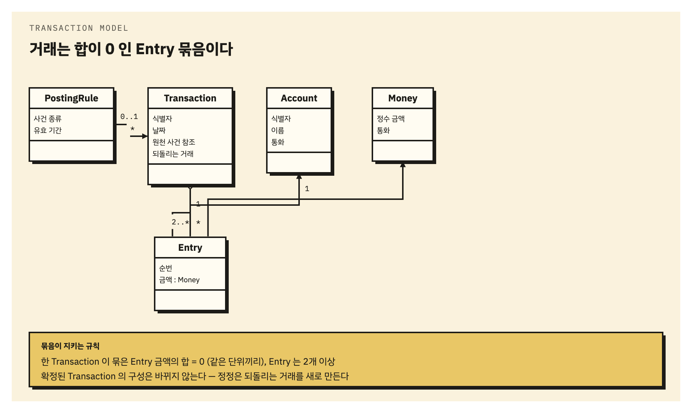

# Transaction — 함께 적어야 할 기록을 한 묶음으로 만들고, 만드는 자리에서 합을 0 으로 맞추기

## 한눈에 보는 개요

작은 회사의 원장 프로그램이 계정마다 금액을 따로 적는다고 해 봅시다. 4월 10일에 급여를 줬어요. 급여 총액은 500,000원이고 그 가운데 50,000원은 세금으로 떼어 회사가 들고 있다가 나중에 냅니다. 실제로 나간 현금은 450,000원이고요. 그러니 남아야 할 기록은 셋이에요 — 급여(비용) +500,000, 예수금(부채) −50,000, 현금(자산) −450,000. 그런데 현금을 줄이는 코드와 세금을 잡아 두는 코드가 서로 다른 메서드에 있고, 이번 달 처리에서 세금 쪽이 호출되지 않았습니다.

```text
Before — 계정마다 따로 적는 모델

  4/10 급여 지급 처리
    record("급여",   +500,000)   → 기록됨
    record("현금",   -450,000)   → 기록됨
    record("예수금",  -50,000)   → 호출되지 않음

  원장에 남는 것: 급여 +500,000 · 현금 -450,000        두 줄의 합 = +50,000
  "50,000 은 어디로 갔나요?"  → 물어볼 묶음이 없음. 두 줄은 서로 남남이다
```

두 줄만 보면 아무 문제가 없어 보여요. 급여도 현금도 각자 맞는 금액이 적혀 있으니까요. 틀어진 것은 줄 하나가 아니라 줄들 사이의 관계인데, 그 관계를 담아 둔 자리가 모델에 없습니다.

Transaction 패턴이 두는 한 수는 **함께 적어야 할 기록을 묶음 하나로 만들고, 그 묶음을 만드는 자리에서 합이 0 인지 보는 것**이에요. 묶음 안의 기록 하나하나를 Entry(계정 하나에 금액 하나가 오간 기록 한 건)라고 부르고, 묶음 전체를 Transaction 이라고 부릅니다. 한 줄이 빠지면 합이 0 이 아니게 되니 묶음이 아예 만들어지지 않아요.

```text
After — 셋을 한 묶음으로 만들고, 만드는 자리에서 합을 본다

  T2 = { 급여 +500,000 · 예수금 -50,000 · 현금 -450,000 }
       만드는 자리에서 통화별 합을 검사 → KRW 합 0 이라 통과

  예수금 줄이 빠지면  KRW 합 = +50,000
       → 거절: "KRW 합이 0 이 아닙니다: 50000"   (묶음 객체 자체가 생기지 않음)
```

> 기억법 — 짝은 나중에 맞추는 것이 아니라, 묶음을 만드는 그 자리에서 맞춥니다.

분류는 Fowler 『Analysis Patterns』 의 회계 패턴이고(근거: Analysis Patterns 6장 「Inventory and Accounting」 §6.2 Transactions), 함께 쓰는 패턴은 [Account](../account/account-guide_v1.1.0.md)(Entry 를 모으는 기준이 되고 그 합인 잔액에 답하는 개념) · [Quantity](../quantity/quantity-guide_v1.1.0.md)(단위를 가진 금액) · Posting Rule(업무 사건에서 거래를 만드는 규칙)입니다. 이 글의 예제는 복식부기 원장을 배경으로 삼아요. 차변과 대변의 부호 규약 · 원장과 전기 · 역분개 같은 회계 기초는 [참고 문서 「복식부기와 회계 모델」](../../reference/accounting-model/accounting-model-ref_v1.0.1.md)이 풀어 두었으니, 이 글은 그 위에서 4월 거래의 값으로만 말합니다. 시나리오 셋을 따라갈 거예요. 급여 사건 하나가 다리 셋짜리 거래가 되어 원장에 들어가는 길, 금액이 틀렸을 때 기록을 고치지 않고 되돌리는 길, 그리고 규칙을 어기면 어느 단계에서 어떤 값이 어긋나는지요. 끝까지 읽으면 어떤 모델을 Transaction 패턴이라고 불러도 되는지 필수 조건 다섯으로 판정할 수 있고, Entry 를 누가 소유할지 네 갈래 가운데 하나를 고르는 기준도 함께 얻습니다.

## 패턴 자세히 들여다보기

### 시나리오 1 — 급여 사건 하나가 다리 셋짜리 거래가 되어 원장에 들어가기까지

원장에는 계정이 여섯 있습니다. 현금(1010, 자산, KRW) · 외화예금(1020, 자산, USD) · 예수금(2010, 부채, KRW) · 가수금(2990, 부채, KRW) · 매출(4010, 수익, KRW) · 급여(5020, 비용, KRW)요. 4월 1일에 매출 100,000원이 현금으로 들어온 거래 T1 이 이미 전기돼 있고, 지금 4월 10일 급여 사건이 들어왔습니다. 급여 총액 500,000원, 원천징수 50,000원, 실제 지급 현금 450,000원이에요. 나와야 하는 것은 묶음 하나입니다 — 다리 셋을 담고 KRW 합이 0 인 거래 T2. 이 장면에 여섯 이름이 나와요. 함께 적어야 할 기록을 묶는 그릇인 Transaction, 그 묶음 안 기록 한 건인 Entry, 기록이 쌓이는 이름표인 Account, 금액과 통화를 묶은 값인 Money, 다른 시스템에서 일어나 이 원장으로 넘어온 사실인 원천 사건, 그리고 그 사건을 계정별 금액으로 바꾸는 규칙인 Posting Rule 이요. 이름은 여기서 한 구절씩만 소개하고 정식 정의는 개념 정리가 맡습니다. 여기에 이름 둘이 더 나옵니다. 4단계의 **전기 서비스**(만들어진 거래를 계정들과 맞춰 보고 원장에 넣는 일을 맡는 자리)와 5단계의 **저장소**(전기된 거래를 쌓아 두고 같은 것이 두 번 들어오지 않게 지키는 자리)인데, 그 둘은 모델이 그리는 개념이 아니라 모델을 움직이는 자리예요. 도메인 개념이 아니라서 개념 정리에 두지 않고, 코드에서 어느 타입이 그 자리를 맡는지는 「상황 설정」이 정합니다.

```text
4/10 급여 사건 (원천 사건 PAY-0410) 이 규칙 PR-PAYROLL 을 거쳐 나온 금액 목록

   급여   +500,000 KRW     비용이 늘면 +
   예수금  -50,000 KRW     부채가 늘면 -
   현금   -450,000 KRW     자산이 줄면 -
   ─────────────────────
   합        0 KRW
```

1. 원천 사건이 도착하고, 그 사건에 맞는 Posting Rule 이 계정별 금액 목록을 냅니다. 이 원장이 받는 것은 사건 종류와 시점, 금액, 그리고 사건의 식별자 `PAY-0410` 뿐이에요. 규칙이 목록만 내고 묶음을 만들지 않는 이유는 합이 0 인지 판정하는 책임을 한 곳에 모으기 위해서입니다. 규칙은 여러 종류가 있고 새로 늘어나는데, 판정을 규칙마다 두면 새 규칙 하나가 잘못 만들어질 때마다 불균형 거래가 들어올 구멍이 하나씩 생겨요. 다리가 둘뿐인 사건이라면 목록을 거치지 않고 거래가 출금 계정과 입금 계정을 직접 들어도 되지만, 이번 사건은 계정이 셋이라 그 형태로는 담기지 않습니다.
2. 그 목록을 묶음 하나로 만들면서, 기록이 2개 이상인지와 통화별 합이 0 인지를 그 자리에서 검사합니다. 급여 +500,000 과 예수금 −50,000 과 현금 −450,000 을 KRW 끼리 더하면 0 이라 통과해요. 이 판정을 묶음이 맡는 이유는 합 0 이 기록 하나만 보고는 알 수 없는 규칙이기 때문입니다. 급여 +500,000 만 들고 있는 기록은 자기가 짝이 맞는지 답할 수 없고, 급여 계정도 상대편 다리가 예수금인지 현금인지 볼 수 없어요. 여러 다리를 동시에 보는 자리는 그것들을 묶는 그릇뿐입니다. 검사를 통과하지 못하면 거래 객체 자체가 만들어지지 않아요(시나리오 3 의 2단계).
3. 묶음 안의 기록마다 순번이 붙고, 그 금액이 어느 Account 에 기록될지가 정해집니다. #1 은 급여, #2 는 예수금, #3 은 현금이에요. 순번이 필요한 이유는 금액과 계정이 같은 기록 둘도 서로 다른 사실이기 때문입니다. 같은 날 같은 계정에 같은 금액이 두 번 기록되면 그것은 사건 둘이고, 나중에 한쪽만 지목해야 할 때 가를 방법이 있어야 해요. 그리고 기록마다 계정이 정해져야 하는 이유는 합이 0 이라는 사실만으로는 가치가 어디서 어디로 갔는지 알 수 없어서입니다.
4. 전기 서비스가 다리마다 그 계정이 기록을 받을 수 있는지 확인한 뒤 저장합니다. 계정이 열려 있는지와 계정 통화가 맞는지를 보는데, 이 확인을 Account 가 맡는 이유는 열림·닫힘과 계정 통화가 Account 만 아는 사실이어서예요. 순서를 저장 뒤로 미루면 닫힌 계정에 다리가 남고, 그것을 되돌릴 역분개마저 같은 확인에서 거절돼 지울 길이 사라집니다(시나리오 3 의 5단계).
5. 저장은 전기 키로 한 번만 일어납니다. 키는 원천 사건과 규칙의 쌍이고, 이번에는 `PAY-0410 + PR-PAYROLL` 이에요. 이 검사를 거래 안이 아니라 저장소에 두는 이유는 거래 하나가 저장소 전체를 볼 수 없기 때문입니다. "내가 두 번째인가"는 나 말고 다른 인스턴스가 이미 있는지를 묻는 질문이라, 자기 안의 값만 보는 객체로는 답할 수 없어요. 사건 하나가 규칙 여럿을 부를 수 있어서 키에 규칙까지 넣습니다.

```text
단계   누가 → 누구에게                넘기는 것                          지켜지는 규칙
 1     원천 사건 → Posting Rule       사건 종류 · 시점 · 금액 · PAY-0410   -
 2     Posting Rule → Transaction     계정별 금액 3건                     기록 2개 이상 · 통화별 합 = 0
 3     Transaction → Entry            금액 하나 + 계정 하나                묶음 안에서 순번이 식별자
 4     전기 서비스 → Account          다리마다 금액 하나                   계정 열림 · 통화 일치
 5     전기 서비스 → 저장소           통과한 거래 + 전기 키                같은 키로 두 번 저장하지 않음
```

잠깐, 확인 하나만 해 볼까요? 2단계에서 규칙이 예수금 다리를 빠뜨려 급여 +500,000 과 현금 −450,000 만 넘겼다면 무엇이 나올까요? KRW 합이 +50,000 이라 검사에서 걸리고, 거래 객체가 만들어지지 않습니다. 개요의 Before 에서 조용히 남았던 그 두 줄이 여기서는 아예 원장에 들어오지 못해요.

이 시나리오가 보여 준 것은 **묶는 자리가 곧 판정하는 자리**라는 것입니다. 규칙은 금액을 계산하기만 하고(1단계), 판정은 묶음을 만드는 곳에서 한 번에 일어나며(2단계), 계정이 아는 사실은 계정이 봅니다(4단계). 저장소가 맡는 것은 그 묶음이 이미 저장됐는지 하나뿐이에요(5단계). 여기서 나온 이름 여섯이 개념 정리로 모입니다.

### 시나리오 2 — 원천징수가 50,000 이 아니라 40,000 이었을 때

4월 12일에 T2 의 금액이 틀렸다는 것을 알게 됐습니다. 세금은 50,000원이 아니라 40,000원이었고, 그러니 실제로 나갔어야 할 현금은 460,000원이에요. 나와야 하는 답은 둘입니다. T2 는 한 글자도 바뀌지 않아야 하고, 예수금의 4/12 기준 기록 합은 −40,000 KRW 여야 해요. 이 시나리오에서 새로 나오는 이름은 역분개 하나뿐이고, 원 거래의 다리 부호를 모두 뒤집은 거래를 뜻합니다.

1. 원장에서 T2 를 식별자로 찾아 읽습니다. 고치려고 찾는 것이 아니라 어떤 다리로 이루어졌는지 보려고 찾는 거예요. 원 거래 전체가 필요한 이유는 역분개가 다리 하나가 아니라 T2 의 다리 **전부**를 되풀이해야 해서입니다. 예수금 쪽만 되돌리면 급여 +500,000 과 현금 −450,000 이 그대로 남아 합이 0 이 아닌 묶음이 되고, 그러면 2단계의 검사를 통과하지 못해요.
2. T2 의 다리 셋을 모두 부호 반전한 T3 을 4/12 자로 만듭니다. #1 급여 −500,000, #2 예수금 +50,000, #3 현금 +450,000 이에요. 여기서 합 검사가 자동으로 통과하는 이유가 있습니다. 원 거래의 합이 0 이었으니 각 항에 −1 을 곱한 합도 0 이거든요. 0 의 부호를 뒤집어도 0 입니다. 그래서 **전부** 뒤집으면 언제나 통과하고, 일부만 뒤집으면 언제나 걸려요 — 이것이 1단계에서 다리 전부가 필요했던 이유를 셈으로 다시 말해 줍니다.
3. T3 이 되돌리는 거래로 T2 를 가리킵니다. 되돌림 표시를 T2 쪽이 아니라 T3 쪽에 두는 이유는 T2 가 이미 확정된 기록이기 때문이에요. T2 에 "정정됨" 표시를 적는 순간 확정된 거래를 고치는 일이 되고, 4/10 에 보고서로 나간 T2 와 저장된 T2 가 달라집니다. 어떤 거래가 정정됐는지는 표시를 읽는 대신 그것을 가리키는 역분개가 있는지로 답해요.
4. 올바른 금액의 T4 를 4/12 자로 전기합니다. 급여 +500,000, 예수금 −40,000, 현금 −460,000 이에요. T3 과 T4 도 시나리오 1 의 2·4단계를 똑같이 지납니다. 정정 거래라고 검사를 건너뛰지 않는 이유는 역분개도 거래이기 때문이에요. 건너뛰면 잘못된 정정이 원장에 그대로 들어가 원본보다 고치기 어려워집니다. T3 과 T4 의 전기 키는 각각 `PAY-0410 + PR-PAYROLL-REV` 와 `PAY-0410 + PR-PAYROLL-FIX` 라서, 원천 사건은 같아도 규칙이 달라 5단계의 중복 검사에 걸리지 않아요.
5. 예수금의 기록 합을 다시 셉니다. −50,000(T2 #2) + 50,000(T3 #2) − 40,000(T4 #2) = −40,000 KRW 예요. 이 셈을 마지막에 두는 이유는 정정의 결과를 **더해서** 확인할 수 있다는 것이 이 방식의 값어치라서입니다. 고친 자리를 찾아다니는 대신 더해진 자리를 세면 되니, 4/10 에 낸 보고서를 다시 들춰 볼 일이 없어요.

| 무엇 | 정정 전 | 정정 후 |
| --- | --- | --- |
| T2 의 다리 셋 | 급여 +500,000 · 예수금 −50,000 · 현금 −450,000 | 그대로 |
| 원장의 거래 수 | T1 · T2 | T1 · T2 · T3 · T4 |
| 예수금 4/12 기준 기록 합 | −50,000 KRW | −40,000 KRW |
| T2 를 가리키는 거래 | 없음 | T3 |

여기서 헷갈리기 쉬운 포인트는 정정이 두 거래가 아니라 한 거래로 끝날 것 같다는 점입니다. 차액 10,000원만 움직이는 거래 하나(예수금 −10,000 · 현금 +10,000)를 쓰면 4/12 기준 합은 똑같이 나와요. 대신 T2 와의 대응이 사라집니다. 차액 거래만 보고는 원래 세금이 50,000 이었는지 60,000 이었는지 알 수 없고, T2 를 통째로 무르는 것과 일부만 무르는 것도 구분되지 않아요. 이 가이드가 역분개 한 가지만 쓰는 이유가 그것이고, 선택지 셋을 견준 판단은 [회계 배경 확정안](../../research/accounting-context.md) 7절에 있습니다.

이 시나리오가 보여 준 것은 변화가 들어올 때 무엇이 움직이지 않는가입니다. 새 사실은 언제나 새 묶음으로 들어오고(2·4단계), 지난 묶음은 손대지 않으며(1·3단계), 정정 여부조차 원 거래에 적지 않고 가리키는 쪽에서 파생합니다(3단계). 묶음 안의 합이 0 이라는 규칙 하나가 이 성질을 떠받쳐요 — 0 인 것을 통째로 뒤집으면 다시 0 이니, 되돌리기가 언제나 같은 검사를 통과하는 안전한 연산이 됩니다.

### 시나리오 3 — 규칙을 어기면 어느 단계에서 어떤 값이 어긋나는가

같은 원장에 규칙을 어기는 일이 여섯 들어옵니다. 아래 값은 모두 Java 21 로 실제 컴파일해 실행하거나, 코드를 그렇게 고쳐 실행해 확인한 것이에요. 고친 경우에는 무엇을 어떻게 고쳤는지 함께 적었습니다.

1. 다리 하나짜리 거래를 만들려 합니다. 급여 +500,000 하나만 담은 T5 예요. 만들려는 순간 `Entry 는 2개 이상이어야 합니다` 로 거절되고 객체가 생기지 않습니다. 하나짜리를 막는 이유는 그것이 묶음이 아니라 기록 하나이기 때문이에요. 통과시키면 예수금 −50,000 이 어느 지급에 딸린 것인지 물을 자리가 사라지고, 개요의 Before 와 같은 모델로 돌아갑니다.
2. 합이 0 이 아닌 거래를 만들려 합니다. T6 은 급여 +500,000 과 현금 −450,000 뿐이라 KRW 합이 +50,000 이에요. `KRW 합이 0 이 아닙니다: 50000` 으로 거절되고 역시 객체가 생기지 않습니다. 만드는 자리에서 막는 이유는 한 번이라도 불균형 묶음이 만들어지면 저장 경로마다 같은 검사를 되풀이해야 하기 때문이에요. 한 경로만 빠뜨려도 합이 +50,000 인 거래가 원장에 남고, 그때는 급여와 현금만 적혀 50,000원이 어디로 갔는지 답할 기록이 없습니다.
3. 통화가 다른 다리를 섞으려 합니다. T7 은 현금 −100 KRW 와 외화예금 +100 USD 예요. 숫자만 더하면 −100 + 100 = 0 이라 통과해야 할 것 같지만, 통화별로 갈라서 더하면 KRW 는 −100 이고 USD 는 +100 이라 둘 다 0 이 아닙니다. 사전 순으로 먼저 오는 통화가 먼저 걸려 `KRW 합이 0 이 아닙니다: -100` 이 나와요. 단위를 무시하고 더하면 안 되는 이유는 100원과 100달러가 서로 상쇄되는 값이 아니기 때문입니다. 통과시키면 원장은 균형이 맞았다고 답하는데 어느 통화로도 맞지 않아요.
4. 확정된 거래에 다리를 하나 더하려 합니다. 이 코드에는 그 경로가 없어서 시도 자체가 컴파일되지 않아요. 경로를 열고 돌려 보려면 **네 곳**을 고쳐야 합니다. 앞의 둘은 경로만 여는 편집이에요 — 묶음을 만드는 마지막 줄에서 수정 불가 목록을 만들던 것을 보통 목록으로 바꾸고(그대로 두면 목록이 수정 불가라 더할 수 없어요), 통화별 합을 내는 메서드 아래에 다리를 더하는 메서드 한 줄을 넣습니다. **여기까지만 고치면 출력 12줄이 기준선과 글자까지 같아요** — 경로만 열렸고 아무도 그 경로를 부르지 않으니까요. 값을 보려면 뒤의 둘이 더 필요합니다. 전기가 끝난 뒤 그 메서드로 현금 −5,000 을 더하는 호출 한 줄, 그리고 바뀐 값을 찍는 출력 세 줄(T2 의 다리 목록 · T2 의 통화별 합 · 현금의 4/12 기준 기록 합)이에요. 현금 합은 기준선이 아예 찍지 않고, 다리 목록과 통화별 합은 더하기 **전에** 찍혀서 그대로 두면 옛 값만 보입니다. 넣은 줄 수만큼 그 아래 줄 번호가 밀리니 다른 자리를 짚을 때 주의하세요. 그렇게 돌리면 T2 의 통화별 합이 `KRW -5000` 이 되고, 다리는 `#1 급여 500000 KRW / #2 예수금 -50000 KRW / #3 현금 -450000 KRW / #4 현금 -5000 KRW` 넷이 됐습니다. 현금의 4/12 기준 기록 합도 −360,000 에서 −365,000 으로 바뀌었어요. 깨진 것은 2단계의 검사가 아니라 그 검사의 **유효 기간**입니다. 검사는 분명히 통과했는데, 통과한 뒤에 검사 대상이 달라졌으니까요.
5. 닫힌 계정으로 전기하려 합니다. 가수금을 닫은 뒤 현금 +50,000 과 가수금 −50,000 을 담은 T8 을 전기하면, 묶음 자체는 KRW 합이 0 이라 만들어지지만 저장 직전에 `가수금 계정은 닫혀 있습니다` 로 거절되고 원장에는 아무것도 남지 않아요. 검사가 저장 앞에 있기 때문입니다. 이 검사를 저장 뒤로 옮기면 T8 이 이미 저장된 뒤라, 지우려고 역분개를 만들어도 그 거래가 같은 닫힌 계정을 가리켜 또 거절돼요. 순서 하나로 지울 방법이 없는 기록이 남습니다.
6. 같은 원천 사건을 같은 규칙으로 두 번 전기하려 합니다. 재시도가 `PAY-0410 + PR-PAYROLL` 로 새 거래 T9 를 들고 와도, 저장소가 그 키를 이미 가지고 있어 이미 전기된 T2 를 돌려주고 거래 수는 4 그대로예요. 검사를 없애면 어떻게 되는지는 전기하는 곳에서 같은 키를 찾아 돌려주던 앞 두 줄을 지우고 돌려 확인했습니다. 두 줄을 지우면 그 아래 줄 번호가 둘씩 당겨져요. 그것만 지우면 열한째 출력 줄이 `같은 원천 사건 재전기: 이미 전기된 거래 T9 를 돌려줌 (전기된 거래 수: 5)` 로 바뀝니다. 돌려주는 거래가 T2 에서 T9 로, 거래 수가 4 에서 5 로 함께 움직여서 거래가 하나 늘어난 것까지는 그 자리에서 보여요. 다만 계정별로 얼마가 틀어졌는지는 안 보입니다 — 기준선이 찍는 계정 합은 예수금 하나뿐이고, 그나마 재시도보다 **앞**에서 찍히니까요. 그래서 재시도 뒤에 급여·예수금·현금의 4/12 기준 기록 합을 찍는 출력 세 줄을 더 넣어 확인했습니다. 그렇게 돌리니 T9 가 저장돼 거래 수가 5 가 되고, 4/12 기준 기록 합이 급여 1,000,000 KRW(기준 500,000) · 예수금 −90,000 KRW(기준 −40,000) · 현금 −810,000 KRW(기준 −360,000)로 바뀌었습니다. 눈여겨볼 것은 T9 자체는 합이 0 인 멀쩡한 거래라는 점이에요. 거래 하나하나는 다 옳은데 원장 전체가 틀립니다.

```text
어긴 규칙                     막히는 자리            막히지 않으면 어긋나는 값
기록 2개 이상                 만드는 자리            묶음 없는 기록 한 건. 짝을 물을 자리가 없음
통화별 합 = 0                 만드는 자리            원장에 합 +50,000 인 거래
같은 단위끼리만 더함          만드는 자리            KRW -100 과 USD +100 이 "합 0" 으로 통과
확정된 묶음의 구성 불변       경로 없음              T2 합 KRW -5000 · 현금 4/12 -360,000 → -365,000
계정 열림 확인 → 저장         저장 앞                지울 방법이 없는 기록이 닫힌 계정에 남음
전기 키로 한 번만 저장        저장 시점              거래 수 5 · 급여 1,000,000 · 현금 -810,000
```

이 시나리오가 보여 준 것은 규칙마다 지켜지는 자리가 다르고, 자리를 옮기면 지켜지지 않는다는 것입니다. 앞의 셋은 묶음을 만드는 한 자리에서 막히고, 계정 열림은 저장 바로 앞에서 막히며, 중복 전기는 저장소만 막을 수 있어요. 그리고 4단계와 6단계를 나란히 놓으면 결이 다른 두 가지 실패가 보입니다. 4단계는 한 거래 안이 틀어진 것이라 그 거래를 보면 드러나지만, 6단계는 거래마다 다 옳은데 모아 놓은 결과가 틀린 것이라 거래를 아무리 들여다봐도 보이지 않아요.

### 개념 정리

시나리오에 나온 분석 층위의 개념 다섯을 정식으로 정의합니다. 이 절이 정하는 것은 개념이 무엇을 책임지고 누구와 협력하는가까지예요. 그 책임을 코드의 어느 객체가 지는지, 무엇이 aggregate 의 root 인지는 뒤의 「상황 설정」 표가 정합니다. 시나리오 1 의 4·5단계에 나온 전기 서비스와 저장소는 여기에 없어요. 모델이 그리는 도메인 개념이 아니라 그 모델을 움직이는 자리라서, 뜻은 그 단계에서 한 구절로 소개했고 코드의 어느 타입이 맡는지는 「상황 설정」이 적습니다.

- **Transaction**(거래) — 함께 적어야 할 금액 기록을 묶고, 그 묶음이 균형을 이루는지에 답하는 개념입니다.
  - 책임: 날짜를 갖고, 묶은 기록이 2개 이상인지와 그 금액의 합이 단위별로 0 인지 판정합니다. 판정을 통과한 뒤에는 묶음의 구성이 바뀌지 않아요(시나리오 1 의 2단계, 시나리오 3 의 4단계).
  - **원천 사건 참조** — 이 거래가 어떤 업무 사실에서 나왔는지를 가리키는 값이에요. 그 사실은 다른 시스템에서 일어났고 이 원장은 식별자만 받습니다. 같은 사건을 두 번 전기하지 않는 근거가 이 값이에요(시나리오 1 의 5단계).
  - **역분개** — 원 거래의 다리 부호를 모두 뒤집은 거래이고, 되돌리는 대상을 자기 쪽에서 가리킵니다. 0 을 뒤집어도 0 이라 균형 검사를 언제나 다시 통과해요(시나리오 2 의 2·3단계).
  - 협력: Entry 를 2개 이상 묶습니다. Posting Rule 이 만들어 주고, 역분개는 원 Transaction 을 가리켜요.
- **Entry**(거래의 다리) — 계정 하나에 금액 하나가 오간 사실 한 건입니다.
  - 책임: 어느 Account 에 얼마가 기록됐는지를 담습니다. 묶음 안에서는 순번이 식별자예요 — 금액과 계정이 모두 같은 두 건도 서로 다른 사실입니다(시나리오 1 의 3단계).
  - 협력: 정확히 한 Account 에 속하고, 복식부기에서는 한 Transaction 에도 묶입니다.
- **Account**(계정) — 금액 기록을 모으는 기준이 되고, 그 합인 잔액에 답하는 개념입니다.
  - 책임: 받을 금액의 통화를 하나 정하고, 열려 있는지 닫혀 있는지를 압니다(시나리오 1 의 4단계). 계정 자체의 규칙과 잔액의 정의는 [Account 가이드](../account/account-guide_v1.1.0.md)가 맡고, 이 글은 다리가 어디로 가는지를 설명하는 만큼만 다뤄요.
  - 협력: Entry 가 Account 에 속합니다(Account 하나에 Entry 여럿).
- **Money**(금액) — 금액과 단위를 묶은 값입니다. 이 가이드의 예제는 단위가 통화이고 금액을 정수 최소 단위로 적어요(KRW 는 1원).
  - 책임: 단위가 다른 금액끼리는 더하지 않습니다(시나리오 3 의 3단계). 단위가 통화가 아니어도 규칙은 같아요 — 재고 이동 거래라면 단위가 품목이고, 같은 품목끼리만 더해 0 을 봅니다.
  - 협력: Entry 의 금액이 Money 예요. 금액을 단위를 가진 수량의 한 종류로 보는 관점은 [Quantity 가이드](../quantity/quantity-guide_v1.1.0.md)가 풉니다.
- **Posting Rule**(전기 규칙) — 업무 사건 한 종류를 계정별 금액 목록으로 바꾸는 규칙입니다.
  - 책임: 어떤 사건 종류에 반응하는지와 언제 유효한지를 갖고, 금액을 계산합니다. 계산만 하고 균형을 판정하지는 않아요(시나리오 1 의 1단계).
  - 협력: 실행 결과가 Transaction 한 건이 됩니다. 규칙과 사실을 다른 층에 두는 이유는 [참고 문서 「복식부기와 회계 모델」](../../reference/accounting-model/accounting-model-ref_v1.0.1.md)이 풀어 두었어요.



그림에서 Entry 는 Transaction 과 Account 양쪽에 연관돼 있어요. 거래 쪽 연관에는 다중도 2 이상과 합 0 이라는 제약이 붙고, 계정 쪽 연관은 Entry 마다 Account 하나가 정해진다는 뜻입니다(근거: Analysis Patterns 그림 6.2 · 6.3). Posting Rule 이 거래를 만드는 쪽에 있다는 것도 같은 모델에 있어요(근거: Analysis Patterns 그림 6.27 의 Posting Rule `0..1` creator — `*` Transaction). 분석 모델은 연관만 정할 뿐 누가 Entry 를 소유하는지는 정하지 않습니다. 소유는 설계가 정하고, 그 선택지 넷은 「상황이 달라지면」에서 나란히 봐요.

## 사용 목적

Transaction 을 꺼낼 때는 코드나 요구서에서 보이는 단서가 있어요. 셋을 차례로 봅시다.

**단서 1. 함께 일어나야 할 기록이 서로 다른 자리에서 따로 만들어집니다.** 출금을 적는 코드와 입금을 적는 코드가 다른 메서드에 있고, 그 둘을 부르는 순서와 횟수를 호출자가 지키고 있는 상황이에요. 새 요구가 들어와 다리가 하나 늘면(원천징수, 수수료, 세금) 호출자가 한 줄을 더 부르면 되는데, 그 줄을 빠뜨려도 아무도 알려 주지 않습니다.

```text
호출자가 짝을 지키는 모델

  이체 처리       record(from, -amount) · record(to, +amount)          두 줄
  수수료 추가     record(from, -amount) · record(to, +amount) · record(fee, +f)   세 줄
  환불 처리       record(to, -amount) · record(from, +amount)          두 줄
  "한 줄을 빠뜨리면?"   → 각 줄은 다 옳고, 합만 틀림. 검사하는 코드가 없음
```

**단서 2. 요구서에 짝과 대사(對査)가 나옵니다.** "돈이 어디서 와서 어디로 갔는지 늘 맞아야 한다", "감사에서 전표 단위로 설명할 수 있어야 한다", "입금표 한 장에 수표 두 장이 붙는다" 같은 문장이요. 이런 문장은 규칙이 기록 하나가 아니라 기록들 사이에 걸려 있다는 신호입니다.

```text
요구서의 문장                    기록 하나만 보고 답할 수 있는가
──────────────────────────      ────────────────────────────────────
이 계정의 지금 잔액은            예
이 -450,000 은 어느 지급인가      아니오 — 같은 사건의 다른 다리가 필요
4/10 지급의 다리가 다 있는가      아니오 — 묶음 단위로 세어야 함
```

**단서 3. 사건 하나가 계정 셋 이상을 건드리기 시작합니다.** 처음에는 두 계정만 오가던 처리에 세금·수수료·할인이 붙어 계정이 늘어나는 경우예요. 두 계정짜리는 출금 계정과 입금 계정을 한 행에 적어도 되지만, 셋부터는 행 하나에 담기지 않아 묶음이 필요해집니다.

반대로 아래 두 경우에는 쓰면 잃는 것이 더 큽니다.

| 쓰지 말아야 할 상황 | 쓰면 잃는 것 |
| --- | --- |
| 계정이라는 개념이 없고 합을 묻지 않음 (활동 로그, 알림 발송 이력) | 기록마다 짝이 되는 반대 기록을 지어내야 하고, 그렇게 해서 새로 답할 수 있는 질문이 없음 |
| 기록을 전부 시스템이 만들고 원천을 로그로 추적하면 충분함 | 단건을 남기는 경로가 사라져 모든 기록이 묶음을 거쳐야 함. 누수를 찾는 이득은 사람이 손으로 넣는 기록이 있을 때 생기는데 그 기록이 없음 |

둘째 줄이 특히 헷갈리는 자리예요. 복식부기가 있는 이유는 돈이 새는 곳을 찾고 막는 것이라, 사람이 개입하지 않는 기록에는 그 이득이 거의 없습니다. 비슷한 단서에서 다른 모델을 고르게 되는 자리도 둘 있어요. 규칙이 한 계정의 합에만 걸리면 Account 만 두면 되고, 원자성만 필요하고 균형 개념이 없으면 저장 계층의 트랜잭션으로 충분합니다. 차이는 다음 절에서 풀어요.

## 패턴의 경계

### 디자인 패턴을 충족하는 최소 조건

어떤 모델을 Transaction 패턴이라고 불러도 되는지 가르는 기준입니다. 클래스 모양이 아니라 개념이 맡는 책임과 모델이 늘 지키는 불변식으로 판정해요 — Entry 를 누가 소유하든, 다리가 별도 개념으로 서 있든 아니든 같은 기준으로 판정할 수 있어야 하니까요. `[필수]` 에는 원전이 Transaction 의 성립 요건으로 든 것만 올렸고, 원전이 흔한 규칙이나 구현 선택지로 적은 것과 이 가이드 예제의 정책은 번호 순서와 무관하게 `[선택]` 입니다. 조건마다 그것을 보여 준 시나리오의 단계를 함께 적었어요.

1. [필수] 함께 확정돼야 하는 금액 기록 2개 이상이 묶음 하나에 속합니다 — 시나리오 1 의 2단계가 다리 셋을 한 묶음으로 만든 자리입니다 (근거: eaaDev Accounting Transaction 이 이 패턴이 하는 일을 「Link two (or more) entries together so that the total of all entries in a transaction is zero」로 적고, Analysis Patterns 그림 6.2 가 Transaction — Entry 다중도를 `2`, 그림 6.3 이 `2..*` 로 둔다).
   - 빠지면: 급여 다리 셋이 서로 남남인 기록 셋이 됩니다. 시나리오 3 의 1단계에서 `Entry 는 2개 이상이어야 합니다` 로 거절되는 것이 이 조건이고, 묶음이 없으면 예수금 −50,000 이 어느 지급에 딸린 것인지 물어볼 자리가 사라져요.
   - 위 근거 괄호가 받쳐 주는 것은 **금액 기록 2개 이상이 한 묶음으로 이어져 있다**까지입니다. 그 묶음이 업무 사건 하나에 대응해야 한다는 것도, 기록을 어떻게 세는지도 괄호는 말하지 않아요. 하루치 전표를 한 묶음에 담아도 이 조건은 지켜지고, 대신 정정 단위가 묶음 전체로 거칠어지며 조건 10 의 전기 키에는 원천 사건 하나만 담기므로 그 키로는 묶이지 않습니다.
   - 세는 방법은 이 가이드가 정했습니다(조건 11 과 짝입니다) — **객체 수가 아니라 묶음이 덮는 계정 쪽 금액의 수**를 셉니다. 기록이 Entry 라는 별도 개념으로 서 있든, 묶음이 계정 쪽 금액 둘을 직접 책임지든 둘 다 2 로 세요. 원전은 기록을 별도 개념으로 세운 모양과 세우지 않은 모양을 함께 인정하는데, 앞쪽에서는 기록 객체를 세고 뒤쪽에는 셀 객체가 없습니다. 두 모양을 한 기준으로 세려면 무엇을 셀지 정해야 하고, 그 계수 규칙까지는 원전에 없어요.
2. [필수] 묶음 안 기록 금액의 합이 0 이고, 합이 0 이 아니면 그 묶음은 확정되지 않습니다 — 판정하는 자리는 묶음이에요. 기록 하나도, 그 기록이 가리키는 계정도 상대편 다리를 볼 수 없어서 판정할 수 없습니다. 다리가 늘 둘이라 구조가 합 0 을 보장하는 모델이면 그 보장이 판정 자리를 대신해요. 시나리오 1 의 2단계가 이 판정을 하는 자리예요 (근거: eaaDev Accounting Transaction 의 「the total of all entries in a transaction is zero」와 예제 코드의 `canPost()` 가 `balance().isZero()` 로 정의돼 거짓이면 게시가 예외로 거절되는 구조, Analysis Patterns 그림 6.2 · 6.3 의 제약 `Sum(entries.amount) = 0`).
   - 빠지면: 다리마다 따로 적는 단식 장부가 됩니다. 시나리오 3 의 2단계에서 급여 +500,000 과 현금 −450,000 만 든 T6 이 `KRW 합이 0 이 아닙니다: 50000` 으로 거절되는데, 이 조건이 없으면 그 거래가 원장에 남아 50,000원이 어디로 갔는지 답할 기록이 없어요.
   - 위 근거 괄호가 받쳐 주는 것은 **확정 시점에 합이 0 이 아니면 확정이 거절된다**까지입니다. 검사를 언제 하느냐 — 조립 중에도 못 만들게 하는가, 확정 직전에 막는가 — 는 원전과 이 가이드가 갈리는 자리라 조건 7 로 내렸어요. 구조가 보장하는 모델까지 읽은 것은 원전이 두 다리 거래를 늘 부호만 반대인 두 기록으로 적고 검증 장치가 필요한 쪽을 여러 다리 거래로 가른 데서 왔는데, 그 대목은 조건 11 의 괄호에 있습니다.
3. [필수] 서로 더해 0 을 만드는 금액은 단위가 같습니다 — 금액은 단위를 가진 값이고, 단위가 다른 금액은 서로 상쇄되지 않습니다. 시나리오 3 의 3단계가 이 조건이 없을 때 무엇이 통과하는지 보인 자리예요 (근거: Analysis Patterns 그림 6.2 · 6.3 에서 합의 대상인 `amount` 가 Quantity, 즉 단위를 가진 값이고, 그림 6.30 의 재고 이동 거래가 제약 「all entry.item types are the same」로 같은 요구를 한 거래 종류에 대해 명시한다).
   - 빠지면: 현금 −100 KRW 와 외화예금 +100 USD 가 "합 0" 으로 통과합니다. 숫자만 더하면 0 이지만 어느 통화로도 균형이 아니에요.
   - 위 근거 괄호가 **명시로** 받쳐 주는 것은 **재고 이동 거래라는 한 종류에 대해 단위가 같아야 한다**까지입니다. 일반 거래로 넓힌 것은 같은 근거가 합의 대상인 `amount` 를 단위를 가진 값으로 둔 데서 한 걸음 유도한 것이고, 그 값끼리 단위가 다르면 더할 수 없다는 성질은 금액 개념 쪽에 있어요. 단위가 여럿 섞인 거래를 통화별로 갈라 각각 0 인지 보는 방식은 이 가이드 예제의 정책이라 조건 8 에 뒀고, 환산해서 한 번에 보는 방식도 실제로 쓰입니다.
4. [필수] 묶음 안의 기록마다 그 금액이 기록될 Account 하나가 정해집니다 — 가리키는 방식이 목록이든 식별자든 상관없고, 정해진다는 것만이 조건이에요. 시나리오 1 의 3단계가 그 자리입니다 (근거: Analysis Patterns 그림 6.2 · 6.3 의 Account 하나 — Entry 여럿 연관과 그림 6.30 이 재고 거래의 제약으로 둔 「self.item type == self.account.item」이 Entry 마다 속한 계정이 있음을 전제하고, eaaDev Accounting Transaction 이 「it really only makes sense to use Accounting Transaction if you're using Account」라고 적는다).
   - 빠지면: 합이 0 인 숫자 묶음이 되지만 가치가 어디서 어디로 갔는지는 답하지 못합니다. 측정값 보정 기록 {+3, −3} 처럼 계정이 없는 묶음도 조건 1·2·3·5 를 전부 만족해요 — 그 묶음을 걸러 내는 것이 이 조건입니다. 다만 이 조건이 요구하는 것은 **계정이 하나로 정해진다**까지이고, 계정끼리 서로 달라야 한다고는 하지 않아요. 현금 +100 과 현금 −100 으로 된 묶음도 필수 다섯을 모두 지나지만 움직인 가치는 없습니다.
   - 위 근거 괄호가 받쳐 주는 것은 **기록마다 속한 Account 가 하나로 정해진다**까지입니다. 그 Account 가 실제로 있고 열려 있는지 확인하는 일은 Account 쪽 규칙이라 조건 9 로 내렸어요.
5. [필수] 확정된 묶음의 구성은 바뀌지 않습니다 — 확정한 뒤에 기록을 더하거나 빼지 않아요. 시나리오 3 의 4단계가 이 조건을 어겼을 때의 값을 보인 자리입니다 (근거: eaaDev Accounting Transaction 의 예제 코드가 이미 게시된 거래에 기록을 더하려 하면 「cannot add entry to a transaction that's already posted」라는 뜻의 전용 예외를 던진다).
   - 빠지면: 조건 2 가 확정하는 순간에만 참인 규칙이 됩니다. 전기가 끝난 T2 에 현금 −5,000 을 더하면 이미 검사를 지난 묶음의 통화별 합이 `KRW -5000` 이 되고, 현금의 4/12 기준 기록 합이 −360,000 에서 −365,000 으로 바뀌어요.
   - 위 근거 괄호가 받쳐 주는 것은 **확정 뒤 기록을 더할 수 없다**까지입니다. 빼는 쪽은 원전 코드에 제거 경로 자체가 없어 명시된 문장이 없고, 더할 수 없으면 뺄 수도 없게 두는 것이 이 가이드의 읽기예요. 확정된 기록의 **값**까지 고치지 않는다는 규칙은 원전이 상황에 따라 고르는 것으로 적은 쪽이라 조건 6 에 뒀습니다.
6. [선택] 확정된 기록의 값도 고치지 않고, 정정은 원 거래를 가리키는 역분개로 합니다 — 시나리오 2 의 1~3단계가 원 거래를 읽기만 하고 되돌리는 거래를 새로 만든 자리예요 (근거: 이 가이드의 정책 — [회계 배경 확정안](../../research/accounting-context.md)의 불변식 I2. eaaDev 는 정정 방식 셋을 나란히 두고 되돌리기를 「a simple alternative when entries are immutable and thus you can't use Replacement Adjustment」라고 적어, 기록이 불변인지 아닌지를 상황에 따라 고르는 것으로 둔다).
7. [선택] 불균형 묶음은 확정 직전이 아니라 만들어지는 자리에서 막습니다 — 조립 중간 상태를 저장할 수 있는 객체로 두지 않고, 묶음을 만드는 유일한 자리가 검사해요. 시나리오 1 의 2단계가 그 자리입니다 (근거: 이 가이드의 정책 — 확정안 3절이 불변식 I1 의 위치를 거래 팩토리로 정한다. 원전은 조립해 둔 거래를 게시할 때 검사하는 쪽이라, 이 가이드가 검사를 한 발 앞당긴 것이다).
8. [선택] 단위가 여럿 섞이면 단위별로 갈라 각각 0 인지 봅니다 — 시나리오 3 의 3단계가 그 결과를 보인 자리예요 (근거: 이 가이드의 정책 — 예제가 통화별 합을 따로 낸다. 환산한 뒤 한 번에 보는 방식도 실제 원장에서 쓰인다).
9. [선택] 확정 전에 기록이 가리키는 Account 가 있고 열려 있는지 확인합니다 — 시나리오 1 의 4단계에서 확인하고 시나리오 3 의 5단계에서 거절되는 자리예요 (근거: 이 가이드의 정책 — 확정안의 불변식 I5. 계정 쪽 규칙이라 [Account 가이드](../account/account-guide_v1.1.0.md)가 맡는다).
10. [선택] 같은 원천 사건을 같은 규칙으로 두 번 확정하지 않습니다 — 거래가 원천 사건과 규칙을 가리키고 그 쌍이 전기 키예요. 시나리오 1 의 5단계가 그 키를 만드는 자리이고 시나리오 3 의 6단계가 없앴을 때의 값입니다 (근거: 이 가이드의 정책 — 확정안의 불변식 I3. 원전은 규칙이 거래를 만든다는 연관까지만 적고 중복을 어떻게 막는지는 적지 않는다).
11. [선택] 다리가 늘 둘이고 서로 부호만 다르면, 기록을 별도 개념으로 세우지 않고 묶음이 계정 쪽 금액 둘을 직접 책임집니다 — 어느 계정에서 나가 어느 계정으로 들어갔는지를 묶음 자신이 답해요. 시나리오 1 의 1단계가 이 형태로는 담기지 않는 사건을 다룬 자리입니다 (근거: Analysis Patterns 그림 6.4 의 Entry 없는 변형과 eaaDev Accounting Transaction 이 두 기록이 늘 서로의 반대일 때 기록을 생략하고 데이터를 거래에 둘 수 있다고 적는 대목).

> 필수는 다섯이다 — 둘 이상이 한 묶음인가, 합이 0 인가, 단위가 같은가, 기록마다 계정이 있는가, 확정 뒤 구성이 그대로인가.

### 비슷한 패턴·안티패턴과의 차이

Transaction 과 닮아 보이거나 같은 단서에서 떠오르는 다섯을 구분 기준부터 모았어요. 기준은 전부 코드나 모델에서 확인할 수 있는 것으로 썼습니다.

| 대상 | 구분 기준 | Transaction 을 고르면 얻는 것 | 포기하는 것 |
| --- | --- | --- | --- |
| 다리 없는 이체 기록 한 행 (from · to · amount) — 이웃이 아니라 **같은 패턴의 다른 변형** | 한 행이 계정 둘만 들 수 있는가, 묶음이 계정 수만큼 기록을 담을 수 있는가 (소속이 아니라 변형을 고르는 기준) | 계정 셋 이상이 걸린 사건을 한 묶음으로 담고, 다리마다 다른 속성을 붙일 수 있음 | 행 하나로 끝나던 단순함. 다리가 늘 둘이면 기록 객체가 늘 두 배 |
| 단식 기록 (Account 만 두고 기록을 각자 남김) | 한 묶음의 합이 0 인지 검사하는 코드가 있는가 | 한쪽 다리가 빠진 것을 만드는 자리에서 잡아냄 | 기록 한 건을 바로 남기는 경로. 모든 기록이 묶음을 거쳐야 함 |
| 데이터베이스 트랜잭션 | 합이 0 인지 판정하는 코드가 도메인 개념 안에 있는가, 저장 계층의 경계 안에만 있는가 | 저장 방식과 무관하게 균형이 지켜지고, 거절 사유가 도메인 말로 나옴 | 저장 원자성까지 대신해 주지는 않음. 둘은 함께 씀 |
| 도메인 이벤트 | 그 객체가 계정별 금액을 2개 이상 들고 그 합이 0 인지 자기가 판정하는가 | 사건을 어떻게 해석했는지가 기록으로 남음 | 사건 자체의 서술. 같은 사실이 사건과 거래 두 모양으로 남음 |
| Posting Rule | 언제 유효한지를 드는가, 무슨 일이 실제 있었는지를 드는가 | 규칙이 틀려도 불균형 거래가 저장되지 않음 | 규칙과 결과가 두 개념으로 갈려 자리가 늘어남 |

표를 읽는 법을 하나 정해 둘게요. **여기의 구분 기준은 이웃과 가르는 데 쓰는 것이라 최소 조건을 대신하지 않습니다.** 두 자리에서 그 점이 드러나요. 첫 줄은 패턴이냐 아니냐를 가르는 줄이 아닙니다 — 다리 없는 형태도 원전이 거래의 한 갈래로 인정하고 이 글도 최소 조건 11 로 받았으니(실제 사례로 든 TigerBeetle 의 transfer 가 그 형태예요), 거기서 고르는 것은 같은 패턴의 두 변형 가운데 어느 쪽이냐입니다. 반대로 둘째 줄의 기준만 통과하고 최소 조건은 못 지키는 모델도 있어요. 합을 검사하기는 하는데 단위를 무시하거나(조건 3), 확정한 뒤에 다리를 더할 수 있는(조건 5) 모델이 그렇습니다. 그것은 이웃이 아니라 잘못 만든 거래이고 이 표로는 걸러지지 않아요. 시나리오 3 의 4단계가 그 가운데 확정 뒤에 다리를 더한 경우입니다. 반대 방향도 있어요. 합을 **검사하는 코드**가 없어도 구조가 0 을 보장하면 조건 2 는 지켜집니다. 실제 사례로 든 transfer 가 그 형태인데, 단식 기록과 가르는 기준은 검사 코드만 보니까 그런 모델을 단식 기록 쪽으로 밀어요. 소속은 어느 방향이든 최소 조건 다섯이 정하고(그 다섯도 가르지 못하는 자리는 아래 Posting Rule 문단에서 다룹니다), 이 표는 닮은 것들 가운데 무엇을 고를지를 돕습니다.

가장 헷갈리는 쌍은 셋째 줄입니다. 이름이 같아서예요. 아래 코드는 두 계정을 한 저장 경계 안에서 고치고 합도 검사하지만, 검사하는 자리가 서비스 메서드 안이라 묶음이라는 개념이 없습니다.

```java no-compile
// Transaction 패턴처럼 보이지만 묶음 개념이 없는 모델
@Transactional
public void transfer(String fromId, String toId, long amount, long fee) {
    long total = -amount + (amount - fee) + fee;       // 호출자가 직접 더해 본다
    if (total != 0) throw new IllegalStateException("불균형");
    accountDao.add(fromId, -amount);
    accountDao.add(toId, amount - fee);
    accountDao.add(FEE_ACCOUNT, fee);
}
```

같은 규칙을 지키는 메서드가 이것 하나라면 값은 맞게 나옵니다. 갈리는 곳은 다음 요구가 들어올 때예요. 환불 처리를 다른 메서드에 쓰는 사람은 이 `total` 계산을 다시 짜야 하고, 그 자리에서 다리 하나를 빠뜨려도 이 메서드는 아무것도 모릅니다. 시나리오 1 의 2단계에서 판정을 묶음에 둔 이유가 그것이에요 — 묶음을 만드는 길이 하나뿐이면 검사를 우회하는 길도 없습니다. 반대로 이 코드가 얻는 것은 객체를 하나도 만들지 않는다는 단순함이고, 포기하는 것은 "이 세 줄이 한 사건이다"라는 사실이 저장된 데이터 어디에도 남지 않는다는 점입니다. 사후에 그 셋을 다시 묶으려면 시각과 금액으로 추측해야 해요.

**단식 기록과의 차이.** 구분 기준은 한 묶음의 합이 0 인지 검사하는 코드가 있느냐입니다. [Account 가이드](../account/account-guide_v1.1.0.md)의 모델만 두면 현금에 −450,000 한 건이 들어와도 급여 +500,000 과 예수금 −50,000 이 빠진 것을 알아챌 코드가 없어요. 규칙이 걸리는 단위가 다릅니다 — 한 계정의 기록 합에 걸리면 Account 쪽이고, 한 묶음의 기록 합에 걸리면 Transaction 쪽이에요. 둘은 대체 관계가 아니라 함께 쓰는 관계이고, 잔액에 하한이 걸린 원장처럼 두 규칙이 동시에 있는 모델도 정상입니다.

```text
Account 만 둔 단식 기록     현금에 -450,000 한 건. 짝이 빠져도 알아챌 코드가 없음
Transaction 을 함께 둠      T2 = {급여 +500,000, 예수금 -50,000, 현금 -450,000}. 만드는 자리가 합 0 을 검사
확인할 곳                   여러 계정의 기록을 한 묶음으로 만들고 그 합을 검사하는 생성 코드가 있는가
```

**도메인 이벤트와의 차이.** 여기서 기준을 "원인을 적는가 결과를 적는가"로 잡으면 갈리지 않습니다. 계정별 금액 목록을 들고 합 0 을 스스로 지키는 이벤트를 짜 보면, 그것은 이름만 이벤트이지 이 절의 최소 조건 다섯을 전부 만족해요. 그래서 기준은 관찰할 수 있는 쪽으로 씁니다 — **그 객체가 계정별 금액을 2개 이상 들고 그 합이 0 인지 자기가 판정하는가.** 판정하면 이름이 무엇이든 Transaction 패턴이고, "급여를 지급했다"라는 사실만 들고 계정을 모르면 도메인 이벤트예요. 시나리오 1 의 1단계에서 원천 사건이 넘겨 주는 것이 사건 종류와 금액뿐이었던 것이 후자입니다.

**Posting Rule 과의 차이.** 구분 기준은 그 객체가 언제 유효한지를 드는가, 무슨 일이 실제 있었는지를 드는가입니다. 규칙은 사건 종류와 유효 기간을 들고 여러 번 실행되며, 거래는 사건 하나의 결과라 한 번 확정되면 그대로예요. 여기에 솔직하게 밝혀 둘 자리가 있습니다. **계정별 금액 목록을 들고 합이 0 이며 불변인 객체는 실제로 일어난 일이 아니어도 최소 조건 다섯을 전부 만족합니다.** 세 가지가 그래요. 매달 같은 분개를 내려고 저장해 둔 정기 분개 템플릿, 아직 실행되지 않은 재고 이동 지시서, 그리고 가치가 움직인 것이 아니라 값이 바뀐 것을 이름표별로 모아 합이 0 인지 본 감사 로그입니다. 앞의 둘은 앞으로 쓸 틀이거나 계획이고, 마지막 것은 이름표를 계정으로 쳐서 조건 4 를 지나가요. 최소 조건 다섯은 그 묶음이 일어난 일인지도, 가치의 이동인지도 묻지 않습니다. 두 갈래에 붙는 장치가 다릅니다. 「일어난 일인가」는 조건 10 이 갈라요. 앞의 둘은 아직 일어나지 않았으니 가리킬 업무 사건이 없습니다. 「가치의 이동인가」는 어느 조건도 가르지 않아요. 감사 로그가 그쪽입니다. 이미 일어난 일이고 그것을 일으킨 요청을 가리킬 수도 있어서 조건 10 으로는 걸러지지 않아요. 그 묶음이 가치의 이동이라는 것은 이 절의 조건 밖에 있고, 모델을 읽는 사람이 판단할 몫입니다. 그래서 조건 10 은 `[선택]` 이지만, 규칙 쪽 객체나 계획 쪽 객체를 거래와 한 모델 안에 함께 둘 때는 실질적으로 필요해집니다.

## 구현 예시

### 상황 설정

예시 도메인은 시나리오가 쓴 그 원장입니다. 작은 회사의 총계정원장(General Ledger, 모든 계정의 거래를 모아 두는 장부)이고, 청구·급여 같은 다른 시스템에서 일어난 업무 사건이 넘어오면 균형 잡힌 거래로 전기해요. 계정도 금액도 날짜도 시나리오 1~3 의 값 그대로입니다 — 현금 1010 · 외화예금 1020 · 예수금 2010 · 가수금 2990 · 매출 4010 · 급여 5020, 그리고 T1 부터 T9 까지요. 배경은 Account · Transaction · Posting Rule 세 가이드가 함께 쓰는 [회계 배경 확정안](../../research/accounting-context.md)을 따르고, 아래 표의 네 칸은 그 문서의 2절(bounded context) · 3절(불변식 I1 · I2 · I3) · 4절(배정) · 5절(참조)에서 가져왔어요.

```text
고정된 것
  · 계정마다 통화 하나, 금액은 정수 최소 단위 (KRW 는 1원)
  · 방향은 부호 (자산·비용 +, 부채·자본·수익 -)
  · 전기된 거래와 그 기록은 바꾸지 않음, 정정은 역분개 한 가지
  · 규칙 계산이 계정의 현재 잔액을 입력으로 쓰지 않음 (누진·한도 요율이 없음)
변하는 것
  · 계정이 새로 열리거나 닫힘
  · 사건 하나가 부르는 규칙 수와 거래의 다리 수
  · 거래는 계속 쌓임 (기록 수는 줄지 않음)
```

고정된 것의 마지막 줄이 이 예제의 범위를 가릅니다. 규칙이 잔액을 읽지 않으니 잔액이 조금 늦게 따라와도 계산이 틀리지 않고, 그래서 이 편의 코드에는 잔액을 관리하는 자리가 없어요. 잔액의 정의와 그것을 늦게 맞추는 읽기 모델은 [Account 가이드](../account/account-guide_v1.1.0.md)가 다룹니다. 이 코드가 계정 잔액처럼 더해 보이는 자리는 전기가 실제로 무엇을 남겼는지 확인하려고 기록을 세는 조회 하나뿐이에요. 예시 타입이 어느 개념을 맡는지는 이렇습니다.

```text
예시 타입               개념
────────────────────    ──────────────────────────────────────────────────
Transaction             Transaction
TransactionId           Transaction 의 식별자
Entry                   Entry (Transaction 안에서만 쓰임)
AccountAmount           계정 id + 금액 (거래를 만들 때 넘기는 다리 하나의 입력)
PostedLine              확정된 거래가 내보내는 다리 한 줄 (순번 + 계정 id + 금액)
Account                 Account (전기 판정에 쓰는 것만)
AccountId               Account 의 식별자
Money                   Money
SourceRef               원천 사건의 식별자
PostingRuleId           Posting Rule 의 식별자 (규칙 자체는 이 코드에 없음)
GeneralLedger           저장소와 전기 서비스를 메모리로 흉내 낸 것 (구현 전용)
```

확정안 4절의 `Account` 는 계정 종류 식별자도 들지만 이 예제의 전기 판정에는 쓰이지 않아 싣지 않았어요. 계정 분류는 Account 가이드가 다룹니다. 아래 표는 DDD(Domain-Driven Design, 도메인 주도 설계)의 전술 용어를 씁니다. Bounded Context · Aggregate · Aggregate Root · Entity · Value Object · id 참조 · 불변식 · Repository 여덟은 이 가이드의 주제 밖이라 [참고 문서 「DDD 전술 용어」](../../reference/ddd-tactical-terms/ddd-tactical-terms-ref_v1.0.1.md)가 풀어 두었어요. 그 문서에 없는 낱말 셋만 여기서 한 줄씩 펴 둡니다.

- **Factory**(팩토리) — 불변식을 검사한 뒤에만 aggregate 를 만들어 돌려주는 생성 책임이에요. 여기서는 `Transaction.create` 와 `Transaction.reverse` 가 그 자리입니다.
- **도메인 서비스** — 한 aggregate 에 속하지 않고 여러 aggregate 를 식별자로 찾아 함께 다루는 작업이에요. 여기서는 전기 서비스, 즉 `GeneralLedger.post` 입니다.
- **지식 층위** — 매일 생기는 사실이 아니라 그 사실을 해석하는 규칙 쪽을 말해요. Posting Rule 이 여기 속합니다.

| 항목 | 이 가이드의 설정 |
| --- | --- |
| bounded context | 총계정원장 전기 컨텍스트 — 다른 컨텍스트의 업무 사건을 균형 잡힌 거래로 전기하고 계정별 잔액을 파생 |
| 불변식의 위치 | ① 한 거래의 Entry 금액 합 = 0(통화별), Entry 2개 이상 → `Transaction` root 의 Factory `Transaction.create` 와 `Transaction.reverse`, 동기 ② 전기된 Transaction 과 그 Entry 는 수정·삭제하지 않음 — 각 Entry 의 값뿐 아니라 그 거래에 어떤 Entry 가 속하는지도 전기 뒤에 바뀌지 않음 → `Transaction` root, 생성 뒤 상태를 바꾸는 메서드가 없어 Entry 를 더하거나 뺄 수 없고 Entry 객체를 밖으로 내보내지 않음, 동기 ③ 같은 원천 사건을 같은 Posting Rule 로 두 번 전기하지 않음 → 한 aggregate 인스턴스로는 지킬 수 없는 집합 규칙이라 aggregate 경계 밖: 전기 키 `(sourceRef, postingRuleId)` 와 저장소의 유일성 제약, 동기(저장 시점) |
| root·entity·VO 배정 | `Transaction` = aggregate root (식별자 · 날짜 · 원천 사건 참조 · 규칙 id · 되돌리는 거래 id · Entry 목록) · `Entry` = `Transaction` 안의 불변 child entity (식별자 = 거래 id + 순번 `seq`, 같은 거래 안에서는 `seq` 로 비교) · `Money` · `AccountAmount` · `PostedLine` · `SourceRef` = VO · `Account` = 별도 aggregate root (이 편의 코드는 전기 판정에 쓰는 것만 든다) · `PostingRule` = 별도 aggregate root, 지식 층위 (이 편의 코드에는 `PostingRuleId` 로만 나타난다) |
| 타 aggregate 참조 방식 | id 참조 — `Entry` → `Account` 는 `AccountId`, 역분개 `Transaction` → 원 `Transaction` 은 `TransactionId`, `Transaction` → 자기를 만든 `PostingRule` 은 `PostingRuleId`, `Transaction` → 원천 사건은 `SourceRef`(다른 컨텍스트의 식별자라 이 컨텍스트에서는 값). 어느 aggregate 도 다른 aggregate 의 객체를 필드나 메서드 시그니처에 두지 않음 |

확정안의 I4(잔액 = 그 계정에 속한 Entry 금액의 합)와 I5(Entry 가 가리키는 계정이 있고 열려 있음)는 Account 가 관여하는 불변식이라 [Account 가이드](../account/account-guide_v1.1.0.md)의 표가 맡고, 이 표에는 Transaction 이 관여하는 셋만 올렸어요. 그 편이 자기 표의 셋째 칸으로 올린 계정 유효 검사는 이 편의 전기 흐름에도 시나리오 1 의 4단계로 그대로 있고, 코드에서는 전기 서비스가 `Account` 의 검사 메서드를 부르는 자리입니다. bounded context 가 코드에서 드러나는 자리는 모듈 경계예요 — Rust 판은 `mod ledger` 하나가 그 경계이고, Java 와 TypeScript 판은 파일 하나가 그 몫을 합니다. 표가 정한 자리를 다른 곳으로 옮기면 어느 동작에서 무엇이 어긋나는지, 불변식 셋과 id 참조 넷을 모두 뒤집어 보면 이렇습니다. 여러 aggregate 를 한 저장으로 원자적으로 묶는 장치는 쓰지 않는다고 전제했어요.

| 규칙(불변식) 또는 참조 | 다른 곳에 두거나 바꾸면 | 어느 동작에서 무엇이 어긋나는가 |
| --- | --- | --- |
| ① 합 0 · Entry 2개 이상 | 기록마다 자기 aggregate 로 두고 호출자가 합을 검사 | T2 전기 = 기록 세 건 저장. 급여 +500,000 만 저장되고 멈추면 짝 없는 기록 한 건이 확정돼, 4/12 기준 합이 급여 500,000 인데 예수금과 현금은 그 사건 몫이 0. 세 건을 함께 볼 root 가 없어 무엇이 빠졌는지 물을 자리도 없음 |
| ① | Entry 를 Account 가 가짐 | T2 전기 = 급여·예수금·현금 세 Account 저장. 합 0 을 한 번에 검사할 root 가 없고, 한 건만 저장되고 멈추는 부분 실패는 위와 같음 |
| ② 전기된 거래·Entry 불변 | `Transaction` 에 다리를 더하는 메서드를 둠 | 시나리오 3 의 4단계가 이 자리. 전기가 끝난 T2 에 현금 −5,000 을 더하면 T2 의 통화별 합이 `KRW -5000`, 현금 4/12 기준 기록 합이 −360,000 에서 −365,000 |
| ② | Entry 가 홀로 존재 | 전기가 끝난 T2 에 속한다는 기록을 나중에 한 건 더 저장. 각 기록은 스스로 바뀌지 않아도 T2 라는 묶음이 닫혔다는 것을 지킬 root 가 없어 막을 곳이 없음 |
| ③ 전기 키로 한 번만 | 전기 키 검사를 `Transaction` 안에 둠 | aggregate 하나는 저장소 전체를 못 보므로 자기가 두 번째인지 알 수 없음. 검사 자체가 성립하지 않고, 통과한 척하면 아래 행과 같아짐 |
| ③ | 검사를 아예 없앰 | 시나리오 3 의 6단계가 이 자리. 재시도가 T9 로 저장돼 거래 수가 5 가 되고, 4/12 기준 기록 합이 급여 1,000,000(기준 500,000) · 예수금 −90,000(기준 −40,000) · 현금 −810,000(기준 −360,000) |
| `Entry` → `Account` 를 `AccountId` 로 | Entry 가 `Account` 객체를 듦 | T2 를 저장할 때 Entry 가 든 옛 `Account` 사본이 함께 저장돼, 같은 시각 닫은 가수금이 다시 열림. 거래 쪽 코드에서 그 객체의 닫기 메서드에 닿을 수도 있어 전기 한 번이 aggregate 둘을 고침 |
| 역분개 `Transaction` → 원 `Transaction` 을 `TransactionId` 로 | T3 이 `Transaction` 객체 T2 를 듦 | 원 거래 쪽에 "정정됨" 표시를 적기 쉬워짐. 그 표시를 쓰는 순간 T3 전기가 이미 확정된 T2 까지 고치고, 4/10 에 보고서로 나간 T2 와 저장소의 T2 가 달라짐(시나리오 2 의 3단계가 표시를 T3 쪽에 둔 이유) |
| `Transaction` → `PostingRule` 을 `PostingRuleId` 로 | 거래가 `PostingRule` 객체를 듦 | 거래를 저장할 때 규칙 정의 사본까지 함께 저장돼, 같은 시각 규칙의 유효 기간을 고친 결과를 덮음. 4/10 에 전기한 T2 가 4/12 에 바뀐 규칙 내용을 되살릴 수 있음 |
| `Transaction` → 원천 사건을 `SourceRef` 로 | 거래가 다른 컨텍스트의 사건 객체를 듦 | 전기가 그 컨텍스트의 사건을 "처리됨"으로 고치게 되고, 원장 저장 한 번이 남의 컨텍스트 상태를 바꿈. 확정안이 사건 쪽에 표시를 쓰지 않기로 한 자리 |

뒤의 세 언어 구현은 이 설정을 그대로 옮긴 것이고, 돌리면 셋이 아래 12줄을 글자까지 같게 냅니다. 가이드 폴더의 `code/expected-output.txt` 와 같은 내용이고 이 글의 실행 수치가 전부 여기서 와요.

```text
T2 다리 셋: #1 급여 500000 KRW / #2 예수금 -50000 KRW / #3 현금 -450000 KRW
T2 통화별 합: KRW 0
T2 전기 키: PAY-0410 + PR-PAYROLL
거절(다리 하나): Entry 는 2개 이상이어야 합니다
거절(합 0 아님): KRW 합이 0 이 아닙니다: 50000
거절(통화 섞임): KRW 합이 0 이 아닙니다: -100
T3 이 되돌리는 거래: T2
T3 다리 셋: #1 급여 -500000 KRW / #2 예수금 50000 KRW / #3 현금 450000 KRW
예수금 4/12 기준 Entry 합: -40000 KRW
전기된 거래 수: 4
같은 원천 사건 재전기: 이미 전기된 거래 T2 를 돌려줌 (전기된 거래 수: 4)
거절(닫힌 계정): 가수금 계정은 닫혀 있습니다
```

### 구현

```java
import java.time.LocalDate;
import java.util.ArrayList;
import java.util.HashMap;
import java.util.List;
import java.util.Map;
import java.util.Optional;
import java.util.StringJoiner;
import java.util.TreeMap;
import java.util.function.Supplier;

record AccountId(String value) {}
record TransactionId(String value) {}
record PostingRuleId(String value) {}
// 다른 컨텍스트의 원천 사건 식별자 — 이 컨텍스트에서는 값이다
record SourceRef(String value) {}

// VO: 식별자 없이 값으로 같음을 판단. 금액은 정수 최소 단위(KRW 는 1원)
record Money(long minor, String currency) {
    Money plus(Money other) {
        if (!currency.equals(other.currency)) throw new IllegalArgumentException("통화가 다른 금액은 더할 수 없습니다");
        return new Money(Math.addExact(minor, other.minor), currency);
    }
    Money negate() { return new Money(Math.negateExact(minor), currency); }
    @Override public String toString() { return minor + " " + currency; }
}

// VO: 계정 id 와 금액 한 쌍 — 거래를 만들 때 넘기는 다리 하나의 입력
record AccountAmount(AccountId accountId, Money amount) {}

// VO: 확정된 거래가 밖으로 내보내는 다리 한 줄. Entry 객체 대신 그 값만 담는다
record PostedLine(int seq, AccountId accountId, Money amount) {}

// 별도 aggregate root. 이 편의 코드는 전기 판정에 쓰이는 것만 든다
final class Account {
    private final AccountId id;
    private final String name;
    private final String currency;
    private boolean closed = false;
    Account(AccountId id, String name, String currency) {
        this.id = id; this.name = name; this.currency = currency;
    }
    void close() { closed = true; }

    // 계정이 열려 있는지와 계정 통화는 Account 만 아는 사실이다
    void checkPostable(Money amount) {
        if (closed) throw new IllegalStateException(name + " 계정은 닫혀 있습니다");
        if (!currency.equals(amount.currency())) throw new IllegalArgumentException(name + " 계정의 통화는 " + currency + " 입니다");
    }
    AccountId id() { return id; }
    String name() { return name; }
}

// Transaction 안의 불변 child entity: 식별자는 거래 id + 순번 seq
final class Entry {
    final int seq;
    final AccountAmount line;
    Entry(int seq, AccountAmount line) { this.seq = seq; this.line = line; }
}

// aggregate root: 만들 때 다리 수와 통화별 합을 검사하고, 만든 뒤에는 바꾸는 메서드가 없다
final class Transaction {
    private final TransactionId id;
    private final LocalDate date;
    private final SourceRef sourceRef;
    private final PostingRuleId postingRuleId;
    private final TransactionId reverses;
    private final List<Entry> entries;
    private Transaction(TransactionId id, LocalDate date, SourceRef sourceRef,
                        PostingRuleId postingRuleId, TransactionId reverses, List<Entry> entries) {
        this.id = id; this.date = date; this.sourceRef = sourceRef;
        this.postingRuleId = postingRuleId; this.reverses = reverses; this.entries = entries;
    }
    static Transaction create(TransactionId id, LocalDate date, SourceRef sourceRef,
                              PostingRuleId postingRuleId, List<AccountAmount> lines) {
        return build(id, date, sourceRef, postingRuleId, null, lines);
    }

    // 역분개: 원 거래를 고치지 않고 다리 전부의 부호를 뒤집은 거래를 새로 만든다
    Transaction reverse(TransactionId newId, LocalDate newDate, PostingRuleId newRuleId) {
        List<AccountAmount> negated = new ArrayList<>();
        for (Entry e : entries) negated.add(new AccountAmount(e.line.accountId(), e.line.amount().negate()));
        return build(newId, newDate, sourceRef, newRuleId, id, negated);
    }
    private static Transaction build(TransactionId id, LocalDate date, SourceRef sourceRef,
                                     PostingRuleId postingRuleId, TransactionId reverses, List<AccountAmount> lines) {
        if (lines.size() < 2) throw new IllegalArgumentException("Entry 는 2개 이상이어야 합니다");
        List<Entry> entries = new ArrayList<>();
        for (AccountAmount line : lines) entries.add(new Entry(entries.size() + 1, line));
        for (Map.Entry<String, Long> t : totalsOf(entries).entrySet()) {
            if (t.getValue() != 0L) throw new IllegalArgumentException(t.getKey() + " 합이 0 이 아닙니다: " + t.getValue());
        }
        return new Transaction(id, date, sourceRef, postingRuleId, reverses, List.copyOf(entries));
    }
    // 통화별로 갈라서 더한다 — 통화가 다른 금액은 서로 상쇄되지 않는다
    private static Map<String, Long> totalsOf(List<Entry> entries) {
        Map<String, Long> sums = new TreeMap<>();
        for (Entry e : entries) sums.merge(e.line.amount().currency(), e.line.amount().minor(), Math::addExact);
        return sums;
    }
    Map<String, Long> currencyTotals() { return totalsOf(entries); }
    TransactionId id() { return id; }
    LocalDate date() { return date; }
    Optional<TransactionId> reverses() { return Optional.ofNullable(reverses); }
    // 전기 키: 어떤 원천 사건을 어떤 규칙으로 전기했는가
    String postingKey() { return sourceRef.value() + " + " + postingRuleId.value(); }
    // Entry 객체는 내보내지 않고 값(PostedLine)의 수정 불가 목록만 내보낸다
    List<PostedLine> lines() { return entries.stream().map(e -> new PostedLine(e.seq, e.line.accountId(), e.line.amount())).toList(); }
}

// 저장소(Repository)와 전기 서비스(도메인 서비스)를 메모리에서 흉내 낸 것
final class GeneralLedger {
    private final Map<AccountId, Account> accounts = new HashMap<>();
    private final List<Transaction> transactions = new ArrayList<>();
    private final Map<String, Transaction> byPostingKey = new HashMap<>();
    void add(Account account) {
        if (accounts.putIfAbsent(account.id(), account) != null) throw new IllegalArgumentException("이미 있는 계정입니다");
    }
    void closeAccount(AccountId id) { account(id).close(); }
    Account account(AccountId id) {
        Account account = accounts.get(id);
        if (account == null) throw new IllegalArgumentException("없는 계정입니다: " + id.value());
        return account;
    }

    // 전기: 같은 전기 키가 이미 있으면 새로 저장하지 않고, 없으면 계정을 확인한 뒤 저장한다
    Transaction post(Transaction tx) {
        Transaction already = byPostingKey.get(tx.postingKey());
        if (already != null) return already;
        for (PostedLine line : tx.lines()) account(line.accountId()).checkPostable(line.amount());
        transactions.add(tx);
        byPostingKey.put(tx.postingKey(), tx);
        return tx;
    }
    int postedCount() { return transactions.size(); }
    Money entrySumAsOf(AccountId accountId, LocalDate asOf, String currency) {
        Money sum = new Money(0, currency);
        for (Transaction tx : transactions) {
            if (tx.date().isAfter(asOf)) continue;
            for (PostedLine line : tx.lines()) {
                if (line.accountId().equals(accountId)) sum = sum.plus(line.amount());
            }
        }
        return sum;
    }
    String describe(Transaction tx) {
        StringJoiner sj = new StringJoiner(" / ");
        for (PostedLine line : tx.lines()) sj.add("#" + line.seq() + " " + account(line.accountId()).name() + " " + line.amount());
        return sj.toString();
    }
}

public class TransactionExample {
    static String attempt(Supplier<Object> action) {
        try { action.get(); return "성공"; } catch (RuntimeException e) { return e.getMessage(); }
    }
    static String totalsText(Transaction tx) {
        StringJoiner sj = new StringJoiner(" / ");
        for (Map.Entry<String, Long> t : tx.currencyTotals().entrySet()) sj.add(t.getKey() + " " + t.getValue());
        return sj.toString();
    }
    public static void main(String[] args) {
        AccountId cash = new AccountId("1010");
        AccountId fx = new AccountId("1020");
        AccountId withheld = new AccountId("2010");
        AccountId suspense = new AccountId("2990");
        AccountId sales = new AccountId("4010");
        AccountId payroll = new AccountId("5020");
        GeneralLedger ledger = new GeneralLedger();
        ledger.add(new Account(cash, "현금", "KRW"));
        ledger.add(new Account(fx, "외화예금", "USD"));
        ledger.add(new Account(withheld, "예수금", "KRW"));
        ledger.add(new Account(suspense, "가수금", "KRW"));
        ledger.add(new Account(sales, "매출", "KRW"));
        ledger.add(new Account(payroll, "급여", "KRW"));
        LocalDate apr1 = LocalDate.of(2026, 4, 1);
        LocalDate apr10 = LocalDate.of(2026, 4, 10);
        LocalDate apr12 = LocalDate.of(2026, 4, 12);
        LocalDate apr13 = LocalDate.of(2026, 4, 13);
        SourceRef pay = new SourceRef("PAY-0410");
        PostingRuleId payrollRule = new PostingRuleId("PR-PAYROLL");

        ledger.post(Transaction.create(new TransactionId("T1"), apr1, new SourceRef("INV-0401"),
                new PostingRuleId("PR-SALES"),
                List.of(new AccountAmount(cash, new Money(100000, "KRW")),
                        new AccountAmount(sales, new Money(-100000, "KRW")))));

        Transaction t2 = Transaction.create(new TransactionId("T2"), apr10, pay, payrollRule,
                List.of(new AccountAmount(payroll, new Money(500000, "KRW")),
                        new AccountAmount(withheld, new Money(-50000, "KRW")),
                        new AccountAmount(cash, new Money(-450000, "KRW"))));
        ledger.post(t2);
        System.out.println("T2 다리 셋: " + ledger.describe(t2));
        System.out.println("T2 통화별 합: " + totalsText(t2));
        System.out.println("T2 전기 키: " + t2.postingKey());

        System.out.println("거절(다리 하나): " + attempt(() -> Transaction.create(new TransactionId("T5"), apr10, pay,
                payrollRule, List.of(new AccountAmount(payroll, new Money(500000, "KRW"))))));
        System.out.println("거절(합 0 아님): " + attempt(() -> Transaction.create(new TransactionId("T6"), apr10, pay,
                payrollRule, List.of(new AccountAmount(payroll, new Money(500000, "KRW")),
                        new AccountAmount(cash, new Money(-450000, "KRW"))))));
        System.out.println("거절(통화 섞임): " + attempt(() -> Transaction.create(new TransactionId("T7"), apr10, pay,
                payrollRule, List.of(new AccountAmount(cash, new Money(-100, "KRW")),
                        new AccountAmount(fx, new Money(100, "USD"))))));

        Transaction t3 = t2.reverse(new TransactionId("T3"), apr12, new PostingRuleId("PR-PAYROLL-REV"));
        ledger.post(t3);
        System.out.println("T3 이 되돌리는 거래: " + t3.reverses().orElseThrow().value());
        System.out.println("T3 다리 셋: " + ledger.describe(t3));
        ledger.post(Transaction.create(new TransactionId("T4"), apr12, pay, new PostingRuleId("PR-PAYROLL-FIX"),
                List.of(new AccountAmount(payroll, new Money(500000, "KRW")),
                        new AccountAmount(withheld, new Money(-40000, "KRW")),
                        new AccountAmount(cash, new Money(-460000, "KRW")))));
        System.out.println("예수금 4/12 기준 Entry 합: " + ledger.entrySumAsOf(withheld, apr12, "KRW"));
        System.out.println("전기된 거래 수: " + ledger.postedCount());

        Transaction retry = Transaction.create(new TransactionId("T9"), apr10, pay, payrollRule,
                List.of(new AccountAmount(payroll, new Money(500000, "KRW")),
                        new AccountAmount(withheld, new Money(-50000, "KRW")),
                        new AccountAmount(cash, new Money(-450000, "KRW"))));
        Transaction kept = ledger.post(retry);
        System.out.println("같은 원천 사건 재전기: 이미 전기된 거래 " + kept.id().value()
                + " 를 돌려줌 (전기된 거래 수: " + ledger.postedCount() + ")");

        ledger.closeAccount(suspense);
        System.out.println("거절(닫힌 계정): " + attempt(() -> ledger.post(Transaction.create(new TransactionId("T8"),
                apr13, new SourceRef("ADJ-0413"), new PostingRuleId("PR-SUSPENSE"),
                List.of(new AccountAmount(cash, new Money(50000, "KRW")),
                        new AccountAmount(suspense, new Money(-50000, "KRW")))))));
    }
}
```

```typescript
// 구조적 타이핑이라 string 별칭만으로는 id 가 서로 섞인다. 브랜드를 붙여 타입으로 가른다
type AccountId = string & { readonly __brand: "AccountId" };
type TransactionId = string & { readonly __brand: "TransactionId" };
type PostingRuleId = string & { readonly __brand: "PostingRuleId" };
// 다른 컨텍스트의 원천 사건 식별자 — 이 컨텍스트에서는 값이다
type SourceRef = string & { readonly __brand: "SourceRef" };

const accountId = (v: string): AccountId => v as AccountId;
const transactionId = (v: string): TransactionId => v as TransactionId;
const postingRuleId = (v: string): PostingRuleId => v as PostingRuleId;
const sourceRef = (v: string): SourceRef => v as SourceRef;

// VO: 식별자 없이 값으로 같음을 판단. 금액은 정수 최소 단위(KRW 는 1원)
class Money {
  constructor(readonly minor: number, readonly currency: string) {
    if (!Number.isSafeInteger(minor)) throw new Error(`금액이 안전한 정수 범위를 벗어났습니다: ${minor}`);
    Object.freeze(this);
  }
  plus(other: Money): Money {
    if (this.currency !== other.currency) throw new Error("통화가 다른 금액은 더할 수 없습니다");
    return new Money(this.minor + other.minor, this.currency);
  }
  negate(): Money { return new Money(-this.minor, this.currency); }
  toString(): string { return `${this.minor} ${this.currency}`; }
}

// VO: 계정 id 와 금액 한 쌍 — 거래를 만들 때 넘기는 다리 하나의 입력
class AccountAmount {
  constructor(readonly accountId: AccountId, readonly amount: Money) { Object.freeze(this); }
}

// VO: 확정된 거래가 밖으로 내보내는 다리 한 줄. Entry 객체 대신 그 값만 담는다
class PostedLine {
  constructor(readonly seq: number, readonly accountId: AccountId, readonly amount: Money) { Object.freeze(this); }
}

// 별도 aggregate root. 이 편의 코드는 전기 판정에 쓰이는 것만 든다
class Account {
  private closed = false;
  constructor(readonly id: AccountId, readonly name: string, readonly currency: string) {}
  close(): void { this.closed = true; }

  // 계정이 열려 있는지와 계정 통화는 Account 만 아는 사실이다
  checkPostable(amount: Money): void {
    if (this.closed) throw new Error(`${this.name} 계정은 닫혀 있습니다`);
    if (this.currency !== amount.currency) throw new Error(`${this.name} 계정의 통화는 ${this.currency} 입니다`);
  }
}

// Transaction 안의 불변 child entity: 식별자는 거래 id + 순번 seq
class Entry {
  constructor(readonly seq: number, readonly line: AccountAmount) { Object.freeze(this); }
}

// aggregate root: 만들 때 다리 수와 통화별 합을 검사하고, 만든 뒤에는 바꾸는 메서드가 없다
class Transaction {
  private constructor(
    readonly id: TransactionId,
    readonly date: string, // YYYY-MM-DD 형식을 전제로 문자열 비교가 날짜 순서와 같다
    private readonly sourceRef: SourceRef,
    private readonly postingRuleId: PostingRuleId,
    readonly reverses: TransactionId | undefined,
    private readonly entries: readonly Entry[],
  ) {
    Object.freeze(this);
  }
  static create(id: TransactionId, date: string, src: SourceRef, rule: PostingRuleId,
                lines: readonly AccountAmount[]): Transaction {
    return Transaction.build(id, date, src, rule, undefined, lines);
  }

  // 역분개: 원 거래를 고치지 않고 다리 전부의 부호를 뒤집은 거래를 새로 만든다
  reverse(newId: TransactionId, newDate: string, newRule: PostingRuleId): Transaction {
    const negated = this.entries.map((e) => new AccountAmount(e.line.accountId, e.line.amount.negate()));
    return Transaction.build(newId, newDate, this.sourceRef, newRule, this.id, negated);
  }
  private static build(id: TransactionId, date: string, src: SourceRef, rule: PostingRuleId,
                       reverses: TransactionId | undefined, lines: readonly AccountAmount[]): Transaction {
    if (lines.length < 2) throw new Error("Entry 는 2개 이상이어야 합니다");
    const entries = lines.map((line, i) => new Entry(i + 1, line));
    for (const [currency, sum] of Transaction.totalsOf(entries)) {
      if (sum !== 0) throw new Error(`${currency} 합이 0 이 아닙니다: ${sum}`);
    }
    return new Transaction(id, date, src, rule, reverses, Object.freeze(entries));
  }
  // 통화별로 갈라서 더한다 — 통화가 다른 금액은 서로 상쇄되지 않는다
  private static totalsOf(entries: readonly Entry[]): ReadonlyArray<readonly [string, number]> {
    const sums = new Map<string, number>();
    for (const e of entries) sums.set(e.line.amount.currency, (sums.get(e.line.amount.currency) ?? 0) + e.line.amount.minor);
    return [...sums.entries()].sort((a, b) => (a[0] < b[0] ? -1 : a[0] > b[0] ? 1 : 0));
  }
  currencyTotals(): ReadonlyArray<readonly [string, number]> { return Transaction.totalsOf(this.entries); }
  // 전기 키: 어떤 원천 사건을 어떤 규칙으로 전기했는가
  postingKey(): string { return `${this.sourceRef} + ${this.postingRuleId}`; }
  // Entry 객체는 내보내지 않고 값(PostedLine)의 읽기 전용 목록만 내보낸다
  lines(): readonly PostedLine[] { return this.entries.map((e) => new PostedLine(e.seq, e.line.accountId, e.line.amount)); }
}

// 저장소(Repository)와 전기 서비스(도메인 서비스)를 메모리에서 흉내 낸 것
class GeneralLedger {
  private readonly accounts = new Map<AccountId, Account>();
  private readonly transactions: Transaction[] = [];
  private readonly byPostingKey = new Map<string, Transaction>();
  add(account: Account): void {
    if (this.accounts.has(account.id)) throw new Error("이미 있는 계정입니다");
    this.accounts.set(account.id, account);
  }
  closeAccount(id: AccountId): void { this.account(id).close(); }
  account(id: AccountId): Account {
    const account = this.accounts.get(id);
    if (account === undefined) throw new Error(`없는 계정입니다: ${id}`);
    return account;
  }

  // 전기: 같은 전기 키가 이미 있으면 새로 저장하지 않고, 없으면 계정을 확인한 뒤 저장한다
  post(tx: Transaction): Transaction {
    const already = this.byPostingKey.get(tx.postingKey());
    if (already !== undefined) return already;
    for (const line of tx.lines()) this.account(line.accountId).checkPostable(line.amount);
    this.transactions.push(tx);
    this.byPostingKey.set(tx.postingKey(), tx);
    return tx;
  }
  postedCount(): number { return this.transactions.length; }
  entrySumAsOf(id: AccountId, asOf: string, currency: string): Money {
    let sum = new Money(0, currency);
    for (const tx of this.transactions) {
      if (tx.date > asOf) continue;
      for (const line of tx.lines()) if (line.accountId === id) sum = sum.plus(line.amount);
    }
    return sum;
  }
  describe(tx: Transaction): string {
    return tx.lines().map((line) => `#${line.seq} ${this.account(line.accountId).name} ${line.amount}`).join(" / ");
  }
}

function attempt(action: () => unknown): string {
  try { action(); return "성공"; } catch (e) { return e instanceof Error ? e.message : String(e); }
}
function totalsText(tx: Transaction): string {
  return tx.currencyTotals().map(([currency, sum]) => `${currency} ${sum}`).join(" / ");
}

const cash = accountId("1010");
const fx = accountId("1020");
const withheld = accountId("2010");
const suspense = accountId("2990");
const sales = accountId("4010");
const payroll = accountId("5020");
const ledger = new GeneralLedger();
ledger.add(new Account(cash, "현금", "KRW"));
ledger.add(new Account(fx, "외화예금", "USD"));
ledger.add(new Account(withheld, "예수금", "KRW"));
ledger.add(new Account(suspense, "가수금", "KRW"));
ledger.add(new Account(sales, "매출", "KRW"));
ledger.add(new Account(payroll, "급여", "KRW"));
const pay = sourceRef("PAY-0410");
const payrollRule = postingRuleId("PR-PAYROLL");

ledger.post(Transaction.create(transactionId("T1"), "2026-04-01", sourceRef("INV-0401"), postingRuleId("PR-SALES"), [
  new AccountAmount(cash, new Money(100000, "KRW")),
  new AccountAmount(sales, new Money(-100000, "KRW")),
]));

const t2 = Transaction.create(transactionId("T2"), "2026-04-10", pay, payrollRule, [
  new AccountAmount(payroll, new Money(500000, "KRW")),
  new AccountAmount(withheld, new Money(-50000, "KRW")),
  new AccountAmount(cash, new Money(-450000, "KRW")),
]);
ledger.post(t2);
console.log(`T2 다리 셋: ${ledger.describe(t2)}`);
console.log(`T2 통화별 합: ${totalsText(t2)}`);
console.log(`T2 전기 키: ${t2.postingKey()}`);

console.log(`거절(다리 하나): ${attempt(() => Transaction.create(transactionId("T5"), "2026-04-10", pay, payrollRule, [
  new AccountAmount(payroll, new Money(500000, "KRW")),
]))}`);
console.log(`거절(합 0 아님): ${attempt(() => Transaction.create(transactionId("T6"), "2026-04-10", pay, payrollRule, [
  new AccountAmount(payroll, new Money(500000, "KRW")),
  new AccountAmount(cash, new Money(-450000, "KRW")),
]))}`);
console.log(`거절(통화 섞임): ${attempt(() => Transaction.create(transactionId("T7"), "2026-04-10", pay, payrollRule, [
  new AccountAmount(cash, new Money(-100, "KRW")),
  new AccountAmount(fx, new Money(100, "USD")),
]))}`);

const t3 = t2.reverse(transactionId("T3"), "2026-04-12", postingRuleId("PR-PAYROLL-REV"));
ledger.post(t3);
console.log(`T3 이 되돌리는 거래: ${t3.reverses ?? "없음"}`);
console.log(`T3 다리 셋: ${ledger.describe(t3)}`);
ledger.post(Transaction.create(transactionId("T4"), "2026-04-12", pay, postingRuleId("PR-PAYROLL-FIX"), [
  new AccountAmount(payroll, new Money(500000, "KRW")),
  new AccountAmount(withheld, new Money(-40000, "KRW")),
  new AccountAmount(cash, new Money(-460000, "KRW")),
]));
console.log(`예수금 4/12 기준 Entry 합: ${ledger.entrySumAsOf(withheld, "2026-04-12", "KRW")}`);
console.log(`전기된 거래 수: ${ledger.postedCount()}`);

const retry = Transaction.create(transactionId("T9"), "2026-04-10", pay, payrollRule, [
  new AccountAmount(payroll, new Money(500000, "KRW")),
  new AccountAmount(withheld, new Money(-50000, "KRW")),
  new AccountAmount(cash, new Money(-450000, "KRW")),
]);
const kept = ledger.post(retry);
console.log(`같은 원천 사건 재전기: 이미 전기된 거래 ${kept.id} 를 돌려줌 (전기된 거래 수: ${ledger.postedCount()})`);

ledger.closeAccount(suspense);
console.log(`거절(닫힌 계정): ${attempt(() => ledger.post(Transaction.create(transactionId("T8"), "2026-04-13",
  sourceRef("ADJ-0413"), postingRuleId("PR-SUSPENSE"), [
    new AccountAmount(cash, new Money(50000, "KRW")),
    new AccountAmount(suspense, new Money(-50000, "KRW")),
  ])))}`);
```

```rust
mod ledger {
    use std::collections::{BTreeMap, HashMap};
    use std::fmt;

    #[derive(Clone, Copy, Debug, PartialEq, Eq, Hash)]
    pub struct AccountId(pub &'static str);
    #[derive(Clone, Copy, Debug, PartialEq, Eq, Hash)]
    pub struct TransactionId(pub &'static str);
    #[derive(Clone, Copy, Debug, PartialEq, Eq, Hash)]
    pub struct PostingRuleId(pub &'static str);
    // 다른 컨텍스트의 원천 사건 식별자 — 이 컨텍스트에서는 값이다
    #[derive(Clone, Copy, Debug, PartialEq, Eq, Hash)]
    pub struct SourceRef(pub &'static str);

    // VO: 식별자 없이 값으로 같음을 판단. 금액은 정수 최소 단위(KRW 는 1원)
    #[derive(Clone, Copy, Debug, PartialEq, Eq)]
    pub struct Money { minor: i64, currency: &'static str }

    impl Money {
        pub fn new(minor: i64, currency: &'static str) -> Money { Money { minor, currency } }
        pub fn minor(self) -> i64 { self.minor }
        pub fn currency(self) -> &'static str { self.currency }
        pub fn plus(self, other: Money) -> Result<Money, String> {
            if self.currency != other.currency { return Err("통화가 다른 금액은 더할 수 없습니다".into()); }
            Ok(Money::new(self.minor.checked_add(other.minor).ok_or("금액 오버플로")?, self.currency))
        }
        pub fn negate(self) -> Result<Money, String> {
            Ok(Money::new(self.minor.checked_neg().ok_or("금액 오버플로")?, self.currency))
        }
    }

    impl fmt::Display for Money {
        fn fmt(&self, f: &mut fmt::Formatter<'_>) -> fmt::Result { write!(f, "{} {}", self.minor, self.currency) }
    }

    // VO: 거래를 만들 때 넘기는 다리 하나의 입력(계정 id + 금액)과, 확정된 거래가 내보내는 다리 한 줄
    #[derive(Clone, Copy, Debug)]
    pub struct AccountAmount { pub account_id: AccountId, pub amount: Money }
    #[derive(Clone, Copy, Debug)]
    pub struct PostedLine { pub seq: u32, pub account_id: AccountId, pub amount: Money }

    // 별도 aggregate root. 이 편의 코드는 전기 판정에 쓰이는 것만 든다
    pub struct Account { id: AccountId, name: &'static str, currency: &'static str, closed: bool }

    impl Account {
        pub fn new(id: AccountId, name: &'static str, currency: &'static str) -> Account {
            Account { id, name, currency, closed: false }
        }
        pub fn close(&mut self) { self.closed = true; }

        // 계정이 열려 있는지와 계정 통화는 Account 만 아는 사실이다
        pub fn check_postable(&self, amount: Money) -> Result<(), String> {
            if self.closed { return Err(format!("{} 계정은 닫혀 있습니다", self.name)); }
            if self.currency != amount.currency() { return Err(format!("{} 계정의 통화는 {} 입니다", self.name, self.currency)); }
            Ok(())
        }
        pub fn id(&self) -> AccountId { self.id }
        pub fn name(&self) -> &'static str { self.name }
    }

    // Transaction 안의 불변 child entity: 식별자는 거래 id + 순번 seq
    struct Entry { seq: u32, line: AccountAmount }

    // aggregate root: 만들 때 다리 수와 통화별 합을 검사하고, 만든 뒤에는 바꾸는 메서드가 없다
    pub struct Transaction {
        id: TransactionId,
        date: &'static str, // YYYY-MM-DD 형식을 전제로 문자열 비교가 날짜 순서와 같다
        source_ref: SourceRef,
        posting_rule_id: PostingRuleId,
        reverses: Option<TransactionId>,
        entries: Vec<Entry>,
    }

    impl Transaction {
        pub fn create(id: TransactionId, date: &'static str, src: SourceRef, rule: PostingRuleId,
                      lines: &[AccountAmount]) -> Result<Transaction, String> {
            Transaction::build(id, date, src, rule, None, lines)
        }

        // 역분개: 원 거래를 고치지 않고 다리 전부의 부호를 뒤집은 거래를 새로 만든다
        pub fn reverse(&self, new_id: TransactionId, new_date: &'static str,
                       new_rule: PostingRuleId) -> Result<Transaction, String> {
            let mut negated = Vec::new();
            for e in &self.entries { negated.push(AccountAmount { account_id: e.line.account_id, amount: e.line.amount.negate()? }); }
            Transaction::build(new_id, new_date, self.source_ref, new_rule, Some(self.id), &negated)
        }
        fn build(id: TransactionId, date: &'static str, src: SourceRef, rule: PostingRuleId,
                 reverses: Option<TransactionId>, lines: &[AccountAmount]) -> Result<Transaction, String> {
            if lines.len() < 2 { return Err("Entry 는 2개 이상이어야 합니다".into()); }
            let mut entries = Vec::new();
            for (i, line) in lines.iter().enumerate() { entries.push(Entry { seq: (i + 1) as u32, line: *line }); }
            for (currency, sum) in Transaction::totals_of(&entries)? {
                if sum != 0 { return Err(format!("{} 합이 0 이 아닙니다: {}", currency, sum)); }
            }
            Ok(Transaction { id, date, source_ref: src, posting_rule_id: rule, reverses, entries })
        }
        // 통화별로 갈라서 더한다 — 통화가 다른 금액은 서로 상쇄되지 않는다
        fn totals_of(entries: &[Entry]) -> Result<Vec<(&'static str, i64)>, String> {
            let mut sums: BTreeMap<&'static str, i64> = BTreeMap::new();
            for e in entries {
                let slot = sums.entry(e.line.amount.currency()).or_insert(0);
                *slot = slot.checked_add(e.line.amount.minor()).ok_or("금액 오버플로")?;
            }
            Ok(sums.into_iter().collect())
        }
        pub fn currency_totals(&self) -> Result<Vec<(&'static str, i64)>, String> { Transaction::totals_of(&self.entries) }
        pub fn id(&self) -> TransactionId { self.id }
        pub fn date(&self) -> &'static str { self.date }
        pub fn reverses(&self) -> Option<TransactionId> { self.reverses }
        // 전기 키: 어떤 원천 사건을 어떤 규칙으로 전기했는가
        pub fn posting_key(&self) -> String { format!("{} + {}", self.source_ref.0, self.posting_rule_id.0) }
        // Entry 객체는 내보내지 않고 값(PostedLine)의 목록만 내보낸다
        pub fn lines(&self) -> Vec<PostedLine> {
            self.entries.iter().map(|e| PostedLine { seq: e.seq, account_id: e.line.account_id, amount: e.line.amount }).collect()
        }
    }

    // 저장소(Repository)와 전기 서비스(도메인 서비스)를 메모리에서 흉내 낸 것
    pub struct GeneralLedger {
        accounts: HashMap<AccountId, Account>,
        transactions: Vec<Transaction>,
        by_posting_key: HashMap<String, TransactionId>,
    }

    impl GeneralLedger {
        pub fn new() -> GeneralLedger {
            GeneralLedger { accounts: HashMap::new(), transactions: Vec::new(), by_posting_key: HashMap::new() }
        }
        pub fn add(&mut self, account: Account) -> Result<(), String> {
            if self.accounts.contains_key(&account.id()) { return Err("이미 있는 계정입니다".into()); }
            self.accounts.insert(account.id(), account);
            Ok(())
        }
        pub fn close_account(&mut self, id: AccountId) -> Result<(), String> {
            self.accounts.get_mut(&id).ok_or(format!("없는 계정입니다: {}", id.0))?.close();
            Ok(())
        }
        pub fn account(&self, id: AccountId) -> Result<&Account, String> {
            self.accounts.get(&id).ok_or_else(|| format!("없는 계정입니다: {}", id.0))
        }

        // 전기: 같은 전기 키가 이미 있으면 새로 저장하지 않고, 없으면 계정을 확인한 뒤 저장한다
        pub fn post(&mut self, tx: Transaction) -> Result<TransactionId, String> {
            if let Some(already) = self.by_posting_key.get(&tx.posting_key()) { return Ok(*already); }
            for line in tx.lines() { self.account(line.account_id)?.check_postable(line.amount)?; }
            let (key, id) = (tx.posting_key(), tx.id());
            self.transactions.push(tx);
            self.by_posting_key.insert(key, id);
            Ok(id)
        }
        pub fn posted_count(&self) -> usize { self.transactions.len() }
        pub fn transaction(&self, id: TransactionId) -> Result<&Transaction, String> {
            self.transactions.iter().find(|t| t.id() == id).ok_or_else(|| format!("없는 거래입니다: {}", id.0))
        }
        pub fn entry_sum_as_of(&self, id: AccountId, as_of: &str, currency: &'static str) -> Result<Money, String> {
            let mut sum = Money::new(0, currency);
            for tx in &self.transactions {
                if tx.date() > as_of { continue; }
                for line in tx.lines() { if line.account_id == id { sum = sum.plus(line.amount)?; } }
            }
            Ok(sum)
        }
        pub fn describe(&self, tx: &Transaction) -> Result<String, String> {
            let mut parts = Vec::new();
            for line in tx.lines() { parts.push(format!("#{} {} {}", line.seq, self.account(line.account_id)?.name(), line.amount)); }
            Ok(parts.join(" / "))
        }
    }
}

use ledger::{Account, AccountAmount, AccountId, GeneralLedger, Money, PostingRuleId, SourceRef, Transaction, TransactionId};

fn attempt<T>(result: Result<T, String>) -> String {
    match result { Ok(_) => "성공".to_string(), Err(message) => message }
}

fn totals_text(tx: &Transaction) -> Result<String, String> {
    let parts: Vec<String> = tx.currency_totals()?.iter().map(|(c, s)| format!("{} {}", c, s)).collect();
    Ok(parts.join(" / "))
}

fn main() -> Result<(), String> {
    let cash = AccountId("1010");
    let fx = AccountId("1020");
    let withheld = AccountId("2010");
    let suspense = AccountId("2990");
    let sales = AccountId("4010");
    let payroll = AccountId("5020");
    let mut ledger = GeneralLedger::new();
    ledger.add(Account::new(cash, "현금", "KRW"))?;
    ledger.add(Account::new(fx, "외화예금", "USD"))?;
    ledger.add(Account::new(withheld, "예수금", "KRW"))?;
    ledger.add(Account::new(suspense, "가수금", "KRW"))?;
    ledger.add(Account::new(sales, "매출", "KRW"))?;
    ledger.add(Account::new(payroll, "급여", "KRW"))?;
    let pay = SourceRef("PAY-0410");
    let payroll_rule = PostingRuleId("PR-PAYROLL");

    ledger.post(Transaction::create(TransactionId("T1"), "2026-04-01", SourceRef("INV-0401"), PostingRuleId("PR-SALES"),
        &[AccountAmount { account_id: cash, amount: Money::new(100000, "KRW") },
          AccountAmount { account_id: sales, amount: Money::new(-100000, "KRW") }])?)?;

    let t2 = Transaction::create(TransactionId("T2"), "2026-04-10", pay, payroll_rule,
        &[AccountAmount { account_id: payroll, amount: Money::new(500000, "KRW") },
          AccountAmount { account_id: withheld, amount: Money::new(-50000, "KRW") },
          AccountAmount { account_id: cash, amount: Money::new(-450000, "KRW") }])?;
    println!("T2 다리 셋: {}", ledger.describe(&t2)?);
    println!("T2 통화별 합: {}", totals_text(&t2)?);
    println!("T2 전기 키: {}", t2.posting_key());
    ledger.post(t2)?;

    println!("거절(다리 하나): {}", attempt(Transaction::create(TransactionId("T5"), "2026-04-10", pay, payroll_rule,
        &[AccountAmount { account_id: payroll, amount: Money::new(500000, "KRW") }])));
    println!("거절(합 0 아님): {}", attempt(Transaction::create(TransactionId("T6"), "2026-04-10", pay, payroll_rule,
        &[AccountAmount { account_id: payroll, amount: Money::new(500000, "KRW") },
          AccountAmount { account_id: cash, amount: Money::new(-450000, "KRW") }])));
    println!("거절(통화 섞임): {}", attempt(Transaction::create(TransactionId("T7"), "2026-04-10", pay, payroll_rule,
        &[AccountAmount { account_id: cash, amount: Money::new(-100, "KRW") },
          AccountAmount { account_id: fx, amount: Money::new(100, "USD") }])));

    let t3 = ledger.transaction(TransactionId("T2"))?
        .reverse(TransactionId("T3"), "2026-04-12", PostingRuleId("PR-PAYROLL-REV"))?;
    println!("T3 이 되돌리는 거래: {}", t3.reverses().map(|r| r.0).unwrap_or("없음"));
    println!("T3 다리 셋: {}", ledger.describe(&t3)?);
    ledger.post(t3)?;
    ledger.post(Transaction::create(TransactionId("T4"), "2026-04-12", pay, PostingRuleId("PR-PAYROLL-FIX"),
        &[AccountAmount { account_id: payroll, amount: Money::new(500000, "KRW") },
          AccountAmount { account_id: withheld, amount: Money::new(-40000, "KRW") },
          AccountAmount { account_id: cash, amount: Money::new(-460000, "KRW") }])?)?;
    println!("예수금 4/12 기준 Entry 합: {}", ledger.entry_sum_as_of(withheld, "2026-04-12", "KRW")?);
    println!("전기된 거래 수: {}", ledger.posted_count());

    let retry = Transaction::create(TransactionId("T9"), "2026-04-10", pay, payroll_rule,
        &[AccountAmount { account_id: payroll, amount: Money::new(500000, "KRW") },
          AccountAmount { account_id: withheld, amount: Money::new(-50000, "KRW") },
          AccountAmount { account_id: cash, amount: Money::new(-450000, "KRW") }])?;
    let kept = ledger.post(retry)?;
    println!("같은 원천 사건 재전기: 이미 전기된 거래 {} 를 돌려줌 (전기된 거래 수: {})", kept.0, ledger.posted_count());

    ledger.close_account(suspense)?;
    let t8 = Transaction::create(TransactionId("T8"), "2026-04-13", SourceRef("ADJ-0413"), PostingRuleId("PR-SUSPENSE"),
        &[AccountAmount { account_id: cash, amount: Money::new(50000, "KRW") },
          AccountAmount { account_id: suspense, amount: Money::new(-50000, "KRW") }])?;
    println!("거절(닫힌 계정): {}", attempt(ledger.post(t8)));
    Ok(())
}
```

세 프로그램을 돌리면 위 12줄이 그대로 나옵니다. Java 는 21.0.11 로, TypeScript 는 5.9.3 으로 변환한 뒤 Node.js 로, Rust 는 1.95.0 으로 돌렸고 셋의 출력이 글자까지 같아요. 시나리오의 단계가 코드의 어느 줄인지부터 맞춰 봅시다. 줄 번호는 각 펜스의 첫 줄을 1 로 센 것입니다.

| 시나리오 단계 | Java | TypeScript | Rust |
| --- | --- | --- | --- |
| 시나리오 1 의 1단계 — 규칙이 계정별 금액 목록을 낸다 | 188~190행(목록만 넘긴다. 규칙 자체는 `PostingRuleId` 180행으로만 등장) | 167~169행, 159행 | 204~206행, 197행 |
| 시나리오 1 의 2단계 — 묶음이 다리 수와 통화별 합을 검사한다 | `create` 73~76행 → `build` 84~93행, 검사는 86행과 89~91행 | 67~70행 → 77~85행, 79행과 81~83행 | 75~78행 → 87~96행, 89행과 92~94행 |
| 시나리오 1 의 3단계 — 기록마다 순번과 계정이 정해진다 | 88행(`Entry` 선언은 54~58행) | 80행(51~53행) | 91행(62행) |
| 시나리오 1 의 4단계 — 계정이 받을 수 있는지 확인한다 | `checkPostable` 45~48행, 호출은 129행 | 44~47행, 119행 | 52~56행, 145행 |
| 시나리오 1 의 5단계 — 전기 키로 한 번만 저장한다 | `postingKey` 105행, 검사는 127~128행 → 출력 3줄은 194행 | 94행, 117~118행 → 174행 | 111행, 144행 → 209행 |
| 시나리오 2 의 1단계 — 원 거래를 읽는다 | 187~190행에서 만들어 191행에서 전기한 `t2` 를 그대로 씀 | 166~170행에서 만들어 171행에서 전기한 것 | `ledger.transaction` 152~154행, 호출은 221행 |
| 시나리오 2 의 2단계 — 다리 전부의 부호를 뒤집는다 | `reverse` 79~83행, 호출은 205행 → 출력 8줄은 208행 | 73~76행, 188행 → 191행 | 81~86행, 222행 → 224행 |
| 시나리오 2 의 3단계 — 되돌리는 거래를 가리킨다 | `reverses` 103행, 출력 7줄은 207행 | 62행, 190행 | 109행, 223행 |
| 시나리오 2 의 4단계 — 올바른 금액의 T4 를 전기한다 | 209~212행 | 192~196행 | 226~229행 |
| 시나리오 2 의 5단계 — 예수금 기록 합을 다시 센다 | `entrySumAsOf` 135~144행, 호출은 213행 → 출력 9줄 | 125~132행, 197행 | 155~162행, 230행 |
| 시나리오 3 의 1단계 — 다리 하나짜리가 거절된다 | 86행, 시도는 196~197행 → 출력 4줄 | 79행, 176~178행 | 89행, 212~213행 |
| 시나리오 3 의 2·3단계 — 합 0 이 아닌 거래와 통화가 섞인 거래가 거절된다 | 89~91행, 시도는 198~203행 → 출력 5·6줄 | 81~83행, 179~186행 | 92~94행, 214~219행 |
| 시나리오 3 의 5단계 — 닫힌 계정으로 가는 거래가 거절된다 | 129행, 시도는 224~228행 → 출력 12줄 | 119행, 208~213행 | 145행, 240~244행 |
| 시나리오 3 의 6단계 — 같은 전기 키가 두 번 오면 이미 저장된 거래를 돌려준다 | 127~128행, 시도는 216~222행 → 출력 11줄 | 117~118행, 200~206행 | 144행, 233~238행 |

시나리오 3 의 4단계만 표에 없습니다. 확정된 거래에 다리를 더하는 경로가 이 코드에 아예 없기 때문이에요. Java 판 `Transaction` 은 61~108행 어디에도 상태를 바꾸는 메서드가 없고, 107행의 `lines()` 는 `Entry` 객체가 아니라 값 목록만 내보냅니다(TypeScript 56~97행과 96행, Rust 65~116행과 113~115행이 같은 자리예요). 상황 설정 표의 네 칸도 같은 방식으로 코드에서 짚을 수 있어요.

| 표의 칸 | 코드에서 확인하는 자리 (Java · TypeScript · Rust) |
| --- | --- |
| 불변식 ① 합 0 · 2개 이상 | 86행과 89~91행 · 79행과 81~83행 · 89행과 92~94행 — `create` 와 `reverse` 가 함께 쓰는 생성 경로 안이라 불균형 거래 객체가 만들어지지 않음 |
| 불변식 ② 전기된 거래 불변 | 61~108행 · 56~97행 · 65~116행 — 변경 메서드 없음. 값만 내보내는 `lines()` 는 107행 · 96행 · 113~115행 |
| 불변식 ③ 전기 키로 한 번만 | 저장소가 키를 들고 있는 114행 · 103행 · 122행, 검사는 127~128행 · 117~118행 · 144행 |
| root·entity·VO 배정 | `Transaction` 61~108행 · 56~97행 · 65~116행 이 유일한 거래 root 이고, `Entry` 는 54~58행 · 51~53행 · 62행 이며 순번을 식별자로 듦. `Money` · `AccountAmount` · `PostedLine` 은 18~31행 · 14~35행 · 17~40행 |
| 타 aggregate 참조 방식 | `AccountAmount.accountId` 28행 · 29행 · 38행 · `reverses` 66행 · 62행 · 70행 · `postingRuleId` 65행 · 61행 · 69행 · `sourceRef` 64행 · 60행 · 68행 |

여기서 가장 중요한 줄은 `Transaction` 의 생성 경로입니다. 세 언어 모두 만드는 길이 `create` 와 `reverse` 둘뿐이고 둘 다 같은 `build` 를 지나므로, 검사를 우회해 거래를 만드는 길이 없어요. 비교 절의 오인 코드가 검사를 서비스 메서드에 두어 우회로가 열렸던 것과 갈리는 자리가 여기입니다. 언어 차이는 셋이에요.

- 실패를 알리는 방식 — Rust 는 `Result` 로 돌려주어 212~219행과 244행이 `attempt` 로 메시지를 꺼내고, Java 와 TypeScript 는 예외를 던져서 같은 이름의 도우미(Java 153~155행 · TypeScript 138~140행)가 잡습니다.
- 다리를 읽는 시점 — Rust 의 `post` 는 거래를 소유권째 가져가므로 207~209행이 저장 **전에** 다리를 찍고 210행에서 저장해요. Java 191~194행과 TypeScript 171~174행은 저장 뒤에 찍습니다. 출력은 같지만, Rust 쪽은 저장한 거래를 다시 보려면 152~154행의 조회를 거쳐야 하고 시나리오 2 의 1단계가 실제로 그 길을 씁니다.
- id 를 타입으로 가르는 법 — TypeScript 는 구조가 같으면 같은 타입으로 보므로 `type AccountId = string` 으로는 `TransactionId` 와 섞여요. 2~6행이 브랜드를 붙여 가르고 8~11행이 만드는 함수입니다. Java 는 11~15행의 `record`, Rust 는 5~13행의 튜플 구조체가 같은 일을 이름만으로 해요.

### 상황이 달라지면

분석 모델에서 Entry 는 Transaction 과 Account 양쪽에 연관돼 있었어요. DDD 로 옮기면 한 Entry 를 두 root 가 함께 가질 수 없는데, 왜 안 되는지는 시나리오 1 의 숫자로 확인할 수 있습니다.

```text
T2 의 다리 #2 (예수금 -50,000) 를 Transaction T2 와 Account 예수금이 함께 가진다면

  전기 T2 = T2 저장 + 예수금 저장 + 현금 저장 + 급여 저장    aggregate 넷을 한 번에
  T2 저장 성공, 예수금 저장 직전에 실패
    거래 쪽 다리로 더한 예수금  = -50,000
    계정 쪽 목록으로 더한 예수금 =       0
    → 같은 기록이 한쪽에만 있어 두 합이 어긋나고, 어느 쪽이 맞는지 정한 규칙이 없음
```

그래서 한쪽을 골라야 하고, 무엇을 고를지는 한 트랜잭션에서 함께 지켜야 할 규칙이 어디 있느냐로 정해집니다. 아래 표의 네 갈래 가운데 이 가이드는 첫 행을 골랐어요.

| 상황 | 경계 | 이유 |
| --- | --- | --- |
| **이 가이드** — 복식부기 원장이라 거래마다 기록 합 = 0 을 지켜야 하고, 계정 잔액은 조금 늦게 따라와도 됨 | Entry 를 Transaction 이 가진다 — `Transaction` root 안의 불변 child entity. `Account` 는 기록도 잔액도 없는 별도 root | 합 0 은 한 거래 안 기록들 사이의 규칙이라 Transaction 한 경계에서 동기로 지킴. 전기 한 번이 aggregate 하나만 저장하므로 같은 계정으로 가는 두 전기가 경합하지 않음. 대가는 잔액 반영의 지연, 그리고 계정 닫기와 같은 순간의 전기는 막지 못하는 것 |
| 거래 균형 규칙이 없는 단식 기록이고, 계정 단위 규칙이 그 계정의 기록 전체에 걸리며, 기록 수가 작게 제한됨 (예: 사용 횟수가 정해진 선불권) | Entry 를 Account 가 가진다 — `Account` root 안의 child | 계정 단위 규칙을 한 경계에서 지킴. 복식부기라면 T2 한 건이 급여·예수금·현금 세 Account 를 함께 고쳐야 해서 지양하고, 기록이 계속 쌓이는 원장에서는 한 건을 더할 때도 큰 경계를 통째로 불러오게 됨 ([Account와 Entry의 관계 설계](<../../consideration/Account와 Entry의 관계 설계.md>) 시나리오 1) |
| 거래 균형이 없는 단식 기록 (포인트 적립 내역, 활동 기록)이고 기록끼리 묶어 지킬 생성 규칙이 없음 | Entry 가 홀로 존재한다 — Entry 가 자기 root (크기 1 aggregate), `AccountId` 로 계정을 가리킴 | 함께 지킬 규칙이 없으니 가장 작은 경계로 충분. 복식부기라면 합 0 이 기록 여럿에 걸쳐 경계 밖으로 나가고, 여러 aggregate 를 원자적으로 묶는 장치 없이는 지킬 곳이 없음 (같은 문서 시나리오 2) |
| 잔액이 음수가 되면 안 된다는 규칙을 전기 순간에 지켜야 함 | Entry 는 별도 entity 로 존재하고, Account 가 그에 대한 VO 를 가진다 — Account 가 요약 VO(잔액·예약액)만 가짐 | 한도 검사에 필요한 것은 기록 전체가 아니라 현재 잔액이라 요약 VO 로 충분. 대가는 전기 한 번에 `Transaction` 과 `Account` 두 종류를 함께 고치는 것 — T2 처럼 계정 셋이 걸린 거래라면 인스턴스로는 넷(T2 · 급여 · 예수금 · 현금)입니다. 트랜잭션 하나에서 aggregate 인스턴스 하나만 고친다는 Vernon 규칙의 예외로 받아들이거나, 잔액을 먼저 예약한 뒤 확정하는 두 단계로 나눔 ([TigerBeetle Transfer](https://docs.tigerbeetle.com/reference/transfer/)의 pending → post/void) |
| 계정 안에서 최근 내역을 바로 보며 규칙을 검사하고 싶음 (예: 최근 N건 기준 한도) | Entry 는 별도 entity 로 존재하고, Account 가 그에 대한 VO 를 가진다 — Account 가 기록을 투영한 VO 목록을 가짐 | 지양. 투영이라는 점은 잔액 읽기 모델과 같지만, 한도 규칙에 쓰려면 늦어서는 안 되므로 전기마다 Transaction 과 Account 를 함께 고쳐야 함. 한쪽만 반영되면 위 도식처럼 두 합이 −50,000 과 0 으로 어긋남 ([account-transaction-entry-modeling](../../consideration/account-transaction-entry-modeling.md)의 계정별 내역 목록이 이 형태) |

넷째·다섯째 행이 이 가이드와 가장 멀어 보이지만, 거래 쪽에서 보면 바뀌는 것은 하나뿐이에요. 전기 한 번이 저장하는 aggregate 수입니다.

```text
Before — 이 가이드 (Entry 를 Transaction 이 가진다)
  전기 1회  = Transaction 저장 1건
  경합      = 없음. T2 와 T4 가 같은 현금 계정을 써도 서로 기다리지 않음
  잔액 하한 = 검사할 곳 없음

After — Account 가 요약 VO를 가진다
  전기 1회  = Transaction 저장 + 걸린 계정마다 Account 의 잔액 VO 갱신
              (aggregate 종류 둘, T2 는 인스턴스 넷: T2 · 급여 · 예수금 · 현금)
  경합      = 같은 계정을 쓰는 두 전기가 그 Account 를 두고 다툼
  잔액 하한 = Account root 가 전기 전에 검사
```

### 실제 사례

- **TigerBeetle** — [Transfer](https://docs.tigerbeetle.com/reference/transfer/) · [Reliable Transaction Submission](https://docs.tigerbeetle.com/coding/reliable-transaction-submission/) 문서
  - Transaction ↔ transfer. 다만 transfer 한 건은 `debit_account_id` 와 `credit_account_id` 와 `amount` 를 직접 들어, 최소 조건 11 의 다리 없는 두 계정 형태예요. 구조적으로 언제나 균형이라 합을 검사하는 자리가 따로 없습니다.
  - 확정 뒤 불변 ↔ 문서가 transfer 를 만든 뒤에는 고칠 수 없고 지울 수도 없으며, 잘못된 값은 정정 transfer 로 고친다고 적습니다. 최소 조건 5 와 6 이 함께 서 있는 형태예요.
  - 전기 키 ↔ `id` 를 멱등성 키로 써서 같은 객체가 두 번 만들어지지 않게 하고, 재시도하면 이미 있다고 알려 줍니다. 최소 조건 10 과 같은 자리이고, 키를 원천 사건에서 만드느냐 클라이언트가 만드느냐만 다릅니다.
  - 다리 셋 이상 ↔ `flags.linked` 로 transfer 여러 건을 한 사슬로 묶어 함께 성공하거나 함께 실패하게 합니다. 이 가이드가 묶음 객체로 푼 자리를 연결 표시로 푼 셈이에요.
- **hledger** — [hledger manual](https://hledger.org/hledger.html)
  - Transaction ↔ transaction, Entry ↔ posting, Account ↔ account. 매뉴얼은 한 거래의 posting 금액이 0 으로 합해져야 하고 그것이 들어온 것과 나간 것이 같다는 뜻이라고 적습니다. 최소 조건 2 를 그대로 쓴 정의예요.
- **Beancount** — [Beancount Language Syntax](https://beancount.github.io/docs/beancount_language_syntax/)
  - Transaction ↔ transaction, Entry ↔ posting. posting 의 금액 합이 0 이어야 한다는 제약을 거래에 대한 유일한 핵심 제약이라고 적고, 그 합을 **모든 통화에 대해** 본다고 덧붙입니다. 최소 조건 3 과 선택 조건 8 이 함께 나타난 자리예요.
- **Apache OFBiz** — [accounting-entitymodel.xml](https://github.com/apache/ofbiz-framework/blob/trunk/applications/datamodel/entitydef/accounting-entitymodel.xml)
  - Transaction ↔ `AcctgTrans`, Entry ↔ `AcctgTransEntry`. `AcctgTransEntry` 의 기본 키가 (`acctgTransId`, `acctgTransEntrySeqId`) 라서 기록이 거래 id + 순번으로 식별돼요. 이 가이드의 `Entry` 식별자와 같은 구조입니다.
  - Account ↔ `glAccountId`, Money ↔ `amount` + `currencyUomId`. 방향은 부호가 아니라 차변·대변 표시 칸으로 적는 점이 이 가이드와 다릅니다. 합을 검사하는 코드가 어디에 있는지는 데이터 모델만으로는 알 수 없어요.

## 스스로 점검하기

**1. 경계 판정.** 아래 정산 모델이 Transaction 패턴인지 필수 조건 1 · 2 · 4 · 5 로 판정해 보세요.

```java
class SettlementBatch {
    private final String batchId;
    private final List<Line> lines = new ArrayList<>();
    private boolean closed = false;

    record Line(String accountId, long amount) {}

    void add(String accountId, long amount) {          // 닫기 전에는 얼마든지 더한다
        if (closed) throw new IllegalStateException("이미 닫힌 배치");
        lines.add(new Line(accountId, amount));
    }

    void close() {                                     // 닫을 때 합을 본다
        long sum = 0;
        for (Line line : lines) sum += line.amount();
        if (sum != 0) throw new IllegalStateException("불균형: " + sum);
        closed = true;
    }
}
```

> 풀이 — 조건 4 는 줄마다 `accountId` 가 정해지니 충족하고, 조건 2 도 충족합니다. 합을 판정하는 자리가 묶음 자신이고 합이 0 이 아니면 `close()` 가 실패해 확정되지 않으니까요. 검사를 만드는 자리가 아니라 닫는 자리에 둔 것은 선택 조건 7 을 안 지킨 것일 뿐 필수 조건 2 를 어긴 것이 아닙니다 — 원전의 게시 검사가 바로 이 모양이에요. 조건 5 도 충족합니다. 닫힌 뒤에는 `add` 가 예외를 던져 구성이 바뀌지 않으니까요. 갈리는 곳은 조건 1 입니다. 줄이 2개 이상인지 세는 코드가 아예 없어요. 줄을 하나도 넣지 않고 `close()` 를 부르면 합이 0 이라 그대로 통과하고, 금액이 0 인 줄 하나만 넣어도 통과합니다. 시나리오 3 의 1단계가 막은 자리가 여기에는 비어 있는 셈이에요. `close()` 앞에 줄 수를 세는 검사를 넣으면 필수 다섯을 모두 만족합니다.

**2. 비교 판별.** 아래 두 객체 가운데 어느 쪽이 Transaction 이고 어느 쪽이 도메인 이벤트인지, 구분 기준을 근거로 골라 보세요. 이름은 일부러 반대로 붙였습니다.

- (가) `PayrollPostedEvent { sourceRef, date, List<AccountAmount> lines }` — 만들 때 통화별 합이 0 인지 검사하고, 만든 뒤에는 바뀌지 않음
- (나) `PayrollTransaction { employeeId, grossAmount, taxAmount, paidAt }` — 급여 총액과 세액을 들고, 어느 계정에 얼마가 가는지는 들지 않음

> 풀이 — 구분 기준은 그 객체가 계정별 금액을 2개 이상 들고 그 합이 0 인지 자기가 판정하는가입니다. (가)는 계정별 금액 목록을 들고 스스로 합을 검사하니 이름이 이벤트라도 Transaction 패턴이에요. (나)는 급여 총액과 세액이라는 사건의 사실만 들고 계정을 모르니 이름이 Transaction 이라도 도메인 이벤트입니다. (나)를 규칙에 넣으면 (가) 같은 것이 나오는데, 그 변환이 시나리오 1 의 1단계예요.

**3. 책임 옮기기.** 시나리오 1 의 2단계에서 통화별 합을 검사하는 일을 묶음이 아니라 Posting Rule 이 맡는다고 해 봅시다. 규칙마다 자기가 낸 목록의 합이 0 인지 보고, 묶음은 받은 목록을 그대로 담기만 해요. 급여 규칙은 올바르고, 새로 들어온 상여 규칙이 세금 다리를 빠뜨립니다. 원장에 무엇이 남고, 시나리오 3 의 2단계에서 보인 거절은 어떻게 달라질까요? 그리고 시나리오 2 의 역분개는 어느 자리에서 걸리게 될까요?

> 풀이 — 급여 사건은 그대로 통과하고, 상여 사건은 규칙이 자기 목록을 검사하지 않거나 잘못 검사하면 그대로 원장에 들어갑니다. 불균형 거래가 저장되는 셈이에요. 시나리오 3 의 2단계에서 나온 `KRW 합이 0 이 아닙니다: 50000` 은 규칙이 검사하는 경우에만 나오고, 규칙이 늘 때마다 그 검사가 제대로 들어갔는지 확인할 곳이 하나씩 늘어납니다. 역분개는 더 나빠요. 되돌리기는 규칙을 거치지 않고 원 거래의 부호만 뒤집는 연산인데, 원 거래가 애초에 불균형이면 부호를 뒤집은 것도 불균형입니다. 묶음이 검사하지 않으니 그 역분개도 그대로 저장되고, 원장에는 불균형 거래가 둘이 돼요. 시나리오 2 의 2단계에서 "전부 뒤집으면 언제나 통과한다"고 말할 수 있었던 것은 원 거래의 합이 0 이라는 사실이 묶음에서 보장됐기 때문입니다.

## 참고 자료

웹 자료는 모두 2026-09-29 에 확인했습니다.

- Martin Fowler, 『Analysis Patterns: Reusable Object Models』, Addison-Wesley, 1997 — Chapter 6 「Inventory and Accounting」 §6.2 Transactions, 관련 절 §6.11 Sources of an Entry · §6.15 Booking Entries to Multiple Accounts. 절 단위 쪽은 확인하지 못했고 6장은 95쪽에서 시작합니다. 장·절 위치는 [Pearson 목차 PDF](https://www.pearson.de/media/muster/toc/toc_9780134271439.pdf)로 확인 — 패턴 이름과 원전 위치
- [UML Diagrams for Chapter 6 (apchap6.pdf)](https://martinfowler.com/apsupp/apchap6.pdf) — 그림 6.2(Transaction — Entry 다중도 `2`, `Sum(entries.amount) = 0`, `amount: Quantity`), 그림 6.3(같은 제약에 다중도 `2..*`), 그림 6.4(Entry 없이 거래가 두 계정을 직접 가리키는 변형), 그림 6.27(Posting Rule `0..1` creator — `*` Transaction), 그림 6.30(재고 이동 거래의 제약 「all entry.item types are the same」 · 「self.item type == self.account.item」). 최소 조건 1 · 2 · 3 · 4 · 11 의 근거와 개념 정리의 연관 설명
- [Accounting Transaction (eaaDev)](https://martinfowler.com/eaaDev/AccountingTransaction.html) — 「Link two (or more) entries together so that the total of all entries in a transaction is zero」, `canPost()` 가 `balance().isZero()` 인 구조와 불균형 게시 예외, 게시된 거래에 기록을 더할 때의 전용 예외, 두 다리 거래에서 기록을 생략하는 변형, 「it really only makes sense to use Accounting Transaction if you're using Account」. 최소 조건 1 · 2 · 4 · 5 · 11 의 근거
- [Reversal Adjustment (eaaDev)](https://martinfowler.com/eaaDev/ReversalAdjustment.html) — 기록이 불변일 때 쓰는 대안이라는 서술, 원 기록마다 반대 부호의 기록을 만드는 절차. 최소 조건 6 을 선택으로 둔 근거와 시나리오 2 의 방식
- [Patterns for Accounting (eaaDev)](https://martinfowler.com/eaaDev/AccountingNarrative.html) — 정정 방식 셋(되돌리기 · 바꿔치기 · 차액)과 그 대가. 시나리오 2 의 오해 호출에서 차액 방식을 견준 자리
- [참고 문서 「복식부기와 회계 모델」](../../reference/accounting-model/accounting-model-ref_v1.0.1.md) — 차변·대변의 부호 규약, 원장과 전기, 역분개, 지식 층위와 운영 층위, Posting Rule 의 회계 쪽 뜻. 개요와 시나리오가 값을 쓰기 전에 기대는 사전 지식
- [참고 문서 「DDD 전술 용어」](../../reference/ddd-tactical-terms/ddd-tactical-terms-ref_v1.0.1.md) — Bounded Context · Aggregate · Aggregate Root · Entity · Value Object · id 참조 · 불변식 · Repository. 상황 설정 표의 네 행을 읽는 데 필요한 용어
- [회계 배경 확정안](../../research/accounting-context.md) — 상황 설정 표 네 칸, 불변식 I1 · I2 · I3 의 위치, 정정을 역분개 한 가지로 고정한 판단, 「상황이 달라지면」의 Entry 소속 네 갈래
- [Account 가이드](../account/account-guide_v1.1.0.md) — 잔액이 Entry 합으로 정의되는 규칙과 계정 유효 검사, 잔액 읽기 모델. 이 글이 Account 쪽으로 넘긴 불변식 둘
- [Quantity 가이드](../quantity/quantity-guide_v1.1.0.md) — 단위를 가진 값의 연산 규칙. 최소 조건 3 이 기대는 금액 개념
- [Account와 Entry의 관계 설계](<../../consideration/Account와 Entry의 관계 설계.md>) — 시나리오 1 · 2, 요약 VO 하이브리드. 「상황이 달라지면」 둘째 · 셋째 · 넷째 행
- [account-transaction-entry-modeling](../../consideration/account-transaction-entry-modeling.md) — 계정별 내역 목록 모델. 「상황이 달라지면」 다섯째 행
- [Effective Aggregate Design Part I (Vernon)](https://www.dddcommunity.org/wp-content/uploads/files/pdf_articles/Vernon_2011_1.pdf) — 진짜 불변식만 한 경계에, 작은 aggregate, 트랜잭션 하나에 aggregate 인스턴스 하나. 「상황이 달라지면」 넷째 행과 경계 반례 표
- [Effective Aggregate Design Part II (Vernon)](https://www.dddcommunity.org/wp-content/uploads/files/pdf_articles/Vernon_2011_2.pdf) — id 참조와 경계 밖 결과적 일관성. 상황 설정의 참조 칸과 id 참조를 뒤집어 본 표
- [TigerBeetle: Transfer](https://docs.tigerbeetle.com/reference/transfer/) · [Reliable Transaction Submission](https://docs.tigerbeetle.com/coding/reliable-transaction-submission/) — 수정·삭제 불가와 정정 transfer, `flags.linked`, `id` 를 멱등성 키로, pending → post/void. 실제 사례와 「상황이 달라지면」 넷째 행
- [hledger manual](https://hledger.org/hledger.html) — 균형 잡힌 거래의 정의. 실제 사례
- [Beancount Language Syntax](https://beancount.github.io/docs/beancount_language_syntax/) — posting 금액 합이 0, 모든 통화에 대해. 실제 사례
- [OFBiz accounting-entitymodel.xml](https://github.com/apache/ofbiz-framework/blob/trunk/applications/datamodel/entitydef/accounting-entitymodel.xml) — `AcctgTrans` · `AcctgTransEntry` 필드와 기본 키. 실제 사례
