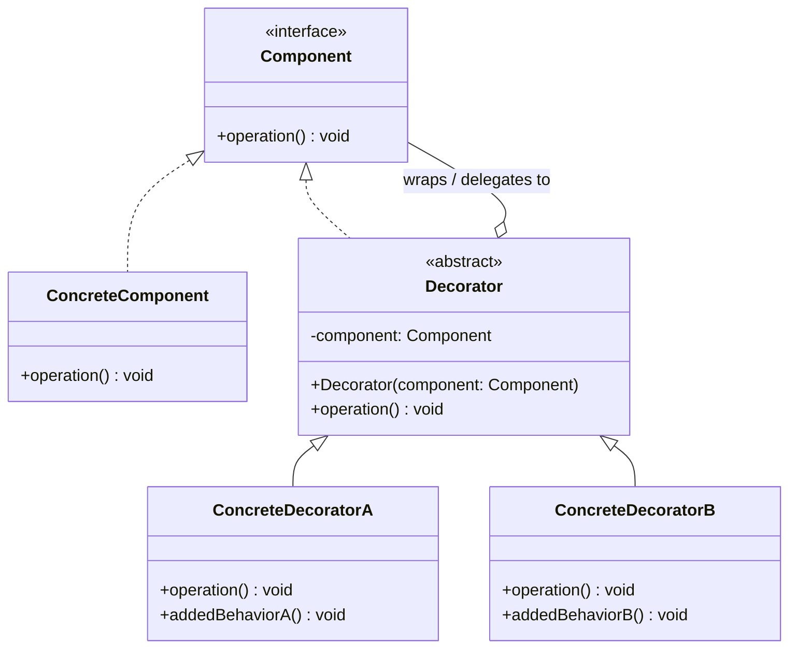

# 데코레이터(Decorator) 디자인 패턴 가이드

> 한 줄 요약: 객체의 행위(behavior)를 동일한 인터페이스를 유지한 채 런타임에 합성(composition)으로 덧붙여, 상속 폭발 없이 기능을 자유롭게 조합할 수 있게 하는 구조 패턴.
>
> 분류: 구조 패턴(Structural Pattern)
> 다른 이름(Aliases): Wrapper(래퍼)

---

## 상세 설명

데코레이터(Decorator) 패턴은 원본 객체(Component)와 동일한 인터페이스를 구현하는 또 다른 객체(Decorator)가 원본을 감싸고(wrap), 위임(delegate)을 통해 호출을 전달하면서 그 앞뒤로 추가 행위를 끼워 넣도록 설계한 구조 패턴이다. 의도(Intent)는 GoF의 표현을 빌리면 "객체에 동적으로(dynamically) 새로운 책임을 추가하되, 서브클래싱(subclassing)에 대한 유연한 대안을 제공한다"이다.

이 패턴이 해결하려는 문제(Problem)는 분명하다. 어떤 클래스 `A`에 기능 X, Y, Z를 선택적으로 결합할 수 있어야 한다고 하자. 상속만으로 풀면 `A`, `AX`, `AY`, `AZ`, `AXY`, `AXZ`, `AYZ`, `AXYZ`처럼 조합의 수만큼 서브클래스가 폭발하는 이른바 클래스 폭발(class explosion) 문제가 생긴다. 게다가 상속은 컴파일 타임에 결정되므로 런타임에 "이 인스턴스에만 X를 더해 달라"는 요구를 만족할 수 없다.

해결책(Solution)은 행위를 추가하는 단위를 별도의 데코레이터 클래스로 추출하고, 원본과 데코레이터 모두 같은 추상 타입(Component)을 구현하게 만드는 것이다. 데코레이터는 내부에 같은 타입의 참조 하나를 들고 있다가, 자신의 메서드 호출 시 추가 작업을 수행한 뒤 내부 참조에 위임한다. 이렇게 하면 `new ZDecorator(new YDecorator(new XDecorator(new A())))` 같은 식으로 마치 양파 껍질처럼 행위를 겹쳐 쌓을 수 있다.

핵심 개념과 용어는 다음과 같다. Component(컴포넌트)는 원본과 데코레이터가 공유하는 추상 인터페이스 또는 추상 클래스이다. ConcreteComponent(구체 컴포넌트)는 실제 기본 동작을 담은 원본 객체이다. Decorator(데코레이터)는 Component를 구현하면서 같은 타입의 필드를 가진 추상 클래스이며, ConcreteDecorator(구체 데코레이터)들이 이를 상속해 각각의 부가 기능을 구현한다.

역사적으로 데코레이터 패턴은 GoF 책에서 정식 명명되었지만, 그 이전부터 입출력 스트림 계층(예: Java의 `java.io`)에서 광범위하게 사용되어 왔다. Java I/O는 사실상 데코레이터 패턴의 교과서적 사례로 자주 인용된다. 또한 함수형 언어에서의 고차함수(higher-order function)나 Python의 `@decorator` 문법은 이름은 같지만, 객체지향 디자인 패턴으로서의 Decorator와는 다른 개념이라는 점에 유의해야 한다.

---

## 디자인 패턴을 충족하는 최소 조건

이 섹션에서는 "어떤 코드가 진짜로 데코레이터 패턴이라고 부를 수 있는가"의 기준을 명확히 한다.

1. **공통 인터페이스(Component) 공유** — 원본(ConcreteComponent)과 데코레이터(Decorator)는 같은 추상 타입을 구현하거나 상속한다. 클라이언트는 이 추상 타입에만 의존해야 하며, 데코레이터로 감싼 결과도 동일한 타입으로 다룰 수 있어야 한다.
2. **합성에 의한 위임(Composition + Delegation)** — 데코레이터는 같은 Component 타입의 인스턴스를 필드로 보유하고, 자신의 메서드 호출 시 추가 행위를 수행한 뒤 그 필드에 위임(delegate)한다. 상속이 아니라 합성으로 행위를 확장한다.
3. **재귀적 합성 가능성(Recursive Wrapping)** — 데코레이터를 또 다른 데코레이터로 감쌀 수 있어야 한다. 즉, "데코레이터의 내부 Component"가 또 데코레이터일 수 있어야 하며, 이를 통해 행위 조합을 런타임에 임의로 쌓을 수 있다.
4. **인터페이스 변경 금지** — 데코레이터는 원본의 인터페이스를 바꾸지 않는다. 시그니처를 동일하게 유지한 채 같은 메서드 호출에 대해 다른 동작을 덧붙일 뿐이다.

> 위 조건 중 하나라도 빠지면 본 패턴이라고 보기 어렵다. 특히 1번(공통 인터페이스)이 깨지면 데코레이터가 아니라 별개의 객체 합성에 가깝고, 4번(인터페이스 변경 금지)이 깨지면 어댑터(Adapter)에 가까워진다.

### 흔히 오해하는 지점

- **Adapter(어댑터)와의 혼동** — 어댑터는 "다른 인터페이스 → 원하는 인터페이스"로 변환하는 것이 목적이고, 데코레이터는 "같은 인터페이스를 유지하면서 행위만 추가"하는 것이 목적이다. 외형은 둘 다 객체를 감싸는 형태지만 의도(Intent)가 다르다.
- **Proxy(프록시)와의 혼동** — 프록시 또한 같은 인터페이스를 유지한 채 객체를 감싸지만, 그 목적은 접근 제어, 지연 초기화, 원격 호출, 캐싱 등 "대리(代理)"이다. 데코레이터의 목적은 "행위 추가"이므로 일반적으로 여러 개를 체인으로 쌓는 것이 자연스럽지만, 프록시는 보통 1단으로 끝난다.
- **Python `@decorator` 문법과의 혼동** — Python의 `@`는 함수/클래스를 다른 함수로 감싸는 문법 설탕(syntactic sugar)이며, 함수형 고차함수에 가깝다. GoF Decorator는 객체지향 설계에서 "Component 인터페이스를 공유하는 객체 합성"이 핵심이라는 점에서 본질적으로 다르다. 이름이 같다고 같은 패턴으로 취급하면 안 된다.
- **상속으로 기능을 추가했다고 데코레이터인 것은 아니다** — 단순히 `BufferedCoffee extends Coffee`처럼 상속만 사용하고 합성이 없다면 그것은 그냥 상속이지 데코레이터가 아니다. 합성과 위임이 핵심이다.

---

## 사례를 통한 예시

### 예시 1: 음료(Beverage)에 토핑을 더하는 카페 주문 시스템

**상황**: 카페에서 에스프레소(Espresso), 하우스 블렌드(HouseBlend) 같은 기본 음료에 우유(Milk), 모카(Mocha), 휘핑크림(Whip) 같은 토핑을 자유롭게 조합해서 가격과 설명을 계산해야 한다. 토핑 조합 수만큼 서브클래스를 만드는 대신, 토핑 각각을 데코레이터로 만든다.

```java
// Component: 원본과 데코레이터가 공유하는 추상 타입
public abstract class Beverage {
    protected String description = "Unknown Beverage";

    public String getDescription() {
        return description;
    }

    public abstract double cost();
}

// ConcreteComponent: 실제 원본 음료
public class Espresso extends Beverage {
    public Espresso() {
        this.description = "Espresso";
    }

    @Override
    public double cost() {
        return 1.99;
    }
}

public class HouseBlend extends Beverage {
    public HouseBlend() {
        this.description = "House Blend Coffee";
    }

    @Override
    public double cost() {
        return 0.89;
    }
}

// Decorator: Component를 상속하면서 Component 참조를 합성으로 보유
public abstract class CondimentDecorator extends Beverage {
    protected Beverage beverage; // 핵심: 같은 타입의 참조를 들고 있다

    public CondimentDecorator(Beverage beverage) {
        this.beverage = beverage;
    }

    @Override
    public abstract String getDescription();
}

// ConcreteDecorator: 부가 기능 한 단위
public class Milk extends CondimentDecorator {
    public Milk(Beverage beverage) {
        super(beverage);
    }

    @Override
    public String getDescription() {
        return beverage.getDescription() + ", Milk";
    }

    @Override
    public double cost() {
        return beverage.cost() + 0.30; // 부가 작업 후 위임 결과에 더한다
    }
}

public class Mocha extends CondimentDecorator {
    public Mocha(Beverage beverage) {
        super(beverage);
    }

    @Override
    public String getDescription() {
        return beverage.getDescription() + ", Mocha";
    }

    @Override
    public double cost() {
        return beverage.cost() + 0.20;
    }
}

public class Whip extends CondimentDecorator {
    public Whip(Beverage beverage) {
        super(beverage);
    }

    @Override
    public String getDescription() {
        return beverage.getDescription() + ", Whip";
    }

    @Override
    public double cost() {
        return beverage.cost() + 0.10;
    }
}

// Client: 런타임에 양파 껍질처럼 행위를 쌓는다
public class CafeMain {
    public static void main(String[] args) {
        Beverage order = new Espresso();
        order = new Mocha(order);
        order = new Mocha(order); // 모카 두 번도 가능
        order = new Whip(order);

        System.out.println(order.getDescription() + " $" + order.cost());
        // 출력: Espresso, Mocha, Mocha, Whip $2.49
    }
}
```

**해설**: `Beverage`가 Component, `Espresso`/`HouseBlend`가 ConcreteComponent, `CondimentDecorator`가 Decorator, `Milk`/`Mocha`/`Whip`이 ConcreteDecorator이다. `Mocha`를 두 번 감쌀 수 있다는 사실은 "재귀적 합성"이라는 최소 조건을 만족한다는 증거이며, 클라이언트는 어떤 단계에서도 `Beverage` 타입으로만 다루므로 "공통 인터페이스 유지"라는 조건도 충족된다.

### 예시 2: 실제 라이브러리 사례 — `java.io`의 스트림 데코레이터 체인

**상황**: Java 표준 라이브러리의 `java.io` 패키지는 데코레이터 패턴의 정전(canon)으로 인용된다. `InputStream`/`Reader`가 Component, `FileInputStream`/`FileReader`가 ConcreteComponent, `FilterInputStream`/`BufferedReader` 등이 Decorator 계열이다.

```java
import java.io.BufferedReader;
import java.io.FileReader;
import java.io.LineNumberReader;
import java.io.Reader;

public class IoDecoratorDemo {
    public static void main(String[] args) throws Exception {
        // 양파 껍질처럼 쌓는다:
        //   FileReader  -> 파일에서 문자 한 개씩 읽는 원본(ConcreteComponent)
        //   BufferedReader -> 버퍼링 기능 추가(ConcreteDecorator)
        //   LineNumberReader -> 라인 번호 추적 기능 추가(ConcreteDecorator)
        Reader reader =
            new LineNumberReader(
                new BufferedReader(
                    new FileReader("sample.txt")));

        LineNumberReader lnr = (LineNumberReader) reader;
        String line;
        while ((line = lnr.readLine()) != null) {
            System.out.println(lnr.getLineNumber() + ": " + line);
        }
        lnr.close();
    }
}
```

또한 바이트 스트림 쪽 예시도 동일한 구조를 따른다.

```java
import java.io.BufferedInputStream;
import java.io.DataInputStream;
import java.io.FileInputStream;
import java.io.InputStream;

public class IoByteStreamDemo {
    public static void main(String[] args) throws Exception {
        // FileInputStream(원본) -> BufferedInputStream(버퍼링) -> DataInputStream(자바 기본 타입 읽기)
        InputStream in =
            new DataInputStream(
                new BufferedInputStream(
                    new FileInputStream("data.bin")));

        DataInputStream din = (DataInputStream) in;
        int magic = din.readInt();      // DataInputStream이 더해 준 행위
        double value = din.readDouble();
        System.out.println("magic=" + magic + ", value=" + value);
        din.close();
    }
}
```

**해설**: `FileReader`/`FileInputStream`은 실제 자원에서 데이터를 읽어오는 원본이고, `BufferedReader`/`BufferedInputStream`은 같은 `Reader`/`InputStream` 인터페이스를 유지한 채 버퍼링이라는 행위를 추가한다. `LineNumberReader`와 `DataInputStream`은 각각 라인 카운팅, 자바 기본 타입 디코딩이라는 행위를 추가하는 또 다른 데코레이터이다. 모두 같은 추상 타입(`Reader`, `InputStream`)을 공유하므로, 이 체인을 어떻게 쌓아도 클라이언트 코드의 사용 방식은 동일하다는 점에서 데코레이터 패턴의 모범 사례이다.

---

## 어떨 때 사용하나

다음과 같은 신호(Symptom)가 보일 때 데코레이터 패턴 도입을 고려한다.

- 동일한 인터페이스를 유지한 채 여러 부가 기능(로깅, 캐싱, 압축, 암호화, 트랜잭션 등)을 선택적·조합적으로 결합해야 할 때.
- 상속으로 기능 조합을 표현하려다 보니 `XxxYyyZzz`처럼 서브클래스가 폭발(class explosion)하는 조짐이 보일 때.
- 객체별로 부여할 기능이 런타임에 결정되어야 할 때. 예를 들어 사용자 권한, 설정값, 요청 헤더 등에 따라 어떤 부가 기능을 활성화할지 정해지는 경우.
- 원본 클래스를 수정하지 않고(또는 수정할 수 없는 서드파티 라이브러리에 대해) 기능을 덧붙여야 할 때. 데코레이터는 원본의 코드를 손대지 않으므로 OCP(개방-폐쇄 원칙)에 부합한다.
- I/O 스트림, HTTP 미들웨어, GUI 위젯의 스크롤/테두리/그림자처럼, 본질적으로 "겹쳐 쓰는" 모델이 자연스러운 도메인일 때.

### 사용하면 안 되는 경우 (Anti-patterns)

- **기본 인터페이스가 너무 무겁고 메서드가 많을 때** — 데코레이터는 모든 메서드를 위임 코드로 채워야 하므로, 인터페이스가 거대하면 데코레이터 한 개당 보일러플레이트(boilerplate)가 막대해진다. 이럴 땐 인터페이스를 잘게 나누거나(ISP), AOP/Proxy 같은 대안을 고려하라.
- **부가 기능이 본질적으로 단 한 종류뿐이고 조합 가능성이 없을 때** — 상속 한 번이면 끝나는 일을 데코레이터로 만들면 과설계(over-engineering)이다.
- **부가 기능 간 순서가 미묘하게 의미를 바꾸는데 그것이 명시되지 않을 때** — 예컨대 "압축 후 암호화"와 "암호화 후 압축"은 결과가 다르다. 데코레이터를 쌓는 순서가 결과를 바꾸는데 클라이언트가 이를 알기 어려운 구조라면, 빌더(Builder)나 명시적 파이프라인이 더 안전하다.
- **데코레이터를 식별해야 하는 코드 경로가 있을 때** — `if (obj instanceof MochaDecorator)` 같이 데코레이터 타입을 들춰봐야 한다면, 이미 추상화가 새고 있다. 그런 분기가 자주 필요하다면 Visitor나 다른 패턴이 더 적합하다.

---

## 장점과 단점, 한계점

### 장점

- **상속 폭발 회피**: 부가 기능의 조합 수만큼 클래스를 만들 필요 없이, 각 부가 기능을 하나의 데코레이터로 표현해 런타임에 조합한다.
- **런타임 합성과 동적 결합**: 컴파일 타임이 아닌 런타임에 어떤 행위를 더할지 결정할 수 있고, 객체별로 다른 조합을 부여할 수 있다.
- **개방-폐쇄 원칙(OCP) 친화**: 원본 클래스를 수정하지 않은 채 새로운 데코레이터 클래스를 추가하는 것만으로 행위 확장이 가능하다.
- **단일 책임 원칙(SRP) 친화**: 각 데코레이터는 하나의 부가 기능에만 책임을 가진다. 거대 클래스에 if 분기로 기능을 욱여넣는 것보다 응집도가 높다.
- **클라이언트 코드 영향 최소화**: 클라이언트는 항상 Component 추상 타입으로만 다루므로, 데코레이터 체인이 어떻게 구성되든 사용 방식은 동일하다.

### 단점

- **작은 객체가 많아진다**: 한 가지 행위 단위로 클래스를 쪼개므로 클래스 수와 인스턴스 수가 늘어난다. 디버깅 시 호출 스택이 깊어지는 비용도 있다.
- **객체 정체성(identity) 문제**: 데코레이터로 감싸진 객체와 원본 객체는 `==` 또는 `equals` 비교에서 다른 객체로 취급된다. "내가 받은 이 객체가 원본인지 데코레이터인지" 를 신경 써야 하는 코드와는 충돌한다.
- **순서 의존성**: 데코레이터를 쌓는 순서가 결과에 영향을 주는 경우, 그 의도를 코드로 강제하기 어렵다. 잘못된 순서로 쌓아도 컴파일은 통과한다.
- **보일러플레이트**: Component 인터페이스가 클수록 모든 메서드를 위임 코드로 채워야 하는 부담이 커진다.

### 한계점

- **언어 차원의 한계는 거의 없다**: 객체와 인터페이스(또는 추상 클래스)만 있으면 어떤 객체지향 언어에서도 구현할 수 있다. 다만 정적 타입 언어에서는 데코레이터마다 클래스를 선언해야 하는 비용이 있고, 동적 언어에서는 메서드 누락이 런타임까지 드러나지 않을 위험이 있다.
- **타입 캐스팅이 필요한 순간 깨진다**: 예시 2의 `LineNumberReader` 처럼 데코레이터가 추가한 메서드(예: `getLineNumber()`)를 호출하려면 다운캐스팅이 필요해, "Component 추상 타입으로만 다룬다"는 이상이 일부 깨진다.
- **동등성/해시 코드/직렬화 같은 메타 동작에 취약**: 원본의 `equals`, `hashCode`, `Serializable` 등을 데코레이터가 어떻게 처리해야 할지 명확하지 않다. 잘못 위임하면 미묘한 버그가 생긴다.
- **AOP, Proxy와 책임이 겹친다**: 횡단 관심사(cross-cutting concern)가 많은 경우 데코레이터를 손으로 쓰는 것보다 AOP나 동적 프록시가 더 깔끔할 수 있어, 데코레이터의 입지가 좁아진다.

---

## 정보 표

| 항목 | 값 |
| --- | --- |
| 분류 | 구조 패턴(Structural) |
| 언어 의존성 | 언어 비의존적. 객체와 인터페이스(또는 추상 클래스)만 있으면 어떤 OOP 언어에서도 구현 가능. |
| 활용성(1점~5점) | ★★★★☆ (4/5) — I/O, 미들웨어, UI, 캐싱 등 실무 도처에서 등장하며 표준 라이브러리에 깊이 박혀 있다. |
| 학습 난이도 | 중 — 개념은 단순하지만 Adapter/Proxy와의 구분, 순서 의존성, 캐스팅 이슈를 익히는 데 약간의 경험이 필요하다. |
| 자주 함께 쓰이는 패턴 | Composite(컴포지트), Strategy(전략), Factory Method(팩토리 메서드), Proxy(프록시) |
| 대표 사용 사례 | `java.io.BufferedReader`/`DataInputStream` 등 Java I/O 스트림 체인, Spring `HttpServletRequestWrapper`, Servlet/Express의 미들웨어 체인, GUI 위젯의 스크롤바·테두리 데코레이터 |

---

## Class Diagram



> 다이어그램에 등장하는 각 클래스가 패턴의 어떤 역할(Role)을 담당하는지 위 "상세 설명" 섹션과 1:1로 대응되어야 한다.

### 역할 설명

- **Component**: 원본과 데코레이터가 공유하는 추상 인터페이스 또는 추상 클래스. 클라이언트는 이 타입에만 의존한다. 예시 1의 `Beverage`, 예시 2의 `java.io.Reader`/`InputStream`.
- **ConcreteComponent**: 실제 기본 동작을 담은 원본 객체. 데코레이터 체인의 가장 안쪽에 위치한다. 예시 1의 `Espresso`/`HouseBlend`, 예시 2의 `FileReader`/`FileInputStream`.
- **Decorator**: Component를 구현(또는 상속)하면서 같은 Component 타입의 참조 하나를 보유한 추상 클래스. 위임의 골격을 제공한다. 예시 1의 `CondimentDecorator`, JDK의 `FilterInputStream`/`FilterReader`.
- **ConcreteDecoratorA / ConcreteDecoratorB**: Decorator를 상속해 부가 행위를 한 가지씩 구현한 클래스들. `operation()` 호출 시 추가 작업을 수행하고 내부 `component`에 위임한다. 예시 1의 `Milk`/`Mocha`/`Whip`, 예시 2의 `BufferedReader`/`LineNumberReader`/`DataInputStream`.

---

## 참고 자료

- Erich Gamma, Richard Helm, Ralph Johnson, John Vlissides, "Design Patterns: Elements of Reusable Object-Oriented Software" (Addison-Wesley, 1994) — Decorator 패턴의 원전.
- Eric Freeman, Elisabeth Robson, "Head First Design Patterns" (O'Reilly) — 본 가이드의 예시 1(`Beverage`/`Espresso`/`Mocha`)이 대중화된 출처.
- Oracle, "Java Platform SE API Documentation — `java.io.FilterInputStream`, `java.io.BufferedReader`, `java.io.DataInputStream`": https://docs.oracle.com/en/java/javase/17/docs/api/java.base/java/io/package-summary.html
- Refactoring.Guru, "Decorator": https://refactoring.guru/design-patterns/decorator
- Joshua Bloch, "Effective Java" 3판, Item 18 "Favor composition over inheritance" — 데코레이터가 왜 상속의 대안이 되는지에 대한 일반 원칙.
