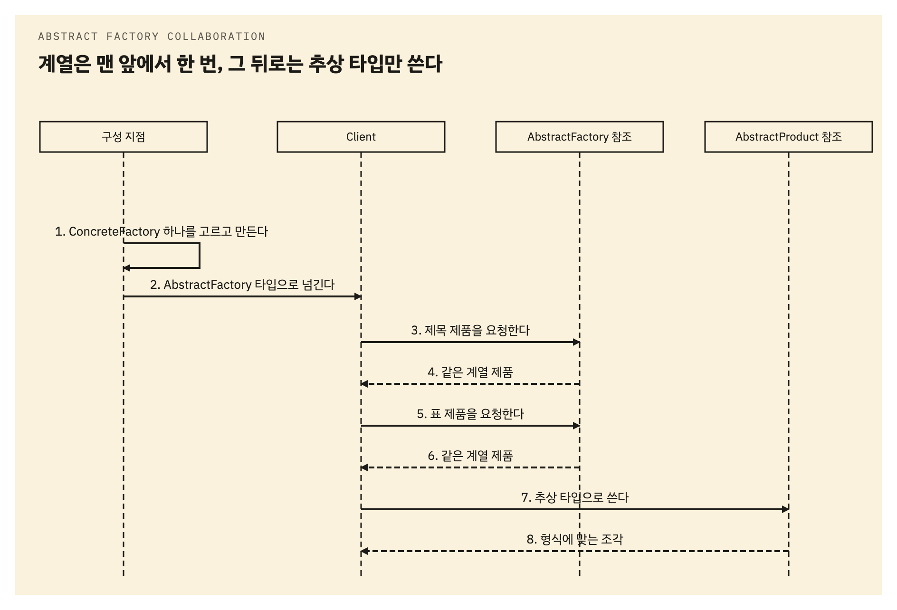
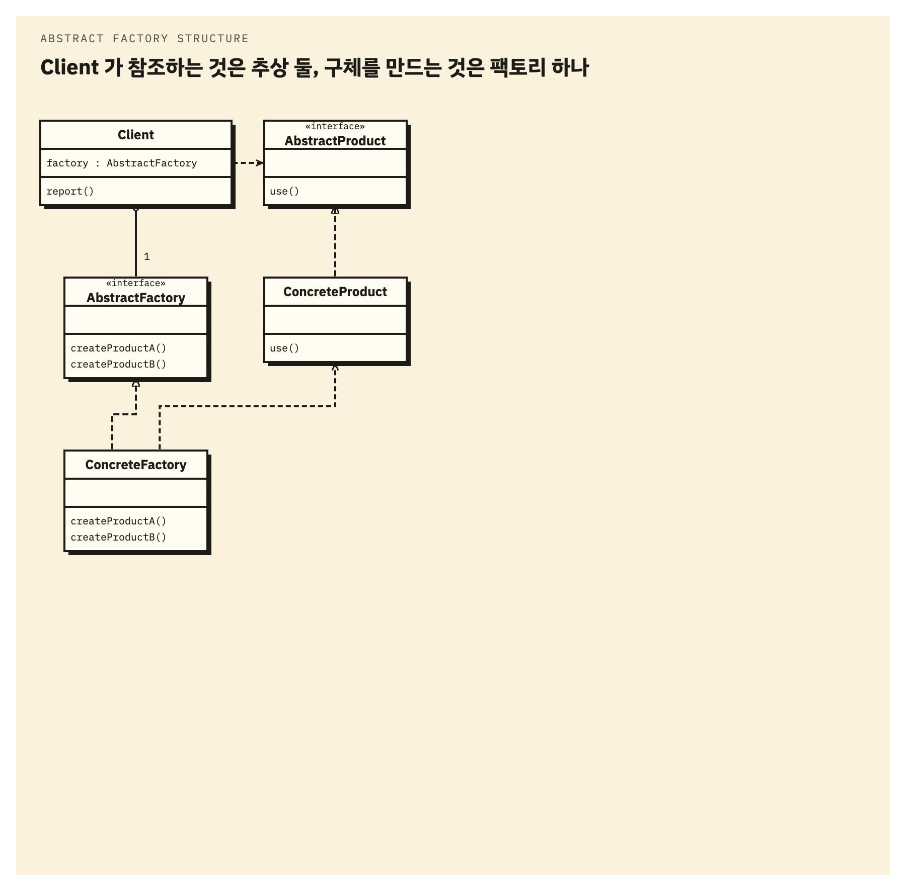

# Abstract Factory — 계열은 맨 앞에서 한 번만 고르고, 그 뒤로는 섞이지 않게 하기

## 한눈에 보는 개요

월간 매출 보고서를 파일로 내보내는 코드를 떠올려 봅시다. 보고서 한 장은 제목 블록 하나와 표 블록 하나로 되어 있고, 형식은 마크다운과 HTML 둘이에요. 제목을 만드는 자리와 표를 만드는 자리가 따로 있으니 형식을 가르는 분기도 두 군데에 생깁니다. 형식이 하나 늘면 두 분기를 함께 고쳐야 하는데, 한 곳만 고치면 더 고약한 일이 벌어져요. 마크다운 제목 아래에 HTML 표가 붙은 파일이 나옵니다. 컴파일은 통과합니다. 예외도 나지 않고요.

Abstract Factory 의 해법은 **한 형식의 제품을 모두 만들 줄 아는 객체 하나를 밖에서 넣어 주는 것**입니다. 보고서를 쓰는 쪽은 그 객체에만 제품을 달라고 하고, 어느 형식인지는 묻지 않아요. 형식을 고르는 일이 객체 하나를 고르는 일로 줄고, 한 객체에서 나온 제품은 전부 같은 형식입니다.

```text
Before : 형식 분기가 제품 종류마다 따로 있음

  ReportWriter.write(보고서)
    제목 블록   if (format == "html") new HtmlHeading(...)  else new MarkdownHeading(...)
    표 블록     if (format == "html") new HtmlTable(...)    else new MarkdownTable(...)
    형식 하나 추가 → 두 분기를 함께 고침. 한 곳만 고치면 제목과 표의 형식이 어긋남

After : 형식 하나를 아는 팩토리 객체를 넣어 주고, 제품은 거기서만 받음

  구성 지점 ── 고른 팩토리 하나를 넣어 줌 ──▶ ReportWriter
                                              write(보고서)
                                                팩토리.createHeading(제목)
                                                팩토리.createTable(머리글, 행)
                                                  ├─ MarkdownKit → MarkdownHeading · MarkdownTable
                                                  ├─ HtmlKit     → HtmlHeading     · HtmlTable
                                                  └─ 새 형식 = 새 팩토리 하나 (ReportWriter 는 그대로)
```

이 패턴의 이름은 GoF(Gang of Four, 1994년에 나온 *Design Patterns* 의 저자 네 명을 함께 부르는 이름)가 붙인 것이고 다른 이름은 Kit 예요(근거: GoF Abstract Factory 절 Also Known As). 분류는 생성 패턴이고, 가장 가까이 함께 쓰는 패턴은 Factory Method 입니다 — 팩토리의 생성 연산 하나하나를 Factory Method 로 구현하는 것이 흔한 구성이라 두 패턴은 경쟁 관계가 아니라 한쪽 안에 다른 쪽이 들어가는 관계예요(근거: GoF Abstract Factory 절 Implementation·Related Patterns). 이 글은 시나리오 셋을 따라갑니다. 보고서 한 장이 만들어지는 길, 형식과 블록 종류가 늘어날 때 드는 품이 왜 다른가, 계열의 경계를 넘으면 어느 단계에서 무엇이 어긋나는가. 끝까지 읽으면 어떤 코드를 Abstract Factory 라고 불러도 되는지 필수 조건 다섯으로 판정할 수 있고, 이름이 닮은 Factory Method·Builder 와도 구분할 수 있게 됩니다.

## 패턴 자세히 들여다보기

### 시나리오 1 — 마크다운 보고서 한 장이 만들어지는 길

보고서 요청이 하나 들어왔습니다. 제목은 `2026년 3월 매출 요약`, 표의 머리글은 `상품 · 수량 · 매출` 세 칸이고 행은 `공책 120 360000` 과 `연필 300 150000` 두 줄이에요. 이 배포의 형식 설정은 `"markdown"` 이고, 나와야 하는 것은 `## 2026년 3월 매출 요약` 한 줄과 그 아래 마크다운 표 네 줄, 모두 다섯 줄짜리 문자열 하나입니다. 이 장면에는 다섯이 등장해요. 설정을 읽어 어느 형식으로 낼지 정하는 **구성 지점**, 보고서를 조립하는 `ReportWriter`(패턴에서는 Client 라고 부르는 역할), 제목과 표를 만들어 주는 `ReportKit`(AbstractFactory)과 그 마크다운 구현 `MarkdownKit`(ConcreteFactory), 그리고 만들어져 나오는 `Heading`·`Table`(AbstractProduct)과 그 구현 `MarkdownHeading`·`MarkdownTable`(ConcreteProduct)입니다. 이름은 여기서 한 번씩만 소개하고 정식 정의는 개념 정리에서 해요.



1. 구성 지점이 형식 설정 `"markdown"` 을 읽고 `MarkdownKit` 인스턴스를 하나 만듭니다. 이 일을 구성 지점이 맡는 이유는 구체 팩토리 클래스의 이름이 프로그램에 한 번만 등장하게 모으기 위해서예요. 이름이 한 곳에만 있으면 계열을 통째로 바꾸는 일이 그 한 줄을 바꾸는 일로 끝납니다. 이 판단을 `ReportWriter` 안에서 하면 형식 이름과 클래스의 대응이 보고서 조립 코드로 들어가고, 시나리오 3 이 그때 무엇이 어긋나는지를 따라갑니다.
2. 구성 지점이 그 인스턴스를 `ReportKit` 타입으로 `ReportWriter` 에 넘깁니다. 타입을 `MarkdownKit` 이 아니라 `ReportKit` 으로 적는 이유는 `ReportWriter` 가 어느 계열인지 모르게 하려는 것이고, 그래야 다른 계열을 넣을 때 `ReportWriter` 를 열지 않아요. 이 단계가 3단계보다 늦으면 제품을 달라고 할 상대가 아직 없습니다.
   - 갈래 2-1. 다른 형식으로 내야 하면 구성 지점이 같은 자리에서 다른 구체 팩토리를 넘깁니다. `HtmlKit` 을 넘기면 그다음 단계들은 한 글자도 바뀌지 않은 채 HTML 제품이 나와요.
3. `ReportWriter` 가 받아 둔 참조에 `createHeading("2026년 3월 매출 요약")` 을 부릅니다. 제목 블록의 구체 클래스를 고르는 일을 팩토리가 맡는 이유는 그 결정에 필요한 지식이 계열이라는 사실 하나뿐이고, 그것을 아는 쪽이 팩토리이기 때문이에요. `ReportWriter` 는 "제목이 필요하다"까지만 알고 "어느 제목 클래스인가"는 모릅니다.
4. `MarkdownKit` 이 `MarkdownHeading` 을 만들어 `Heading` 타입으로 돌려줍니다. 반환 타입을 추상으로 두는 이유는 받는 쪽 변수 선언에 구체 클래스 이름이 남지 않게 하려는 것이에요. 여기서 `MarkdownHeading` 을 그대로 반환 타입에 적으면, 팩토리를 바꿔도 `ReportWriter` 의 변수 선언의 타입이 맞지 않아 컴파일 오류가 납니다.
5. `ReportWriter` 가 이어서 `createTable(머리글, 행)` 을 부르고 `MarkdownTable` 을 `Table` 타입으로 받습니다. 두 번째 제품을 **같은 팩토리 인스턴스**에 묻는 것이 이 단계의 핵심이에요. 같은 인스턴스에 물었기 때문에 4단계의 제목과 계열이 같다는 것이 보장되고, 표만 다른 인스턴스에 물으면 그 보장이 그 자리에서 사라집니다.
6. `ReportWriter` 가 두 제품의 `render()` 를 `Heading`·`Table` 타입으로만 부르고 결과를 줄바꿈으로 잇습니다. 조립하는 일을 제품이 아니라 `ReportWriter` 가 맡는 이유는 "제목 다음에 표"라는 순서가 형식과 무관하게 늘 같아서예요. 이 순서를 제품 쪽으로 옮기면 같은 순서 규칙이 계열 수만큼 복제됩니다.

```text
단계   부르는 쪽 → 받는 쪽              넘기는 것                       돌아오는 것
 1     구성 지점 → (new)                "markdown"                      MarkdownKit 인스턴스
 2     구성 지점 → ReportWriter         MarkdownKit 을 ReportKit 으로    —
 3     ReportWriter → ReportKit         "2026년 3월 매출 요약"           —
 4     MarkdownKit → ReportWriter       —                               Heading 타입의 MarkdownHeading
 5     ReportWriter → ReportKit         머리글 3칸 · 행 2줄              Table 타입의 MarkdownTable
 6     ReportWriter → Heading · Table   —                               두 조각을 이은 보고서 5줄
```

잠깐, 확인 하나만 해 볼까요? 3단계와 5단계에서 `ReportWriter` 가 받은 값의 **컴파일 시점 타입**과 **실행 중 실제 타입**은 각각 무엇일까요?

컴파일 시점 타입은 `Heading` 과 `Table` 이고, 실행 중 실제 타입은 `MarkdownHeading` 과 `MarkdownTable` 이에요. 이 둘이 다르기 때문에 `ReportWriter` 의 코드에는 마크다운이라는 말이 한 번도 나오지 않으면서도 실행 결과는 마크다운으로 나옵니다. 두 타입이 다른 구조를 이르는 말이 [참고 문서 「GoF 공통 어휘」의 인터페이스에 프로그래밍한다](../../reference/gof-vocabulary/gof-vocabulary-ref_v1.0.2.md#인터페이스에-프로그래밍한다)이고, 실행 중에 실제 타입을 찾아 부르는 일을 무엇이라 부르는지는 같은 문서의 [컴파일 시점 결합과 실행 시점 결합](../../reference/gof-vocabulary/gof-vocabulary-ref_v1.0.2.md#컴파일-시점-결합과-실행-시점-결합)에 있어요.

```text
                          컴파일 시점 타입   실행 중 실제 타입
3·4단계가 받은 제목 제품     Heading          MarkdownHeading
5단계가 받은 표 제품         Table            MarkdownTable
ReportWriter 가 아는 것     왼쪽 칸까지       오른쪽 칸은 모름
```

이 시나리오가 보여 준 것은 역할 다섯과 그 사이의 호출 방향입니다. 계열을 고르고 팩토리를 만드는 일(1단계)은 구성 지점이, 제품을 요청하고 조립하는 일(3·5·6단계)은 Client 가, 구체 제품을 고르고 만드는 일(4단계)은 ConcreteFactory 가 맡아요. Client 로 들어오고 나가는 타입은 AbstractFactory 와 AbstractProduct 둘뿐이고(2·3·6단계), Client 코드에는 구체 클래스 이름이 한 번도 나오지 않아요. 두 제품을 같은 팩토리 인스턴스에 물었다는 사실(5단계)이 계열 일관성의 유일한 근거예요.

### 시나리오 2 — 계열이 하나 더 늘 때와, 블록 종류가 하나 더 늘 때

같은 보고서 기능에 요구가 둘 들어왔습니다. 하나는 사내 메신저에 붙일 **텍스트 형식**을 더해 달라는 것이고, 다른 하나는 보고서 맨 아래에 **각주 블록**을 넣어 달라는 것이에요. 텍스트 형식은 제목을 `== 2026년 3월 매출 요약 ==` 로, 표를 `- 공책 / 120 / 360000` 같은 줄로 냅니다. 각주는 제목·표에 이은 세 번째 블록 종류이고, 마크다운·HTML·텍스트 세 형식 모두에 있어야 해요. 두 요구는 크기가 비슷해 보이지만 드는 품이 전혀 다르고, 그 차이가 이 패턴이 어느 변화를 가볍게 만들고 어느 변화를 무겁게 만드는지를 그대로 보여 줍니다.

1. 텍스트 형식을 위해 `TextHeading` 과 `TextTable` 두 클래스를 새로 씁니다. `Heading` 과 `Table` 이 선언한 연산 모양(`render()`)은 그대로 두고 본문만 텍스트 규칙으로 채워요. 모양을 바꾸지 않는 이유는 그 모양이 `ReportWriter` 와 모든 제품 사이의 계약이라서, 한 계열이 모양을 바꾸면 `ReportWriter` 의 호출 줄과 다른 계열 제품이 전부 따라 바뀌기 때문입니다.
2. `TextKit` 을 새로 써서 두 생성 연산을 구현합니다. 계열마다 팩토리 클래스를 따로 두는 이유는 계열 교체를 팩토리 하나 바꾸기로 끝내려는 것이에요. 이 클래스 안에는 형식을 가르는 분기가 하나도 없고, 두 연산이 각각 자기 계열의 구체 클래스를 하나씩 만들 뿐입니다.
3. 구성 지점에 `"text"` 를 `TextKit` 으로 잇는 한 줄을 더합니다. 여기까지가 전부예요 — `ReportKit`·`Heading`·`Table` 세 선언과 `ReportWriter`, 그리고 기존 두 계열의 여섯 클래스는 한 줄도 바뀌지 않습니다. `ReportWriter` 에 적힌 이름이 `ReportKit`·`Heading`·`Table`·`createHeading`·`createTable`·`render` 여섯뿐이라 새 클래스 이름이 들어갈 자리가 없기 때문이에요.
4. 이번에는 각주를 더해 봅니다. `Footnote` 라는 추상 제품 타입을 새로 만들고 `createFootnote` 를 `ReportKit` 에 더해야 하는데, 그 한 줄을 더하는 순간 `MarkdownKit`·`HtmlKit`·`TextKit` 세 구현 모두에서 컴파일 오류가 나요. 팩토리 인터페이스가 "만들 수 있는 제품의 집합"을 고정하고 있어서, 집합을 늘리면 그 인터페이스를 구현한 모든 계열이 새 연산을 채워야 하기 때문입니다(근거: GoF Abstract Factory 절 Consequences 4 — 새로운 종류의 제품을 지원하기 어렵다).
5. 세 언어 모두 이 지점을 컴파일러가 막습니다. 실제로 `createFootnote` 선언만 더하고 구현을 비워 둔 채 컴파일해 보면 Java 는 `MarkdownKit is not abstract and does not override abstract method createFootnote(String) in ReportKit` 를 세 클래스에 대해 내고, TypeScript 는 `TS2420: Class 'MarkdownKit' incorrectly implements interface 'ReportKit'` 를, Rust 는 `error[E0046]: not all trait items implemented, missing: create_footnote` 를 각각 세 번 냅니다(세 언어 모두 직접 컴파일해 확인). 막아 주는 것이 다행이지 이득은 아니에요 — 고칠 자리가 컴파일 오류 개수만큼 있다는 뜻이니까요.

| 더하는 것 | 새로 쓰는 것 | 고쳐야 하는 것 | 손대지 않는 것 |
| --- | --- | --- | --- |
| 계열 하나 (텍스트 형식) | `TextHeading` · `TextTable` · `TextKit` 세 클래스 | 구성 지점 한 줄 | `ReportKit` · `Heading` · `Table` · `ReportWriter` · 기존 두 계열 |
| 종류 하나 (각주 블록) | 계열마다 `ConcreteProduct` 하나씩 세 클래스 + `Footnote` 선언 | `ReportKit` 선언과 `MarkdownKit` · `HtmlKit` · `TextKit` 세 구현 | `ReportWriter` 의 기존 두 호출과 `Heading` · `Table` |

두 줄을 비교하면 새로 쓰는 클래스 수는 셋으로 같은데 **고쳐야 하는 기존 파일의 수**가 1 대 4 로 차이가 납니다. 계열 수를 m, 종류 수를 n 이라고 두면 이 차이를 식으로 쓸 수 있어요. 계열을 하나 더하면 새로 쓰는 것이 구체 제품 n 개와 구체 팩토리 1 개, 고치는 곳은 구성 지점 1 곳입니다. 종류를 하나 더하면 새로 쓰는 것이 구체 제품 m 개와 추상 제품 1 개, 고치는 곳은 팩토리 인터페이스 1 곳과 구체 팩토리 m 곳을 합쳐 m + 1 곳이에요. 앞은 m 이 아무리 커져도 고칠 곳이 1 로 고정이고, 뒤는 계열이 늘어날수록 고칠 곳이 함께 늘어납니다. 이 패턴이 가볍게 만드는 변화와 무겁게 만드는 변화가 이렇게 나뉘어요.

```text
계열 갈래 (m) ▶  MarkdownKit   HtmlKit   TextKit   ← 하나 더: 새 클래스 n+1, 고칠 곳 1
                 ─────────── ───────── ────────
종류 갈래 (n)
  Heading        Markdown-     Html-     Text-
  Table          Markdown-     Html-     Text-
  Footnote ?     ↑ 하나 더: 새 클래스 m+1, 고칠 곳 m+1 (인터페이스 1 + 구체 팩토리 m)
```

여기서 헷갈리기 쉬운 포인트는 이 대가를 인터페이스 설계를 잘못해서 생긴 문제로 읽는 것입니다. 그렇지 않아요. 만들 수 있는 제품의 집합을 인터페이스에 고정했기 때문에 4단계의 컴파일 오류가 나는 것이고, 바로 그 고정 덕분에 3단계에서 새 계열이 빠진 연산 없이 완성됩니다. 집합을 열어 두는 변형도 있는데, 종류를 인자로 받는 생성 연산 하나(`make("footnote")` 같은 모양)를 두는 방식이에요. 그러면 종류를 늘려도 인터페이스가 그대로지만, 반환 타입이 모든 종류에 공통인 추상 타입 하나가 되어 받는 쪽이 종류마다의 연산을 안전하게 부를 수 없게 됩니다(근거: GoF Abstract Factory 절 Implementation — 확장 가능한 팩토리는 더 유연하지만 덜 안전하다). 고정이 대가를 낳고 그 대가가 보장을 낳는 셈이죠.

이 시나리오가 보여 준 것은 변화가 들어오는 두 갈래에 드는 품이 서로 다르다는 점입니다. 계열이 늘 때는 기존 코드를 열지 않고 새 클래스만 더하면 되고(1~3단계), 종류가 늘 때는 팩토리 인터페이스와 모든 구체 팩토리를 함께 열어야 해요(4·5단계). 그래서 "형식이 자주 는다"는 요구에는 잘 맞고 "블록 종류가 자주 는다"는 요구에는 잘 맞지 않습니다.

### 시나리오 3 — 계열의 경계를 넘으면 어디서 어긋나는가

같은 기능의 다른 코드베이스에서 일어난 일입니다. HTML 표를 급하게 먼저 붙여야 할 일이 생겨서, 누군가 `ReportWriter` 안에서 표를 만드는 줄만 팩토리를 거치지 않고 `new HtmlTable(머리글, 행)` 으로 바꿔 놓았어요. 형식 설정은 그대로 `"markdown"` 이고, 같은 보고서 요청(제목 `2026년 3월 매출 요약`, 공책·연필 두 줄)이 그대로 들어옵니다. 아래 결과는 전부 Java 21 로 실제로 컴파일해 실행한 것입니다.

1. `ReportWriter.write` 의 표 줄이 `kit.createTable(headers, rows)` 에서 `new HtmlTable(headers, rows)` 로 바뀝니다. 이렇게 짜는 이유는 대개 급함이에요 — 당장 필요한 것이 HTML 표 하나뿐이니 그 자리에서 만드는 편이 빠릅니다. 그 대가로 `ReportWriter` 에 구체 제품 클래스의 이름이 처음으로 들어갑니다.
2. 컴파일은 통과하고 실행 중에 예외도 나지 않습니다. `HtmlTable` 도 `Table` 을 구현하니 타입은 아무 문제가 없어요. 대신 출력이 이렇게 나옵니다.

```text
--- markdown ---
## 2026년 3월 매출 요약
<table>
<tr><th>상품</th><th>수량</th><th>매출</th></tr>
<tr><td>공책</td><td>120</td><td>360000</td></tr>
<tr><td>연필</td><td>300</td><td>150000</td></tr>
</table>
```

3. 마크다운 제목 아래 HTML 표가 붙은 이 여섯 줄은 어느 뷰어로도 제대로 열리지 않습니다. 시나리오 1 의 5단계가 두 제품을 같은 팩토리 인스턴스에 물어야 한다고 한 이유가 이것이에요. 타입 검사는 "`Table` 인가"만 보지 "제목과 같은 계열인가"는 보지 않으므로, 계열이 맞는지는 **구체 이름을 어디서 부르는가**로만 지킬 수 있습니다. 되돌리는 길은 `ReportWriter` 에서 `HtmlTable` 이라는 이름을 지우고 다시 팩토리에 묻는 것이고, 최소 조건으로는 5번이 빠지는 자리예요.
4. 갈래 하나를 더 봅니다. 팩토리를 계열마다 두는 대신 `OneKit(format)` 하나로 두고 생성 연산마다 `if (format.equals(...))` 로 가른 코드예요. `createHeading` 에는 텍스트 분기를 넣었는데 `createTable` 의 분기에서 텍스트를 빠뜨리면, 형식 설정이 `"text"` 인데 출력은 이렇게 나옵니다(직접 컴파일해 실행한 결과).

```text
--- text ---
== 2026년 3월 매출 요약 ==
| 상품 | 수량 | 매출 |
| --- | --- | --- |
| 공책 | 120 | 360000 |
| 연필 | 300 | 150000 |
```

5. 두 갈래는 어긋나는 자리도 되돌리는 길도 다릅니다. 앞은 쓰는 쪽에 구체 이름이 들어와서 어긋났으니 그 이름을 지우면 되고, 뒤는 계열 교체 지점이 생성 연산 수만큼 흩어져서 어긋났으니 계열마다 팩토리를 쪼개야 해요. 생성 연산이 둘일 때는 빠뜨릴 곳이 둘이지만 종류가 늘면 빠뜨릴 곳도 함께 늘고, 빠뜨렸다는 사실을 컴파일러가 알려 주지 않는다는 점은 둘 다 같습니다. 최소 조건으로는 앞이 5번, 뒤가 4번이에요.

이 시나리오가 보여 준 것은 이 패턴이 지키려는 것이 타입이 아니라 **계열의 짝**이라는 점입니다. 두 실패 모두 컴파일을 통과하고 예외도 내지 않으면서 출력만 어긋났어요(2·4단계). 그래서 판정 기준도 타입 검사가 아니라 구체 클래스 이름이 어디에 있는지, 계열을 고르는 분기가 어디에 있는지로 정해집니다(3·5단계).

### 개념 정리

시나리오에 나온 역할 다섯을 정식으로 정의합니다. 다섯 모두 이 패턴의 참여자이고, 예시의 타입 이름(`ReportKit`·`MarkdownKit` 같은 것)은 역할이 아니라 역할에 대응하는 구현이라 구현 예시에서 따로 매핑해요.

- **AbstractFactory** — 추상 제품을 만드는 연산들의 인터페이스를 선언합니다. 제품 종류마다 생성 연산이 하나씩 있고, 각 연산의 반환 타입은 그 종류의 AbstractProduct 예요. 이 선언이 곧 "이 팩토리가 만들 수 있는 제품의 집합"이라서, 집합을 늘리는 일은 이 선언을 고치는 일이 됩니다(시나리오 2 의 4단계). 보고서 예에서는 `createHeading` 과 `createTable` 두 연산을 선언한 `ReportKit` 이 AbstractFactory 입니다.
- **ConcreteFactory** — 한 계열에 속하는 구체 제품을 만드는 연산을 구현합니다. 계열 하나에 클래스 하나가 대응하고, 이 클래스 안에는 계열을 고르는 분기가 없어요 — 어느 계열인지는 이 클래스가 무엇인지로 이미 정해져 있으니까요(시나리오 2 의 2단계). 구체 클래스를 만드는 자리가 프로그램에서 여기와 구성 지점뿐이라는 것이 이 패턴의 뼈대입니다. 보고서 예에서는 `MarkdownKit`·`HtmlKit`·`TextKit` 이 각각 ConcreteFactory 예요.
- **AbstractProduct** — 제품 한 종류의 인터페이스를 선언합니다. 종류마다 하나씩 있고, Client 는 제품을 이 타입으로만 받아 이 타입이 약속한 연산만 불러요(시나리오 1 의 6단계). 제품을 이 타입으로 주고받기 때문에 Client 코드에 계열 이름이 남지 않습니다. 보고서 예에서는 `Heading` 과 `Table` 이 각각 AbstractProduct 입니다.
- **ConcreteProduct** — 대응하는 ConcreteFactory 가 만들 제품을 정의하고 AbstractProduct 인터페이스를 구현합니다. 계열 × 종류의 수만큼 있고, 자기를 만드는 팩토리는 정확히 하나예요(시나리오 1 의 4단계). 보고서 예에서는 `MarkdownHeading`·`MarkdownTable`·`HtmlHeading`·`HtmlTable`·`TextHeading`·`TextTable` 여섯이 ConcreteProduct 입니다.
- **Client** — AbstractFactory 참조를 받아 두고, 필요한 제품을 그 참조에 요청해 AbstractProduct 타입으로만 씁니다(시나리오 1 의 2·3·5·6단계). 요청한 제품들을 조립하는 규칙은 Client 가 갖고, 그 규칙은 계열과 무관해요. 어느 ConcreteFactory 를 넣을지 정하는 자리는 Client 밖에 두는데 이 글에서는 그곳을 **구성 지점**이라고 부릅니다 — 설정을 읽어 구체 팩토리 하나를 만들고 Client 에 넘기는 코드로, 구체 팩토리를 만드는 유일한 자리예요(시나리오 1 의 1단계). 보고서 예에서는 `ReportWriter` 가 Client 이고, `chooseKit` 과 진입점이 구성 지점입니다.



그림에서 Client 로 들어가고 나가는 화살표가 추상 둘(AbstractFactory · AbstractProduct)로만 향한다는 점을 봐 두세요. ConcreteProduct 로 들어가는 화살표는 ConcreteFactory 에서 내려온 것 하나뿐입니다 — 그것을 만드는 쪽이 ConcreteFactory 이기 때문이에요. Client 쪽 화살표는 최소 조건 1·3·5번으로, ConcreteFactory 에서 ConcreteProduct 로 가는 화살표는 4번으로 코드에서 확인합니다. 제품을 일일이 넘겨 처리를 맡기는 이 관계 자체를 무엇이라 부르는지는 [참고 문서 「GoF 공통 어휘」의 위임](../../reference/gof-vocabulary/gof-vocabulary-ref_v1.0.2.md#위임delegation)에 있어요.

> 계열은 팩토리가 알고, 종류는 인터페이스가 알고, 조립은 Client 가 안다.

## 사용 목적

Abstract Factory 가 필요할 때 보이는 단서가 셋 있습니다. 차례로 봅시다.

**단서 1. 같은 조건으로 가르는 분기가 생성 지점마다 복제돼 있습니다.** 형식·플랫폼·벤더·테마처럼 한 번 정하면 프로그램 전체가 따라가는 값으로 `if` 나 `switch` 가 분기하고, 그 분기가 객체를 만드는 자리마다 하나씩 있으면 신호예요. 변경 이력에서는 그 값에 갈래를 하나 더하는 커밋이 늘 여러 파일을 함께 고치는 모양으로 보입니다.

```text
변경 이력                       수정된 곳
─────────────────────────────   ─────────────────────────────
텍스트 형식 추가                 제목을 만드는 자리의 switch
                                표를 만드는 자리의 switch
PDF 형식 추가                    제목을 만드는 자리의 switch
                                표를 만드는 자리의 switch
                                (각주가 생긴 뒤로는 세 자리)
```

**단서 2. 섞이면 안 되는 조합이 실제 버그로 나옵니다.** 분기가 흩어져 있으면 한 곳을 빠뜨리는 일이 언젠가 일어나고, 그때 나오는 것이 시나리오 3 의 2단계 같은 출력이에요. 여기서 중요한 것은 그 버그를 타입 검사가 잡지 못한다는 점입니다. 두 제품이 각자의 추상 타입을 제대로 구현하고 있는 한 컴파일러가 볼 것은 없으니까요. 테스트가 출력 전체를 비교하지 않으면 배포 뒤에야 발견됩니다.

**단서 3. 쓰는 쪽에 구체 클래스 이름이 하나도 없어야 한다는 요구가 있습니다.** 구현을 갈아 끼울 수 있는 라이브러리를 제공할 때 이런 요구가 붙어요. 사용자 코드가 구현 클래스를 직접 `new` 하면 그 구현이 사실상 공개 API 가 되어 바꿀 수 없게 되니까요. 아래 표는 그 요구가 코드에서 어떻게 확인되는지입니다.

| 확인할 곳 | 분기로 두어도 되는 코드 | Abstract Factory 를 검토할 코드 |
| --- | --- | --- |
| 같은 조건으로 가르는 분기의 수 | 객체를 만드는 자리 한 곳에만 있음 | 생성 지점마다 같은 분기가 복제됨(단서 1) |
| 한 갈래를 빠뜨렸을 때 | 컴파일이 막거나 곧바로 예외가 남 | 컴파일도 실행도 통과하고 출력만 어긋남(단서 2) |
| 쓰는 쪽 코드의 `new` | 구체 클래스를 직접 만들어도 무방 | 구체 클래스 이름이 쓰는 쪽에 있으면 안 됨(단서 3) |

비슷한 단서에서 다른 패턴을 골라야 하는 경우가 둘 있습니다. 바꿔 끼울 제품이 한 종류뿐이고 그 결정을 상속으로 내리는 구조가 맞으면 Factory Method 를, 쓰는 쪽이 조립 단계를 순서대로 부르며 객체 하나를 완성해 가는 모양이면 Builder 를 먼저 검토하세요. 둘과의 차이는 「비슷한 패턴·안티패턴과의 차이」에서 풉니다. 그리고 아래 상황에서는 이 패턴을 쓰면 얻는 것보다 잃는 것이 커요.

| 쓰지 말아야 할 상황 | 쓰면 잃는 것 |
| --- | --- |
| 제품 **종류**가 자주 늘어남 | 종류를 하나 더할 때마다 팩토리 인터페이스와 구체 팩토리 m 개를 함께 고쳐야 함(시나리오 2 의 4·5단계). 계열이 많을수록 이 비용이 커짐 |
| 계열이 하나뿐임 | 교체할 대상이 없는데 추상 팩토리 타입과 구체 팩토리 클래스만 늘어남. 인터페이스와 클래스가 늘어 필요 이상으로 복잡해진다는 지적이 여기에 해당함([refactoring.guru Abstract Factory](https://refactoring.guru/design-patterns/abstract-factory)) |
| 제품끼리 섞여도 무방함 | 계열 일관성이라는 이득이 쓰일 자리가 없음. 시나리오 3 의 두 실패가 버그가 아닌 코드라면 이 패턴이 지키는 것이 아무것도 없음 |

## 패턴의 경계

### 디자인 패턴을 충족하는 최소 조건

어떤 코드를 Abstract Factory 라고 불러도 되는지 가르는 기준입니다. `[필수]` 가 하나라도 빠지면 이 패턴이 아니고, `[선택]` 은 갖추면 좋은 구조예요. 조건은 언어와 상관없이 코드에서 확인할 수 있는 모양(타입 선언 · 참조 보유 · 호출 방향 · 생성 위치)으로 적었고, 조건마다 그것을 보여 준 시나리오의 단계를 가리킵니다.

1. [필수] 생성 책임이 별개의 팩토리 객체에 있고, 제품을 쓰는 쪽은 그 팩토리의 추상 타입을 통해 제품을 요청합니다 — 제품을 쓰는 클래스의 필드·생성자 인자·메서드 인자에 팩토리의 추상 타입이 적혀 있고, 제품은 그 참조의 연산을 불러 얻습니다. 시나리오 1 의 2·3단계가 이 조건의 두 면이에요 (근거: GoF Abstract Factory 절 Participants — AbstractFactory 는 추상 제품 객체를 만드는 연산들의 인터페이스를 선언하고, Client 는 AbstractFactory 와 AbstractProduct 가 선언한 인터페이스만 쓴다).
   - 빠지면: 제품을 쓰는 클래스 자신이 `protected abstract Heading createHeading()` 같은 연산을 선언하고 하위 클래스가 그것을 채우면 Factory Method 입니다. 생성을 미룬 상대가 별개 객체가 아니라 자기 자신의 하위 클래스라, 계열을 통째로 갈아 끼울 대상이 없어요.
2. [필수] 한 팩토리 타입이 함께 쓰이는 제품 종류를 둘 이상 만듭니다 — 추상 팩토리 타입에 선언된 생성 연산 가운데 서로 다른 추상 제품 타입을 반환하는 것이 둘 이상이거나, 종류를 인자로 받는 생성 연산 하나가 그 자리를 대신합니다. 시나리오 1 의 3·5단계가 한 팩토리에 두 종류를 묻는 자리예요 (근거: GoF Abstract Factory 절 Intent — 관련되거나 의존하는 객체들의 **군(families)** 을 구체 클래스를 지정하지 않고 만드는 인터페이스를 제공한다).
   - 빠지면: 제품 한 종류만 만드는 팩토리 객체에는 "같은 계열끼리 맞물린다"는 보장을 적용할 대상이 없습니다. 시나리오 3 의 2단계에서 어긋난 것이 제목과 표의 짝인데, 종류가 하나면 그 짝 자체가 성립하지 않아요.
3. [필수] 생성 연산의 반환 타입이 제품 종류마다의 추상 타입입니다 — 각 생성 연산의 반환 타입 자리에 구체 제품 클래스 이름이 없습니다. 시나리오 1 의 4단계가 이 모양이에요 (근거: GoF Abstract Factory 절 Consequences 1 — 구체 클래스를 격리한다. 제품 클래스 이름이 구체 팩토리 구현 안에만 있고 클라이언트 코드에 나타나지 않는다).
   - 빠지면: `MarkdownTable createTable(...)` 처럼 구체 타입을 반환하면 그 이름이 받는 쪽 변수 선언에 그대로 적힙니다. 팩토리를 `HtmlKit` 으로 바꾸는 순간 그 선언의 타입이 맞지 않아 컴파일 오류가 나고, 계열 교체가 팩토리 한 줄로 끝나지 않아요.
4. [필수] 계열마다 구체 팩토리가 따로 있고, 한 구체 팩토리의 생성 연산들이 만드는 구체 제품이 전부 같은 계열입니다 — 구체 팩토리 안에 계열을 고르는 분기가 없고, 각 생성 연산이 `new` 하는 구체 클래스가 한 계열에 속합니다. 이것이 이 패턴이 늘 유지해야 하는 불변식이고, 시나리오 3 의 4단계가 그것이 성립하지 않는 자리예요 (근거: GoF Abstract Factory 절 Consequences 2·3 — 구체 팩토리를 바꾸면 제품군 전체가 한꺼번에 바뀌고, 한 번에 한 계열만 쓰도록 강제하기 쉽다).
   - 빠지면: 시나리오 3 의 4단계가 그 자리입니다. 팩토리 하나가 생성 연산마다 형식을 분기하면 계열 교체 지점이 연산 수만큼 흩어지고, 한 곳을 빠뜨리면 텍스트 제목에 마크다운 표가 붙은 출력이 나옵니다. 컴파일러는 아무것도 알려 주지 않아요.
5. [필수] 제품을 쓰는 쪽 코드에 구체 팩토리·구체 제품의 이름이 없습니다 — 그 코드에 구체 제품을 만드는 문장(`new ConcreteProduct`)과 구체 제품 타입의 변수 선언이 없고, 구체 팩토리를 만드는 문장은 그것을 고르는 자리에만 있습니다. 시나리오 3 의 1·3단계가 이 조건을 어겼다가 되돌리는 자리예요 (근거: GoF Abstract Factory 절 Participants — Client 는 AbstractFactory 와 AbstractProduct 가 선언한 인터페이스만 쓴다).
   - 빠지면: 시나리오 3 의 2단계처럼 출력이 섞입니다. 타입은 맞으므로 컴파일러가 막지 못하고, 그래서 이 조건은 타입이 아니라 **이름이 등장하는 위치**로 봅니다.
6. [선택] 구체 팩토리를 고르는 자리가 프로그램에 한 곳입니다 — 설정이나 인자를 보고 어느 구체 팩토리를 쓸지 가르는 코드가 한 함수·한 모듈에 모여 있습니다. 시나리오 1 의 1단계와 시나리오 2 의 3단계가 그 자리예요 (근거: GoF Abstract Factory 절 Consequences 2 — 구체 팩토리 클래스가 애플리케이션에 한 번만 나타나 제품군 교체가 쉬워진다).
7. [선택] 구체 팩토리를 인스턴스 하나로 둡니다 — 계열마다 팩토리 인스턴스가 하나만 있고 그것을 함께 씁니다. 시나리오 1 의 1단계에서 팩토리를 한 번만 만든 것이 이 모양에 가까워요 (근거: GoF Abstract Factory 절 Implementation — 제품군마다 구체 팩토리 인스턴스는 보통 하나면 되므로 Singleton 으로 구현한다).
8. [선택] 각 생성 연산이 Factory Method 로 구현되거나, 팩토리가 견본 객체를 가지고 있다가 복제해 제품을 냅니다 — 생성 연산의 본문이 구체 클래스를 직접 만드는 대신 하위 클래스의 재정의나 견본의 복제에 기대는 모양입니다. 시나리오 2 의 2단계에서 새 계열이 두 연산을 채운 자리가 이 선택지가 놓이는 곳이에요 (근거: GoF Abstract Factory 절 Implementation — 제품마다 팩토리 메서드를 두는 방식이 가장 흔하고, 제품군이 많으면 프로토타입을 가지고 복제하는 구체 팩토리로 계열마다 서브클래스를 만들 필요를 없앤다).
9. [선택] 종류를 인자로 받는 생성 연산 하나가 여러 제품을 만듭니다 — 생성 연산이 종류 식별자를 받고 반환 타입은 모든 종류에 공통인 추상 타입 하나입니다. 시나리오 2 의 4단계에서 종류를 늘리는 비용을 피하려 할 때 나오는 모양이에요 (근거: GoF Abstract Factory 절 Implementation — 확장 가능한 팩토리는 더 유연하지만, 반환이 모두 같은 추상 인터페이스라 클라이언트가 하위 타입 연산을 안전하게 쓸 수 없어 덜 안전하다).

2번을 뒤가 아니라 앞쪽에 둔 데는 이유가 있습니다. 1·3·4·5번을 모두 만족하면서 2번만 빠지는 코드가 실제로 흔해서, 2번을 보지 않으면 그런 코드가 이 패턴으로 통과해요. 아이콘 세트를 갈아 끼우는 아래 코드를 봅시다.

```java no-compile
interface IconSet {
    Icon createIcon(String name);          // 생성 연산이 하나뿐 — 제품 종류가 한 가지다
}

final class FlatIconSet implements IconSet {
    public Icon createIcon(String name) {
        return new FlatIcon(name);
    }
}

final class OutlineIconSet implements IconSet {
    public Icon createIcon(String name) {
        return new OutlineIcon(name);
    }
}

final class Toolbar {
    private final IconSet icons;           // 추상 팩토리 타입으로 보유 (1번 만족)

    Toolbar(IconSet icons) {
        this.icons = icons;
    }

    void draw() {
        icons.createIcon("save").paint();  // 추상 제품 타입으로만 사용 (5번 만족)
        icons.createIcon("open").paint();
    }
}
```

`Toolbar` 는 팩토리를 추상 타입으로 받아 두고(1번), 반환 타입이 `Icon` 이며(3번), 계열마다 팩토리 클래스가 따로 있고 각자 한 계열만 만들며(4번), 구체 이름이 `Toolbar` 에 없습니다(5번). 그런데 생성 연산이 하나뿐이라 "제목과 표처럼 함께 쓰이는 두 종류가 같은 계열인가"를 물을 대상이 없어요. 이 가이드는 2번으로 그 경계를 긋고, 제품 종류가 하나뿐인 팩토리 계층은 Abstract Factory 로 보지 않습니다. 다만 원전에도 팩토리마다 제품을 한 종류만 만드는 계층을 이 패턴의 적용 예로 든 자리가 있어서, 이 선은 원전이 그어 준 것이 아니라 의도의 "군"을 기준으로 이 가이드가 고른 것이에요(근거: GoF 생성 패턴 토론 절). 그 경계에 놓인 코드가 어느 쪽에 가까운지는 비교 절의 Factory Method 항목에서 다시 봅니다.

| 코드 | 1번 | 2번 | 3번 | 4번 | 5번 | 판정 |
| --- | --- | --- | --- | --- | --- | --- |
| 구현 절의 `ReportKit` · 세 Kit · `ReportWriter` | 만족 | 만족 | 만족 | 만족 | 만족 | Abstract Factory |
| 위 `IconSet` · `Toolbar` | 만족 | 빠짐 (생성 연산 하나) | 만족 | 만족 | 만족 | 아님 |
| 시나리오 3 의 `new HtmlTable` 판 | 만족 | 만족 | 만족 | 만족 | 빠짐 (Client 에 구체 이름) | 아님 |
| 시나리오 3 의 `OneKit(format)` 판 | 만족 | 만족 | 만족 | 빠짐 (구현 안 분기) | 만족 | 아님 |
| `MarkdownTable createTable(...)` 로 반환 타입을 좁힌 판 | 만족 | 만족 | 빠짐 (구체 반환) | 만족 | 빠짐 (선언이 따라옴) | 아님 |

`[필수]` 는 하나만 빠져도 판정이 끝나므로 1번부터 차례로 봅니다. 1번과 5번은 제품을 쓰는 쪽 코드만, 2번과 3번은 팩토리 타입의 선언만, 4번은 구체 팩토리의 본문만 보면 되어서 앞에서 멈추면 뒤는 읽지 않아도 돼요. 다만 필수 다섯을 다 갖췄다고 판정이 끝나는 것은 아닙니다. 쓰는 쪽이 생성 연산을 순서대로 부르며 결과를 쌓아 가는 모양이라면 비교 절의 기준으로 Builder 쪽인지 함께 봐야 해요.

> 필수는 계열이 나뉘는 자리와 구체 이름이 있는 자리, 선택은 그 자리를 어떻게 꾸미는가.

### 비슷한 패턴·안티패턴과의 차이

Abstract Factory 와 구조가 닮았거나 같은 단서에서 떠오르는 대상 넷을 비교합니다. Factory Method 와 Builder 는 개요와 사용 목적에서 이름만 꺼냈고, Prototype 은 제품을 만드는 방법으로 클래스가 아니라 견본 객체의 복제를 쓰는 패턴이에요. 나머지 하나는 계열 분기를 팩토리 안에 넣어 두고 이 패턴으로 오해받는 코드입니다. 표에 기준을 먼저 모으고, 대상마다 코드와 시나리오로 풀어 볼게요.

| 비교 대상 | 구분 기준 | 이 패턴을 고르면 얻는 것 | 포기하는 것 |
| --- | --- | --- | --- |
| Factory Method | 생성을 미루는 상대가 **별개의 팩토리 객체**인가, 제품을 쓰는 클래스 **자신의 하위 클래스**인가 | 제품 종류 여럿의 계열이 한 번에 바뀌고, 실행 중에 팩토리 참조를 바꿔 계열을 바꿀 수 있음 | 타입이 하나 더 필요함(팩토리 인터페이스). 제품이 한 종류뿐이면 그 타입이 값을 하지 못함 |
| Builder | 쓰는 쪽이 조립 단계를 순서대로 부르고 마지막에 결과를 꺼내는가, 호출 한 번에 완성된 제품을 받는가 | 여러 종류의 제품을 같은 계열로 묶어 주는 보장 | 제품 하나를 단계적으로 다르게 조립하는 능력. 그것이 필요하면 Builder 를 따로 둠 |
| Prototype | 구체 제품을 클래스 이름으로 만드는가, 미리 만들어 둔 견본을 복제해서 얻는가 | 계열마다 팩토리 클래스가 있어 어느 계열에 무엇이 있는지 타입에 명시됨 | 계열이 늘 때 클래스가 함께 느는 것. 견본 집합만 갈아 끼우면 클래스 없이도 계열을 늘릴 수 있음 |
| 계열 분기를 안에 둔 팩토리 하나 (이 패턴으로 오해받는 코드) | 계열을 고르는 분기가 팩토리 **구현 안**에 있는가, 팩토리 **선택** 자리에 있는가 | 계열 교체 지점이 한 곳으로 모여, 한 연산을 빠뜨려 계열이 섞이는 일이 구조적으로 불가능해짐 | 계열 수만큼 클래스가 생김. 계열이 둘뿐이고 늘 계획이 없으면 분기 쪽이 짧음 |

**Factory Method 와의 차이.** 구분 기준은 생성을 미루는 상대가 별개의 팩토리 객체인지, 제품을 쓰는 클래스 자신의 하위 클래스인지입니다. 코드에서는 제품을 얻는 문장이 다른 객체 참조의 연산 호출인지 **자기 자신의 연산 호출**인지를 보면 돼요. 시나리오 1 의 3단계는 `ReportWriter` 가 받아 둔 `ReportKit` 참조에 물었고, 아래 코드는 `ReportWriter` 가 자기 자신에게 묻습니다.

```java no-compile
abstract class ReportWriter {
    final String write(String title, List<String> headers, List<List<String>> rows) {
        return createHeading(title).render();          // 자기 자신의 연산을 부른다
    }

    protected abstract Heading createHeading(String text);   // 하위 클래스가 채운다
}

final class MarkdownReportWriter extends ReportWriter {
    protected Heading createHeading(String text) {
        return new MarkdownHeading(text);
    }
}
```

이 코드에서 마크다운으로 쓰는 보고서 작성기는 만들어지는 순간 `MarkdownReportWriter` 로 정해지고, 그 객체를 HTML 로 바꿀 방법이 없습니다. 클래스가 곧 계열이니까요. 계열과 조립 규칙이 한 클래스에 묶이는 것도 여기서 생기는 결과예요 — 시나리오 2 의 3단계에서 계열을 더할 때 손대지 않았던 조립 규칙이, 이 모양에서는 계열마다 상속으로 딸려 옵니다. 상속으로 맺는 관계와 객체로 맺는 관계가 어떻게 다른지는 [참고 문서 「GoF 공통 어휘」의 클래스 패턴과 객체 패턴](../../reference/gof-vocabulary/gof-vocabulary-ref_v1.0.2.md#클래스-패턴과-객체-패턴)에 있습니다.

여기서 헷갈리기 쉬운 포인트는 두 패턴을 서로 배타적인 선택지로 보는 것입니다. 실제로는 한쪽 안에 다른 쪽이 들어가요. `MarkdownKit.createHeading` 처럼 팩토리의 생성 연산 하나하나는 흔히 Factory Method 로 구현되고, 그것이 이 패턴의 표준적인 구성입니다(근거: GoF Abstract Factory 절 Implementation·Related Patterns — 제품마다 팩토리 메서드를 두는 방식이 가장 흔하다). 그래서 "Abstract Factory 안에 Factory Method 가 있다"는 구조는 정상이고, 가르는 기준은 그 연산이 어디에 선언돼 있는가 하나예요. 제품을 쓰는 로직과 생성 연산이 **같은 추상 클래스**에 있으면 Factory Method 가 여럿인 것이고, 생성만 하는 **별도 객체를 받아** 쓰면 Abstract Factory 입니다. 최소 조건 절의 `IconSet` 코드가 이 두 기준 사이에 놓여 있었는데, 별도 객체라는 점에서는 뒤쪽이고 제품 종류가 하나라는 점에서 2번이 빠져 이 가이드는 이 패턴으로 보지 않았어요.

```text
Abstract Factory : 생성 연산이 별도 팩토리 타입에 선언된다
  interface ReportKit { Heading createHeading(...); Table createTable(...); }
  ReportWriter 가 ReportKit 참조를 갖고  kit.createHeading(...)  을 부른다

Factory Method : 생성 연산이 제품을 쓰는 클래스 자신에 선언된다
  abstract class ReportWriter { protected abstract Heading createHeading(...); }
  ReportWriter 가 자기 자신의            createHeading(...)      을 부르고 하위 클래스가 채운다
```

**Builder 와의 차이.** 구분 기준은 쓰는 쪽이 조립 단계를 순서대로 부르고 마지막에 결과를 꺼내는지, 호출 한 번에 완성된 제품을 받는지입니다. 시나리오 1 의 3·5단계에서 `createHeading` 과 `createTable` 은 각각 한 번의 호출로 쓸 수 있는 제품을 돌려줬어요 — 두 호출은 서로 다른 제품을 얻는 일이지 한 제품을 단계적으로 쌓는 일이 아닙니다.

```text
Abstract Factory : 호출마다 완성된 제품 하나 (시나리오 1 의 3~5단계)
  kit.createHeading(제목)     → 바로 render() 를 부를 수 있는 Heading
  kit.createTable(머리글, 행)  → 바로 render() 를 부를 수 있는 Table
  두 호출의 관계 = 같은 계열의 다른 종류

Builder : 단계를 순서대로 부르고 마지막에 꺼냄
  draft.addHeading(제목)      → 아직 제품이 아님 (빌더 자신을 돌려줌)
  draft.addRow(줄)            → 아직 제품이 아님
  draft.build()               → 여기서 비로소 제품 하나
  호출들의 관계 = 한 제품의 조립 단계
```

Abstract Factory 를 고르면 여러 종류의 제품이 같은 계열로 묶인다는 보장을 얻습니다. 시나리오 3 이 보여 준 대로 그 보장은 타입이 주지 않으므로, 구조로 얻어 내는 것이 이득이에요. 대신 제품 하나를 단계마다 다르게 조립하는 능력은 포기합니다 — 표의 행을 하나씩 더해 가며 중간에 조건을 보고 멈추는 식의 조립이 필요하면 그것은 Builder 의 일이고, 둘을 함께 쓰는 것도 가능합니다. 팩토리가 돌려준 제품을 빌더가 받아 조립하는 구성이 그 모양이에요.

**Prototype 과의 차이.** 구분 기준은 구체 제품을 클래스 이름으로 만드는지, 미리 만들어 둔 견본을 복제해서 얻는지입니다. 시나리오 2 의 1·2단계에서 텍스트 계열을 더할 때 우리는 클래스 셋을 새로 썼는데, 견본을 복제하는 팩토리라면 그 자리에 텍스트용 견본 객체 둘을 담은 맵 하나가 들어갑니다. 같은 팩토리 클래스가 견본 집합만 바꿔 계열을 갈아 끼우므로 계열마다 팩토리 클래스를 만들 필요가 없어져요(근거: GoF Abstract Factory 절 Implementation — 제품군이 많으면 프로토타입을 가지고 복제하는 구체 팩토리로 계열마다 서브클래스를 만들 필요를 없앤다). 이 패턴을 고르면 어느 계열에 어떤 제품이 있는지가 타입에 명시되어 컴파일러가 빠진 연산을 잡아 주고, 견본 쪽을 고르면 클래스 수가 줄지만 그 검사도 함께 사라집니다.

```text
클래스로 계열을 두면                견본 복제로 계열을 두면
  TextKit 클래스를 새로 씀            팩토리 하나에 텍스트 견본 두 개를 등록
  TextHeading · TextTable 을 새로 씀   등록된 견본을 복제해 제품을 냄
  빠뜨린 연산은 컴파일이 막음          빠뜨린 견본은 그 종류를 요청할 때 발견됨
```

둘을 양자택일로 읽기 쉽지만, 이 두 패턴도 함께 쓸 수 있어요. `MarkdownKit`·`HtmlKit`·`TextKit` 세 클래스를 지우고 `PrototypeKit` 하나만 남긴 뒤, 그 인스턴스가 제목 견본 하나와 표 견본 하나를 가지고 `createHeading`·`createTable` 에서 각각 복제본을 돌려주게 하는 구성이 그것입니다. 이 구성이 Abstract Factory 를 그만둔 것인지는 최소 조건으로 재 보면 답이 나와요. `ReportWriter` 는 여전히 `ReportKit` 타입으로 팩토리를 받아 두고 제품을 요청하니 1번을 만족하고, 생성 연산이 여전히 둘이면서 서로 다른 추상 제품을 돌려주니 2번과 3번도 그대로이며, 쓰는 쪽에 구체 이름이 없으니 5번도 지켜집니다. 읽는 법이 달라지는 것은 4번 하나예요. 계열을 가르는 것이 팩토리 **클래스**가 아니라 **인스턴스가 가진 견본 집합**이 되니까요. 그래도 4번이 요구하는 두 가지는 남습니다. 마크다운 견본 둘을 가진 인스턴스 안에는 형식을 가르는 분기가 없고, 그 인스턴스가 내는 제품은 전부 마크다운이에요. 시나리오 3 의 4단계에서 어긋났던 것이 여기서는 어긋나지 않는 셈이죠. 그래서 이 구성은 최소 조건 `[선택]` 8번이 처음부터 허용해 둔 자리이고(근거: GoF Abstract Factory 절 Implementation — 제품군이 많으면 프로토타입을 가지고 복제하는 구체 팩토리로 계열마다 서브클래스를 만들 필요를 없앤다), 견본을 가지고 있는 그 팩토리는 [Prototype 가이드 「디자인 패턴을 충족하는 최소 조건」](../prototype/prototype-guide_v1.0.1.md#디자인-패턴을-충족하는-최소-조건)이 관리자라고 부르는 보관소를 생성 연산마다 키를 하나씩 고정해 둔 모양으로 읽으면 됩니다.

**계열 분기를 안에 둔 팩토리 하나와의 차이.** 구분 기준은 계열을 고르는 분기가 팩토리 구현 안에 있는지, 팩토리를 고르는 자리에 있는지입니다. 시나리오 3 의 4단계가 이 코드였어요.

```java no-compile
final class OneKit implements ReportKit {
    private final String format;

    OneKit(String format) {
        this.format = format;
    }

    @Override
    public Heading createHeading(String text) {
        if (format.equals("html")) {
            return new HtmlHeading(text);
        }
        if (format.equals("text")) {                 // 여기에는 text 갈래가 있고
            return new TextHeading(text);
        }
        return new MarkdownHeading(text);
    }

    @Override
    public Table createTable(List<String> headers, List<List<String>> rows) {
        if (format.equals("html")) {
            return new HtmlTable(headers, rows);     // 여기에는 없다 — 컴파일러는 말해 주지 않는다
        }
        return new MarkdownTable(headers, rows);
    }
}
```

최소 조건으로 보면 4번이 빠집니다. 계열 교체 지점이 생성 연산 수만큼 흩어져서, 한 연산의 갈래 하나를 빠뜨리면 시나리오 3 의 4단계 출력처럼 텍스트 제목에 마크다운 표가 붙어요. 계열마다 클래스를 쪼개면 그 실수가 구조적으로 불가능해집니다 — `TextKit` 안에는 마크다운 클래스 이름이 아예 없으니까요. 대신 계열 수만큼 클래스가 생기므로, 계열이 둘뿐이고 늘 계획이 없다면 위 코드가 더 짧고 읽기 쉬운 것도 사실입니다. 사용 목적의 표에서 "같은 분기가 생성 지점마다 복제되는가"를 물었던 이유가 이것이에요.

## 구현 예시

### 상황 설정

시나리오 1·2 의 보고서 장면을 세 언어로 똑같이 구현합니다. 보고서 한 장은 제목 블록과 표 블록을 줄바꿈으로 이은 문자열이고, 바뀌는 부분은 그 두 블록을 어떤 형식으로 찍는가예요.

- 고정되는 것: 보고서의 구조(제목 블록 하나 다음에 표 블록 하나), 표 데이터의 모양(머리글 문자열 목록과 행 문자열 목록의 목록), 두 생성 연산의 모양(제목은 문자열 하나를 받고, 표는 머리글과 행을 받음), 제품이 약속하는 연산(`render()` 하나)
- 바뀌는 것: 출력 형식 계열 셋(마크다운 · HTML · 텍스트)과 이번 배포가 어느 계열을 쓸지
- 입력 범위: 제목과 칸 값은 모두 문자열이고 이스케이프는 하지 않음. 실제 HTML 출력이라면 `<`·`&` 를 바꿔 주어야 하지만 이 예제의 입력에는 그런 문자가 없어 생략했고, 세 언어의 출력이 같다는 말은 이 입력 범위에서 한 말임
- 진입점의 실행 순서: 시나리오 1 의 보고서 데이터 하나(제목 `2026년 3월 매출 요약`, 머리글 `상품 · 수량 · 매출`, 행 `공책 120 360000` 과 `연필 300 150000`)를 마크다운 → HTML → 텍스트 순서로 세 번 내보내며, 형식 이름을 구분선으로 한 줄씩 찍음. 시나리오 3 의 두 반례는 정본 코드에 넣지 않고 그 시나리오에서 따로 컴파일한 결과로 보였음

손으로 예상해 본 값은 마크다운 제목 한 줄과 표 네 줄, HTML 제목 한 줄과 표 다섯 줄, 텍스트 제목 한 줄과 표 세 줄입니다. 실제로 그런지는 실행해 보면 알아요. 아래가 그 실행 출력이고, 형식 이름 구분선 세 줄까지 합쳐 가이드 폴더의 `code/expected-output.txt` 에 그대로 담긴 열여덟 줄입니다. 이 글의 출력 예는 전부 여기서 왔습니다.

```text
--- markdown ---
## 2026년 3월 매출 요약
| 상품 | 수량 | 매출 |
| --- | --- | --- |
| 공책 | 120 | 360000 |
| 연필 | 300 | 150000 |
--- html ---
<h2>2026년 3월 매출 요약</h2>
<table>
<tr><th>상품</th><th>수량</th><th>매출</th></tr>
<tr><td>공책</td><td>120</td><td>360000</td></tr>
<tr><td>연필</td><td>300</td><td>150000</td></tr>
</table>
--- text ---
== 2026년 3월 매출 요약 ==
- 상품 / 수량 / 매출
- 공책 / 120 / 360000
- 연필 / 300 / 150000
```

예시 타입이 맡는 역할은 다음과 같습니다. Rust 판은 함수 이름만 snake_case(소문자 단어를 밑줄로 잇는 이름 규칙)로 바뀌어 `create_heading`·`create_table`·`choose_kit` 이 돼요.

| 예시 타입·함수 | 역할 |
| --- | --- |
| `ReportKit` (`createHeading` · `createTable`) | AbstractFactory |
| `MarkdownKit` · `HtmlKit` · `TextKit` | ConcreteFactory |
| `Heading` · `Table` | AbstractProduct (제품 종류 둘) |
| `MarkdownHeading` · `MarkdownTable` · `HtmlHeading` · `HtmlTable` · `TextHeading` · `TextTable` | ConcreteProduct (계열 3 × 종류 2) |
| `ReportWriter` (`write`) | Client |
| `chooseKit` 과 진입점(Java `ReportApp.main` · TypeScript 최상위 코드 · Rust `main`) | Client 밖의 구성 지점. 구체 팩토리를 만드는 유일한 자리 |

### 구현

```java
import java.util.List;

interface Heading {
    String render();
}

interface Table {
    String render();
}

interface ReportKit {
    Heading createHeading(String text);

    Table createTable(List<String> headers, List<List<String>> rows);
}

final class MarkdownHeading implements Heading {
    private final String text;

    MarkdownHeading(String text) {
        this.text = text;
    }

    @Override
    public String render() {
        return "## " + text;
    }
}

final class MarkdownTable implements Table {
    private final List<String> headers;
    private final List<List<String>> rows;

    MarkdownTable(List<String> headers, List<List<String>> rows) {
        this.headers = headers;
        this.rows = rows;
    }

    @Override
    public String render() {
        StringBuilder out = new StringBuilder("| " + String.join(" | ", headers) + " |\n|");
        for (int i = 0; i < headers.size(); i++) {
            out.append(" --- |");
        }
        for (List<String> row : rows) {
            out.append("\n| ").append(String.join(" | ", row)).append(" |");
        }
        return out.toString();
    }
}

final class HtmlHeading implements Heading {
    private final String text;

    HtmlHeading(String text) {
        this.text = text;
    }

    @Override
    public String render() {
        return "<h2>" + text + "</h2>";
    }
}

final class HtmlTable implements Table {
    private final List<String> headers;
    private final List<List<String>> rows;

    HtmlTable(List<String> headers, List<List<String>> rows) {
        this.headers = headers;
        this.rows = rows;
    }

    @Override
    public String render() {
        StringBuilder out = new StringBuilder("<table>\n<tr>");
        for (String header : headers) {
            out.append("<th>").append(header).append("</th>");
        }
        out.append("</tr>");
        for (List<String> row : rows) {
            out.append("\n<tr>");
            for (String cell : row) {
                out.append("<td>").append(cell).append("</td>");
            }
            out.append("</tr>");
        }
        return out.append("\n</table>").toString();
    }
}

final class TextHeading implements Heading {
    private final String text;

    TextHeading(String text) {
        this.text = text;
    }

    @Override
    public String render() {
        return "== " + text + " ==";
    }
}

final class TextTable implements Table {
    private final List<String> headers;
    private final List<List<String>> rows;

    TextTable(List<String> headers, List<List<String>> rows) {
        this.headers = headers;
        this.rows = rows;
    }

    @Override
    public String render() {
        StringBuilder out = new StringBuilder("- " + String.join(" / ", headers));
        for (List<String> row : rows) {
            out.append("\n- ").append(String.join(" / ", row));
        }
        return out.toString();
    }
}

final class MarkdownKit implements ReportKit {
    @Override
    public Heading createHeading(String text) {
        return new MarkdownHeading(text);
    }

    @Override
    public Table createTable(List<String> headers, List<List<String>> rows) {
        return new MarkdownTable(headers, rows);
    }
}

final class HtmlKit implements ReportKit {
    @Override
    public Heading createHeading(String text) {
        return new HtmlHeading(text);
    }

    @Override
    public Table createTable(List<String> headers, List<List<String>> rows) {
        return new HtmlTable(headers, rows);
    }
}

final class TextKit implements ReportKit {
    @Override
    public Heading createHeading(String text) {
        return new TextHeading(text);
    }

    @Override
    public Table createTable(List<String> headers, List<List<String>> rows) {
        return new TextTable(headers, rows);
    }
}

final class ReportWriter {
    private final ReportKit kit;

    ReportWriter(ReportKit kit) {
        this.kit = kit;
    }

    String write(String title, List<String> headers, List<List<String>> rows) {
        Heading heading = kit.createHeading(title);
        Table table = kit.createTable(headers, rows);
        return heading.render() + "\n" + table.render();
    }
}

public class ReportApp {
    static ReportKit chooseKit(String format) {
        return switch (format) {
            case "markdown" -> new MarkdownKit();
            case "html" -> new HtmlKit();
            case "text" -> new TextKit();
            default -> throw new IllegalArgumentException("unknown format: " + format);
        };
    }

    public static void main(String[] args) {
        String title = "2026년 3월 매출 요약";
        List<String> headers = List.of("상품", "수량", "매출");
        List<List<String>> rows = List.of(
                List.of("공책", "120", "360000"),
                List.of("연필", "300", "150000"));

        for (String format : List.of("markdown", "html", "text")) {
            ReportWriter writer = new ReportWriter(chooseKit(format));
            System.out.println("--- " + format + " ---");
            System.out.println(writer.write(title, headers, rows));
        }
    }
}
```

```typescript
interface Heading {
  render(): string;
}

interface Table {
  render(): string;
}

interface ReportKit {
  createHeading(text: string): Heading;
  createTable(headers: string[], rows: string[][]): Table;
}

class MarkdownHeading implements Heading {
  constructor(private readonly text: string) {}

  render(): string {
    return `## ${this.text}`;
  }
}

class MarkdownTable implements Table {
  constructor(
    private readonly headers: string[],
    private readonly rows: string[][],
  ) {}

  render(): string {
    const head = `| ${this.headers.join(" | ")} |`;
    const rule = `| ${this.headers.map(() => "---").join(" | ")} |`;
    const body = this.rows.map((row) => `| ${row.join(" | ")} |`);
    return [head, rule, ...body].join("\n");
  }
}

class HtmlHeading implements Heading {
  constructor(private readonly text: string) {}

  render(): string {
    return `<h2>${this.text}</h2>`;
  }
}

class HtmlTable implements Table {
  constructor(
    private readonly headers: string[],
    private readonly rows: string[][],
  ) {}

  render(): string {
    const head = `<tr>${this.headers.map((header) => `<th>${header}</th>`).join("")}</tr>`;
    const body = this.rows.map((row) => `<tr>${row.map((cell) => `<td>${cell}</td>`).join("")}</tr>`);
    return ["<table>", head, ...body, "</table>"].join("\n");
  }
}

class TextHeading implements Heading {
  constructor(private readonly text: string) {}

  render(): string {
    return `== ${this.text} ==`;
  }
}

class TextTable implements Table {
  constructor(
    private readonly headers: string[],
    private readonly rows: string[][],
  ) {}

  render(): string {
    const head = `- ${this.headers.join(" / ")}`;
    const body = this.rows.map((row) => `- ${row.join(" / ")}`);
    return [head, ...body].join("\n");
  }
}

class MarkdownKit implements ReportKit {
  createHeading(text: string): Heading {
    return new MarkdownHeading(text);
  }

  createTable(headers: string[], rows: string[][]): Table {
    return new MarkdownTable(headers, rows);
  }
}

class HtmlKit implements ReportKit {
  createHeading(text: string): Heading {
    return new HtmlHeading(text);
  }

  createTable(headers: string[], rows: string[][]): Table {
    return new HtmlTable(headers, rows);
  }
}

class TextKit implements ReportKit {
  createHeading(text: string): Heading {
    return new TextHeading(text);
  }

  createTable(headers: string[], rows: string[][]): Table {
    return new TextTable(headers, rows);
  }
}

class ReportWriter {
  constructor(private readonly kit: ReportKit) {}

  write(title: string, headers: string[], rows: string[][]): string {
    const heading = this.kit.createHeading(title);
    const table = this.kit.createTable(headers, rows);
    return `${heading.render()}\n${table.render()}`;
  }
}

function chooseKit(format: string): ReportKit {
  switch (format) {
    case "markdown":
      return new MarkdownKit();
    case "html":
      return new HtmlKit();
    case "text":
      return new TextKit();
    default:
      throw new Error(`unknown format: ${format}`);
  }
}

const title = "2026년 3월 매출 요약";
const headers = ["상품", "수량", "매출"];
const rows = [
  ["공책", "120", "360000"],
  ["연필", "300", "150000"],
];

for (const format of ["markdown", "html", "text"]) {
  const writer = new ReportWriter(chooseKit(format));
  console.log(`--- ${format} ---`);
  console.log(writer.write(title, headers, rows));
}
```

```rust
trait Heading {
    fn render(&self) -> String;
}

trait Table {
    fn render(&self) -> String;
}

trait ReportKit {
    fn create_heading(&self, text: &str) -> Box<dyn Heading>;
    fn create_table(&self, headers: &[String], rows: &[Vec<String>]) -> Box<dyn Table>;
}

struct MarkdownHeading {
    text: String,
}

impl Heading for MarkdownHeading {
    fn render(&self) -> String {
        format!("## {}", self.text)
    }
}

struct MarkdownTable {
    headers: Vec<String>,
    rows: Vec<Vec<String>>,
}

impl Table for MarkdownTable {
    fn render(&self) -> String {
        let mut lines = vec![
            format!("| {} |", self.headers.join(" | ")),
            format!("| {} |", vec!["---"; self.headers.len()].join(" | ")),
        ];
        for row in &self.rows {
            lines.push(format!("| {} |", row.join(" | ")));
        }
        lines.join("\n")
    }
}

struct HtmlHeading {
    text: String,
}

impl Heading for HtmlHeading {
    fn render(&self) -> String {
        format!("<h2>{}</h2>", self.text)
    }
}

struct HtmlTable {
    headers: Vec<String>,
    rows: Vec<Vec<String>>,
}

impl Table for HtmlTable {
    fn render(&self) -> String {
        let cells: Vec<String> = self.headers.iter().map(|h| format!("<th>{}</th>", h)).collect();
        let mut lines = vec![String::from("<table>"), format!("<tr>{}</tr>", cells.concat())];
        for row in &self.rows {
            let cells: Vec<String> = row.iter().map(|c| format!("<td>{}</td>", c)).collect();
            lines.push(format!("<tr>{}</tr>", cells.concat()));
        }
        lines.push(String::from("</table>"));
        lines.join("\n")
    }
}

struct TextHeading {
    text: String,
}

impl Heading for TextHeading {
    fn render(&self) -> String {
        format!("== {} ==", self.text)
    }
}

struct TextTable {
    headers: Vec<String>,
    rows: Vec<Vec<String>>,
}

impl Table for TextTable {
    fn render(&self) -> String {
        let mut lines = vec![format!("- {}", self.headers.join(" / "))];
        for row in &self.rows {
            lines.push(format!("- {}", row.join(" / ")));
        }
        lines.join("\n")
    }
}

struct MarkdownKit;

impl ReportKit for MarkdownKit {
    fn create_heading(&self, text: &str) -> Box<dyn Heading> {
        Box::new(MarkdownHeading { text: text.to_string() })
    }

    fn create_table(&self, headers: &[String], rows: &[Vec<String>]) -> Box<dyn Table> {
        Box::new(MarkdownTable { headers: headers.to_vec(), rows: rows.to_vec() })
    }
}

struct HtmlKit;

impl ReportKit for HtmlKit {
    fn create_heading(&self, text: &str) -> Box<dyn Heading> {
        Box::new(HtmlHeading { text: text.to_string() })
    }

    fn create_table(&self, headers: &[String], rows: &[Vec<String>]) -> Box<dyn Table> {
        Box::new(HtmlTable { headers: headers.to_vec(), rows: rows.to_vec() })
    }
}

struct TextKit;

impl ReportKit for TextKit {
    fn create_heading(&self, text: &str) -> Box<dyn Heading> {
        Box::new(TextHeading { text: text.to_string() })
    }

    fn create_table(&self, headers: &[String], rows: &[Vec<String>]) -> Box<dyn Table> {
        Box::new(TextTable { headers: headers.to_vec(), rows: rows.to_vec() })
    }
}

struct ReportWriter {
    kit: Box<dyn ReportKit>,
}

impl ReportWriter {
    fn new(kit: Box<dyn ReportKit>) -> Self {
        ReportWriter { kit }
    }

    fn write(&self, title: &str, headers: &[String], rows: &[Vec<String>]) -> String {
        let heading = self.kit.create_heading(title);
        let table = self.kit.create_table(headers, rows);
        format!("{}\n{}", heading.render(), table.render())
    }
}

fn choose_kit(format: &str) -> Box<dyn ReportKit> {
    match format {
        "markdown" => Box::new(MarkdownKit),
        "html" => Box::new(HtmlKit),
        "text" => Box::new(TextKit),
        other => panic!("unknown format: {}", other),
    }
}

fn main() {
    let title = "2026년 3월 매출 요약";
    let headers: Vec<String> = ["상품", "수량", "매출"].iter().map(|s| s.to_string()).collect();
    let rows: Vec<Vec<String>> = [["공책", "120", "360000"], ["연필", "300", "150000"]]
        .iter()
        .map(|row| row.iter().map(|s| s.to_string()).collect())
        .collect();

    for format in ["markdown", "html", "text"] {
        let writer = ReportWriter::new(choose_kit(format));
        println!("--- {} ---", format);
        println!("{}", writer.write(title, &headers, &rows));
    }
}
```

시나리오 1 의 여섯 단계가 세 언어에서 어느 줄에 있는지부터 짚어 봅시다.

| 시나리오 1 의 단계 | Java | TypeScript | Rust |
| --- | --- | --- | --- |
| 1. 구성 지점이 구체 팩토리 하나를 만든다 | 175~182행 `chooseKit` | 118~129행 `chooseKit` | 147~154행 `choose_kit` |
| 2. AbstractFactory 타입으로 Client 에 넘긴다 | 192행 호출 · 161행 필드 선언 | 139행 호출 · 109행 생성자 매개변수 | 165행 호출 · 132행 필드 선언 |
| 3·4. 제목 제품을 요청하고 추상 타입으로 받는다 | 168행 | 112행 | 141행 |
| 5. 같은 팩토리에 표 제품을 요청한다 | 169행 | 113행 | 142행 |
| 6. 추상 타입으로만 쓰고 조립한다 | 170행 | 114행 | 143행 |

이 표에서 눈여겨볼 곳은 2단계입니다. 이 두 줄이 나뉘어 있는 데는 이유가 있어요. 구체 팩토리를 만드는 줄(`new MarkdownKit()`·`new HtmlKit()`·`new TextKit()`)은 1단계 칸에 적힌 `chooseKit` 안뿐이고, Client 쪽 선언은 전부 추상 타입이에요 — 최소 조건 5번이 코드에서 보이는 모습이 이것입니다. 시나리오 2 의 2단계에서 계열마다 팩토리를 따로 두라고 한 것은 Java 124·136·148행, TypeScript 78·88·98행, Rust 97·109·121행 세 덩어리로 나타나고, 그 안에 형식을 가르는 `if` 가 하나도 없다는 점이 최소 조건 4번의 확인 지점이에요.

세 언어가 다른 점은 제품과 팩토리를 어떤 타입으로 가지고 있느냐 하나입니다. Java 와 TypeScript 는 인터페이스 이름을 그대로 변수 타입으로 쓰고, Rust 는 크기를 컴파일 시점에 알 수 없는 trait 값을 `Box<dyn Heading>` 처럼 상자에 담아 돌려줘요(Rust 10·11행). 그래서 Rust 판은 실행 중에 팩토리를 바꿔 끼울 수 있는 대신 호출마다 동적 디스패치 비용을 냅니다. 제네릭으로 제품 타입을 고정하면 그 비용은 사라지지만 한 `ReportWriter` 타입이 한 계열에만 묶이게 되는데, 두 방식의 이름과 차이는 [참고 문서 「GoF 공통 어휘」의 컴파일 시점 결합과 실행 시점 결합](../../reference/gof-vocabulary/gof-vocabulary-ref_v1.0.2.md#컴파일-시점-결합과-실행-시점-결합)에 있어요.

| 언어 | 제목 제품을 돌려주는 연산의 선언 줄 (최소 조건 3번) |
| --- | --- |
| Java | 12행 `Heading createHeading(String text);` |
| TypeScript | 10행 `createHeading(text: string): Heading;` |
| Rust | 10행 `fn create_heading(&self, text: &str) -> Box<dyn Heading>;` |

TypeScript 에는 한 가지가 더 있습니다. 타입 호환을 이름이 아니라 모양으로 판정하니 계열이 다른 두 제품의 모양이 같으면 서로 대입될 것 같지만, 위 코드의 `MarkdownHeading` 과 `HtmlHeading` 은 서로 대입되지 않아요. 실제로 `const a: MarkdownHeading = new HtmlHeading("x")` 를 넣고 컴파일하면 `error TS2322: Type 'HtmlHeading' is not assignable to type 'MarkdownHeading'. Types have separate declarations of a private property 'text'.` 로 막힙니다. 두 클래스의 `text` 필드에서 `private` 만 떼고 같은 줄을 다시 컴파일하면 이번에는 통과해요(두 경우 모두 tsc 5.9.3 으로 직접 컴파일해 확인). `private`·`protected` 멤버가 있으면 같은 선언에서 나온 것만 호환으로 보기 때문입니다([TypeScript Handbook — Type Compatibility](https://www.typescriptlang.org/docs/handbook/type-compatibility.html)). 계열이 섞이는 것을 타입으로도 막고 싶다면 TypeScript 에서 쓸 수 있는 장치는 이 성질 하나예요. 다만 시나리오 3 의 2단계가 보여 준 섞임은 두 제품이 각자 **다른 종류의 추상 타입**(`Heading` 과 `Table`)을 구현한 경우라, 이 장치로도 막히지 않습니다.

### 실제 라이브러리에서

표준 라이브러리에서 같은 구조를 찾아 역할을 대응시켜 봅니다. 앞의 두 행은 공식 문서가 스스로를 팩토리라고 소개하는 곳이고, 마지막 행은 문서에 패턴 이름이 없어 이 가이드가 구조만 보고 대응시킨 것이라 그렇게 적었어요.

| 사용처 | AbstractFactory | 생성 연산 | AbstractProduct | ConcreteFactory |
| --- | --- | --- | --- | --- |
| Java SE 21 [`org.w3c.dom.Document`](https://docs.oracle.com/en/java/javase/21/docs/api/java.xml/org/w3c/dom/Document.html) | `Document` 인터페이스 | `createElement` · `createTextNode` · `createComment` | `Element` · `Text` · `Comment` | DOM 구현이 제공하는 `Document` 구현 클래스(이름은 구현마다 다름) |
| Java SE 21 [`javax.xml.transform.TransformerFactory`](https://docs.oracle.com/en/java/javase/21/docs/api/java.xml/javax/xml/transform/TransformerFactory.html) | `TransformerFactory` 추상 클래스 | `newTransformer()` · `newTemplates()` | `Transformer` · `Templates` | `TransformerFactory.newInstance()` 가 찾아 주는 구현 |
| Java SE 21 [`java.sql.Connection`](https://docs.oracle.com/en/java/javase/21/docs/api/java.sql/java/sql/Connection.html) | `Connection` 인터페이스 (구조만 보고 대응시킴) | `createStatement` · `prepareStatement` · `prepareCall` | `Statement` · `PreparedStatement` · `CallableStatement` | 드라이버마다의 `Connection` 구현 |

`Document` 행이 계열 일관성을 API 계약으로 고정한 사례예요. Javadoc 은 `Document` 인터페이스가 이 객체들을 만드는 데 필요한 팩토리 메서드도 담고 있다고 적고, 만들어진 노드가 `ownerDocument` 로 자기를 만든 `Document` 에 묶인다고 밝힙니다. 다른 문서에서 만든 노드를 그냥 붙일 수 없다는 뜻이라, 최소 조건 4번의 불변식이 라이브러리 수준에서 강제되는 모양이에요 — 시나리오 3 의 2단계 같은 섞임을 API 가 직접 막는 셈이죠. `TransformerFactory` 는 구체 팩토리를 고르는 자리가 `newInstance()` 한 곳으로 모여 있어 최소 조건 6번의 예이기도 합니다.

`Connection` 행은 조금 다르게 읽어야 합니다. Javadoc 에 패턴 이름이 없어 이 대응은 구조를 보고 내린 판단이고, 드라이버라는 계열 하나가 세 종류의 문장 객체를 모두 만든다는 점에서 시나리오 1 의 3·5단계와 같은 모양이에요. 반대로 Javadoc 이 팩토리라는 말을 쓰더라도 제품 종류가 하나면 최소 조건 2번이 빠집니다. 이름만 보고 판정하지 않는 이유가 이것이에요.

## 스스로 점검하기

1. 아래 `Toolbar` 와 `IconSet` 이 Abstract Factory 인지 최소 조건 1~5번을 하나씩 적용해 판정해 보세요. 빠진 조건이 있다면 몇 번이고, 그 조건을 채우려면 `IconSet` 에 무엇을 더해야 하나요? 그리고 조건을 채우기 전의 이 코드는 비교 절의 어느 대상과 가장 가까운가요? (`Icon`·`FlatIcon`·`OutlineIcon` 은 각각 아이콘 인터페이스와 두 계열의 구현입니다.)

   ```java
   interface IconSet {
       Icon createIcon(String name);
   }

   final class FlatIconSet implements IconSet {
       public Icon createIcon(String name) {
           return new FlatIcon(name);
       }
   }

   final class Toolbar {
       private final IconSet icons;

       Toolbar(IconSet icons) {
           this.icons = icons;
       }

       void draw() {
           icons.createIcon("save").paint();
       }
   }
   ```

2. 아래 `ReportDraft` 는 Abstract Factory 와 Builder 중 어느 쪽인가요? 비교 절의 구분 기준으로 답해 보세요. 이어서 이 코드에 마크다운과 HTML 두 형식을 넣으려 한다면 어느 패턴을 어디에 두게 되는지도 적어 보세요.

   ```java
   final class ReportDraft {
       private final StringBuilder body = new StringBuilder();

       ReportDraft addHeading(String text) {
           body.append("## ").append(text).append("\n");
           return this;
       }

       ReportDraft addRow(String line) {
           body.append("| ").append(line).append(" |\n");
           return this;
       }

       String build() {
           return body.toString();
       }
   }
   ```

3. 구현 절의 코드에서 `ReportWriter.write` 가 표만 새 팩토리 인스턴스(`new HtmlKit()`)에 물어 만들도록 고쳤다고 해 봅시다. 세 언어 모두 컴파일은 통과합니다. 그때 형식 설정이 `"text"` 인 배포의 출력은 어떤 모양이 되고, 최소 조건 몇 번이 빠지나요? 이어서 그 코드에 시나리오 2 의 4단계처럼 각주 종류를 더하면, 각주를 어느 팩토리에 물을지가 왜 빠뜨릴 수 있는 자리가 하나 더 생기는지도 짚어 보세요.

## 참고 자료

웹 자료는 모두 2026-09-27 에 확인했습니다.

- Erich Gamma · Richard Helm · Ralph Johnson · John Vlissides, *Design Patterns: Elements of Reusable Object-Oriented Software*, Addison-Wesley, 1994. 쪽 번호는 원서가 패턴 이름 뒤 괄호에 적는 시작 쪽 표기를 옮긴 것이고 종이책 판면과 대조하지 않았습니다. 장 번호도 확인하지 않아 장 이름으로만 적습니다.
  - 생성 패턴(Creational Patterns) 장, Abstract Factory(87쪽부터) — 의도 · 다른 이름(Kit) · 적용 대상(Applicability) · 참여자(Participants) · 협력(Collaborations) · 결과(Consequences: 구체 클래스 격리, 제품군 교체, 제품 간 일관성, 새 종류 지원의 어려움) · 구현(Singleton 으로 두는 구체 팩토리, 제품 생성을 팩토리 메서드나 프로토타입 복제로, 확장 가능한 팩토리) · 관련 패턴. 개요 · 시나리오 1~3 · 개념 정리 · 최소 조건 전부의 근거
  - 생성 패턴 토론(Discussion of Creational Patterns) — 팩토리마다 제품을 한 종류만 만드는 계층도 이 패턴의 적용 예로 든 대목. 최소 조건 2번의 경계를 이 가이드가 골랐다고 밝힌 자리의 근거
  - 생성 패턴 장, Factory Method(107쪽부터) — 생성을 하위 클래스에 미루는 구조. Factory Method 비교의 근거
  - 생성 패턴 장, Builder(97쪽부터) — 단계적 조립과 마지막에 결과를 꺼내는 구조. Builder 비교의 근거
  - 생성 패턴 장, Prototype(117쪽부터) — 견본 복제로 제품을 얻는 구조. Prototype 비교의 근거
- [참고 문서 「GoF 공통 어휘」](../../reference/gof-vocabulary/gof-vocabulary-ref_v1.0.2.md) — 시나리오 1 의 확인 질문과 개념 정리의 인터페이스에 프로그래밍한다는 원칙과 위임, Factory Method 비교의 클래스 패턴과 객체 패턴, 구현 해설의 컴파일 시점 결합과 실행 시점 결합(정적·동적 디스패치)
- [Prototype 가이드 「디자인 패턴을 충족하는 최소 조건」](../prototype/prototype-guide_v1.0.1.md#디자인-패턴을-충족하는-최소-조건) — 견본을 키로 보관하는 팩토리를 관리자로 읽는 조건. 비교 절 Prototype 대목의 둘째 문단이 가리키는 자리
- [refactoring.guru — Abstract Factory](https://refactoring.guru/design-patterns/abstract-factory) — 인터페이스와 클래스가 늘어 필요 이상으로 복잡해질 수 있다는 단점. 사용 목적의 "계열이 하나뿐임" 줄의 근거
- [TypeScript Handbook — Type Compatibility](https://www.typescriptlang.org/docs/handbook/type-compatibility.html) — 구조적 타이핑과, `private`·`protected` 멤버가 있으면 같은 선언에서 나온 것만 호환으로 보는 규칙. 구현 해설의 `TS2322` 실험의 근거
- [Document (Java SE 21 API)](https://docs.oracle.com/en/java/javase/21/docs/api/java.xml/org/w3c/dom/Document.html) — `createElement` 등의 팩토리 메서드와 `ownerDocument` 로 묶이는 노드. 실제 라이브러리 표 첫 행
- [TransformerFactory (Java SE 21 API)](https://docs.oracle.com/en/java/javase/21/docs/api/java.xml/javax/xml/transform/TransformerFactory.html) — `newTransformer()` · `newTemplates()` 와 구현을 찾아 주는 `newInstance()`. 실제 라이브러리 표 둘째 행
- [Connection (Java SE 21 API)](https://docs.oracle.com/en/java/javase/21/docs/api/java.sql/java/sql/Connection.html) — `createStatement` · `prepareStatement` · `prepareCall`. 실제 라이브러리 표 셋째 행
