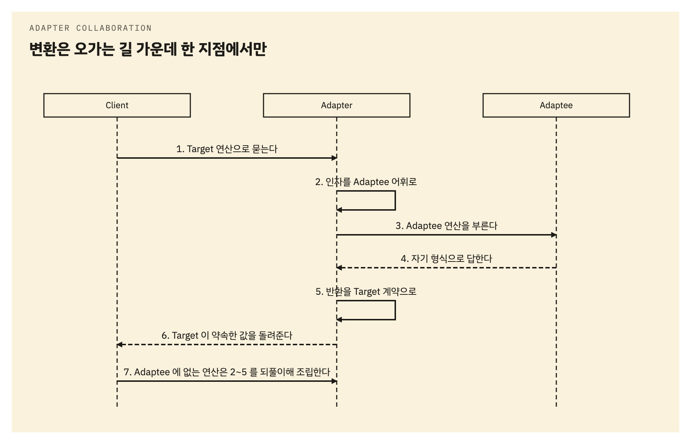
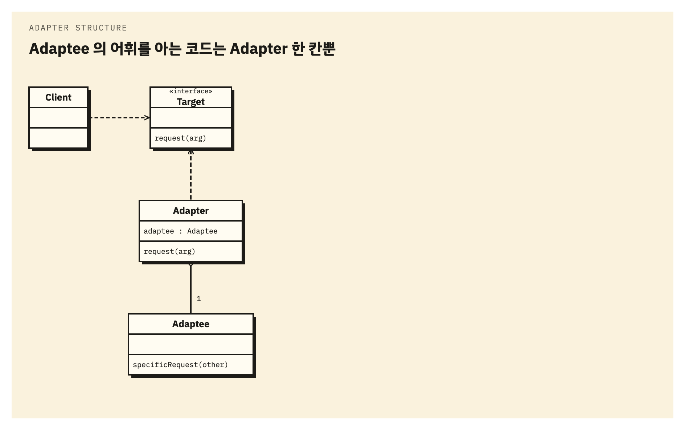

# Adapter — 고칠 수 없는 쪽은 그대로 두고, 말을 옮기는 한 칸을 사이에 넣기

## 한눈에 보는 개요

주문 데스크 코드를 하나 떠올려 봅시다. 주문을 받으면 재고가 충분한지 확인해야 하는데, 재고 정보를 가진 것은 몇 해 전에 들여온 창고 시스템이에요. 그 시스템에 물으려면 `query("BOOK_042")` 처럼 밑줄이 들어간 품목 코드를 넘겨야 하고, 돌아오는 것은 `BOOK_042|ON_HAND=37|RESERVED=5` 같은 한 줄 문자열입니다. 주문 데스크가 필요한 것은 "지금 팔 수 있는 개수" 하나인데 말이죠.

```text
주문 데스크가 원하는 것    available("BOOK-042")  →  32                    (지금 팔 수 있는 개수)
창고 시스템이 주는 것      query("BOOK_042")      →  "BOOK_042|ON_HAND=37|RESERVED=5"
                           ↑ 밑줄 표기               ↑ 한 줄 문자열, 예약분이 안 빠진 값
```

그 변환 — 하이픈을 밑줄로 바꾸고, 문자열을 갈라 숫자를 꺼내고, 예약분을 빼는 일 — 을 호출부마다 되풀이하면 어떻게 될까요. 한 곳이 예약분 빼는 줄을 잊는 순간 같은 품목이 어느 화면에서는 32 로, 다른 화면에서는 37 로 찍힙니다. 이 글의 예시 코드를 실제로 실행해 보면 마지막 줄이 정확히 그 상태예요(`8) adaptee read without adapter: 37`).

Adapter 의 해법은 **양쪽을 다 고치는 대신, 말을 옮기는 칸 하나를 사이에 두는 것**입니다. 창고 시스템은 건드리지 않고, 주문 데스크가 이미 쓰고 있는 연산 모양을 구현한 클래스 하나를 새로 써요. 그 안에서만 코드를 바꾸고 문자열을 갈라 숫자를 빼고, 바깥에서는 아무도 창고 시스템의 어휘를 모릅니다.

```text
Before : 창고 시스템의 어휘가 호출부마다 번진다

  주문 데스크 ──▶ 창고시스템.query("BOOK_042")   → "BOOK_042|ON_HAND=37|RESERVED=5"
                   하이픈→밑줄 · 문자열 파싱 · 37−5
  재고 리포트 ──▶ 창고시스템.query("BOOK_042")   → 같은 변환을 다시 씀 (예약분 빼는 줄을 잊음 → 37)
  정산 배치   ──▶ 창고시스템.query("BOOK_042")   → 또 한 벌

After : 변환을 아는 칸을 하나만 두고, 나머지는 우리 연산 모양만 본다

  주문 데스크 ─┐
  재고 리포트 ─┼──▶ StockSource.available("BOOK-042") ──▶ 창고 어댑터 ──▶ 창고시스템.query("BOOK_042")
  정산 배치   ─┘        (우리가 이미 쓰던 연산 모양)      37 − 5 = 32          (그대로 둠)
```

이 패턴의 이름은 GoF(Gang of Four, 1994년에 나온 *Design Patterns* 의 저자 네 명을 함께 부르는 이름)가 붙인 것이고 다른 이름은 Wrapper 예요(근거: GoF Adapter 절 Also Known As). 분류는 구조 패턴인데, 감싸는 방식(합성)과 물려받는 방식(상속) 둘 다 이 패턴으로 치기 때문에 GoF 의 패턴 분류표에서 클래스 범위와 객체 범위 양쪽에 함께 실려 있습니다(근거: GoF 1장 Table 1.1). 함께 쓰는 패턴은 Decorator·Proxy 예요 — 셋 다 대상을 감싸지만 목적이 달라서, 어댑터가 맞춰 놓은 연산 모양 **위에** 데코레이터나 프록시를 겹쳐 쓸 수 있습니다. 그 겹침은 비교 절에서 코드로 확인해요.

이 글은 시나리오 셋을 따라갑니다. 주문 하나가 재고 확인을 거치는 길, 두 번째 창고사가 들어올 때 무엇이 바뀌는가, 어댑터를 우회하면 어느 단계에서 무엇이 어긋나는가. 끝까지 읽으면 어떤 코드를 Adapter 라고 불러도 되는지 필수 조건 넷으로 판정할 수 있고, 구조가 거의 같은 Decorator·Proxy 와도 물음 셋으로 구분할 수 있게 됩니다.

## 패턴 자세히 들여다보기

### 시나리오 1 — 주문 하나가 재고 확인을 거쳐 승인되는 길

주문 하나가 들어왔습니다. 품목 `BOOK-042` 30개예요. 창고 원장에는 그 품목의 보유 수량이 37, 예약분이 5 로 적혀 있습니다. 나와야 하는 답은 `accepted` 하나고, 그 답이 나오려면 가용 수량 32 를 누군가 계산해야 해요. 이 장면에는 넷이 등장합니다. 주문을 받아 판정하는 `OrderDesk`(패턴에서는 Client 라고 부르는 역할), 주문 데스크가 재고에 묻는 연산 모양 `StockSource`(Target), 이미 있는 창고 시스템 `LegacyWarehouseApi`(Adaptee), 그리고 둘 사이에서 말을 옮기는 `LegacyWarehouseStock`(Adapter)입니다. 이름은 여기서 한 구절씩만 소개하고 정식 정의는 개념 정리에서 해요.



1. `OrderDesk` 가 `StockSource` 의 `available("BOOK-042")` 를 부릅니다. 주문 데스크가 `StockSource` 에만 묻는 이유는, 재고가 어디에서 오는지 아는 순간 주문 판정 코드가 그 출처에 묶이기 때문이에요. 지금 판정에 필요한 것은 "몇 개 팔 수 있는가" 하나뿐이고, 그것을 어디서 구하는지는 판정의 일이 아닙니다. 넘기는 품목 이름은 우리 쪽 표기인 `BOOK-042` 예요 — 창고 쪽 표기를 여기서 쓰면 창고의 어휘가 이미 주문 데스크까지 퍼진 겁니다.
2. Adapter 가 받은 인자를 Adaptee 의 어휘로 옮깁니다. `BOOK-042` 의 하이픈을 밑줄로 바꿔 `BOOK_042` 를 만들어요. 이 일을 Adapter 가 맡는 이유는 두 쪽이 같은 물건을 다른 이름으로 부르고 있는데 **어느 쪽도 이름을 바꿀 수 없기** 때문입니다. 창고 시스템은 우리가 고칠 수 있는 코드가 아니고, 주문 데스크의 표기를 창고에 맞추면 주문·정산·화면까지 전부 밑줄 표기로 갈아엎어야 해요.
3. Adapter 가 Adaptee 의 연산 `query("BOOK_042")` 를 부릅니다. 여기서 중요한 것은 Adapter 가 재고를 **계산하지 않고 물어본다**는 점이에요. 어댑터가 자기 안에 재고 표를 가지고 답하기 시작하면 그건 기존 시스템을 재사용하는 것이 아니라 다시 구현하는 것이고, 창고 원장이 바뀌어도 반영되지 않습니다(시나리오 3 의 3단계가 그 모양입니다).
4. Adaptee 가 자기 형식으로 답합니다. 돌아오는 값은 `BOOK_042|ON_HAND=37|RESERVED=5` 한 줄이에요. Adaptee 는 `StockSource` 라는 타입이 이 세상에 있다는 것도 모르고, 알 필요도 없습니다. 이 방향으로 아는 것이 없다는 점이 "기존 코드를 고치지 않는다"는 말의 실제 내용이에요.
5. Adapter 가 그 한 줄을 Target 이 약속한 값으로 옮깁니다. `ON_HAND` 에서 37 을, `RESERVED` 에서 5 를 꺼내 빼면 32 예요. 이 자리에서 옮기는 것은 형식만이 아니라 **의미**입니다. `StockSource.available` 이 약속한 것은 "지금 팔 수 있는 개수"이고, 창고가 주는 보유 수량은 예약분을 포함한 값이니까요. 계약이 다른 두 수를 그대로 이어 주면 타입은 맞는데 답이 틀립니다.
   - 갈래 5-a. 창고에 없는 품목이면 Adaptee 는 `NOT_FOUND` 라는 문자열을 돌려줍니다. Adapter 는 이것을 `0` 으로 옮겨요. Adaptee 의 "모름" 표현과 Target 의 "팔 수 있는 개수" 표현이 서로 다른 세계의 값이라, 옮기는 규칙을 정하는 것도 Adapter 의 일입니다. 실행 출력 7번 줄이 이 갈래예요.
6. `OrderDesk` 가 받은 32 와 주문 수량 30 을 견줘 `accepted` 를 냅니다. 주문 데스크는 이 답이 어댑터를 거쳐 왔다는 사실을 모르고, 32 가 37 에서 5 를 뺀 값이라는 것도 모릅니다. 아는 것은 `StockSource` 가 약속한 의미 하나뿐이에요.
7. Target 에는 있는데 Adaptee 에는 대응이 없는 연산도 있습니다. `totalAvailable(["BOOK-042", "PEN-007"])` 가 그것인데, 창고 시스템은 품목을 한 번에 하나씩만 답해요. Adapter 는 이 요청을 2~5단계의 되풀이로 조립합니다 — `BOOK-042` 에서 32, `PEN-007` 에서 12 − 4 = 8, 합 40. 어댑터가 하는 일이 "이름만 바꿔 넘기기"부터 "없는 연산을 여러 호출로 조립하기"까지 넓게 벌어지는 것이 이 패턴의 성질이고, 그 폭은 두 인터페이스가 얼마나 닮았느냐로 정해집니다(근거: GoF Adapter 절 Consequences).

```text
단계   부르는 쪽 → 받는 쪽        넘기는 것                        돌아오는 것
 1     Client → Target          "BOOK-042"                       (6단계에서 32)
 2     Adapter → (자기 안)       "BOOK-042"                       "BOOK_042"
 3     Adapter → Adaptee        "BOOK_042"                       —
 4     Adaptee → Adapter        —                                "BOOK_042|ON_HAND=37|RESERVED=5"
 5     Adapter → (자기 안)       그 한 줄                          37 − 5 = 32
 6     Adapter → Client         —                                32  → 30개 주문은 accepted
 7     Client → Target          ["BOOK-042", "PEN-007"]          32 + 8 = 40 (2~5 를 두 번)
```

잠깐, 확인 하나만 해 볼까요? 2단계와 5단계를 Adapter 에서 빼내 `OrderDesk` 쪽으로 옮기면, 위 표에서 무엇이 달라질까요?

표의 화살표 자체는 그대로입니다. 여전히 누군가 이름을 바꾸고 누군가 뺄셈을 해야 하니까요. 달라지는 것은 그 두 줄을 아는 코드의 **개수**입니다. Adapter 안에 있으면 한 벌이고, `OrderDesk` 로 옮기면 재고를 묻는 화면 수만큼 늘어나요. 개요의 Before 그림이 그 상태였고, 시나리오 3 이 그 상태에서 무엇이 어긋나는지를 따라갑니다.

```text
2단계(이름 변환)와 5단계(예약분 차감)를 아는 코드의 수

  Adapter 안에 둘 때      1 벌          ← 고칠 곳도 1 곳
  호출부로 옮길 때        재고를 묻는 곳의 수만큼   ← 하나가 한 줄을 빠뜨려도 티가 안 남
```

이 시나리오가 보여 준 것은 역할 넷과 **변환이 일어나는 지점이 둘**이라는 사실입니다. 들어갈 때 인자를 Adaptee 어휘로(2단계), 나올 때 반환을 Target 계약으로(5단계). 두 지점이 모두 Adapter 안에 있어서 Client 는 Adaptee 의 이름 규칙도 문자열 형식도 모르고(1·6단계), Adaptee 는 Target 이 있다는 것조차 모릅니다(4단계). 그리고 Target 에만 있는 연산은 Adaptee 호출 여럿으로 조립됩니다(7단계).

### 시나리오 2 — 두 번째 창고사가 들어올 때

상점이 파트너 창고사와 계약했습니다. 이 회사 시스템은 `lookup("BOOK-042")` 로 묻고 `sku=BOOK-042;free=12` 를 돌려줘요. 품목 표기가 우리와 같고, 예약분을 이미 뺀 가용 수량을 바로 줍니다. 주문 데스크는 창고사 둘 중 어느 쪽에 물어도 같은 방식으로 판정해야 하고, 파트너 창고에 `BOOK-042` 를 물으면 12 가 나와야 해요.

1. 개발자가 `PartnerWarehouseStock` 클래스를 새로 씁니다. 구현하는 연산 모양은 시나리오 1 의 `StockSource` 그대로예요. 모양을 바꾸지 않는 이유는 그 모양이 주문 데스크와 모든 재고 출처 사이의 계약이기 때문입니다. 여기서 `availableFree` 같은 새 이름을 쓰면 주문 데스크가 창고사마다 다른 호출을 갖게 되고, 그 순간 어댑터를 둔 이유가 사라져요.
2. 새 어댑터가 하는 일은 첫 어댑터보다 적습니다. 품목 표기가 같아서 2단계의 이름 변환이 없고, 가용 수량을 이미 받아서 5단계의 뺄셈도 없어요. 문자열에서 `free=` 뒤 숫자를 꺼내는 것이 전부입니다. 시나리오 1 의 7단계에서 말한 "적응 작업량의 폭"이 실제로 벌어진 모습이에요.
3. `OrderDesk` 와 `StockSource` 는 한 줄도 바뀌지 않습니다. `OrderDesk` 에 적힌 재고 관련 이름은 `StockSource` 와 `available` 뿐이라 새 창고사 이름이 들어갈 자리가 없어서예요. 바뀐 곳을 세면 새 클래스 하나와 그것을 만들어 넘기는 조립 코드 한 줄입니다.
4. 어댑터가 창고 시스템을 **필드로 가지고 있기** 때문에 생기는 여유가 하나 더 있어요. 파트너 창고사가 나중에 `PartnerWarehouseApi` 를 상속한 `PartnerWarehouseApiV2` 를 내놓아도 같은 어댑터가 그대로 받습니다. 어댑터가 창고 시스템을 **물려받는** 방식으로 짜여 있었다면 그 구체 클래스에 묶여, 하위 타입마다 어댑터를 다시 써야 해요. 대신 물려받는 방식은 창고 시스템의 동작 일부를 덮어쓸 수 있다는 이점을 갖습니다(근거: GoF Adapter 절 Consequences).
5. Java 에서는 물려받는 방식에 언어 제약이 하나 더 붙습니다. 클래스는 직접 상위 클래스를 하나만 가지므로(근거: Java 언어 명세 SE 21 §8.1.4 의 `extends` 절), 창고 시스템을 상속하면서 Target 도 상속할 수는 없어요. `Target` 이 인터페이스일 때만 `class Adapter extends Adaptee implements Target` 이 성립하고, 그러면 창고 시스템의 공개 메서드가 어댑터 바깥으로 그대로 노출됩니다. 이 가이드의 예시가 필드로 가지고 있는 방식을 쓰는 이유가 이것이에요.

```text
변화                        바뀐 곳                                 안 바뀐 곳
파트너 창고사 추가            PartnerWarehouseStock (새 클래스)        OrderDesk 전체
                            그것을 만들어 넘기는 조립 코드 한 줄        StockSource 의 연산 모양
                                                                   LegacyWarehouseStock
                                                                   LegacyWarehouseApi
```

| 어댑터를 짜는 방식 | Adaptee 를 갖는 법 | 하위 타입까지 받는가 | Adaptee 동작을 덮어쓸 수 있는가 | Java 에서 |
| --- | --- | --- | --- | --- |
| 감싸는 방식(합성) | 필드로 가지고 있음 | 받음 — 하위 타입도 같은 어댑터로 | 어려움 — 하위 타입을 따로 만들어 넣어야 함 | 제약 없음. 이 가이드 예시가 이 쪽 |
| 물려받는 방식(상속) | 자기가 그 타입임 | 못 받음 — 상속한 그 클래스에 묶임 | 쉬움 — 메서드를 덮어쓰면 됨 | Target 이 인터페이스일 때만. Adaptee 의 공개 메서드가 노출됨 |

두 방식의 구분은 GoF 가 클래스 어댑터와 객체 어댑터로 나눠 적은 것이고, 둘 다 Adapter 입니다(근거: GoF Adapter 절 Consequences). 그래서 최소 조건에서도 어느 쪽인지는 `[선택]` 에 둡니다.

여기서 헷갈리기 쉬운 포인트는 어댑터를 거친 객체를 **모든 클라이언트가 똑같이 볼 것**이라고 믿는 것입니다. 그렇지 않아요. 어댑터는 Target 의 인터페이스만 제공하기 때문에, 창고 시스템을 원래 형태로 다뤄야 하는 코드가 따로 있으면 그 코드는 어댑터를 쓸 수 없어요. 예를 들어 창고사가 제공하는 관리 콘솔용 코드가 `LegacyWarehouseApi` 를 그대로 받아야 한다면, 어댑터를 준 곳과 원본을 준 곳이 서로 다른 객체를 보게 됩니다. 두 클라이언트가 한 물건을 서로 다른 인터페이스로 봐야 한다면 양쪽 인터페이스를 모두 구현하는 어댑터(two-way adapter)를 쓰는 길이 있습니다(근거: GoF Adapter 절 Consequences).

```text
한 창고 시스템을 두 쪽이 서로 다르게 봐야 할 때

  주문 데스크  ──▶ StockSource 로 본다          ← 어댑터를 받음
  관리 콘솔    ──▶ LegacyWarehouseApi 로 본다   ← 원본을 받음 (어댑터는 이 인터페이스를 제공하지 않음)
                   두 인터페이스를 한 객체가 다 제공해야 하면 → two-way adapter
```

이 시나리오가 보여 준 것은 변화의 범위입니다. 재고 출처가 하나 늘 때 바뀌는 곳은 새 Adapter 하나와 조립 코드 한 줄이고, Target 과 Client 와 기존 Adapter 는 그대로예요(1·3단계). 어댑터가 하는 변환의 양은 두 인터페이스가 닮은 정도에 따라 크게 달라지고(2단계), 감싸는 방식과 물려받는 방식은 하위 타입 수용과 동작 재정의를 맞바꿉니다(4·5단계).

### 시나리오 3 — 어댑터를 우회하면 어느 단계에서 무엇이 어긋나는가

같은 상점의 다른 코드가 재고를 다르게 가져갑니다. 재고 리포트는 창고 시스템을 직접 부르고, 조립 코드를 손보던 개발자는 주문 데스크에 창고 시스템을 바로 넘겨 보려 하고, 성능을 걱정한 누군가는 어댑터 안에 값을 미리 채워 두려고 해요. 세 갈래를 차례로 따라갑니다. 같은 품목 `BOOK-042`(보유 37, 예약 5)를 쓰고, 정답은 32 예요. 아래 결과는 Java 21 · TypeScript 5.9.3 · Rust 1.95.0 으로 실제로 컴파일하거나 실행해 확인한 것입니다.

1. 재고 리포트가 `LegacyWarehouseApi.query("BOOK_042")` 를 직접 부릅니다. 받은 한 줄에서 `ON_HAND=` 뒤 숫자만 꺼내 37 을 찍었어요. 예약분을 빼는 줄을 잊은 건데, **잊었다는 사실을 아무 데서도 알 수 없습니다.** 타입은 맞고 숫자는 그럴듯하니까요. 주문 데스크는 같은 품목에 32 를 쓰고 있으므로 한 화면에 두 값이 함께 놓입니다. 이 줄이 예시 코드의 실행 출력 8번 줄이에요. 시나리오 1 의 5단계가 "형식이 아니라 의미를 옮긴다"고 한 이유가 이것입니다.
2. 조립 코드에서 주문 데스크에 창고 시스템을 바로 넘겨 봅니다. 이 갈래는 세 언어 모두 컴파일에서 막혀요. `OrderDesk` 가 받는 타입이 `StockSource` 인데 창고 시스템은 그 연산을 갖고 있지 않으니까요. 1번 갈래와 이 갈래의 차이가 중요합니다 — 이쪽은 **타입이 어긋나서** 기계가 잡아 주고, 1번은 타입이 맞는 채로 의미만 틀려서 아무도 못 잡습니다.
3. 성능을 걱정한 개발자가 `LegacyWarehouseStock` 안에 품목별 가용 수량 표를 미리 채워 두고, `available` 이 창고를 부르지 않고 그 표를 읽게 고칩니다. 지금 이 순간에는 32 가 그대로 나오지만, 창고에서 예약이 하나 잡히는 순간 어댑터의 답과 창고 원장이 어긋나요. 이 클래스는 더 이상 창고 시스템을 **재사용**하지 않고 재고 계산을 **다시 구현**한 것이고, 어댑터라고 부를 근거가 사라집니다. 시나리오 1 의 3단계가 "계산하지 않고 물어본다"고 한 자리예요.
4. 2번 갈래의 진단을 그대로 옮깁니다. 세 도구가 내는 메시지는 이렇습니다.

```text
javac 21.0.11  (파일명과 줄 번호 앞머리 `WarehouseDeskApp.java:156: ` 를 지운 것 외에는 원문 그대로)
error: incompatible types: LegacyWarehouseApi cannot be converted to StockSource

tsc 5.9.3      (파일명·줄·칸 앞머리 `bad.ts(120,7): ` 를 지운 것 외에는 원문 그대로)
error TS2739: Type 'LegacyWarehouseApi' is missing the following properties from type 'StockSource': available, totalAvailable

rustc 1.95.0   (머리 줄만 옮겼고 `--> 파일:줄:칸` 위치 줄과 밑줄 표시 줄은 지웠습니다)
error[E0277]: the trait bound `LegacyWarehouseApi: StockSource` is not satisfied
```

5. 세 진단이 말하는 것은 한 가지입니다 — Adaptee 는 Target 이 아니다. 어댑터가 하는 일의 절반은 이 문장을 코드에서 참으로 만드는 것이고, 그래서 최소 조건 2번이 "Adapter 가 Target 을 구현한다"를 요구합니다. 다만 TypeScript 에서는 이 검사가 느슨해요. 구조적 타입 판정이라 `implements` 를 쓰지 않아도 **연산 모양만 우연히 맞으면** Target 자리에 들어갑니다. 아래 코드는 `StockSource` 라는 이름을 모르는 클래스인데 실제로 `tsc` 를 통과했어요(종료 코드 0, 직접 컴파일해 확인).

```typescript no-compile
// StockSource 를 이름으로 알지도 못하고 implements 도 쓰지 않았다
class ModernWarehouseApi {
  available(sku: string): number {
    return sku === "BOOK-042" ? 32 : 0;
  }
  totalAvailable(skus: readonly string[]): number {
    return skus.reduce((a, s) => a + this.available(s), 0);
  }
}

const source: StockSource = new ModernWarehouseApi();   // 통과한다
```

6. 5번의 통과는 버그가 아니라 이 패턴의 경계를 보여 줍니다. 인터페이스가 **이미 맞으면 어댑터는 필요 없어요** — 감쌀 것이 없으니까요. 뒤집으면, 감싸는 클래스를 어댑터라고 부르려면 두 인터페이스가 실제로 어긋나 있어야 한다는 뜻이고, 그것이 최소 조건 1번입니다. 다만 TypeScript 에서는 모양만 맞고 **의미가 다른** 객체도 같은 방식으로 통과하므로, 어댑터에는 `implements StockSource` 를 명시해 빠뜨린 연산을 컴파일러가 잡게 하는 편이 낫습니다.

이 시나리오가 보여 준 것은 어댑터를 우회하는 세 가지 길과 그 대가입니다. Client 가 Adaptee 를 직접 부르면 변환 규칙이 복제되고 조용히 어긋나며(1단계), 타입으로 어긋나는 우회는 컴파일이 막아 주지만(2·4단계) 의미만 어긋나는 우회는 아무도 막아 주지 않습니다. Adapter 가 Adaptee 를 부르지 않고 스스로 답하기 시작하면 재사용이 재구현으로 바뀌고(3단계), 두 인터페이스가 처음부터 맞으면 어댑터를 둘 이유 자체가 없습니다(5·6단계).

### 개념 정리

시나리오에 나온 역할 넷을 정식으로 정의합니다. 넷 모두 GoF 가 이 패턴의 참여자로 적은 역할이에요(근거: GoF Adapter 절 Participants).

- **Target** — Client 가 쓰는, 그 업무 영역의 말로 쓰인 연산 모양입니다. 이 인터페이스를 정의하는 쪽은 Client 를 가진 우리이고, Adaptee 를 만든 쪽이 아니에요. 그래서 Target 의 연산 이름·인자·반환은 Adaptee 를 닮을 이유가 없고, 닮지 않았다는 사실이 바로 어댑터가 필요한 이유입니다. 재고 예에서는 `available(sku)` 와 `totalAvailable(skus)` 를 선언한 `StockSource` 가 Target 이에요.
- **Client** — Target 을 따르는 객체와만 협력하는 쪽입니다. Adaptee 가 무엇인지, 어댑터를 거쳤는지 모른 채 Target 의 연산만 부르고, 그 연산이 약속한 의미로 결과를 씁니다(시나리오 1 의 1·6단계). 재고 예에서는 주문 수량과 가용 수량을 견줘 판정하는 `OrderDesk` 가 Client 예요.
- **Adaptee** — 이미 있고 우리가 고칠 수 없는(또는 고치고 싶지 않은) 인터페이스입니다. 외부 회사의 SDK, 오래된 사내 시스템, 표준 라이브러리 타입이 모두 여기에 들어가요. Adaptee 는 Target 도 Adapter 도 알지 못하고, 이 방향으로 아는 것이 없다는 점이 "기존 코드를 건드리지 않는다"는 말의 내용입니다(시나리오 1 의 4단계). 재고 예에서는 `query(itemCode)` 하나를 가진 `LegacyWarehouseApi` 가 Adaptee 예요.
- **Adapter** — Target 을 구현하고, 받은 요청을 Adaptee 의 연산 호출로 수행하는 쪽입니다. 들어가는 인자를 Adaptee 의 어휘로, 나오는 값을 Target 의 계약으로 옮기는 두 변환이 이 안에 있습니다(시나리오 1 의 2·5단계). Adaptee 에 대응이 없는 연산은 여러 호출로 조립하고(7단계), Adaptee 의 오류 표현도 Target 의 값으로 옮겨요(갈래 5-a). 재고 예에서는 `LegacyWarehouseStock` 과 `PartnerWarehouseStock` 이 각각 Adapter 입니다.



그림에서 Client 에서 나가는 화살표가 Target 으로만 향하고 Adaptee 를 가리키지 않는다는 점을 봐 두세요. Adaptee 로 들어가는 화살표도 Adapter 에서 온 것 하나뿐입니다. 이 두 가지가 각각 최소 조건 4번과 3번이 코드에서 확인하는 모양이에요.

> 양쪽 다 고치지 못할 때, 가운데 한 칸만 새로 만든다.

## 사용 목적

Adapter 가 필요하다는 단서는 코드와 요구 양쪽에서 보입니다. 셋을 차례로 봅시다.

**단서 1. 같은 변환 코드가 호출부마다 복제돼 있습니다.** 외부 API 나 레거시 시스템을 부르는 자리마다 코드 변환·문자열 파싱·단위 환산이 함께 붙어 다니는 모양이에요. 시나리오 3 의 1단계가 그 결과였습니다 — 복제된 변환 중 하나가 한 줄을 빠뜨렸고, 그 사실을 어디에서도 알 수 없었죠. 검색으로 확인할 수 있는 단서라 가장 쓰기 좋아요.

```text
grep 으로 창고 API 호출을 세어 보면
────────────────────────────────────────────────────────────
order/OrderDesk        query(...)  + 하이픈→밑줄 + 파싱 + 예약분 차감
report/StockReport     query(...)  + 하이픈→밑줄 + 파싱            ← 차감 없음
batch/SettlementJob    query(...)  + 하이픈→밑줄 + 파싱 + 예약분 차감
```

**단서 2. 쓰고 싶은 기존 클래스가 있는데 필요한 인터페이스와 맞지 않습니다.** 재고 계산 로직은 이미 창고 시스템 안에 제대로 들어 있고, 우리에게 없는 것은 그것을 우리 말로 부르는 길뿐인 상황이에요. GoF 도 "기존 클래스를 쓰고 싶은데 인터페이스가 필요한 것과 맞지 않을 때"를 첫 번째 적용 대상으로 듭니다(근거: GoF Adapter 절 Applicability). 이 단서가 중요한 이유는, 이 상황에서 대안이 둘뿐이기 때문입니다 — 기존 클래스를 고치거나, 사이에 한 칸을 두거나. 기존 클래스를 고칠 수 있다면 그 편이 간단할 때도 있어요. 외부 소유이거나 다른 코드가 이미 그 인터페이스에 기대고 있으면 그때 어댑터입니다.

**단서 3. 재사용하려는 쪽이 협력 상대를 미리 알 수 없습니다.** 우리가 만든 라이브러리가 아직 존재하지도 않는 클래스와 협력해야 하는 경우예요(근거: GoF Adapter 절 Applicability). 재고 예로 옮기면, 주문 데스크를 다른 상점에 팔 때 그 상점의 창고 시스템이 무엇일지 우리는 모릅니다. 그래서 `StockSource` 만 정해 두고 어댑터는 도입하는 쪽이 쓰게 해요. 아래 표는 세 단서를 코드에서 무엇을 보면 되는지로 정리한 것입니다.

| 단서 | 코드에서 관찰되는 것 | 확인 방법 |
| --- | --- | --- |
| 1. 변환 코드의 복제 | 외부 호출 자리마다 같은 파싱·환산이 붙음 | 외부 API 이름으로 검색해 호출부 수를 셈 |
| 2. 인터페이스 불일치 | 쓰려는 클래스의 연산 이름·인자·반환이 필요한 것과 다름 | 그 클래스를 필요한 자리에 대입해 컴파일 — 시나리오 3 의 4단계 진단이 나옴 |
| 3. 상대를 모르는 재사용 | 우리 코드가 인터페이스만 정의하고 구현은 도입하는 쪽에 맡김 | 인터페이스 선언은 있는데 우리 저장소 안에 구현이 없음 |

비슷한 단서에서 다른 패턴을 고르게 되는 경우가 셋 있습니다. 감싸는 목적이 인터페이스 변환이 아니라 기능 추가면 Decorator 를, 접근 통제면 Proxy 를, 여러 객체를 묶어 새 진입점을 만드는 것이면 Facade 를 먼저 검토하세요. 차이는 다음 절에서 풉니다. 그리고 아래 상황에서는 어댑터를 두면 얻는 것보다 잃는 것이 큽니다.

| 쓰지 말아야 할 상황 | 쓰면 잃는 것 |
| --- | --- |
| 두 인터페이스를 **우리가 둘 다 설계할 수 있음** | 맞지 않게 만들어 놓고 맞추는 칸을 또 두는 셈. 설계 시점에 양쪽을 맞추거나, 추상과 구현을 애초에 분리(Bridge)하는 편이 낫습니다 |
| 호출부가 한 곳뿐이고 늘어날 계획이 없음 | 타입 하나·파일 하나가 늘고 호출이 한 단계 깊어지는데, 변환이 한 곳에 모이는 이득은 이미 한 곳이라 생기지 않습니다. 서비스 클래스를 직접 고치는 편이 더 간단할 때가 있어요([refactoring.guru — Adapter](https://refactoring.guru/design-patterns/adapter)) |
| 두 인터페이스가 이미 맞음 | 그대로 대입하면 되는 것을 한 겹 감싸는 일. 시나리오 3 의 5·6단계가 이 경우였고, 감싼 이유가 변환이 아니라면 그것은 Decorator 나 Proxy 입니다 |

## 패턴의 경계

### 디자인 패턴을 충족하는 최소 조건

어떤 코드를 Adapter 라고 불러도 되는지 가르는 기준입니다. `[필수]` 가 하나라도 빠지면 Adapter 가 아니고, `[선택]` 은 갖추면 좋거나 둘 중 하나를 고르면 되는 구조예요. 조건은 언어와 상관없이 코드에서 확인할 수 있는 모양(타입 선언·참조 보유·호출 방향·생성 위치)으로 적었고, 조건마다 그것을 보여 준 시나리오의 단계를 가리킵니다.

1. [필수] Client 가 의존하는 Target 인터페이스가 있고, 재사용하려는 Adaptee 의 인터페이스가 그와 **맞지 않습니다** — Client 가 부르는 연산의 이름·인자·반환·연산 집합 가운데 적어도 하나가 Adaptee 의 것과 다릅니다. 시나리오 1 의 2·5단계가 그 어긋남을 메우는 자리이고, 시나리오 3 의 4단계 진단이 어긋남을 기계로 확인한 자리예요 (근거: GoF Adapter 절 Intent — 한 클래스의 인터페이스를 클라이언트가 기대하는 다른 인터페이스로 바꿔, 맞지 않아서 함께 일할 수 없던 클래스들이 협력하게 하는 것이 이 패턴의 의도다).
   - 빠지면: 두 인터페이스가 이미 같으면 감싼 이유가 변환일 수 없습니다. 그 래퍼가 전달 전후에 연산을 더하고 있으면 Decorator 이고, 접근을 막거나 미루고 있으면 Proxy 예요. 시나리오 3 의 5단계에서 본 `ModernWarehouseApi` 는 모양이 이미 맞아 어댑터 없이 대입됐습니다.
2. [필수] Adapter 가 Target 을 구현하거나 상속해서, Client 가 Adapter 를 **Target 타입으로만** 씁니다 — Client 의 필드·인자·반환에 적힌 타입이 Target 이고, Adapter 고유의 공개 연산을 Client 가 직접 부르는 자리가 없습니다. 시나리오 1 의 1·6단계가 이 모양이에요 (근거: GoF Adapter 절 Participants — Adapter 는 Adaptee 의 인터페이스를 Target 인터페이스에 맞추고, Client 는 Target 인터페이스를 따르는 객체와 협력한다).
   - 빠지면: Client 가 `LegacyWarehouseStock` 이라는 구체 타입으로 어댑터를 받고 그 고유 메서드를 부르면, 창고사를 바꿀 때 Client 를 고쳐야 합니다. 시나리오 2 의 3단계에서 `OrderDesk` 가 한 줄도 안 바뀐 이유가 이 조건이었어요.
3. [필수] Adapter 가 요청을 **Adaptee 의 연산 호출로 수행**하며, 인터페이스 차이를 그 안에서 메웁니다 — Adapter 가 Adaptee 참조를 갖고(필드로 가지거나 자기가 그 타입이거나) 자기 연산 안에서 그것을 부르며, 이름·인자·반환·연산 집합의 차이를 옮기는 코드가 Adapter 안에 있습니다. 시나리오 1 의 3·7단계가 이 자리입니다 (근거: GoF Adapter 절 Collaborations — Client 가 Adapter 의 연산을 부르면 Adapter 는 그 요청을 수행하는 Adaptee 의 연산을 부른다).
   - 빠지면: Adapter 가 Adaptee 를 부르지 않고 자기 안에서 답을 만들면 기존 클래스를 재사용하는 것이 아니라 다시 구현한 것입니다. 시나리오 3 의 3단계가 그 모양이고, 창고 원장이 바뀌는 순간 두 답이 어긋나요.
4. [필수] Client 코드가 Adaptee 타입에 의존하지 않습니다 — Client 쪽 어디에도 Adaptee 타입의 선언·인자·캐스팅이 없고, Adaptee 를 부르는 코드는 Adapter 한 곳입니다. 시나리오 3 의 1단계가 이 조건이 성립하지 않는 자리예요 (근거: GoF Adapter 절 Intent·Participants — Client 는 Target 인터페이스를 따르는 객체와 협력하고, Adaptee 를 그 인터페이스에 맞추는 일은 Adapter 가 맡는다).
   - 빠지면: 변환 책임이 Adapter 한 곳에 모이지 않고 호출부마다 흩어집니다. 재고 리포트가 창고 시스템을 직접 읽어 37 을 찍은 것이 그것이고, 같은 품목에 32 와 37 이 함께 나와도 타입 검사는 통과해요.
5. [선택] 감싸는 방식(합성)과 물려받는 방식(상속) 중 어느 쪽이든 됩니다 — Adapter 가 Adaptee 를 필드로 가지고 있어도, Adaptee 를 상속해 자기가 그 타입이어도 이 패턴입니다. 시나리오 2 의 4·5단계가 두 방식의 득실을 따라간 자리예요 (근거: GoF Adapter 절 Consequences — 객체 어댑터와 클래스 어댑터가 모두 이 패턴으로 제시되고 각각의 득실이 다르다).
6. [선택] Adaptee 에 없는 연산을 여러 호출로 조립합니다 — Target 의 연산 하나가 Adaptee 호출 여럿이나 추가 계산으로 구현됩니다. 시나리오 1 의 7단계가 이 모양이고, 적응 작업량은 두 인터페이스가 닮은 정도에 달려 있어 이름만 바꾸는 어댑터도 똑같이 이 패턴입니다 (근거: GoF Adapter 절 Consequences — 적응에 드는 일의 양은 Target 과 Adaptee 가 얼마나 비슷한지에 따라 넓게 벌어진다).
7. [선택] 한 물건을 두 인터페이스로 제공하는 two-way adapter — 두 클라이언트가 같은 객체를 서로 다른 인터페이스로 봐야 할 때, Target 과 Adaptee 인터페이스를 모두 구현합니다. 시나리오 2 의 "헷갈리기 쉬운 포인트"가 이 필요가 생기는 자리예요 (근거: GoF Adapter 절 Consequences — 어댑터를 거친 객체는 더 이상 Adaptee 인터페이스를 따르지 않아 모든 클라이언트에 투명하지 않다).
8. [선택] Adaptee 의 오류·부재 표현을 Target 의 값으로 옮깁니다 — Adaptee 가 예외나 특별한 값으로 표현하는 "없음"을 Target 계약이 정한 값으로 바꿉니다. 시나리오 1 의 갈래 5-a 가 `NOT_FOUND` 를 0 으로 옮긴 자리예요 (근거: 이 가이드의 정책 — GoF 는 이름·인자·반환의 변환을 적을 뿐 오류 표현의 변환을 따로 다루지 않아 필수로 올리지 않았습니다).

조건 1번이 맨 앞인 데는 이유가 있습니다. 1번만 빠지고 2·3·4번은 만족하는 코드가 흔하고, 그 코드는 Adapter 가 아니라 Decorator 나 Proxy 거든요. 아래 표로 판정 순서를 봅시다.

| 코드 | 1번 | 2번 | 3번 | 4번 | 판정 |
| --- | --- | --- | --- | --- | --- |
| `LegacyWarehouseStock` 과 `OrderDesk` | 만족 (연산 이름·인자·반환이 모두 다름) | 만족 | 만족 | 만족 | Adapter |
| `PartnerWarehouseStock` 과 `OrderDesk` | 만족 (연산 이름·반환 형식이 다름) | 만족 | 만족 | 만족 | Adapter (변환량만 적음) |
| `CountingStock`(같은 `StockSource` 를 감싸 호출을 셈) | 빠짐 (감싼 것과 인터페이스가 같음) | 만족 | 만족 | 만족 | Adapter 아님 — Decorator |
| 재고 리포트가 `query` 를 직접 읽는 코드 | 만족 | — | — | 빠짐 | Adapter 아님 |
| 어댑터 안에 표를 가지고 답하는 코드 | 만족 | 만족 | 빠짐 | 만족 | Adapter 아님 |

표의 세 번째 줄이 이 가이드 예시 코드에 실제로 들어 있는 `CountingStock` 입니다. 겉모습은 어댑터예요. `StockSource` 를 구현하고, `StockSource` 를 필드로 가지고, 받은 요청을 그 필드에 넘겨요. 2·3·4번만 보면 통과하지만 감싼 것과 인터페이스가 같아서 1번에서 걸립니다. 그리고 걸리는 것이 맞아요 — 이 클래스가 하는 일은 변환이 아니라 호출 세기, 곧 책임 추가니까요.

> 감쌌다는 사실은 셋 모두에 있다. 다른 점은 감싼 뒤에 제공하는 인터페이스가 달라졌는가다.

### 비슷한 패턴·안티패턴과의 차이

Adapter 와 구조가 닮았거나 같은 단서에서 떠오르는 대상 다섯을 비교합니다. Decorator·Proxy 는 Adapter 와 구조가 거의 같아 셋을 함께 가르는 물음을 먼저 정하고, 그다음 Bridge·Facade, 마지막으로 어댑터로 오해받는 변환 함수를 봅니다.

| 비교 대상 | 구분 기준 (코드에서 보는 것) | Adapter 를 고르면 얻는 것 | 포기하는 것 |
| --- | --- | --- | --- |
| Decorator | 감싼 결과가 제공하는 인터페이스가 감싼 대상과 **다른가** — 같으면서 전달 전후에 연산을 더하면 Decorator | Client 가 Adaptee 의 어휘를 모름. 창고사를 바꿔도 Client 무변경(시나리오 2 의 3단계) | 같은 어댑터를 겹쳐 쌓는 재귀 합성. 어댑터 위에 어댑터를 쌓아도 인터페이스가 계속 바뀌어 쌓는 의미가 없음 |
| Proxy | 인터페이스가 **같으면서** 끼어드는 목적이 접근 통제(지연 생성·권한 검사·원격·참조 관리)인가 | 두 인터페이스의 불일치를 한 곳에 모음 | 대상의 생성·수명을 감추는 일. 어댑터는 Adaptee 를 받아서 쓸 뿐 만들어 주지 않음(시나리오 2 의 1단계 조립 코드가 Adaptee 를 만듦) |
| Bridge | 두 인터페이스를 **우리가 설계했는가**, 밖에서 주어졌는가 | 이미 어긋난 두 쪽을 사후에 잇는 최소 비용 | 추상과 구현이 각자 독립으로 확장되는 구조. 어댑터는 이미 굳은 두 쪽을 잇는 것이라 양쪽 계층이 함께 늘지 않음 |
| Facade | 인터페이스를 **새로 만들었는가**, 이미 있던 것을 재사용하는가 | 기존 Target 을 그대로 쓰므로 Client 코드가 안 바뀜 | 여러 객체의 복잡한 협력을 하나로 줄여 주는 단순화. 어댑터는 보통 한 대상을 맡음 |
| 필드만 옮기는 변환 함수 | Target 타입이 코드에 **존재하는가** | 변환이 타입으로 고정돼 Client 가 그 타입에만 기대게 됨 | 함수 하나로 끝낼 수 있던 단순함. Target 인터페이스와 구현 클래스가 늘어남 |

**Decorator·Proxy 와 구분하는 물음 셋.** 이 셋은 대상을 감싸 같은 요청을 넘긴다는 구조가 거의 같아서, 구조만 보면 구분되지 않습니다. 아래 물음 셋을 순서대로 적용하세요. 물음 1 에서 구분되면 거기서 끝이고, 구분되지 않으면 물음 2 로 내려갑니다. 물음 3 은 물음 2 의 판정을 코드에서 다시 확인하는 보조 물음이에요.

```text
물음 1 — 감싼 결과가 제공하는 인터페이스가 대상의 것과 같은가?
       │
       ├─ 다르다 ───────────────────────────────▶ Adapter
       │     (근거: GoF Adapter 절 Intent / GoF Decorator 절 Related Patterns /
       │            GoF Proxy 절 Related Patterns — Adapter 는 감싼 객체에 다른 인터페이스를 준다)
       │
       └─ 같다 ──▶ 물음 2 — 끼어드는 목적이 무엇인가?
                     │
                     ├─ 책임을 더한다 (전달 전후에 연산을 수행) ──▶ Decorator
                     │     (근거: GoF Decorator 절 Intent — 객체에 책임을 동적으로 덧붙인다 /
                     │            GoF Proxy 절 Related Patterns — 데코레이터는 책임을 더하고 프록시는 접근을 통제한다)
                     │
                     └─ 접근을 통제한다 (지연 생성·권한 검사·원격·참조 관리·쓸 때 복사) ──▶ Proxy
                           (근거: GoF Proxy 절 Intent — 다른 객체에 대한 접근을 통제하려고 대리자를 둔다)

물음 3 — 겹쳐 쌓는 것이 설계의 전제인가? (물음 2 의 판정을 코드에서 재확인)
       Decorator : 참조 필드가 데코레이터와 감싼 대상이 함께 구현하는 공통 인터페이스 타입(Decorator 가 Component 라고
                   부르는 역할)이라, 데코레이터 위에 데코레이터를 겹칠 수 있고 조합을 Client 가 고른다
       Proxy     : 대상과 프록시의 한 관계에 집중하며 보통 한 겹, 대상의 생성·수명까지 감출 수 있다
       Adapter   : 인터페이스가 바뀌므로 같은 어댑터를 겹쳐 쌓을 수 없다
       (근거: GoF Adapter 절 Related Patterns — Decorator 는 더 투명해 재귀 합성이 가능하고 순수 Adapter 는 그렇지 않다 /
              GoF Discussion of Structural Patterns — Decorator 는 재귀 합성을 전제하고 Proxy 의 관계는 정적으로 표현될 수 있다)
```

**Decorator 와의 차이.** 구분 기준은 감싼 결과가 제공하는 인터페이스가 감싼 대상의 것과 다른지입니다. 이 가이드 예시 코드에 두 클래스가 나란히 있어요. `LegacyWarehouseStock` 은 `LegacyWarehouseApi` 를 감싸 `StockSource` 를 제공하고(인터페이스가 바뀜), `CountingStock` 은 `StockSource` 를 감싸 `StockSource` 를 제공합니다(인터페이스가 그대로). 뒤쪽이 하는 일은 전달하기 전에 세는 것 하나뿐이고, 그래서 최소 조건 1번에서 걸립니다.

```text
Adapter  : LegacyWarehouseApi  ──감쌈──▶  StockSource 를 제공한다  인터페이스가 바뀜   → 변환
Decorator: StockSource         ──감쌈──▶  StockSource 를 제공한다  인터페이스가 그대로 → 책임 추가
```

시나리오 2 의 1단계에서 새 창고사가 들어올 때 우리가 쓴 것이 어댑터였던 이유가 여기 있습니다. 파트너 창고사의 `lookup` 은 `StockSource` 의 연산이 아니었으니까요. 반대로 호출 횟수를 세고 싶어졌을 때는 `StockSource` 를 구현해 `StockSource` 를 감싸면 됐고, 그건 어댑터가 아니었습니다. Adapter 를 고르면 Client 가 Adaptee 의 어휘를 모르게 되는 것을 얻고, 같은 것을 겹쳐 쌓는 재귀 합성을 포기합니다 — 어댑터 위에 어댑터를 쌓으면 인터페이스가 계속 바뀌어서 쌓을수록 Client 가 기대하는 타입에서 멀어져요.

**포개지는 관계 — 둘은 배타적 선택지가 아닙니다.** 어댑터가 맞춰 놓은 Target 위에 데코레이터를 겹치는 구성은 성립하고, 실제로 이 가이드의 예시 코드가 그렇게 동작합니다. `CountingStock(new LegacyWarehouseStock(legacyApi))` 가 그것이에요. 어댑터가 `StockSource` 를 구현하므로 데코레이터가 감쌀 Component 자리에 그대로 들어가고, 데코레이터도 `StockSource` 를 제공하므로 `OrderDesk` 는 둘 중 무엇을 받았는지 모릅니다. 실행 출력 6번 줄이 그 결과입니다.

```text
6) counting over legacy: available 32, total 40, calls 2
```

순서가 반대여도 될까요? `LegacyWarehouseStock(counting)` 은 성립하지 않습니다 — 어댑터가 감싸야 하는 것은 `LegacyWarehouseApi` 인데 데코레이터가 제공하는 것은 `StockSource` 니까요. 그래서 어댑터는 항상 **바깥 세계에 가장 가까운 안쪽**에 놓이고, 같은 인터페이스를 유지하는 데코레이터와 프록시는 그 바깥에 층으로 쌓입니다. 물음 3 의 「겹쳐 쌓는 것이 전제인가」를 코드로 확인하면 이 순서가 나와요.

```text
바깥                                                                          안쪽
OrderDesk ──▶ CountingStock ──▶ LegacyWarehouseStock ──▶ LegacyWarehouseApi
              (Decorator)        (Adapter)                (Adaptee)
              StockSource 유지    StockSource 로 변환       자기 어휘
              ↑ 여기에 Proxy 도 같은 층으로 들어갈 수 있다
```

**Proxy 와의 차이.** 구분 기준은 인터페이스가 같으면서 끼어드는 목적이 접근 통제인지입니다. 접근 통제라는 말은 넓어 보이지만 코드에서 보이는 모양은 좁아요 — 대상을 첫 호출까지 만들지 않거나(지연 생성), 권한을 확인해 어떤 호출은 넘기지 않거나(보호), 다른 주소 공간으로 보내거나(원격), 참조 수·잠금·쓸 때 복사를 관리합니다. 어댑터에는 이 중 어느 것도 없습니다. 어댑터는 받은 요청을 **전부** 넘기고, 넘길 때 말을 바꿀 뿐이에요(시나리오 1 의 3·7단계).

```text
같은 인터페이스를 유지하는 두 래퍼

Proxy     : if (권한 없음) 거부       ← 어떤 호출은 대상에 전달되지 않는다
            if (아직 없음) 만들어 둠   ← 대상의 생성·수명을 래퍼가 관리한다
Decorator : before(); 대상 호출; after()   ← 모든 호출이 대상에 전달되고, 앞뒤에 일이 붙는다

Adapter (인터페이스가 다르므로 위 둘과 애초에 구분된다)
          : 인자를 옮겨 대상 호출; 반환을 옮김   ← 모든 호출이 전달되고, 말이 바뀐다
```

경계 사례가 하나 있습니다. 보호 프록시가 일부 연산을 거부하면 실제로 쓸 수 있는 연산이 대상의 부분집합이 되어, 인터페이스가 같다는 판정이 흔들려 보여요. 이때도 **선언된 타입**은 같습니다. 거부는 실행 중에 일어나지 시그니처에서 빠지는 것이 아니니까요(근거: GoF Proxy 절 Related Patterns). 그래서 물음 1 은 실행 결과가 아니라 선언된 타입으로 판정합니다. 시나리오 3 의 4단계에서 본 진단 셋이 전부 **타입 검사** 결과였던 것과 같은 이유예요. Adapter 를 고르면 두 인터페이스의 불일치를 한 곳에 모으는 것을 얻고, 대상의 생성과 수명을 감추는 일을 포기합니다 — 어댑터는 Adaptee 를 받아서 쓸 뿐이라 누가 그것을 만들지는 조립 코드가 정해요.

**Bridge 와의 차이.** 구분 기준은 이어 주는 두 인터페이스를 우리가 설계했는지, 밖에서 주어졌는지입니다. 코드 모양만 보면 둘 다 인터페이스 필드를 가지고 위임하는 클래스라 똑같아 보여요. 다른 점은 시점입니다. Bridge 는 설계하기 전에 추상과 구현을 갈라 각자 확장되게 하려는 것이고, Adapter 는 이미 굳어 버린 두 쪽을 설계가 끝난 뒤에 잇는 것이니까요(근거: GoF Discussion of Structural Patterns 의 Adapter versus Bridge). 그래서 저장소에서 확인할 수 있는 단서가 있습니다.

```text
위임 대상 인터페이스를 누가 정의했나?
  우리 저장소 안 + 구현이 여럿 + 양쪽이 함께 늘어남   → Bridge
  외부 SDK·레거시 + 우리가 못 고침 + 한쪽만 굳어 있음  → Adapter
```

**Facade 와의 차이.** 구분 기준은 Client 가 쓰는 인터페이스를 이번에 새로 만들었는지, 이미 있던 것을 재사용하는지입니다. 시나리오 2 에서 파트너 창고사를 붙일 때 우리는 `StockSource` 를 새로 만들지 않았어요. 주문 데스크가 이미 쓰던 것을 그대로 구현했습니다. 만약 그때 창고 관련 일을 한 군데서 편하게 부르자며 `WarehouseOps` 라는 새 인터페이스를 만들고 조회·입고·반품을 묶었다면, 그건 Facade 예요. 새로 만들었으니까요. Facade 는 여러 객체가 이루는 서브시스템 전체를 상대하는 반면 Adapter 는 보통 한 대상을 맡는다는 차이도 함께 쓰입니다([refactoring.guru 의 Adapter 문서](https://refactoring.guru/design-patterns/adapter)).

**필드만 옮기는 변환 함수와의 차이.** 구분 기준은 Target 타입이 코드에 존재하는지입니다. 아래는 어댑터로 오해받기 쉬운 코드예요.

```java no-compile
// Target 인터페이스가 없다. Client 는 이 함수를 직접 부르고 결과 타입에 직접 기댄다.
static StockRow toStockRow(String warehouseLine) {
    String[] parts = warehouseLine.split("\\|");
    return new StockRow(parts[0], Integer.parseInt(parts[1].substring(8)));
}
```

이 함수도 형식을 옮기고, 창고 시스템을 재사용하고, 호출부를 한 곳으로 모읍니다. 없는 것은 Client 가 기대는 **Target 타입**이에요. Client 가 `StockRow` 라는 구체 타입에 직접 기대고 있으므로, 창고사가 하나 늘면 시나리오 2 의 3단계가 성립하지 않습니다 — `OrderDesk` 가 두 변환 함수 중 무엇을 부를지 고르게 되니까요. 어댑터로 만들면 변환이 타입으로 고정되는 것을 얻고, 함수 하나로 끝낼 수 있던 단순함을 포기합니다. 호출부가 한 곳뿐이면 얻는 것보다 포기하는 것이 커요.

## 구현 예시

### 상황 설정

시나리오가 쓴 도메인을 그대로 코드 크기로 고정합니다. 주문 데스크가 재고를 묻고, 재고는 두 창고사에서 오며, 창고사는 각자 다른 말로 답해요. 창고 시스템은 외부에 있다고 가정하되 세 언어 표준 라이브러리만 쓰기 위해 메모리 안의 맵으로 둡니다 — 이 예시에서 중요한 것은 우리가 고칠 수 없는 인터페이스라는 점이지 통신 방식이 아니니까요.

| 고정된 것 | 바뀌는 것 |
| --- | --- |
| `StockSource` 의 연산 모양 — `available(sku)` 와 `totalAvailable(skus)` | 재고 출처 — 창고사가 늘면 Adapter 가 하나 늘어남 |
| `OrderDesk` 의 판정 규칙 — 가용 수량이 주문 수량 이상이면 승인 | 창고사가 답하는 형식 — 문자열 모양도 예약분 처리도 회사마다 다름 |

들어가는 값과 나오는 값은 이렇습니다. 레거시 창고에는 `BOOK_042` 가 보유 37·예약 5, `PEN_007` 이 보유 12·예약 4 로 있고, 파트너 창고에는 `BOOK-042` 의 가용 수량이 12 로 있어요. 주문은 `BOOK-042` 30개와 40개 둘을 넣어 승인·거절을 각각 봅니다. 예시 타입이 맡는 역할은 아래와 같아요.

| 예시 타입 | 역할 |
| --- | --- |
| `StockSource` | Target |
| `OrderDesk` | Client |
| `LegacyWarehouseApi` · `PartnerWarehouseApi` | Adaptee |
| `LegacyWarehouseStock` · `PartnerWarehouseStock` | Adapter |
| `CountingStock` | 역할 없음 — Decorator. 비교 절의 포개짐을 보이려고 함께 둔 것 |

세 언어를 컴파일해 실행하면 아래 여덟 줄이 나옵니다. 본문이 드는 수치는 전부 이 출력에서 온 것이에요.

```text
1) legacy BOOK-042: BOOK_042|ON_HAND=37|RESERVED=5 -> available 32
2) order BOOK-042 x 30 -> accepted
3) order BOOK-042 x 40 -> rejected (short by 8)
4) legacy total [BOOK-042, PEN-007] = 32 + 8 = 40
5) partner BOOK-042 -> available 12
6) counting over legacy: available 32, total 40, calls 2
7) unknown CHAIR-900 -> available 0
8) adaptee read without adapter: 37 (RESERVED 5 not subtracted)
```

### 구현

```java
import java.util.LinkedHashMap;
import java.util.List;
import java.util.Map;

/** Target — 주문 데스크가 재고에 묻는 연산 모양. */
interface StockSource {
    long available(String sku);

    long totalAvailable(List<String> skus);
}

/** Adaptee — 이미 있는 창고 시스템. 우리 타입을 모르고 한 줄 문자열로 답한다. */
final class LegacyWarehouseApi {
    private final Map<String, int[]> rows = new LinkedHashMap<>();

    LegacyWarehouseApi() {
        rows.put("BOOK_042", new int[] {37, 5});
        rows.put("PEN_007", new int[] {12, 4});
    }

    String query(String itemCode) {
        int[] row = rows.get(itemCode);
        if (row == null) {
            return "NOT_FOUND";
        }
        return itemCode + "|ON_HAND=" + row[0] + "|RESERVED=" + row[1];
    }
}

/** Adapter — 창고 시스템의 한 줄 문자열을 StockSource 계약으로 옮긴다. */
final class LegacyWarehouseStock implements StockSource {
    private final LegacyWarehouseApi api;

    LegacyWarehouseStock(LegacyWarehouseApi api) {
        this.api = api;
    }

    @Override
    public long available(String sku) {
        String line = api.query(toItemCode(sku));
        if (line.equals("NOT_FOUND")) {
            return 0;
        }
        return field(line, "ON_HAND") - field(line, "RESERVED");
    }

    @Override
    public long totalAvailable(List<String> skus) {
        long sum = 0;
        for (String sku : skus) {
            sum += available(sku);
        }
        return sum;
    }

    private static String toItemCode(String sku) {
        return sku.replace('-', '_');
    }

    private static long field(String line, String name) {
        for (String part : line.split("\\|")) {
            if (part.startsWith(name + "=")) {
                return Long.parseLong(part.substring(name.length() + 1));
            }
        }
        return 0;
    }
}

/** Adaptee 2 — 다른 창고사. 가용 수량을 이미 빼서 주고 sku 를 그대로 쓴다. */
final class PartnerWarehouseApi {
    private final Map<String, Integer> free = new LinkedHashMap<>();

    PartnerWarehouseApi() {
        free.put("BOOK-042", 12);
    }

    String lookup(String code) {
        Integer n = free.get(code);
        return "sku=" + code + ";free=" + (n == null ? 0 : n);
    }
}

/** Adapter 2 — 같은 StockSource 계약, 다른 Adaptee. */
final class PartnerWarehouseStock implements StockSource {
    private final PartnerWarehouseApi api;

    PartnerWarehouseStock(PartnerWarehouseApi api) {
        this.api = api;
    }

    @Override
    public long available(String sku) {
        for (String part : api.lookup(sku).split(";")) {
            if (part.startsWith("free=")) {
                return Long.parseLong(part.substring("free=".length()));
            }
        }
        return 0;
    }

    @Override
    public long totalAvailable(List<String> skus) {
        long sum = 0;
        for (String sku : skus) {
            sum += available(sku);
        }
        return sum;
    }
}

/** Decorator — 인터페이스는 그대로 두고 호출 횟수만 덧붙인다. Adapter 위에 겹쳐 쓴다. */
final class CountingStock implements StockSource {
    private final StockSource inner;
    private int calls;

    CountingStock(StockSource inner) {
        this.inner = inner;
    }

    @Override
    public long available(String sku) {
        calls++;
        return inner.available(sku);
    }

    @Override
    public long totalAvailable(List<String> skus) {
        calls++;
        return inner.totalAvailable(skus);
    }

    int calls() {
        return calls;
    }
}

/** Client — StockSource 만 알고 창고 시스템의 타입은 모른다. */
final class OrderDesk {
    private final StockSource stock;

    OrderDesk(StockSource stock) {
        this.stock = stock;
    }

    String decide(String sku, long qty) {
        long have = stock.available(sku);
        return have >= qty ? "accepted" : "rejected (short by " + (qty - have) + ")";
    }
}

public final class WarehouseDeskApp {
    public static void main(String[] args) {
        LegacyWarehouseApi legacyApi = new LegacyWarehouseApi();
        StockSource legacy = new LegacyWarehouseStock(legacyApi);
        OrderDesk desk = new OrderDesk(legacy);
        List<String> basket = List.of("BOOK-042", "PEN-007");

        System.out.println("1) legacy BOOK-042: " + legacyApi.query("BOOK_042")
                + " -> available " + legacy.available("BOOK-042"));
        System.out.println("2) order BOOK-042 x 30 -> " + desk.decide("BOOK-042", 30));
        System.out.println("3) order BOOK-042 x 40 -> " + desk.decide("BOOK-042", 40));
        System.out.println("4) legacy total [BOOK-042, PEN-007] = "
                + legacy.available("BOOK-042") + " + " + legacy.available("PEN-007")
                + " = " + legacy.totalAvailable(basket));

        StockSource partner = new PartnerWarehouseStock(new PartnerWarehouseApi());
        System.out.println("5) partner BOOK-042 -> available " + partner.available("BOOK-042"));

        CountingStock counted = new CountingStock(new LegacyWarehouseStock(legacyApi));
        System.out.println("6) counting over legacy: available " + counted.available("BOOK-042")
                + ", total " + counted.totalAvailable(basket) + ", calls " + counted.calls());

        System.out.println("7) unknown CHAIR-900 -> available " + legacy.available("CHAIR-900"));

        String raw = legacyApi.query("BOOK_042");
        String onHand = raw.split("\\|")[1].substring("ON_HAND=".length());
        System.out.println("8) adaptee read without adapter: " + onHand + " (RESERVED 5 not subtracted)");
    }
}
```

```typescript
/** Target — 주문 데스크가 재고에 묻는 연산 모양. */
interface StockSource {
  available(sku: string): number;
  totalAvailable(skus: readonly string[]): number;
}

/** Adaptee — 이미 있는 창고 시스템. 우리 타입을 모르고 한 줄 문자열로 답한다. */
class LegacyWarehouseApi {
  private readonly rows = new Map<string, readonly [number, number]>([
    ["BOOK_042", [37, 5]],
    ["PEN_007", [12, 4]],
  ]);

  query(itemCode: string): string {
    const row = this.rows.get(itemCode);
    if (row === undefined) {
      return "NOT_FOUND";
    }
    return `${itemCode}|ON_HAND=${row[0]}|RESERVED=${row[1]}`;
  }
}

/** Adapter — 창고 시스템의 한 줄 문자열을 StockSource 계약으로 옮긴다. */
class LegacyWarehouseStock implements StockSource {
  constructor(private readonly api: LegacyWarehouseApi) {}

  available(sku: string): number {
    const line = this.api.query(LegacyWarehouseStock.toItemCode(sku));
    if (line === "NOT_FOUND") {
      return 0;
    }
    return LegacyWarehouseStock.field(line, "ON_HAND") - LegacyWarehouseStock.field(line, "RESERVED");
  }

  totalAvailable(skus: readonly string[]): number {
    let sum = 0;
    for (const sku of skus) {
      sum += this.available(sku);
    }
    return sum;
  }

  private static toItemCode(sku: string): string {
    return sku.replaceAll("-", "_");
  }

  private static field(line: string, name: string): number {
    for (const part of line.split("|")) {
      if (part.startsWith(`${name}=`)) {
        return Number(part.slice(name.length + 1));
      }
    }
    return 0;
  }
}

/** Adaptee 2 — 다른 창고사. 가용 수량을 이미 빼서 주고 sku 를 그대로 쓴다. */
class PartnerWarehouseApi {
  private readonly free = new Map<string, number>([["BOOK-042", 12]]);

  lookup(code: string): string {
    return `sku=${code};free=${this.free.get(code) ?? 0}`;
  }
}

/** Adapter 2 — 같은 StockSource 계약, 다른 Adaptee. */
class PartnerWarehouseStock implements StockSource {
  constructor(private readonly api: PartnerWarehouseApi) {}

  available(sku: string): number {
    for (const part of this.api.lookup(sku).split(";")) {
      if (part.startsWith("free=")) {
        return Number(part.slice("free=".length));
      }
    }
    return 0;
  }

  totalAvailable(skus: readonly string[]): number {
    let sum = 0;
    for (const sku of skus) {
      sum += this.available(sku);
    }
    return sum;
  }
}

/** Decorator — 인터페이스는 그대로 두고 호출 횟수만 덧붙인다. Adapter 위에 겹쳐 쓴다. */
class CountingStock implements StockSource {
  private count = 0;

  constructor(private readonly inner: StockSource) {}

  available(sku: string): number {
    this.count += 1;
    return this.inner.available(sku);
  }

  totalAvailable(skus: readonly string[]): number {
    this.count += 1;
    return this.inner.totalAvailable(skus);
  }

  calls(): number {
    return this.count;
  }
}

/** Client — StockSource 만 알고 창고 시스템의 타입은 모른다. */
class OrderDesk {
  constructor(private readonly stock: StockSource) {}

  decide(sku: string, qty: number): string {
    const have = this.stock.available(sku);
    return have >= qty ? "accepted" : `rejected (short by ${qty - have})`;
  }
}

const legacyApi = new LegacyWarehouseApi();
const legacy: StockSource = new LegacyWarehouseStock(legacyApi);
const desk = new OrderDesk(legacy);
const basket: readonly string[] = ["BOOK-042", "PEN-007"];

console.log(`1) legacy BOOK-042: ${legacyApi.query("BOOK_042")} -> available ${legacy.available("BOOK-042")}`);
console.log(`2) order BOOK-042 x 30 -> ${desk.decide("BOOK-042", 30)}`);
console.log(`3) order BOOK-042 x 40 -> ${desk.decide("BOOK-042", 40)}`);
console.log(
  `4) legacy total [BOOK-042, PEN-007] = ${legacy.available("BOOK-042")} + ${legacy.available("PEN-007")}` +
    ` = ${legacy.totalAvailable(basket)}`,
);

const partner: StockSource = new PartnerWarehouseStock(new PartnerWarehouseApi());
console.log(`5) partner BOOK-042 -> available ${partner.available("BOOK-042")}`);

const counted = new CountingStock(new LegacyWarehouseStock(legacyApi));
console.log(
  `6) counting over legacy: available ${counted.available("BOOK-042")}` +
    `, total ${counted.totalAvailable(basket)}, calls ${counted.calls()}`,
);

console.log(`7) unknown CHAIR-900 -> available ${legacy.available("CHAIR-900")}`);

const raw = legacyApi.query("BOOK_042");
const onHand = (raw.split("|")[1] ?? "").slice("ON_HAND=".length);
console.log(`8) adaptee read without adapter: ${onHand} (RESERVED 5 not subtracted)`);
```

```rust
use std::collections::BTreeMap;

/// Target — 주문 데스크가 재고에 묻는 연산 모양.
trait StockSource {
    fn available(&self, sku: &str) -> i64;

    fn total_available(&self, skus: &[&str]) -> i64;
}

/// Adaptee — 이미 있는 창고 시스템. 우리 타입을 모르고 한 줄 문자열로 답한다.
struct LegacyWarehouseApi {
    rows: BTreeMap<String, (i64, i64)>,
}

impl LegacyWarehouseApi {
    fn new() -> Self {
        let mut rows = BTreeMap::new();
        rows.insert("BOOK_042".to_string(), (37, 5));
        rows.insert("PEN_007".to_string(), (12, 4));
        Self { rows }
    }

    fn query(&self, item_code: &str) -> String {
        match self.rows.get(item_code) {
            None => "NOT_FOUND".to_string(),
            Some((on_hand, reserved)) => {
                format!("{item_code}|ON_HAND={on_hand}|RESERVED={reserved}")
            }
        }
    }
}

/// Adapter — 창고 시스템의 한 줄 문자열을 StockSource 계약으로 옮긴다.
struct LegacyWarehouseStock<'a> {
    api: &'a LegacyWarehouseApi,
}

impl<'a> LegacyWarehouseStock<'a> {
    fn new(api: &'a LegacyWarehouseApi) -> Self {
        Self { api }
    }

    fn to_item_code(sku: &str) -> String {
        sku.replace('-', "_")
    }

    fn field(line: &str, name: &str) -> i64 {
        for part in line.split('|') {
            if let Some(rest) = part.strip_prefix(&format!("{name}=")) {
                return rest.parse().unwrap_or(0);
            }
        }
        0
    }
}

impl StockSource for LegacyWarehouseStock<'_> {
    fn available(&self, sku: &str) -> i64 {
        let line = self.api.query(&Self::to_item_code(sku));
        if line == "NOT_FOUND" {
            return 0;
        }
        Self::field(&line, "ON_HAND") - Self::field(&line, "RESERVED")
    }

    fn total_available(&self, skus: &[&str]) -> i64 {
        let mut sum = 0;
        for sku in skus {
            sum += self.available(sku);
        }
        sum
    }
}

/// Adaptee 2 — 다른 창고사. 가용 수량을 이미 빼서 주고 sku 를 그대로 쓴다.
struct PartnerWarehouseApi {
    free: BTreeMap<String, i64>,
}

impl PartnerWarehouseApi {
    fn new() -> Self {
        let mut free = BTreeMap::new();
        free.insert("BOOK-042".to_string(), 12);
        Self { free }
    }

    fn lookup(&self, code: &str) -> String {
        format!("sku={code};free={}", self.free.get(code).copied().unwrap_or(0))
    }
}

/// Adapter 2 — 같은 StockSource 계약, 다른 Adaptee.
struct PartnerWarehouseStock<'a> {
    api: &'a PartnerWarehouseApi,
}

impl<'a> PartnerWarehouseStock<'a> {
    fn new(api: &'a PartnerWarehouseApi) -> Self {
        Self { api }
    }
}

impl StockSource for PartnerWarehouseStock<'_> {
    fn available(&self, sku: &str) -> i64 {
        for part in self.api.lookup(sku).split(';') {
            if let Some(rest) = part.strip_prefix("free=") {
                return rest.parse().unwrap_or(0);
            }
        }
        0
    }

    fn total_available(&self, skus: &[&str]) -> i64 {
        let mut sum = 0;
        for sku in skus {
            sum += self.available(sku);
        }
        sum
    }
}

/// Decorator — 인터페이스는 그대로 두고 호출 횟수만 덧붙인다. Adapter 위에 겹쳐 쓴다.
struct CountingStock<'a> {
    inner: &'a dyn StockSource,
    count: std::cell::Cell<i64>,
}

impl<'a> CountingStock<'a> {
    fn new(inner: &'a dyn StockSource) -> Self {
        Self { inner, count: std::cell::Cell::new(0) }
    }

    fn calls(&self) -> i64 {
        self.count.get()
    }
}

impl StockSource for CountingStock<'_> {
    fn available(&self, sku: &str) -> i64 {
        self.count.set(self.count.get() + 1);
        self.inner.available(sku)
    }

    fn total_available(&self, skus: &[&str]) -> i64 {
        self.count.set(self.count.get() + 1);
        self.inner.total_available(skus)
    }
}

/// Client — StockSource 만 알고 창고 시스템의 타입은 모른다.
struct OrderDesk<'a> {
    stock: &'a dyn StockSource,
}

impl<'a> OrderDesk<'a> {
    fn new(stock: &'a dyn StockSource) -> Self {
        Self { stock }
    }

    fn decide(&self, sku: &str, qty: i64) -> String {
        let have = self.stock.available(sku);
        if have >= qty {
            "accepted".to_string()
        } else {
            format!("rejected (short by {})", qty - have)
        }
    }
}

fn main() {
    let legacy_api = LegacyWarehouseApi::new();
    let legacy = LegacyWarehouseStock::new(&legacy_api);
    let desk = OrderDesk::new(&legacy);
    let basket = ["BOOK-042", "PEN-007"];

    println!(
        "1) legacy BOOK-042: {} -> available {}",
        legacy_api.query("BOOK_042"),
        legacy.available("BOOK-042")
    );
    println!("2) order BOOK-042 x 30 -> {}", desk.decide("BOOK-042", 30));
    println!("3) order BOOK-042 x 40 -> {}", desk.decide("BOOK-042", 40));
    println!(
        "4) legacy total [BOOK-042, PEN-007] = {} + {} = {}",
        legacy.available("BOOK-042"),
        legacy.available("PEN-007"),
        legacy.total_available(&basket)
    );

    let partner_api = PartnerWarehouseApi::new();
    let partner = PartnerWarehouseStock::new(&partner_api);
    println!("5) partner BOOK-042 -> available {}", partner.available("BOOK-042"));

    let inner = LegacyWarehouseStock::new(&legacy_api);
    let counted = CountingStock::new(&inner);
    println!(
        "6) counting over legacy: available {}, total {}, calls {}",
        counted.available("BOOK-042"),
        counted.total_available(&basket),
        counted.calls()
    );

    println!("7) unknown CHAIR-900 -> available {}", legacy.available("CHAIR-900"));

    let raw = legacy_api.query("BOOK_042");
    let on_hand = raw.split('|').nth(1).unwrap_or("").trim_start_matches("ON_HAND=");
    println!("8) adaptee read without adapter: {on_hand} (RESERVED 5 not subtracted)");
}
```

시나리오의 단계가 코드의 어느 줄인지 짚어 봅시다. 줄 번호는 위 세 펜스 기준이에요.

| 시나리오 1 의 단계 | Java | TypeScript | Rust |
| --- | --- | --- | --- |
| 1. Client 가 Target 연산을 부른다 | 147행 `stock.available(sku)` | 114행 | 161행 |
| 2. 인자를 Adaptee 어휘로 옮긴다 | 56~58행 `toItemCode` | 43~45행 | 43~45행 `to_item_code` |
| 3. Adaptee 연산을 부른다 | 40행 `api.query(...)` | 28행 | 59행 |
| 4. Adaptee 가 자기 형식으로 답한다 | 26행 `return itemCode + "\|ON_HAND=" ...` | 19행 | 27행 |
| 5. 반환을 Target 계약으로 옮긴다 | 44행 `field(line, "ON_HAND") - field(line, "RESERVED")` | 32행 | 63행 |
| 갈래 5-a. `NOT_FOUND` 를 0 으로 | 41~43행 | 29~31행 | 60~62행 |
| 7. 없는 연산을 여러 호출로 조립한다 | 48~54행 `totalAvailable` | 35~41행 | 66~72행 |

가장 중요한 줄은 Java 44행 · TypeScript 32행 · Rust 63행입니다. 이 한 줄이 보유 수량과 가용 수량이라는 서로 다른 두 계약을 잇는 자리예요. 이 줄에서 뺄셈을 빼면 세 언어 모두 컴파일은 그대로 통과하고 출력만 32 에서 37 로 바뀝니다 — 시나리오 3 의 1단계가 말한, 타입이 맞는 채로 의미만 틀리는 고장이 바로 이 모양이에요.

최소 조건이 코드의 어디에서 확인되는지도 짚어 둡니다. 조건 4번은 있는 줄이 아니라 **없는 이름**으로 확인해요 — `OrderDesk` 안에 `LegacyWarehouseApi` 라는 이름이 한 번도 나오지 않습니다.

| 최소 조건 | Java | TypeScript | Rust |
| --- | --- | --- | --- |
| 2. Adapter 가 Target 을 구현 | 31행 `implements StockSource` | 24행 | 57행 `impl StockSource for ...` |
| 3. Adaptee 참조 보유와 호출 | 32·40행 | 25·28행 | 35·59행 |
| 4. Client 가 Adaptee 를 모름 | `OrderDesk`(139~150행)에 그 이름이 없음 | 110~117행 | 151~168행 |

언어 차이는 셋입니다. Java 는 클래스가 직접 상위 클래스를 하나만 가지므로(근거: Java 언어 명세 SE 21 §8.1.4) 물려받는 방식의 어댑터는 Target 이 인터페이스일 때만 가능하고, 그래서 이 예시는 필드로 가지는 방식을 씁니다. TypeScript 는 구조적 타입 판정이라 `implements` 없이도 모양만 맞으면 통과하지만(시나리오 3 의 5단계), 명시해 두면 연산을 빠뜨렸을 때 컴파일러가 잡아 줘요. Rust 는 소유권 때문에 어댑터가 Adaptee 를 참조로 가지고 수명 표기를 답니다.

그리고 Rust 에는 언어가 어댑터를 강제하는 자리가 하나 더 있어요. 외부 크레이트의 트레이트를 외부 타입에 직접 구현할 수 없다는 고아 규칙(orphan rule)인데, 실제로 어겨 보면 `rustc 1.95.0` 이 `error[E0117]: only traits defined in the current crate can be implemented for types defined outside of the crate` 로 막고 마지막 note 로 `define and implement a trait or new type instead` 를 권합니다(직접 컴파일해 확인. 머리 줄과 그 note 만 옮겼고 `--> 파일:줄:칸` 위치 줄과 밑줄 표시 줄은 지웠습니다). 여기서 권하는 "new type" 이 한 필드짜리 구조체로 외부 타입을 감싸는 방식이고, 그것이 Rust 에서 가장 흔한 어댑터 모양이에요([Rust Book — Advanced Traits](https://doc.rust-lang.org/book/ch20-02-advanced-traits.html)). 감싼 뒤에 우리 트레이트를 구현하면 되니까요.

### 실제 라이브러리에서

표준 라이브러리와 널리 쓰이는 프레임워크에 이 패턴이 들어 있는 자리를 넷 봅니다. 역할 매핑을 함께 답니다.

| 실제 타입 | Target | Adaptee | Adapter |
| --- | --- | --- | --- |
| [`java.io.InputStreamReader`](https://docs.oracle.com/en/java/javase/21/docs/api/java.base/java/io/InputStreamReader.html) | `Reader`(문자 스트림) | `InputStream`(바이트 스트림) | `InputStreamReader` — 지정한 문자 집합으로 바이트를 문자로 디코딩 |
| [`java.util.Arrays.asList`](https://docs.oracle.com/en/java/javase/21/docs/api/java.base/java/util/Arrays.html) | `List` | 배열 | 반환된 고정 크기 리스트 — 배열을 그대로 들여다보는 뷰 |
| [Node.js `util.promisify`](https://nodejs.org/api/util.html) | Promise 를 돌려주는 함수 | 오류를 첫 인자로 받는 콜백 함수 | 반환된 함수 |
| [Spring MVC `HandlerAdapter`](https://docs.spring.io/spring-framework/docs/current/javadoc-api/org/springframework/web/servlet/HandlerAdapter.html) | `HandlerAdapter` 인터페이스 | 여러 종류의 핸들러 객체 | 핸들러 종류마다 구현한 `HandlerAdapter` — `DispatcherServlet` 은 이 인터페이스로만 핸들러를 부른다 |

`InputStreamReader` 에는 이름만 보고 판단하면 어긋나는 자리가 하나 있어요. 이 클래스의 API 문서는 스스로를 바이트 스트림에서 문자 스트림으로 가는 "bridge" 라고 소개하는데, 구조는 Bridge 가 아니라 Adapter 입니다. 비교 절의 기준으로 보면 분명해요 — `InputStream` 은 우리가 설계한 추상이 아니라 이미 굳어 있는 타입이고, `Reader` 자리에 그것을 넣기 위해 사이에 둔 클래스가 `InputStreamReader` 니까요.

`Arrays.asList` 는 최소 조건 3번이 무엇을 요구하는지 잘 보여 주는 사례입니다. 이 메서드가 돌려주는 리스트는 배열을 **복사하지 않고** 그대로 들여다봅니다 — 그래서 크기가 고정이고, 배열을 고치면 리스트에도 보여요. 어댑터가 Adaptee 를 재사용한다는 말의 가장 짧은 실물이에요. 시나리오 3 의 3단계에서 본, 어댑터가 자기 안에 표를 가지고 답하는 코드와 정확히 반대편에 있습니다. 아래는 Java 21 로 직접 실행해 확인한 값이에요.

```text
String[] arr = {"a", "b"};
List<String> view = Arrays.asList(arr);

view.set(0, "z");   →  arr[0] = z                              어댑터를 고치면 배열도 바뀐다
arr[1] = "y";       →  view.get(1) = y                         배열을 고치면 어댑터도 바뀐다
view.add("c");      →  java.lang.UnsupportedOperationException  크기는 배열에 묶여 있다
```

Rust 표준 라이브러리에도 어댑터가 있는데, 여기서는 이름을 조심해야 합니다. [`Read::bytes()`](https://doc.rust-lang.org/std/io/trait.Read.html) 는 `Read` 를 구현한 값을 `Iterator` 를 구현한 값으로 바꿔 주므로 인터페이스가 바뀌고, 물음 1 로 판정하면 Adapter 예요. 반면 표준 라이브러리 문서가 "iterator adapters" 라고 부르는 `map`·`filter`·`take` 는 `Iterator` 를 받아 `Iterator` 를 돌려줍니다 — 인터페이스가 그대로이고 전달하면서 일을 더하니, 같은 물음으로 판정하면 Decorator 쪽이에요. 표준 라이브러리가 쓰는 `adapter` 라는 낱말과 이 글이 쓰는 Adapter 는 같은 말이 아닙니다.

## 스스로 점검하기

1. 아래 `CsvPriceFeed` 는 Adapter 인가요? 최소 조건 1~4번을 차례로 적용해 판정하고, 빠진 조건이 있으면 그 조건이 요구하는 것이 코드의 어디에 없는지 적어 보세요.

   ```java
   interface PriceFeed {
       long priceOf(String sku);
   }

   final class CsvPriceFeed implements PriceFeed {
       private final Map<String, Long> table = Map.of("BOOK-042", 12_000L);

       @Override
       public long priceOf(String sku) {
           Long p = table.get(sku);
           return p == null ? 0 : p;
       }
   }
   ```

2. 아래 두 클래스는 각각 Adapter · Decorator · Proxy 중 무엇인가요? 비교 절의 물음 1 과 물음 2 를 순서대로 적용해 답하고, 물음 1 만으로 구분되는지 물음 2 까지 내려가야 하는지도 밝혀 주세요. 이어서 `LazyStock` 의 `available` 이 `inner` 를 만들기만 하고 부르지는 않도록 바뀌면 판정이 어떻게 달라지는지도 적어 보세요.

   ```java
   final class RetryingStock implements StockSource {
       private final StockSource inner;

       RetryingStock(StockSource inner) {
           this.inner = inner;
       }

       @Override
       public long available(String sku) {
           try {
               return inner.available(sku);
           } catch (RuntimeException e) {
               return inner.available(sku);
           }
       }

       @Override
       public long totalAvailable(List<String> skus) {
           return inner.totalAvailable(skus);
       }
   }

   final class LazyStock implements StockSource {
       private final Supplier<StockSource> factory;
       private StockSource inner;

       LazyStock(Supplier<StockSource> factory) {
           this.factory = factory;
       }

       @Override
       public long available(String sku) {
           if (inner == null) {
               inner = factory.get();
           }
           return inner.available(sku);
       }

       @Override
       public long totalAvailable(List<String> skus) {
           if (inner == null) {
               inner = factory.get();
           }
           return inner.totalAvailable(skus);
       }
   }
   ```

3. 구현 절의 코드에서 시나리오 1 의 2단계(`toItemCode`)를 `LegacyWarehouseStock` 밖으로 꺼내 `OrderDesk` 가 부르게 하고, `LegacyWarehouseStock.available` 이 이미 변환된 코드를 받는다고 해 봅시다. 세 언어 모두 컴파일은 통과합니다. 이때 최소 조건 1~4번 중 어느 것이 빠지나요? 그리고 시나리오 2 에서 파트너 창고사를 붙일 때 무슨 일이 일어나는지 — 파트너 쪽은 하이픈 표기를 그대로 쓴다는 점을 떠올리며 — 단계로 적어 보세요.

## 참고 자료

웹 자료는 모두 2026-09-27 에 확인했습니다.

- Erich Gamma · Richard Helm · Ralph Johnson · John Vlissides, *Design Patterns: Elements of Reusable Object-Oriented Software*, Addison-Wesley, 1994. 쪽 번호는 원서 표 1.1(Design pattern space)의 교차참조 표기를 따랐고 종이책과 대조하지 않았습니다.
  - 1장 Introduction, Table 1.1(Design pattern space) — Adapter 가 클래스 범위와 객체 범위 양쪽에 실린다는 개요의 분류 근거
  - 4장 Structural Patterns, Adapter(139쪽부터) — 의도(Intent)·다른 이름(Wrapper)·적용 대상(Applicability)·참여자(Participants)·협력(Collaborations)·결과(Consequences: 클래스/객체 어댑터의 득실, 적응 작업량의 폭, two-way adapter)·관련 패턴(Related Patterns). 개요·시나리오 1~3·개념 정리·사용 목적·최소 조건 1~7번·비교 물음 1·3 의 근거
  - 4장 Structural Patterns, Decorator(175쪽부터) — 의도(책임을 동적으로 덧붙인다)와 관련 패턴(Adapter 는 인터페이스를 바꾸고 Decorator 는 책임만 바꾼다). 비교 물음 1·2 의 근거
  - 4장 Structural Patterns, Proxy(207쪽부터) — 의도(접근을 통제하는 대리자)와 관련 패턴(Adapter 는 다른 인터페이스를, Proxy 는 같은 인터페이스를 제공하며 보호 프록시는 사실상 부분집합일 수 있다). 비교 물음 1·2 와 보호 프록시 경계 사례의 근거
  - 4장 Structural Patterns, Discussion of Structural Patterns — Adapter versus Bridge(설계 후 잇기 vs 설계 전 가르기), Facade 를 어댑터로 보는 해석의 한계, Decorator 의 재귀 합성과 Proxy 의 정적 관계. Bridge·Facade 비교와 비교 물음 3 의 근거
- [Java 언어 명세 SE 21 8장](https://docs.oracle.com/javase/specs/jls/se21/html/jls-8.html) — `extends` 절이 직접 상위 클래스 **하나**를 지정한다는 §8.1.4. 시나리오 2 의 5단계와 구현 해설의 언어 차이 근거
- [refactoring.guru — Adapter](https://refactoring.guru/design-patterns/adapter) — 클래스·인터페이스가 늘어 복잡해지므로 서비스 클래스를 직접 고치는 편이 간단할 때가 있다는 단점, Adapter 는 보통 한 객체를 감싸고 Facade 는 서브시스템 전체를 상대한다는 구분. 사용 목적의 "쓰지 말아야 할 상황" 표와 Facade 비교의 근거
- [Java SE 21 — InputStreamReader](https://docs.oracle.com/en/java/javase/21/docs/api/java.base/java/io/InputStreamReader.html) — 바이트 스트림을 문자 스트림으로 잇는다는 자기 소개와 문자 집합 디코딩. 실제 사용처와 이름 오해의 근거
- [Java SE 21 — Arrays](https://docs.oracle.com/en/java/javase/21/docs/api/java.base/java/util/Arrays.html) — `asList` 가 배열에 기반한 고정 크기 뷰이고 변경이 서로에게 보인다는 설명. 실제 사용처와 최소 조건 3번의 실물 근거
- [Node.js — Util](https://nodejs.org/api/util.html) — `util.promisify` 가 오류를 첫 인자로 받는 콜백 함수를 Promise 반환 함수로 바꾼다는 설명. 실제 사용처의 근거
- [Spring Framework — HandlerAdapter](https://docs.spring.io/spring-framework/docs/current/javadoc-api/org/springframework/web/servlet/HandlerAdapter.html) — 핸들러 종류마다 구현하며 `DispatcherServlet` 이 이 인터페이스로만 핸들러를 부른다는 설명. 실제 사용처의 근거
- [Rust std — Read](https://doc.rust-lang.org/std/io/trait.Read.html) — `bytes()` 가 `Read` 를 바이트의 `Iterator` 로 바꾼다는 설명. 실제 사용처의 근거
- [Rust std — std::iter](https://doc.rust-lang.org/std/iter/index.html) — `map`·`filter`·`take` 를 "iterator adapters" 라고 부르는 자리. 이름 충돌을 짚은 근거
- [Rust Book — Advanced Traits](https://doc.rust-lang.org/book/ch20-02-advanced-traits.html) — 고아 규칙과 그 우회로인 newtype. 구현 해설의 `E0117` 진단 설명 근거
- [TypeScript Handbook — Type Compatibility](https://www.typescriptlang.org/docs/handbook/type-compatibility.html) — 멤버 모양으로 판정하는 구조적 서브타이핑. 시나리오 3 의 5·6단계와 구현 해설의 언어 차이 근거
