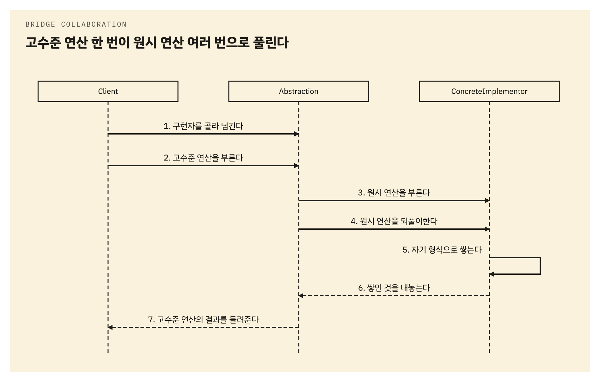
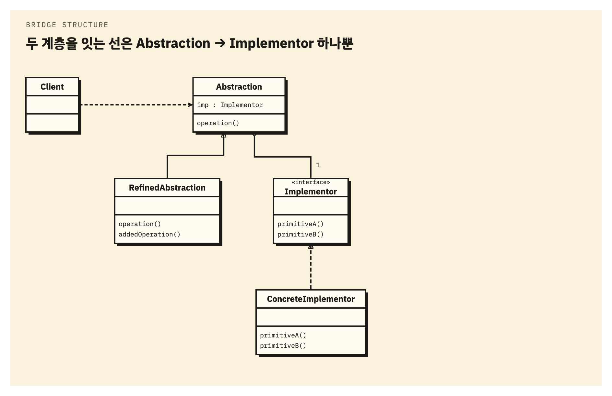

# Bridge — 함께 자랄 두 갈래를 미리 갈라 두고, 참조 하나로 잇기

## 한눈에 보는 개요

빵토 상점의 영수증 출력 코드를 떠올려 봅시다. 처음에는 영수증 한 종류를 감열 프린터로만 찍었어요. 그러다 웹 주문이 생겨 HTML 로도 내보내야 했고, 선물 포장 주문이 들어오면서 금액을 가린 선물 영수증이 필요해졌습니다. 필요할 때마다 클래스를 하나씩 만들면 이름이 이렇게 불어나요.

```text
                   감열 프린터          HTML 페이지
  일반 영수증       ThermalReceipt      HtmlReceipt
  선물 영수증       ThermalGiftReceipt  HtmlGiftReceipt
```

넷까지는 견딜 만합니다. 그런데 매대에 라벨 장비가 들어오면 `LabelReceipt` 와 `LabelGiftReceipt` 가 함께 따라와요. 영수증 종류를 하나 더해도 매체 수만큼 따라옵니다. 늘어나는 방향이 둘인데 클래스는 그 둘의 곱으로 자라는 것이죠. 이 글의 예시 코드를 실제로 돌리면 마지막 줄이 그 수를 찍습니다.

```text
6) combined 2 x 3 = 6 classes, separated 2 + 3 = 5 classes
```

Bridge 가 두는 한 수는 **두 갈래를 상속으로 묶지 않고, 한쪽이 다른 쪽을 참조로 들게 하는 것**입니다. 영수증은 무엇을 어떤 순서로 찍을지만 정하고, 그 한 줄을 32칸에 맞출지 `<p>` 로 감쌀지는 매체 객체에 넘겨요. 그러면 영수증 종류와 매체가 각자 자기 자리에서 늘어나고, 조합은 코드가 아니라 조립할 때 만들어집니다.

```text
Before : 두 갈래를 상속 하나로 묶는다 — 조합마다 클래스가 하나씩 필요하다

  Receipt ─┬─ ThermalReceipt      HtmlReceipt      LabelReceipt
           └─ ThermalGiftReceipt  HtmlGiftReceipt  LabelGiftReceipt
                                                   2 x 3 = 6 클래스

After : 두 갈래를 갈라 두고 참조 하나로 잇는다 — 조합은 조립할 때 만든다

  Receipt ─────┐                        ┌── ThermalPrinter
               ├── Medium 참조 하나 ────┼── HtmlPage
  GiftReceipt ─┘                        └── LabelPrinterMedium
                                            2 + 3 = 5 클래스
```

이 패턴의 이름은 GoF(Gang of Four, 1994년에 나온 *Design Patterns* 의 저자 네 명을 함께 부르는 이름)가 붙인 것이고 다른 이름은 Handle/Body 예요(근거: GoF Bridge 절 Also Known As). 분류는 구조 패턴이고, 두 계층을 잇는 것이 상속이 아니라 객체 참조라서 객체 범위에 실려 있습니다(근거: GoF 1장 Table 1.1). 함께 쓰는 패턴은 Abstract Factory 와 Adapter 예요. 구현자를 고르는 일을 Abstract Factory 에 맡길 수 있고, 구현자 자리에 어댑터를 세워 바깥 장비를 끌어다 쓸 수도 있습니다. 뒤엣것은 이 글의 예시 코드가 실제로 그렇게 돌아가고, 비교 절에서 실행 출력으로 확인해요.

이 글은 시나리오 셋을 따라갑니다. 영수증 한 장이 감열 프린터로 나가는 길, 선물 영수증과 라벨 장비가 각각 더해질 때 무엇이 바뀌고 무엇은 안 바뀌는가, 갈라 둔 두 갈래를 다시 묶으면 어느 단계에서 무엇이 깨지는가. 끝까지 읽으면 어떤 코드를 Bridge 라고 불러도 되는지 필수 조건 셋으로 판정할 수 있고, 코드 모양이 거의 같은 Adapter·Strategy 와도 가를 수 있게 됩니다.

## 패턴 자세히 들여다보기

### 시나리오 1 — 주문 하나의 영수증이 감열 프린터로 나가는 길

주문 하나가 들어왔습니다. 번호는 `ORD-7781`, 품목은 `Coffee Beans 200g` 18,000원과 `Paper Filter x2` 7,000원 둘이고 합계는 25,000원이에요. 계산대 옆에는 한 줄이 32칸인 감열 프린터가 있습니다. 나와야 하는 것은 그 프린터에 맞춰 줄이 선 영수증 한 장이고, 나오는 줄 수는 일곱이에요. 이 장면에는 넷이 등장합니다. 영수증을 청구하고 매체를 정해 주는 조립 코드(패턴에서는 Client 라고 부르는 역할), 영수증 한 장의 서식을 아는 `Receipt`(Abstraction), 매체가 할 줄 알아야 하는 일을 적어 둔 `Medium`(Implementor), 그리고 그 일을 32칸 종이 위에서 실제로 하는 `ThermalPrinter`(ConcreteImplementor)입니다. 이름은 여기서 한 구절씩만 소개하고 정식 정의는 개념 정리에서 해요.



1. 조립 코드가 `ThermalPrinter` 를 만들어 `Receipt` 에 넘깁니다. 매체를 밖에서 넣어 주는 이유는, 영수증이 자기 안에서 매체를 만들어 버리면 매체를 바꿀 때마다 영수증 코드를 고쳐야 하기 때문이에요. 게다가 오늘 이 주문을 어디에 찍을지는 계산대가 아는 사실이지 영수증 서식이 아는 사실이 아닙니다. 웹 주문이면 같은 `Receipt` 에 HTML 매체가 들어가요.
   - 갈래 1-a. 매체를 안 넘기면 영수증이 기본 매체 하나를 스스로 정해 두는 구성도 됩니다. 이때 영수증이 여러 매체 중 하나를 골라도 이 패턴에서는 어긋나지 않아요. 무엇을 만들지 정하는 일은 추상 쪽이 쥐어도 되는 자리이기 때문입니다(근거: GoF Bridge 절 Implementation — 올바른 Implementor 객체 만들기). 비교 절에서 이 자리가 Strategy 와 갈리는 지점으로 다시 나옵니다.
2. 조립 코드가 고수준 연산 `render(order)` 를 부릅니다. 조립 코드가 말하는 것은 "이 주문의 영수증을 한 장 내라" 하나뿐이에요. 줄을 몇 개 쌓을지, 구분선을 어디에 넣을지는 묻지 않습니다. 이 단계가 다음 단계와 나뉘어 있는 덕분에 조립 코드는 매체를 고른 뒤로 매체를 다시 만나지 않아요.
3. `Receipt` 가 `Medium` 의 원시 연산을 차례로 부릅니다. 가게 이름에 `emphasis`, 구분선에 `rule`, 품목 줄과 합계 줄에 `row`, 주문 번호에 `text` 예요. 일곱 번을 부릅니다. 서식을 `Receipt` 가 쥐는 이유는 그것이 영수증이라는 문서의 성질이기 때문이에요. 가게 이름이 맨 위에 오고 합계 앞에 구분선이 온다는 규칙은 종이에 찍든 화면에 띄우든 같습니다. 이 순서를 매체가 정하게 하면 매체를 하나 더할 때마다 서식이 한 벌씩 갈라져요.
4. `ThermalPrinter` 가 받은 원시 연산을 자기 형식으로 쌓습니다. `emphasis` 는 대문자로 바꿔 32칸 가운데에 놓고, `rule` 은 하이픈 32개를 놓고, `row` 는 왼쪽 22칸과 오른쪽 10칸으로 갈라 금액을 오른쪽에 붙여요. 이 계산을 매체가 쥐는 이유는 32칸이라는 숫자가 이 장비에만 있는 사실이라서입니다. `Receipt` 가 그 숫자를 알면 HTML 로 찍을 때도 22칸 공백이 `<p>` 안에 들어가요.
5. `Receipt` 가 `flush()` 로 쌓인 것을 받아 조립 코드에 돌려줍니다. 쌓는 동안에는 아무것도 나오지 않다가 이 자리에서 한 번에 나오는 이유는, 매체마다 "다 됐다"의 뜻이 다르기 때문이에요. 감열 프린터는 줄을 개행으로 잇고, 라벨 장비는 자기 테이프를 통째로 뱉습니다. 돌려받은 조립 코드는 그 문자열이 어느 매체에서 왔는지 모르고 알 필요도 없어요.

돌려받은 일곱 줄이 이것입니다.

```text
         BBANGTO STORE
--------------------------------
Coffee Beans 200g         18,000
Paper Filter x2            7,000
--------------------------------
TOTAL                     25,000
no ORD-7781
```

이 시나리오가 보여 준 것은 **고수준 연산 한 번이 원시 연산 여러 번으로 풀린다**는 점입니다. `render` 한 번에 원시 연산 일곱 번이 들어갔고, 그 일곱 번이 위의 일곱 줄이에요. 두 쪽의 연산이 1:1로 맞물리지 않는다는 것이 이 구조의 특징입니다. 그리고 두 쪽이 서로에 대해 아는 것이 다릅니다. `Receipt` 는 `Medium` 이라는 타입 하나를 알지만 `ThermalPrinter` 라는 이름은 모르고, `ThermalPrinter` 는 `Receipt` 가 이 세상에 있다는 것조차 모릅니다. 이 비대칭이 다음 시나리오에서 값을 내요.

### 시나리오 2 — 선물 영수증과 라벨 장비가 각각 더해질 때

요구 둘이 같은 주에 들어왔습니다. 하나는 선물 포장 주문의 영수증에서 금액을 가리고 메시지 한 줄을 넣어 달라는 것이고, 다른 하나는 매대에 새로 들인 라벨 장비로도 영수증을 뽑고 싶다는 것이에요. 두 요구는 서로 아무 관계가 없습니다. 선물 영수증은 무엇을 찍을지의 문제이고 라벨 장비는 어떻게 찍을지의 문제니까요. 주문은 시나리오 1 과 같은 `ORD-7781` 이고, 확인할 것은 한쪽을 더할 때 반대쪽 파일이 몇 줄 바뀌는가입니다.

1. 추상 쪽에 `GiftReceipt` 를 더합니다. `Receipt` 를 물려받아 `render` 를 다시 쓰고, 금액 자리에 `GIFT` 를 넣고, `renderCard` 라는 연산을 하나 보태요. 이때 매체 쪽 파일은 한 줄도 바뀌지 않습니다. `GiftReceipt` 가 부르는 것이 `Medium` 의 원시 연산 넷뿐이고 그 넷은 이미 있으니까요. 만약 선물 영수증이 원시 연산을 새로 요구했다면 그때는 매체 셋을 모두 고쳐야 하고, 그것이 두 갈래를 갈라 둔 값이 떨어지는 자리입니다.
2. 구현 쪽에 라벨 매체를 더합니다. 그런데 이 장비는 우리가 만든 것이 아니에요. `esc(code, payload)` 라는 연산 하나만 내밀고, 굵게 찍으려면 코드 1, 구분선은 2, 두 칸짜리 줄은 3, 보통 글은 4 를 넘겨야 합니다. 그래서 `LabelPrinterMedium` 은 `Medium` 의 네 연산을 그 한 연산 위에 얹어요. 이 클래스는 구현 쪽의 한 자리이면서 동시에 어댑터입니다. 추상 쪽 파일은 여기서도 한 줄이 안 바뀝니다.
3. 조합은 조립할 때 만듭니다. 선물 영수증을 감열 프린터로 찍고, 일반 영수증을 라벨 장비로 찍어요. 두 줄을 쓰는 데 새 클래스는 하나도 필요하지 않습니다. 실행 출력 3번과 4번 블록이 그 둘이에요.
4. 늘어난 연산도 매체를 가리지 않습니다. `GiftReceipt` 가 새로 얻은 `renderCard` 는 `Receipt` 에 없던 연산인데, 이것도 원시 연산 위에 쌓은 것이라 HTML 로도 그대로 나와요. 실행 출력 5번 블록이 그 결과입니다. 새 고수준 연산을 더할 때 매체 쪽에 물어볼 일이 없다는 것이 추상 계층이 혼자 자란다는 말의 실제 내용이에요.
5. 클래스 수를 셉니다. 영수증 종류 둘과 매체 셋이니 조합은 여섯인데, 코드에 선 클래스는 다섯이에요. 실행 출력 6번 줄이 그 둘을 함께 찍습니다. 갈래 하나가 더 길어질수록 차이가 벌어져요. 매체가 하나 더 들어오면 조합은 여덟이 되지만 클래스는 여섯이 됩니다.

세 매체가 같은 `render` 호출에 어떻게 다르게 답하는지를 나란히 놓으면 이렇습니다.

```text
같은 Receipt.render(ORD-7781) 이 매체마다 내놓는 첫 두 줄

  ThermalPrinter       "         BBANGTO STORE" · "--------------------------------"
  HtmlPage             "<h1>BBANGTO STORE</h1>" · "<hr>"
  LabelPrinterMedium   "<1>BBANGTO STORE"       · "<2>"
```

이 시나리오가 보여 준 것은 **두 갈래가 서로를 모른 채 각자 늘어난다**는 점입니다. 1단계에서 추상 쪽을 늘릴 때 구현 쪽 파일이 안 바뀌었고, 2단계에서 구현 쪽을 늘릴 때 추상 쪽 파일이 안 바뀌었어요. 이것이 가능한 이유는 시나리오 1 의 마지막에서 본 비대칭입니다. 의존이 한 방향뿐이에요. 추상 쪽에서 구현 쪽으로만 나 있고, 그 방향조차 인터페이스 타입 하나에서 멈추니까요. 그리고 2단계에서 본 것처럼 구현 쪽의 한 자리는 바깥에서 온 물건을 어댑터로 감싼 것이어도 됩니다.

### 시나리오 3 — 갈라 둔 두 갈래를 다시 묶으면 어느 단계에서 무엇이 깨지는가

같은 주문 `ORD-7781` 로 세 가지 되묶기를 해 봅시다. 하나는 참조 타입을 구체 매체로 바꾸는 것, 하나는 추상 쪽이 매체 종류를 보고 갈라지게 하는 것, 하나는 구현 쪽이 추상 쪽을 알게 하는 것이에요. 셋은 깨지는 방식이 다릅니다. 앞의 것은 컴파일에서 멈추고, 가운데 것은 통과한 뒤 출력이 조용히 갈라지고, 뒤엣것은 아무것도 깨지지 않은 채 다음 변경에서 값을 치릅니다.

1. `Receipt` 가 매체를 드는 타입을 `Medium` 에서 `ThermalPrinter` 로 바꿉니다. 고칠 곳은 필드 선언 한 줄이 아니라 **그 필드와, 그 값을 받는 생성자 인자까지**예요. 예시 코드에서는 Java 157·159·192행 · TypeScript 142·159행 · Rust 156·160·184행입니다. 필드만 바꾸면 생성자가 그 필드에 값을 넣는 자리에서 먼저 걸리거든요. Java 로 해 보면 `this.medium = medium;` 한 줄에서 `Medium cannot be converted to ThermalPrinter` 가 나고 거기서 끝납니다. 그 자리들까지 고쳐 세 언어를 다시 컴파일하면 전부 멈춰요. Java 는 오류 3건, TypeScript 는 3건, Rust 는 5건입니다(직접 컴파일해 확인). Java 와 TypeScript 에서 감열 프린터를 넘기는 두 자리는 그대로 통과하고 나머지 셋이 걸려요. Rust 만 다섯인 이유는 Rust 쪽 구현이 매체를 `Box` 에 담아 넘기고 있어서, 감열 프린터를 넘기는 두 자리도 `Box<ThermalPrinter>` 와 `ThermalPrinter` 가 어긋나 함께 걸리기 때문입니다. 아래는 javac 21.0.11 이 낸 진단이에요. 줄 앞의 파일 경로와 줄 번호, 각 오류 아래에 붙는 소스 인용 두 줄, 그리고 맨 끝의 `Note: Some messages have been simplified…` 안내를 지웠고 오류 문구 자체는 그대로입니다.

   ```text
   error: incompatible types: HtmlPage cannot be converted to ThermalPrinter
   error: incompatible types: LabelPrinterMedium cannot be converted to ThermalPrinter
   error: incompatible types: HtmlPage cannot be converted to ThermalPrinter
   ```

2. TypeScript 가 같은 자리에서 다른 말을 합니다. 이 언어는 타입 이름이 아니라 모양으로 대입을 판정하는데, `HtmlPage` 는 `ThermalPrinter` 와 공개 연산 다섯이 똑같은데도 거절당해요. 두 클래스가 각자 `private` 필드 `buffer` 를 따로 선언했기 때문입니다. 그래서 이 언어에서도 구체 매체 타입으로 받는 순간 매체를 바꿔 끼울 길이 막혀요. 아래는 tsc 5.9.3 의 진단이고, 줄 앞의 파일 경로와 행·열 위치를 지웠으며 같은 문구가 되풀이되는 나머지 하나를 뺐습니다. 나머지는 그대로예요.

   ```text
   error TS2345: Argument of type 'HtmlPage' is not assignable to parameter of type 'ThermalPrinter'.
     Types have separate declarations of a private property 'buffer'.
   error TS2345: Argument of type 'LabelPrinterMedium' is not assignable to parameter of type 'ThermalPrinter'.
     Property 'buffer' is missing in type 'LabelPrinterMedium' but required in type 'ThermalPrinter'.
   ```

3. 이번에는 필드 타입을 그대로 두고, `Receipt.render` 안에서 매체 종류를 보고 갈라지게 합니다. 합계 줄만 감열 프린터일 때는 `row` 로, 아닐 때는 `text` 로 찍도록 조건을 하나 넣는 것이죠. 이 코드는 컴파일을 통과합니다. 타입은 아무것도 어긋나지 않았으니까요. 그런데 돌려 보면 실행 출력 36줄 가운데 두 줄이 갈라져요. 아래는 그 두 줄을 뽑은 것이고, 앞의 번호는 실행 출력에서의 줄 번호, 왼쪽이 원래 줄, 오른쪽이 분기를 넣은 뒤의 줄입니다.

   ```text
   15행   <p>TOTAL<b>25,000</b></p>      →   <p>TOTAL 25,000</p>
   30행   <3>TOTAL;25,000                →   <4>TOTAL 25,000
   ```

   갈라진 둘이 하필 감열 프린터가 아닌 매체 둘이라는 점이 중요합니다. 분기를 쓴 사람은 감열 프린터만 생각했고, 그 조건에 이름이 적히지 않은 매체는 전부 조용히 반대쪽으로 갔어요. 경고 한 줄 없이요. 매체가 하나 더 들어오면 그 매체도 똑같이 반대쪽으로 갑니다. 시나리오 2 의 2단계에서 라벨 장비를 넣을 때 추상 쪽 파일이 한 줄도 안 바뀌었던 것이 여기서는 성립하지 않아요.

4. 마지막으로 구현 쪽이 추상 쪽을 알게 해 봅시다. `Medium` 에 `renderReceipt(Receipt r)` 같은 연산을 하나 얹는 것이에요. 이러면 의존이 양쪽으로 나서, 영수증 종류를 하나 더할 때 매체 셋을 함께 열어 봐야 합니다. 시나리오 2 의 1단계에서 매체 쪽 파일이 안 바뀌었던 이유가 사라지는 것이죠. 그리고 조합마다 클래스를 만드는 원래 방식으로 되돌아가면 개요에서 본 곱셈이 다시 옵니다. 실행 출력 6번 줄의 왼쪽 숫자가 그것이고, 매체가 하나 늘 때마다 영수증 종류 수만큼 클래스가 따라와요.

이 시나리오가 보여 준 것은 **되묶기의 방식마다 걸리는 자리가 다르다**는 점입니다. 참조 타입을 구체로 바꾸면 컴파일러가 막아 주지만, 추상 쪽에 종류 분기를 넣는 것은 아무도 막지 않아요. 그쪽이 더 위험합니다. 3단계의 코드는 타입 검사를 전부 통과하고 출력 두 줄만 조용히 바꿨습니다. 그래서 다음 절의 최소 조건 2번은 "참조 타입이 인터페이스인가"에서 멈추지 않고 "구체 구현자 타입으로 갈라지는 코드가 없는가"까지 봅니다.

### 개념 정리

시나리오에 나온 역할 다섯을 정의합니다. 예시의 타입 이름이 아니라 패턴의 역할 이름으로 적었고, 예시 타입과의 대응은 상황 설정 절에 있어요.

- **Abstraction** — 클라이언트가 쓰는 고수준 연산을 정의하고, `Implementor` 타입 객체에 대한 참조를 유지합니다. 자기 연산을 직접 끝내지 않고 그 참조의 연산 호출로 수행해요. 시나리오 1 에서 서식의 순서를 쥐고 원시 연산 일곱 번을 부른 쪽이 이 역할입니다. 협력 상대는 `Implementor` 하나이고, 어떤 `ConcreteImplementor` 가 들어왔는지는 모릅니다. 일을 자기가 하지 않고 다른 객체의 연산 호출로 넘기는 이 관계를 위임이라고 부르는데, 그 말의 정의는 [참고 문서 「GoF 공통 어휘」](../../reference/gof-vocabulary/gof-vocabulary-ref_v1.0.1.md)의 「위임」 항목에 있어요.
- **RefinedAbstraction** — `Abstraction` 이 정의한 인터페이스를 확장합니다. 고수준 연산을 다시 쓰거나 새 연산을 보태요. 시나리오 2 의 1·4단계에서 금액을 가리고 `renderCard` 를 보탠 쪽이 이 역할입니다. 협력 상대는 자기 상위인 `Abstraction` 과, 상위에게 물려받은 `Implementor` 참조예요.
- **Implementor** — 구현 클래스들이 갖춰야 할 연산을 정의합니다. `Abstraction` 의 연산과 하나씩 맞물릴 필요가 없고 상당히 달라도 돼요. 보통은 원시 연산만 두고 그 위에 고수준 연산을 쌓는 일은 `Abstraction` 이 맡습니다(근거: GoF Bridge 절 Participants). 시나리오 1 의 3단계에서 `Receipt` 가 부른 네 가지 연산이 이 역할의 것이에요.
- **ConcreteImplementor** — `Implementor` 를 구현해 실제 동작을 정의합니다. 시나리오 1 의 4단계에서 32칸 정렬을 한 쪽, 시나리오 2 의 2단계에서 라벨 장비의 코드 번호로 옮긴 쪽이 이 역할이에요. 협력 상대는 자기를 부르는 `Abstraction` 인데, 그쪽의 타입 이름은 모릅니다.
- **Client** — `Abstraction` 을 쓰는 쪽입니다. 시나리오 1 의 1단계에서 매체를 골라 넘기고 2단계에서 고수준 연산을 부른 조립 코드예요. `ConcreteImplementor` 를 만드는 자리가 보통 여기라서, 두 갈래의 조합이 실제로 정해지는 곳도 여기입니다.



그림에서 `ConcreteImplementor` 에서 나가는 화살표가 `Implementor` 로만 향하고 위쪽 두 칸으로는 아무것도 가지 않는다는 점을 봐 두세요. 시나리오 2 에서 양쪽이 서로를 모른 채 늘어날 수 있었던 이유가 이 모양입니다.

## 사용 목적

Bridge 를 꺼내게 하는 단서는 클래스 이름과 조건문에서 보입니다. 셋을 차례로 봅시다.

**단서 1. 타입 이름 안에 두 갈래의 값이 함께 들어 있습니다.** `ThermalReceipt` 와 `HtmlGiftReceipt` 처럼 이름 하나가 "무엇을"과 "어떻게"를 둘 다 말하고 있는 모양이에요. 개요의 표가 그것이고, 갈래 하나가 길어질 때마다 반대쪽 수만큼 클래스가 따라옵니다. 파일 이름만 훑어도 세어지는 단서라 가장 쓰기 좋아요.

```text
ls 로 파일 이름을 세어 보면
────────────────────────────────────────────────
ThermalReceipt.java       HtmlReceipt.java
ThermalGiftReceipt.java   HtmlGiftReceipt.java
                          ← 여기에 Label 열이 통째로 하나 더 붙는다
```

**단서 2. 한 갈래의 값이 다른 갈래 코드 안에 조건문으로 박혀 있습니다.** 영수증 서식을 다루는 코드 안에 `if (medium instanceof ThermalPrinter)` 같은 줄이 있는 모양이에요. 시나리오 3 의 3단계가 그 코드였고, 매체를 하나 더할 때마다 그 조건문을 찾아다녀야 했습니다. 이 단서가 위험한 이유는 컴파일러가 막아 주지 않기 때문이에요. 조건에 이름이 적히지 않은 매체는 조용히 반대쪽 가지로 갑니다.

**단서 3. 같은 내용을 어디로 내보낼지가 실행 중에 정해집니다.** 계산대에서는 종이로, 웹 주문에서는 HTML 로, 배송 라벨은 라벨 장비로 같은 영수증이 나가야 하는 상황이에요. 시나리오 2 의 3단계가 이 요구였고, 내보낼 곳이 늘어나는 속도와 문서 종류가 늘어나는 속도가 서로 무관하다면 두 갈래가 따로 있다는 뜻입니다. 아래는 세 단서를 코드에서 무엇을 보면 되는지로 정리한 것이에요.

| 단서 | 코드에서 관찰되는 것 | 확인 방법 |
| --- | --- | --- |
| 1. 이름 안의 두 갈래 | 타입 이름이 "무엇을"과 "어떻게"를 함께 말함 | 이름을 두 낱말로 갈라 표를 그려 보고 빈칸이 곱으로 늘어나는지 봄 |
| 2. 종류 분기 | 한 갈래의 코드 안에 반대쪽 구체 타입 이름이 조건으로 등장 | 구체 구현자 타입 이름으로 검색해 추상 쪽 파일에 나오는지 봄 |
| 3. 무관하게 늘어나는 두 목록 | 한쪽 목록에 항목을 더해도 반대쪽 목록이 안 변함 | 두 목록의 최근 변경 이력을 견줘 함께 늘었는지 따로 늘었는지 봄 |

비슷한 단서에서 다른 패턴을 고르게 되는 경우가 둘 있습니다. 이어야 할 두 쪽 가운데 하나가 이미 밖에서 굳어 있으면 Adapter 를, 바뀌는 것이 계산 방법 하나뿐이면 Strategy 를 먼저 검토하세요. 차이는 다음 절에서 풉니다. 그리고 아래 상황에서는 다리를 놓으면 얻는 것보다 잃는 것이 큽니다.

| 쓰지 말아야 할 상황 | 쓰면 잃는 것 |
| --- | --- |
| 갈래가 하나뿐이고 추상 쪽이 늘어날 계획이 없음 | 인터페이스 하나와 간접 호출 한 겹이 늘어납니다. 시나리오 2 의 1단계처럼 추상 쪽이 자라는 일이 없으면 그 비용이 회수되지 않고, 바뀌는 것이 계산 방법 하나면 Strategy 가 더 작게 끝나요 |
| 이어야 할 두 쪽 중 하나를 우리가 못 고침 | 다리는 양쪽의 모양을 우리가 정할 수 있을 때 놓는 것입니다. 한쪽이 굳어 있으면 그 모양에 맞춰 주는 칸이 결국 필요하고, 그것이 Adapter 예요 |
| 한 덩어리로 읽히던 응집도 높은 클래스를 쪼갬 | 한 동작을 따라가려면 두 파일을 오가게 됩니다. 시나리오 1 의 3·4단계처럼 서식과 배치가 실제로 다른 이유로 변하지 않는다면, 나눈 값은 없고 읽는 값만 치러요([refactoring.guru — Bridge](https://refactoring.guru/design-patterns/bridge)) |

## 패턴의 경계

### 디자인 패턴을 충족하는 최소 조건

어떤 코드를 Bridge 라고 불러도 되는지 가르는 기준입니다. `[필수]` 가 하나라도 빠지면 Bridge 가 아니고, `[선택]` 은 갖추면 좋거나 원전이 허용하는 변형이에요. 조건은 언어와 상관없이 코드에서 확인할 수 있는 모양(타입 선언·참조 보유·호출 방향·의존 방향)으로 적었고, 조건마다 그것을 보여 준 시나리오의 단계를 가리킵니다.

1. [필수] 추상 쪽이 구현 쪽을 **상속이 아니라 참조로** 보유합니다 — Abstraction 또는 그 상위 타입에 구현 쪽 타입의 필드가 있고, 그 값은 밖에서 들어오거나 Abstraction 이 정합니다. Abstraction 이 구현 쪽 타입을 물려받아 자기가 그 타입이 되지 않습니다. 시나리오 1 의 1단계가 그 참조가 들어오는 자리예요 (근거: GoF Bridge 절 Participants — Abstraction 은 Implementor 타입 객체에 대한 참조를 유지한다. 그리고 GoF Bridge 절 Implementation 은 다중 상속으로 Abstraction 과 ConcreteImplementor 를 한 클래스에 묶으면 구현이 정적으로 붙어 버려 진짜 Bridge 가 아니라고 본다).
   - 빠지면: 두 갈래가 한 클래스로 합쳐져 조합마다 클래스가 하나씩 필요한 모양이 됩니다. 시나리오 3 의 4단계가 그 자리이고, 개요에서 본 여섯 클래스가 그 결과예요.
2. [필수] 추상 쪽의 연산이 **구현 쪽 인터페이스의 연산 호출로** 수행되고, 구체 구현자 타입으로 갈라지는 코드가 없습니다 — 추상 쪽 어디에도 ConcreteImplementor 타입 이름의 타입 검사·형 변환·조건 분기가 없습니다. 시나리오 1 의 3단계가 이 모양이고, 시나리오 3 의 3단계가 이 조건이 깨진 자리예요 (근거: GoF Bridge 절 Collaborations — Abstraction 이 클라이언트의 요청을 Implementor 객체에 전달한다).
   - 빠지면: 구현자를 하나 더할 때 추상 쪽을 함께 고쳐야 합니다. 시나리오 3 의 3단계에서 본 대로 타입 검사는 전부 통과하고 출력 두 줄만 조용히 바뀌어요.
3. [필수] 구현 쪽 타입이 **추상 쪽 타입을 모릅니다** — Implementor 와 ConcreteImplementor 의 선언·연산 서명·본문 어디에도 Abstraction 이나 RefinedAbstraction 의 타입 이름이 나오지 않습니다. 의존이 추상 쪽에서 구현 쪽으로 한 방향만 나 있어요. 시나리오 2 의 1·2단계에서 한쪽을 늘릴 때 반대쪽 파일이 한 줄도 안 바뀐 이유가 이것입니다 (근거: GoF Bridge 절 Consequences — Abstraction 계층과 Implementor 계층을 각각 독립적으로 확장할 수 있다).
   - 빠지면: 의존이 양쪽으로 나서 한쪽을 늘릴 때마다 반대쪽을 열어 봐야 합니다. 시나리오 3 의 4단계가 그 모양이고, 그러면 두 계층을 갈라 둔 값이 사라지고 파일이 둘로 나뉜 것만 남아요.
4. [선택] RefinedAbstraction 이 있습니다 — Abstraction 을 확장해 고수준 연산을 다시 쓰거나 새 연산을 보탠 하위 타입이 있습니다. 시나리오 2 의 1·4단계가 그것을 더하고 쓴 자리예요 (근거: 이 가이드의 정책 — GoF Bridge 절 Participants 가 이 역할을 두기는 하지만, 정제된 추상이 하나도 없어도 참조와 위임으로 선 분리는 그대로라 필수로 올리지 않았습니다).
5. [선택] ConcreteImplementor 가 둘 이상입니다 — 시나리오 2 의 2단계가 세 번째 구현자를 더한 자리입니다 (근거: GoF Bridge 절 Implementation — 구현자가 하나뿐이면 추상 Implementor 클래스를 따로 둘 필요가 없는 퇴화 형태가 되지만, 구현을 바꿔도 클라이언트가 영향을 받지 않는다는 분리는 그래도 쓸모가 있다). 그래서 구현자가 하나여도 1~3번을 만족하면 이 패턴입니다.
6. [선택] Implementor 는 원시 연산만 두고 Abstraction 이 그 위에 고수준 연산을 쌓습니다 — 고수준 연산 하나가 원시 연산 호출 여럿으로 풀리고, 두 쪽의 연산이 1:1로 대응하지 않습니다. 시나리오 1 의 3단계에서 `render` 한 번이 원시 연산 일곱 번이 된 것이 이 모양이에요 (근거: GoF Bridge 절 Participants — 보통 Implementor 는 원시 연산만 제공하고 Abstraction 이 그 위에 고수준 연산을 정의한다고 적혀 있어, 흔한 규칙이라 선택에 둡니다).
7. [선택] 구현자를 누가 고를지가 열려 있습니다 — 조립 코드가 넘겨도 되고, Abstraction 이 기본값을 정하거나 상황을 보고 골라도 되고, 별도의 생성 객체에 맡겨도 됩니다. 시나리오 1 의 갈래 1-a 가 추상 쪽이 정하는 경우예요 (근거: GoF Bridge 절 Implementation — 올바른 Implementor 객체 만들기).
8. [선택] 여러 Abstraction 이 한 구현자를 함께 쓰고 클라이언트는 그 사실을 모릅니다 — 시나리오 2 의 3단계에서 조합을 조립 코드가 정한 것처럼, 구현자를 몇이 나눠 쓰는지도 조립 코드의 일입니다 (근거: GoF Bridge 절 Consequences — 구현 세부와 구현자 공유·참조 관리를 클라이언트에게서 감춘다).

1번이 맨 앞인 데는 이유가 있습니다. 1번이 빠진 코드는 2·3번을 아예 판정할 수 없거든요. 참조가 없으면 "인터페이스로 부르는가"도 "구현 쪽이 추상 쪽을 아는가"도 물을 대상이 없습니다. 아래 표로 판정 순서를 봅시다.

| 코드 | 1번 | 2번 | 3번 | 판정 |
| --- | --- | --- | --- | --- |
| 구현 절의 `Receipt` 와 `Medium` 과 매체 셋 | 만족 | 만족 | 만족 | Bridge |
| 거기에 `GiftReceipt` 를 더한 것 | 만족 | 만족 | 만족 | Bridge (정제된 추상까지 갖춘 모양) |
| 필드 타입이 `ThermalPrinter` 인 `Receipt` | 빠짐 (구체 타입) | 판정 불가 | 만족 | Bridge 아님 |
| `render` 안에서 매체 종류를 가르는 `Receipt` | 만족 | 빠짐 | 만족 | Bridge 아님 |
| `Medium` 이 `Receipt` 를 인자로 받는 코드 | 만족 | 만족 | 빠짐 | Bridge 아님 |
| 매체가 `ThermalPrinter` 하나뿐인 `Receipt` | 만족 | 만족 | 만족 | Bridge (퇴화 형태) |

표의 마지막 줄이 헷갈리기 쉬운 포인트입니다. 구현자가 둘 이상이어야 다리라고 부를 수 있을 것 같지만 그렇지 않아요. 원전은 구현자가 하나뿐인 형태를 퇴화 형태라고 부르면서도 이 패턴으로 인정합니다(근거: GoF Bridge 절 Implementation). 그럴 만한 이유가 있어요. 구현자가 지금 하나라도 추상 쪽은 그 이름을 모르는 상태이고, 그래서 구현을 통째로 갈아 끼울 때 추상 쪽과 그것을 쓰는 코드가 안 바뀝니다. 시나리오 2 의 2단계에서 라벨 장비를 넣을 때 추상 쪽이 한 줄도 안 바뀐 그 성질이, 매체가 둘일 때 생긴 것이 아니라 처음부터 있던 것이라는 뜻이죠. 그래서 이 가이드는 구현자 수를 5번 `[선택]` 에 두었습니다.

반대로 세 번째 줄은 판정이 1번에서 끝납니다. 시나리오 3 의 1단계에서 본 대로 세 언어가 전부 컴파일을 거부했으니 코드가 서지도 않아요.

> 다리는 두 쪽을 이어 주는 것이 아니라, 두 쪽이 서로를 모르게 갈라 두는 것이다.

### 비슷한 패턴·안티패턴과의 차이

Bridge 와 구조가 닮았거나 같은 단서에서 떠오르는 대상 셋을 비교합니다. Adapter 는 코드 모양이 거의 같아서 먼저 보고, 그다음 위임 구조가 똑같은 Strategy 를, 마지막으로 이 패턴이 대신하려는 상속 조합 코드를 봅니다.

| 비교 대상 | 구분 기준 (코드에서 보는 것) | Bridge 를 고르면 얻는 것 | 포기하는 것 |
| --- | --- | --- | --- |
| Adapter | 이어지는 두 쪽의 모양을 우리가 함께 정하는가, 한쪽이 밖에서 굳어 왔는가 | 양쪽 계층이 각자 자란다(시나리오 2 의 1·2단계) | 이미 굳은 쪽을 그대로 두고 잇는 최소 비용. 다리는 양쪽을 우리가 쥐고 있을 때만 놓을 수 있음 |
| Strategy | 위임하는 쪽에도 하위 타입이 자라는가, 그리고 구현자를 고르는 분기를 안쪽에 두어도 되는가 | 추상 쪽도 함께 늘어나고, 구현자를 고르는 일을 추상 쪽이 쥐어도 됨 | Strategy 의 작음. 갈래가 하나뿐이면 인터페이스 하나와 간접 호출 한 겹만 늘고 돌려받는 것이 없음 |
| 조합마다 클래스를 만든 상속 코드 | 타입 이름 하나가 두 갈래의 값을 함께 말하는가 | 클래스 수가 곱이 아니라 합(실행 출력 6번 줄) | 특정 조합에만 맞는 동작을 둘 자리와, 클래스 하나만 열면 되던 직접성 |

**Adapter 와의 차이.** 구분 기준은 이어지는 두 쪽의 모양을 우리가 함께 정하는지, 한쪽이 이미 밖에서 굳어 왔는지입니다. 코드 모양만 보면 둘 다 인터페이스 필드를 들고 위임하는 클래스라 똑같아 보여요. 갈라지는 것은 시점입니다. Bridge 는 설계하기 전에 추상과 구현을 갈라 각자 자라게 하려는 것이고, Adapter 는 이미 굳어 버린 두 쪽을 설계가 끝난 뒤에 잇는 것이니까요(근거: GoF Discussion of Structural Patterns 의 Adapter versus Bridge). [Adapter 가이드의 비교 절](../adapter/adapter-guide_v1.0.0.md#비슷한-패턴안티패턴과의-차이)이 같은 선을 반대 방향에서 긋고 있고, 두 글은 같은 단서를 씁니다.

```text
시점은 코드에 남지 않는다. 저장소에서 대신 보는 것

  위임 대상 인터페이스를 누가 정의했나?
    우리 저장소 안 + 구현이 여럿 + 양쪽이 함께 늘어남    → Bridge
    외부 SDK·레거시 + 우리가 못 고침 + 한쪽만 굳어 있음   → Adapter
```

시점을 최소 조건에 올리지 않은 이유가 여기 있습니다. "설계하기 전에 갈랐는가"는 코드에 흔적이 남지 않아서 코드만 보고 판정할 수 없어요. 그래서 이 글의 필수 조건 셋은 전부 지금 코드에서 보이는 것으로 적혀 있고, 시점은 위 도식처럼 저장소에서 보이는 대리 지표로 봅니다. 한 가지 더 분명히 해 둘 것이 있어요. 「두 쪽을 우리가 정했는가」는 **다리가 잇는 두 인터페이스**에 대한 물음이지 그 아래에 무엇이 있는지에 대한 물음이 아닙니다. 시나리오 2 의 2단계에서 우리가 정한 것은 `Receipt` 의 고수준 연산과 `Medium` 의 원시 연산 넷이었고, 바깥에서 굳어 온 `esc(code, payload)` 는 그보다 한 칸 더 아래에 있었어요. 그래서 구현 쪽의 한 자리가 어댑터여도 다리는 그대로 다리입니다.

Bridge 를 고르면 양쪽 계층이 각자 자라는 것을 얻습니다. 시나리오 2 의 1단계에서 추상 쪽을 늘릴 때 매체 파일이, 2단계에서 구현 쪽을 늘릴 때 영수증 파일이 한 줄도 안 바뀐 것이 그것이에요. 대신 이미 굳은 쪽을 그대로 두고 잇는 최소 비용을 포기합니다. Adapter 가이드도 어댑터를 쓰지 말아야 할 상황의 첫 줄로 「두 인터페이스를 우리가 둘 다 설계할 수 있음」을 들면서 그럴 때는 애초에 추상과 구현을 분리하는 편이 낫다고 적어 두었는데, 이 글의 사용 목적 절에 있는 「이어야 할 두 쪽 중 하나를 우리가 못 고침」 줄이 그 문장의 반대쪽입니다. 두 글이 같은 선을 양쪽에서 그어 둔 셈이에요.

```text
같은 선을 양쪽에서 긋는다

  Adapter 가이드 「쓰지 말아야 할 상황」   두 인터페이스를 우리가 둘 다 설계할 수 있음  → 어댑터를 두지 마라
  이 글 「쓰지 말아야 할 상황」            이어야 할 두 쪽 중 하나를 우리가 못 고침     → 다리를 놓지 마라
```

**Strategy 와의 차이.** 독자가 가장 헷갈리는 자리가 여기일 겁니다. 구조가 거의 같거든요. Strategy 의 Context 도 인터페이스 필드를 들고 위임하고, Bridge 의 Abstraction 도 그렇습니다. 실제로 [Strategy 가이드의 최소 조건](../strategy/strategy-guide_v1.1.0.md#디자인-패턴을-충족하는-최소-조건) 2번(Context 는 전략을 그 연산 모양으로만 보유하고 호출한다)은 이 글의 필수 조건 2번과 거의 같은 말이에요. 구분 기준은 위임하는 쪽에도 하위 타입이 자라는지, 그리고 구현자를 고르는 분기를 안쪽에 두어도 되는지입니다. 갈림 셋을 순서대로 적용하세요.

```text
갈림 1 — 위임하는 쪽에도 하위 타입이 자라는가?
       │
       ├─ 자란다 (추상 쪽과 구현 쪽 둘 다 늘어남) ──────▶ Bridge 쪽
       │
       └─ 한 자리다 (늘어나는 것은 위임받는 쪽뿐) ──▶ 갈림 2

갈림 2 — 여러 구현 중 하나를 고르는 분기를 안쪽에 두어도 되는가?
       │
       ├─ 두어도 된다 ──▶ Bridge      (GoF Bridge 절 Implementation 이 그 자리를 열어 둔다)
       └─ 두면 안 된다 ──▶ Strategy   (Strategy 가이드 최소 조건 3번이 막는다)

갈림 3 — 두 쪽의 연산이 1:1로 맞물리는가? (갈림 1·2 가 안 갈릴 때의 보조 신호)
       Bridge   : 1:N — 고수준 연산 하나가 원시 연산 여럿으로 풀린다
       Strategy : 대체로 1:1 — Context 의 한 요청이 전략 연산 한 번으로 끝난다
```

갈림 2 가 가장 날카롭습니다. Strategy 가이드의 최소 조건 3번은 여러 전략 중 하나를 고르는 분기가 Context 안에 있으면 Strategy 가 아니라고 분명히 적어 두었어요. 인자를 생략했을 때 쓸 기본 전략 하나를 정해 두는 것은 괜찮지만, 여럿 중에서 고르면 걸립니다. 그런데 이 글의 `[선택]` 7번은 반대로 구현자를 Abstraction 이 상황을 보고 골라도 된다고 적었어요. 원전이 그 자리를 열어 두었기 때문입니다(근거: GoF Bridge 절 Implementation — 올바른 Implementor 객체 만들기). 그래서 아래 코드는 Bridge 로는 성립하고 Strategy 로는 성립하지 않습니다.

```java no-compile
final class Receipt {
    private final Medium medium;

    Receipt(int lineWidth) {
        // 여러 구현 중 하나를 안쪽에서 고른다. Bridge 는 이 자리를 허용하고 Strategy 는 막는다.
        this.medium = lineWidth > 0 ? new ThermalPrinter() : new HtmlPage();
    }

    String render(Order order) {
        medium.emphasis(order.storeName());
        medium.rule();
        return medium.flush();
    }
}
```

갈림 1 은 시나리오 2 가 그대로 보여 준 것입니다. 1단계에서 늘어난 것은 추상 쪽이었고 2단계에서 늘어난 것은 구현 쪽이었어요. 두 방향이 다 열려 있는 것이 다리입니다. Strategy 에서 늘어나는 것은 전략 쪽 한 방향이고, Context 는 대체로 한 자리에 머물러요. 갈림 3 은 시나리오 1 의 3단계에서 `render` 한 번이 원시 연산 일곱 번으로 풀린 그 모양인데, 원전이 「보통」이라고 적은 성질이라 판정을 혼자 짊어지지는 못합니다(그래서 이 글에서도 `[선택]` 6번이에요). 앞의 둘이 안 갈릴 때 참고하는 신호로 씁니다.

```text
                       Bridge (Receipt)                 Strategy (Checkout)
위임하는 쪽            계층이다 — 아래로 자란다          한 자리다 — 자라는 것은 전략 쪽뿐
고르는 분기의 자리     Abstraction 안에 있어도 된다      Context 안에 있으면 Strategy 가 아니다
두 쪽 연산의 대응      1:N — 고수준 하나가 원시 여럿     대체로 1:1
```

Bridge 를 고르면 추상 쪽도 함께 늘어나는 자리와, 구현자를 고르는 일을 추상 쪽이 쥐어도 되는 여지를 얻습니다. 대신 Strategy 의 작음을 포기해요. 갈래가 정말 하나뿐이라면 다리는 인터페이스 하나와 간접 호출 한 겹만 더하고 아무것도 돌려주지 않습니다. 사용 목적 절의 「갈래가 하나뿐이고 추상 쪽이 늘어날 계획이 없음」 줄이 그 경우예요.

**조합마다 클래스를 만든 상속 코드와의 차이.** 구분 기준은 타입 이름 하나가 두 갈래의 값을 함께 말하는지입니다. 아래가 그 코드예요.

```java no-compile
// 이름 하나가 "무엇을"과 "어떻게"를 함께 말한다. 매체가 하나 늘면 영수증 종류 수만큼 이런 클래스가 따라온다.
final class ThermalGiftReceipt extends Receipt {
    @Override
    String render(Order order) {
        StringBuilder out = new StringBuilder();
        out.append(center(order.storeName().toUpperCase(), 32));  // 32 는 감열 프린터의 사실인데 여기 적혀 있다
        out.append('\n').append("-".repeat(32));
        for (OrderLine line : order.lines()) {
            out.append('\n').append(pad(line.name(), 22)).append(lead("GIFT", 10));
        }
        return out.toString();
    }
}
```

이 클래스 안에는 선물 영수증의 서식과 감열 프린터의 배치가 함께 들어 있습니다. 그래서 32라는 숫자가 이 파일에도 있고 `ThermalReceipt` 에도 있어요. 복제된 것이죠. 프린터를 36칸짜리로 바꾸면 두 파일을 함께 고쳐야 하고, 고치다 하나를 빠뜨리면 영수증 종류에 따라 줄 폭이 달라집니다. 시나리오 3 의 3단계에서 본 것과 같은 종류의 어긋남인데, 거기서는 조건문 하나가 원인이었고 여기서는 복제가 원인이에요.

```text
매체가 하나씩 늘 때 클래스 수가 자라는 속도

  조합 상속   2 x 2 = 4  →  2 x 3 = 6  →  2 x 4 = 8     영수증 종류 수만큼 따라온다
  다리        2 + 2 = 4  →  2 + 3 = 5  →  2 + 4 = 6     하나만 따라온다
```

Bridge 를 고르면 클래스 수가 곱이 아니라 합이 됩니다. 실행 출력 6번 줄이 그 둘을 나란히 찍었어요. 대신 특정 조합에만 맞는 동작을 둘 자리를 포기합니다. 상속 조합에서는 "선물 영수증을 감열 프린터로 찍을 때만" 해야 하는 일을 그 클래스 안에 바로 쓸 수 있는데, 다리에는 그 자리가 없어요. 그런 요구가 실제로 있으면 추상 쪽이나 구현 쪽 한쪽에 비집어 넣게 되고, 그것이 시나리오 3 의 3단계에서 본 종류 분기입니다. 그리고 한 조합의 동작을 확인하려고 클래스 하나만 열면 되던 직접성도 잃어요. 이제는 영수증 파일과 매체 파일을 함께 열어야 합니다.

**포개지는 관계 — 셋은 배타적 선택지가 아닙니다.** 위의 비교는 "어느 쪽인가"를 가르는 기준이지 "어느 하나만 쓴다"는 뜻이 아니에요. Adapter 와 Bridge 는 한 코드에 함께 설 수 있고, 이 글의 예시 코드가 실제로 그렇습니다. 구현 쪽의 세 번째 자리인 `LabelPrinterMedium` 은 `Medium` 을 구현하는 ConcreteImplementor 이면서, 우리가 못 고치는 `esc(code, payload)` 하나에 `Medium` 의 네 연산을 얹는 Adapter 예요. 실행 출력 4번 블록이 그 자리를 거쳐 나온 것입니다.

```text
4) label x Receipt
<1>BBANGTO STORE
<2>
<3>Coffee Beans 200g;18,000
<3>Paper Filter x2;7,000
<2>
<3>TOTAL;25,000
<4>no ORD-7781
```

`Receipt` 는 이 매체가 어댑터라는 것을 모르고, 라벨 장비는 `Receipt` 가 있다는 것도 모릅니다. 어댑터는 다리의 구현 쪽 **안쪽**에 서고 다리는 그 위에 그대로 걸려 있어요. 순서가 반대일 수는 없습니다. 어댑터가 맞춰 주는 대상은 `Medium` 이라는 우리 타입인데, 그 타입이 있으려면 다리가 먼저 놓여 있어야 하니까요.

```text
한 코드에 셋이 함께 설 때 각자 서는 자리

  Strategy   품목 줄을 어떤 순서로 낼지 바꿔 끼우는 자리          다리 위에 겹친다
  Bridge     Receipt ──참조──▶ Medium                            다리 그 자체
  Adapter    LabelPrinterMedium ──▶ esc(code, payload)           다리 아래에 선다
```

Strategy 와의 포개짐은 모양이 다릅니다. 최소 조건 5번에서 본 퇴화 형태, 곧 구현자가 하나이고 정제된 추상이 없는 코드는 원전 기준으로 Bridge 이면서 Strategy 의 최소 조건도 함께 만족할 수 있어요. 어느 한쪽이 아니라 둘 다인 코드가 있다는 뜻입니다. 그리고 다리 위에 전략을 겹칠 수도 있어요. 품목 줄을 이름순으로 낼지 금액순으로 낼지를 바꿔 끼우고 싶어지면 그것은 매체 갈래가 아니라 계산 갈래이고, `Receipt.render` 안에서 그 정렬을 객체로 받는 것이 Strategy 입니다. 갈래가 둘에서 셋으로 늘어난 것이지 다리가 전략으로 바뀐 것이 아니에요.

구현자를 고르는 일 자체를 다른 객체에 맡기는 구성도 원전이 함께 쓰는 것으로 듭니다(근거: GoF Bridge 절 Related Patterns — Abstract Factory 가 특정 Bridge 를 만들고 구성할 수 있다). 시나리오 1 의 1단계에서 조립 코드가 `ThermalPrinter` 를 직접 만든 자리가 그 후보예요. 매체를 고르는 규칙이 계산대·웹 주문·배송 라벨로 늘어나면 그 규칙이 조립 코드 여러 곳에 흩어지는데, 그것을 한 객체로 모으면 다리는 그대로 두고 고르는 일만 따로 서게 됩니다.

> 어댑터는 다리 아래에 서고, 전략은 다리 위에 겹친다. 셋을 고르는 것이 아니라 어디에 둘지를 고르는 것이다.

## 구현 예시

### 상황 설정

시나리오 셋이 따라간 빵토 상점의 영수증 출력을 그대로 코드 크기로 고정합니다. 주문은 시나리오 1 과 같은 `ORD-7781` 이고, 품목은 `Coffee Beans 200g` 18,000원과 `Paper Filter x2` 7,000원 둘, 합계는 25,000원이에요.

**변하는 것은 둘이고 서로 무관합니다.** 하나는 영수증 종류입니다. 일반 영수증은 금액을 찍고, 선물 영수증은 금액 자리에 `GIFT` 를 넣고 카드를 한 장 더 찍을 수 있어요. 다른 하나는 출력 매체입니다. 감열 프린터는 한 줄이 32칸이고, HTML 페이지는 태그로 감싸고, 라벨 장비는 코드 번호를 앞에 붙여요.

```text
서로 무관하게 늘어나는 두 갈래

  무엇을 찍는가   일반 영수증 · 선물 영수증          ← 금액을 찍느냐 가리느냐
  어떻게 찍는가   감열 프린터 · HTML · 라벨 장비     ← 한 줄을 어떤 모양으로 그리느냐
```

**고정된 것은 서식의 순서입니다.** 가게 이름이 맨 위, 구분선, 품목 줄들, 구분선, 합계 줄, 주문 번호. 이 순서는 매체가 무엇이든 같고, 그래서 영수증 쪽이 쥡니다. 매체가 쥐는 것은 그 한 줄을 어떻게 그리느냐뿐이에요.

```text
매체가 무엇이든 같은 서식 뼈대 (시나리오 1 의 3단계가 이 순서로 원시 연산을 부른다)

  emphasis  가게 이름
  rule      구분선
  row       품목 줄  (품목 수만큼)
  rule      구분선
  row       합계 줄
  text      주문 번호
```

라벨 장비는 바깥에서 온 물건이라 메모리 안의 대역으로 두었습니다. `esc(code, payload)` 한 연산만 내밀고 테이프에 줄을 쌓는 모양이에요. 예시 타입과 역할의 대응은 이렇습니다.

| 예시 타입 | 역할 | 맡는 일 |
| --- | --- | --- |
| `Receipt` | Abstraction | 영수증 한 장의 서식 순서를 정하고 원시 연산으로 수행 |
| `GiftReceipt` | RefinedAbstraction | 금액을 가린 서식으로 다시 쓰고 `renderCard` 를 보탬 |
| `Medium` | Implementor | 매체가 갖춰야 할 원시 연산 넷과 비우기 하나를 선언 |
| `ThermalPrinter` · `HtmlPage` · `LabelPrinterMedium` | ConcreteImplementor | 원시 연산을 각자의 형식으로 실현 |
| `LegacyLabelPrinter` | 역할 밖 — 바깥 장비의 SDK | `esc` 하나만 내밀고 테이프를 쌓음. `LabelPrinterMedium` 이 감쌈 |
| `ReceiptDeskApp.main` (Rust·TypeScript 는 최상위 코드) | Client | 매체를 골라 영수증에 넘기고 고수준 연산을 부름 |

이 시나리오를 여섯 조합으로 돌리면 아래가 나옵니다. 세 언어가 모두 이 출력을 내고, `code/expected-output.txt` 와 글자 단위로 같아요.

```text
1) thermal x Receipt
         BBANGTO STORE
--------------------------------
Coffee Beans 200g         18,000
Paper Filter x2            7,000
--------------------------------
TOTAL                     25,000
no ORD-7781
2) html x Receipt
<h1>BBANGTO STORE</h1>
<hr>
<p>Coffee Beans 200g<b>18,000</b></p>
<p>Paper Filter x2<b>7,000</b></p>
<hr>
<p>TOTAL<b>25,000</b></p>
<p>no ORD-7781</p>
3) thermal x GiftReceipt
         BBANGTO STORE
--------------------------------
Coffee Beans 200g           GIFT
Paper Filter x2             GIFT
--------------------------------
no ORD-7781
4) label x Receipt
<1>BBANGTO STORE
<2>
<3>Coffee Beans 200g;18,000
<3>Paper Filter x2;7,000
<2>
<3>TOTAL;25,000
<4>no ORD-7781
5) html x GiftReceipt.renderCard
<h1>gift card</h1>
<hr>
<p>Happy birthday, Jiwon!</p>
6) combined 2 x 3 = 6 classes, separated 2 + 3 = 5 classes
```

### 구현

```java
import java.util.ArrayList;
import java.util.List;
import java.util.Locale;

/** Implementor — 영수증을 실제 매체에 얹는 원시 연산 넷과 비우기. */
interface Medium {
    void emphasis(String text);

    void rule();

    void row(String label, String amount);

    void text(String text);

    String flush();
}

/** ConcreteImplementor — 32칸 감열 프린터. */
final class ThermalPrinter implements Medium {
    private static final int WIDTH = 32;
    private final List<String> buffer = new ArrayList<>();

    @Override
    public void emphasis(String text) {
        String upper = text.toUpperCase(Locale.ROOT);
        int pad = Math.max(0, (WIDTH - upper.length()) / 2);
        buffer.add(" ".repeat(pad) + upper);
    }

    @Override
    public void rule() {
        buffer.add("-".repeat(WIDTH));
    }

    @Override
    public void row(String label, String amount) {
        buffer.add(padRight(label, 22) + padLeft(amount, 10));
    }

    @Override
    public void text(String text) {
        buffer.add(text);
    }

    @Override
    public String flush() {
        String out = String.join("\n", buffer);
        buffer.clear();
        return out;
    }

    private static String padRight(String s, int width) {
        return s.length() >= width ? s : s + " ".repeat(width - s.length());
    }

    private static String padLeft(String s, int width) {
        return s.length() >= width ? s : " ".repeat(width - s.length()) + s;
    }
}

/** ConcreteImplementor — HTML 페이지. */
final class HtmlPage implements Medium {
    private final List<String> buffer = new ArrayList<>();

    @Override
    public void emphasis(String text) {
        buffer.add("<h1>" + text + "</h1>");
    }

    @Override
    public void rule() {
        buffer.add("<hr>");
    }

    @Override
    public void row(String label, String amount) {
        buffer.add("<p>" + label + "<b>" + amount + "</b></p>");
    }

    @Override
    public void text(String text) {
        buffer.add("<p>" + text + "</p>");
    }

    @Override
    public String flush() {
        String out = String.join("\n", buffer);
        buffer.clear();
        return out;
    }
}

/** 외부 라벨 장비의 SDK. 우리가 고칠 수 없고 Medium 이라는 타입을 모른다. */
final class LegacyLabelPrinter {
    private final List<String> tape = new ArrayList<>();

    void esc(int code, String payload) {
        tape.add("<" + code + ">" + payload);
    }

    String takeTape() {
        String out = String.join("\n", tape);
        tape.clear();
        return out;
    }
}

/** ConcreteImplementor 이면서 Adapter — 라벨 장비의 연산 하나에 Medium 의 네 연산을 얹는다. */
final class LabelPrinterMedium implements Medium {
    private final LegacyLabelPrinter device;

    LabelPrinterMedium(LegacyLabelPrinter device) {
        this.device = device;
    }

    @Override
    public void emphasis(String text) {
        device.esc(1, text);
    }

    @Override
    public void rule() {
        device.esc(2, "");
    }

    @Override
    public void row(String label, String amount) {
        device.esc(3, label + ";" + amount);
    }

    @Override
    public void text(String text) {
        device.esc(4, text);
    }

    @Override
    public String flush() {
        return device.takeTape();
    }
}

record OrderLine(String name, long amount) {
}

record Order(String storeName, String id, List<OrderLine> lines) {
    long total() {
        long sum = 0;
        for (OrderLine line : lines) {
            sum += line.amount();
        }
        return sum;
    }
}

/** Abstraction — 영수증 한 장의 고수준 연산. 매체를 참조로 들고 원시 연산으로 수행한다. */
class Receipt {
    protected final Medium medium;

    Receipt(Medium medium) {
        this.medium = medium;
    }

    String render(Order order) {
        medium.emphasis(order.storeName());
        medium.rule();
        for (OrderLine line : order.lines()) {
            medium.row(line.name(), won(line.amount()));
        }
        medium.rule();
        medium.row("TOTAL", won(order.total()));
        medium.text("no " + order.id());
        return medium.flush();
    }

    static String won(long amount) {
        String digits = Long.toString(amount);
        StringBuilder out = new StringBuilder();
        for (int i = 0; i < digits.length(); i++) {
            if (i > 0 && (digits.length() - i) % 3 == 0) {
                out.append(',');
            }
            out.append(digits.charAt(i));
        }
        return out.toString();
    }
}

/** RefinedAbstraction — 금액을 감추고, 카드 한 장을 더 찍는 연산을 보탠 영수증. */
final class GiftReceipt extends Receipt {
    private final String message;

    GiftReceipt(Medium medium, String message) {
        super(medium);
        this.message = message;
    }

    @Override
    String render(Order order) {
        medium.emphasis(order.storeName());
        medium.rule();
        for (OrderLine line : order.lines()) {
            medium.row(line.name(), "GIFT");
        }
        medium.rule();
        medium.text("no " + order.id());
        return medium.flush();
    }

    String renderCard() {
        medium.emphasis("gift card");
        medium.rule();
        medium.text(message);
        return medium.flush();
    }
}

public final class ReceiptDeskApp {
    public static void main(String[] args) {
        Order order = new Order("BBANGTO STORE", "ORD-7781",
                List.of(new OrderLine("Coffee Beans 200g", 18_000),
                        new OrderLine("Paper Filter x2", 7_000)));
        String message = "Happy birthday, Jiwon!";

        System.out.println("1) thermal x Receipt");
        System.out.println(new Receipt(new ThermalPrinter()).render(order));

        System.out.println("2) html x Receipt");
        System.out.println(new Receipt(new HtmlPage()).render(order));

        System.out.println("3) thermal x GiftReceipt");
        System.out.println(new GiftReceipt(new ThermalPrinter(), message).render(order));

        System.out.println("4) label x Receipt");
        System.out.println(new Receipt(new LabelPrinterMedium(new LegacyLabelPrinter())).render(order));

        System.out.println("5) html x GiftReceipt.renderCard");
        System.out.println(new GiftReceipt(new HtmlPage(), message).renderCard());

        List<String> abstractions = List.of("Receipt", "GiftReceipt");
        List<String> media = List.of("ThermalPrinter", "HtmlPage", "LabelPrinterMedium");
        System.out.println("6) combined " + abstractions.size() + " x " + media.size() + " = "
                + (abstractions.size() * media.size()) + " classes, separated "
                + abstractions.size() + " + " + media.size() + " = "
                + (abstractions.size() + media.size()) + " classes");
    }
}
```

```typescript
/** Implementor — 영수증을 실제 매체에 얹는 원시 연산 넷과 비우기. */
interface Medium {
  emphasis(text: string): void;
  rule(): void;
  row(label: string, amount: string): void;
  text(text: string): void;
  flush(): string;
}

/** ConcreteImplementor — 32칸 감열 프린터. */
class ThermalPrinter implements Medium {
  private static readonly WIDTH = 32;
  private readonly buffer: string[] = [];

  emphasis(text: string): void {
    const upper = text.toUpperCase();
    const pad = Math.max(0, Math.floor((ThermalPrinter.WIDTH - upper.length) / 2));
    this.buffer.push(" ".repeat(pad) + upper);
  }

  rule(): void {
    this.buffer.push("-".repeat(ThermalPrinter.WIDTH));
  }

  row(label: string, amount: string): void {
    this.buffer.push(label.padEnd(22) + amount.padStart(10));
  }

  text(text: string): void {
    this.buffer.push(text);
  }

  flush(): string {
    const out = this.buffer.join("\n");
    this.buffer.length = 0;
    return out;
  }
}

/** ConcreteImplementor — HTML 페이지. */
class HtmlPage implements Medium {
  private readonly buffer: string[] = [];

  emphasis(text: string): void {
    this.buffer.push(`<h1>${text}</h1>`);
  }

  rule(): void {
    this.buffer.push("<hr>");
  }

  row(label: string, amount: string): void {
    this.buffer.push(`<p>${label}<b>${amount}</b></p>`);
  }

  text(text: string): void {
    this.buffer.push(`<p>${text}</p>`);
  }

  flush(): string {
    const out = this.buffer.join("\n");
    this.buffer.length = 0;
    return out;
  }
}

/** 외부 라벨 장비의 SDK. 우리가 고칠 수 없고 Medium 이라는 타입을 모른다. */
class LegacyLabelPrinter {
  private readonly tape: string[] = [];

  esc(code: number, payload: string): void {
    this.tape.push(`<${code}>${payload}`);
  }

  takeTape(): string {
    const out = this.tape.join("\n");
    this.tape.length = 0;
    return out;
  }
}

/** ConcreteImplementor 이면서 Adapter — 라벨 장비의 연산 하나에 Medium 의 네 연산을 얹는다. */
class LabelPrinterMedium implements Medium {
  constructor(private readonly device: LegacyLabelPrinter) {}

  emphasis(text: string): void {
    this.device.esc(1, text);
  }

  rule(): void {
    this.device.esc(2, "");
  }

  row(label: string, amount: string): void {
    this.device.esc(3, `${label};${amount}`);
  }

  text(text: string): void {
    this.device.esc(4, text);
  }

  flush(): string {
    return this.device.takeTape();
  }
}

interface OrderLine {
  readonly name: string;
  readonly amount: number;
}

class Order {
  constructor(
    readonly storeName: string,
    readonly id: string,
    readonly lines: readonly OrderLine[],
  ) {}

  total(): number {
    let sum = 0;
    for (const line of this.lines) {
      sum += line.amount;
    }
    return sum;
  }
}

function won(amount: number): string {
  const digits = String(amount);
  let out = "";
  for (let i = 0; i < digits.length; i += 1) {
    if (i > 0 && (digits.length - i) % 3 === 0) {
      out += ",";
    }
    out += digits.charAt(i);
  }
  return out;
}

/** Abstraction — 영수증 한 장의 고수준 연산. 매체를 참조로 들고 원시 연산으로 수행한다. */
class Receipt {
  constructor(protected readonly medium: Medium) {}

  render(order: Order): string {
    this.medium.emphasis(order.storeName);
    this.medium.rule();
    for (const line of order.lines) {
      this.medium.row(line.name, won(line.amount));
    }
    this.medium.rule();
    this.medium.row("TOTAL", won(order.total()));
    this.medium.text(`no ${order.id}`);
    return this.medium.flush();
  }
}

/** RefinedAbstraction — 금액을 감추고, 카드 한 장을 더 찍는 연산을 보탠 영수증. */
class GiftReceipt extends Receipt {
  constructor(medium: Medium, private readonly message: string) {
    super(medium);
  }

  override render(order: Order): string {
    this.medium.emphasis(order.storeName);
    this.medium.rule();
    for (const line of order.lines) {
      this.medium.row(line.name, "GIFT");
    }
    this.medium.rule();
    this.medium.text(`no ${order.id}`);
    return this.medium.flush();
  }

  renderCard(): string {
    this.medium.emphasis("gift card");
    this.medium.rule();
    this.medium.text(this.message);
    return this.medium.flush();
  }
}

const order = new Order("BBANGTO STORE", "ORD-7781", [
  { name: "Coffee Beans 200g", amount: 18000 },
  { name: "Paper Filter x2", amount: 7000 },
]);
const message = "Happy birthday, Jiwon!";

console.log("1) thermal x Receipt");
console.log(new Receipt(new ThermalPrinter()).render(order));

console.log("2) html x Receipt");
console.log(new Receipt(new HtmlPage()).render(order));

console.log("3) thermal x GiftReceipt");
console.log(new GiftReceipt(new ThermalPrinter(), message).render(order));

console.log("4) label x Receipt");
console.log(new Receipt(new LabelPrinterMedium(new LegacyLabelPrinter())).render(order));

console.log("5) html x GiftReceipt.renderCard");
console.log(new GiftReceipt(new HtmlPage(), message).renderCard());

const abstractions = ["Receipt", "GiftReceipt"];
const media = ["ThermalPrinter", "HtmlPage", "LabelPrinterMedium"];
console.log(
  `6) combined ${abstractions.length} x ${media.length} = ${abstractions.length * media.length}` +
    ` classes, separated ${abstractions.length} + ${media.length} = ${abstractions.length + media.length} classes`,
);
```

```rust
/// Implementor — 영수증을 실제 매체에 얹는 원시 연산 넷과 비우기.
trait Medium {
    fn emphasis(&mut self, text: &str);
    fn rule(&mut self);
    fn row(&mut self, label: &str, amount: &str);
    fn text(&mut self, text: &str);
    fn flush(&mut self) -> String;
}

const WIDTH: usize = 32;

/// ConcreteImplementor — 32칸 감열 프린터.
#[derive(Default)]
struct ThermalPrinter {
    buffer: Vec<String>,
}

impl Medium for ThermalPrinter {
    fn emphasis(&mut self, text: &str) {
        let upper = text.to_uppercase();
        let pad = if WIDTH > upper.len() {
            (WIDTH - upper.len()) / 2
        } else {
            0
        };
        self.buffer.push(format!("{}{}", " ".repeat(pad), upper));
    }

    fn rule(&mut self) {
        self.buffer.push("-".repeat(WIDTH));
    }

    fn row(&mut self, label: &str, amount: &str) {
        self.buffer.push(format!("{:<22}{:>10}", label, amount));
    }

    fn text(&mut self, text: &str) {
        self.buffer.push(text.to_string());
    }

    fn flush(&mut self) -> String {
        let out = self.buffer.join("\n");
        self.buffer.clear();
        out
    }
}

/// ConcreteImplementor — HTML 페이지.
#[derive(Default)]
struct HtmlPage {
    buffer: Vec<String>,
}

impl Medium for HtmlPage {
    fn emphasis(&mut self, text: &str) {
        self.buffer.push(format!("<h1>{}</h1>", text));
    }

    fn rule(&mut self) {
        self.buffer.push("<hr>".to_string());
    }

    fn row(&mut self, label: &str, amount: &str) {
        self.buffer.push(format!("<p>{}<b>{}</b></p>", label, amount));
    }

    fn text(&mut self, text: &str) {
        self.buffer.push(format!("<p>{}</p>", text));
    }

    fn flush(&mut self) -> String {
        let out = self.buffer.join("\n");
        self.buffer.clear();
        out
    }
}

/// 외부 라벨 장비의 SDK. 우리가 고칠 수 없고 Medium 이라는 타입을 모른다.
#[derive(Default)]
struct LegacyLabelPrinter {
    tape: Vec<String>,
}

impl LegacyLabelPrinter {
    fn esc(&mut self, code: u8, payload: &str) {
        self.tape.push(format!("<{}>{}", code, payload));
    }

    fn take_tape(&mut self) -> String {
        let out = self.tape.join("\n");
        self.tape.clear();
        out
    }
}

/// ConcreteImplementor 이면서 Adapter — 라벨 장비의 연산 하나에 Medium 의 네 연산을 얹는다.
#[derive(Default)]
struct LabelPrinterMedium {
    device: LegacyLabelPrinter,
}

impl Medium for LabelPrinterMedium {
    fn emphasis(&mut self, text: &str) {
        self.device.esc(1, text);
    }

    fn rule(&mut self) {
        self.device.esc(2, "");
    }

    fn row(&mut self, label: &str, amount: &str) {
        self.device.esc(3, &format!("{};{}", label, amount));
    }

    fn text(&mut self, text: &str) {
        self.device.esc(4, text);
    }

    fn flush(&mut self) -> String {
        self.device.take_tape()
    }
}

struct OrderLine {
    name: String,
    amount: u64,
}

struct Order {
    store_name: String,
    id: String,
    lines: Vec<OrderLine>,
}

impl Order {
    fn total(&self) -> u64 {
        self.lines.iter().map(|line| line.amount).sum()
    }
}

fn won(amount: u64) -> String {
    let digits = amount.to_string();
    let len = digits.len();
    let mut out = String::new();
    for (i, ch) in digits.chars().enumerate() {
        if i > 0 && (len - i) % 3 == 0 {
            out.push(',');
        }
        out.push(ch);
    }
    out
}

/// Abstraction — 영수증 한 장의 고수준 연산. 매체를 참조로 들고 원시 연산으로 수행한다.
struct Receipt {
    medium: Box<dyn Medium>,
}

impl Receipt {
    fn new(medium: Box<dyn Medium>) -> Self {
        Receipt { medium }
    }

    fn render(&mut self, order: &Order) -> String {
        self.medium.emphasis(&order.store_name);
        self.medium.rule();
        for line in &order.lines {
            self.medium.row(&line.name, &won(line.amount));
        }
        self.medium.rule();
        self.medium.row("TOTAL", &won(order.total()));
        self.medium.text(&format!("no {}", order.id));
        self.medium.flush()
    }
}

/// RefinedAbstraction — 금액을 감추고, 카드 한 장을 더 찍는 연산을 보탠 영수증.
struct GiftReceipt {
    base: Receipt,
    message: String,
}

impl GiftReceipt {
    fn new(medium: Box<dyn Medium>, message: &str) -> Self {
        GiftReceipt {
            base: Receipt::new(medium),
            message: message.to_string(),
        }
    }

    fn render(&mut self, order: &Order) -> String {
        let medium = &mut self.base.medium;
        medium.emphasis(&order.store_name);
        medium.rule();
        for line in &order.lines {
            medium.row(&line.name, "GIFT");
        }
        medium.rule();
        medium.text(&format!("no {}", order.id));
        medium.flush()
    }

    fn render_card(&mut self) -> String {
        let medium = &mut self.base.medium;
        medium.emphasis("gift card");
        medium.rule();
        medium.text(&self.message);
        medium.flush()
    }
}

fn main() {
    let order = Order {
        store_name: "BBANGTO STORE".to_string(),
        id: "ORD-7781".to_string(),
        lines: vec![
            OrderLine {
                name: "Coffee Beans 200g".to_string(),
                amount: 18_000,
            },
            OrderLine {
                name: "Paper Filter x2".to_string(),
                amount: 7_000,
            },
        ],
    };
    let message = "Happy birthday, Jiwon!";

    println!("1) thermal x Receipt");
    println!("{}", Receipt::new(Box::new(ThermalPrinter::default())).render(&order));

    println!("2) html x Receipt");
    println!("{}", Receipt::new(Box::new(HtmlPage::default())).render(&order));

    println!("3) thermal x GiftReceipt");
    println!("{}", GiftReceipt::new(Box::new(ThermalPrinter::default()), message).render(&order));

    println!("4) label x Receipt");
    println!("{}", Receipt::new(Box::new(LabelPrinterMedium::default())).render(&order));

    println!("5) html x GiftReceipt.renderCard");
    println!("{}", GiftReceipt::new(Box::new(HtmlPage::default()), message).render_card());

    let abstractions = ["Receipt", "GiftReceipt"];
    let media = ["ThermalPrinter", "HtmlPage", "LabelPrinterMedium"];
    let (a, m) = (abstractions.len(), media.len());
    println!("6) combined {a} x {m} = {} classes, separated {a} + {m} = {} classes", a * m, a + m);
}
```

시나리오의 단계가 코드 어디에 있는지부터 짚겠습니다. 아래 표의 줄 번호는 `code/` 의 세 파일 기준이고, 위 펜스는 그 파일을 그대로 가져온 것이라 같은 번호로 읽힙니다.

| 시나리오의 단계 | Java | TypeScript | Rust |
| --- | --- | --- | --- |
| 1 의 1·2단계 — 매체를 골라 넘기고 고수준 연산을 부른다 | 225행 | 189행 | 230행 |
| 그 매체를 받아 두는 참조 | 157행 | 142행 | 156행 |
| 1 의 3단계 — 원시 연산 일곱 번 | 164~171행 | 145~152행 | 165~172행 |
| 1 의 4단계 — 한 줄을 32칸에 배치한다 | 36~38행 | 25~27행 | 33~35행 |
| 1 의 5단계 — 쌓인 것을 내놓는다 | 172행 | 153행 | 173행 |
| 2 의 1단계 — 정제된 추상을 더한다 | 189행 | 158행 | 178행 |
| 2 의 2단계 — 라벨 매체를 더한다 | 109행 | 83행 | 98행 |
| 2 의 4단계 — 늘어난 연산 `renderCard` | 209행 | 174행 | 203행 |

첫 줄에서 두 단계가 한 줄에 겹친 것은 조립과 호출이 붙어 있는 이 예시의 사정이에요. 웹 서버라면 1단계는 시작할 때 한 번, 2단계는 요청마다 일어납니다. 참조를 적은 줄의 세 자리는 타입이 모두 `Medium` 이지 구체 매체가 아니고, 시나리오 3 의 1단계에서 이 세 줄과 그 값을 받는 생성자 인자까지 구체 타입으로 바꿨을 때 세 언어가 전부 컴파일을 거부했어요. 그리고 32칸 배치를 적은 줄이 이 예시에서 가장 중요합니다. 왼쪽 22칸과 오른쪽 10칸으로 나누는 계산이 거기에만 있고, 22도 10도 32도 영수증 쪽 파일에는 한 번도 나오지 않아요.

언어 차이는 셋입니다. Java 와 TypeScript 는 정제된 추상을 상속으로 쓰고 상위의 `medium` 필드를 그대로 물려받는데, Rust 에는 상속이 없어 `GiftReceipt` 가 `Receipt` 를 `base` 필드로 품고 그 안의 매체를 빌려 씁니다(Rust 179·192행). TypeScript 는 타입 이름이 아니라 모양으로 대입을 판정해서 `implements Medium` 을 적지 않은 클래스도 모양만 맞으면 들어가는데, 시나리오 3 의 2단계에서 본 대로 `private` 필드가 끼면 그 판정이 뒤집혀요. 그리고 Rust 는 매체를 `Box<dyn Medium>` 으로 들어 실행할 때 어느 매체인지가 정해지고, `Box` 대신 타입 매개변수로 두면 컴파일할 때 고정됩니다. 두 방식이 갈리는 지점인 결합 시점의 정의는 [참고 문서 「GoF 공통 어휘」](../../reference/gof-vocabulary/gof-vocabulary-ref_v1.0.1.md)의 「컴파일 시점 결합과 실행 시점 결합」 항목에 있어요.

### 실제 라이브러리에서

세 사례 모두 **공식 문서가 이 패턴의 이름을 쓰지는 않습니다.** 아래 역할 대응은 문서에 적힌 타입 관계를 보고 이 가이드가 내린 판정이고, 각 사실은 Java 21.0.11 과 rustc 1.95.0 에서 직접 확인했어요.

| 사용처 | Abstraction | Implementor | 바꿔 끼우는 자리 |
| --- | --- | --- | --- |
| `java.util.logging` | `Handler` | `Formatter` | `Handler#setFormatter` |
| `java.util.Collections` | 돌려받은 `Set` | 넘긴 `Map` | `newSetFromMap` 의 인자 |
| Rust `std::collections` | `HashMap<K, V, S>` | `BuildHasher` 인 `S` | `HashMap::with_hasher` |

**`java.util.logging.Handler` 와 `Formatter`.** Abstraction 은 추상 클래스 `Handler` 이고 정제된 추상은 그것을 직접 물려받은 `StreamHandler` 와 `MemoryHandler` 입니다. `ConsoleHandler` 는 `StreamHandler` 를 물려받아 추상 쪽 계층이 한 단 더 있어요. Implementor 는 추상 클래스 `Formatter` 이고 구체 구현자는 `SimpleFormatter` 와 `XMLFormatter` 입니다. 참조를 넣는 자리는 `Handler#setFormatter(Formatter)` 이고 읽는 자리는 `getFormatter()` 예요. 두 갈래가 무관하게 늘어납니다. 로그를 어디에 내보낼지(콘솔·파일·메모리)와 어떤 형식으로 적을지(평문·XML)는 서로를 모르거든요. 새 형식을 하나 만들어도 핸들러 쪽 클래스는 건드릴 것이 없습니다([Handler](https://docs.oracle.com/en/java/javase/21/docs/api/java.logging/java/util/logging/Handler.html) · [Formatter](https://docs.oracle.com/en/java/javase/21/docs/api/java.logging/java/util/logging/Formatter.html)).

```text
두 계층이 각자 자란 결과 (Java SE 21 에서 직접 확인)

  Handler ─┬─ StreamHandler ─── ConsoleHandler      Formatter ─┬─ SimpleFormatter
           └─ MemoryHandler                                    └─ XMLFormatter
  어디에 내보낼까                                   어떤 형식으로 적을까
```

**`java.util.Collections.newSetFromMap(Map)`.** 돌려받은 `Set` 이 Abstraction 이고 넘긴 `Map` 이 Implementor 입니다. 정제된 추상은 없어서 최소 조건 4번이 빠진 모양이에요. 구현 쪽을 바꾸면 겉 연산은 그대로인데 동작이 달라집니다. `IdentityHashMap` 을 넘기면 `java.util.Collections$SetFromMap` 이 돌아오고, `TreeMap` 을 넘긴 뒤 `"b"` 와 `"a"` 를 그 순서로 넣으면 `[a, b]` 로 정렬되어 나와요. 넣는 연산은 같은 `Set#add` 하나였는데 말이죠. 같은 묶음에 `HashSet` 도 있습니다. 이쪽은 선언 필드에 `HashMap` 을 하나 들고 있어 구현자가 고정된 형태인데, 최소 조건 5번에서 본 퇴화 형태가 표준 라이브러리에 서 있는 모습이에요([Collections](https://docs.oracle.com/en/java/javase/21/docs/api/java.base/java/util/Collections.html) · [HashSet](https://docs.oracle.com/en/java/javase/21/docs/api/java.base/java/util/HashSet.html)).

**Rust `std::collections::HashMap<K, V, S>` 와 `std::hash::BuildHasher`.** `HashMap` 이 Abstraction 이고 해시 알고리즘을 만드는 `BuildHasher` 가 Implementor 이며, 바꿔 끼우는 자리는 `HashMap::with_hasher` 입니다. 직접 만든 `BuildHasher` 구현을 넘겨 `with_hasher` 로 맵을 만들고 넣고 꺼내는 것까지 확인했어요. 이쪽은 매체가 타입 매개변수 `S` 라서 어느 구현을 쓸지가 컴파일할 때 정해지는 정적 변형입니다. 실행 중에 바꿀 수 없는 대신 간접 호출이 없어요([HashMap](https://doc.rust-lang.org/std/collections/struct.HashMap.html) · [BuildHasher](https://doc.rust-lang.org/std/hash/trait.BuildHasher.html)).

## 스스로 점검하기

**1. 이 코드는 Bridge 인가요?** 최소 조건 1~3번을 차례로 적용해 판정하고, 빠진 조건이 있으면 몇 번인지 대세요.

```java
final class Invoice {
    private final Medium medium;

    Invoice(Medium medium) {
        this.medium = medium;
    }

    String render(Order order) {
        medium.emphasis(order.storeName());
        if (medium instanceof HtmlPage) {
            medium.text("<!-- web copy -->");
        }
        medium.row("TOTAL", String.valueOf(order.total()));
        return medium.flush();
    }
}
```

**2. 이 코드는 Bridge 인가요, Strategy 인가요?** 비교 절의 갈림 셋을 순서대로 적용하세요. 갈림 1 에서 안 갈리면 갈림 2 로 내려가야 합니다.

```java
final class Report {
    private final Sink sink;

    Report(long rowCount) {
        this.sink = rowCount > 10_000 ? new FileSink() : new MemorySink();
    }

    String emit(List<Row> rows) {
        sink.open();
        for (Row row : rows) {
            sink.write(row.toLine());
        }
        return sink.close();
    }
}
```

**3. 어느 쪽인가요.** 우리 팀이 `Medium` 과 `Receipt` 를 함께 설계해 두었고, 거기에 협력사가 준 `PartnerPrinterSdk` 를 붙이려고 `PartnerMedium implements Medium` 을 새로 썼습니다. 이 `PartnerMedium` 은 Bridge 의 무엇이고 동시에 무엇인가요. 비교 절의 포개짐 문단과 시나리오 2 의 2단계를 근거로 답하세요.

```text
협력사가 준 것 (우리가 못 고친다)        우리가 정해 둔 것
  PartnerPrinterSdk#emit(String tag,      Medium#emphasis(String)
                         String body)     Medium#rule()
                                          Medium#row(String, String)
                                          Medium#text(String)
```

**4. 책임을 옮기면 무엇이 깨지나요.** 시나리오 1 의 3단계에서 `Receipt` 가 쥐고 있던 서식 순서를 매체 쪽으로 옮긴다고 합시다. `Medium` 에 `renderReceipt(Order order)` 하나를 두고 매체마다 순서까지 정하게 하는 것이죠. 이때 (가) 최소 조건 몇 번이 먼저 깨지는지, (나) 시나리오 2 의 1단계에서 선물 영수증을 더했을 때 안 바뀌던 파일이 몇 개나 바뀌게 되는지, (다) 그래도 컴파일은 통과하는지를 각각 답하세요.

**5. 퇴화 형태 판정.** 매체가 `ThermalPrinter` 하나뿐이고 `GiftReceipt` 도 없는 상태의 예시 코드를 생각해 봅시다. 최소 조건 표의 마지막 줄이 이것을 Bridge 로 판정하는 근거는 무엇이고, 그 코드가 Strategy 의 조건도 함께 만족할 수 있는 이유는 무엇인가요.

## 참고 자료

- Erich Gamma, Richard Helm, Ralph Johnson, John Vlissides, *Design Patterns: Elements of Reusable Object-Oriented Software* (Addison-Wesley, 1994), 4장 구조 패턴 중 Bridge 절(원서 151쪽부터) — 이 글의 필수 조건 셋과 선택 조건 다섯의 근거입니다. 의도·참여자·협력은 시나리오 1 과 개념 정리가, 결과와 구현 항목은 최소 조건 3·5·7·8번이 받아 갔어요. 같은 책 1장의 패턴 분류표(Table 1.1)는 개요의 분류 한 줄을, 4장 도입부의 Adapter versus Bridge 논의는 비교 절의 시점 기준을 받칩니다.
- [Bridge — refactoring.guru](https://refactoring.guru/design-patterns/bridge) — 사용 목적 절에서 응집도 높은 클래스를 쪼개면 코드가 더 복잡해질 수 있다고 적은 줄의 출처입니다.
- [Adapter 가이드](../adapter/adapter-guide_v1.0.0.md) — 비교 절의 Adapter 항목이 같은 구분 기준을 반대 방향에서 쓰는 글입니다. 저장소에서 보는 대리 지표 도식도 그 편과 같은 것이에요.
- [Strategy 가이드](../strategy/strategy-guide_v1.1.0.md) — 비교 절 갈림 2 가 근거로 삼은 최소 조건 3번(고르는 분기를 Context 안에 두면 Strategy 가 아니다)이 있는 글입니다.
- [참고 문서 「GoF 공통 어휘」](../../reference/gof-vocabulary/gof-vocabulary-ref_v1.0.1.md) — 개념 정리의 「위임」과 구현 해설의 「컴파일 시점 결합과 실행 시점 결합」을 이 문서에 맡겼습니다.
- [Handler (Java SE 21)](https://docs.oracle.com/en/java/javase/21/docs/api/java.logging/java/util/logging/Handler.html) · [Formatter (Java SE 21)](https://docs.oracle.com/en/java/javase/21/docs/api/java.logging/java/util/logging/Formatter.html) — 실제 라이브러리 절의 첫 사례에서 상속 관계와 `setFormatter` 를 확인한 문서입니다.
- [Collections (Java SE 21)](https://docs.oracle.com/en/java/javase/21/docs/api/java.base/java/util/Collections.html) · [HashSet (Java SE 21)](https://docs.oracle.com/en/java/javase/21/docs/api/java.base/java/util/HashSet.html) — 두 번째 사례의 `newSetFromMap` 과 퇴화 형태 이야기를 받칩니다.
- [HashMap (Rust std)](https://doc.rust-lang.org/std/collections/struct.HashMap.html) · [BuildHasher (Rust std)](https://doc.rust-lang.org/std/hash/trait.BuildHasher.html) — 세 번째 사례의 `with_hasher` 와 해시 알고리즘 갈래를 받칩니다.
