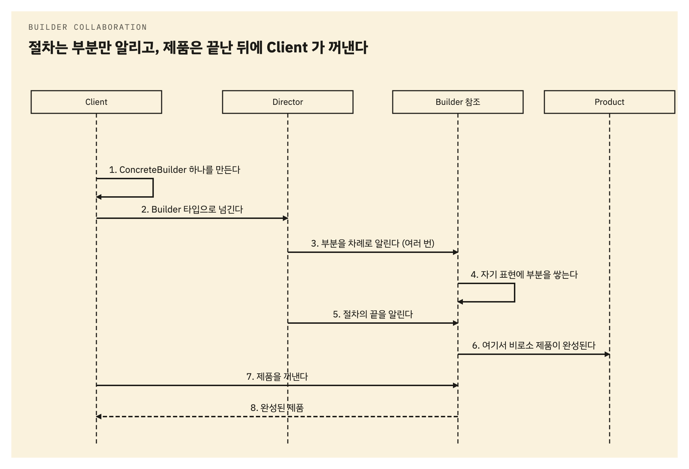
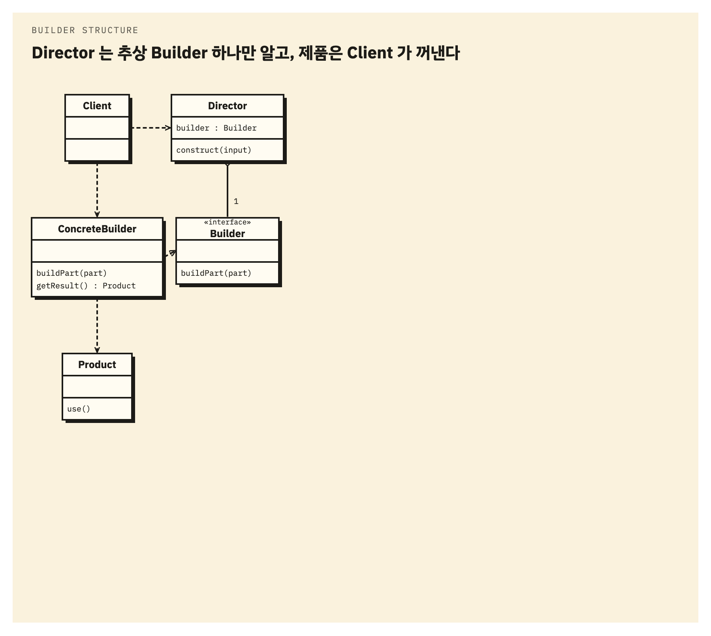

# Builder — 순회하는 절차는 한 벌만 두고, 제품은 끝난 뒤에 꺼내기

## 한눈에 보는 개요

주문 한 건을 받아 영수증을 찍는 코드를 떠올려 봅시다. 주문 번호를 맨 위에 적고, 품목을 한 줄씩 적고, 배송비를 적고, 마지막에 합계를 적어요. 그런데 회계 쪽에서 같은 주문의 집계도 달라고 합니다 — 품목이 몇 종이고 수량이 몇 개고 금액이 얼마인지 한 줄로요. 가장 빠른 길은 집계 함수를 따로 하나 더 써서 품목 목록을 한 번 더 순회하는 것입니다. 그러면 주문을 순회하는 절차가 두 벌이 됩니다. 배송비를 합계에 넣는 규칙이 바뀌면 두 벌을 함께 고쳐야 하는데, 한 벌만 고치면 더 고약한 일이 벌어져요. 영수증의 합계와 집계의 합계가 서로 다른 값이 나옵니다. 컴파일은 통과하고, 예외도 나지 않고요.

Builder 의 해법은 **주문을 순회하는 절차를 한 벌만 남기고, 그 절차가 알림을 보내는 상대를 갈아 끼우는 것**입니다. 절차는 "주문이 시작됐다 · 품목이 하나 있다 · 배송비가 있다 · 끝났다"까지만 알리고, 그 알림을 받아 무엇으로 쌓을지는 받는 쪽이 정해요. 영수증이 필요하면 줄을 쌓는 쪽을 넣고, 집계가 필요하면 숫자를 더하는 쪽을 넣습니다.

```text
Before : 표현마다 주문을 순회하는 절차가 따로 있음

  printReceipt(주문)                     summarize(주문)
    주문 번호 줄을 적는다                   품목 종수를 센다
    for 품목 → 품목 줄을 적는다             for 품목 → 수량·금액을 더한다
    배송비 줄을 적는다                      배송비를 더한다
    합계 줄을 적는다                        합계를 낸다
    배송비 규칙이 바뀌면 → 두 절차를 함께 고침. 한쪽만 고치면 두 합계가 달라짐

After : 순회하는 절차는 한 벌, 알림을 받는 쪽만 갈아 끼움

  OrderReader.read(주문) ── begin · addLine · addShipping · end ──▶ OrderBuilder
                                                                     ├ ReceiptBuilder → Receipt
                                                                     └ TotalsBuilder  → OrderTotals
```

분류는 생성 패턴이고 범위는 객체입니다. 만들어 내는 제품이 부분과 전체가 같은 모양을 갖는 구조면 Composite 를 함께 쓰고, 부분을 만드는 일 자체를 또 다른 객체에 맡기면 Abstract Factory 를 함께 씁니다(근거: GoF 원서 Builder 절 Related Patterns).

## 패턴 자세히 들여다보기

### 시나리오 1 — 주문 한 건이 영수증 한 장이 되는 길

주문 하나가 들어왔습니다. 주문 번호는 `ORD-4417`, 품목은 공책 3개에 개당 3,000원, 연필 12개에 개당 500원, 지우개 2개에 개당 800원이고 배송비는 3,000원이에요. 나와야 하는 것은 주문 번호 한 줄, 품목 세 줄, 배송비 한 줄, 합계 한 줄을 합친 여섯 줄짜리 영수증입니다. 이 장면에는 다섯이 등장해요. 어떤 표현이 필요한지 아는 **진입점**(패턴에서 Client 라고 부르는 역할), 주문을 순회하며 부분을 알리는 `OrderReader`(Director), 알림을 받는 연산만 선언한 `OrderBuilder`(Builder)와 그 영수증 구현 `ReceiptBuilder`(ConcreteBuilder), 그리고 나오는 물건인 `Receipt`(Product)입니다. 이름은 여기서 한 번씩만 소개하고 정식 정의는 개념 정리에서 해요.



1. 진입점이 `ReceiptBuilder` 인스턴스를 하나 만듭니다. 이 일을 진입점이 맡는 이유는 "이번에 어떤 표현이 필요한가"를 아는 쪽이 거기뿐이기 때문이에요. 이 판단을 `OrderReader` 안으로 옮기면 순회하는 절차 안에 표현의 이름이 들어가고, 시나리오 3 이 그때 무엇이 막히는지를 따라갑니다.
2. 진입점이 그 인스턴스를 `OrderBuilder` 타입으로 `OrderReader` 에 넘깁니다. 타입을 `ReceiptBuilder` 가 아니라 `OrderBuilder` 로 적는 이유는 순회하는 절차가 어떤 표현인지 모르게 하려는 것이고, 그래야 다른 표현을 넣을 때 `OrderReader` 를 열지 않아요. 이 단계가 3단계보다 늦으면 알릴 상대가 아직 없습니다.
3. `OrderReader` 가 `begin("ORD-4417")` 로 주문의 시작을 알립니다. 끝만 알리면 될 것 같지만 시작도 알려야 하는 이유는 빌더가 앞 주문의 잔재를 비울 시점을 알아야 하기 때문이에요. 같은 빌더 인스턴스에 두 번째 주문을 읽히면, 시작 알림이 없을 때 첫 주문의 품목 줄이 두 번째 영수증 위에 그대로 남습니다.
4. `OrderReader` 가 품목 셋을 차례로 `addLine(이름, 수량, 단가)` 으로 알립니다. 주문 데이터에 품목이 몇 개 있는지는 주문을 가지고 있는 `OrderReader` 만 알고, 그 품목을 어떤 글자로 적을지는 `ReceiptBuilder` 만 알아요. 그래서 각자 아는 것에 따라 나눠, 한쪽은 알리고 한쪽은 받습니다.
5. `OrderReader` 가 배송비가 0보다 클 때만 `addShipping(3000)` 을 부릅니다. 이 분기 판단을 절차 쪽이 맡는 이유는, 판단을 빌더로 옮기면 같은 조건문이 빌더 수만큼 복제되기 때문이에요. 빌더가 둘이면 두 벌, 셋이면 세 벌이 되고 그중 하나만 고쳐지는 날이 옵니다.
6. `OrderReader` 가 `end()` 로 절차의 끝을 알리고, `ReceiptBuilder` 가 그 자리에서 합계 줄 `합계 19600` 을 붙여 `Receipt` 를 만듭니다. 합계를 마지막에 내는 이유는 그 값이 앞선 알림을 다 받은 뒤에야 확정되기 때문이에요. 4단계 중간에 합계를 확정하면 배송비가 더해지기 전의 16,600원이 적힙니다.
7. 진입점이 `ReceiptBuilder` 에서 `getReceipt()` 로 제품을 꺼냅니다. 꺼내는 일을 `OrderReader` 가 아니라 진입점이 맡는 이유는, 표현마다 제품 타입이 달라서 `OrderReader` 의 반환 타입 자리에 적을 이름이 없기 때문이에요. 다음 시나리오에서 집계 표현이 들어올 때 이 사정을 확인할 수 있습니다.

```text
단계   부르는 쪽 → 받는 쪽                넘기는 것                      돌아오는 것
 1     진입점 → (new)                    —                             ReceiptBuilder 인스턴스
 2     진입점 → OrderReader              ReceiptBuilder 를 OrderBuilder 로   —
 3     OrderReader → OrderBuilder        "ORD-4417"                    —
 4     OrderReader → OrderBuilder        (공책 3 3000) · (연필 12 500) · (지우개 2 800)   —
 5     OrderReader → OrderBuilder        3000                          —
 6     OrderReader → OrderBuilder        —                             (빌더 안에서 Receipt 가 만들어진다)
 7     진입점 → ReceiptBuilder           —                             Receipt
```

잠깐, 확인 하나만 해 볼까요? 7단계의 `getReceipt()` 는 왜 `OrderBuilder` 에 선언돼 있지 않을까요?

`OrderBuilder` 에 올리려면 반환 타입을 적어야 하는데, 그 자리에 들어갈 타입이 없기 때문이에요. 영수증을 만드는 쪽은 `Receipt` 를 내고 집계를 만드는 쪽은 `OrderTotals` 를 내는데 둘은 서로 아무 관계가 없는 타입입니다. 억지로 공통 부모를 만들면 그 부모에는 두 제품이 함께 약속할 수 있는 연산만 남아, 정작 각자의 연산을 부르려면 받는 쪽이 다시 구체 타입으로 되돌려야 해요. 그래서 종결 연산은 구체 빌더에 두고, 그것을 부르는 쪽은 자기가 어떤 빌더를 골랐는지 아는 진입점으로 정합니다(근거: GoF 원서 Builder 절 Implementation — 제품들의 표현이 크게 달라 공통 추상 클래스를 두어 얻는 것이 적은 것이 보통이고, 그래서 클라이언트가 구체 빌더에서 제품을 받는다).

| | 부분을 받는 연산 | 제품을 내주는 연산 |
| --- | --- | --- |
| 어디에 선언되나 | `OrderBuilder`(추상 타입) | `ReceiptBuilder` · `TotalsBuilder`(구체 타입) |
| 누가 부르나 | `OrderReader`(절차) | 진입점(빌더를 고른 쪽) |
| 반환 타입 | 없음 | `Receipt` · `OrderTotals` — 서로 무관한 두 타입 |

이 시나리오가 보여 준 것은 역할 다섯과 그 사이의 호출 방향입니다. 표현을 고르는 일(1단계)은 진입점이, 주문을 순회하며 부분을 알리는 일(3~6단계)은 Director 가, 알림을 받아 자기 표현에 쌓는 일(4·6단계)은 ConcreteBuilder 가 맡아요. Director 에 들어오는 타입은 추상 Builder 하나뿐이고(2단계), 제품 타입은 Director 코드에 한 번도 나오지 않습니다. 제품이 밖으로 나오는 자리가 7단계 하나뿐이라는 점도 함께 봐 두세요 — 그 하나를 언제로 정하느냐가 다음다음 시나리오의 핵심입니다.

### 시나리오 2 — 표현이 하나 더 늘 때와, 부분 종류가 하나 더 늘 때

같은 주문 기능에 요구가 둘 들어왔습니다. 하나는 회계용 집계를 내 달라는 것이고, 다른 하나는 쿠폰 할인 줄을 영수증과 집계 양쪽에 넣어 달라는 것이에요. 집계는 `주문 ORD-4417 · 품목 3종 · 수량 17개 · 상품 16600원 · 배송 3000원 · 합계 19600원` 한 줄입니다. 쿠폰 할인은 주문 번호와 품목 사이에 들어갈 새 부분 종류이고요. 두 요구는 크기가 비슷해 보이는데 드는 품이 전혀 다르고, 그 차이가 이 패턴이 어떤 변화를 가볍게 만들고 어떤 변화를 무겁게 만드는지를 그대로 보여 줍니다.

1. 집계를 위해 `TotalsBuilder` 를 새로 씁니다. `OrderBuilder` 가 선언한 네 연산을 그대로 구현하되, 줄을 쌓는 대신 종수·수량·금액을 더해요. 연산 모양을 바꾸지 않는 이유는 그 모양이 `OrderReader` 와 모든 빌더 사이의 계약이라서, 한 빌더가 모양을 바꾸면 절차 코드와 다른 빌더가 전부 따라 바뀌기 때문입니다.
2. `TotalsBuilder` 의 종결 연산 `getTotals()` 가 `OrderTotals` 를 내도록 씁니다. 제품 타입을 `Receipt` 와 맞추지 않는 이유는 맞출 이유가 없어서예요 — 영수증은 사람이 읽을 여러 줄이고 집계는 프로그램이 쓸 숫자 다섯이라, 둘이 함께 약속할 연산이 없습니다. 제품 사이에 공통 타입을 두지 않는 것이 이 패턴에서는 보통입니다.
3. 진입점에 `TotalsBuilder` 를 만들어 `OrderReader` 에 넘기는 두 줄을 더합니다(결과를 찍는 줄은 따로예요). 여기까지가 전부예요 — `OrderBuilder` 선언과 `OrderReader`, 그리고 `ReceiptBuilder` 는 한 줄도 바뀌지 않습니다. `OrderReader` 에 적힌 이름이 `OrderBuilder` · `begin` · `addLine` · `addShipping` · `end` 다섯뿐이라 새 빌더의 이름이 들어갈 자리가 없기 때문이에요.
4. 이번에는 쿠폰 할인을 더해 봅니다. `OrderBuilder` 에 `addDiscount` 한 줄을 더해야 하는데, 그 한 줄을 더하는 순간 `ReceiptBuilder` 와 `TotalsBuilder` 두 구현에서 함께 컴파일 오류가 나요. 빌더 인터페이스가 "절차가 알릴 수 있는 부분의 종류"를 고정하고 있어서, 종류를 늘리면 그 인터페이스를 구현한 모든 표현이 새 연산을 채워야 하기 때문입니다.
5. 세 언어 모두 이 자리를 컴파일러가 막습니다. 실제로 선언만 더하고 구현을 비워 둔 채 컴파일해 보면 Java 는 `ReceiptBuilder is not abstract and does not override abstract method addDiscount(int) in OrderBuilder` 를 두 클래스에서 각각 내고, TypeScript 는 `TS2420: Class 'ReceiptBuilder' incorrectly implements interface 'OrderBuilder'.` 두 건에 더해 두 빌더를 `OrderReader` 에 넘기는 줄에서 `TS2345` 를 두 건 더 내며, Rust 는 `E0046` 오류로 `add_discount` 구현이 빠졌다고 두 번 냅니다(세 언어 모두 직접 컴파일해 확인했습니다. 진단 문자열은 javac 21.0.11 · tsc 5.9.3 · rustc 1.95.0 의 출력이에요). 막아 주는 것이 다행이지 이득은 아니에요 — 고칠 자리가 컴파일 오류 개수만큼 있다는 뜻이니까요.

| 더하는 것 | 새로 쓰는 것 | 고쳐야 하는 것 | 손대지 않는 것 |
| --- | --- | --- | --- |
| 표현 하나 (집계) | `TotalsBuilder` · `OrderTotals` 두 타입 | 진입점 두 줄 | `OrderBuilder` · `OrderReader` · `ReceiptBuilder` · `Receipt` |
| 부분 종류 하나 (쿠폰 할인) | 새 타입은 없음 | `OrderBuilder` 선언과 `ReceiptBuilder` · `TotalsBuilder` 두 구현, `OrderReader` 의 알림 한 줄 | `Receipt` · `OrderTotals` · 진입점 |

두 줄을 비교하면 고쳐야 하는 기존 코드 자리의 수가 1 대 4 입니다. 표현 수를 m, 부분 종류 수를 n 이라고 두면 이 차이를 식으로 쓸 수 있어요. 표현을 하나 더하면 새로 쓰는 것이 빌더 1 개와 제품 1 개이고 고치는 곳은 진입점 1 곳이라, m 이 아무리 커져도 고칠 곳은 1 로 고정입니다. 부분 종류를 하나 더하면 고치는 곳이 빌더 인터페이스 1 곳과 구체 빌더 m 곳과 절차 1 곳을 합쳐 m + 2 곳이고, 표현이 늘어날수록 함께 늡니다.

```text
표현 갈래 (m) ▶  ReceiptBuilder   TotalsBuilder   ← 하나 더: 새 타입 2, 고칠 곳 1
                 ──────────────   ─────────────
부분 종류 (n)
  begin            주문 번호 줄       주문 번호 보관
  addLine          품목 줄            종수·수량·금액 누적
  addShipping      배송비 줄          배송비 누적
  addDiscount ?    ↑ 하나 더: 고칠 곳 m + 2 (인터페이스 1 + 구체 빌더 m + 절차 1)
```

여기서 헷갈리기 쉬운 포인트는 4단계의 대가를 인터페이스 설계를 잘못해서 생긴 문제로 읽는 것입니다. 그렇지 않아요. 알릴 수 있는 부분의 종류를 인터페이스에 고정했기 때문에 컴파일 오류가 나는 것이고, 바로 그 고정 덕분에 3단계에서 새 표현이 빠진 연산 없이 완성됩니다. 종류를 열어 두는 변형도 있는데, `addPart("discount", 값)` 처럼 종류 이름을 인자로 받는 연산 하나를 두는 방식이에요. 그러면 종류를 늘려도 인터페이스가 그대로지만, 어떤 종류를 어떤 빌더가 실제로 처리하는지 컴파일러가 더는 검사해 주지 않아 4단계의 오류가 아무 일도 일어나지 않는 쪽으로 바뀝니다.

이 시나리오가 보여 준 것은 변화가 들어오는 두 갈래에 드는 품이 서로 다르다는 점입니다. 표현이 늘 때는 기존 코드를 열지 않고 새 타입만 더하면 되고(1~3단계), 부분 종류가 늘 때는 인터페이스와 모든 빌더, 그리고 절차까지 함께 열어야 해요(4·5단계). 그래서 "같은 데이터에서 뽑아야 할 결과물이 자꾸 는다"는 요구에는 잘 맞고, "구성 요소 자체가 자꾸 는다"는 요구에는 잘 맞지 않습니다.

### 시나리오 3 — 종결 연산을 없애거나 절차를 표현에 묶으면 어디서 어긋나는가

같은 기능의 다른 코드베이스에서 일어난 일입니다. 두 갈래를 차례로 따라가요. 앞 갈래는 "어차피 줄을 쌓고 있으니 그때그때 현재 영수증을 돌려주면 편하지 않나"에서 시작했고, 뒤 갈래는 "`OrderBuilder` 를 굳이 둘 것 없이 `ReceiptBuilder` 를 바로 받자"에서 시작했습니다. 주문은 앞 시나리오와 같은 `ORD-4417` 이고, 아래 결과는 전부 javac 21.0.11 로 실제로 컴파일하거나 실행해서 받은 것입니다.

1. 앞 갈래는 `end()` 를 지우고 `begin` · `addLine` · `addShipping` 이 각자 그 시점까지의 영수증 문자열을 돌려주도록 고칩니다. 이렇게 짜는 이유는 대개 편의예요 — 종결 연산을 기억했다 부르는 일이 없어지고, 어느 시점에든 중간 결과를 볼 수 있으니까요. 그 대가로 "완성됐다"는 시점이 코드에서 사라집니다.
2. `OrderReader` 는 품목 셋을 다 알린 뒤 마지막으로 받은 문자열을 돌려줍니다. 배송비 알림은 그 뒤에 오므로 이 문자열에는 배송비 줄도 합계 줄도 없어요. 컴파일은 통과하고 예외도 나지 않습니다.

```text
주문 ORD-4417
공책 x3 @3000 = 9000
연필 x12 @500 = 6000
지우개 x2 @800 = 1600
```

3. 이 네 줄이 그대로 고객에게 나가면 배송비 3,000원이 빠진 영수증이 됩니다. 합계 줄도 없어서 받은 쪽이 19,600원 대신 16,600원으로 읽을 여지가 생겨요. 시나리오 1 의 6단계가 합계를 끝에 내야 한다고 한 이유가 이것입니다 — 마지막 부분까지 다 와야 확정되는 값이 있는 한, "지금까지의 결과"는 제품이 아니라 중간 상태예요. 되돌리는 길은 부분 연산의 반환을 없애고 종결 연산을 되살리는 것이고, 최소 조건으로는 2번이 걸리는 자리입니다.
4. 뒤 갈래는 `OrderReader` 의 필드 타입을 `OrderBuilder` 에서 `ReceiptBuilder` 로 바꿉니다. 이렇게 짜는 이유도 편의예요 — 표현이 하나뿐일 때는 인터페이스 하나가 늘어난 것처럼만 보이니까요. 이 상태에서 시나리오 2 의 3단계처럼 `TotalsBuilder` 를 넘기려고 하면 컴파일이 막힙니다. 아래는 그 판을 따로 만들어 컴파일한 출력이고, 파일 이름과 줄 번호가 적힌 앞머리만 지웠습니다.

```text
error: incompatible types: TotalsBuilder cannot be converted to ReceiptBuilder
        OrderReader reader = new OrderReader(new TotalsBuilder());
                                             ^
```

5. 앞 갈래와 달리 이번에는 컴파일러가 막아 줍니다. 대신 막힌 자리가 잘못을 저지른 자리가 아니라는 점이 문제예요 — 고칠 곳은 `OrderReader` 의 필드 선언인데 오류는 진입점에서 납니다. 표현이 둘로 늘어나는 날에야 알 수 있으므로, 표현이 하나인 동안에는 이 코드가 멀쩡해 보입니다.
6. 두 갈래는 문제가 나타나는 시점도 되돌리는 길도 다릅니다. 앞은 실행해야 알 수 있고 부분 연산의 반환을 없애면 되돌아오며, 뒤는 컴파일에서 확인되고 필드 타입을 추상 타입으로 되돌리면 풀려요. 최소 조건으로는 앞이 2번, 뒤가 3번입니다.

| | 앞 갈래(종결 연산 없앰) | 뒤 갈래(절차를 구체 빌더에 묶음) |
| --- | --- | --- |
| 언제 나타나나 | 실행 뒤 출력에서 | 두 번째 표현을 넣는 순간 컴파일에서 |
| 무엇이 나오나 | 배송비·합계가 빠진 네 줄 | `incompatible types` 오류 |
| 되돌리는 길 | 부분 연산의 반환을 없애고 종결 연산을 되살림 | 필드 타입을 `OrderBuilder` 로 되돌림 |
| 걸리는 최소 조건 | 2번 | 3번 |

이 시나리오가 보여 준 것은 이 패턴이 지키려는 것이 "만들 수 있는가"가 아니라 **언제 완성인가와 누가 표현을 아는가**라는 점입니다. 앞 갈래는 완성 시점을 지우고도 컴파일을 통과했고(2단계), 뒤 갈래는 표현 이름을 절차에 들여놓고도 표현이 하나인 동안에는 아무 일도 없었어요(5단계). 그래서 판정 기준도 실행 결과가 아니라 연산의 반환 타입이 무엇인지, 절차 코드의 타입 선언에 어떤 이름이 적혀 있는지로 정해집니다.

### 개념 정리

시나리오에 나온 역할 다섯을 정식으로 정의합니다. 예시의 타입 이름(`OrderReader` · `ReceiptBuilder` 같은 것)은 역할이 아니라 역할에 대응하는 구현이라, 구현 예시에서 따로 매핑해요.

- **Builder** — 제품의 부분을 만드는 연산을 추상 인터페이스로 선언합니다. 선언하는 것은 "절차가 알릴 수 있는 부분의 종류"뿐이고, 제품을 내주는 연산은 여기 없어요(시나리오 1 의 3~6단계). 이 선언이 절차와 모든 표현 사이의 계약이라서, 여기를 고치면 구현이 전부 따라 바뀝니다(시나리오 2 의 4단계). 주문 예에서는 `begin` · `addLine` · `addShipping` · `end` 를 선언한 `OrderBuilder` 가 Builder 입니다.
- **ConcreteBuilder** — Builder 인터페이스를 구현해 부분을 만들고 조립하며, 자기가 만드는 표현을 정의하고 완성될 때까지 가지고 있습니다. 제품을 내주는 종결 연산도 여기에 있어요 — 제품 타입이 표현마다 달라 추상 쪽에 올릴 수 없기 때문입니다(시나리오 1 의 7단계). 주문 예에서는 `ReceiptBuilder` 와 `TotalsBuilder` 가 ConcreteBuilder 예요.
- **Director** — Builder 인터페이스만 써서 구성 절차를 한 벌 가지고 있습니다. 무엇을 어떤 순서로 알릴지, 어떤 조건에서 어떤 부분을 건너뛸지가 여기 있고(시나리오 1 의 5단계), 어떤 표현이 만들어지는지는 모릅니다. 주문 예에서는 주문을 순회하며 네 연산을 부르는 `OrderReader` 가 Director 입니다.
- **Product** — 만들어지는 물건입니다. ConcreteBuilder 가 그 내부 표현과 쌓는 방식을 정하고, 표현이 다르면 제품 타입도 다른 것이 보통이라 제품들 사이에 공통 부모가 없는 경우가 많아요(시나리오 2 의 2단계). 주문 예에서는 `Receipt` 와 `OrderTotals` 가 각각 Product 입니다.
- **Client** — 어떤 표현이 필요한지 정해 ConcreteBuilder 를 하나 만들고, 그것을 Builder 타입으로 Director 에 넘긴 다음, 절차가 끝나면 그 ConcreteBuilder 에서 제품을 꺼냅니다(시나리오 1 의 1·2·7단계). 구체 빌더의 이름과 제품 타입을 아는 자리는 프로그램에서 여기뿐이에요. 주문 예에서는 진입점(Java `OrderApp.main` · TypeScript 최상위 코드 · Rust `main`)이 Client 입니다.



그림에서 Director 칸에서 나가는 선이 추상 Builder 하나로만 향한다는 점을 봐 두세요. Product 칸으로 들어오는 선은 ConcreteBuilder 에서 내려온 것 하나뿐이고, Client 에서는 Director 와 ConcreteBuilder 양쪽으로 선이 이어집니다 — 절차를 시키는 일과 제품을 받는 일이 둘 다 Client 의 몫이기 때문이에요. 제품을 일일이 넘겨 처리를 맡기는 이 관계 자체를 무엇이라 부르는지는 [참고 문서 「GoF 공통 어휘」의 위임](../../reference/gof-vocabulary/gof-vocabulary-ref_v1.0.2.md#위임delegation)에 있습니다.

> 절차는 알리기만 하고, 표현은 받는 쪽이 정하고, 제품은 끝난 뒤에 꺼낸다.

## 사용 목적

Builder 가 필요할 때 보이는 단서가 셋 있습니다. 차례로 봅시다.

- **같은 데이터를 순회하는 절차가 두 벌 이상 복제돼 있고, 다른 점은 결과물뿐이다.** 개요의 `printReceipt` 와 `summarize` 가 그 모양이에요. 두 함수의 `for` 문이 같은 목록을 같은 순서로 순회하고, 조건문도 같은 자리에 있고, 몸통만 다릅니다. 순회 규칙이 바뀔 때마다 두 곳을 함께 고치고 있다면 절차가 한 벌이어야 할 것이 두 벌인 상태예요.
- **만들다 만 물건이 밖으로 나가 있다.** 시나리오 3 의 앞 갈래가 그 모양입니다. 객체를 만들어 두고 세터를 여러 번 불러 채우는 코드라면, 그 사이의 어느 시점에 다른 코드가 그 객체를 가져다 쓸 수 있어요. "아직 합계가 안 들어간 영수증" 같은 상태가 타입으로 구분되지 않는다면 단서입니다.
- **생성자 인자가 많고 그중 여럿이 선택이라 오버로드가 불어난다.** 인자 여덟 개짜리 생성자와 그중 셋을 뺀 판, 다섯을 뺀 판이 나란히 있는 코드가 그 모양이에요. 인자 순서를 잘못 적어도 타입이 같으면 컴파일러가 잡아 주지 않는다는 점까지 겹치면 더 그렇습니다. 이 단서에서 나오는 빌더는 Director 없이 빌더 하나만 두는 모양이 보통이고, 그 차이는 최소 조건의 5번에서 다시 봐요.

쓰지 말아야 할 경우도 둘 적어 둡니다.

- **필드가 두셋이고 선택 옵션이 없는 값 객체**에는 쓰지 않습니다. 빌더 타입이 하나 늘고, 한 줄이면 끝날 생성이 세 줄이 되고, 제품의 정의를 보려면 파일 둘을 오가게 돼요. 잃는 것은 읽는 속도이고, 얻는 것은 없습니다.
- **표현이 앞으로도 하나뿐이고 순회하는 절차를 부르는 자리도 한 곳**이면 Director 와 추상 Builder 를 두지 않습니다. 이때 추상 타입은 구현이 하나뿐인 인터페이스라, 읽는 사람에게 "다른 구현이 어딘가 있겠거니" 하는 잘못된 기대만 남겨요. 표현이 실제로 둘이 되는 날 시나리오 3 의 뒤 갈래처럼 타입을 되돌리면 되고, 그 비용은 필드 선언 한 줄입니다.

```text
같은 단서에서 다른 선택을 하는 경우

  결과물이 호출 한 번에 나온다              ─▶ 팩토리 쪽 (Abstract Factory · Factory Method)
  알림을 여러 번 받고 끝에 꺼낸다           ─▶ Builder
  받는 쪽이 하나뿐이고 앞으로도 하나다      ─▶ 빌더 하나만 두고 Director 는 두지 않는다
  알림을 받는 쪽이 만들어질 제품 자신이다   ─▶ 패턴이 아니라 세터 체이닝
```

비슷한 단서에서 Abstract Factory 를 고르게 되는 경우가 있는데, 구분 기준은 결과물을 한 번에 받는지 여러 번에 나눠 쌓는지예요. 차이는 다음 절에서 풉니다.

## 패턴의 경계

### 디자인 패턴을 충족하는 최소 조건

어떤 코드를 Builder 라고 불러도 되는지 가르는 기준입니다. `[필수]` 가 하나라도 빠지면 이 패턴이 아니고, `[선택]` 은 갖추면 좋은 구조예요. 조건은 언어와 상관없이 코드에서 확인할 수 있는 모양(타입 선언 · 참조 보유 · 호출 방향 · 생성 위치)으로 적었고, 조건마다 그것을 보여 준 시나리오의 단계를 가리킵니다.

1. [필수] 부분을 받는 연산이 제품이 아니라 별개의 빌더 타입에 선언돼 있습니다 — 부분을 더하는 연산을 가진 타입과 그 결과로 나오는 제품 타입이 따로 선언돼 있고, 절차가 부르는 상대는 앞쪽입니다. 시나리오 1 의 3~5단계가 그 모양이에요 (근거: GoF 원서 Builder 절 Participants — Builder 가 Product 의 부분을 만드는 추상 인터페이스를 선언하고, ConcreteBuilder 가 그것을 구현해 부분을 만들고 조립하며 자신이 만드는 표현을 정의·추적한다).
   - 빠지면: 제품 자신이 세터마다 자기를 돌려주는 체이닝이 됩니다. 시나리오 2 의 1단계처럼 절차를 그대로 두고 받는 쪽만 갈아 끼우려 해도 갈아 끼울 대상이 없어요 — 표현을 하나 더 만들려면 제품 클래스를 통째로 하나 더 써야 합니다.
2. [필수] 완성된 제품을 내주는 종결 연산이 따로 있고, 부분을 받는 연산은 제품을 돌려주지 않습니다 — 부분 연산의 반환 타입 자리에 제품 타입이 없고(반환이 없거나 빌더 자신), 제품을 내주는 연산이 그와 별개로 선언돼 있습니다. 이것이 이 패턴이 늘 유지해야 하는 불변식이고, 시나리오 1 의 6·7단계가 그 자리예요 (근거: GoF 원서 Builder 절 Consequences — 제품을 한 번에 만드는 다른 생성 패턴과 달리 Director 통제 아래 단계적으로 만들고, 제품은 완성된 뒤에 빌더에서 꺼낸다).
   - 빠지면: 시나리오 3 의 2·3단계처럼 부분이 덜 들어간 값이 제품 행세를 하고 밖으로 나갑니다. 타입이 같으므로 컴파일러가 막지 못하고, 그래서 이 조건은 실행 결과가 아니라 반환 타입으로 봅니다.
3. [필수] 구성 절차를 실행하는 코드가 추상 빌더 타입만 참조합니다 — 그 코드의 필드와 매개변수 타입이 빌더 인터페이스이고, 구체 빌더의 이름이 그 안에 없습니다. 시나리오 2 의 3단계에서 `OrderReader` 가 한 줄도 바뀌지 않은 것이 이 조건 덕분이에요 (근거: GoF 원서 Builder 절 Participants·Collaborations — Director 는 Builder 인터페이스를 써서 객체를 구성하고, 클라이언트가 Director 를 원하는 Builder 객체로 구성한다).
   - 빠지면: 시나리오 3 의 4·5단계가 그 자리입니다. 절차가 한 표현에 묶여 있으면 같은 절차로 다른 표현을 만들 수 없고, 표현을 더하는 날 절차까지 복제하게 돼요.
4. [필수] 부분을 제품에 더하는 조립이 빌더 안에서 일어나고, 절차를 실행하는 쪽은 알리기만 합니다 — 절차 코드에 제품의 필드를 채우거나 제품 조각을 이어 붙이는 문장이 없고, 빌더에서 꺼낸 중간 조각을 절차가 가지고 있지 않습니다. 시나리오 1 의 4·6단계가 그 모양이에요 (근거: GoF 원서 Builder 절 Collaborations — Director 는 제품의 부분을 만들어야 할 때마다 Builder 에 알리고, Builder 는 그 요청을 처리해 제품에 부분을 더한다).
   - 빠지면: 절차가 조립까지 하면 표현마다의 조립 규칙이 절차 안으로 들어옵니다. 시나리오 2 의 1단계에서 `TotalsBuilder` 가 줄 대신 숫자를 더하기로 한 결정이 절차 쪽 분기가 되어, 표현이 늘 때마다 절차에 분기가 하나씩 붙어요.
5. [선택] 구성 절차가 별도의 Director 객체에 들어 있습니다 — 절차를 담은 타입이 빌더와 따로 선언돼 있고, 그 타입이 빌더 참조를 필드로 갖습니다. 시나리오 1 의 2단계가 그 자리입니다 (근거: 이 가이드의 정책 — 절차를 부르는 자리가 한 곳뿐이면 그 자리에 절차를 두는 편이 짧다. 표준 라이브러리의 빌더에는 Director 에 해당하는 타입이 없는 것이 보통이고, 이때도 1~4번은 그대로 적용된다).
6. [선택] 종결 연산이 필수 부분이 빠졌는지 검사하고 거부합니다 — 종결 연산에 조건 검사가 있고, 채워지지 않았으면 제품 대신 오류나 빈 값을 냅니다. 시나리오 3 의 1단계가 없애 버린 것이 이 검사의 자리예요 (근거: 이 가이드의 정책 — 원전은 종결 시점 검증을 요구하지 않는다. 다만 `HttpRequest.Builder` 는 URI 가 없으면 `build()` 에서 예외를 내도록 계약을 밝히고 있어, 계약이 있다면 적는 편이 낫다).
7. [선택] 부분을 받는 연산이 빌더 자신을 돌려줘 한 줄로 이어 부를 수 있습니다 — 부분 연산의 반환 타입이 빌더 타입입니다. 시나리오 1 의 4단계처럼 절차가 따로 있으면 이어 부를 일이 없고, 절차 없이 쓰는 빌더에서 쓸모가 있습니다 (근거: 이 가이드의 정책 — Rust API Guidelines 의 C-BUILDER 가 권하는 모양이지만 원전의 성립 요건은 아니다. 2번을 지키는 한 반환이 빌더 자신인 것은 무방하다).
8. [선택] 종결 연산이 돌려준 제품이 그 뒤의 빌더 변경과 독립입니다 — 종결 연산이 빌더의 내부 자료를 복사해 제품에 넣거나, 제품이 빌더와 자료를 공유하지 않습니다. 시나리오 2 의 1단계에서 같은 빌더로 두 번째 주문을 읽힐 수 있는 것이 이 성질에 기대요 (근거: 이 가이드의 정책 — 원전에는 이 요구가 없다. 빌더를 한 번만 쓰고 버린다면 없어도 되지만, 재사용하면 앞서 꺼낸 제품이 조용히 바뀐다).

`[필수]` 는 하나만 빠져도 판정이 끝나므로 1번부터 차례로 봅니다. 1번과 2번은 타입 선언만, 3번은 절차 코드의 필드·매개변수 타입만, 4번은 절차 코드의 본문만 보면 되어서 앞에서 멈추면 뒤는 읽지 않아도 돼요.

| 코드 | 1번 | 2번 | 3번 | 4번 | 판정 |
| --- | --- | --- | --- | --- | --- |
| 구현 절의 `OrderBuilder` · 두 빌더 · `OrderReader` | 만족 | 만족 | 만족 | 만족 | Builder |
| 시나리오 3 의 앞 갈래(부분 연산이 영수증을 돌려줌) | 만족 | 빠짐 | 만족 | 만족 | 아님 |
| 시나리오 3 의 뒤 갈래(`OrderReader` 가 `ReceiptBuilder` 를 필드로) | 만족 | 만족 | 빠짐 | 만족 | 아님 |
| 제품 자신이 `return this` 세터를 체이닝하는 판 | 빠짐 | 빠짐 | 절차가 따로 없어 볼 코드 없음 | 빠짐 | 아님 |
| 절차가 빌더에서 중간 조각을 꺼내 직접 이어 붙이는 판 | 만족 | 만족 | 만족 | 빠짐 | 아님 |

표의 세 번째 줄을 조금 더 봐 둡시다. 5번(Director 의 존재)이 `[선택]` 이라서 절차가 별도 객체에 없어도 판정은 유지되는데, 그렇다고 3번이 면제되는 것은 아니에요. 절차가 진입점 안에 인라인으로 있더라도 그 절차가 참조하는 변수의 타입이 구체 빌더면 3번이 걸립니다. 조건이 묻는 것은 절차가 어디 있느냐가 아니라 절차가 어떤 타입으로 부르느냐입니다.

> 필수는 연산이 어디에 선언됐고 무엇을 돌려주는가, 선택은 그 둘레를 어떻게 꾸미는가.

### 비슷한 패턴·안티패턴과의 차이

Builder 와 같은 단서에서 떠오르거나 구조가 닮은 대상 셋을 비교합니다. Abstract Factory 는 인덱스가 빠른 비교 페어로 묶어 둔 상대이고, Factory Method 는 "생성을 다른 곳에 맡긴다"는 점이 겹치는 상대예요. 나머지 하나는 제품 자신이 세터를 체이닝하면서 이 패턴으로 불리는 코드입니다. 표에 기준을 먼저 모으고, 대상마다 코드와 시나리오로 풀어 볼게요.

| 비교 대상 | 구분 기준 | 이 패턴을 고르면 얻는 것 | 포기하는 것 |
| --- | --- | --- | --- |
| Abstract Factory | 쓰는 쪽이 조립 단계를 순서대로 부르고 마지막에 결과를 꺼내는가, 호출 한 번에 완성된 제품을 받는가 | 한 제품을 단계마다 다르게 쌓는 능력과, 완성 시점을 한 곳으로 모으는 것 | 여러 종류의 제품이 같은 계열로 묶인다는 보장. 그것이 필요하면 팩토리를 따로 둠 |
| Factory Method | 만드는 일이 여러 번의 알림으로 나뉘어 쓰는 쪽에 보이는가, 호출 한 번 안에 감춰지는가 | 순회하는 절차를 한 벌로 두고 결과물만 갈아 끼우는 것 | 생성이 한 줄로 끝나는 간결함. 부르는 쪽이 절차를 알아야 함 |
| 제품 자신이 세터를 체이닝하는 코드 | 체이닝하는 객체가 별개의 빌더인가, 만들어질 제품 자신인가 | 같은 절차로 다른 표현을 만드는 능력과, 미완성 상태가 제품 타입으로 바깥에 노출되지 않는 것 | 타입 하나로 끝나는 단순함. 제품이 둘로 나뉨(빌더 + 제품) |

**Abstract Factory 와의 차이.** 구분 기준은 쓰는 쪽이 조립 단계를 순서대로 부르고 마지막에 결과를 꺼내는지, 호출 한 번에 완성된 제품을 받는지입니다. 코드에서는 생성 연산의 반환 타입을 보면 돼요 — 매번 쓸 수 있는 제품이 돌아오면 팩토리 쪽이고, 부분 연산에서는 아무것도 돌아오지 않고 따로 있는 종결 연산에서만 제품이 나오면 빌더 쪽입니다. 시나리오 1 의 3~6단계는 `begin` 한 번과 `addLine` 세 번, `addShipping` 한 번, `end` 한 번을 합쳐 여섯 번을 불렀는데 제품은 한 번도 나오지 않았고, 7단계에서 한 번 나왔어요.

```text
Builder : 단계를 순서대로 알리고 마지막에 꺼냄 (시나리오 1 의 3~7단계)
  reader.read(주문)  →  begin · addLine × 3 · addShipping · end   아직 제품이 아님
  receiptBuilder.getReceipt()                                     여기서 비로소 제품 하나
  호출들의 관계 = 한 제품의 조립 단계

Abstract Factory : 호출마다 완성된 제품 하나
  kit.createHeading(제목)  → 바로 쓸 수 있는 Heading
  kit.createTable(머리글, 행) → 바로 쓸 수 있는 Table
  호출들의 관계 = 같은 계열의 다른 종류
```

Builder 를 고르면 한 제품을 단계마다 다르게 쌓는 능력을 얻습니다. 시나리오 2 의 1단계에서 같은 알림을 받아 한쪽은 줄을 쌓고 한쪽은 숫자를 더한 것이 그 능력이에요. 대신 여러 종류의 제품이 같은 계열로 묶인다는 보장은 포기합니다 — 제목과 표가 같은 형식이어야 한다는 식의 요구는 빌더가 아니라 팩토리가 지키는 것이고, 그 보장을 어떻게 얻는지는 [Abstract Factory 가이드](../abstract-factory/abstract-factory-guide_v1.0.1.md)에 있어요. 그 가이드는 팩토리 하나가 함께 쓰이는 제품 종류를 둘 이상 만드는 것을 최소 조건의 `[필수]` 로 두는데, 그 선은 원전이 그어 준 것이 아니라 의도에 나오는 "군"을 기준으로 그 가이드가 고른 것이라고 밝히고 있습니다.

여기서 헷갈리기 쉬운 포인트는 둘을 서로 배타적인 선택지로 보는 것입니다. 실제로는 포개져요. 주문 예에서 영수증을 마크다운과 HTML 두 형식으로 내야 한다고 해 봅시다. 순회하는 절차는 그대로 한 벌이고, `ReceiptBuilder` 가 줄을 직접 만드는 대신 형식 하나를 아는 팩토리에 제목 조각과 품목 조각을 물어 쌓으면 됩니다. 빌더는 언제 무엇을 쌓을지를 알고 팩토리는 그 조각이 어떤 형식인지를 아는, 서로 다른 질문에 답하는 두 층이에요. 반대 방향으로 포개는 구성도 있습니다 — 팩토리가 돌려준 제품이 복잡해서 그 자체를 단계적으로 조립해야 하면 그 자리에 빌더가 들어가고요.

```text
포개는 방향 1 : 빌더가 팩토리를 쓴다
  OrderReader ─알림─▶ ReceiptBuilder ─조각 요청─▶ ReportKit(팩토리) ─▶ 형식에 맞는 조각
  빌더가 아는 것 = 언제 무엇을 쌓는가 · 팩토리가 아는 것 = 그 조각이 어떤 형식인가

포개는 방향 2 : 팩토리가 낸 제품을 빌더가 조립한다
  ReportKit ─▶ Table 제품 ─▶ TableDraft(빌더) ─행 추가 여러 번─▶ build() ─▶ 완성된 표
```

**Factory Method 와의 차이.** 구분 기준은 만드는 일이 여러 번의 알림으로 나뉘어 쓰는 쪽에 보이는지, 호출 한 번 안에 감춰지는지입니다. 아래 코드는 주문에서 영수증을 만드는 일을 한 번의 호출로 감쌌고, 그 안에서 부품을 조립하는 부분만 하위 클래스가 채웁니다.

```java no-compile
abstract class OrderExporter {
    final String export(Order order) {
        StringBuilder out = new StringBuilder();
        out.append(head(order));                 // 한 번의 호출 안에서 전부 끝난다
        for (OrderLine line : order.lines) {
            out.append(body(line));
        }
        return out.toString();
    }

    protected abstract String head(Order order);   // 하위 클래스가 채운다
    protected abstract String body(OrderLine line);
}
```

쓰는 쪽은 `export(order)` 한 줄만 부르고 단계를 보지 않습니다. 그래서 "여기까지 쌓고 잠깐 멈춘다"거나 "조건을 보고 마지막 부분을 뺀다" 같은 조작을 할 자리가 없어요. 시나리오 1 의 5단계에서 배송비를 넣을지 말지를 절차가 정할 수 있었던 것은 단계가 밖으로 나와 있었기 때문이고, 위 코드에서는 그 판단이 `export` 안으로 들어갑니다. Builder 를 고르면 그 판단 자리를 얻고, 대신 부르는 쪽이 절차를 알아야 하는 부담을 집니다 — 한 줄로 끝나던 생성이 빌더를 만들고 절차를 실행하고 꺼내는 세 단계가 돼요.

**제품 자신이 세터를 체이닝하는 코드와의 차이.** 구분 기준은 체이닝하는 객체가 별개의 빌더인지 만들어질 제품 자신인지입니다. 아래는 `Receipt` 자신이 세터를 이어 부를 수 있게 만든 판이에요.

```java no-compile
final class Receipt {
    private final List<String> lines = new ArrayList<>();

    Receipt addLine(String text) {    // 제품 자신이 제품을 돌려준다
        lines.add(text);
        return this;
    }

    String text() {
        return String.join("\n", lines);
    }
}

// 쓰는 쪽
Receipt r = new Receipt().addLine("주문 ORD-4417").addLine("공책 x3 @3000 = 9000");
```

읽기 좋고 짧습니다. 다만 최소 조건으로 보면 1번과 2번과 4번이 빠져요. 부분을 받는 연산이 제품 타입에 붙어 있어서 같은 알림으로 다른 표현을 만들 대상이 없고, 시나리오 2 의 1단계처럼 집계를 더하려면 `OrderTotals` 에 똑같은 세터 묶음을 다시 써야 합니다. 2번이 걸리는 이유는 `addLine` 이 돌려주는 것이 빌더가 아니라 제품 자신이기 때문이에요 — 시나리오 3 의 앞 갈래가 실수로 만든 상태가 여기서는 타입 수준에서 상시로 열려 있습니다. 이 패턴을 고르면 표현을 갈아 끼우는 능력과 미완성 상태가 밖으로 나가지 않게 하는 것을 얻고, 타입 하나로 끝나던 단순함을 포기합니다.

## 구현 예시

### 상황 설정

시나리오 1·2 의 주문 장면을 세 언어로 똑같이 구현합니다. 주문 한 건이 들어오고 영수증과 집계가 각각 한 번씩 나오며, 바뀌는 부분은 같은 알림을 받아 무엇을 쌓는가예요.

- 고정되는 것: 순회하는 절차(주문 시작 → 품목마다 한 번 → 배송비가 있으면 한 번 → 끝), 빌더가 받는 연산 넷의 모양, 주문 데이터의 모양(품목 이름·수량·단가 셋과 배송비 하나)
- 바뀌는 것: 알림을 받아 쌓는 표현 둘(영수증 여러 줄 · 집계 한 줄)과 그 결과로 나오는 제품 타입 둘
- 입력 범위: 금액과 수량은 모두 음이 아닌 정수이고 통화는 하나뿐이라 단위를 적지 않습니다. 곱셈이 넘칠 만큼 큰 값은 이 예제의 입력에 없고, 세 언어의 출력이 같다는 말은 이 입력 범위에서 한 말이에요
- 진입점의 실행 순서: 주문 `ORD-4417`(공책 3개 @3,000 · 연필 12개 @500 · 지우개 2개 @800, 배송비 3,000)을 영수증 빌더로 한 번, 집계 빌더로 한 번 읽습니다. 마지막으로 `end()` 를 부르지 않은 빌더에 제품을 요청해 종결 전 꺼내기가 거부되는지 봅니다

손으로 예상해 본 값은 품목 금액이 9,000원과 6,000원과 1,600원이라 상품 합이 16,600원, 배송비를 더한 합계가 19,600원, 수량 합이 17개입니다. 실제로 그런지는 실행해 보면 알아요. 아래가 그 실행 출력이고, 구분선 세 줄까지 합쳐 가이드 폴더의 `code/expected-output.txt` 에 그대로 담긴 열한 줄입니다. 이 글의 출력 예는 전부 여기서 왔습니다.

```text
--- receipt ---
주문 ORD-4417
공책 x3 @3000 = 9000
연필 x12 @500 = 6000
지우개 x2 @800 = 1600
배송비 3000
합계 19600
--- totals ---
주문 ORD-4417 · 품목 3종 · 수량 17개 · 상품 16600원 · 배송 3000원 · 합계 19600원
--- before end ---
거부됨
```

예시 타입이 맡는 역할은 다음과 같습니다. Rust 판은 함수 이름이 snake_case(소문자 단어를 밑줄로 잇는 이름 규칙)로 바뀌어 `add_line` · `add_shipping` 이 되고, 종결 연산은 그 언어에서 조회 연산에 `get_` 을 붙이지 않는 관례를 따라 `receipt` · `totals` 예요.

| 예시 타입·함수 | 역할 |
| --- | --- |
| `OrderBuilder` (`begin` · `addLine` · `addShipping` · `end`) | Builder |
| `ReceiptBuilder` · `TotalsBuilder` | ConcreteBuilder |
| `getReceipt` · `getTotals` (Rust 는 `receipt` · `totals`) | 종결 연산. 추상 타입이 아니라 구체 빌더에 있다 |
| `Receipt` · `OrderTotals` | Product (표현 둘, 공통 부모 없음) |
| `OrderReader` (`read`) | Director |
| 진입점(Java `OrderApp.main` · TypeScript 최상위 코드 · Rust `main`) | Client. 구체 빌더를 만들고 제품을 꺼내는 유일한 자리 |
| `Order` · `OrderLine` | 입력 데이터. 패턴의 역할이 아니다 |

### 구현

```java
import java.util.ArrayList;
import java.util.List;

/** 주문 한 줄. 예시의 입력 데이터이고 패턴의 역할은 아니다. */
final class OrderLine {
    final String name;
    final int quantity;
    final int unitPrice;

    OrderLine(String name, int quantity, int unitPrice) {
        this.name = name;
        this.quantity = quantity;
        this.unitPrice = unitPrice;
    }
}

/** 주문 한 건. 예시의 입력 데이터이고 패턴의 역할은 아니다. */
final class Order {
    final String id;
    final List<OrderLine> lines;
    final int shippingFee;

    Order(String id, List<OrderLine> lines, int shippingFee) {
        this.id = id;
        this.lines = lines;
        this.shippingFee = shippingFee;
    }
}

/** Builder — 부분을 받는 연산만 선언한다. 제품을 꺼내는 연산은 여기 없다. */
interface OrderBuilder {
    void begin(String orderId);

    void addLine(String name, int quantity, int unitPrice);

    void addShipping(int fee);

    void end();
}

/** Product 1 — 영수증 여러 줄. */
final class Receipt {
    private final List<String> lines;

    Receipt(List<String> lines) {
        this.lines = List.copyOf(lines);
    }

    String text() {
        return String.join("\n", lines);
    }
}

/** Product 2 — 집계 한 줄. Receipt 와 공통 부모가 없다. */
final class OrderTotals {
    private final String orderId;
    private final int lineCount;
    private final int itemCount;
    private final int goodsAmount;
    private final int shippingFee;

    OrderTotals(String orderId, int lineCount, int itemCount, int goodsAmount, int shippingFee) {
        this.orderId = orderId;
        this.lineCount = lineCount;
        this.itemCount = itemCount;
        this.goodsAmount = goodsAmount;
        this.shippingFee = shippingFee;
    }

    String summary() {
        return "주문 " + orderId + " · 품목 " + lineCount + "종 · 수량 " + itemCount
                + "개 · 상품 " + goodsAmount + "원 · 배송 " + shippingFee
                + "원 · 합계 " + (goodsAmount + shippingFee) + "원";
    }
}

/** ConcreteBuilder 1 — 영수증 표현을 정의하고 추적한다. */
final class ReceiptBuilder implements OrderBuilder {
    private final List<String> lines = new ArrayList<>();
    private int amount;
    private Receipt product;

    @Override
    public void begin(String orderId) {
        lines.clear();
        amount = 0;
        product = null;
        lines.add("주문 " + orderId);
    }

    @Override
    public void addLine(String name, int quantity, int unitPrice) {
        int sum = quantity * unitPrice;
        amount += sum;
        lines.add(name + " x" + quantity + " @" + unitPrice + " = " + sum);
    }

    @Override
    public void addShipping(int fee) {
        amount += fee;
        lines.add("배송비 " + fee);
    }

    @Override
    public void end() {
        lines.add("합계 " + amount);
        product = new Receipt(lines);
    }

    Receipt getReceipt() {
        if (product == null) {
            throw new IllegalStateException("end() 전에는 영수증을 꺼낼 수 없습니다");
        }
        return product;
    }
}

/** ConcreteBuilder 2 — 집계 표현을 정의하고 추적한다. */
final class TotalsBuilder implements OrderBuilder {
    private String orderId = "";
    private int lineCount;
    private int itemCount;
    private int goodsAmount;
    private int shippingFee;
    private OrderTotals product;

    @Override
    public void begin(String orderId) {
        this.orderId = orderId;
        lineCount = 0;
        itemCount = 0;
        goodsAmount = 0;
        shippingFee = 0;
        product = null;
    }

    @Override
    public void addLine(String name, int quantity, int unitPrice) {
        lineCount += 1;
        itemCount += quantity;
        goodsAmount += quantity * unitPrice;
    }

    @Override
    public void addShipping(int fee) {
        shippingFee += fee;
    }

    @Override
    public void end() {
        product = new OrderTotals(orderId, lineCount, itemCount, goodsAmount, shippingFee);
    }

    OrderTotals getTotals() {
        if (product == null) {
            throw new IllegalStateException("end() 전에는 집계를 꺼낼 수 없습니다");
        }
        return product;
    }
}

/** Director — 추상 빌더 타입만 참조한다. */
final class OrderReader {
    private final OrderBuilder builder;

    OrderReader(OrderBuilder builder) {
        this.builder = builder;
    }

    void read(Order order) {
        builder.begin(order.id);
        for (OrderLine line : order.lines) {
            builder.addLine(line.name, line.quantity, line.unitPrice);
        }
        if (order.shippingFee > 0) {
            builder.addShipping(order.shippingFee);
        }
        builder.end();
    }
}

public final class OrderApp {
    public static void main(String[] args) {
        Order order = new Order("ORD-4417", List.of(
                new OrderLine("공책", 3, 3000),
                new OrderLine("연필", 12, 500),
                new OrderLine("지우개", 2, 800)), 3000);

        ReceiptBuilder receiptBuilder = new ReceiptBuilder();
        new OrderReader(receiptBuilder).read(order);
        System.out.println("--- receipt ---");
        System.out.println(receiptBuilder.getReceipt().text());

        TotalsBuilder totalsBuilder = new TotalsBuilder();
        new OrderReader(totalsBuilder).read(order);
        System.out.println("--- totals ---");
        System.out.println(totalsBuilder.getTotals().summary());

        ReceiptBuilder halfway = new ReceiptBuilder();
        halfway.begin(order.id);
        halfway.addLine("공책", 3, 3000);
        System.out.println("--- before end ---");
        try {
            halfway.getReceipt();
            System.out.println("꺼냈음");
        } catch (IllegalStateException e) {
            System.out.println("거부됨");
        }
    }
}
```

```typescript
/** 주문 한 줄. 예시의 입력 데이터이고 패턴의 역할은 아니다. */
interface OrderLine {
  readonly name: string;
  readonly quantity: number;
  readonly unitPrice: number;
}

/** 주문 한 건. 예시의 입력 데이터이고 패턴의 역할은 아니다. */
interface Order {
  readonly id: string;
  readonly lines: readonly OrderLine[];
  readonly shippingFee: number;
}

/** Builder — 부분을 받는 연산만 선언한다. 제품을 꺼내는 연산은 여기 없다. */
interface OrderBuilder {
  begin(orderId: string): void;
  addLine(name: string, quantity: number, unitPrice: number): void;
  addShipping(fee: number): void;
  end(): void;
}

/** Product 1 — 영수증 여러 줄. */
class Receipt {
  private readonly lines: readonly string[];

  constructor(lines: readonly string[]) {
    this.lines = [...lines];
  }

  text(): string {
    return this.lines.join("\n");
  }
}

/** Product 2 — 집계 한 줄. Receipt 와 공통 부모가 없다. */
class OrderTotals {
  constructor(
    private readonly orderId: string,
    private readonly lineCount: number,
    private readonly itemCount: number,
    private readonly goodsAmount: number,
    private readonly shippingFee: number,
  ) {}

  summary(): string {
    const total = this.goodsAmount + this.shippingFee;
    return `주문 ${this.orderId} · 품목 ${this.lineCount}종 · 수량 ${this.itemCount}개`
      + ` · 상품 ${this.goodsAmount}원 · 배송 ${this.shippingFee}원 · 합계 ${total}원`;
  }
}

/** ConcreteBuilder 1 — 영수증 표현을 정의하고 추적한다. */
class ReceiptBuilder implements OrderBuilder {
  private lines: string[] = [];
  private amount = 0;
  private product: Receipt | null = null;

  begin(orderId: string): void {
    this.lines = [];
    this.amount = 0;
    this.product = null;
    this.lines.push(`주문 ${orderId}`);
  }

  addLine(name: string, quantity: number, unitPrice: number): void {
    const sum = quantity * unitPrice;
    this.amount += sum;
    this.lines.push(`${name} x${quantity} @${unitPrice} = ${sum}`);
  }

  addShipping(fee: number): void {
    this.amount += fee;
    this.lines.push(`배송비 ${fee}`);
  }

  end(): void {
    this.lines.push(`합계 ${this.amount}`);
    this.product = new Receipt(this.lines);
  }

  getReceipt(): Receipt {
    if (this.product === null) {
      throw new Error("end() 전에는 영수증을 꺼낼 수 없습니다");
    }
    return this.product;
  }
}

/** ConcreteBuilder 2 — 집계 표현을 정의하고 추적한다. */
class TotalsBuilder implements OrderBuilder {
  private orderId = "";
  private lineCount = 0;
  private itemCount = 0;
  private goodsAmount = 0;
  private shippingFee = 0;
  private product: OrderTotals | null = null;

  begin(orderId: string): void {
    this.orderId = orderId;
    this.lineCount = 0;
    this.itemCount = 0;
    this.goodsAmount = 0;
    this.shippingFee = 0;
    this.product = null;
  }

  addLine(name: string, quantity: number, unitPrice: number): void {
    this.lineCount += 1;
    this.itemCount += quantity;
    this.goodsAmount += quantity * unitPrice;
  }

  addShipping(fee: number): void {
    this.shippingFee += fee;
  }

  end(): void {
    this.product = new OrderTotals(
      this.orderId, this.lineCount, this.itemCount, this.goodsAmount, this.shippingFee);
  }

  getTotals(): OrderTotals {
    if (this.product === null) {
      throw new Error("end() 전에는 집계를 꺼낼 수 없습니다");
    }
    return this.product;
  }
}

/** Director — 추상 빌더 타입만 참조한다. */
class OrderReader {
  constructor(private readonly builder: OrderBuilder) {}

  read(order: Order): void {
    this.builder.begin(order.id);
    for (const line of order.lines) {
      this.builder.addLine(line.name, line.quantity, line.unitPrice);
    }
    if (order.shippingFee > 0) {
      this.builder.addShipping(order.shippingFee);
    }
    this.builder.end();
  }
}

const order: Order = {
  id: "ORD-4417",
  lines: [
    { name: "공책", quantity: 3, unitPrice: 3000 },
    { name: "연필", quantity: 12, unitPrice: 500 },
    { name: "지우개", quantity: 2, unitPrice: 800 },
  ],
  shippingFee: 3000,
};

const receiptBuilder = new ReceiptBuilder();
new OrderReader(receiptBuilder).read(order);
console.log("--- receipt ---");
console.log(receiptBuilder.getReceipt().text());

const totalsBuilder = new TotalsBuilder();
new OrderReader(totalsBuilder).read(order);
console.log("--- totals ---");
console.log(totalsBuilder.getTotals().summary());

const halfway = new ReceiptBuilder();
halfway.begin(order.id);
halfway.addLine("공책", 3, 3000);
console.log("--- before end ---");
try {
  halfway.getReceipt();
  console.log("꺼냈음");
} catch {
  console.log("거부됨");
}
```

```rust
/// 주문 한 줄. 예시의 입력 데이터이고 패턴의 역할은 아니다.
struct OrderLine {
    name: &'static str,
    quantity: u32,
    unit_price: u32,
}

/// 주문 한 건. 예시의 입력 데이터이고 패턴의 역할은 아니다.
struct Order {
    id: &'static str,
    lines: Vec<OrderLine>,
    shipping_fee: u32,
}

/// Builder — 부분을 받는 연산만 선언한다. 제품을 꺼내는 연산은 여기 없다.
trait OrderBuilder {
    fn begin(&mut self, order_id: &str);
    fn add_line(&mut self, name: &str, quantity: u32, unit_price: u32);
    fn add_shipping(&mut self, fee: u32);
    fn end(&mut self);
}

/// Product 1 — 영수증 여러 줄.
struct Receipt {
    lines: Vec<String>,
}

impl Receipt {
    fn new(lines: &[String]) -> Receipt {
        Receipt { lines: lines.to_vec() }
    }

    fn text(&self) -> String {
        self.lines.join("\n")
    }
}

/// Product 2 — 집계 한 줄. Receipt 와 공통 부모가 없다.
struct OrderTotals {
    order_id: String,
    line_count: u32,
    item_count: u32,
    goods_amount: u32,
    shipping_fee: u32,
}

impl OrderTotals {
    fn summary(&self) -> String {
        format!(
            "주문 {} · 품목 {}종 · 수량 {}개 · 상품 {}원 · 배송 {}원 · 합계 {}원",
            self.order_id,
            self.line_count,
            self.item_count,
            self.goods_amount,
            self.shipping_fee,
            self.goods_amount + self.shipping_fee
        )
    }
}

/// ConcreteBuilder 1 — 영수증 표현을 정의하고 추적한다.
struct ReceiptBuilder {
    lines: Vec<String>,
    amount: u32,
    product: Option<Receipt>,
}

impl ReceiptBuilder {
    fn new() -> ReceiptBuilder {
        ReceiptBuilder { lines: Vec::new(), amount: 0, product: None }
    }

    fn receipt(&self) -> Option<&Receipt> {
        self.product.as_ref()
    }
}

impl OrderBuilder for ReceiptBuilder {
    fn begin(&mut self, order_id: &str) {
        self.lines.clear();
        self.amount = 0;
        self.product = None;
        self.lines.push(format!("주문 {}", order_id));
    }

    fn add_line(&mut self, name: &str, quantity: u32, unit_price: u32) {
        let sum = quantity * unit_price;
        self.amount += sum;
        self.lines.push(format!("{} x{} @{} = {}", name, quantity, unit_price, sum));
    }

    fn add_shipping(&mut self, fee: u32) {
        self.amount += fee;
        self.lines.push(format!("배송비 {}", fee));
    }

    fn end(&mut self) {
        self.lines.push(format!("합계 {}", self.amount));
        self.product = Some(Receipt::new(&self.lines));
    }
}

/// ConcreteBuilder 2 — 집계 표현을 정의하고 추적한다.
struct TotalsBuilder {
    order_id: String,
    line_count: u32,
    item_count: u32,
    goods_amount: u32,
    shipping_fee: u32,
    product: Option<OrderTotals>,
}

impl TotalsBuilder {
    fn new() -> TotalsBuilder {
        TotalsBuilder {
            order_id: String::new(),
            line_count: 0,
            item_count: 0,
            goods_amount: 0,
            shipping_fee: 0,
            product: None,
        }
    }

    fn totals(&self) -> Option<&OrderTotals> {
        self.product.as_ref()
    }
}

impl OrderBuilder for TotalsBuilder {
    fn begin(&mut self, order_id: &str) {
        self.order_id = order_id.to_string();
        self.line_count = 0;
        self.item_count = 0;
        self.goods_amount = 0;
        self.shipping_fee = 0;
        self.product = None;
    }

    fn add_line(&mut self, _name: &str, quantity: u32, unit_price: u32) {
        self.line_count += 1;
        self.item_count += quantity;
        self.goods_amount += quantity * unit_price;
    }

    fn add_shipping(&mut self, fee: u32) {
        self.shipping_fee += fee;
    }

    fn end(&mut self) {
        self.product = Some(OrderTotals {
            order_id: self.order_id.clone(),
            line_count: self.line_count,
            item_count: self.item_count,
            goods_amount: self.goods_amount,
            shipping_fee: self.shipping_fee,
        });
    }
}

/// Director — 추상 빌더 타입만 참조한다.
struct OrderReader<'a> {
    builder: &'a mut dyn OrderBuilder,
}

impl<'a> OrderReader<'a> {
    fn new(builder: &'a mut dyn OrderBuilder) -> OrderReader<'a> {
        OrderReader { builder }
    }

    fn read(&mut self, order: &Order) {
        self.builder.begin(order.id);
        for line in &order.lines {
            self.builder.add_line(line.name, line.quantity, line.unit_price);
        }
        if order.shipping_fee > 0 {
            self.builder.add_shipping(order.shipping_fee);
        }
        self.builder.end();
    }
}

fn main() {
    let order = Order {
        id: "ORD-4417",
        lines: vec![
            OrderLine { name: "공책", quantity: 3, unit_price: 3000 },
            OrderLine { name: "연필", quantity: 12, unit_price: 500 },
            OrderLine { name: "지우개", quantity: 2, unit_price: 800 },
        ],
        shipping_fee: 3000,
    };

    let mut receipt_builder = ReceiptBuilder::new();
    OrderReader::new(&mut receipt_builder).read(&order);
    println!("--- receipt ---");
    println!("{}", receipt_builder.receipt().expect("end() 가 끝났으므로 제품이 있다").text());

    let mut totals_builder = TotalsBuilder::new();
    OrderReader::new(&mut totals_builder).read(&order);
    println!("--- totals ---");
    println!("{}", totals_builder.totals().expect("end() 가 끝났으므로 제품이 있다").summary());

    let mut halfway = ReceiptBuilder::new();
    halfway.begin(order.id);
    halfway.add_line("공책", 3, 3000);
    println!("--- before end ---");
    match halfway.receipt() {
        Some(_) => println!("꺼냈음"),
        None => println!("거부됨"),
    }
}
```

시나리오 1 의 단계가 코드의 어느 줄인지 먼저 맞춰 봅시다.

| 시나리오 1 의 단계 | Java | TypeScript | Rust |
| --- | --- | --- | --- |
| 1. 진입점이 ConcreteBuilder 를 만든다 | 189행 | 157행 | 194행 |
| 2. Builder 타입으로 Director 에 넘긴다 | 190행 호출 · 164행 필드 선언 | 158행 호출 · 133행 생성자 매개변수 | 195행 호출 · 163행 필드 선언 |
| 3. 주문의 시작을 알린다 | 171행 | 136행 | 172행 |
| 4. 품목 셋을 차례로 알린다 | 172~174행 | 137~139행 | 173~175행 |
| 5. 배송비가 있을 때만 알린다 | 175~177행 | 140~142행 | 176~178행 |
| 6. 끝을 알리고 빌더가 제품을 만든다 | 178행 호출 · 105~108행 구현 | 143행 호출 · 77~80행 구현 | 179행 호출 · 97~100행 구현 |
| 7. 진입점이 제품을 꺼낸다 | 192행 | 160행 | 197행 |

이 표에서 눈여겨볼 곳은 6단계입니다. 호출 칸과 구현 칸이 나뉘어 있는 데는 이유가 있어요. 호출 줄은 절차의 마지막 한 줄일 뿐이고, 그 줄이 불러 오는 구현이 합계 줄을 붙이고 제품을 만드는 자리라서 최소 조건 2번이 코드에서 보이는 모습이 그 구현 쪽입니다. 시나리오 2 의 1단계에서 같은 알림을 받아 다른 것을 쌓으라고 한 것은 Java 92~102행과 138~147행, TypeScript 66~75행과 108~116행, Rust 86~95행과 140~148행 두 덩어리로 나타나고, 그 두 덩어리 어디에도 `Receipt` 나 `OrderTotals` 를 고르는 분기가 없다는 점이 최소 조건 4번의 확인 지점이에요.

| 최소 조건 | 어느 줄을 보면 되나 (Java · TypeScript · Rust) |
| --- | --- |
| 1번 (부분 연산이 별개 타입에) | 31~39행 · 16~21행 · 16~21행 — 제품 타입 `Receipt` 는 이 선언 안에 없다 |
| 2번 (종결 연산이 따로) | 110행 · 82행 · 73행 — 추상 타입이 아니라 구체 빌더에만 있다 |
| 3번 (절차가 추상 타입만) | 164행 · 133행 · 163행 — 필드 타입에 `ReceiptBuilder` 가 없다 |
| 8번 (제품이 빌더와 독립) | 46행 `List.copyOf` · 28행 `[...lines]` · 30행 `lines.to_vec()` |

세 언어를 통틀어 가장 중요한 줄은 종결 연산의 선언(Java 110행 · TypeScript 82행 · Rust 73행)입니다. 이 줄이 추상 타입 쪽으로 올라가면 제품 둘에 공통 부모가 필요해져 시나리오 1 의 확인 질문이 말한 문제가 생기고, 이 줄이 사라지고 부분 연산이 제품을 돌려주기 시작하면 시나리오 3 의 앞 갈래가 됩니다. 어디에 있는가와 무엇을 돌려주는가가 둘 다 걸려 있는 한 줄이라, 코드를 읽을 때 여기부터 찾으면 판정이 빨라요.

세 언어가 다른 점은 종결 전에 꺼내려 할 때 무엇을 내느냐 하나입니다. Java 와 TypeScript 는 예외를 던지고(Java 111~112행 · TypeScript 83~85행), Rust 는 `Option` 을 돌려줘 없음을 값으로 표현해요(Rust 73~75행). 그래서 Rust 판의 진입점은 `match` 로 두 경우를 가르고(208~211행), 나머지 둘은 `try`/`catch` 로 가릅니다. 셋 다 최소 조건 6번을 만족하는 모양이고, 다른 것은 "아직 없음"을 타입으로 말하느냐 제어 흐름으로 말하느냐입니다. Rust 판에서 Director 가 빌더를 `&'a mut dyn OrderBuilder` 로 빌려 갖는 것(163행)도 같은 갈래의 차이예요 — 빌려 간 참조는 `read` 가 끝나면 풀리고, 그래서 진입점이 197행에서 다시 그 빌더에 제품을 물을 수 있습니다.

### 실제 라이브러리에서

표준 라이브러리에서 같은 구조를 찾아 역할을 대응시켜 봅니다. 앞의 넷은 공식 문서가 스스로를 빌더라고 부르는 곳이고, 다섯째는 이름이 Builder 인데 문서의 설명은 팩토리라는 말을 쓰는 곳이에요.

| 사용처 | Builder · ConcreteBuilder | 부분을 받는 연산 | 종결 연산 | Product | Director |
| --- | --- | --- | --- | --- | --- |
| Java SE 21 [`java.net.http.HttpRequest.Builder`](https://docs.oracle.com/en/java/javase/21/docs/api/java.net.http/java/net/http/HttpRequest.Builder.html) | `HttpRequest.Builder` 인터페이스와 JDK 안의 구현 | `uri` · `header` · `timeout` 등 | `build()` | `HttpRequest` | 없음 |
| Java SE 21 [`java.lang.ProcessBuilder`](https://docs.oracle.com/en/java/javase/21/docs/api/java.base/java/lang/ProcessBuilder.html) | `ProcessBuilder` 클래스 하나가 둘을 겸함 | `command` · `directory` · `redirectOutput` 등 | `start()` | `Process` | 없음 |
| Rust [`std::process::Command`](https://doc.rust-lang.org/std/process/struct.Command.html) | `Command` 구조체 하나가 둘을 겸함 | `arg` · `env` · `current_dir` 등 | `spawn` · `output` · `status` | `Child` · `Output` · `ExitStatus` | 없음 |
| Rust [`std::fs::OpenOptions`](https://doc.rust-lang.org/std/fs/struct.OpenOptions.html) | `OpenOptions` 구조체 하나가 둘을 겸함 | `read` · `write` · `create` 등 | `open(path)` | `File` | 없음 |
| Rust [`std::thread::Builder`](https://doc.rust-lang.org/std/thread/struct.Builder.html) | `Builder` 구조체 하나가 둘을 겸함 | `name` · `stack_size` | `spawn(f)` | `JoinHandle` | 없음 |

다섯 행에 Director 가 하나도 없다는 점부터 봐 두세요. 표준 라이브러리의 빌더는 입력이 많고 그중 여럿이 선택이라는 단서에서 나온 것이라, 부르는 자리가 곧 절차이고 절차를 따로 떼어 재사용할 일이 없어서입니다. 그래서 최소 조건 5번을 `[선택]` 으로 둔 것이고, 1~4번은 이 다섯에도 그대로 적용돼요 — 설정을 받는 연산이 제품이 아니라 빌더에 붙어 있고(1번), 제품은 종결 연산에서만 나오며(2번), 설정 연산은 제품을 돌려주지 않습니다.

`HttpRequest.Builder` 는 종결 연산의 계약을 문서로 밝힌 사례예요. Javadoc 은 설정 연산이 같은 인스턴스를 돌려주고 동기화되지 않아 외부 동기화 없이 여러 스레드에서 부르면 안 된다고 적고, `build()` 는 부를 때마다 새 `HttpRequest` 를 내며 만들어진 요청이 불변이라고 적습니다. 최소 조건 7번(체이닝)에 더해 8번(제품이 빌더에서 떨어져 나오는 성질)까지 한 타입에서 확인할 수 있는 셈이고, 시나리오 2 의 1단계에서 같은 빌더로 두 번째 주문을 읽힐 수 있었던 근거가 라이브러리 쪽에서는 이 문장이에요. `ProcessBuilder` 는 한발 더 나아가 같은 인스턴스에서 `start()` 를 되풀이해 같은 속성의 프로세스를 여러 개 만들 수 있다고 밝힙니다.

```text
빌려 가는 종결 연산 (빌더가 남는다)           소유째 가져가는 종결 연산 (빌더가 사라진다)
  Command::spawn(&mut self)                     thread::Builder::spawn(self, f)
  OpenOptions::open(&self, path)
  같은 설정으로 여러 번 만들 수 있다             한 번 만들면 그 빌더는 다시 못 쓴다
```

Rust 쪽 셋은 종결 연산이 빌더를 어떻게 받는지가 다릅니다. `Command::spawn` 과 `OpenOptions::open` 은 빌더를 빌려만 가서 빌더가 호출 뒤에도 남고, `thread::Builder::spawn` 은 빌더를 소유째 가져가 그 자리에서 사라져요(세 시그니처 모두 rustc 1.95.0 으로 직접 확인했습니다. `mut` 없이 선언한 `Command` 에 `spawn` 을 부르면 `error[E0596]: cannot borrow as mutable` 이 나고, 같은 방식으로 선언한 `OpenOptions` 는 `open` 을 두 번 불러도 통과하며, `thread::Builder` 는 두 번째 `spawn` 에서 `error[E0382]: use of moved value` 가 납니다). 앞쪽 모양이면 같은 설정으로 여러 번 만들 수 있고, 뒤쪽 모양이면 한 번 쓰면 끝입니다. 구현 절의 Rust 판이 앞쪽 모양인데(163행의 빌려 오는 참조), 그래서 `read` 가 끝난 뒤에도 진입점이 빌더에 제품을 물을 수 있었어요. `thread::Builder` 는 이름이 Builder 인데 문서의 첫 설명은 스레드 팩토리라는 말을 쓰는 곳이라, 이름만 보고 판정하지 않는 편이 낫다는 예이기도 합니다.

## 스스로 점검하기

1. 아래 `InvoiceBuilder` 가 Builder 인지 최소 조건 1~4번을 하나씩 적용해 판정해 보세요. 빠진 조건이 있다면 몇 번이고, 그 조건을 채우려면 무엇을 어디로 옮겨야 하나요? 조건을 채우기 전의 이 코드는 비교 절의 어느 대상과 가장 가까운가요? (`Invoice` 는 청구서 제품이고 `addItem` 은 품목을 한 줄 더하는 연산입니다.)

   ```java
   final class Invoice {
       private final List<String> items = new ArrayList<>();

       void addItem(String text) {
           items.add(text);
       }

       String render() {
           return String.join("\n", items);
       }
   }

   final class InvoiceBuilder {
       private final Invoice invoice = new Invoice();

       Invoice addItem(String text) {
           invoice.addItem(text);
           return invoice;
       }
   }
   ```

2. 아래 `ExportRunner` 는 Builder 와 Abstract Factory 중 어느 쪽인가요? 비교 절의 구분 기준으로 답해 보세요. 이어서 이 코드에 "품목이 20개를 넘으면 뒤는 생략하고 요약 줄로 대신한다"는 요구를 넣으려면 어느 패턴을 어디에 두게 되는지도 적어 보세요.

   ```java
   final class ExportRunner {
       private final ExportKit kit;

       ExportRunner(ExportKit kit) {
           this.kit = kit;
       }

       String run(Order order) {
           String head = kit.createHead(order.id).render();
           String body = kit.createBody(order.lines).render();
           return head + "\n" + body;
       }
   }
   ```

3. 구현 절의 코드에서 `OrderReader.read` 의 마지막 두 문장 순서를 바꿔 `builder.end()` 를 먼저 부르고 `builder.addShipping(...)` 을 나중에 불렀다고 해 봅시다. 세 언어 모두 컴파일은 통과합니다. 그때 영수증 출력의 어느 줄이 어떻게 달라지고, 집계 출력의 어느 숫자가 달라지나요? 두 표현에서 달라지는 양상이 서로 다른 이유도 함께 짚어 보세요. 이어서 이 사고가 시나리오 3 의 앞 갈래와 무엇이 같고 무엇이 다른지 적어 보세요.

## 참고 자료

웹 자료는 모두 2026-09-27 에 확인했습니다.

- Erich Gamma · Richard Helm · Ralph Johnson · John Vlissides, *Design Patterns: Elements of Reusable Object-Oriented Software*, Addison-Wesley, 1994. 쪽 번호는 원서가 패턴 이름 뒤 괄호에 적는 시작 쪽 표기를 옮긴 것이고 종이책 판면과 대조하지 않았습니다. 장 번호도 확인하지 않아 장 이름으로만 적습니다.
  - 생성 패턴(Creational Patterns) 장, Builder(97쪽부터) — 의도 · 적용 대상(Applicability) · 참여자(Participants) · 협력(Collaborations) 네 단계 · 결과(Consequences: 제품의 내부 표현 교체, 구성 코드와 표현 코드의 격리, 구성 과정의 세밀한 제어) · 구현(제품에 공통 추상 클래스를 두지 않는 것이 보통) · 관련 패턴. 개요 · 시나리오 1~3 · 개념 정리 · 최소 조건 전부의 근거
  - 생성 패턴 장, Abstract Factory(87쪽부터) — 호출 한 번에 제품을 내는 구조. 비교 절 Abstract Factory 항목의 근거
  - 생성 패턴 장, Factory Method(107쪽부터) — 생성을 한 번의 호출 안에 감추고 하위 클래스가 채우는 구조. 비교 절 Factory Method 항목의 근거
- [Abstract Factory 가이드](../abstract-factory/abstract-factory-guide_v1.0.1.md) — 제품 종류 둘 이상이라는 최소 조건과 그 선을 그 가이드가 골랐다는 서술. 비교 절에서 계열 일관성 쪽을 그 편으로 넘긴 자리
- [참고 문서 「GoF 공통 어휘」](../../reference/gof-vocabulary/gof-vocabulary-ref_v1.0.2.md) — 개념 정리에서 제품을 넘겨 처리를 맡기는 관계를 부르는 이름(위임)
- [Builder — refactoring.guru](https://refactoring.guru/design-patterns/builder) — Director 가 반드시 필요한 것은 아니라는 서술과, 타입이 여럿 늘어 전체 복잡도가 커진다는 단점. 사용 목적의 "쓰지 말아야 할 경우" 두 줄과 최소 조건 5번의 근거
- [Rust API Guidelines — Type safety (C-BUILDER)](https://rust-lang.github.io/api-guidelines/type-safety.html) — 빌더가 필요해지는 조건(입력이 많음 · 선택 설정이 많음 · 생성에 부수 효과가 있음)과 설정 메서드가 빌더 자신을 돌려주는 모양, 빌려 가는 종결 연산과 소유째 가져가는 종결 연산의 절충. 사용 목적의 마지막 단서와 최소 조건 7번, 실제 라이브러리 절 Rust 세 행의 근거
- [HttpRequest.Builder (Java SE 21 API)](https://docs.oracle.com/en/java/javase/21/docs/api/java.net.http/java/net/http/HttpRequest.Builder.html) — 설정 연산이 같은 인스턴스를 돌려주고 동기화되지 않는다는 점, `build()` 마다 새 불변 `HttpRequest` 가 나온다는 점. 실제 라이브러리 표 첫 행과 최소 조건 6·8번의 근거
- [ProcessBuilder (Java SE 21 API)](https://docs.oracle.com/en/java/javase/21/docs/api/java.base/java/lang/ProcessBuilder.html) — 속성 모음을 관리하고 `start()` 를 되풀이해 같은 속성의 프로세스를 여러 개 만들 수 있다는 서술. 실제 라이브러리 표 둘째 행
- [Command (Rust std)](https://doc.rust-lang.org/std/process/struct.Command.html) — 문서가 스스로를 프로세스 빌더라고 부르는 점과 `spawn` · `output` · `status` 의 시그니처. 실제 라이브러리 표 셋째 행
- [OpenOptions (Rust std)](https://doc.rust-lang.org/std/fs/struct.OpenOptions.html) — 파일을 어떻게 열지 설정하는 빌더라는 서술과 `open` 의 시그니처. 실제 라이브러리 표 넷째 행
- [thread::Builder (Rust std)](https://doc.rust-lang.org/std/thread/struct.Builder.html) — 이름은 Builder 인데 설명은 스레드 팩토리라는 말을 쓰는 점과 `spawn` 이 빌더를 소유째 가져가는 점. 실제 라이브러리 표 다섯째 행
