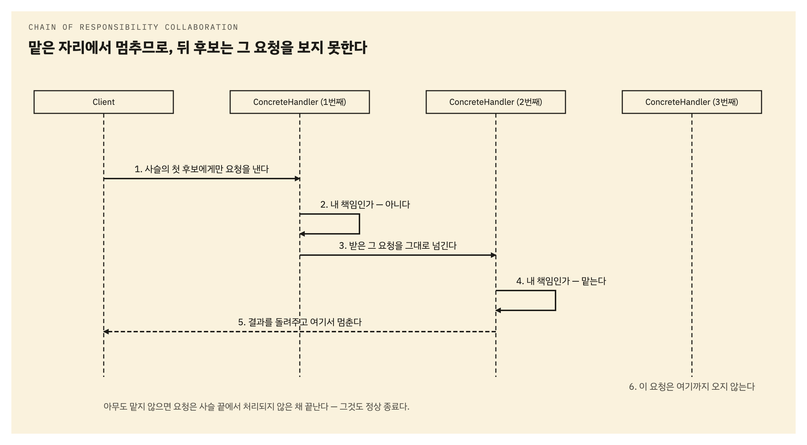
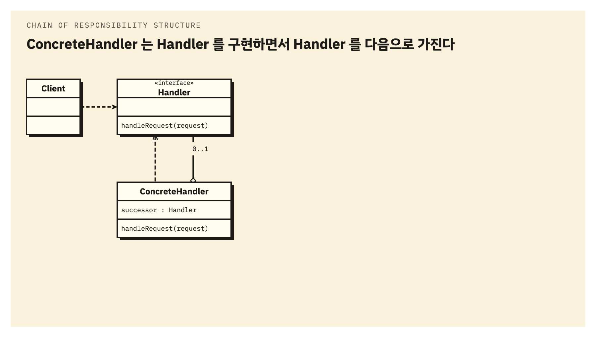

# Chain of Responsibility — 누가 맡을지 고르지 않고, 맡을 수 있는 쪽이 스스로 맡게 하기

## 한눈에 보는 개요

경비 청구를 받아 결재선에 올리는 코드를 하나 떠올려 봅시다. `ExpenseDesk.submit(request)` 가 금액을 보고 결재자를 고르는데, 10만 원 이하는 팀장, 100만 원 이하는 부서장, 1,000만 원 이하는 재무이사예요. 이 `if` 사슬을 한 곳에만 두면 다행인데 실제로는 영수증 화면·정산 배치·모바일 앱이 각자 같은 분기를 가지고 있습니다. 결재 한도가 바뀌거나 단계가 하나 늘면 그 세 곳을 함께 고쳐야 하고, 한 곳을 빠뜨리면 같은 청구가 화면마다 다른 사람에게 갑니다.

Chain of Responsibility 의 해법은 **고르는 일을 없애고, 후보들을 한 줄로 세워 요청을 차례로 넘기는 것**입니다. 요청을 내는 쪽은 줄의 맨 앞에게만 건네고, 각 후보가 「내가 맡을 일인가」를 스스로 보고 맡거나 다음으로 넘겨요. 누가 맡을지 고르던 분기는 어느 코드에도 남지 않고, 각 후보 안의 「내 한도인가」 한 줄로 흩어집니다.

```text
Before : 요청을 내는 쪽마다 누가 맡을지 고르는 분기를 가지고 있음

  submit(request)
    if      (금액 ≤ 100,000)    팀장.approve(request)
    else if (금액 ≤ 1,000,000)  부서장.approve(request)
    else if (금액 ≤ 10,000,000) 재무이사.approve(request)
    else                        throw
  ← 같은 분기가 영수증 화면 · 정산 배치 · 모바일 앱에 복제돼 있다

After : 후보를 한 줄로 세우고, 맡을 수 있는 쪽이 맡는다

  submit(request) ──▶ [영수증 검사] ──▶ [팀장] ──▶ [부서장] ──▶ [재무이사] ──▶ (끝)
                          │               │           │             │            │
                       못 맡으면        못 맡으면    맡는다!      여기까지        아무도
                       다음으로         다음으로    → 멈춘다     오지 않음       안 맡으면
                                                                               처리 안 됨
```

이 패턴의 이름은 GoF(Gang of Four, 1994년에 나온 *Design Patterns* 의 저자 네 명을 함께 부르는 이름)가 붙였고 줄여서 CoR 이라고도 씁니다. 분류는 행위 패턴이고, 자주 함께 쓰이는 패턴은 셋이에요. 사슬을 타고 넘어가는 요청 자체를 객체로 만들면 [Command](../command/command-guide_v1.0.1.md) 가 되고, 트리에서 자식이 부모로 요청을 올려 보내면 [Composite](../composite/composite-guide_v1.0.1.md) 의 부모 참조가 그대로 다음 후보 노릇을 합니다(근거: GoF Chain of Responsibility 절 Related Patterns). 후보들이 요청을 서로에게 넘긴다는 관계를 이르는 말이 위임인데, 그 정의는 [참고 문서 「GoF 공통 어휘」](../../reference/gof-vocabulary/gof-vocabulary-ref_v1.0.2.md)의 「위임」 항목에 있어요. 이 글은 시나리오 셋을 따라갑니다. 청구 하나가 결재선을 타고 내려가다 어디선가 멈추는 길, 새 규정이 더해질 때 어디에 끼우느냐가 결과를 어떻게 바꾸는가, 규칙을 어기면 어느 단계에서 무엇이 어긋나는가. 끝까지 읽으면 어떤 코드를 Chain of Responsibility 라고 불러도 되는지 필수 조건 다섯으로 판정할 수 있고, 구조가 거의 같은 Decorator 코드와도 구분할 수 있게 됩니다.

## 패턴 자세히 들여다보기

### 시나리오 1 — 청구 하나가 결재선을 타고 내려가다 멈추는 길

경비 청구 R2 가 들어왔습니다. 금액은 700,000원이고 영수증은 첨부돼 있어요. 이 회사의 결재선은 셋입니다. 팀장은 100,000원까지, 부서장은 1,000,000원까지, 재무이사는 10,000,000원까지 결재해요. 나와야 하는 것은 「부서장이 승인했다」 한 줄입니다. 이 장면에는 넷이 등장해요. 청구를 만들어 결재선에 올리는 조립 코드(패턴에서는 Client 라고 부르는 역할), 차례로 이어진 결재 담당 셋(각각 ConcreteHandler), 그리고 그 셋이 공통으로 따르는 처리 연산의 모양 `handle(청구)`(Handler)입니다. 이름은 여기서 한 번씩만 소개하고 정식 정의는 개념 정리에서 해요.



1. 조립 코드가 팀장 → 부서장 → 재무이사 순서로 셋을 이어 사슬 하나를 만듭니다. 순서를 정하는 일을 조립 코드가 맡는 이유는 결재선이 사내 규정이고, 규정을 아는 쪽만 누가 앞이고 누가 뒤인지 판단할 수 있어서예요. 이 순서를 결재 담당 자신이 정하게 하면 팀장이 부서장을 이름으로 알아야 하고, 규정이 바뀔 때마다 결재 담당 클래스를 열게 됩니다.
2. 조립 코드가 **사슬의 첫 후보에게만** 청구 R2 를 건넵니다. 첫 후보에게만 건네는 이유는 이 코드가 누가 맡을지 모른 채로 요청할 수 있어야 해서예요. 여기서 금액을 보고 부서장을 직접 부르면 개요의 Before 그림에 있던 `if` 사슬이 그대로 돌아옵니다.
3. 팀장이 청구를 받아 700,000원과 자기 한도 100,000원을 견줍니다. 넘으므로 맡지 않고, **받은 그 청구를 그대로** 다음 후보에게 넘겨요. 한도 판단을 팀장 안에 두는 이유는 그 한도가 팀장의 권한이라서입니다. 판단을 밖으로 빼면 다시 2단계에서 없앤 분기가 생기고, 청구를 바꿔서 넘기면 뒤 후보가 다른 사실을 보고 판단하게 됩니다.
4. 부서장이 같은 청구를 받아 700,000원과 자기 한도 1,000,000원을 견줍니다. 이번에는 한도 안이라 자기 일로 보고 승인해요. 3단계와 4단계가 **같은 청구에 다른 답**을 낸 것이 이 패턴의 핵심입니다. 부르는 쪽은 아무것도 고르지 않았는데 답이 달라졌어요.
5. 부서장은 승인한 뒤 **다음 후보를 부르지 않습니다.** 여기서 멈추지 않으면 재무이사도 같은 청구를 받아 자기 한도 안이라며 또 승인하고, 전표가 둘이 됩니다. 시나리오 3 의 첫 갈래에서 그 상태를 실제로 실행해 봐요.
6. 승인 결과가 조립 코드로 돌아옵니다. 결과를 받는 자리가 진입점 하나인 이유는 2단계에서 건넨 곳이 거기뿐이기 때문이에요. 누가 맡았는지는 결과 문자열에 담겨 오고, 조립 코드는 그 이름을 미리 알 필요가 없습니다.
7. 갈래를 둘 더 봅시다. 사슬은 늘 5단계처럼 끝나지 않아요.
   - 갈래 7-a. 금액이 30,000,000원인 청구 R4 는 셋 다 한도를 넘습니다. 마지막 후보인 재무이사가 다음 후보가 없는 것을 보고 그대로 끝내요. **아무도 맡지 않은 채 끝나는 것도 이 사슬의 정상 종료**이고, 이 패턴이 치르는 대가가 바로 이것입니다 — 요청이 처리된다는 보장이 없어요(근거: GoF Chain of Responsibility 절 Consequences).
   - 갈래 7-b. 영수증이 없는 청구가 들어오면 어떻게 될까요? 지금 사슬에는 그것을 볼 후보가 없어서 팀장이 금액만 보고 승인해 버립니다. 이 빠진 부분을 채우는 것이 시나리오 2 예요.

영수증 검사가 없는 이 사슬에 청구 다섯을 넣고 Java 21 로 실제로 실행한 결과입니다. `seen=` 칸이 그 청구를 실제로 본 후보를 순서대로 적은 것이에요.

```text
R1 80000 seen=TeamLead -> TeamLead approved
R2 700000 seen=TeamLead>DeptHead -> DeptHead approved
R3 5000000 seen=TeamLead>DeptHead>Finance -> Finance approved
R4 30000000 seen=TeamLead>DeptHead>Finance -> unhandled
R5 80000 seen=TeamLead -> TeamLead approved
```

잠깐, 확인 하나만 해 볼까요? R1(80,000원)의 `seen=` 칸에 왜 `DeptHead` 와 `Finance` 가 없을까요?

팀장이 1단계에서 맡고 멈췄기 때문입니다. 부서장과 재무이사는 R1 이라는 청구가 있었다는 사실조차 모르고, 그래서 둘의 코드를 아무리 읽어도 R1 이 어떻게 처리됐는지 알 수 없어요. 반대로 R4 는 `seen=` 에 셋이 다 있는데 결과는 `unhandled` 입니다. 「끝까지 갔다」와 「처리됐다」가 다른 말이라는 것이 이 두 줄에 같이 들어 있어요.

| 청구 | 금액 | 본 후보 | 결과 | 어느 단계에서 끝났나 |
| --- | --- | --- | --- | --- |
| R1 | 80,000 | 팀장 | 팀장 승인 | 첫 후보가 3단계에서 바로 맡음 |
| R2 | 700,000 | 팀장 · 부서장 | 부서장 승인 | 3단계에서 넘기고 4·5단계에서 맡음 |
| R3 | 5,000,000 | 팀장 · 부서장 · 재무이사 | 재무이사 승인 | 두 번 넘기고 마지막 후보가 맡음 |
| R4 | 30,000,000 | 팀장 · 부서장 · 재무이사 | 처리 안 됨 | 갈래 7-a — 다음이 없어서 끝남 |

이 시나리오가 보여 준 것은 역할 셋과 요청이 전달되는 방향입니다. 사슬을 잇고 첫 후보에게 건네는 일(1·2단계)은 Client 가, 맡을지 말지 판단하고 맡거나 넘기는 일(3·4단계)은 ConcreteHandler 가 하고, 그 판단을 밖에서 부를 수 있게 해 주는 것이 Handler 라는 공통 연산 모양이에요. 그리고 이 사슬이 끝나는 길은 둘입니다 — 누군가 맡아서 멈추거나(5단계), 아무도 맡지 않은 채 끝에 이르거나(갈래 7-a). 두 번째 길이 있다는 것이 「수신 보장 없음」이라는 대가의 실체입니다.

### 시나리오 2 — 영수증 규정이 더해질 때, 어디에 끼우느냐가 답을 바꾼다

감사에서 지적이 하나 나왔습니다. 영수증이 첨부되지 않은 청구가 승인된 건이 있다는 거예요. 새 규정은 「영수증이 없으면 금액과 상관없이 결재선에 올리지 않고 그 자리에서 반려한다」 한 줄입니다. 시험할 청구는 R5, 금액 80,000원에 영수증 없음이고, 지금 사슬에 넣으면 시나리오 1 의 실행 출력 마지막 줄처럼 `TeamLead approved` 가 나옵니다. 나와야 하는 것은 `rejected(no-receipt)` 예요.

1. 개발자가 영수증 검사 후보 클래스를 하나 새로 씁니다. 처리 연산의 모양은 시나리오 1 의 `handle(청구)` 그대로이고, 안에 든 판단만 「영수증이 없으면 내가 맡아 반려하고, 있으면 다음으로 넘긴다」예요. 연산 모양을 바꾸지 않는 이유는 그 모양이 사슬에 놓인 모든 후보와 부르는 쪽 사이의 계약이라서입니다. 모양이 바뀌면 기존 결재 담당 셋과 조립 코드가 전부 따라 바뀌어요.
2. 조립 코드에서 사슬을 잇는 줄 하나를 고쳐 새 후보를 **맨 앞에** 끼웁니다. 맨 앞인 이유는 이 규정이 「결재선에 올리기 전에」 걸러야 하는 것이기 때문이에요. 이 한 줄 말고는 아무것도 바뀌지 않습니다.
3. 기존 결재 담당 셋과 Handler 선언, 그리고 청구를 내는 코드는 한 줄도 바뀌지 않습니다. 결재 담당들이 서로를 이름으로 알지 않고 「다음 후보」라는 공통 타입으로만 알기 때문이에요. 시나리오 1 의 1단계에서 순서를 조립 코드가 맡은 것이 여기서 효과를 냅니다.
4. R5 를 넣으면 맨 앞의 영수증 검사가 맡아 반려하고 멈춥니다. 여기서 「맡았다」는 것이 「승인했다」는 뜻이 아니라는 점을 봐 두세요. 맡는다는 것은 이 요청에 대한 답을 내가 낸다는 뜻이고, 그 답이 반려일 수도 있습니다.
5. 같은 후보를 팀장 **뒤에** 끼우면 R5 의 답이 달라집니다. 팀장이 먼저 80,000원을 보고 자기 한도 안이라며 승인한 뒤 멈추므로, 영수증 검사는 불리지도 않아요. 시나리오 1 의 5단계에서 본 「맡으면 멈춘다」가 여기서는 검사를 건너뛰게 만듭니다. 사슬의 순서는 취향이 아니라 결과를 정하는 설계예요.

두 배치를 각각 Java 21 로 컴파일해 실행한 결과입니다. 바꾼 곳은 조립 코드에서 사슬을 잇는 네 줄뿐이고 후보 클래스는 손대지 않았어요.

```text
영수증 검사를 맨 앞에 둔 사슬 (구현 절의 정본)
  R5 80000 seen=ReceiptCheck -> rejected(no-receipt)

영수증 검사를 팀장 뒤에 둔 사슬
  R5 80000 seen=TeamLead -> TeamLead approved
  R2 700000 seen=TeamLead>ReceiptCheck>DeptHead -> DeptHead approved
```

| 변화 | 바뀐 곳 | 안 바뀐 곳 |
| --- | --- | --- |
| 영수증 규정 추가 | 영수증 검사 후보 클래스 (새로 씀) | 결재 담당 셋 전부 |
| | 조립 코드에서 사슬을 잇는 줄 | `handle(청구)` 라는 연산 모양 |
| | | 청구를 내는 코드 (진입점 하나만 상대함) |
| 끼우는 자리 이동 | 조립 코드의 같은 줄 | 모든 후보 클래스 |

여기서 헷갈리기 쉬운 포인트는 사슬에 후보를 더하는 일이 늘 안전하다고 믿는 것입니다. 새 후보를 더하는 것 자체는 기존 코드를 건드리지 않지만, **그 자리에 따라 기존 후보가 보던 요청이 사라질 수 있어요.** 위 두 번째 출력의 R2 줄을 보면 영수증 검사가 팀장과 부서장 사이에 들어가면서 부서장이 청구를 받기 전에 한 단계가 더 생겼습니다. 이번에는 통과했지만, 영수증 검사가 맡아 버리는 청구였다면 부서장은 그 청구를 못 봤을 거예요. 사슬에 후보를 끼우는 것은 목록에 항목을 더하는 일이 아니라 **요청이 지나는 길을 바꾸는 일**입니다.

이 시나리오가 보여 준 것은 변화의 범위와 순서의 무게입니다. 새 규정이 들어올 때 바뀌는 곳은 새 ConcreteHandler 하나와 조립 코드에서 사슬을 잇는 줄이고, 기존 후보와 Handler 선언과 요청을 내는 코드는 그대로예요(1~3단계). 대신 그 한 줄이 어디에 놓이느냐가 같은 입력에 다른 답을 냅니다(5단계). Strategy 에서는 새 구현을 더해도 기존 구현의 동작이 바뀌지 않지만, 사슬에서는 앞에 놓인 후보가 뒤에 놓인 후보의 입력을 가로챌 수 있어요.

### 시나리오 3 — 규칙을 어기면 어느 단계에서 무엇이 어긋나는가

같은 회사의 다른 코드베이스는 결재선을 조금 다르게 짰습니다. 세 갈래를 차례로 따라가 볼게요. 청구는 시나리오 1 과 같은 R1(80,000원)·R2(700,000원)이고, 아래 결과는 전부 Java 21 로 실제로 컴파일해 실행한 것입니다.

1. 첫 갈래는 결재 담당이 승인한 뒤에도 다음 후보를 계속 부르게 한 코드입니다. 「어차피 위 결재자도 알아야 하니까」라는 이유로 그렇게 짜는 일이 실제로 있어요. 시나리오 1 의 5단계에서 멈춘 그 호출을 분기 밖으로 꺼내 늘 실행되게 하면 됩니다.
2. 그 코드에 R1(80,000원)을 넣으면 팀장·부서장·재무이사가 **전부** 승인합니다. 출력이 `TeamLead approved+DeptHead approved+Finance approved+unhandled` 예요. 전표를 만드는 코드가 이 결과를 받으면 8만 원짜리 청구에 결재 도장이 셋 찍힙니다. 어긋나는 자리는 「승인한다」가 아니라 「멈춘다」였어요 — 각 후보의 판단은 멀쩡히 실행됐는데 멈출 권한을 쓰지 않은 것만으로 틀린 결과가 나옵니다.
3. 둘째 갈래는 조립 코드가 금액을 보고 결재자를 직접 고르는 코드입니다. 개요의 Before 그림 그대로예요. 컴파일도 되고 R1·R2 의 결과도 맞습니다. 문제가 생기는 것은 시나리오 2 가 들어올 때예요 — 영수증 검사는 금액으로 고를 수 있는 후보가 아니라서 이 `if` 사슬에 끼울 자리가 없고, 결국 모든 호출부의 분기 앞에 영수증 검사 한 줄을 각각 더하게 됩니다.
4. 셋째 갈래는 사슬을 잇는 자리의 타입을 공통 선언이 아니라 구체 클래스로 좁힌 코드입니다. 「어차피 결재자만 들어오니까」라며 다음 후보의 타입을 `LimitApprover` 로 적어 두는 경우예요. 이 코드는 **지금은 그대로 컴파일되고 실행 결과도 같습니다.** 최소 조건으로 재도 `[필수]` 1~5번은 그대로 만족하고 `[선택]` 6번만 빠지므로, 앞의 두 갈래와 달리 「이 패턴이 아니게 되는」 코드는 아니에요. 문제는 시나리오 2 의 2단계를 하려고 할 때 나타납니다.
5. 좁힌 타입에 영수증 검사를 끼우려 하면 Java 는 `incompatible types: ReceiptCheck cannot be converted to LimitApprover` 로 1건, TypeScript 는 `error TS2345: Argument of type 'ReceiptCheck' is not assignable to parameter of type 'LimitApprover'` 로 1건, Rust 는 `error[E0308]: mismatched types` 로 1건 멈춥니다. 셋 다 사슬을 잇는 그 줄 하나에서 나요. 타입을 좁힌 시점이 아니라 **새 종류의 후보를 끼우려는 시점**에 걸린다는 것이 이 갈래의 교훈입니다.

세 갈래가 각각 어느 조건을 어겼고 무엇으로 나타나는지 모으면 이렇습니다.

```text
갈래            무엇을 한 코드인가              나타나는 곳
──────────────  ────────────────────────────  ──────────────────────────────────────
1·2단계         맡은 뒤에 멈추지 않음           R1 에 승인이 셋 (실행 결과)
3단계           고르는 판단이 부르는 쪽에 있음   새 종류의 후보를 끼울 자리가 없음
4·5단계         다음 자리를 구체 타입으로 좁힘   새 후보를 끼울 때 컴파일이 막음
```

이 시나리오가 보여 준 것은 문제가 나타나는 시점과 무게가 저마다 다르다는 것입니다. 멈추지 않는 코드는 **실행 결과**가 바로 틀리고(2단계), 부르는 쪽이 고르는 코드는 **지금은 맞지만 다음 변경**에서 막히고(3단계), 타입을 좁힌 코드는 `[필수]` 를 어기지 않는 대신 **새 후보를 끼우려는 순간 컴파일러가** 잡아 줍니다(5단계). 앞 둘은 이 패턴이 아니게 되는 코드이고, 타입을 좁힌 쪽은 이 패턴이되 넓히지 못하는 코드예요. 셋 중 가장 위험한 것은 둘째입니다. 컴파일도 되고 결과도 맞아서 코드 리뷰를 그냥 통과하는데, 그 분기가 복제된 호출부가 늘어난 뒤에야 비용이 나타납니다.

### 개념 정리

시나리오에 나온 역할 셋을 정식으로 정의합니다. Handler 와 ConcreteHandler 는 이 패턴의 참여자이고, Client 는 사슬을 만들고 요청을 건네는 쪽이라 참여자 목록에 함께 실려요(근거: GoF Chain of Responsibility 절 Participants).

- **Handler** — 사슬에 놓일 수 있는 모든 후보가 따르는 요청 처리 연산을 선언합니다. 요청을 내는 쪽과 앞선 후보는 이 선언만 보고 부르므로, 뒤에 어떤 후보가 있는지 몰라도 돼요(시나리오 1 의 2·3단계). 다음 후보를 가리키는 링크를 여기에 둘 수도 있지만 그것은 선택입니다 — 최소 조건 6번에서 다뤄요. 경비 예에서는 청구를 받아 결과 문자열을 돌려주는 연산 `handle(청구)` 하나를 선언한 `ApprovalHandler` 가 Handler 입니다.
- **ConcreteHandler** — Handler 가 선언한 연산을 구현해, 받은 요청이 자기 책임인지 판단하고 맡거나 다음 후보에게 넘깁니다(시나리오 1 의 3·4단계). 다음 후보에게 가는 길을 알고 있지만 그 후보가 누구인지는 공통 타입으로만 압니다. 같은 사슬에 놓인 다른 ConcreteHandler 들과 서로를 알지 않아요. 경비 예에서는 영수증 검사 `ReceiptCheck` 와 한도 결재자 `LimitApprover` 가 ConcreteHandler 이고, 팀장·부서장·재무이사는 한도만 다른 `LimitApprover` 세 인스턴스예요.
- **Client** — 후보들을 순서대로 이어 사슬을 만들고(시나리오 1 의 1단계), 사슬의 진입점에만 요청을 건넵니다(2단계). 어느 후보가 맡을지는 지정하지 않고 알지도 못해요. 경비 예에서는 사슬을 잇는 `buildChain` 과 청구를 넣고 결과를 찍는 `submit`, 그리고 진입점이 Client 입니다.



그림에서 ConcreteHandler 에서 Handler 로 화살표가 **두 개** 나간다는 점을 봐 두세요. 하나는 「나는 이 연산 모양을 구현한다」이고 다른 하나는 「나는 이 타입의 다음 후보를 가진다」입니다. 한 칸이 두 관계를 함께 가지기 때문에 후보 뒤에 다른 후보가 오고, 그 뒤에 또 다른 후보가 올 수 있어요. 다음을 가리키는 쪽의 `0..1` 은 다음이 없을 수도 있다는 뜻이고, 그 자리가 시나리오 1 의 갈래 7-a 에서 요청이 처리되지 않은 채 끝나던 지점입니다.

> 다음이 누구인지는 몰라도 되고, 다음이 없어도 된다. 없으면 요청은 처리되지 않은 채 끝난다.

## 사용 목적

Chain of Responsibility 가 필요할 때는 코드나 요구에서 보이는 단서가 있습니다. 넷을 차례로 봅시다.

**단서 1. 같은 `if … else if …` 사슬이 여러 호출부에 복제돼 있고, 조건이 하나 늘 때마다 그것을 전부 고칩니다.** 개요의 Before 그림이 그 모양이에요. 코드에서는 같은 조건식이 파일 셋 이상에 나타나고, 변경 이력에서 그 셋이 늘 한 커밋에 함께 오르는 것으로 보입니다. 요청을 처리할 수 있는 객체가 여럿이고 누가 처리할지를 부르는 쪽이 미리 알 필요가 없을 때가 이 패턴이 겨냥하는 자리예요(근거: GoF Chain of Responsibility 절 Applicability).

```text
변경 이력                        수정된 곳
──────────────────────────────   ──────────────────────────────────────
부서장 한도 100만 → 300만         ExpenseDesk · ReceiptScreen · MobileApi
본부장 결재 단계 신설             ExpenseDesk · ReceiptScreen · MobileApi
접대비 전용 결재선 추가           ExpenseDesk · ReceiptScreen · MobileApi
```

**단서 2. 요청을 받을 대상과 그 순서가 설정이나 배포마다 다르고, 운영 중에 바뀌어야 합니다.** 회사마다 결재선이 다르고 조직 개편 때마다 단계가 늘고 줄어드는 상황이 그것이에요. 코드에서는 처리 대상을 고르는 분기가 설정 파일 값에 따라 분기하고, 그 설정 값의 가짓수가 계속 늘어나는 모양으로 보입니다. 사슬은 실행 중에 이어 붙이고 끊을 수 있으므로 이 변화를 조립 코드 한 곳에서 처리합니다(근거: GoF Chain of Responsibility 절 Applicability).

**단서 3. 정해진 순서로 여러 검사를 지나야 하고, 앞 검사가 뒤 단계로 가지 못하게 막을 수 있어야 합니다.** 인증 → 권한 → 한도 → 실제 처리 같은 흐름이에요. 여기서 중요한 것은 「순서대로 지난다」가 아니라 **「막을 수 있다」** 입니다. 막을 필요가 없고 모든 단계가 항상 실행돼야 한다면 그것은 사슬이 아니라 겹겹이 감싼 층이고, 경계 절에서 Decorator 와 가르는 자리가 바로 여기예요.

| 요구 | 사슬이 맞는가 | 이유 |
| --- | --- | --- |
| 단계마다 기록을 남기고 전부 통과시킨다 | 아니오 | 막을 일이 없으면 멈출 권한이 필요 없음 → Decorator |
| 권한이 없으면 뒤 단계로 보내지 않는다 | 예 | 앞 단계가 요청의 진행을 끊음 |
| 등록된 모두가 각자 반응한다 | 아니오 | 하나가 맡고 끝내면 나머지가 못 받음 → Observer |
| 여럿 중 맡을 수 있는 하나가 처리한다 | 예 | 이 패턴이 겨냥하는 바로 그 모양 |

**단서 4. 자식에서 부모로 거슬러 올라가며 처리자를 찾는 구조가 이미 있습니다.** 화면 위젯이 부모 위젯을 알고, 트리 노드가 부모 노드를 아는 경우예요. 이때는 후보를 잇는 링크를 새로 만들 필요가 없습니다. 이미 있는 부모 참조가 그대로 다음 후보를 가리키는 링크가 되거든요(근거: GoF Chain of Responsibility 절 Implementation). 비교 절의 Composite 항목에서 이 겹침을 따로 다룹니다.

비슷한 단서에서 다른 패턴을 골라야 하는 경우가 셋 있습니다. 모든 층이 반드시 실행돼야 하면 Decorator 를, 등록된 모두가 같은 사건에 각자 반응해야 하면 Observer 를, 여러 객체 사이의 협력 규칙 자체를 한 곳에 모아야 하면 Mediator 를 먼저 검토하세요. 셋과의 차이는 「비슷한 패턴·안티패턴과의 차이」에서 풉니다. 그리고 아래 상황에서는 이 패턴을 쓰면 얻는 것보다 잃는 것이 커요.

| 쓰지 말아야 할 상황 | 쓰면 잃는 것 |
| --- | --- |
| 요청이 반드시 처리돼야 하는데 사슬 끝에 늘 맡는 후보를 둘 수 없음 | 처리된다는 보장. 시나리오 1 의 갈래 7-a 처럼 아무도 맡지 않으면 요청이 조용히 끝나고, 부른 쪽은 그것을 결과로 구분해 내야 함(근거: GoF Chain of Responsibility 절 Consequences) |
| 처리자가 늘 하나로 정해져 있음 | 읽기 쉬움. 후보가 하나뿐이면 사슬을 만들 이유가 없고, 공통 타입·다음 참조·넘기는 코드만 늘어남 |
| 누가 처리했는지 호출 한 번으로 추적해야 함 | 흐름을 한곳에서 읽는 일. 시나리오 1 의 실행 출력에 `seen=` 칸을 따로 둔 이유가 이것이고, 그 칸이 없으면 어느 후보가 맡았는지 알려면 후보를 전부 읽어야 함 |
| 등록된 모두가 같은 사건에 반응해야 함 | 전원 통지. 하나가 맡고 멈추면 뒤 후보는 그 요청을 아예 못 봄 → Observer 가 맡을 자리 |

## 패턴의 경계

### 디자인 패턴을 충족하는 최소 조건

어떤 코드를 Chain of Responsibility 라고 불러도 되는지 가르는 기준입니다. `[필수]` 가 하나라도 빠지면 이 패턴이 아니고, `[선택]` 은 갖추면 좋거나 상황에 따라 고르는 구조예요. 조건은 언어와 상관없이 코드에서 확인할 수 있는 모양(타입 선언·참조 보유·호출 방향·생성 위치)으로 적었고, 조건마다 그것을 보여 준 시나리오의 단계를 가리킵니다. `[필수]` 마다 근거 괄호 다음에 **그 근거가 어디까지 받쳐 주는지**를 한 줄로 따로 적었어요 — 근거가 받치지 않는 부분을 필수로 올리면 원전 기준으로는 이 패턴인 코드가 「아님」으로 잘립니다.

1. [필수] 요청을 받을 후보가 둘 이상이고, 모두 같은 처리 연산 모양으로 다뤄지며 그 사이에 정해진 순서가 있습니다 — 후보들이 공통 선언(인터페이스·추상 클래스·trait(Rust 에서 타입이 구현할 연산을 선언하는 문법)·함수 타입)이 정한 연산을 구현합니다. 누가 먼저이고 누가 다음인지가 코드에 고정돼 있습니다 — 다음 후보를 가리키는 참조의 연결 순서이거나, 후보를 담은 목록의 순서입니다. 시나리오 1 의 1단계가 그 순서를 정하는 자리예요 (근거: GoF Chain of Responsibility 절 Intent — 둘 이상의 객체에 요청을 처리할 기회를 주고 받는 객체들을 사슬로 엮는다 / Participants — Handler 가 요청 처리 인터페이스를 정의하고 ConcreteHandler 들이 그것을 구현한다).
   - 위 근거 괄호가 받쳐 주는 것은 「후보가 둘 이상이다」·「공통 연산 모양이 있다」·「사슬로 엮여 순서가 있다」**까지**입니다. 그 순서를 무엇으로 표현하는지(후보가 가진 참조냐 목록이냐)도, **다음 후보를 가지는 자리의 타입이 무엇이어야 하는지**도 근거가 정하지 않아요. 원전은 다음 후보로 가는 링크를 두는 것 자체를 선택으로 적었으니, 그 링크의 타입을 묻는 일은 더더욱 이 조건의 몫이 아닙니다. 둘 다 6번으로 내렸어요.
   - 빠지면: 후보가 늘 하나면 사슬이 아니라 단순 위임입니다. 공통 연산 모양이 없으면 부르는 쪽이 후보마다 다른 메서드 이름을 알아야 해서 5번도 함께 성립하지 않아요. 시나리오 2 의 1단계에서 새 후보가 기존 후보와 같은 연산 모양으로 들어온 것이 이 조건을 지킨 자리입니다.
2. [필수] 요청을 받은 후보가 자기가 맡을지를 스스로 정합니다 — 「내가 맡는가」를 가르는 분기가 후보의 처리 연산 안에 있고, 그 판단에 쓰는 기준(한도·권한·요청 종류)을 후보가 자기 안에 가지고 있습니다. 시나리오 1 의 3단계와 4단계가 **같은 청구에 다른 답**을 낸 자리예요 (근거: GoF Chain of Responsibility 절 Participants — ConcreteHandler 는 자기가 책임질 수 있는 요청을 처리하고 그렇지 못하면 다음으로 넘긴다).
   - 위 근거 괄호가 받쳐 주는 것은 「맡을지 말지의 판단이 후보 안에 있다」**까지**입니다. 부르는 쪽에 그 판단이 없어야 한다는 것은 5번이 따로 받아요 — 근거가 다릅니다.
   - 빠지면: 후보들이 판단 없이 시키는 일만 하면 그것은 사슬이 아니라 일꾼 목록이고, 고르는 쪽이 디스패처입니다. 시나리오 3 의 3단계가 그 모양이에요.
3. [필수] 맡지 않은 후보 뒤에서 요청이 다음 후보에게 이어집니다 — 맡지 않은 경로에 다음 후보로 가는 길이 있고, 맡지도 넘기지도 않고 조용히 끝나는 길이 없습니다. 넘기는 일을 후보가 직접 하든(다음 참조를 호출) 사슬을 대표하는 객체나 순회가 하든 같습니다. 시나리오 1 의 3단계가 그 자리예요 (근거: GoF Chain of Responsibility 절 Participants — 처리할 수 없으면 다음 후보에게 전달한다 / Collaborations — 요청은 어떤 ConcreteHandler 가 책임을 맡을 때까지 사슬을 따라 전파된다).
   - 위 근거 괄호가 받쳐 주는 것은 「맡지 않으면 다음으로 간다」와 「사슬을 따라 전파되는 것이 그 요청이다」**까지**입니다. 그 넘김을 누가 부르는가는 근거가 정하지 않아요 — 원전 스스로 다음 참조를 후보가 보유하는 것을 선택으로 적었기 때문에, 순회가 다음 차례로 넘어가는 형태도 이 조건을 만족합니다.
   - 빠지면: 맡지도 않고 넘기지도 않는 후보가 하나 있으면 요청이 그 자리에서 사라집니다. 부르는 쪽은 「아무도 맡지 않음」과 구분할 수 없어서 갈래 7-a 와 같은 결과를 받고, 뒤에 있는 후보는 영영 불리지 않아요.
4. [필수] 한 후보가 맡으면 그 뒤의 후보는 같은 요청을 받지 않습니다 — 다음 후보를 부르는 호출이 분기 아래에 있어 실행되지 않는 길이 코드에 있거나, 순회에 조기 종료가 있습니다. 모든 후보가 무조건 다음을 부르는 코드에는 그 길이 없어요. 시나리오 1 의 5단계와 실행 출력의 `seen=` 칸이 그 증거입니다 (근거: GoF Chain of Responsibility 절 Intent — 어떤 객체가 요청을 처리할 때까지 사슬을 따라 넘긴다 / Participants — 처리할 수 있으면 처리하고 그렇지 않으면 넘긴다는 둘 중 하나다).
   - 위 근거 괄호가 받쳐 주는 것은 「처리될 때까지 넘긴다」와 「처리 아니면 전달」**까지**입니다. 맡은 후보가 답을 낸 뒤에 기록 같은 부가 작업을 더 해도 되는지는 근거가 말하지 않아서 조건이 묻지 않아요. 다만 「맡고도 계속 넘기는」 변형은 이 조건이 걸러 냅니다 — 아래에서 따로 다룹니다.
   - 빠지면: 모든 층이 무조건 다음을 부르면 그것은 [Decorator](../decorator/decorator-guide_v1.0.1.md) 이거나 그냥 파이프라인입니다. 시나리오 3 의 1·2단계가 그 상태이고, R1 한 건에 승인이 셋 찍혔어요.
5. [필수] 요청을 내는 쪽은 사슬의 진입점만 알고 누가 맡을지 지정하지 않습니다 — 요청을 내는 코드에 후보의 구체 타입 이름이 호출 자리에 나오지 않고, 호출이 진입점 하나(첫 후보이거나 사슬을 대표하는 객체)에만 갑니다. 시나리오 1 의 2단계와 6단계가 그 자리예요 (근거: GoF Chain of Responsibility 절 Intent — 요청을 보내는 쪽과 받는 쪽의 결합을 피한다 / Participants — Client 는 사슬 위의 ConcreteHandler 에게 요청을 개시한다 / Consequences — 결합이 느슨해져 보내는 쪽도 받는 쪽도 서로를 명시적으로 알지 않아도 된다).
   - 위 근거 괄호가 받쳐 주는 것은 「보내는 쪽이 받는 쪽을 명시하지 않는다」와 「요청은 사슬 위의 한 후보에게 개시된다」**까지**입니다. 그 진입점이 반드시 첫 후보여야 하는지는 근거가 정하지 않아서, 사슬을 대표하는 객체를 두고 그것에 요청을 건네는 형태도 이 조건을 만족해요.
   - 빠지면: 부르는 쪽이 금액을 보고 결재자를 골라 직접 부르면 그것은 사슬이 아니라 디스패처입니다. 시나리오 3 의 3단계가 그 모양이고, 새 종류의 후보를 더할 자리가 없어 분기가 호출부마다 복제돼요.
6. [선택] 후보가 다음 후보 참조를 자기 필드로 **공통 타입**으로 보유합니다 — 후보 안에 1번의 공통 선언 타입으로 적힌 필드가 하나 있고, 그 값을 만들거나 설치하는 자리가 조립 코드입니다. 구현 절의 코드가 이 모양이고 시나리오 1 의 1단계가 그것을 잇는 자리예요. 이 필드의 타입을 구체 클래스로 좁히면(시나리오 3 의 4·5단계) 1~5번은 그대로 만족하지만 이 항목이 빠지고, 그 대가로 새 종류의 후보를 사슬에 끼울 수 없게 됩니다 (근거: GoF Chain of Responsibility 절 Participants — 다음 후보로 가는 링크를 Handler 가 구현하는 것을 선택으로 적었다 / Implementation — 링크를 새로 만들지 않고 이미 있는 링크(Composite 의 부모 참조 같은)를 쓰는 길도 든다). 컨테이너가 넘겨주는 사슬 객체로 다음을 부르는 형태나, 목록을 따라가는 순회가 다음 차례로 넘기는 형태도 1·3번을 만족하므로 이 항목이 없어도 패턴입니다.
7. [선택] 공통 기본 구현이 아무 판단 없이 다음으로 넘깁니다 — 추상 클래스나 기본 구현에 넘기는 코드를 한 번만 써 두면, 관심 없는 후보는 그 연산을 다시 쓰지 않아도 됩니다. 구현 절의 `BaseHandler` 가 그 자리이고 시나리오 2 의 1단계에서 새 후보가 넘기는 코드를 다시 쓰지 않은 이유예요 (근거: GoF Chain of Responsibility 절 Implementation — 기본 전달 동작을 Handler 에 두면 관심 없는 서브클래스가 재정의하지 않아도 된다).
8. [선택] 사슬 끝에 늘 맡는 기본 후보를 둡니다 — 마지막 자리에 조건 없이 맡는 후보를 하나 두면 요청이 처리되지 않고 끝나는 일이 없어집니다. 시나리오 1 의 갈래 7-a 가 이 후보가 없을 때의 모습이에요 (근거: 이 가이드의 정책 — 원전이 든 대가 「수신 보장 없음」을 줄이는 수단이지 패턴의 성립 요건은 아니라서 선택에 둡니다).
9. [선택] 요청을 객체 하나로 표현합니다 — 처리 연산이 값 여럿을 따로 받지 않고 요청 객체 하나를 받으면, 새 후보가 필요로 하는 정보를 더할 때 사슬 전체의 연산 모양을 바꾸지 않아도 됩니다. 시나리오 2 의 1단계에서 영수증 여부를 새 후보가 읽을 수 있었던 것이 이 덕분이에요 (근거: GoF Chain of Responsibility 절 Implementation — 요청을 표현하는 방식으로 고정된 연산 호출, 요청 코드와 조건 분기, 별도 요청 객체 셋을 들고 마지막이 가장 확장적이라고 적는다).
10. [선택] 사슬은 유한하고 자기 자신을 다시 가리키지 않습니다 — 조립 코드가 만든 연결을 따라가면 반드시 끝에 이르고, 같은 후보를 두 번 지나지 않습니다. 시나리오 1 의 갈래 7-a 에서 요청이 끝날 수 있었던 전제예요 (근거: 이 가이드의 정책 — 원전은 이 불변식을 따로 적지 않지만, 순환하는 사슬에서는 아무도 맡지 않는 요청이 끝나지 않고 돌아 5번이 보장하려던 「요청을 걸면 답이 온다」가 성립하지 않습니다).

4번이 가장 자주 틀리는 자리라 조금 더 봅시다. **「맡았다」와 「계속 넘긴다」를 함께 하는 변형**이 실무에 흔하기 때문이에요. Java 표준 라이브러리의 `java.util.logging.Logger` 가 그 예인데, 기본 설정에서 로거는 자기 핸들러로 기록을 내보낸 뒤에도 부모 로거로 계속 올려 보냅니다([Java SE 21 — Logger](https://docs.oracle.com/en/java/javase/21/docs/api/java.logging/java/util/logging/Logger.html)). 멈출지 말지는 `setUseParentHandlers` 로 로거마다 한 번 정하는 설정이고, 기록 한 건을 보고 내리는 판단이 아니에요. 그래서 이 가이드의 4번으로 재면 기본 설정의 로거 전파는 「맡으면 멈춘다」가 아니라 「전부 거쳐 간다」이고, 사슬이 아니라 겹겹이 쌓인 층에 가깝습니다. refactoring.guru 는 이 API 를 이 패턴의 Java 사례로 들지만([refactoring.guru — Chain of Responsibility in Java](https://refactoring.guru/design-patterns/chain-of-responsibility/java/example)), 이름을 붙인 출처가 있다는 것과 판정 기준을 통과한다는 것은 다른 말이에요.

```java no-compile
// 사슬처럼 생겼지만 멈추지 않는다 — 조건 4번이 빠진다
@Override
public String handle(ExpenseRequest request) {
    request.visited(title);
    String rest = passToNext(request);                 // 늘 불린다
    if (request.amount() <= limit) {
        return title + " approved+" + rest;            // 맡고도 계속 넘겼다
    }
    return rest;
}
```

위 코드로 바꾸고 실제로 실행하면 R1(80,000원)의 결과가 `TeamLead approved+DeptHead approved+Finance approved+unhandled` 로 나옵니다(직접 컴파일해 확인). 각 후보의 한도 판단은 멀쩡히 실행됐는데도 8만 원짜리 청구에 결재가 셋 찍혔어요. 반대로 다섯 조건을 전부 만족하는 코드는 이름이 무엇이든 이 패턴입니다. 예를 들어 검증기 다섯을 순서대로 실행하다 첫 실패에서 멈추고 나머지를 부르지 않는 「검증 파이프라인」은 1~5번을 모두 통과하므로 이 가이드는 그것을 Chain of Responsibility 로 판정해요. 아무도 실패를 잡지 않고 끝나는 경우가 갈래 7-a 와 같은 「처리되지 않음」이고, 그것이 곧 「전부 통과」라는 뜻일 뿐입니다.

| 코드 | 1번 | 2번 | 3번 | 4번 | 5번 | 판정 |
| --- | --- | --- | --- | --- | --- | --- |
| 구현 절의 `ReceiptCheck` · `LimitApprover` 셋과 `buildChain` | 만족 | 만족 | 만족 | 만족 | 만족 | Chain of Responsibility |
| 후보 목록을 순회하며 첫 「맡았다」에서 멈추는 코드 | 만족 (목록의 순서) | 만족 | 만족 (순회가 다음으로) | 만족 (조기 종료) | 만족 | Chain of Responsibility |
| 첫 실패에서 멈추는 검증 파이프라인 | 만족 | 만족 | 만족 | 만족 | 만족 | Chain of Responsibility (이름과 무관하게) |
| 맡고도 늘 다음을 부르는 사슬 | 만족 | 만족 | 만족 | **빠짐** | 만족 | 아님 — Decorator 쪽 |
| 등록된 전부를 끝까지 순회하는 통지 루프 | 만족 | 빠짐 (맡을지 판단하지 않음) | 만족 | **빠짐** | 만족 | 아님 — Observer |
| 부르는 쪽이 금액으로 결재자를 고르는 코드 | 만족할 수 있음 | 빠짐 | 해당 없음 (넘기지 않음) | 해당 없음 | 빠짐 | 아님 — 디스패처 |
| 결재자 하나에게 늘 넘기는 코드 | 빠짐 (후보가 하나) | 만족할 수 있음 | 해당 없음 | 해당 없음 | 만족 | 아님 — 단순 위임 |
| 맡지도 넘기지도 않는 후보가 낀 사슬 | 만족 | 만족 | **빠짐** | 만족 | 만족 | 아님 — 사슬이 끊김 |

`[필수]` 는 하나만 빠져도 판정이 끝나므로 1번부터 차례로 봅니다. 1번은 후보 쪽 타입 선언만, 2번은 후보의 처리 연산 안만, 3·4번은 다음을 부르는 호출이 어떤 분기 아래에 있는지만, 5번은 요청을 내는 코드만 보면 되어서 앞 조건에서 멈추면 뒤는 읽지 않아도 돼요. 표의 두 번째 줄과 세 번째 줄이 이 조건들의 성격을 잘 보여 줍니다. 둘 다 다음 후보 참조가 아예 없는데 판정은 이 패턴이에요 — 6번이 `[선택]` 이기 때문이고, 그 근거는 원전이 링크 보유를 선택으로 적은 자리입니다.

> 맡을 수 있는가는 후보가 정하고, 누가 먼저인가는 조립 코드가 정하고, 맡으면 멈춘다.

### 비슷한 패턴·안티패턴과의 차이

이 패턴과 구조가 닮았거나 같은 단서에서 떠오르는 대상 여섯을 비교합니다. Decorator 는 구조가 거의 같아 가장 먼저 보고, Observer 는 「여럿에게 차례로 보낸다」는 모양이 같아 그다음에 보며, Mediator 와 Command 는 보내는 쪽과 받는 쪽을 떼어 놓는 다른 방식이라 한 물음으로 묶습니다. Composite 는 경쟁 상대가 아니라 겹치는 관계라 따로 두고, 마지막으로 이 패턴으로 오해받는 디스패처 코드를 봐요.

| 비교 대상 | 구분 기준 (코드에서 보는 것) | 이 패턴을 고르면 얻는 것 | 포기하는 것 |
| --- | --- | --- | --- |
| Decorator | 층이 전달을 **멈출 수 있는가** — 다음 후보로 가는 호출이 실행되지 않는 길이 있는가(후보 안의 분기든, 순회의 조기 종료든) | 맡을 수 있는 하나가 처리하고 끝내는 흐름. 뒤 후보는 그 요청을 아예 안 봄 | 모든 층이 반드시 실행된다는 보장. 바깥 층이 기록한 일이 안쪽에서 안 일어날 수 있음 |
| Observer | **목록을 끝까지 순회하는가**, 하나가 처리하면 멈추는가 — 루프에 조기 종료가 있는지, 연산이 「내가 처리했다」는 답을 돌려주는지 | 「누군가 하나가 맡는다」는 모양. 뒤 후보를 부르지 않아 중복 처리가 없음 | 전원 통지. 등록된 모두가 각자 반응하는 일은 사슬이 해 주지 않음 |
| Mediator | 부른 쪽과 일하는 쪽 사이에 **무엇을 끼워 넣어** 떼어 놓는가 — 후보들의 줄인가, 제삼의 중재자인가 | 후보를 실행 중에 이어 붙이고 끊는 일. 후보끼리 서로를 모름 | 사건 하나에 여러 수신자를 각기 다르게 움직이는 조율 |
| Command | 같은 물음 — 후보들의 줄인가, 수행할 요청을 담은 객체인가 | 요청 하나를 맡을 수 있는 첫 후보가 받는 모양 | 요청을 값으로 보관하며 미루고 쌓고 되돌리는 일 |
| Composite | 배타 관계가 아님 — 트리의 부모 참조가 그대로 다음 후보 링크가 됨 | 링크를 새로 만들지 않고 이미 있는 계층을 사슬로 씀 | 없음. 둘은 함께 쓰인다 |
| 디스패처 (오해받는 코드) | 맡을지 말지의 판단이 **후보의 답**인가 부르는 쪽의 **조건문**인가 | 새 종류의 후보를 더할 때 부르는 쪽을 열지 않음 | 한 곳에서 읽히던 흐름. 누가 맡았는지 알려면 후보를 따라가야 함 |

표의 기준과 최소 조건은 **답하는 물음이 다릅니다.** 이 절의 기준은 「이 협력이 어느 갈래인가」를 가르고, 그 코드가 「유효한 사슬인가」는 최소 조건이 따로 봐요. 둘을 한 물음에 섞으면 엉뚱한 답이 나옵니다 — 예를 들어 맡지도 넘기지도 않는 후보가 하나 낀 사슬은 이 표의 Decorator 기준으로는 「멈출 수 있으니 이쪽」이지만, 최소 조건 3번으로 재면 사슬이 끊겨 있어 이 패턴이 아니에요. 표로 갈래를 고르고, 최소 조건으로 성립을 확인하세요.

**Decorator 와의 차이.** 구분 기준은 층이 전달을 멈출 수 있는가, 곧 다음 후보로 가는 호출이 실행되지 않는 길이 있는가입니다. [Decorator 가이드](../decorator/decorator-guide_v1.0.1.md)가 세운 기준을 반대 방향에서 그대로 받은 것이고, 그 가이드는 같은 물음으로 「조건을 보고 전달을 멈추는 층」을 자기 쪽이 아니라 이쪽이라고 판정합니다. 구조는 거의 같아요 — 같은 인터페이스를 구현한 객체들이 다음을 하나씩 가지고 한 줄로 이어져 있으니까요. 다른 점은 권한입니다. 데코레이터에게는 요청 흐름을 끊을 권한이 없고, 이쪽 후보는 맡으면 거기서 끝내는 것이 정상 동작이에요. 최소 조건 4번이 그 권한을 코드에서 확인하는 자리이고, Decorator 가이드의 최소 조건 3번은 정확히 그 반대(어떤 호출도 대상에 전달되지 않고 끝나는 일이 없음)를 요구합니다.

```java no-compile
// Decorator — 다음을 부르는 호출이 분기 밖에 있다. 안 불리는 길이 없다
@Override
public String handle(ExpenseRequest request) {
    audit.record(request);                 // 앞에 붙인 책임
    return next.handle(request);           // 늘 불린다
}

// Chain of Responsibility — 다음을 부르는 호출이 분기 아래에 있다
@Override
public String handle(ExpenseRequest request) {
    if (request.amount() <= limit) {
        return title + " approved";        // 맡았다. next.handle 은 불리지 않는다
    }
    return passToNext(request);
}
```

두 코드를 놓고 보면 다른 줄이 하나입니다. 다음을 부르는 호출이 `if` 밖에 있느냐 안에 있느냐예요. 시나리오 1 의 5단계가 위쪽 모양이었다면 R1 의 `seen=` 칸에 세 결재자가 다 찍혔을 것이고, 실제로 시나리오 3 의 2단계에서 그렇게 됐습니다. 이 패턴을 고르면 맡을 수 있는 하나가 처리하고 끝내는 흐름을 얻고, 모든 층이 반드시 실행된다는 보장을 포기해요. Decorator 가이드가 「바깥 층이 이미 한 일과 안쪽에서 일어나지 않은 일이 어긋난다」고 적은 그 위험을 이쪽은 정상 동작으로 받아들이는 것이고, 그래서 사슬에서는 맡은 후보가 앞선 후보의 기록과 어긋나지 않도록 순서를 설계해야 합니다(시나리오 2 의 5단계).

**Observer 와의 차이.** 구분 기준은 목록을 끝까지 순회하는지, 하나가 처리하면 멈추는지입니다. [Observer 가이드](../observer/observer-guide_v1.0.1.md)가 고정한 코드 표식을 그대로 씁니다 — 통지 루프에 조기 종료가 있는지, 그리고 갱신 연산이 「내가 처리했다」는 답을 돌려주는지예요. 둘 다 보내는 쪽과 받는 쪽을 떼어 놓지만, 이쪽은 후보들 사이로 요청을 넘기다 하나가 맡으면 끝냅니다(근거: GoF 5장 행위 패턴 토론 — 잠재적 수신자들의 사슬을 따라 요청을 넘겨 보내는 쪽과 받는 쪽을 분리한다).

```java no-compile
// Observer 의 순회 — 끝까지 돈다
void notifyObservers(ExpenseRequest request) {
    for (ExpenseObserver observer : observers) {
        observer.updated(request);           // 반환값이 없고 멈추지 않는다
    }
}

// Chain of Responsibility 의 순회 — 처리되면 멈춘다
String dispatch(List<ApprovalHandler> chain, ExpenseRequest request) {
    for (ApprovalHandler handler : chain) {
        String verdict = handler.tryHandle(request);   // 맡았는지를 답으로 받고
        if (verdict != null) {
            return verdict;                            // 하나가 맡으면 끝낸다
        }
    }
    return "unhandled";
}
```

아래쪽 모양을 실제로 짜서 실행해 봤습니다. 후보 넷을 `List` 에 담고 위 `dispatch` 로 실행한 프로그램이 구현 절 정본과 **글자 단위로 같은 다섯 줄**을 냈어요(직접 컴파일·실행해 확인). 다음 후보 참조가 아예 없는데도 최소 조건 1~5번을 그대로 만족하고, 그래서 판정도 같습니다 — 최소 조건 6번이 `[선택]` 인 이유가 여기 있어요. 시나리오 1 의 5단계에서 부서장이 맡고 멈춘 것이 위 `return verdict` 자리이고, 그 `if` 를 지우면 그대로 Observer 의 순회가 됩니다. 이 패턴을 고르면 중복 처리가 없다는 것을 얻고, 등록된 전부가 각자 반응하는 전원 통지를 포기해요. 반대로 통지가 「알림」이지 「처리 요청」이 아니라면 사슬은 잘못된 도구입니다.

**Mediator·Command 와의 차이.** 셋은 모두 부른 쪽과 실제로 일하는 쪽을 떼어 놓습니다. [Mediator 가이드](../mediator/mediator-guide_v1.0.1.md)와 [Command 가이드](../command/command-guide_v1.0.1.md)가 함께 정한 물음을 이쪽에 적용하면 이렇게 돼요 — **무엇을 끼워 넣어 떼어 놓는가.**

```text
부른 쪽 ──▶ [ 무엇을 끼웠나 ] ──▶ 일하는 쪽

  Chain of Responsibility   처리 후보들을 이은 줄       요청 하나를 처리할 수 있는 첫 후보가 받는다
  Mediator                  중재자라는 제삼의 객체      사건 하나에 여러 수신자를 각기 다르게 움직인다
  Command                   수행할 요청을 담은 객체     요청 하나를 담아 두었다가 실행하거나 되돌린다
```

시나리오 1 의 2단계로 보면 차이가 또렷합니다. 조립 코드는 진입점 하나에 청구를 건네고 그 뒤에 무엇이 있는지 모르는데, 끼워 넣은 것이 **줄**이라서 답은 그 줄 위의 어느 한 후보에게서 옵니다. 중재자를 끼웠다면 중재자 하나가 여러 동료를 각기 다르게 움직였을 것이고, 커맨드를 끼웠다면 그 객체 안에 이미 받을 대상이 묶여 있었을 거예요. Command 의 세 역할(Invoker · Receiver · Command 객체)은 [참고 문서 「GoF 공통 어휘」](../../reference/gof-vocabulary/gof-vocabulary-ref_v1.0.2.md)의 「Invoker · Receiver · Command 객체」에 정의가 있습니다. 이 패턴을 고르면 후보를 실행 중에 이어 붙이고 끊는 일을 얻고, 사건 하나로 여러 수신자를 조율하는 일과 요청을 값으로 쌓아 두는 일을 포기해요.

**셋은 배타적인 선택지가 아닙니다.** 사슬을 타고 넘어가는 요청 자체를 커맨드 객체로 만들거나, 사슬에 놓인 후보를 커맨드로 구현하는 조합이 실제로 쓰여요([refactoring.guru — Chain of Responsibility](https://refactoring.guru/design-patterns/chain-of-responsibility)). 최소 조건 9번이 바로 그 자리입니다 — 요청을 객체 하나로 표현하면 새 후보가 필요로 하는 정보를 더할 때 사슬 전체의 연산 모양을 바꾸지 않아도 되거든요. 중재자와도 겹칠 수 있습니다. 중재자가 받은 사건을 스스로 처리하지 않고 후보들의 줄로 넘기면 한 시스템 안에 둘이 함께 쓰여요. 그래서 위 물음은 「이 코드가 어느 패턴인가」를 가르는 것이지 「둘 중 하나만 써야 한다」는 뜻이 아닙니다.

```text
겹쳐 쓰는 모양                                     이 가이드의 최소 조건으로 보면
─────────────────────────────────────────────    ────────────────────────────────────
사슬을 타고 넘어가는 요청을 커맨드 객체로 만든다      9번까지 갖춘 사슬 — 1~5번은 그대로
사슬에 놓인 후보를 커맨드로 구현한다                 후보의 속이 커맨드일 뿐 1~5번은 그대로
중재자가 받은 사건을 후보들의 줄로 넘긴다            중재자 안쪽에 사슬이 하나 생긴다
```

**Composite 와의 관계.** 이쪽은 아예 경쟁 관계가 아니라 겹치는 관계예요. [Composite 가이드](../composite/composite-guide_v1.0.1.md)가 개요에서 「자식이 부모를 거슬러 올라가며 요청을 넘기면 Chain of Responsibility 가 된다」고 적은 그 자리입니다(근거: GoF Composite 절 Related Patterns). 트리에서 자식 노드가 부모 노드를 알고 있으면 그 부모 참조가 그대로 다음 후보를 가리키는 링크가 되고, 링크를 새로 만들 필요가 없어요. 최소 조건 6번이 `[선택]` 인 두 번째 이유가 이것입니다.

```text
Composite 트리                          같은 트리를 사슬로 읽으면

  Window                                  Window          ← 마지막 후보
    └ Panel                                 ↑ 부모 참조
        └ Button                          Panel           ← 두 번째 후보
                                            ↑ 부모 참조
  Button.parent = Panel                   Button          ← 첫 후보 (여기서 요청이 시작)
  Panel.parent  = Window
```

겹친다고 해서 최소 조건이 느슨해지지는 않습니다. 트리 구조가 있다는 것만으로는 이 패턴이 아니고, 요청을 받은 노드가 스스로 맡을지 판단하고(2번) 맡으면 부모를 부르지 않아야(4번) 이쪽입니다. 부모의 답을 늘 받아다 합치는 트리 순회는 Composite 의 집계이지 사슬이 아니에요. 시나리오 1 의 4·5단계가 그 차이를 보여 준 자리입니다.

**디스패처와의 차이.** 구분 기준은 맡을지 말지의 판단이 후보의 답인지, 부르는 쪽의 조건문인지입니다. 같은 파일에 무엇이 들어 있는지나 클래스 이름에 Handler 가 붙었는지는 기준이 아니에요.

```java no-compile
// Handler 라는 이름이 붙었지만 판단이 부르는 쪽에 있다 — 최소 조건 2·5번이 빠진다
final class ExpenseDesk {
    private final ApprovalHandler teamLead;
    private final ApprovalHandler deptHead;
    private final ApprovalHandler finance;

    String submit(ExpenseRequest request) {
        if (request.amount() <= 100_000) {            // 고르는 분기가 여기 있다
            return teamLead.handle(request);
        } else if (request.amount() <= 1_000_000) {
            return deptHead.handle(request);
        }
        return finance.handle(request);
    }
}
```

이 코드는 컴파일도 되고 R1·R2 의 결과도 시나리오 1 과 같습니다. 차이가 나는 것은 시나리오 2 가 들어올 때예요 — 영수증 검사는 금액으로 고를 수 있는 후보가 아니라서 이 `if` 사슬에 끼울 자리가 없고, 결국 분기 앞에 검사 한 줄을 따로 더하게 됩니다. 그 코드가 복제된 호출부만큼요. 이 패턴을 고르면 새 종류의 후보를 더할 때 부르는 쪽을 열지 않는 것을 얻고, 한 곳에서 읽히던 흐름을 포기해요. 누가 맡았는지 알려면 사슬을 따라가야 하므로, 구현 절의 `seen=` 칸 같은 기록을 따로 두지 않으면 추적이 어려워집니다.

## 구현 예시

### 상황 설정

시나리오 1·2 의 경비 결재 장면을 세 언어로 똑같이 구현합니다. 청구 하나가 사슬을 타고 내려가 어느 후보에게서 답을 받거나 아무에게도 받지 못하는 것이 이 프로그램이 하는 일이에요.

- 고정되는 것: 처리 연산의 모양(청구를 받아 결과 문자열을 반환함), 청구 데이터의 모양(청구 번호 · 원 단위 금액 · 영수증 첨부 여부 · 실제로 본 후보의 기록), 사슬을 잇는 방향(앞에서 뒤로 한 방향)
- 바뀌는 것: 사슬에 놓이는 후보의 종류와 순서(영수증 검사 · 한도 결재자 셋)와 각 한도 값
- 입력 범위: 금액은 0 이상의 정수이고 세 언어의 수 타입(Java `long` · TypeScript `number` · Rust `u64`)이 모두 정확히 담는 크기만 씀. 청구 번호와 후보 이름은 ASCII 로 고정 — 세 언어의 문자열 색인 단위가 다르기 때문인데, 이 코드는 문자열을 색인으로 다루지 않으므로 그 차이가 결과에 영향을 주지 않음
- 진입점이 실행하는 순서: 영수증 검사 → 팀장(100,000) → 부서장(1,000,000) → 재무이사(10,000,000) 로 사슬을 만들고, 청구 다섯을 차례로 넣어 한 줄씩 출력. R1(80,000·영수증 있음) · R2(700,000·있음) · R3(5,000,000·있음) · R4(30,000,000·있음) · R5(80,000·**없음**)
- 시나리오 3 의 반례들은 정본 코드에 넣지 않고, 정본의 어느 줄을 어떻게 바꾼 것인지로 구현 해설에서 따로 컴파일·실행한 결과로 보임

손으로 따져 본 값은 이렇습니다. R1 은 영수증이 있어 검사를 통과하고 팀장 한도 안이라 팀장이 맡아요. R2 는 팀장을 넘어 부서장이, R3 은 부서장을 넘어 재무이사가 맡습니다. R4 는 셋 다 넘겨 아무도 맡지 못하고, R5 는 영수증이 없어 첫 후보가 반려합니다.

```text
R1 80000 seen=ReceiptCheck>TeamLead -> TeamLead approved
R2 700000 seen=ReceiptCheck>TeamLead>DeptHead -> DeptHead approved
R3 5000000 seen=ReceiptCheck>TeamLead>DeptHead>Finance -> Finance approved
R4 30000000 seen=ReceiptCheck>TeamLead>DeptHead>Finance -> unhandled
R5 80000 seen=ReceiptCheck -> rejected(no-receipt)
```

위 다섯 줄이 세 언어를 실제로 실행해 나온 출력이고, 가이드 폴더의 `code/expected-output.txt` 에 그대로 담겨 있습니다. 이 글의 수치는 전부 이 출력에서 왔어요. 예시 타입이 맡는 역할은 다음과 같습니다. Rust 판은 함수 이름만 snake_case(소문자 단어를 밑줄로 잇는 이름 규칙)로 바뀌어 `build_chain`·`pass_to_next`·`trail_text` 가 돼요.

| 예시 타입·함수 | 역할 |
| --- | --- |
| `ApprovalHandler` | Handler |
| `ReceiptCheck` · `LimitApprover` (팀장·부서장·재무이사 세 인스턴스) | ConcreteHandler |
| `BaseHandler` (Rust 는 자유 함수 `pass_to_next`) | 역할 없음. 최소 조건 7번의 기본 전달 구현을 한 곳에 모은 것 |
| `buildChain` · `submit` 과 진입점(Java `ExpenseApp.main` · TypeScript 최상위 코드 · Rust `main`) | Client. `buildChain` 은 후보를 순서대로 잇는 조립 코드 |
| `ExpenseRequest` | 역할 없음. 사슬을 따라 전달되는 요청 데이터이고 본 후보를 기록함 |

### 구현

```java
import java.util.ArrayList;
import java.util.List;

final class ExpenseRequest {
    private final String id;
    private final long amount;
    private final boolean hasReceipt;
    private final List<String> trail = new ArrayList<>();

    ExpenseRequest(String id, long amount, boolean hasReceipt) {
        this.id = id;
        this.amount = amount;
        this.hasReceipt = hasReceipt;
    }

    String id() {
        return id;
    }

    long amount() {
        return amount;
    }

    boolean hasReceipt() {
        return hasReceipt;
    }

    void visited(String who) {
        trail.add(who);
    }

    String trail() {
        return String.join(">", trail);
    }
}

interface ApprovalHandler {
    String handle(ExpenseRequest request);
}

abstract class BaseHandler implements ApprovalHandler {
    private final ApprovalHandler next;

    BaseHandler(ApprovalHandler next) {
        this.next = next;
    }

    protected String passToNext(ExpenseRequest request) {
        if (next == null) {
            return "unhandled";
        }
        return next.handle(request);
    }
}

final class ReceiptCheck extends BaseHandler {
    ReceiptCheck(ApprovalHandler next) {
        super(next);
    }

    @Override
    public String handle(ExpenseRequest request) {
        request.visited("ReceiptCheck");
        if (!request.hasReceipt()) {
            return "rejected(no-receipt)";
        }
        return passToNext(request);
    }
}

final class LimitApprover extends BaseHandler {
    private final String title;
    private final long limit;

    LimitApprover(String title, long limit, ApprovalHandler next) {
        super(next);
        this.title = title;
        this.limit = limit;
    }

    @Override
    public String handle(ExpenseRequest request) {
        request.visited(title);
        if (request.amount() <= limit) {
            return title + " approved";
        }
        return passToNext(request);
    }
}

public final class ExpenseApp {
    static ApprovalHandler buildChain() {
        return new ReceiptCheck(
                new LimitApprover("TeamLead", 100_000,
                        new LimitApprover("DeptHead", 1_000_000,
                                new LimitApprover("Finance", 10_000_000, null))));
    }

    static void submit(ApprovalHandler head, ExpenseRequest request) {
        String verdict = head.handle(request);
        System.out.println(request.id() + " " + request.amount()
                + " seen=" + request.trail() + " -> " + verdict);
    }

    public static void main(String[] args) {
        ApprovalHandler head = buildChain();
        submit(head, new ExpenseRequest("R1", 80_000, true));
        submit(head, new ExpenseRequest("R2", 700_000, true));
        submit(head, new ExpenseRequest("R3", 5_000_000, true));
        submit(head, new ExpenseRequest("R4", 30_000_000, true));
        submit(head, new ExpenseRequest("R5", 80_000, false));
    }
}
```

```typescript
class ExpenseRequest {
    private readonly trail: string[] = [];

    constructor(
        readonly id: string,
        readonly amount: number,
        readonly hasReceipt: boolean,
    ) {}

    visited(who: string): void {
        this.trail.push(who);
    }

    trailText(): string {
        return this.trail.join(">");
    }
}

interface ApprovalHandler {
    handle(request: ExpenseRequest): string;
}

abstract class BaseHandler implements ApprovalHandler {
    constructor(private readonly next: ApprovalHandler | null) {}

    abstract handle(request: ExpenseRequest): string;

    protected passToNext(request: ExpenseRequest): string {
        if (this.next === null) {
            return "unhandled";
        }
        return this.next.handle(request);
    }
}

class ReceiptCheck extends BaseHandler {
    constructor(next: ApprovalHandler | null) {
        super(next);
    }

    handle(request: ExpenseRequest): string {
        request.visited("ReceiptCheck");
        if (!request.hasReceipt) {
            return "rejected(no-receipt)";
        }
        return this.passToNext(request);
    }
}

class LimitApprover extends BaseHandler {
    constructor(
        private readonly title: string,
        private readonly limit: number,
        next: ApprovalHandler | null,
    ) {
        super(next);
    }

    handle(request: ExpenseRequest): string {
        request.visited(this.title);
        if (request.amount <= this.limit) {
            return `${this.title} approved`;
        }
        return this.passToNext(request);
    }
}

function buildChain(): ApprovalHandler {
    return new ReceiptCheck(
        new LimitApprover("TeamLead", 100_000,
            new LimitApprover("DeptHead", 1_000_000,
                new LimitApprover("Finance", 10_000_000, null))));
}

function submit(head: ApprovalHandler, request: ExpenseRequest): void {
    const verdict = head.handle(request);
    console.log(`${request.id} ${request.amount} seen=${request.trailText()} -> ${verdict}`);
}

const head = buildChain();
submit(head, new ExpenseRequest("R1", 80_000, true));
submit(head, new ExpenseRequest("R2", 700_000, true));
submit(head, new ExpenseRequest("R3", 5_000_000, true));
submit(head, new ExpenseRequest("R4", 30_000_000, true));
submit(head, new ExpenseRequest("R5", 80_000, false));
```

```rust
struct ExpenseRequest {
    id: &'static str,
    amount: u64,
    has_receipt: bool,
    trail: Vec<&'static str>,
}

impl ExpenseRequest {
    fn new(id: &'static str, amount: u64, has_receipt: bool) -> ExpenseRequest {
        ExpenseRequest {
            id,
            amount,
            has_receipt,
            trail: Vec::new(),
        }
    }

    fn visited(&mut self, who: &'static str) {
        self.trail.push(who);
    }

    fn trail_text(&self) -> String {
        self.trail.join(">")
    }
}

trait ApprovalHandler {
    fn handle(&self, request: &mut ExpenseRequest) -> String;
}

fn pass_to_next(next: &Option<Box<dyn ApprovalHandler>>, request: &mut ExpenseRequest) -> String {
    match next {
        Some(handler) => handler.handle(request),
        None => String::from("unhandled"),
    }
}

struct ReceiptCheck {
    next: Option<Box<dyn ApprovalHandler>>,
}

impl ApprovalHandler for ReceiptCheck {
    fn handle(&self, request: &mut ExpenseRequest) -> String {
        request.visited("ReceiptCheck");
        if !request.has_receipt {
            return String::from("rejected(no-receipt)");
        }
        pass_to_next(&self.next, request)
    }
}

struct LimitApprover {
    title: &'static str,
    limit: u64,
    next: Option<Box<dyn ApprovalHandler>>,
}

impl ApprovalHandler for LimitApprover {
    fn handle(&self, request: &mut ExpenseRequest) -> String {
        request.visited(self.title);
        if request.amount <= self.limit {
            return format!("{} approved", self.title);
        }
        pass_to_next(&self.next, request)
    }
}

fn build_chain() -> Box<dyn ApprovalHandler> {
    Box::new(ReceiptCheck {
        next: Some(Box::new(LimitApprover {
            title: "TeamLead",
            limit: 100_000,
            next: Some(Box::new(LimitApprover {
                title: "DeptHead",
                limit: 1_000_000,
                next: Some(Box::new(LimitApprover {
                    title: "Finance",
                    limit: 10_000_000,
                    next: None,
                })),
            })),
        })),
    })
}

fn submit(head: &dyn ApprovalHandler, request: &mut ExpenseRequest) {
    let verdict = head.handle(request);
    println!(
        "{} {} seen={} -> {}",
        request.id,
        request.amount,
        request.trail_text(),
        verdict
    );
}

fn main() {
    let head = build_chain();
    submit(head.as_ref(), &mut ExpenseRequest::new("R1", 80_000, true));
    submit(head.as_ref(), &mut ExpenseRequest::new("R2", 700_000, true));
    submit(head.as_ref(), &mut ExpenseRequest::new("R3", 5_000_000, true));
    submit(head.as_ref(), &mut ExpenseRequest::new("R4", 30_000_000, true));
    submit(head.as_ref(), &mut ExpenseRequest::new("R5", 80_000, false));
}
```

세 프로그램을 실제로 실행하면 상황 설정에 실은 그 다섯 줄이 나옵니다. Java 는 21.0.11 로, TypeScript 는 5.9.3 으로 컴파일해 Node.js 22.22.3 에서, Rust 는 1.95.0(2021 edition)으로 실행했고 세 언어의 출력이 글자까지 같아요. 시나리오의 단계가 코드의 어느 줄인지부터 맞춰 봅시다. 줄 번호는 위 펜스의 첫 줄을 1 로 센 것입니다.

| 시나리오 단계 | Java | TypeScript | Rust |
| --- | --- | --- | --- |
| 시나리오 1 의 1단계 — 조립 코드가 후보를 순서대로 잇는다 | 92~97행 `buildChain` | 68~73행 | 68~84행 `build_chain` |
| 시나리오 1 의 2단계 — 진입점에만 요청을 건넨다 | 100행 `head.handle(request)` | 76행 | 87행 |
| 시나리오 1 의 3단계 — 맡지 않고 그대로 넘긴다 | 87행 `return passToNext(request)` | 64행 | 64행 `pass_to_next(&self.next, request)` |
| 시나리오 1 의 4단계 — 자기 한도와 견준다 | 84행 `if (request.amount() <= limit)` | 61행 | 61행 |
| 시나리오 1 의 5단계 — 맡고 멈춘다 | 85행 `return title + " approved";` | 62행 | 62행 |
| 시나리오 1 의 갈래 7-a — 다음이 없어 처리되지 않음 | 49~51행 `if (next == null) return "unhandled";` | 29~31행 | 34행 `None => String::from("unhandled")` |
| 시나리오 2 의 1단계 — 새 후보 클래스 | 56~69행 `ReceiptCheck` | 36~48행 | 38~50행 |
| 시나리오 2 의 2단계 — 조립 코드에서 맨 앞에 끼운다 | 93행 `new ReceiptCheck(` | 69행 | 69행 `Box::new(ReceiptCheck {` |
| 시나리오 2 의 3단계 — 기존 후보 무변경 | 71~89행에 새 이름 없음 | 50~66행 | 52~66행 |
| 최소 조건 7번 — 기본 전달을 한 곳에 모음 | 41~54행 `BaseHandler` | 23~34행 | 31~36행 `pass_to_next` |

여기서 가장 중요한 줄은 둘입니다. 공통 연산을 선언한 줄과, 다음 후보를 부르는 호출이 어느 분기 아래에 있는지 보여 주는 줄이에요. 앞의 줄이 최소 조건 1번을, 뒤의 줄이 3·4번을 코드에서 확인하는 자리입니다.

| 언어 | 공통 연산 선언 줄 (최소 조건 1번) | 다음을 부르는 호출과 그 위의 분기 (3·4번) |
| --- | --- | --- |
| Java | 38행 `String handle(ExpenseRequest request);` | 84~87행 — `if` 안에서 `return` 하면 87행의 `passToNext` 가 안 불린다 |
| TypeScript | 20행 `handle(request: ExpenseRequest): string;` | 61~64행 |
| Rust | 28행 `fn handle(&self, request: &mut ExpenseRequest) -> String;` | 61~64행 |

이 줄들을 바꿔 컴파일하거나 실행해 보면 각 줄이 맡은 조건이 바로 보입니다. 아래는 정본 코드의 해당 줄만 바꿔 직접 컴파일·실행한 결과예요.

| 바꾼 곳 (편집 범위) | 직접 컴파일·실행한 결과 | 최소 조건으로 보면 |
| --- | --- | --- |
| Java 83~87행을 `String rest = passToNext(request);` 를 먼저 부르고 그 뒤에 `if` 로 승인 문자열을 앞에 붙이도록 (5줄) | 컴파일 통과. 첫 줄이 `R1 80000 seen=ReceiptCheck>TeamLead>DeptHead>Finance -> TeamLead approved+DeptHead approved+Finance approved+unhandled` | 4번이 빠짐. 맡고도 멈추지 않아 한 청구에 승인이 셋 |
| Java 42·44·57·75행의 타입 `ApprovalHandler` 를 `LimitApprover` 로 (4곳. TypeScript 는 24·37·54행, Rust 는 31·39·55행) | 컴파일 통과. 출력 다섯 줄이 정본과 같음 | `[필수]` 1~5번은 그대로 만족하고 `[선택]` 6번이 빠짐 — 컴파일도 출력도 멀쩡하다는 것이 주의할 점 |
| 위와 같이 좁힌 뒤 Java 93~96행(TypeScript 69~72행 · Rust 69~83행)의 `ReceiptCheck` 를 `TeamLead` 뒤로 옮김 (시나리오 2 의 2단계) | Java 94행에서 `incompatible types: ReceiptCheck cannot be converted to LimitApprover` 1건, TypeScript 70행에서 `error TS2345: Argument of type 'ReceiptCheck' is not assignable to parameter of type 'LimitApprover'` 1건, Rust 72행에서 `error[E0308]: mismatched types` 1건 | 앞 줄에서 빠진 6번의 대가가 여기서 나타남. 새 종류의 후보가 사슬에 못 들어감 |
| 93~96행의 `ReceiptCheck` 만 `TeamLead` 뒤로 옮김 (타입은 정본 그대로, 4줄) | 컴파일 통과. `R5 80000 seen=TeamLead -> TeamLead approved` · `R2 700000 seen=TeamLead>ReceiptCheck>DeptHead -> DeptHead approved` | 조건은 전부 만족. 어긴 것이 없는데 답이 달라지는 자리 — 순서는 조건이 아니라 설계다 |
| `buildChain` 을 `List<ApprovalHandler>` 로 바꾸고 `handle` 대신 「맡았으면 결과, 아니면 `null`」 을 돌려주는 `tryHandle` 로 바꿔 순회에서 조기 종료 | 컴파일 통과. 출력 다섯 줄이 정본과 **글자 단위로 같음** | 6번이 빠지고 1~5번은 그대로 만족. 판정도 그대로 이 패턴 |

세 번째 줄에서 셋의 진단문이 다른 이유가 언어마다 다릅니다. Java 와 Rust 는 이름으로 타입을 맞추므로 `ReceiptCheck` 가 `LimitApprover` 가 아니라는 사실만으로 막아요. TypeScript 는 멤버의 모양으로 맞추기 때문에 진단문이 「`title` 과 `limit` 이 없다」로 나옵니다. 여기서 헷갈리기 쉬운 포인트는 그러면 그 두 필드를 넣어 주면 통과하겠거니 하는 것인데, **정본에서는 통과하지 않아요.** `LimitApprover` 가 두 필드를 `private readonly` 로 선언했기 때문입니다. TypeScript 는 private·protected 멤버만큼은 모양이 아니라 **어느 클래스에서 선언됐는지**로 맞추거든요([TypeScript Handbook: Type Compatibility](https://www.typescriptlang.org/docs/handbook/type-compatibility.html)). 세 갈래를 직접 컴파일해 확인한 결과입니다.

| `ReceiptCheck` 에 넣은 필드 | `LimitApprover` 쪽 | tsc 5.9.3 결과 |
| --- | --- | --- |
| `private readonly title`·`limit` | `private readonly` (정본) | 막음 — `Types have separate declarations of a private property 'title'.` |
| `readonly title`·`limit` (공개) | `private readonly` (정본) | 막음 — `Property 'title' is private in type 'LimitApprover' but not in type 'ReceiptCheck'.` |
| `readonly title`·`limit` (공개) | `readonly` (공개로 바꿈) | 통과 |

그러니까 「우연히 같은 필드가 있었으면 조용히 통과했다」가 성립하려면 **양쪽이 모두 공개 멤버**여야 합니다. 좁힌 타입을 쓰면 안 되는 이유가 언어마다 다른 강도로 나타나는 셈이에요. 그리고 Rust 판만 사슬을 잇는 모양이 다른데, 여기에도 이유가 있습니다.

| 언어 | 사슬을 잇는 모양 | 같은 후보 객체를 두 사슬에 넣을 수 있는가 |
| --- | --- | --- |
| Java · TypeScript | `new ReceiptCheck(new LimitApprover(…, new LimitApprover(…, null)))` — 다음 후보의 **참조**를 넘김 | 됨. 두 사슬이 같은 객체를 함께 가리켜도 컴파일이 막지 않음 |
| Rust | `Box::new(ReceiptCheck { next: Some(Box::new(LimitApprover { … })) })` — 다음 후보의 **소유**를 넘김 | 안 됨. 한 후보는 한 사슬에만 들어가고, 공유하려면 소유 대신 공유를 표현하는 타입이 필요함 |

Rust 의 `Box<dyn ApprovalHandler>` 는 다음 후보의 **소유**를 앞 후보에게 넘깁니다. 그래서 사슬을 뒤에서부터 안쪽으로 감싸며 만들게 되고, 같은 후보 객체를 두 사슬에 넣으려면 소유 대신 공유를 표현하는 `Rc<dyn ApprovalHandler>` 로 바꿔야 해요. `Box` 를 `Rc` 로 바꾸고 공유할 후보를 `Rc::clone` 으로 두 사슬에 넣으면 그대로 컴파일되고 돌아갑니다(직접 컴파일·실행해 확인). 이때 `RefCell` 은 필요 없어요 — 정본의 처리 연산이 `&self` 를 받아 후보 자신을 고치지 않기 때문입니다. 후보가 호출 사이에 자기 상태를 바꿔야 할 때에만 `Rc<RefCell<…>>` 로 한 겹 더 가요. 이 예제는 사슬이 하나라 소유로 충분합니다. 반대로 Composite 의 부모 참조를 사슬로 쓰는 형태(비교 절의 겹침)에서는 자식이 부모를 가리키는 순환이 생기므로 그쪽은 `Weak` 가 필요한데, 그 정적·동적 디스패치와 결합 시점의 차이는 [참고 문서 「GoF 공통 어휘」](../../reference/gof-vocabulary/gof-vocabulary-ref_v1.0.2.md)의 「컴파일 시점 결합과 실행 시점 결합」에 있습니다.

### 실제 라이브러리에서

표준 라이브러리와 프레임워크에서 같은 구조를 찾아 역할을 대응시켜 봅니다. 첫 행은 출처가 이 패턴의 이름을 직접 쓰는 곳이고, 나머지 세 행은 공식 문서로 동작만 확인한 곳이라 이 패턴으로 읽을 수 있는 구조라고만 적었어요.

| 사용처 | Handler | ConcreteHandler | 다음으로 넘기는 길 · 멈추는 길 |
| --- | --- | --- | --- |
| Jakarta Servlet 6.0 [`Filter`](https://jakarta.ee/specifications/servlet/6.0/apidocs/jakarta.servlet/jakarta/servlet/filter) · [`FilterChain`](https://jakarta.ee/specifications/servlet/6.0/apidocs/jakarta.servlet/jakarta/servlet/filterchain) | `Filter` 의 `doFilter(request, response, chain)` | 등록된 각 필터와 사슬 끝의 서블릿·정적 자원 | `chain.doFilter(...)` 를 부르면 다음 필터 또는 사슬 끝 자원으로 감 · **부르지 않으면 거기서 요청 처리가 끝남** |
| Spring Security 7.1.1 [`FilterChainProxy` · `SecurityFilterChain`](https://docs.spring.io/spring-security/reference/servlet/architecture.html) | 같은 `Filter` 연산 | 인증·권한 등 각 Security Filter | `FilterChainProxy` 가 요청에 맞는 사슬을 골라 진입점이 됨 · 각 필터는 뒤쪽 필터와 서블릿 호출을 막을 수 있음 |
| [Express 미들웨어](https://expressjs.com/en/guide/using-middleware.html) | `(req, res, next) => …` 라는 함수 모양 | 등록된 각 미들웨어 함수 | `next()` 를 부르면 다음 미들웨어로 감 · 응답을 보내고 `next()` 를 부르지 않으면 거기서 끝남(부르지도 응답하지도 않으면 요청이 응답 없이 멈춰 있음) |
| [DOM 이벤트 버블링](https://developer.mozilla.org/en-US/docs/Learn_web_development/Core/Scripting/Event_bubbling) | 요소에 등록하는 이벤트 처리기 | 이벤트가 난 요소와 그 조상 요소들 | 처리기가 끝나면 브라우저가 부모 요소로 올려 보냄 · `stopPropagation()` 을 부르면 더 올라가지 않음 |

첫 행을 최소 조건과 맞춰 보면 이 패턴의 조건들이 실제 API 에서 어떻게 보이는지 알 수 있습니다. 필터는 다음 후보 참조를 자기 필드로 갖지 않아요 — 컨테이너가 매 호출마다 `FilterChain` 객체를 넘겨주고, 필터는 그것으로 다음을 부릅니다. 그래서 6번은 없지만 1·3번은 만족하고, `chain.doFilter` 를 부르지 않는 길이 코드에 있으니 4번도 만족해요. refactoring.guru 가 이 API 를 이 패턴의 Java 사례로 드는 곳이 [Chain of Responsibility in Java](https://refactoring.guru/design-patterns/chain-of-responsibility/java/example) 페이지입니다.

```text
정본 코드                 ReceiptCheck 가 next 필드를 가지고 passToNext(request) 로 부름 ← 6번 있음
Servlet Filter           필터는 next 가 없고, 받은 chain 으로 chain.doFilter() 를 부름     ← 6번 없음
                         둘 다 1·2·3·4·5번을 만족한다 — 그래서 판정이 같다
```

네 행에 공통으로 보이는 것이 하나 있어요. **멈추는 길이 「다음을 부르는 코드를 실행하지 않는 것」으로 표현된다**는 점입니다. 서블릿 필터는 `chain.doFilter` 를 부르지 않고, Express 미들웨어는 `next()` 를 부르지 않고, DOM 은 `stopPropagation()` 으로 브라우저가 부모로 올려 보내는 일을 막아요. 최소 조건 4번이 「다음을 부르는 호출이 실행되지 않는 길이 코드에 있는가」로 적힌 이유가 이것이고, 네 사용처 모두 그 길을 API 의 정상 기능으로 열어 두고 있습니다.

## 스스로 점검하기

1. 아래 두 클래스가 Chain of Responsibility 인지 최소 조건 1~4번을 하나씩 적용해 판정해 보세요(5번은 요청을 내는 코드가 여기 없어서 잴 수 없습니다 — 왜 그런지도 한 줄로 적어 보세요). 빠진 조건이 있다면 몇 번이고, 시나리오 3 의 어느 단계와 같은 모양이며, 어느 줄을 어떻게 바꾸면 채워지나요?

   ```java
   interface Stage {
       String process(Order order);
   }

   final class TaxStage implements Stage {
       private final Stage next;

       TaxStage(Stage next) {
           this.next = next;
       }

       public String process(Order order) {
           order.addTax();
           return next.process(order);
       }
   }

   final class ShipStage implements Stage {
       private final Stage next;

       ShipStage(Stage next) {
           this.next = next;
       }

       public String process(Order order) {
           order.addShipping();
           return next.process(order);
       }
   }
   ```

2. 아래 `AlertBus` 는 Chain of Responsibility 와 Observer 중 어느 쪽인가요? 비교 절의 구분 기준으로 답해 보세요. 이어서 `Listener.onAlert` 가 `boolean` 을 돌려주게 바꾸고 `dispatch` 안의 호출을 `if (listener.onAlert(alert)) { return; }` 로 고치면 판정이 바뀌는지, 그리고 그때 최소 조건 몇 번이 새로 만족되는지도 적어 보세요.

   ```java
   interface Listener {
       void onAlert(Alert alert);
   }

   final class AlertBus {
       private final List<Listener> listeners = new ArrayList<>();

       void register(Listener listener) {
           listeners.add(listener);
       }

       void dispatch(Alert alert) {
           for (Listener listener : listeners) {
               listener.onAlert(alert);
           }
       }
   }
   ```

3. 구현 절의 코드에서 `buildChain` 의 사슬 순서를 영수증 검사 → 재무이사 → 부서장 → 팀장으로 뒤집었다고 해 봅시다. 연산 모양은 그대로라서 세 언어 모두 컴파일은 통과합니다. 이때 R1(80,000원)과 R2(700,000원)의 출력 줄은 각각 어떻게 바뀌고, `seen=` 칸에는 무엇이 찍히나요? 최소 조건 1~5번 가운데 이 변경으로 성립하지 않게 되는 것이 있는지, 그리고 시나리오 2 의 5단계가 말한 「순서는 결과를 정하는 설계」가 여기서 어떤 모습으로 나타나는지도 짚어 보세요.

4. 시나리오 1 의 3단계와 4단계의 순서를 바꿔 팀장을 부서장 뒤에 세우면 R2(700,000원)의 답은 그대로일까요, 달라질까요? 답이 그대로라면 왜 그런지, 그리고 어떤 청구를 넣으면 순서를 바꾼 것이 결과에 나타나는지 금액 하나를 들어 설명해 보세요.

## 참고 자료

웹 자료는 모두 2026-09-28 에 확인했습니다.

- Erich Gamma · Richard Helm · Ralph Johnson · John Vlissides, *Design Patterns: Elements of Reusable Object-Oriented Software*, Addison-Wesley, 1994. 쪽 번호는 원서 표 1.1(Design pattern space)의 교차참조 표기를 따랐고 종이책과 대조하지 않았습니다.
  - 5장 Behavioral Patterns, Chain of Responsibility(223쪽부터) — 의도(Intent)·적용 대상(Applicability)·참여자(Participants: Handler·ConcreteHandler·Client 와 다음 후보 링크가 선택이라는 표기)·협력(Collaborations)·결과(Consequences: 결합도 감소, 책임 배분의 유연성, 수신 보장 없음)·구현(Implementation: 다음 후보 링크를 새로 만들지 기존 링크를 쓸지, 기본 전달 동작, 요청을 표현하는 세 방식)·관련 패턴(Related Patterns: Composite). 개요·시나리오 1~3·개념 정리·사용 목적·최소 조건 1~9번의 근거
  - 4장 Structural Patterns, Composite(163쪽부터) — 관련 패턴(Related Patterns)에서 자식이 부모를 거슬러 올라가는 링크를 이 패턴의 다음 후보 링크로 쓰는 대비. Composite 겹침 절의 근거
  - 5장 Behavioral Patterns 끝의 토론(Discussion of Behavioral Patterns) — 잠재적 수신자들의 사슬을 따라 요청을 넘겨 보내는 쪽과 받는 쪽을 떼어 놓는다는 서술. Observer 비교의 근거
- [Decorator 가이드](../decorator/decorator-guide_v1.0.1.md) — 「층이 전달을 멈출 수 있는가」로 둘을 가른 비교 절과, 전달을 멈추는 층은 이쪽이라고 판정한 최소 조건 3번. Decorator 비교에서 기준을 반대 방향으로 받은 근거
- [Observer 가이드](../observer/observer-guide_v1.0.1.md) — 「목록을 끝까지 순회하는가, 하나가 처리하면 멈추는가」와 그 코드 표식(조기 종료가 있는지, 연산이 「내가 처리했다」는 답을 돌려주는지). Observer 비교의 기준을 맞춘 근거
- [Command 가이드](../command/command-guide_v1.0.1.md) · [Mediator 가이드](../mediator/mediator-guide_v1.0.1.md) — 「무엇을 끼워 넣어 떼어 놓는가」로 셋을 한 틀에 묶은 자리. Mediator·Command 비교의 기준을 맞춘 근거
- [Composite 가이드](../composite/composite-guide_v1.0.1.md) — 개요에서 부모로 요청을 올려 보내면 이 패턴이 된다고 적은 자리. Composite 겹침 절의 근거
- [참고 문서 「GoF 공통 어휘」](../../reference/gof-vocabulary/gof-vocabulary-ref_v1.0.2.md) — 개요의 위임, Mediator·Command 비교의 Invoker · Receiver · Command 객체, 구현 해설의 컴파일 시점 결합과 실행 시점 결합(정적·동적 디스패치)
- [refactoring.guru — Chain of Responsibility](https://refactoring.guru/design-patterns/chain-of-responsibility) — 사슬의 처리자나 요청을 커맨드로 구현하는 조합. 비교 절에서 셋이 배타적이지 않다고 한 근거
- [refactoring.guru — Chain of Responsibility in Java](https://refactoring.guru/design-patterns/chain-of-responsibility/java/example) — `javax.servlet.Filter#doFilter()` 와 `java.util.logging.Logger#log()` 를 사례로 드는 자리. 「실제 라이브러리에서」 첫 행과 최소 조건 4번의 로거 논의에서 이름을 붙인 출처로 쓴 근거
- [Java SE 21 — java.util.logging.Logger](https://docs.oracle.com/en/java/javase/21/docs/api/java.logging/java/util/logging/Logger.html) — 기본 설정에서 부모 로거로 출력을 계속 전달하고 `setUseParentHandlers` 로 그것을 끄는 동작. 최소 조건 4번의 경계 사례 근거
- [Jakarta Servlet 6.0 — Filter](https://jakarta.ee/specifications/servlet/6.0/apidocs/jakarta.servlet/jakarta/servlet/filter) · [FilterChain](https://jakarta.ee/specifications/servlet/6.0/apidocs/jakarta.servlet/jakarta/servlet/filterchain) — `doFilter` 에서 다음 엔티티를 부르거나 부르지 않아 요청 처리를 끝내는 동작
- [Spring Security Reference — Servlet Architecture](https://docs.spring.io/spring-security/reference/servlet/architecture.html) — `FilterChainProxy` 가 요청에 맞는 `SecurityFilterChain` 을 고르고 각 필터가 뒤쪽 호출을 막을 수 있다는 설명(문서 버전 7.1.1)
- [Express — Using middleware](https://expressjs.com/en/guide/using-middleware.html) — `next()` 호출 규칙과 부르지 않았을 때 요청이 응답 없이 멈춰 있게 된다는 설명
- [MDN — Event bubbling](https://developer.mozilla.org/en-US/docs/Learn_web_development/Core/Scripting/Event_bubbling) — 부모 요소로 올라가는 버블링과 `stopPropagation()`
- [TypeScript Handbook — Type Compatibility](https://www.typescriptlang.org/docs/handbook/type-compatibility.html) — 멤버의 모양으로 판정하는 구조적 타이핑. 구현 해설에서 세 언어의 진단이 다른 이유의 근거
