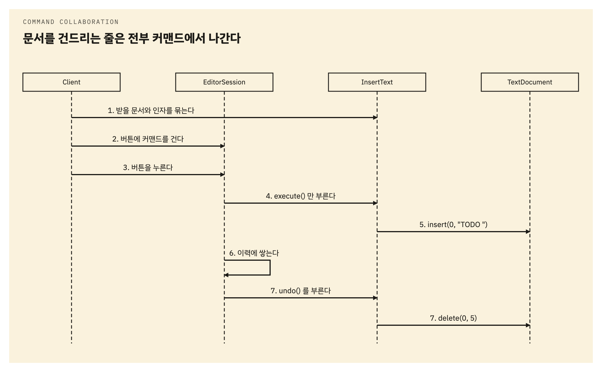
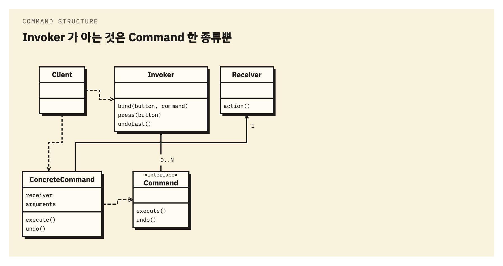

# Command — 할 일을 객체 하나에 묶어 두고, 부르는 쪽은 실행 연산만 알기

## 한눈에 보는 개요

메모 편집기의 버튼 처리 코드를 하나 떠올려 봅시다. 툴바에 버튼이 셋 있고, `EditorSession.press(버튼이름)` 이 이름에 따라 `switch` 로 분기해 `document.insert(0, "TODO ")` 같은 편집을 바로 부릅니다. 버튼이 하나 늘 때마다 이 `switch` 를 열어야 하는 것도 성가시지만, 진짜 문제는 되돌리기를 붙이려는 순간에 생깁니다. 되돌리려면 "방금 무슨 일을 했는지" 를 어딘가에 쌓아 둬야 하는데, 지금 코드에서 방금 한 일은 이미 지나간 메서드 호출이라 쌓을 것이 없어요.

Command 의 해법은 **할 일 하나를 객체로 만들고, 그 일을 받을 대상과 인자를 객체 안에 묶어 두는 것**입니다. 버튼은 그 객체의 실행 연산 하나만 부르고, 무슨 편집인지도 어느 문서에 하는 편집인지도 모릅니다. 일이 객체라서 눌리기 전에 만들어 둘 수 있고, 실행한 뒤에는 목록에 쌓아 되돌릴 수 있어요.

```text
Before : 버튼 처리 코드가 무슨 편집인지·어느 문서인지를 전부 알고 있음

  EditorSession.press("prefix")
    switch (button)
      "prefix"   → document.insert(0, "TODO ")
      "cut-milk" → document.delete(9, 4)
      새 버튼     → 이 switch 를 열어 case 추가
    되돌리기 → 쌓아 둔 것이 없어 되돌릴 대상이 없음

After : 할 일을 객체로 만들고 받을 문서와 인자를 그 안에 묶어 둠

  조립 코드 ── new InsertText(memo, 0, "TODO ") ──▶ EditorSession
                                                     press(button)
                                                       커맨드.execute()   ← 무슨 편집인지 모름
                                                       history 에 쌓음
                                                     undoLast()
                                                       커맨드.undo()
                                                         ├─ InsertText   (memo 를 안에 묶고 있음)
                                                         ├─ DeleteRange
                                                         └─ 새 편집 = 새 클래스 (press 는 그대로)
```

이 패턴의 이름은 GoF(Gang of Four, 1994년에 나온 *Design Patterns* 의 저자 네 명을 함께 부르는 이름)가 붙인 것이고 다른 이름은 Action 과 Transaction 이에요(근거: GoF Command 절 Also Known As). 분류는 행위 패턴이고, 함께 쓰는 패턴은 Composite(여러 커맨드를 하나처럼 묶어 실행할 때)와 Memento(되돌리기에 필요한 상태를 커맨드 대신 보관할 때)입니다(근거: GoF Command 절 Related Patterns). 이 글은 시나리오 셋을 따라갑니다. 버튼 하나가 눌려 메모가 바뀌고 되돌아오는 길, 새 편집과 매크로가 더해질 때 무엇이 안 바뀌는가, 규칙을 어기면 어느 단계에서 무엇이 어긋나는가. 끝까지 읽으면 어떤 코드를 Command 라고 불러도 되는지 필수 조건 셋으로 판정할 수 있고, 구조가 닮은 Strategy·Observer·Memento 코드와도 구분할 수 있게 됩니다.

## 패턴 자세히 들여다보기

### 시나리오 1 — 버튼 하나가 눌려 메모 맨 앞에 말머리가 붙는 길

메모에 `buy milk` 여덟 글자가 들어 있습니다. 툴바의 `"prefix"` 버튼을 누르면 맨 앞에 `TODO ` 다섯 글자가 붙어 `TODO buy milk` 가 되어야 하고, 되돌리기를 누르면 다시 `buy milk` 로 돌아와야 해요. 이 장면에는 다섯이 등장합니다. 조립 코드(패턴에서는 Client 라고 부르는 역할), 버튼 이름에 할 일을 걸어 두고 눌리면 실행시키는 `EditorSession`(Invoker), 넣을 자리와 글자를 가진 할 일 객체 `InsertText`(ConcreteCommand), 그 객체들이 공통으로 따르는 연산 모양 `execute()` · `undo()` 를 선언한 `EditCommand`(Command), 그리고 실제로 글자를 넣고 지울 줄 아는 `TextDocument`(Receiver)입니다. 이름은 여기서 한 번씩만 소개하고 정식 정의는 개념 정리에서 해요.



1. 조립 코드가 `InsertText(memo, 0, "TODO ")` 를 만듭니다. 이때 **넣을 문서 `memo` 와 자리 `0` 과 글자 `"TODO "` 가 전부 이 객체 안으로 들어가요.** 이 일을 조립 코드가 맡는 이유는, 어느 문서에 무엇을 하는 버튼인지를 아는 쪽이 요구를 아는 쪽뿐이기 때문입니다. 이 결정을 `EditorSession` 이 하면 버튼 이름과 편집 내용의 대응이 `EditorSession` 안에 남고, 버튼이 늘 때마다 `EditorSession` 을 고치게 됩니다(시나리오 3 이 그 모양을 따라갑니다).
2. 조립 코드가 만든 객체를 `EditorSession` 의 `"prefix"` 버튼에 겁니다. `EditorSession` 은 그것을 `EditCommand` 타입으로 받아 보관하므로 말머리 붙이기인지 구간 지우기인지 몰라도 돼요. 이 단계가 3단계보다 늦으면 버튼이 눌렸을 때 실행시킬 대상이 없습니다.
3. 사용자가 `"prefix"` 버튼을 누릅니다. `EditorSession` 은 이름으로 걸어 둔 커맨드를 찾기만 하고, 그것이 무슨 일인지는 묻지 않아요. 묻지 않아야 하는 이유는 5단계에서 다시 봅니다.
4. `EditorSession` 이 찾은 커맨드의 `execute()` 를 부릅니다. 넘기는 인자는 하나도 없어요 — 필요한 값은 1단계에서 이미 객체 안에 들어갔으니까요. 인자를 여기서 넘겨야 한다면 `EditorSession` 이 그 인자가 무엇인지 알아야 하고, 그러면 버튼 종류마다 다른 인자를 챙기느라 3단계의 "묻지 않는다" 가 지켜지지 않습니다.
   - 갈래 4-a. 되돌리기에 **실행 직전 상태**가 필요한 커맨드는 `execute()` 의 첫 줄에서 그 상태를 자기 안에 저장합니다. 시나리오 2 의 `DeleteRange` 가 그런 커맨드예요. 지우기 전에 무엇이 지워지는지를 적어 두지 않으면 나중에 되돌릴 때 무엇을 다시 넣어야 할지 알 수 없습니다. 반대로 `InsertText` 는 넣을 글자를 이미 가지고 있어서 따로 적어 둘 것이 없어요.
5. `InsertText` 가 `memo.insert(0, "TODO ")` 를 불러 문서를 실제로 고칩니다. 글자를 옮기는 일을 커맨드가 직접 하지 않고 문서에 넘기는 이유는, 버퍼를 어떻게 저장하는지 아는 쪽이 문서이기 때문이에요. 커맨드가 버퍼를 직접 만지면 편집 종류가 늘 때마다 버퍼 표현을 아는 코드가 함께 늘어납니다. 메모는 `TODO buy milk` 가 됐어요.
6. `EditorSession` 이 방금 실행한 커맨드를 이력 목록 맨 뒤에 쌓습니다. 실행 **뒤에** 쌓는 순서가 중요해요. 먼저 쌓고 실행하면 `execute()` 가 도중에 실패했을 때 일어나지 않은 일이 이력에 남고, 그 상태에서 되돌리기를 누르면 하지도 않은 일을 되돌리게 됩니다.
7. 되돌리기를 누르면 `EditorSession` 이 이력 맨 뒤 커맨드를 꺼내 `undo()` 를 부르고, `InsertText` 가 `memo.delete(0, 5)` 로 자기가 넣은 다섯 글자를 지웁니다. 되돌리는 일을 커맨드가 맡는 이유는 무엇을 했는지 아는 쪽이 그 커맨드뿐이기 때문이에요. `EditorSession` 이 되돌리기를 직접 짜려면 편집 종류마다 그 반대 연산을 알아야 하고, 그 순간 3단계의 "묻지 않는다" 가 다시 지켜지지 않습니다. 메모는 `buy milk` 로 돌아왔습니다.

```text
단계   부르는 쪽 → 받는 쪽              넘기는 것                     메모 상태
 1     조립 코드 → (new)               memo · 0 · "TODO "            buy milk
 2     조립 코드 → EditorSession       "prefix" · 커맨드 객체         buy milk
 3     사용자 → EditorSession          "prefix"                      buy milk
 4     EditorSession → EditCommand     —  (인자 없음)                 buy milk
 5     InsertText → TextDocument       0 · "TODO "                   TODO buy milk
 6     EditorSession → (이력)          방금 실행한 커맨드              TODO buy milk
 7     EditorSession → EditCommand     —  → memo.delete(0, 5)        buy milk
```

잠깐, 확인 하나만 해 볼까요? 4단계에서 `EditorSession` 이 넘기는 인자가 하나도 없다면, 같은 `execute()` 호출로 `"cut-milk"` 버튼의 커맨드도 부를 수 있을까요?

부를 수 있습니다. `"cut-milk"` 에 걸린 `DeleteRange` 도 자를 자리와 길이를 이미 안에 가지고 있으니까요. 인자가 없다는 것은 `EditorSession` 이 커맨드마다 다른 것을 챙길 필요가 없다는 뜻이고, 그래서 버튼이 몇 개든 `press` 의 코드는 한 벌입니다.

```text
커맨드 안에 든 것                      EditorSession 이 넘기는 것
─────────────────────────────────     ──────────────────────────
InsertText    memo · 0 · "TODO "      없음
DeleteRange   memo · 9 · 4            없음
```

이 성질이 시나리오 2 에서 새 버튼을 더할 때 무엇을 아끼는지 보여 줘요.

이 시나리오가 보여 준 것은 역할 다섯과 그 사이의 호출 방향입니다. 만들고 묶는 일(1단계)과 거는 일(2단계)은 Client 가, 실행 연산 하나를 부르고 이력에 쌓는 일(4·6단계)은 Invoker 가, 받을 대상의 연산을 부르는 일(5단계)과 되돌리는 일(7단계)은 ConcreteCommand 가, 실제 편집(5단계)은 Receiver 가 맡습니다. Invoker 에서 Receiver 로 바로 가는 줄은 하나도 없어요 — 문서를 건드리는 줄은 전부 커맨드에서 나갑니다.

### 시나리오 2 — 구간 지우기와 매크로가 더해질 때

메모 편집기에 버튼 둘을 더 답니다. 하나는 `TODO buy milk` 에서 `milk` 네 글자를 지우는 `"cut-milk"` 로, 누르면 `TODO buy ` 가 나와야 해요. 다른 하나는 그 자리를 `bread` 로 바꾸는 `"swap-bread"` 인데, 이건 새 편집 종류가 아니라 **지우기와 넣기를 이어 붙인 하나**입니다. 누르면 `TODO buy bread` 가 나와야 하고, 되돌리기 한 번에 `TODO buy milk` 로 통째로 돌아와야 해요.

1. 개발자가 `DeleteRange` 클래스를 새로 씁니다. 연산 모양은 시나리오 1 의 `execute()` · `undo()` 그대로이고 본문만 "적어 둔 자리에서 적어 둔 길이만큼 지운다" 예요. 모양을 바꾸지 않는 이유는 그 모양이 `EditorSession` 과 모든 커맨드 사이의 계약이라서, 모양이 바뀌면 `EditorSession` 의 호출 줄과 기존 커맨드가 전부 따라 바뀌기 때문입니다.
2. `DeleteRange` 는 시나리오 1 의 갈래 4-a 대로 `execute()` 첫 줄에서 지울 글자 `milk` 를 자기 안에 적어 둡니다. 되돌리기가 그 글자를 다시 넣어야 해서예요. 이 저장을 생성자에서 하면 안 됩니다 — 버튼을 만들 때와 누를 때 사이에 문서가 바뀌었으면 적어 둔 글자가 실제로 지워질 글자와 달라지니까요.
3. 매크로 버튼은 새 편집 종류가 아니라 **커맨드를 담는 커맨드**로 만듭니다. `MacroEdit` 는 `DeleteRange` 와 `InsertText` 를 순서대로 가지고, 자기 `execute()` 에서 둘을 차례로 부르고 자기 `undo()` 에서 둘을 **역순으로** 되돌려요. 역순이어야 하는 이유는 앞 편집이 뒤 편집의 자리를 옮겨 놨기 때문입니다. 넣기를 먼저 되돌려야 지우기가 적어 둔 자리가 실행 직전과 같아집니다. `MacroEdit` 자신도 `EditCommand` 를 따르니 `EditorSession` 에게는 그냥 커맨드 하나예요.
4. `EditorSession` 은 한 줄도 바뀌지 않습니다. `EditorSession` 에 적힌 편집 관련 이름은 `EditCommand` 와 `execute` · `undo` 뿐이라 새 클래스 이름이 들어갈 자리가 없어서예요. 늘어난 것은 조립 코드에서 버튼을 거는 한 줄씩뿐입니다.
5. 되돌리기도 그대로입니다. `EditorSession` 은 이력 맨 뒤에서 하나를 꺼내 `undo()` 를 부를 뿐이라, 꺼낸 것이 홑 편집인지 매크로인지 묻지 않아요. 매크로를 누른 뒤 되돌리기를 한 번 누르면 지우기와 넣기가 함께 되돌려져 `TODO buy milk` 로 돌아옵니다.

```text
변화                  바뀐 곳                                   안 바뀐 곳
cut-milk 추가         DeleteRange 클래스 (새로 씀)                EditorSession 전체
                      조립 코드의 "cut-milk" 한 줄                EditCommand 의 연산 모양 · InsertText

swap-bread 추가       MacroEdit 클래스 (새로 씀 — 커맨드를 담음)   EditorSession 전체
                      조립 코드의 "swap-bread" 한 줄              EditCommand · InsertText · DeleteRange
```

여기서 헷갈리기 쉬운 포인트는 매크로를 더할 때 이력 코드도 손봐야 한다고 믿는 것입니다. 손보지 않아요. 이력은 `EditCommand` 목록이고 `MacroEdit` 도 `EditCommand` 라서, 이력에서 보면 매크로 한 번은 편집 한 건입니다. 아래 「메모」 칸은 구현 예시의 실행 출력 1~6번 줄이고, 「이력 길이」 칸은 같은 코드에 이력 크기를 찍는 줄을 더해 따로 재 봤어요.

```text
출력 줄  누른 것       메모                 이력 길이(누른 뒤)
  1     prefix       [TODO buy milk]      1
  2     cut-milk     [TODO buy ]          2   ← DeleteRange 가 "milk" 를 자기 안에 적어 둠
  3     undo         [TODO buy milk]      1
  4     undo         [buy milk]           0
  5     prefix       [TODO buy milk]      1
  6     swap-bread   [TODO buy bread]     2   ← 안에 편집이 둘 들었지만 이력은 한 건만 늘었다
```

이 시나리오가 보여 준 것은 변화의 범위입니다. 새 편집 종류가 들어올 때 바뀌는 곳은 새 ConcreteCommand 하나와 조립 코드 한 줄이고, Invoker 와 기존 커맨드는 그대로예요(1·4단계). 되돌리기에 실행 직전 상태가 필요한 커맨드는 그 상태를 자기 안에 갖고(2단계), 커맨드를 담는 커맨드를 만들면 여럿을 하나처럼 실행하고 하나처럼 되돌릴 수 있습니다(3·5단계).

### 시나리오 3 — 버튼이 문서를 직접 부르면 어디서 어긋나는가

같은 편집기의 다른 코드베이스는 `EditorSession` 을 조금 다르게 짰습니다. 세션이 문서를 직접 가지고, `press` 가 버튼 이름에 따라 `switch` 로 분기해 `document.insert(0, "TODO ")` 와 `document.delete(9, 4)` 를 그 자리에서 부릅니다. 겉보기에는 같은 `buy milk` 에서 같은 결과가 나와요. 여기에 시나리오 1 의 되돌리기 요구와 시나리오 2 의 변화(`"swap-bread"` 추가)가 그대로 들어옵니다. 아래 결과는 Java 21 로 실제로 컴파일해 실행한 것입니다.

1. `press("prefix")` 가 `switch` 를 거쳐 `document.insert(0, "TODO ")` 를 바로 부릅니다. 메모는 `TODO buy milk` 가 돼요. 이렇게 짜는 이유는 대개 짧아서입니다 — 클래스를 하나도 만들지 않고 한 줄로 끝나니까요. 그 대가로 버튼 이름과 편집 내용의 대응이 세션 안에 들어갑니다.
2. `press("cut-milk")` 로 `TODO buy ` 까지 간 뒤 되돌리기를 부릅니다. 결과는 `TODO buy ` 그대로예요. 이력에 쌓을 것이 없었기 때문입니다. 방금 한 일이 이미 지나간 메서드 호출이라 저장해 둘 대상이 없고, 세션이 되돌리기를 스스로 짜려면 `"cut-milk"` 가 무엇을 지웠는지 따로 기억해야 하는데 그 기억이 어디에도 없어요.
3. 고치려면 되돌리기용 기억을 세션 안에 만들어야 합니다. 그런데 무엇을 기억해야 하는지가 버튼마다 달라서 — 넣기는 넣은 길이를, 지우기는 지운 글자를 — 결국 버튼 종류마다 분기하는 코드가 세션 안에 한 벌 더 생겨요. 시나리오 1 의 7단계가 되돌리기를 커맨드에 맡긴 이유가 이것입니다.
4. 갈래 하나를 더 봅니다. 위 문제를 커맨드로 고쳤다고 해도, **같은 커맨드 객체를 두 번 눌러 이력에 두 번 쌓으면** 또 어긋나요. `"swap-bread"` 를 연달아 두 번 누르면 안에 든 `DeleteRange` 가 두 번째 실행에서 적어 둔 글자를 `milk` 에서 `brea` 로 덮어씁니다. 이력에는 같은 객체가 두 줄 들어 있는데, 두 줄이 가리키는 복원 정보는 마지막 것 하나뿐이에요.
5. 그래서 되돌리기를 두 번 눌러도 원래 글자가 돌아오지 않습니다. 구현 예시의 실행 출력 7~10번 줄이 그 결과예요. 두 번째 누름 뒤 메모는 `TODO buy breadd` 이고, 되돌리기 두 번 뒤에는 `TODO buy milk` 가 아니라 `TODO buy brea` 가 남으며, 한 번 더 되돌려도 처음의 `buy milk` 가 아니라 `buy brea` 로 끝납니다.

```text
갈래 A — 세션이 문서를 직접 부름 (직접 실행해 확인)
  1  prefix     [TODO buy milk]
  2  cut-milk   [TODO buy ]
  3  undo       [TODO buy ]        ← 되돌아가지 않음. 이력에 쌓인 것이 없다
     press("swap-bread") → IllegalArgumentException: unbound button: swap-bread

갈래 B — 같은 커맨드 객체를 두 번 이력에 쌓음 (구현 예시의 실행 출력 6번 줄을 기준으로 7~10번 줄이 그 결과)
  6  swap-bread [TODO buy bread]   ← DeleteRange 가 적어 둔 글자: milk
  7  swap-bread [TODO buy breadd]  ← 적어 둔 글자가 brea 로 덮어써짐
  8  undo       [TODO buy bread]
  9  undo       [TODO buy brea]    ← TODO buy milk 가 아님
  10 undo       [buy brea]         ← 처음의 buy milk 가 아님
```

이 시나리오가 보여 준 것은 두 규칙이 어디서 어긋나는지입니다. 할 일이 객체로 존재하지 않으면 쌓아 둘 것이 없어 되돌리기가 성립하지 않고(2단계), 되돌리기를 부르는 쪽에 억지로 짜 넣으면 버튼 종류로 분기하는 코드가 그쪽에 생깁니다(3단계). 그리고 할 일이 객체가 되어도, 그 객체가 실행할 때마다 자기 안의 복원 정보를 바꾼다면 이력에 같은 객체를 두 번 넣는 순간 되돌리기가 어긋나요(4·5단계). 앞은 최소 조건 1·3번, 뒤는 6번이 잡는 자리입니다.

### 개념 정리

시나리오에 나온 역할 다섯을 정식으로 정의합니다.

- **Command** — 할 일 객체들이 모두 따르는 **실행 연산 하나를 선언**합니다. Invoker 는 이 선언만 보고 부르고(시나리오 1 의 4단계), ConcreteCommand 는 이 선언을 구현해요. 메모 예에서는 `execute()` 와 `undo()` 를 선언한 `EditCommand` 가 Command 입니다. 되돌리기 연산은 이 패턴의 필수가 아니라 이 예가 더한 것이고, 그 판단 근거는 최소 조건 5번에 있어요.
- **ConcreteCommand** — Command 가 선언한 연산을 실제 할 일로 구현하면서, **받을 대상과 인자를 자기 안에 묶습니다**(시나리오 1 의 1단계). 그래서 실행 연산이 인자를 받지 않아도 일을 끝낼 수 있어요. 메모 예에서는 `InsertText` 와 `DeleteRange` 가 각각 ConcreteCommand 입니다. 커맨드 여럿을 순서대로 가지고 하나처럼 실행·되돌리는 **매크로 커맨드**도 ConcreteCommand 의 한 모양이고(시나리오 2 의 3단계), 메모 예에서는 `MacroEdit` 가 그것이에요.
- **Invoker** — 커맨드를 받아 두었다가 **실행 연산만 불러 요청을 발동시키는 쪽**입니다. 어떤 커맨드인지도 그 뒤에 어느 Receiver 가 있는지도 모릅니다(시나리오 1 의 3·4단계). 메모 예에서는 버튼 이름에 커맨드를 걸어 두고 눌리면 실행시키는 `EditorSession` 이 Invoker 이고, 실행한 커맨드를 이력에 쌓는 일도 여기서 합니다.
- **Receiver** — 요청에 딸린 **연산을 실제로 수행할 줄 아는 객체**입니다. 어떤 클래스든 Receiver 가 될 수 있고, 자기가 커맨드에 묶여 있다는 사실도 몰라요. ConcreteCommand 가 부르고(시나리오 1 의 5단계), Invoker 와는 직접 이어지지 않습니다. 메모 예에서는 글자를 넣고 지울 줄 아는 `TextDocument` 가 Receiver 예요.
- **Client** — ConcreteCommand 를 **만들면서 Receiver 를 지정하고**(시나리오 1 의 1단계), 그것을 Invoker 에 넘겨 둡니다(2단계). 메모 예에서는 문서를 만들고 버튼 셋에 커맨드를 거는 조립 코드와 진입점이 Client 입니다.



그림에서 Invoker 의 화살표가 Command 로만 향하고 ConcreteCommand 를 직접 가리키지 않는다는 점, 그리고 Receiver 로 들어가는 화살표가 ConcreteCommand 에서 나온 것 하나뿐이라는 점을 봐 두세요. Invoker 에서 Receiver 로 가는 선은 아예 없습니다. Invoker 쪽 화살표는 최소 조건 3번으로, ConcreteCommand 에서 Receiver 로 가는 화살표는 2번으로 코드에서 확인해요. 커맨드를 `EditCommand` 타입 하나로 받아 두고 부르는 것을 인터페이스에 프로그래밍한다고 하고, 일을 안쪽 객체에 넘기는 것을 위임이라고 하는데, 두 말의 정의는 [참고 문서 「GoF 공통 어휘」](../../reference/gof-vocabulary/gof-vocabulary-ref_v1.0.2.md)에 있습니다.

> 무엇을 할지는 커맨드가, 어떻게 할지는 Receiver 가, 언제 할지는 Invoker 가 정한다.

## 사용 목적

Command 가 필요할 때는 코드나 요구에서 보이는 단서가 있습니다. 셋을 차례로 봅시다.

**단서 1. 같은 기능을 부르는 자리가 여럿이고, 무엇을 부를지가 설정으로 바뀝니다.** 툴바 버튼·메뉴 항목·단축키가 같은 편집을 부르는데 그 대응을 사용자가 바꿀 수 있어야 하는 경우예요. 코드에서는 세 곳이 같은 호출을 복제하고 있거나, 부를 것을 문자열로 받아 `switch` 로 분기하는 모양으로 보입니다(근거: GoF Command 절 Applicability — 수행할 액션으로 객체를 매개변수화하는 경우를 적용 대상으로 둔다). 복제가 문제인 이유는 편집 한 건을 고칠 때 세 곳을 함께 고쳐야 해서이고, `switch` 가 문제인 이유는 시나리오 3 의 3단계에서 본 대로 대응이 부르는 쪽 코드 안에 들어가 있어서예요.

```text
같은 편집을 부르는 자리                 새 편집을 하나 더할 때 고치는 곳
──────────────────────────────         ──────────────────────────────
툴바 버튼 핸들러                        3곳 전부 + 설정 화면의 목록
메뉴 항목 핸들러
단축키 표
```

**단서 2. 지금 실행하지 않고 어딘가에 넣어 두었다가 나중에 실행해야 합니다.** 작업을 큐나 스케줄러나 스레드 풀에 넘기는 요구가 그것이고, 요청과 실행이 다른 시점·다른 스레드·다른 프로세스에서 일어나는 경우도 같습니다(근거: GoF Command 절 Applicability — 요청을 서로 다른 시점에 지정·큐잉·실행하는 경우를 적용 대상으로 둔다). 코드에서는 `queue.add(...)` 나 `pool.submit(...)` 에 넣을 것이 필요한데 넣을 수 있는 것이 값뿐이고 부르려는 것은 메서드 호출인 상황으로 보여요. 메서드 호출은 값이 아니라 큐에 들어가지 않습니다.

**단서 3. 되돌리기·매크로 기록·변경 로그 재적용이 필요합니다.** 셋 다 "방금 한 일" 을 나중에 다시 꺼내야 하는 요구예요(근거: GoF Command 절 Applicability — 되돌리기 지원과 변경 로그를 적용 대상으로 둔다). 코드에서는 시나리오 3 의 2단계가 그 모양입니다. `history.push(...)` 를 쓰고 싶은데 괄호 안에 넣을 것이 없어요.

| 쓰지 말아야 할 상황 | 쓰면 잃는 것 |
| --- | --- |
| 부르는 자리가 한 곳으로 고정이고 큐잉·되돌리기·로깅 요구가 없음 | 요청 하나마다 타입과 객체가 늘어 부르는 쪽과 일하는 쪽 사이에 계층이 하나 생김([refactoring.guru — Command](https://refactoring.guru/design-patterns/command)). 표 아래에서 코드로 비교함 |
| 되돌리기를 역연산으로 짜기 어렵거나 불가능함 | 되돌리기가 목적이었다면 커맨드를 만들고도 목적을 못 이룸. 실행 직전 상태를 통째로 저장해 두는 쪽(Memento)이 맞는지 먼저 확인해야 함 |
| 넘기는 일회성 콜백이 하나뿐이고 받을 대상도 그 자리에 있음 | 값으로 넘기면 끝날 것을 타입 선언과 클래스로 옮겨 적게 됨. 비교 절의 마지막 항목에서 구분함 |

표의 첫 줄부터 코드로 봅시다. 버튼이 하나뿐이고 되돌리기 요구도 없는 편집기라고 해요.

```text
바로 부르는 코드
  press() 안에   document.insert(0, "TODO ");
  늘어난 타입 0개 · 호출 1곳

Command 로 옮긴 코드
  interface EditCommand { void execute(); }
  final class InsertText implements EditCommand { ... document, at, text 필드 3개 }
  EditorSession 에 EditCommand 필드 1개
  조립 코드에 new InsertText(memo, 0, "TODO ")
  늘어난 타입 2개 · 필드 4개 · 호출 1곳 (press 에서 execute 로 이름만 바뀜)
```

옮긴 뒤에도 호출은 한 곳 그대로이고 타입 둘과 필드 넷이 더 생겼습니다. 얻은 것은 실행 시점을 미루고 이력에 쌓을 수 있다는 점인데, 버튼이 늘지도 않고 되돌리기도 없는 코드에서는 그 이득이 쓰일 자리가 없어요. 앞으로 늘지는 코드에서 직접 볼 수 없으니, 대신 아래 세 곳을 확인해 모두 가운데 열에 해당하면 그냥 부릅니다.

| 확인할 곳 | 바로 부름 | Command 를 검토함 |
| --- | --- | --- |
| 같은 편집을 부르는 자리의 수 | 한 곳뿐 | 버튼·메뉴·단축키로 흩어짐(단서 1) |
| 부르는 시점과 정해지는 시점 | 같은 호출 안에서 끝남 | 큐·스케줄러를 거쳐 나중에 실행됨(단서 2) |
| 되돌리기·로그 요구 | 없음 | 이력에 쌓을 것이 필요함(단서 3) |

비슷한 단서에서 다른 패턴을 골라야 하는 경우도 있습니다. 바뀌는 것이 "무엇을 할까" 가 아니라 "같은 일을 어떤 방법으로 할까" 면 Strategy 를, 보내는 쪽이 할 일을 지정하지 않고 일어난 사실만 알리는 것이면 Observer 를, 되돌리기에 필요한 것이 역연산이 아니라 실행 직전 상태 전체면 Memento 를 먼저 검토하세요. 셋과의 차이는 「비슷한 패턴·안티패턴과의 차이」에서 풉니다.

## 패턴의 경계

### 디자인 패턴을 충족하는 최소 조건

어떤 코드를 Command 라고 불러도 되는지 가르는 기준입니다. `[필수]` 가 하나라도 빠지면 Command 가 아니고, `[선택]` 은 갖추면 좋은 구조예요. 조건은 언어와 상관없이 코드에서 확인할 수 있는 모양(타입 선언·참조 보유·호출 방향·생성 위치)으로 적었고, 조건마다 그것을 보여 준 시나리오의 단계를 가리킵니다.

1. [필수] 수행할 요청이 객체나 그에 준하는 일급 값으로 만들어지고, 그 값들이 **실행 연산을 선언한 공통 타입**을 따릅니다 — 실행 연산 하나를 요구하는 선언(인터페이스·추상 클래스·trait(Rust 에서 타입이 구현할 연산을 선언하는 문법)·함수 타입)이 코드에 있고, 요청 종류마다 그 연산을 구현한 별도 단위가 있으며, 그 값이 만들어진 자리와 실행되는 자리가 다른 문장일 수 있습니다. 시나리오 1 의 1·4단계가 이 모양이에요 (근거: GoF Command 절 Intent — 요청을 객체로 캡슐화한다 · Participants — Command 는 연산을 실행하는 인터페이스를 선언한다).
   - 빠지면: 시나리오 3 의 1·2단계가 이 자리입니다. 버튼 처리 코드가 `document.insert(0, "TODO ")` 를 바로 부르면 요청이 값으로 존재한 적이 없어서 큐에 넣을 것도 이력에 쌓을 것도 없고, 되돌리기를 붙이는 순간 막힙니다(직접 실행해 확인 — 되돌리기 뒤에도 메모가 `TODO buy ` 그대로였습니다).
2. [필수] ConcreteCommand 가 **받을 대상과 인자를 자기 안에 묶고**, 실행 연산이 그 대상의 연산을 부릅니다 — 요청 객체의 필드(또는 클로저가 붙잡은 값)에 받을 대상과 실행에 필요한 인자가 들어 있고, 실행 연산의 매개변수 목록에 그것들이 없으며, 그 연산의 본문이 묶어 둔 대상의 연산을 호출합니다. 시나리오 1 의 1·5단계가 이 조건의 두 면이에요 (근거: GoF Command 절 Participants — ConcreteCommand 는 Receiver 객체와 액션 사이의 바인딩을 정의하고 Receiver 의 연산을 불러 실행 연산을 구현한다 · Collaborations — ConcreteCommand 가 요청을 수행하려고 receiver 의 연산을 부른다).
   - 빠지면: 실행 연산이 `execute(document, 0, "TODO ")` 처럼 대상과 인자를 그때 받으면, 부르는 쪽이 그 값들을 알아야 하므로 요청 객체를 가지고 있어도 혼자서는 아무 일도 못 합니다. 큐에 넣으면 인자를 따로 실어 보내야 하고, 이력에 쌓으면 되돌릴 때 그 인자를 다시 찾아와야 해요. 그때 그 객체는 요청이 아니라 같은 일의 다른 방법을 담은 전략에 가까워지고, 그 차이는 비교 절의 Strategy 항목에서 다룹니다.
3. [필수] 커맨드를 실행시키는 쪽이 **공통 실행 연산만 부르고, 커맨드 종류나 받을 대상에 따라 분기하지 않습니다** — 커맨드를 담는 필드·컬렉션·매개변수의 타입이 1번의 공통 타입이고, 실행시키는 코드에 구체 커맨드 타입 검사나 다운캐스트(상위 타입으로 받은 값을 하위 타입으로 바꾸는 변환)나 종류별 분기가 없으며, 그 코드가 받을 대상을 참조하지 않습니다. 시나리오 1 의 4단계와 시나리오 3 의 3단계가 이 조건의 앞뒤예요 (근거: GoF Command 절 Consequences — Command 는 연산을 호출하는 객체를 그 연산의 수행법을 아는 객체로부터 떼어 놓는다).
   - 빠지면: 실행시키는 쪽이 `if (name.equals("prefix")) document.insert(...)` 로 분기하면 시나리오 3 의 모양이 되어, 버튼이 늘 때마다 그 분기를 고치고 되돌리기까지 그 안에 짜 넣게 됩니다. 필드 타입만 구체 커맨드로 좁혀도 컴파일 오류가 나요. 구현 예시의 `EditorSession` 에서 커맨드를 담는 자리의 타입을 `EditCommand` 에서 `InsertText` 로 바꾸면 세 언어가 모두 `bind` 를 부르는 같은 두 줄에서 오류 2건으로 멈춥니다(직접 컴파일해 확인). 바꿔야 하는 자리는 언어마다 달라요. Java 는 네 자리(필드 둘·`bind` 의 인자·`press` 의 지역 변수)이고 `error: incompatible types: DeleteRange cannot be converted to InsertText` 가 나며, Rust 와 TypeScript 는 세 자리(필드 둘·`bind` 의 인자)이고 각각 `error[E0308]: mismatched types` 와 `error TS2345` 가 납니다. TypeScript 가 막는 이유는 필드를 `private` 으로 둬서가 아니라 `DeleteRange` 와 `MacroEdit` 에 `InsertText` 의 필드가 없어서예요 — 세 커맨드의 필드를 전부 `public` 으로 바꿔 다시 컴파일해도 진단 두 건이 글자 단위로 같았습니다.
4. [선택] 커맨드를 실행시키는 쪽이 그 커맨드를 **필드나 컬렉션으로 보유합니다** — 실행시키는 코드가 커맨드를 인자로 받아 그 자리에서 부르고 끝내지 않고, 만들어진 커맨드를 담아 두었다가 나중에 부릅니다. 시나리오 1 의 2단계가 이 모양이에요 (근거: GoF Command 절 Collaborations — Invoker 가 ConcreteCommand 객체를 저장한다). 받자마자 부르는 모양도 널리 쓰여서 이 가이드는 필수로 올리지 않았습니다. 다만 이것이 빠지면 단서 2 의 큐잉과 단서 3 의 이력은 얻지 못해요.
5. [선택] 커맨드에 **되돌리기 연산**이 있고, 실행 직후에 그것을 부르면 Receiver 가 실행 직전 상태로 돌아옵니다 — 공통 타입이 실행 연산 말고 되돌리기 연산을 하나 더 선언하고, 되돌리기가 필요로 하는 값이 커맨드 안에 있습니다. 시나리오 1 의 7단계가 그 자리예요 (근거: GoF Command 절 Applicability — 되돌리기 지원을 이 패턴을 쓰는 경우의 하나로 들고, 그때 인터페이스에 되돌리기 연산을 더한다고 적는다). 실행 연산 하나만 있는 커맨드도 Command 이고, 표준 라이브러리의 작업 큐가 그 모양입니다.
6. [선택] **이력에 들어간 커맨드는 이후의 재실행으로 자기 안의 복원 정보가 바뀌지 않습니다** — 같은 커맨드 객체를 여러 번 실행해 그때마다 이력에 쌓는 코드라면, 실행 연산이 복원용 필드에 값을 덮어쓰지 않거나 이력에 넣기 전에 커맨드를 복사합니다. 시나리오 3 의 4·5단계가 이것이 빠졌을 때의 모양이에요 (근거: GoF Command 절 Implementation — 호출마다 상태가 달라지는 커맨드는 이력에 넣기 전에 복사해야 한다고 적는다). 구현 예시의 실행 출력 7~10번 줄이 그 결과이고, 되돌리기를 끝까지 눌러도 `buy milk` 가 아니라 `buy brea` 로 끝납니다.
7. [선택] 받을 대상이 **별도 객체**입니다 — 커맨드가 다른 객체를 필드로 가지고 실행 연산에서 그 객체의 연산을 부릅니다. 시나리오 1 의 5단계가 그 모양이에요 (근거: GoF Command 절 Implementation — 커맨드가 얼마나 똑똑해야 하는지를 두고, 받을 대상과 액션의 단순 바인딩부터 받을 대상 없이 스스로 전부 수행하는 커맨드까지를 범위로 둔다). 받을 대상 없이 커맨드가 일을 다 해도 1~3번을 만족하면 Command 이므로 필수로 올리지 않았습니다.
8. [선택] 커맨드 여럿을 **하나처럼 실행하고 하나처럼 되돌리는 복합 커맨드**가 있습니다 — 공통 타입을 구현하면서 같은 공통 타입의 커맨드 목록을 가지고, 실행 연산에서 차례로 부르고 되돌리기에서 역순으로 되돌립니다. 시나리오 2 의 3·5단계가 이 모양이에요 (근거: GoF Command 절 Consequences — 커맨드를 복합 커맨드로 조립할 수 있다고 적는다).

1번이 맨 앞인 데는 이유가 있습니다. 1번만 빠지고 나머지를 흉내 낸 코드가 실제로 있어서, 1번을 보지 않으면 그런 코드가 Command 로 통과해요. 아래가 그 모양입니다.

```java no-compile
final class EditorSession {
    private final TextDocument document;

    EditorSession(TextDocument document) {
        this.document = document;
    }

    void press(String button) {
        switch (button) {                              // 요청이 값으로 존재하지 않는다
            case "prefix" -> document.insert(0, "TODO ");
            case "cut-milk" -> document.delete(9, 4);
            default -> throw new IllegalArgumentException("unbound button: " + button);
        }
    }

    void undoLast() {
        // 쌓아 둔 것이 없어서 되돌릴 대상이 없다
    }
}
```

이 코드는 버튼 이름으로 편집을 고르고, 문서를 필드로 가지고, `press` 라는 공통 진입점도 있습니다. 눌러 보면 결과도 구현 예시와 같아요 — `"prefix"` 로 `TODO buy milk`, 이어서 `"cut-milk"` 로 `TODO buy ` 가 나옵니다. 여기까지는 멀쩡해 보이죠. 그런데 되돌리기를 부르면 메모가 그대로이고, `"swap-bread"` 를 누르면 `IllegalArgumentException: unbound button: swap-bread` 가 납니다(직접 실행해 확인). 2번을 볼 것도 없이 1번에서 끝나는 코드예요.

| 코드 | 1번 | 2번 | 3번 | 판정 |
| --- | --- | --- | --- | --- |
| 구현 예시의 `InsertText`·`DeleteRange`·`MacroEdit` 와 `EditorSession` | 만족 | 만족 | 만족 | Command |
| 위 오인 코드의 `EditorSession` | 빠짐 (요청이 값이 아님) | 볼 대상 없음 | 볼 대상 없음 | Command 아님 |
| 실행 연산이 `execute(document, at, text)` 인 요청 객체 | 만족 | 빠짐 (대상·인자가 밖에서 옴) | 만족할 수 있음 | Command 아님 |
| 커맨드를 담는 필드가 `InsertText` 인 `EditorSession` | 만족 | 만족 | 빠짐 (구체 타입) | Command 아님 |
| 받을 대상 없이 스스로 일을 다 하는 커맨드와 `EditorSession` | 만족 | 만족 (묶을 대상이 없을 뿐 인자는 안에 있음) | 만족 | Command (7번이 없는 모양) |

`[필수]` 는 하나만 빠져도 판정이 끝나므로 1번부터 차례로 봅니다. 1번은 요청 쪽 코드만, 2번은 실행 연산의 매개변수 목록과 본문만, 3번은 실행시키는 쪽의 선언과 분기만 보면 되어서 앞 조건에서 멈추면 뒤는 읽지 않아도 돼요. 그리고 이 조건들은 **커맨드를 만든 쪽과 실행시키는 쪽이 같은 객체인지는 보지 않습니다** — 조립 코드가 커맨드를 만들어 곧바로 작업 큐에 넘기는 코드도 1~3번으로 판정합니다.

여기서 헷갈리기 쉬운 포인트는 5번 되돌리기가 필수처럼 보인다는 점입니다. 이 가이드의 메모 편집기가 되돌리기를 앞세우고 있어서 더 그렇게 보여요. 하지만 표준 라이브러리의 작업 큐에 실리는 작업 객체는 실행 연산 하나뿐인데도 1~3번을 모두 만족하고, 그 사례는 「실제 라이브러리에서」에 있습니다. 되돌리기는 이 패턴으로 할 수 있는 일 가운데 하나이지 성립 요건이 아니에요.

> 요청이 값이 되면 미룰 수 있고, 미룰 수 있으면 쌓을 수 있고, 쌓을 수 있으면 되돌릴 수 있다.

### 비슷한 패턴·안티패턴과의 차이

Command 와 구조가 닮았거나 같은 단서에서 떠오르는 대상 다섯을 비교합니다. 가장 헷갈리는 상대는 Strategy 예요 — 둘 다 "인터페이스 필드 하나에 객체를 넣는다" 는 모양이 같아서 구조만으로는 구분되지 않습니다. 표에 기준을 먼저 모으고, 대상마다 코드와 시나리오로 풀어 볼게요.

| 비교 대상 | 구분 기준 | Command 를 고르면 얻는 것 | 포기하는 것 |
| --- | --- | --- | --- |
| Strategy | 받을 대상과 인자가 객체 안에 묶여 고정인가, 부르는 쪽이 호출할 때마다 넘기는가 | 요청을 만들어 두었다가 나중에 실행하고, 이력에 쌓아 되돌릴 수 있음 | 요청마다 객체가 하나씩 생김. 부르는 쪽이 결과를 그 자리에서 이어받아 다음 계산에 쓰는 흐름은 얻지 못함 |
| Observer | 보내는 쪽이 "무슨 일이 일어났다" 를 말하는가, "이 일을 하라" 를 담은 객체를 넘기는가 | 무엇을 할지가 한 객체에 담겨 있어 실행 시점을 미루고 되돌릴 수 있음 | 받을 대상이 객체 안에 고정이라, 받는 쪽의 수가 실행 중에 늘고 주는 느슨함은 얻지 못함 |
| Memento | 나중에 쓰려고 건네는 토큰이 다형적 실행 연산을 갖는가, 값으로만 전달되는 좁은 인터페이스인가 | 되돌리기를 역연산으로 짜면 상태 전체를 저장하지 않아도 됨 | 역연산이 어렵거나 오차가 쌓이는 편집에서는 정확한 복원을 보장하지 못함 |
| Mediator · Chain of Responsibility | 부른 쪽과 일하는 쪽 사이에 무엇을 끼워 넣어 떼어 놓는가 — 요청을 담은 객체인가, 제삼의 중재자인가, 후보들의 줄인가 | 요청 하나를 값으로 다루며 미루고 쌓고 되돌리는 일 | 사건 하나에 여러 수신자를 각기 다르게 움직이는 조율과, 처리자를 실행 중에 이어 붙이는 일 |
| 단순 콜백·함수 값 (Command 로 오해받는 코드) | 붙잡은 값 안에 받을 대상과 인자가 다 들어 있고 공통 실행 연산으로 불리는가 | 되돌리기처럼 연산이 둘 이상 필요할 때 한 값에 함께 담을 수 있음 | 타입 선언과 클래스. 연산이 하나뿐이면 함수 값 한 줄이 짧음 |

**Strategy 와의 차이.** 구분 기준은 받을 대상과 인자가 객체 안에 묶여 고정인지, 부르는 쪽이 호출할 때마다 넘기는지입니다. 반환값은 기준이 아니에요. 코드에서는 **실행 연산의 매개변수 목록**을 먼저 봅니다. 비어 있고 필요한 값이 전부 필드에 있으면 그 객체는 요청 하나를 대표하고, 매개변수로 받아 계산해 돌려주면 같은 일을 하는 여러 방법 중 하나예요.

```text
Command  : 받을 대상이 객체 안에 묶여 고정 (시나리오 1 의 1·4단계)
  new InsertText(memo, 0, "TODO ")   execute() 가 인자 없이 memo.insert(0, "TODO ") 를 부름
  EditorSession 은 무슨 편집인지 모른 채 execute() 만 부름 (바로 부르든 이력에 두었다 부르든)

Strategy : 부르는 쪽이 호출할 때마다 값을 넘김
  checkout.total(order) 안에서        policy.fee(32000, 2300)   → 3000 또는 4500 을 돌려줌
  Checkout 이 흐름과 넘길 데이터를 정하고 그 자리에서 결과를 이어받음
```

[Strategy 가이드](../strategy/strategy-guide_v1.1.1.md)도 같은 자리를 반대 방향에서 적습니다 — 구현 객체가 요청 처리 중 한 단계를 같은 목적의 다른 방법으로 맡으면 Strategy, 수행할 요청 하나를 객체로 담고 있으면 Command 라는 기준이에요. 시나리오 1 의 4단계에서 `EditorSession` 이 인자를 하나도 넘기지 않은 것이 이 차이의 코드 표식입니다. Command 를 고르면 요청을 만들어 두었다가 나중에 실행하고 이력에 쌓을 수 있는 대신, 요청마다 객체가 하나씩 생기고 부르는 쪽이 결과를 그 자리에서 이어받아 다음 계산에 쓰는 흐름은 얻지 못해요. 두 패턴은 서로를 대신하는 선택지가 아니라 맡는 범위가 달라서 **함께 쓸 수 있습니다.** 커맨드의 실행 연산 안에서 계산 방법 하나를 전략으로 갈아 끼우는 구조가 그것이고, 그때 판정은 두 번 일어나요. 바깥 객체는 Command 의 조건으로 보고, 안쪽 객체는 Strategy 의 조건으로 봅니다.

**Observer 와의 차이.** 구분 기준은 보내는 쪽이 "무슨 일이 일어났다" 를 말하는지, "이 일을 하라" 를 담은 객체를 넘기는지입니다. 코드에서는 **받을 대상이 어디에 적혀 있는지**를 봐요. 커맨드 쪽은 받을 대상이 객체 안에 묶여 고정이고, 옵저버 쪽은 보내는 쪽이 목록을 가지고 있어 그 수가 실행 중에 변합니다(근거: GoF 5장 행위 패턴 토론 — Observer 가 Command 보다 느슨한 보내는 쪽·받는 쪽 묶임을 정의하는 것은 주체가 옵저버를 여럿 가질 수 있고 그 수가 실행 중에 변하기 때문이라고 적는다).

```text
Command  : 호출하는 쪽이 "이 일을 하라" 를 담은 객체 하나를 넘긴다
  new InsertText(memo, 0, "TODO ")  →  execute()  →  받을 대상 memo 가 객체 안에 묶여 있음
  붙였다 뗄 목록이 없다 — 바꾸려면 버튼에 다른 커맨드를 건다 (시나리오 2 의 4단계)

Observer : 주체가 "바뀌었다" 를 등록된 전부에게 알린다
  item.ship(9)  →  updated(item)  →  받는 쪽 수는 실행 중에 0~N 으로 변함
```

[Observer 가이드](../observer/observer-guide_v1.0.1.md)가 이 한 쌍을 같은 기준으로 고정해 두었고, 이 편은 그 기준을 Command 쪽에서 다시 확인한 것입니다. 왜 그 차이가 생기는지는 시나리오 2 의 4단계에 있어요. 매크로를 더할 때 `EditorSession` 이 한 줄도 안 바뀐 것은 버튼 하나에 커맨드 하나가 걸려 있기 때문이고, 그 자리를 목록으로 바꾸려면 붙이고 떼는 연산과 순회 코드가 따로 필요합니다. Command 를 고르면 무엇을 할지가 한 객체에 담겨 있어 실행을 미루고 되돌릴 수 있는 대신, 받는 쪽의 수가 실행 중에 늘고 주는 느슨함은 얻지 못해요.

**Memento 와의 차이.** 구분 기준은 나중에 쓰려고 건네는 토큰이 다형적 실행 연산을 갖는지, 값으로만 전달되는 좁은 인터페이스인지입니다(근거: GoF 5장 행위 패턴 토론 — 인자로 건네는 토큰을 두고 Command 에서는 다형적 실행 연산이 중요하고, Memento 의 인터페이스는 좁아서 값으로만 전달된다고 적는다). 코드에서는 그 객체를 받은 쪽이 무엇을 하는지를 봐요. 부른다면 커맨드이고, 되돌릴 대상에게 그대로 건네 상태를 복원시킨다면 메멘토입니다.

```text
Command : 이력에 쌓인 것을 부른다
  history.removeLast().undo()        ← 무엇을 되돌릴지는 그 객체가 안다 (시나리오 1 의 7단계)

Memento : 이력에 쌓인 것을 건넨다
  document.restore(history.removeLast())   ← 무엇을 되돌릴지는 문서가 안다
```

**두 패턴은 배타적 선택지가 아니라 되돌리기에서 함께 쓰입니다.** 커맨드가 대상에 연산을 수행하고, 메멘토는 그 커맨드가 실행되기 직전의 대상 상태를 보관해요(근거: GoF Command 절 Related Patterns — 되돌리기에 필요한 상태를 Memento 가 보관할 수 있다고 적는다). 다른 점은 되돌리기를 **무엇으로** 하느냐입니다. 시나리오 1 의 7단계에서 `InsertText` 는 자기가 넣은 다섯 글자를 지워 되돌렸는데, 이것이 역연산이에요.

```text
되돌리기를 무엇으로 하는가

  역연산        InsertText.undo()  →  memo.delete(0, 5)      넣은 만큼 지운다
                커맨드가 가진 것: 자리 0 과 길이 5

  실행 전 상태   InsertText.undo()  →  memo.restore(메멘토)    통째로 되돌려 놓는다
                커맨드가 가진 것: 실행 직전의 문서 내용 전체
```

역연산을 쓰면 상태 전체를 저장하지 않아 메모리가 적게 듭니다. 대신 되돌리기와 다시 하기를 번갈아 반복하면 계산 오차가 쌓여 원래 값에서 멀어질 수 있어요(근거: GoF Command 절 Implementation — 되돌리기·다시 하기 반복에서 오차가 누적되는 문제를 다루며 Memento 로 복원 정보를 확보하는 길을 든다). 그럴 때는 커맨드가 실행 직전 상태를 메멘토로 저장해 두고 되돌리기에서 그것을 되돌려 놓습니다. 시나리오 3 의 4·5단계에서 본 복원 정보 덮어쓰기도 같은 방향의 문제이고, 최소 조건 6번이 그 자리예요.

**Mediator·Chain of Responsibility 와의 차이.** 셋은 모두 부른 쪽과 실제로 일하는 쪽을 떼어 놓습니다. 가르는 물음은 하나예요 — **무엇을 끼워 넣어 떼어 놓는가.**

```text
부른 쪽 ──▶ [ 무엇을 끼웠나 ] ──▶ 일하는 쪽

  Command                   수행할 요청을 담은 객체     요청 하나를 담아 두었다가 실행하거나 되돌린다
  Mediator                  중재자라는 제삼의 객체      사건 하나에 여러 수신자를 각기 다르게 움직인다
  Chain of Responsibility   처리 후보들을 이은 줄       요청 하나를 처리할 수 있는 첫 후보가 받는다
```

[Mediator 가이드](../mediator/mediator-guide_v1.0.1.md)에서 다룬 물음을 Command 쪽에서 다시 확인한 것입니다(근거: GoF 5장 행위 패턴 토론 — Command 는 보내는 쪽과 받는 쪽의 바인딩을 별도 객체에 정의해 떼어 놓고, 그 연결을 별도 객체에 두면 보내는 쪽이 다른 받는 쪽과도 일할 수 있다고 적는다). 시나리오 1 의 2단계로 보면 차이가 또렷해요. 버튼은 걸어 둔 커맨드 하나의 `execute()` 만 부르고 그 뒤에 무엇이 있는지 모르는데, 그 커맨드를 다른 것으로 바꿔 걸면 같은 버튼이 다른 일을 합니다. 사건 하나에 여러 수신자를 각기 다르게 움직이는 조율과, 처리 후보를 실행 중에 이어 붙이는 일은 Command 가 해 주지 않으니 필요하면 그 둘을 따로 둬야 해요. **셋도 배타적이지 않습니다.** 사슬을 따라 전달되는 요청 자체를 커맨드로 만들거나, 사슬의 처리자를 커맨드로 구현하는 조합이 실제로 쓰입니다([refactoring.guru 의 Command 페이지](https://refactoring.guru/design-patterns/command)).

**단순 콜백·함수 값과의 차이.** 구분 기준은 붙잡은 값 안에 받을 대상과 인자가 다 들어 있고 그것이 공통 실행 연산으로 불리는지입니다. 클래스로 썼는지 람다로 썼는지는 기준이 아니에요 — 아래 둘은 같은 판정을 받습니다.

```java no-compile
// 왼쪽과 오른쪽은 최소 조건 1~3번에 대해 같은 판정이다
EditCommand a = new InsertText(memo, 0, "TODO ");
EditCommand b = () -> memo.insert(0, "TODO ");     // EditCommand 에 execute() 하나만 있을 때

// 아래는 다르다 — 부르는 쪽이 대상과 인자를 알아야 하므로 2번이 빠진다
interface EditAction {
    void apply(TextDocument document, int at, String text);
}
```

람다가 붙잡은 `memo` 는 `InsertText` 의 필드와 같은 일을 하고, 둘 다 `execute()` 라는 공통 연산으로 불립니다. 그래서 값으로 넘기는 콜백이라는 이유만으로 Command 가 아니라고 할 수는 없어요. 반대로 세 번째 모양은 부르는 쪽이 어느 문서의 몇 번 자리에 무슨 글자를 넣을지를 알아야 해서 2번이 빠집니다. 다만 되돌리기를 붙이는 순간 연산이 둘이 되고, 추상 메서드가 둘인 인터페이스는 람다 하나로 표현할 수 없어서 클래스가 필요해져요 — 시나리오 2 의 2단계에서 `DeleteRange` 가 지운 글자를 자기 안에 적어 둔 것도 함수 값 하나로는 담기 어려운 상태입니다. Command 를 고르면 연산이 둘 이상 필요할 때 한 값에 함께 담을 수 있는 대신, 연산이 하나뿐인 자리에서는 타입 선언과 클래스를 더 써야 해요.

## 구현 예시

### 상황 설정

시나리오 1·2·3 의 메모 편집 장면을 세 언어로 똑같이 구현합니다. 메모는 글자를 담은 버퍼 하나이고, 버튼에 걸린 할 일이 바뀌는 부분이에요.

- 고정되는 것: 커맨드의 연산 모양(인자 없이 `execute()` · `undo()`), 문서가 아는 연산(자리와 글자를 받아 넣기 · 자리와 길이를 받아 지우기 · 구간 읽기), 세션이 하는 일(버튼에 걸기 · 눌리면 실행하고 이력에 쌓기 · 이력 맨 뒤를 되돌리기)
- 바뀌는 것: 버튼에 걸린 할 일 셋(맨 앞에 `TODO ` 넣기 · 9번 자리부터 네 글자 지우기 · 그 둘을 이어 `bread` 로 바꾸기)
- 입력 범위: 문서 내용과 넣는 글자는 **ASCII 문자만** 씁니다. 자리와 길이는 0 이상의 정수이고 언제나 문서 길이 안입니다. 세 언어의 결과가 같다는 말은 이 범위에서 한 말이에요 — 문자열의 자리를 Java 와 TypeScript 는 UTF-16 코드 단위로, Rust 는 UTF-8 바이트로 세기 때문에, 한글처럼 두 셈이 다른 글자가 들어오면 같은 `9` 가 다른 자리를 가리킵니다
- 진입점의 실행 순서: `buy milk` 로 시작해 ① 시나리오 1(`prefix` → 되돌리기) ② 시나리오 2(`cut-milk` · 말머리를 다시 붙인 뒤 `swap-bread` — 출력 5번 줄이 그 말머리인데, 이것이 없으면 9번 자리가 문서 밖이라 `swap-bread` 를 실행할 수 없어요) ③ 시나리오 3 의 갈래 B(같은 매크로 객체를 두 번 눌렀다가 두 번 되돌리기) 를 차례로 실행하며 매 줄 메모를 출력합니다. 시나리오 3 의 갈래 A(세션이 문서를 직접 부르는 코드)는 정본 코드에 넣지 않고 최소 조건 절에서 따로 실행한 결과로 보였어요

```text
buy milk 에서 시작

  1  prefix      맨 앞에 "TODO " 다섯 글자         TODO buy milk
  2  cut-milk    9번 자리부터 네 글자 지움         TODO buy
  3  undo        지운 milk 를 되돌려 넣음          TODO buy milk
  4  undo        넣은 TODO 를 되돌려 지움          buy milk
  5  prefix      말머리를 다시 붙임                TODO buy milk
  6  swap-bread  milk 를 지우고 bread 를 넣음      TODO buy bread
  7  swap-bread  같은 객체를 한 번 더 누름         TODO buy breadd   ← 최소 조건 6번이 빠진 자리
```

손으로 낸 이 값을 세 언어 구현이 실제로 내는지는 실행해 보면 압니다. 아래가 그 실행 출력이고, 가이드 폴더의 `code/expected-output.txt` 에 그대로 담긴 열 줄이에요. 이 글이 인용하는 메모 값은 전부 이 펜스에서 왔습니다. 이력 길이·컴파일 진단·시나리오 3 의 갈래 A 는 정본 코드를 그대로 실행한 값이 아니라, 본문이 그 자리에서 따로 밝힌 별도 실행에서 온 값이에요.

```text
1  prefix     [TODO buy milk]
2  cut-milk   [TODO buy ]
3  undo       [TODO buy milk]
4  undo       [buy milk]
5  prefix     [TODO buy milk]
6  swap-bread [TODO buy bread]
7  swap-bread [TODO buy breadd]
8  undo       [TODO buy bread]
9  undo       [TODO buy brea]
10 undo       [buy brea]
```

7번 줄부터 끝까지가 시나리오 3 의 갈래 B 입니다. 6번 줄에서 한 번 눌렀을 때는 `TODO buy bread` 가 제대로 나왔는데, 같은 매크로 객체를 한 번 더 누른 7번 줄에서 안에 든 `DeleteRange` 가 적어 둔 글자를 `milk` 에서 `brea` 로 덮어써요. 그래서 8·9번 줄의 되돌리기 두 번이 `TODO buy milk` 로 돌아가지 못하고 `TODO buy brea` 에서 멈추고, 10번 줄까지 되돌려도 처음의 `buy milk` 가 아니라 `buy brea` 가 남습니다.

예시 타입이 맡는 역할은 다음과 같습니다. Rust 판은 함수 이름만 snake_case(소문자 단어를 밑줄로 잇는 이름 규칙)로 바뀌어 `undo_last` · `text_at` 이 돼요.

| 예시 타입·함수 | 역할 |
| --- | --- |
| `EditCommand` | Command |
| `InsertText` · `DeleteRange` · `MacroEdit` | ConcreteCommand (`MacroEdit` 는 매크로 커맨드) |
| `EditorSession` (`bind` · `press` · `undoLast`) | Invoker |
| `TextDocument` (`insert` · `delete` · `textAt`) | Receiver |
| 진입점(Java `MemoEditorApp.main` · TypeScript 최상위 코드 · Rust `main`)의 조립 부분 | Client. 문서를 만들고 커맨드 셋을 만들어 버튼에 거는 코드 |
| `show` | 역할 없음. 매 단계의 메모를 찍는 출력 도우미 |

### 구현

```java
import java.util.ArrayList;
import java.util.HashMap;
import java.util.List;
import java.util.Map;

final class TextDocument {
    private final StringBuilder buffer;

    TextDocument(String initial) {
        this.buffer = new StringBuilder(initial);
    }

    void insert(int at, String text) {
        buffer.insert(at, text);
    }

    void delete(int at, int length) {
        buffer.delete(at, at + length);
    }

    String textAt(int at, int length) {
        return buffer.substring(at, at + length);
    }

    String text() {
        return buffer.toString();
    }
}

interface EditCommand {
    void execute();

    void undo();
}

final class InsertText implements EditCommand {
    private final TextDocument document;
    private final int at;
    private final String text;

    InsertText(TextDocument document, int at, String text) {
        this.document = document;
        this.at = at;
        this.text = text;
    }

    @Override
    public void execute() {
        document.insert(at, text);
    }

    @Override
    public void undo() {
        document.delete(at, text.length());
    }
}

final class DeleteRange implements EditCommand {
    private final TextDocument document;
    private final int at;
    private final int length;
    private String removed = "";

    DeleteRange(TextDocument document, int at, int length) {
        this.document = document;
        this.at = at;
        this.length = length;
    }

    @Override
    public void execute() {
        removed = document.textAt(at, length);
        document.delete(at, length);
    }

    @Override
    public void undo() {
        document.insert(at, removed);
    }
}

final class MacroEdit implements EditCommand {
    private final List<EditCommand> parts;

    MacroEdit(List<EditCommand> parts) {
        this.parts = List.copyOf(parts);
    }

    @Override
    public void execute() {
        for (EditCommand part : parts) {
            part.execute();
        }
    }

    @Override
    public void undo() {
        for (int i = parts.size() - 1; i >= 0; i--) {
            parts.get(i).undo();
        }
    }
}

final class EditorSession {
    private final Map<String, EditCommand> buttons = new HashMap<>();
    private final List<EditCommand> history = new ArrayList<>();

    void bind(String button, EditCommand command) {
        buttons.put(button, command);
    }

    void press(String button) {
        EditCommand command = buttons.get(button);
        if (command == null) {
            throw new IllegalArgumentException("unbound button: " + button);
        }
        command.execute();
        history.add(command);
    }

    void undoLast() {
        if (history.isEmpty()) {
            return;
        }
        history.remove(history.size() - 1).undo();
    }
}

public final class MemoEditorApp {
    private static void show(TextDocument document, int step, String label) {
        System.out.printf("%-2d %-10s [%s]%n", step, label, document.text());
    }

    public static void main(String[] args) {
        TextDocument memo = new TextDocument("buy milk");
        EditorSession session = new EditorSession();

        session.bind("prefix", new InsertText(memo, 0, "TODO "));
        session.bind("cut-milk", new DeleteRange(memo, 9, 4));
        session.bind("swap-bread", new MacroEdit(List.of(
                new DeleteRange(memo, 9, 4),
                new InsertText(memo, 9, "bread"))));

        session.press("prefix");
        show(memo, 1, "prefix");
        session.press("cut-milk");
        show(memo, 2, "cut-milk");
        session.undoLast();
        show(memo, 3, "undo");
        session.undoLast();
        show(memo, 4, "undo");

        session.press("prefix");
        show(memo, 5, "prefix");
        session.press("swap-bread");
        show(memo, 6, "swap-bread");
        session.press("swap-bread");
        show(memo, 7, "swap-bread");
        session.undoLast();
        show(memo, 8, "undo");
        session.undoLast();
        show(memo, 9, "undo");
        session.undoLast();
        show(memo, 10, "undo");
    }
}
```

```typescript
class TextDocument {
  private buffer: string;

  constructor(initial: string) {
    this.buffer = initial;
  }

  insert(at: number, text: string): void {
    this.buffer = this.buffer.slice(0, at) + text + this.buffer.slice(at);
  }

  delete(at: number, length: number): void {
    this.buffer = this.buffer.slice(0, at) + this.buffer.slice(at + length);
  }

  textAt(at: number, length: number): string {
    return this.buffer.slice(at, at + length);
  }

  text(): string {
    return this.buffer;
  }
}

interface EditCommand {
  execute(): void;
  undo(): void;
}

class InsertText implements EditCommand {
  constructor(
    private readonly document: TextDocument,
    private readonly at: number,
    private readonly text: string,
  ) {}

  execute(): void {
    this.document.insert(this.at, this.text);
  }

  undo(): void {
    this.document.delete(this.at, this.text.length);
  }
}

class DeleteRange implements EditCommand {
  private removed = "";

  constructor(
    private readonly document: TextDocument,
    private readonly at: number,
    private readonly length: number,
  ) {}

  execute(): void {
    this.removed = this.document.textAt(this.at, this.length);
    this.document.delete(this.at, this.length);
  }

  undo(): void {
    this.document.insert(this.at, this.removed);
  }
}

class MacroEdit implements EditCommand {
  private readonly parts: readonly EditCommand[];

  constructor(parts: readonly EditCommand[]) {
    this.parts = [...parts];
  }

  execute(): void {
    for (const part of this.parts) {
      part.execute();
    }
  }

  undo(): void {
    for (let i = this.parts.length - 1; i >= 0; i--) {
      this.parts[i]!.undo();
    }
  }
}

class EditorSession {
  private readonly buttons = new Map<string, EditCommand>();
  private readonly history: EditCommand[] = [];

  bind(button: string, command: EditCommand): void {
    this.buttons.set(button, command);
  }

  press(button: string): void {
    const command = this.buttons.get(button);
    if (command === undefined) {
      throw new Error(`unbound button: ${button}`);
    }
    command.execute();
    this.history.push(command);
  }

  undoLast(): void {
    const command = this.history.pop();
    if (command === undefined) {
      return;
    }
    command.undo();
  }
}

function show(document: TextDocument, step: number, label: string): void {
  console.log(`${String(step).padEnd(2)} ${label.padEnd(10)} [${document.text()}]`);
}

const memo = new TextDocument("buy milk");
const session = new EditorSession();

session.bind("prefix", new InsertText(memo, 0, "TODO "));
session.bind("cut-milk", new DeleteRange(memo, 9, 4));
session.bind("swap-bread", new MacroEdit([
  new DeleteRange(memo, 9, 4),
  new InsertText(memo, 9, "bread"),
]));

session.press("prefix");
show(memo, 1, "prefix");
session.press("cut-milk");
show(memo, 2, "cut-milk");
session.undoLast();
show(memo, 3, "undo");
session.undoLast();
show(memo, 4, "undo");

session.press("prefix");
show(memo, 5, "prefix");
session.press("swap-bread");
show(memo, 6, "swap-bread");
session.press("swap-bread");
show(memo, 7, "swap-bread");
session.undoLast();
show(memo, 8, "undo");
session.undoLast();
show(memo, 9, "undo");
session.undoLast();
show(memo, 10, "undo");
```

```rust
use std::cell::RefCell;
use std::collections::HashMap;
use std::rc::Rc;

struct TextDocument {
    buffer: String,
}

impl TextDocument {
    fn new(initial: &str) -> Self {
        Self { buffer: initial.to_string() }
    }

    fn insert(&mut self, at: usize, text: &str) {
        self.buffer.insert_str(at, text);
    }

    fn delete(&mut self, at: usize, length: usize) {
        self.buffer.replace_range(at..at + length, "");
    }

    fn text_at(&self, at: usize, length: usize) -> String {
        self.buffer[at..at + length].to_string()
    }

    fn text(&self) -> String {
        self.buffer.clone()
    }
}

trait EditCommand {
    fn execute(&mut self);

    fn undo(&mut self);
}

struct InsertText {
    document: Rc<RefCell<TextDocument>>,
    at: usize,
    text: String,
}

impl InsertText {
    fn new(document: &Rc<RefCell<TextDocument>>, at: usize, text: &str) -> Self {
        Self { document: Rc::clone(document), at, text: text.to_string() }
    }
}

impl EditCommand for InsertText {
    fn execute(&mut self) {
        self.document.borrow_mut().insert(self.at, &self.text);
    }

    fn undo(&mut self) {
        self.document.borrow_mut().delete(self.at, self.text.len());
    }
}

struct DeleteRange {
    document: Rc<RefCell<TextDocument>>,
    at: usize,
    length: usize,
    removed: String,
}

impl DeleteRange {
    fn new(document: &Rc<RefCell<TextDocument>>, at: usize, length: usize) -> Self {
        Self { document: Rc::clone(document), at, length, removed: String::new() }
    }
}

impl EditCommand for DeleteRange {
    fn execute(&mut self) {
        self.removed = self.document.borrow().text_at(self.at, self.length);
        self.document.borrow_mut().delete(self.at, self.length);
    }

    fn undo(&mut self) {
        self.document.borrow_mut().insert(self.at, &self.removed);
    }
}

struct MacroEdit {
    parts: Vec<Rc<RefCell<dyn EditCommand>>>,
}

impl MacroEdit {
    fn new(parts: Vec<Rc<RefCell<dyn EditCommand>>>) -> Self {
        Self { parts }
    }
}

impl EditCommand for MacroEdit {
    fn execute(&mut self) {
        for part in &self.parts {
            part.borrow_mut().execute();
        }
    }

    fn undo(&mut self) {
        for part in self.parts.iter().rev() {
            part.borrow_mut().undo();
        }
    }
}

struct EditorSession {
    buttons: HashMap<String, Rc<RefCell<dyn EditCommand>>>,
    history: Vec<Rc<RefCell<dyn EditCommand>>>,
}

impl EditorSession {
    fn new() -> Self {
        Self { buttons: HashMap::new(), history: Vec::new() }
    }

    fn bind(&mut self, button: &str, command: Rc<RefCell<dyn EditCommand>>) {
        self.buttons.insert(button.to_string(), command);
    }

    fn press(&mut self, button: &str) {
        let command = match self.buttons.get(button) {
            Some(found) => Rc::clone(found),
            None => panic!("unbound button: {button}"),
        };
        command.borrow_mut().execute();
        self.history.push(command);
    }

    fn undo_last(&mut self) {
        if let Some(command) = self.history.pop() {
            command.borrow_mut().undo();
        }
    }
}

fn show(document: &Rc<RefCell<TextDocument>>, step: usize, label: &str) {
    println!("{:<2} {:<10} [{}]", step, label, document.borrow().text());
}

fn main() {
    let memo = Rc::new(RefCell::new(TextDocument::new("buy milk")));
    let mut session = EditorSession::new();

    session.bind("prefix", Rc::new(RefCell::new(InsertText::new(&memo, 0, "TODO "))));
    session.bind("cut-milk", Rc::new(RefCell::new(DeleteRange::new(&memo, 9, 4))));
    let parts: Vec<Rc<RefCell<dyn EditCommand>>> = vec![
        Rc::new(RefCell::new(DeleteRange::new(&memo, 9, 4))),
        Rc::new(RefCell::new(InsertText::new(&memo, 9, "bread"))),
    ];
    session.bind("swap-bread", Rc::new(RefCell::new(MacroEdit::new(parts))));

    session.press("prefix");
    show(&memo, 1, "prefix");
    session.press("cut-milk");
    show(&memo, 2, "cut-milk");
    session.undo_last();
    show(&memo, 3, "undo");
    session.undo_last();
    show(&memo, 4, "undo");

    session.press("prefix");
    show(&memo, 5, "prefix");
    session.press("swap-bread");
    show(&memo, 6, "swap-bread");
    session.press("swap-bread");
    show(&memo, 7, "swap-bread");
    session.undo_last();
    show(&memo, 8, "undo");
    session.undo_last();
    show(&memo, 9, "undo");
    session.undo_last();
    show(&memo, 10, "undo");
}
```

시나리오의 단계가 코드의 어느 줄인지 짚어 둡니다.

| 시나리오 단계 | Java | TypeScript | Rust |
| --- | --- | --- | --- |
| 1 의 1단계 — 받을 문서와 인자를 커맨드 안에 묶는다 | 138행 | 118행 | 145행 |
| 1 의 2단계 — Invoker 가 커맨드를 받아 보관한다 | 108행 | 89행 | 117행 |
| 1 의 4단계 — 실행 연산만 부른다 (인자 없음) | 117행 | 98행 | 126행 |
| 1 의 5단계 — 묶어 둔 대상의 연산을 부른다 | 49행 | 38행 | 51행 |
| 1 의 6단계 — 실행한 커맨드를 이력에 쌓는다 | 118행 | 99행 | 127행 |
| 1 의 갈래 4-a — 실행 직전 상태를 자기 안에 적는다 | 72행 | 56행 | 74행 |
| 2 의 3단계 — 매크로가 안의 커맨드를 역순으로 되돌린다 | 98~100행 | 79~81행 | 101~103행 |
| 3 의 4단계 — 같은 객체를 두 번 눌러 이력에 두 번 쌓는다 | 155·157행 | 136·138행 | 164·166행 |

여기서 가장 중요한 줄은 실행 연산을 부르는 한 줄입니다. Java 117행 `command.execute();` · TypeScript 98행 `command.execute();` · Rust 126행 `command.borrow_mut().execute();` 에 인자가 하나도 없다는 점을 봐 두세요. 이 줄에 인자가 붙으면 `EditorSession` 이 커맨드마다 무엇을 넘겨야 하는지 알아야 하고, 그 순간 최소 조건 2·3번이 함께 어긋납니다. 커맨드를 담는 자리의 타입도 이 줄과 함께 봐야 해요 — Java 105·106행, TypeScript 86·87행, Rust 108·109행이 전부 공통 타입입니다.

세 언어가 다른 곳은 **같은 커맨드 객체를 두 곳에서 함께 가리키는 방법**입니다. 시나리오 1 의 6단계에서 이력에 쌓이는 것은 버튼에 걸린 바로 그 객체여야 하는데(그래야 시나리오 3 의 갈래 B 가 재현됩니다), Java 와 TypeScript 는 참조를 그대로 두 곳에 넣으면 됩니다. Rust 는 소유자가 하나여야 해서 `Rc`(참조를 세어 공유하는 상자)로 감싸고, 실행이 커맨드 안의 값을 바꾸므로 `RefCell`(빌림 검사를 실행 중으로 미루는 상자)을 한 겹 더 씁니다. 그래서 Rust 판의 타입이 `Rc<RefCell<dyn EditCommand>>` 로 길어졌어요. `dyn EditCommand` 는 어떤 커맨드인지 실행할 때 정해진다는 표시인데, 그렇게 늦게 정하는 것과 컴파일할 때 정하는 것의 차이는 [참고 문서 「GoF 공통 어휘」](../../reference/gof-vocabulary/gof-vocabulary-ref_v1.0.2.md)의 「컴파일 시점 결합과 실행 시점 결합」에 있습니다. TypeScript 판의 `this.parts[i]!` 에 붙은 `!` 는 배열 색인이 값을 돌려준다고 컴파일러에 알리는 표시이고, 나머지 둘은 그런 표시 없이 같은 순회를 씁니다.

### 실제 라이브러리에서

표준 라이브러리에도 이 구조가 그대로 있습니다. 셋을 역할에 매핑해 볼게요.

| 실제 타입 | Command | Invoker | Receiver |
| --- | --- | --- | --- |
| [`java.lang.Runnable`](https://docs.oracle.com/en/java/javase/21/docs/api/java.base/java/lang/Runnable.html) + [`java.util.concurrent.Executor`](https://docs.oracle.com/en/java/javase/21/docs/api/java.base/java/util/concurrent/Executor.html) | `Runnable` (`run()`) | `Executor` (`execute(Runnable)`) | 작업이 붙잡아 둔 객체 |
| [`javax.swing.Action`](https://docs.oracle.com/en/java/javase/21/docs/api/java.desktop/javax/swing/Action.html) | `Action` (`actionPerformed(ActionEvent)`) | 버튼·메뉴 항목 | 액션이 붙잡아 둔 객체 |
| [`javax.swing.undo.UndoableEdit`](https://docs.oracle.com/en/java/javase/21/docs/api/java.desktop/javax/swing/undo/UndoableEdit.html) + [`UndoManager`](https://docs.oracle.com/en/java/javase/21/docs/api/java.desktop/javax/swing/undo/UndoManager.html) | `UndoableEdit` (`undo()` · `redo()`) | `UndoManager` (`addEdit` · `undo` · `redo`) | 편집 대상 |

`Executor` 는 최소 조건 5번 없이 1~3번만 갖춘 모양의 표준 라이브러리 사례입니다. 문서의 첫 문장이 "제출된 `Runnable` 작업을 실행하는 객체" 이고, 이 인터페이스가 **작업을 제출하는 일과 각 작업이 어떻게 실행될지의 방법을 떼어 놓는다**고 적혀 있어요. `execute(Runnable command)` 하나뿐인 이 인터페이스가 최소 조건 3번 그대로이고, 매개변수 이름이 `command` 인 것도 우연이 아닙니다. 작업이 새 스레드에서 실행될지 풀의 스레드에서 실행될지 부른 스레드에서 실행될지는 구현이 정한다고 적혀 있는데, 이것이 시나리오 1 의 4단계에서 부르는 쪽이 아무것도 모른다고 한 것의 실제 효과예요. 되돌리기 연산은 없습니다.

```text
이 가이드                                Executor 사례
──────────────────────────────────      ────────────────────────────────
session.bind("prefix", 커맨드)           만든 작업을 넘김
session.press("prefix")                 executor.execute(작업)
  → command.execute()                     → 작업의 run() 이 불림
  인자 없음 · 무슨 편집인지 모름             인자 없음 · 무슨 작업인지 모름
```

`UndoManager` 쪽은 이 가이드의 `EditorSession` 과 가장 닮았습니다. 문서의 첫 문장이 "`UndoableEdit` 의 목록을 관리하며 알맞은 편집을 되돌리거나 다시 할 방법을 제공한다" 이고, 편집들의 순서 있는 목록과 다음 편집의 색인을 유지한다고 적혀 있어요. 시나리오 1 의 6단계가 이력에 쌓은 것과 7단계가 맨 뒤를 꺼낸 것이 `addEdit` 과 `undo` 에 그대로 대응합니다. 다만 이 셋 가운데 문서가 스스로 Command 패턴이라는 이름을 대는 것은 없어서, 위 표의 역할 매핑은 이 가이드가 최소 조건으로 판정한 것입니다.

이름만 같고 이 패턴이 아닌 것도 하나 짚어 둘게요. Rust 의 [`std::process::Command`](https://doc.rust-lang.org/std/process/struct.Command.html) 는 문서가 스스로를 프로세스 빌더라고 부릅니다. `arg` · `env` 같은 연산으로 설정을 쌓다가 `spawn` 으로 만들어 내는 구조라 [Builder 가이드](../builder/builder-guide_v1.0.1.md)가 다루는 쪽이고, 최소 조건 2번이 요구하는 "받을 대상과 인자를 묶은 요청 객체" 와는 다른 물건이에요. 이름으로 판정하지 않는 편이 낫다는 예입니다.

## 스스로 점검하기

1. 아래 `Thermostat` 이 Command 인지 최소 조건 1~3번을 하나씩 적용해 판정해 보세요. 빠진 조건이 있다면 몇 번이고, 그 조건을 보여 준 시나리오의 단계는 어디이며, 어느 줄을 어떻게 바꾸면 채워지나요? (`Room` 은 난방과 냉방을 할 줄 아는 객체입니다.)

   ```java
   interface RoomCommand {
       void execute(Room room, int degrees);
   }

   final class Warmer implements RoomCommand {
       public void execute(Room room, int degrees) {
           room.heat(degrees);
       }
   }

   final class Cooler implements RoomCommand {
       public void execute(Room room, int degrees) {
           room.cool(degrees);
       }
   }

   final class Thermostat {
       private final RoomCommand command;
       private final Room room;

       Thermostat(RoomCommand command, Room room) {
           this.command = command;
           this.room = room;
       }

       void dial(int degrees) {
           command.execute(room, degrees);
       }
   }
   ```

2. 아래 `Dispatcher` 는 Command 와 Observer 중 어느 쪽인가요? 비교 절의 구분 기준으로 답해 보세요. 이어서 `add` 를 없애고 `job` 필드 하나만 두도록 고치면 판정이 바뀌는지도 적어 보세요.

   ```java
   interface Job {
       void run();
   }

   final class Dispatcher {
       private final List<Job> jobs = new ArrayList<>();

       void add(Job job) {
           jobs.add(job);
       }

       void tick() {
           for (Job job : jobs) {
               job.run();
           }
       }
   }
   ```

3. 구현 예시의 `MacroEdit.undo()` 에서 역순 순회를 정순으로 바꿨다고 해 봅시다. 연산 모양은 그대로라서 세 언어 모두 컴파일은 통과합니다. `"swap-bread"` 를 한 번 누른 뒤 되돌리기를 한 번 누르면 실행 출력의 6번 줄 다음에 무엇이 찍힐까요? 안에 든 두 커맨드가 각각 어느 자리에 무엇을 하는지 손으로 따라가 보고, 시나리오 2 의 3단계가 역순을 요구한 이유와 맞는지 확인해 보세요.

## 참고 자료

웹 자료는 모두 2026-09-28 에 확인했습니다.

- Erich Gamma · Richard Helm · Ralph Johnson · John Vlissides, *Design Patterns: Elements of Reusable Object-Oriented Software*, Addison-Wesley, 1994. 5장 행위 패턴의 쪽 번호는 원서 표 1.1(Design pattern space)의 교차참조 표기를 따랐고 종이책과 대조하지 않았습니다.
  - 5장 Behavioral Patterns, Command(233쪽부터) — 의도(Intent: 요청을 객체로 캡슐화)·다른 이름(Also Known As: Action, Transaction)·적용 대상(Applicability: 액션으로 객체를 매개변수화, 요청의 지정·큐잉·실행 시점 분리, 되돌리기, 변경 로그, 고수준 연산)·참여자(Participants: Command·ConcreteCommand·Client·Invoker·Receiver)·협력(Collaborations: Client 가 만들며 receiver 를 지정, Invoker 가 보관, Invoker 가 실행 연산을 불러 요청을 발행하며 되돌릴 수 있는 커맨드는 그 전에 상태를 저장, ConcreteCommand 가 receiver 의 연산을 호출)·결과(Consequences: 호출하는 객체와 수행법을 아는 객체의 분리, 일급 객체, 복합 커맨드 조립, 새 커맨드 추가)·구현(Implementation: 커맨드가 얼마나 똑똑해야 하는가, 되돌리기와 다시 하기, 되돌리기 과정의 오차 누적, C++ 템플릿 쓰기)·관련 패턴(Related Patterns: Composite·Memento·Prototype). 개요·시나리오 1~3·개념 정리·사용 목적·최소 조건·비교 절의 근거
  - 5장 Behavioral Patterns 끝의 토론(Discussion of Behavioral Patterns) — 인자로 건네는 토큰을 두고 Command 에서는 다형적 실행 연산이 중요하고 Memento 의 인터페이스는 좁아 값으로만 전달된다는 대비, 보내는 쪽과 받는 쪽을 떼어 놓는 방식의 비교(Command 는 그 바인딩을 별도 객체에 정의한다, Observer 는 주체가 옵저버를 여럿 가질 수 있고 그 수가 실행 중에 변해 Command 보다 느슨하다, Mediator 는 제삼의 객체를 거치고 Chain of Responsibility 는 후보의 사슬로 넘긴다). Observer·Memento·Mediator·Chain of Responsibility 비교의 근거
- [참고 문서 「GoF 공통 어휘」](../../reference/gof-vocabulary/gof-vocabulary-ref_v1.0.2.md) — 개념 정리의 인터페이스에 프로그래밍한다는 원칙과 위임, 구현 해설의 컴파일 시점 결합과 실행 시점 결합
- [Strategy 가이드](../strategy/strategy-guide_v1.1.1.md) — 「비슷한 패턴·안티패턴과의 차이」가 같은 차이를 Strategy 쪽에서 적은 자리. Strategy 비교의 기준을 맞춘 근거
- [Observer 가이드](../observer/observer-guide_v1.0.1.md) — 「비슷한 패턴·안티패턴과의 차이」가 보내는 쪽이 무엇을 말하는가로 두 패턴을 가른 자리. Observer 비교의 기준을 맞춘 근거
- [Mediator 가이드](../mediator/mediator-guide_v1.0.1.md) — 「비슷한 패턴·안티패턴과의 차이」가 무엇을 끼워 넣어 떼어 놓는가로 셋을 가른 자리. Mediator·Chain of Responsibility 비교의 기준을 맞춘 근거
- [Builder 가이드](../builder/builder-guide_v1.0.1.md) — `std::process::Command` 를 빌더 사례로 다루는 자리. 「실제 라이브러리에서」의 이름 충돌 주의
- [refactoring.guru — Command](https://refactoring.guru/design-patterns/command) — 발신자와 수신자 사이에 계층이 생겨 복잡해질 수 있다는 단점, Chain of Responsibility 의 처리자나 요청을 커맨드로 구현하는 조합
- [Java SE 21 — Runnable](https://docs.oracle.com/en/java/javase/21/docs/api/java.base/java/lang/Runnable.html) — 결과를 돌려주지 않는 연산 하나를 선언한 인터페이스
- [Java SE 21 — Executor](https://docs.oracle.com/en/java/javase/21/docs/api/java.base/java/util/concurrent/Executor.html) — 제출된 `Runnable` 작업을 실행하는 객체, 작업 제출과 실행 방법의 분리, `execute(Runnable command)`, 실행 스레드를 구현이 정한다는 설명
- [Java SE 21 — javax.swing.Action](https://docs.oracle.com/en/java/javase/21/docs/api/java.desktop/javax/swing/Action.html) — 여러 컨트롤이 같은 기능에 접근할 때 쓰는 `ActionListener` 확장
- [Java SE 21 — javax.swing.undo.UndoableEdit](https://docs.oracle.com/en/java/javase/21/docs/api/java.desktop/javax/swing/undo/UndoableEdit.html) — 되돌리거나 다시 할 수 있는 편집
- [Java SE 21 — javax.swing.undo.UndoManager](https://docs.oracle.com/en/java/javase/21/docs/api/java.desktop/javax/swing/undo/UndoManager.html) — `UndoableEdit` 목록 관리, 순서 있는 편집 목록과 다음 편집의 색인, `addEdit` · `undo` · `redo`
- [Rust std — std::process::Command](https://doc.rust-lang.org/std/process/struct.Command.html) — 문서가 스스로를 프로세스 빌더라고 부르는 자리. 「실제 라이브러리에서」의 이름 충돌 주의
