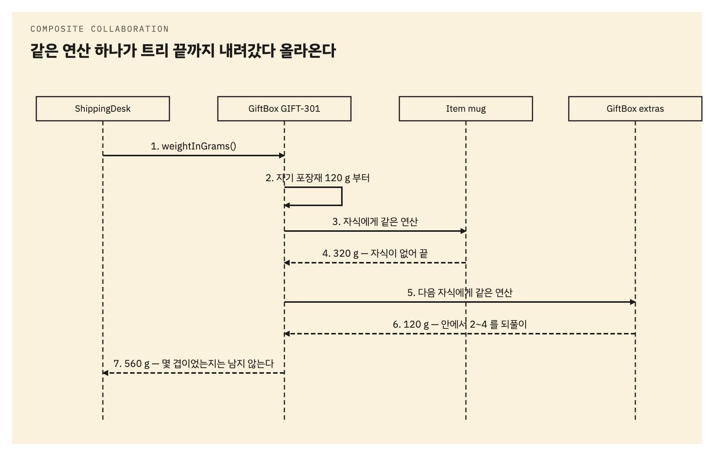
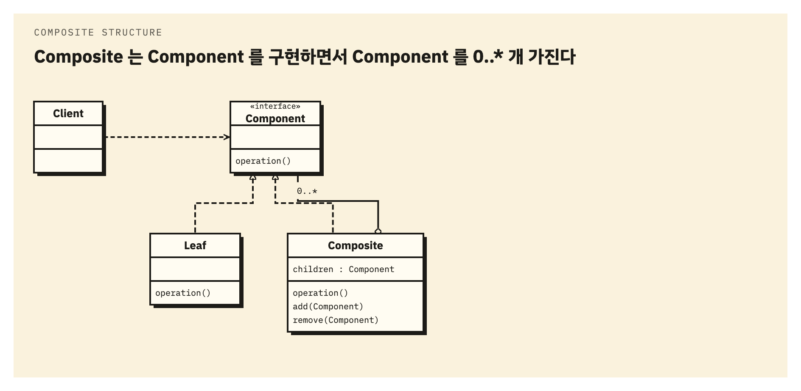

# Composite — 묶음에게도 낱개와 같은 인터페이스를 주어, 트리를 통째로 한 번에 다루기

## 한눈에 보는 개요

선물 포장을 대신 해 주는 작은 상점을 떠올려 봅시다. 배송 데스크가 하는 일은 하나예요. 나가는 한 건의 무게를 재서 운임을 매기는 것입니다. 그런데 "한 건"의 모양이 제각각이에요. 어떤 건은 머그컵 하나가 그냥 나가고, 어떤 건은 상자에 담겨 나가고, 그 상자 안에 작은 상자가 또 들어 있기도 합니다. 상자에는 포장재 무게가 따로 붙고요.

패턴 없이 쓰면 데스크가 두 가지 일을 한꺼번에 떠맡게 됩니다. 지금 받은 것이 무엇인지 **판별하는 일**과, 상자면 안쪽을 **재귀로 순회하는 일**이에요.

```text
Before : 데스크가 종류 판별과 재귀를 둘 다 떠맡는다

  int weigh(Object x) {
      if (x instanceof Item i)     return i.grams();
      if (x instanceof GiftCard)   return 5;
      if (x instanceof GiftBox b) {                        ← 재귀가 데스크 안에 있다
          int total = b.wrapGrams();
          for (Object c : b.children()) total += weigh(c);
          return total;
      }
      throw new IllegalArgumentException();                ← 종류가 늘면 여기서 예외가 난다
  }

  종류 3가지 × 연산 1개 = 분기 3갈래
  연산이 하나 늘면(내용물 목록 출력) 이 분기 묶음이 통째로 하나 더 생긴다 → 6갈래
  종류가 하나 늘면(기프트 카드) 연산마다 한 갈래씩 → 8갈래
```

Composite 의 해법은 **묶음에게도 낱개와 똑같은 인터페이스를 주는 것**입니다. 무게를 묻는 연산 하나를 낱개와 묶음이 함께 구현하고, 묶음은 그 연산 안에서 자기 자식들에게 **같은 연산**을 부릅니다. 판별과 재귀가 데스크에서 묶음 안으로 옮겨 가요.

```text
After : 묶음도 낱개와 같은 인터페이스를 구현하고, 재귀는 묶음 안으로 들어간다

  desk.quote(parcel)  →  parcel.weightInGrams()
                         │
                         ├─ 낱개면 자기 무게를 돌려주고 거기서 끝
                         └─ 묶음이면 자기 포장재 무게 + 자식마다 같은 연산
                                                    ↑ 자식이 또 묶음이어도 데스크는 모른다

  데스크가 아는 타입   Parcel 하나           분기 0갈래
  종류가 하나 늘 때    Parcel 구현 클래스 1개  데스크·기존 클래스 변경 0줄
```

이 패턴에 Composite 라는 이름을 붙인 것은 GoF(Gang of Four, 1994년에 나온 *Design Patterns* 의 저자 네 명을 함께 부르는 이름)예요. 분류는 구조 패턴이고, 객체를 합성해서 만들므로 객체 범위에만 실립니다. 자주 함께 쓰는 이웃은 다섯이에요. 트리를 순회하는 일을 밖으로 빼면 Iterator 가 되고, 노드마다 흩어진 연산을 한곳에 모으면 Visitor 가 되고, 같은 트리 위에 책임을 한 겹 더하면 Decorator 가 되고, 자식이 부모를 거슬러 올라가며 요청을 넘기면 Chain of Responsibility 가 되고, 같은 자식을 여러 곳에서 나눠 쓰려고 부모 저장을 아예 없애면 Flyweight 가 됩니다(근거: GoF Composite 절 Related Patterns).

이 글은 시나리오 셋을 따라갑니다. 선물 상자 한 건의 무게를 묻는 요청이 트리 끝까지 내려갔다 올라오는 길, 상자와 새 종류가 더해질 때 무엇이 바뀌고 무엇은 안 바뀌는가, 컴포지트의 규칙을 어기면 어느 단계에서 무엇이 어긋나는가. 끝까지 읽으면 어떤 코드를 Composite 라고 불러도 되는지 필수 조건 다섯으로 판정할 수 있고, 구조가 거의 같은 Decorator 와도 물음 하나로 구분할 수 있게 됩니다.

## 패턴 자세히 들여다보기

### 시나리오 1 — 선물 상자 한 건의 무게를 묻는 요청이 트리 끝까지 내려갔다 올라오는 길

주문 `GIFT-301` 이 포장을 마치고 배송 데스크에 올라왔습니다. 바깥 상자는 포장재가 120 g 이고, 그 안에 머그컵 320 g 과 작은 상자 하나가 들어 있어요. 작은 상자는 포장재가 45 g 이고 안에 티백 60 g 과 엽서 15 g 이 있습니다. 데스크가 받아야 하는 값은 이 한 건의 총 무게, 실행 출력 2번 줄의 `560 g` 하나예요. 이 장면에는 넷이 나옵니다. 무게를 묻는 `ShippingDesk`(패턴에서 Client 라고 부르는 역할), 무게를 묻는 연산 모양 `Parcel`(Component), 자기 무게만 아는 `Item`(Leaf), 자식을 가지고 있는 `GiftBox`(Composite)입니다. 이름은 여기서 한 구절씩만 소개하고 정식 정의는 개념 정리에서 해요.



1. `ShippingDesk` 가 받은 것에 `weightInGrams()` 를 부릅니다. 데스크가 아는 타입은 `Parcel` 하나뿐이고, 그것이 낱개인지 상자인지 묻지 않아요. 묻지 않는 편이 나은 이유는 포장 모양이 주문마다 다르기 때문입니다. 데스크가 종류를 물으면 종류가 하나 늘 때마다 데스크 코드에 분기가 늘어요.
2. 바깥 상자 `GiftBox` 가 **자식에게 내려가기 전에** 자기 몫부터 셉니다. 포장재 120 g 이에요. 이 일이 앞에 있어야 하는 이유는 전체 무게가 "부분의 합"만으로는 모자라기 때문입니다. 상자 자신도 무게를 갖는데 그것을 빼먹으면 합계가 실제 저울값과 어긋나고, 운임이 한 구간 아래로 잘못 매겨집니다.
3. `GiftBox` 가 첫 자식에게 **자기가 받은 것과 똑같은 연산**을 부릅니다. 자식의 구체 타입은 묻지 않아요. 자식 목록에 적힌 원소 타입이 `Parcel` 이라 물어볼 방법도 없고, 물어볼 필요도 없습니다. 이 한 줄이 재귀의 전부예요 — 상자는 자기가 부른 상대가 낱개인지 또 다른 상자인지 끝까지 모릅니다.
4. 첫 자식 머그컵 `Item` 이 자기 무게 320 g 을 그대로 돌려줍니다. 여기서 되돌아 나오는 이유는 이 종류가 유일하게 **자식 목록을 가지고 있지 않은** 쪽이기 때문이에요. 더 내려갈 곳이 없으니 재귀가 여기서 멈춥니다. 잎이 없으면 재귀가 끝나지 않아요.
5. `GiftBox` 가 둘째 자식인 작은 상자에게 같은 연산을 부릅니다. 작은 상자는 2~4단계를 자기 안에서 그대로 되풀이해요. 포장재 45 g 을 세고, 티백에게 묻고, 엽서에게 묻습니다. 되풀이가 가능한 이유는 상자가 상자를 자식으로 가질 수 있기 때문이고, 그렇게 가질 수 있는 이유는 자식 목록의 원소 타입이 `Parcel` 이기 때문이에요.
6. 작은 상자가 120 g 을 돌려주고, 바깥 상자가 그것까지 더해 560 g 을 만듭니다. 이 합산이 **자식에게 다녀온 뒤에** 일어나야 하는 이유는 더할 값이 자식이 만들어 준 값이라서예요. 앞으로 옮기면 아직 없는 숫자를 더하는 셈이 됩니다.
7. `ShippingDesk` 가 숫자 하나를 반환받습니다. 몇 겹이었는지, 상자가 몇 개였는지는 그 숫자 어디에도 남아 있지 않아요. 데스크가 보는 것은 `Parcel` 이 약속한 반환값 하나입니다.

```text
단계   부르는 쪽 → 받는 쪽                  더해지는 값      그 시점의 누계
 1     Client → Parcel(바깥 상자)          —                —
 2     GiftBox GIFT-301 → (자기 안)        포장재 120       120
 3·4   GIFT-301 → Item mug → 되돌아옴      머그컵 320       440
 5     GIFT-301 → GiftBox extras           (안에서 되풀이)
         extras → (자기 안)                포장재 45        45
         extras → Item tea bags            티백 60          105
         extras → Item postcard            엽서 15          120
 6     extras → GIFT-301                   작은 상자 120    560
 7     GIFT-301 → Client                   —                실행 출력 2번 줄 = 560 g
```

잠깐, 확인 하나만 해 볼까요? 3단계에서 `GiftBox` 가 가진 자식 목록의 원소 타입이 `Parcel` 이 아니라 `Item` 이었다면, 위 표에서 무엇이 사라질까요?

1·2·4단계는 그대로입니다. 통째로 사라지는 것은 5단계예요. 원소 타입이 `Item` 이면 작은 상자를 그 목록에 넣을 수 없어서, 바깥 상자가 담을 수 있는 것은 낱개뿐이 됩니다. 그러면 깊이가 한 겹에서 끝나고, 부분-전체 **계층**이라고 부를 것이 남지 않아요. 시나리오 3 의 1번 갈래가 이것을 세 언어의 컴파일 오류로 확인합니다.

```text
GiftBox 의 자식 목록에 적힌 원소 타입이 정하는 것

  List<Parcel> children   →  GIFT-301[ mug, extras[ tea, postcard ] ]   상자 안에 상자가 들어간다
  List<Item>   children   →  GIFT-301[ mug ]                            낱개만 들어간다. 깊이는 1
```

이 시나리오가 보여 준 것은 **같은 연산 하나가 구조를 따라 재귀로 퍼진다**는 사실과 **묶음에게는 자기 몫이 따로 있다**는 사실입니다. 상자는 자기가 부른 상대가 낱개인지 상자인지 구별하지 못하고(3·5단계), 그래서 같은 과정이 트리 끝까지 되풀이돼요. 묶음이 하는 일은 전달만이 아닙니다 — 내려가기 전에 자기 포장재를 세고(2단계), 올라온 값들을 모아 하나로 만듭니다(6단계). 그동안 Client 가 보는 타입은 하나예요. `Parcel` 뿐입니다(1·7단계).

### 시나리오 2 — 사은품 상자와 새 종류가 더해질 때

같은 주문에 두 가지 요구가 연달아 들어옵니다. 먼저 사은품을 넣어 달라는데, 낱개로 굴러다니지 않게 따로 작은 상자에 담아 달라고 해요. 그 사은품 상자는 포장재 30 g 에 샘플 파우치 55 g 이 들어가니 85 g 입니다. 그다음 감사 카드를 한 장 넣어 달라는 요구가 오는데, 카드는 지금 코드에 없는 **새로운 종류**예요. 무게는 5 g 이고 문구가 인쇄돼 있습니다. 나와야 하는 값은 실행 출력 4번 줄의 `645 g` 과 5번 줄의 `650 g` 입니다.

1. 사은품 상자를 만들어 파우치를 넣고, 그 상자를 `GIFT-301` 의 자식으로 넣습니다. 고친 곳은 조립 코드 세 줄이에요(본문 java 펜스 25~27행 · typescript 112~114행 · rust 144~146행). 이게 되는 이유는 시나리오 1 의 5단계에서 이미 본 것과 같습니다. 자식 목록의 원소 타입이 `Parcel` 이라 `GiftBox` 자신도 그 자리에 들어가요.
2. `ShippingDesk` · `Item` · `GiftBox` 는 한 글자도 안 바뀝니다. 그런데도 총 무게는 560 g 에서 645 g 으로 바뀌어요(실행 출력 4번 줄). 데스크가 바뀌지 않아도 되는 이유는 데스크가 부르는 것이 `Parcel` 이 약속한 연산 하나뿐이고, 그 연산의 뜻이 "너와 네 안에 든 것 전부의 무게"로 처음부터 정해져 있었기 때문입니다.
3. 감사 카드는 `Parcel` 을 구현하는 클래스 하나로 끝납니다(본문 java 펜스 75~94행, 20줄). `GiftBox` 도 `Item` 도 데스크도 열지 않아요. 새 종류를 받아들이는 자리가 따로 없는 이유는 **아무도 구체 타입 이름으로 분기하지 않기** 때문입니다. 분기가 있었다면 그 분기마다 한 갈래씩 보태야 했을 거예요.
4. 그런데 반대 방향의 요구는 드는 비용이 다릅니다. "상자 안에 뭐가 들었는지 목록으로 뽑아 달라"는 **새 연산** 요구가 그래요. 이건 `Parcel` 에 연산을 하나 더하고 그것을 구현하는 클래스를 **전부** 열어야 합니다. 이 가이드의 코드에서 `lines` 를 가진 타입은 넷이에요 — `Item` · `GiftCard` · `GiftBox`, 그리고 비교 절에서 쓰려고 함께 둔 보냉 포장 층 `ChilledWrap` 입니다. 연산이 노드 클래스마다 흩어져 있어서 그런 건데, 이 대가를 치르지 않으려면 연산을 한곳에 모으는 다른 패턴이 필요합니다. 그 자리는 비교 절에서 Visitor 로 다뤄요.

| 변화 | 바뀐 곳 | 안 바뀐 곳 |
| --- | --- | --- |
| 사은품 상자를 한 겹 더 넣음 | 조립 코드 세 줄 | `Parcel` · `Item` · `GiftBox` · `ShippingDesk` 전부 |
| 새 **종류**(감사 카드)가 생김 | `GiftCard` 클래스 하나(20줄) | 기존 클래스 전부 · 데스크 전부 |
| 새 **연산**(내용물 목록)이 생김 | `Parcel` 선언 + 구현 클래스 4개 | 데스크는 부르는 줄만 |

여기서 헷갈리기 쉬운 포인트는 **이 패턴이 모든 방향의 변화에서 비용이 작다**고 믿는 것입니다. 위 표의 마지막 줄이 그렇지 않다는 증거예요. 종류가 느는 방향은 클래스 하나로 끝나지만, 연산이 느는 방향은 구현 클래스 전부를 엽니다. 방향에 따라 비용이 다른 이유는 이 구조가 **종류별로 코드를 갈라 두었기** 때문이에요. 같은 종류 안의 여러 연산은 한 클래스에 모여 있고, 같은 연산의 여러 종류는 여러 클래스에 흩어져 있습니다. 그러니 어느 쪽이 자주 늘어나는지를 보고 골라야 해요.

```text
무엇이 자주 늘어나는가

  종류가 자주 는다(상자·낱개·카드·쿠폰·…)   → 클래스 하나씩 추가. Composite 는 비용이 작다
  연산이 자주 는다(무게·목록·검사·견적·…)   → 구현 클래스를 매번 전부 연다. 비용이 크다
                                               이 방향이 Visitor 가 다루는 자리다
```

이 시나리오가 보여 준 것은 변화의 범위와 그 방향입니다. 깊이를 한 겹 더하는 일은 조립 코드 몇 줄이고(1단계), 새 종류를 더하는 일은 클래스 하나예요(3단계). 두 경우 모두 Client 와 기존 클래스는 그대로입니다(2단계). 대신 대가를 치릅니다. 연산이 늘어나는 방향에서는 구현 클래스를 전부 열어야 하고(4단계), 그 개수는 종류가 늘수록 함께 늡니다.

### 시나리오 3 — 컴포지트의 규칙을 어기면 어느 단계에서 무엇이 어긋나는가

같은 포장 코드를 네 사람이 각자 다르게 손봅니다. 한 사람은 자식 목록의 타입을 좁히고, 한 사람은 데스크에서 종류를 판별하고, 한 사람은 상자가 자식을 쓰지 않게 고치고, 한 사람은 상자를 자기 안쪽에 집어넣어요. 마지막 한 사람은 규칙을 어기는 대신 **절충 하나를 고릅니다** — 그래서 어긋나는 자리가 옮겨 갈 뿐 틀린 것은 아니에요. 다섯을 차례로 따라가 봅시다. 아래 진단은 `javac 21.0.11` · `tsc 5.9.3` · `rustc 1.95.0` 으로 이 가이드의 코드를 실제로 고쳐 컴파일해 받은 것이고, 옮기면서 무엇을 지웠는지는 각 줄에 적었습니다.

1. 첫 사람이 자식 목록의 원소 타입을 구체 잎 타입으로 좁힙니다. 고친 곳은 각 언어 **두 줄**이에요 — java 펜스 100행의 `List<Parcel> children` 을 `List<Item> children` 으로, 107행의 `void add(Parcel child)` 를 `void add(Item child)` 로. typescript 는 40행과 47행, rust 는 57행의 `Vec<Box<dyn Parcel>>` 을 `Vec<Box<Item>>` 으로, 65행의 인자 타입을 `Box<Item>` 으로 바꿉니다. 그 밖의 줄은 그대로 두었어요. 이 두 줄 편집으로 세 언어가 각각 **오류 4건**을 냅니다. 막히는 호출은 상자를 상자에 넣는 두 곳(`extras` · `freebie`), 카드를 넣는 한 곳, 보냉 층을 넣는 한 곳이에요.

```text
javac 21.0.11 — 4건 (파일명·줄 번호 앞머리 `ParcelShippingApp.java:19: ` 와 캐럿 표시 줄,
                     그리고 "Note: Some messages have been simplified" 안내 줄과
                     맨 끝 "4 errors" 요약 줄을 지운 것 외에는 원문 그대로)
error: incompatible types: GiftBox cannot be converted to Item        ← giftBox.add(extras)
error: incompatible types: GiftBox cannot be converted to Item        ← giftBox.add(freebie)
error: incompatible types: GiftCard cannot be converted to Item       ← giftBox.add(new GiftCard(...))
error: incompatible types: ChilledWrap cannot be converted to Item    ← cooler.add(new ChilledWrap(...))

tsc 5.9.3 — 4건 (파일·줄·칸 앞머리 `main.ts(106,13): ` 를 지운 것 외에는 원문 그대로.
                 첫 줄은 넷 다 아래 모양이고 작은따옴표 안 타입 이름만 달라서 한 번만 옮기고,
                 달라지는 둘째 줄은 넷을 다 옮깁니다. 셋째·넷째 건은 문장 형태부터 다릅니다)
error TS2345: Argument of type 'GiftBox' is not assignable to parameter of type 'Item'.
  Property 'grams' is missing in type 'GiftBox' but required in type 'Item'.            ← extras
  Property 'grams' is missing in type 'GiftBox' but required in type 'Item'.            ← freebie
  Type 'GiftCard' is missing the following properties from type 'Item': name, grams
  Type 'ChilledWrap' is missing the following properties from type 'Item': name, grams

rustc 1.95.0 — 4건 (머리 줄만 옮겼고 `--> 파일:줄:칸` 위치 줄, 밑줄 표시 줄, `note:` 로 시작하는
                    안내 줄, 맨 끝 `error: aborting due to 4 previous errors` 요약 줄은 지웠습니다.
                    오류 건수는 `^error[` 로 시작하는 줄만 세었습니다)
error[E0308]: mismatched types      ← expected `Item`, found `GiftBox`     (×2)
error[E0308]: mismatched types      ← expected `Item`, found `GiftCard`
error[E0308]: mismatched types      ← expected `Item`, found `ChilledWrap`
```

2. 둘째 사람이 데스크를 고칩니다. 운임 구간을 나누려고 "상자면 완충재 비용을 더하자"는 요구가 들어왔고, 데스크에 `parcel instanceof GiftBox` 분기를 넣었어요. 컴파일도 되고 실행도 됩니다. 문제가 생기는 것은 지금이 아니라 **다음번**이에요. 종류가 하나 늘 때마다 이 분기를 다시 열어야 하고, 개요에서 센 것처럼 연산이 늘면 분기 묶음이 통째로 하나 더 생깁니다. 그리고 더 무거운 문제가 따로 있어요. 데스크가 상자를 알아보기 시작하면 상자 안을 들여다보고 싶어지고, 그러면 시나리오 1 의 3~6단계에 있던 재귀가 데스크로 되돌아옵니다.
3. 셋째 사람이 `GiftBox.weightInGrams()` 를 고칩니다. 자식 순회가 느리다며 자식을 순회하는 `for` 문을 지우고 `return wrapGrams;` 한 줄로 바꿨어요(java 펜스 113~117행 다섯 줄을 한 줄로). 컴파일은 통과합니다. 값만 조용히 틀려요. Java 쪽만 그렇게 고쳐 실행해 보니 2·4·5번 줄이 전부 `120 g` 으로 나왔고, 6번 줄은 `370 g`, 7번 줄은 `20 g` 이 됐습니다. 눈여겨볼 곳은 **3번 줄이 그대로**라는 점이에요. 내용물 목록을 내는 `lines` 는 여전히 자식을 순회하고 있으니, 목록에는 머그컵도 티백도 다 찍히는데 무게만 빠집니다.

```text
갈래 3 — 자식을 보관만 하고 쓰지 않을 때 (Java 만 고쳐 실행)

  2) gift box GIFT-301:            560 g  →  120 g      포장재만 남았다
  4) freebie box added:            645 g  →  120 g      자식을 더 넣어도 숫자가 안 움직인다
  6) chilled wrap around GIFT-301: 900 g  →  370 g
  7) box holding a chilled mug:    590 g  →   20 g
  3) contents of GIFT-301:         그대로                 목록은 자식을 다 보여 준다
      ↑ 목록과 숫자가 어긋나는데 컴파일러도 목록도 아무 말을 안 한다
```

4. 넷째 사람이 포장을 재구성하다가 바깥 상자를 자기 안쪽 상자의 자식으로 집어넣습니다. 구조가 더 이상 트리가 아니라 고리가 돼요. Java 에서는 `weightInGrams()` 가 자기 자신으로 되돌아오며 끝없이 내려가다 `java.lang.StackOverflowError` 로 끝났고(직접 실행해 확인), Node 로 실행한 TypeScript 는 `RangeError: Maximum call stack size exceeded` 를 냈습니다. 흥미로운 것은 Rust 예요. 이 가이드의 Rust 구현은 자식을 **소유**하므로 같은 값을 두 곳에 넣는 일 자체가 막힙니다. 본문 rust 펜스의 138행을 한 줄 복사해 `extras` 를 두 번 넣어 보면 `error[E0382]: use of moved value: extras` 한 건으로 끝나요(직접 컴파일해 확인). 고리를 만들려면 `Rc` 같은 공유 소유로 바꿔야 하고, 그렇게 바꾸는 순간 같은 문제가 Rust 에서도 생겨요.
5. 다섯째 사람은 규칙을 어기는 대신 다른 길을 고릅니다. 자식을 더하는 `add` 를 `GiftBox` 가 아니라 `Parcel` 에 선언해서 낱개에게도 같은 인터페이스를 주는 쪽이에요. 그러면 `Item` 도 `add` 를 갖게 되는데 할 일이 없으니 예외를 던집니다. 이 길도 이 패턴입니다 — 다만 막히는 자리가 컴파일에서 실행으로 옮겨 가요. 실제로 `Item` 에 `add` 를 두고 예외를 던지게 짜서 실행해 보니 `javac` 는 아무 말도 하지 않았고, 호출하는 순간 `java.lang.UnsupportedOperationException: leaf has no children` 이 났습니다(직접 실행해 확인).

```text
같은 코드, 오류를 잡는 자리가 다르다

  1번 갈래(자식 목록을 구체 잎 타입으로)  → 세 언어 모두 컴파일이 막는다. 각 4건
  4번 갈래(고리를 만듦)                   → Java·TypeScript 는 실행 중에 스택이 넘친다
                                             Rust 는 소유권 때문에 애초에 못 만든다
  2번 갈래(데스크가 종류를 판별)          → 아무도 안 막는다. 다음 변경에서 비용이 나온다
  3번 갈래(자식을 쓰지 않음)              → 아무도 안 막는다. 숫자만 조용히 틀린다
  5번 갈래(잎에도 add 를 둠)              → 컴파일은 통과. 부르는 순간 예외 — 어긴 게 아니라 고른 것
```

이 시나리오가 보여 준 것은 규칙마다 어긋남을 잡아 주는 단계가 다르다는 점입니다. 타입에 적힌 것은 컴파일러가 잡아 줘요(1번 갈래). 구조가 트리인지는 언어에 따라 다르고(4번 갈래), 데스크가 종류를 묻는지와 묶음이 자식을 실제로 쓰는지는 **아무 도구도 잡아 주지 않습니다**(2·3번 갈래). 그래서 뒤의 둘은 조건으로 적어 두고 사람이 읽어야 해요. 그리고 5번 갈래처럼 어긴 것이 아니라 고른 것도 있습니다 — 그 구분을 다음 절의 `[필수]` 와 `[선택]` 이 맡아요.

### 개념 정리

시나리오에 나온 역할 넷을 정식으로 정의합니다. 앞의 셋은 GoF 가 이 패턴의 참여자로 적은 역할이고, Client 도 참여자 목록에 함께 있습니다(근거: GoF Composite 절 Participants·Collaborations).

- **Component** — 낱개와 묶음이 **함께 구현하는** 연산 모양입니다. 이 타입 하나가 이 패턴의 계약 전부예요. Client 는 이것만 보고, 묶음은 이것을 구현하면서 동시에 이것을 자식으로 여럿 가집니다. 그 두 가지가 모두 한 타입을 가리켜서 묶음 안에 묶음이 들어가요. 포장 예에서는 `weightInGrams()` 와 `lines(indent)` 둘을 선언한 `Parcel` 이 Component 입니다.
- **Leaf** — 자식을 가지지 않는 쪽입니다. 이 패턴에서 유일하게 **더 내려갈 곳이 없는** 종류이고, 그래서 재귀가 여기서 멈추고 값이 되돌아갑니다(시나리오 1 의 4단계). 자기 힘으로 연산을 끝내는 것이 이 역할의 일이에요. 포장 예에서는 무게를 그대로 돌려주는 `Item` 과, 나중에 더해진 `GiftCard` 가 Leaf 입니다.
- **Composite** — Component 타입의 자식을 0개 이상 가지고, 받은 연산을 자식들에게 넘겨 결과를 모으는 쪽입니다. 넘기기만 하는 것이 아니라 자기 몫을 더한다는 점이 이 역할의 핵심이에요(시나리오 1 의 2·6단계). 자식을 더하고 빼는 일도 여기서 맡습니다. 포장 예에서는 포장재 무게를 갖고 자식을 순회하는 `GiftBox` 가 Composite 입니다.
- **Client** — Component 타입으로만 대상을 받아 쓰는 쪽입니다. 그것이 낱개인지 묶음인지, 묶음이면 몇 겹인지 모르고 알 필요도 없어요(시나리오 1 의 1·7단계). 포장 예에서는 무게를 물어 운임을 매기는 `ShippingDesk` 가 Client 입니다. 트리를 실제로 엮는 일은 이 역할이 아니라 **조립 코드**가 맡아요(시나리오 2 의 1단계).



그림에서 `Composite` 칸으로 들어가고 나가는 선 둘을 봐 두세요. 위로는 `Component` 를 구현한다는 선이 있고, 옆으로는 `Component` 를 갖는다는 선이 있는데 그 끝에 `0..*` 가 적혀 있습니다. 한 칸이 같은 타입과 이 두 관계를 함께 맺는 것이 이 패턴의 모양이에요. 그리고 **그 `0..*` 자리에 `1` 이 적히면 그림은 다른 패턴이 됩니다** — 비교 절에서 그 자리를 다뤄요. `Composite` 칸 안의 `add` · `remove` 는 자식 관리 연산인데, 이것을 `Component` 로 올릴지 여기 둘지는 최소 조건 6번이 다룹니다.

> 묶음이 낱개처럼 보이면, 묶음 안에 묶음을 넣을 수 있다.

## 사용 목적

Composite 가 필요하다는 단서는 자료 모양과 함수 모양 둘 다에서 보입니다. 셋을 차례로 봅시다.

**단서 1. 자료 모델에 자기 자신을 담는 관계가 있습니다.** 상자 안의 상자, 폴더 안의 폴더, 부서 안의 부서, 메뉴 안의 메뉴처럼요. 요구사항 문장에서는 「무엇 안에 무엇을 넣을 수 있다」나 「전체의 합」 같은 말로 나타납니다. 이 단서가 강한 이유는 그 관계가 한 번이라도 허용되면 깊이가 사실상 무제한이 되기 때문이에요. 깊이가 정해져 있으면 반복문 두 겹으로 끝나지만, 무제한이면 재귀가 어디엔가 있어야 하고 그 재귀를 어디에 둘 것이냐가 이 패턴이 답하는 물음입니다.

```text
단서 1 이 자료 모델에 나타나는 모양

  Box ──담는다──▶ Box        자기 자신으로 돌아오는 화살표 하나
       └────────▶ Item

  깊이가 2 로 정해져 있다   →  for (상자) for (물건)        반복문 두 겹으로 끝난다
  깊이가 무제한이다         →  재귀가 있어야 한다           그 재귀를 어디에 둘 것인가
```

**단서 2. 같은 재귀 함수가 호출부마다 복제돼 있고, 그 안에 종류 판별 분기가 들어 있습니다.** 개요의 Before 코드가 그 모양이에요. 검색으로 찾을 수 있는 단서라 알아보기 쉽습니다.

```text
단서 2 를 코드에서 찾는 법

  1. 자기 자신을 부르는 함수를 찾는다(재귀)
  2. 그 안에 instanceof · switch(type) · if (x.kind == …) 가 있는지 본다
  3. 그 함수가 파일 여럿에 비슷한 모양으로 복제돼 있는지 본다
     → 셋이 다 걸리면 분기의 개수는 (종류 수 × 연산 수 × 복제본 수) 로 자란다
```

**단서 3. Client 가 "하나"와 "여럿"을 위해 연산을 두 벌 갖고 있습니다.** `weigh(Item)` 과 `weighAll(List<Item>)`, `render(Shape)` 와 `renderGroup(List<Shape>)` 처럼요. 이것이 단서인 이유는 두 벌을 두는 순간 "여럿 안의 여럿"이 곧바로 문제가 되기 때문입니다. `weighAll` 이 받은 목록 안에 또 목록이 들어오면 어느 쪽을 불러야 하는지 Client 가 정해야 하고, 그 판단이 Client 마다 복제돼요. 이 패턴은 그 두 벌을 한 벌로 줄입니다.

| 단서 | 코드에서 관찰되는 것 | 확인 방법 |
| --- | --- | --- |
| 1. 자기 참조 관계 | 어떤 타입의 필드나 컬렉션 원소가 자기 자신(또는 자기 상위 타입) | 자료 모델에서 자기 자신으로 돌아오는 화살표를 찾음 |
| 2. 복제된 재귀 + 판별 분기 | 재귀 함수 안의 `instanceof` · `switch(type)` | 재귀 함수를 찾고 그 안의 타입 분기를 셈 |
| 3. 하나용·여럿용 연산 두 벌 | `doOne(X)` 과 `doAll(List<X>)` 가 나란히 있음 | 같은 동사의 단수·복수 쌍을 검색 |

비슷한 단서에서 다른 패턴을 고르게 되는 경우가 둘 있습니다. 감싸는 대상이 늘 **하나**이고 목적이 기능 추가면 Decorator 를, 구조는 그대로 두고 **연산**이 자주 느는 것이 문제면 Visitor 를 먼저 검토하세요. 차이는 다음 절에서 풉니다. 그리고 아래 상황에서는 트리를 허용하면 얻는 것보다 잃는 것이 큽니다.

| 쓰지 말아야 할 상황 | 쓰면 잃는 것 |
| --- | --- |
| 묶음에 들어갈 수 있는 것을 **종류로 제한**해야 함(예: 냉장 상자에는 냉장 품목만) | 컴파일 시 검사를 잃습니다. 자식 목록의 원소 타입이 Component 라 제한을 타입으로 표현할 수 없고, `add` 안의 실행 중 검사로 내려가요 |
| 깊이가 **항상 1**인 것이 도메인 규칙임 | 규칙이 코드에서 사라집니다. 트리를 허용하면 "상자 안의 상자"가 언제든 만들어지고, 그것을 막는 곳이 아무 데도 없어요 |
| 낱개와 묶음이 공통으로 할 수 있는 일이 거의 없음 | 공통 타입이 억지로 일반화됩니다. 연산 대부분이 한쪽에서 의미가 없어지고, 결국 Client 가 다시 종류를 묻게 돼요(시나리오 3 의 2번 갈래가 그 상태) |
| 트리를 한 번 만들고 그 위에서 **연산만** 계속 늘어남 | 종류별 클래스를 매번 전부 여는 비용을 치릅니다(시나리오 2 의 4단계). 그 방향은 Visitor 가 비용이 더 작습니다 |

## 패턴의 경계

### 디자인 패턴을 충족하는 최소 조건

어떤 코드를 Composite 라고 불러도 되는지 가르는 기준입니다. `[필수]` 가 하나라도 빠지면 Composite 가 아니고, `[선택]` 은 갖추면 좋거나 상황에 따라 고르는 구조예요. 조건은 언어와 상관없이 코드에서 확인할 수 있는 모양(타입 선언 · 참조 보유 · 호출 방향 · 생성 위치)으로 적었고, 조건마다 그것을 보여 준 시나리오의 단계를 가리킵니다.

1. [필수] Leaf 와 Composite 가 **같은 Component 타입**을 구현하고, Client 는 그 타입으로만 둘을 다룹니다 — Client 쪽 변수·인자 타입이 Component 이고, Client 코드에 구체 타입 판별이 없습니다. 시나리오 1 의 1·7단계가 그 모양이에요 (근거: GoF Composite 절 Intent — 개별 객체와 합성 객체를 클라이언트가 **균일하게** 다루게 하는 것이 이 패턴의 목적이다 / Participants — Client 는 Component 인터페이스로 합성 구조의 객체를 조작한다).
   - 빠지면: Client 가 종류를 물어야 하고, 그 순간 태그·분기가 되돌아옵니다. 시나리오 3 의 2번 갈래가 그 자리이고, 개요의 Before 코드가 그 끝입니다. 이때 남는 것은 패턴이 아니라 그냥 타입 분기예요.
2. [필수] Composite 가 **Component 타입**의 자식을 0개 이상 보유합니다 — 자식 컬렉션에 적힌 원소 타입이 구체 잎 클래스가 아니라 Component 입니다. 그래서 그 자리에 또 다른 Composite 가 들어가고 깊이가 임의가 됩니다. 시나리오 2 의 1단계가 그 자리예요 (근거: GoF Composite 절 Intent — 객체들을 **트리 구조**로 합성해 부분-전체 계층을 표현한다 / Participants — Composite 는 자식 컴포넌트들을 저장한다).
   - 빠지면: 묶음 안에 묶음을 넣을 수 없어 깊이가 한 겹에서 끝나고, 부분-전체 **계층**이 아니라 평평한 컬렉션이 됩니다. 시나리오 3 의 1번 갈래에서 세 언어가 각각 오류 4건으로 막았어요.
3. [필수] Composite 의 연산이 자식들에게 **전달**되고, 그 결과로 전체의 결과가 만들어집니다 — 연산 본문에 자식 컬렉션을 순회하는 호출이 있고, 그 반환값이 자기 결과에 쓰입니다. 시나리오 1 의 3·5·6단계가 그 왕복이에요 (근거: GoF Composite 절 Collaborations — Composite 는 보통 요청을 자식 컴포넌트들에 전달하고, 전달 전후에 추가 연산을 수행할 수 있다).
   - 빠지면: 자식을 보관만 하는 컨테이너입니다. 시나리오 3 의 3번 갈래가 그 모양이고, 컴파일도 실행도 통과하면서 숫자만 어긋나요.
4. [필수] Leaf 는 자식 컴포넌트를 보유하지 않고 요청을 **자기가 끝냅니다** — 잎 클래스에 Component 컬렉션 필드가 없고, 연산 본문에 다른 Component 로 나가는 호출이 없습니다. 시나리오 1 의 4단계가 그 자리예요 (근거: GoF Composite 절 Participants — Leaf 는 합성의 잎 객체로 자식을 갖지 않으며 원시 객체의 동작을 정의한다).
   - 빠지면: 재귀가 멈출 자리가 없습니다. 모든 종류가 다음을 가지고 있으면 재귀가 계속 내려가고, 끝을 내는 일이 실행 중의 조건에 달리게 돼요.
5. [필수] 자식 보유 관계를 따라가면 시작한 곳으로 되돌아오는 경로가 없습니다 — 트리를 만드는 조립 코드에서 한 컴포넌트를 자기 자손의 자식으로 넣지 않습니다. 시나리오 1 의 5단계가 그 전제 위에서 동작해요 (근거: GoF Composite 절 Intent — 합성의 결과를 **트리 구조**라고 적는다).
   - 빠지면: 구조가 고리가 되어 연산이 끝나지 않습니다. 시나리오 3 의 4번 갈래에서 Java 는 `StackOverflowError`, Node 로 실행한 TypeScript 는 `RangeError` 로 끝났어요. 한 컴포넌트를 두 부모가 함께 가지는 **공유**는 고리와 다른 이야기라 조건 9번에 따로 두었습니다. 이 조건을 실행 중에 강제하는 실물도 있어요 — DOM(Document Object Model, 브라우저가 웹 문서를 노드 트리로 가지고 있는 그 구조)은 자기 조상을 자식으로 붙이려 하면 `HierarchyRequestError` 를 던집니다([MDN — Node.appendChild()](https://developer.mozilla.org/en-US/docs/Web/API/Node/appendChild)).
6. [선택] 자식 관리 연산(`add` · `remove` · `getChild`)을 Component 에 둡니다 — 낱개에게도 같은 인터페이스를 주는 쪽(투명성)이고, 대신 잎의 그 연산은 할 일이 없어 실행 중에 거절해야 합니다. Composite 에만 두면(안전성) 컴파일러가 잡아 주는 대신 Client 가 자식을 더할 때 구체 타입을 알아야 해요. 시나리오 3 의 5번 갈래가 두 길의 차이를 보여 주고, 이 가이드의 예시 코드는 안전성 쪽을 골랐습니다 (근거: GoF Composite 절 Implementation — 자식 관리 연산을 Component 에 선언하면 투명성을 얻고 안전성을 잃으며, Composite 에만 선언하면 그 반대다. 원전 서술은 투명성 쪽을 기본으로 둔다).
7. [선택] 자식이 부모를 가리키는 참조를 둡니다 — 자식에서 위로 거슬러 올라가는 순회나 관리가 쉬워지는 대신, 자식을 더하고 뺄 때 양쪽을 함께 고쳐야 합니다. 시나리오 1 의 6단계처럼 결과가 되돌아 올라가는 길만 있으면 합계는 나오므로 이 가이드의 예시는 두지 않았어요 (근거: GoF Composite 절 Implementation — 명시적 부모 참조는 순회와 관리를 쉽게 하지만 부모와 자식의 일관성이라는 불변식을 함께 지켜야 한다).
8. [선택] 자식의 **순서**가 결과에 뜻을 갖습니다 — 순서가 뜻을 가지면 자식 컬렉션이 순서 있는 자료구조여야 하고, 아니면 집합이어도 됩니다. 포장 예에서 무게 합은 순서와 무관하지만 내용물 목록은 순서대로 찍히므로(시나리오 2 의 4단계가 만든 연산), 이 가이드의 예시는 순서 있는 목록을 씁니다 (근거: GoF Composite 절 Implementation — 자식의 순서가 설계의 일부인 경우를 따로 다룬다).
9. [선택] 한 컴포넌트의 부모를 하나로 둡니다 — 조립 코드에서 같은 인스턴스를 두 부모의 자식 목록에 넣지 않습니다. 부모를 하나로 묶으면 위로 올라가는 요청의 행선지가 분명해지는 대신 같은 컴포넌트를 여러 곳에서 나눠 쓸 수 없고, 공유가 꼭 필요하면 부모 저장을 아예 없애는 Flyweight 쪽으로 갑니다. 시나리오 2 의 1단계에서 상자를 넣을 때 이 가이드가 지킨 규칙이고, 실행 출력 7번 줄이 그 때문에 머그컵을 새로 만들어요 (근거: GoF Composite 절 Implementation — 컴포넌트 공유는 부모가 하나뿐일 때 어려워지는 구현 쟁점으로 다루고, 자식이 부모를 여럿 저장하면 요청이 위로 퍼질 때 모호해진다고 적는다 / Related Patterns — Flyweight 는 컴포넌트를 공유하게 해 주지만 그 컴포넌트는 더 이상 부모를 가리킬 수 없다).
   - 느슨하게 두면: 공유가 가능해지는 대신, 부모 참조를 두는 설계(조건 7번)에서 위로 가는 요청이 어느 부모로 갈지 정해야 합니다. 이 가이드의 예시는 부모 참조를 두지 않아 그 물음이 생기지 않아요. DOM 은 한 부모만 허용하는 쪽이라, 이미 문서에 있는 노드를 붙이면 복사하지 않고 원래 자리에서 **옮겨** 한 노드가 두 곳에 동시에 있지 못하게 합니다([MDN — Node.appendChild()](https://developer.mozilla.org/en-US/docs/Web/API/Node/appendChild)).

여기서 판정 순서를 한 번 정리해 둡시다. 조건 1번과 2번은 **타입 선언만 보면** 답이 나오고, 3번과 4번은 연산 본문을 봐야 하며, 5번은 **조립 코드**를 봐야 합니다. 보는 품이 적은 것부터 적용하면 대부분 앞의 둘에서 끝나요.

| 코드 | 1번 | 2번 | 3번 | 4번 | 5번 | 판정 |
| --- | --- | --- | --- | --- | --- | --- |
| `GiftBox`(`List<Parcel>` 자식 · 순회해 합산) | 만족 | 만족 | 만족 | 만족 | 만족 | Composite |
| `GiftBox` 인데 자식 목록이 `List<Item>` | 만족 | **빠짐** | 만족 | 만족 | 만족 | Composite 아님 — 평평한 컬렉션 |
| `GiftBox` 인데 자식을 보관만 함 | 만족 | 만족 | **빠짐** | 만족 | 만족 | Composite 아님 — 단순 컨테이너 |
| 데스크가 `instanceof GiftBox` 로 분기함 | **빠짐** | 만족 | 만족 | 만족 | 만족 | Composite 아님 — 타입 분기 |
| `ChilledWrap`(`Parcel` **하나**를 감싸 무게를 더함) | 만족 | **빠짐** | 만족 | — | 만족 | Composite 아님 — Decorator |
| 왼쪽·오른쪽 자식을 가진 이진 탐색 트리 노드 | **빠짐** | 만족 | 만족 | **빠짐** | 만족 | Composite 아님 — 트리 자료구조 |

`ChilledWrap` 줄의 4번 칸이 `—` 인 것은 그 클래스가 잎 역할을 하지 않아 조건을 적용할 데가 없다는 뜻이에요. 그 줄이 가장 헷갈리는 자리이고, 마지막 줄은 이 패턴으로 오해받는 대표적인 모양입니다. 둘 다 다음 절에서 풉니다.

### 비슷한 패턴·안티패턴과의 차이

Composite 와 구조가 닮았거나 같은 단서에서 떠오르는 대상 넷을 비교합니다. Decorator 는 클래스 모양이 거의 같아 먼저 다루고, 그다음 같은 트리 위에서 역할을 나눠 갖는 Visitor 와 Iterator, 마지막으로 이 패턴으로 오해받는 트리 자료구조를 봅니다.

| 비교 대상 | 구분 기준 (코드에서 보는 것) | Composite 를 고르면 얻는 것 | 포기하는 것 |
| --- | --- | --- | --- |
| Decorator | 가진 참조가 **여럿을 담는 자리**인가 하나인가, 목적이 집계인가 책임 추가인가 | 여러 대상을 하나처럼 다루는 집계. 깊이가 임의여도 Client 는 그대로(시나리오 1 의 7단계) | 한 대상에 책임을 겹겹이 쌓는 구성. 묶음은 자식을 모을 뿐 자식이 하는 일을 바꾸지 않음 |
| Visitor | 연산이 **노드 클래스 안**에 있는가 바깥 한곳에 모여 있는가 | 새 **종류**가 클래스 하나로 끝남(시나리오 2 의 3단계) | 새 **연산**의 비용이 작아지는 것. 구현 클래스를 매번 전부 열어야 함(시나리오 2 의 4단계) |
| Iterator | 순회 순서를 **누가** 정하는가 — 노드 자신인가 밖의 순회자인가 | 연산마다 순회를 따로 쓰지 않아도 됨. 재귀가 구조를 따라감 | 순회 순서를 밖에서 고르는 일. 깊이 우선 말고 너비 우선으로 바꾸려면 노드를 고쳐야 함 |
| 트리 자료구조(이진 탐색 트리 등) | 노드 종류가 **여럿**이고 같은 연산을 다형으로 받는가, 한 종류인가 | 종류마다 다르게 답하면서도 부르는 쪽은 한 줄 | 자료구조로서의 단순함. 타입과 클래스가 늘고, 노드 하나를 만드는 비용이 커짐 |

**Decorator 와 구분하는 물음은 물음 1 앞에 놓입니다.** 이 가이드의 이웃 편들(Adapter · Decorator · Proxy)은 「감싼 결과가 제공하는 인터페이스가 대상의 것과 같은가(물음 1)」 · 「끼어드는 목적이 책임 추가인가 접근 통제인가(물음 2)」 · 「겹쳐 쌓는 것이 설계의 전제인가(물음 3)」라는 물음 셋으로 서로를 가릅니다. Composite 는 그 셋으로는 구분되지 않아요. 물음 1 에서 Composite 도 "같다" 쪽이고(묶음은 Component 를 구현해 Component 를 제공합니다), 물음 3 에서도 Composite 는 "그렇다" 쪽입니다(묶음 안에 묶음을 넣는 것이 설계의 전제예요). 물음 2 의 두 선택지인 책임 추가와 접근 통제에는 애초에 **집계**라는 칸이 없고요. 그래서 이 쌍은 다른 물음으로 구분되고, 그 물음을 셋 앞에 놓으면 이렇게 됩니다.

```text
물음 0 — 그 참조가 하나인가, 여럿을 담는 자리인가? (실행 중의 개수가 아니라 선언된 타입으로)
       │
       ├─ 여럿을 담는 자리(컬렉션) ──▶ Composite
       │     목적은 집계다 — 부분의 결과를 모아 전체의 결과를 만든다
       │     (근거: GoF Composite 절 Intent / GoF Discussion of Structural Patterns —
       │             Composite 는 여러 객체를 하나처럼 다루는 것이 목적이다)
       │
       └─ 하나 ──▶ 물음 1 로 내려간다 (Adapter · Decorator · Proxy 를 가르는 물음 셋)
             (근거: GoF Decorator 절 Related Patterns — 데코레이터는 컴포넌트 하나짜리
                     퇴화한 컴포지트로 볼 수 있으나, 책임을 더하는 것이지 객체 집계가 아니다)
```

이 물음이 **선언된 타입**으로 판정한다는 점이 경계 사례를 푸는 열쇠입니다. Decorator 편은 「자식이 하나뿐인 컴포지트를 상상하면 구조는 거의 같아진다」고 적는데, 실제로 그렇습니다. 그럼 지금 자식이 하나뿐인 상자는 무엇일까요? 이 가이드의 조건으로 판정하면 **여전히 Composite 예요.** 조건 2번이 요구하는 것은 "자식을 0개 이상 보유"이고, 그 판정 대상은 실행 중의 개수가 아니라 자식 컬렉션에 적힌 원소 타입이니까요. 실행 출력 8번 줄의 빈 상자가 그 증거입니다 — 자식이 0개인데도 `10 g` 을 돌려주고 아무 오류도 나지 않아요.

```text
자식이 하나뿐일 때 무엇으로 가르는가

  List<Parcel> children  ← 지금 원소가 하나여도 둘째를 담을 자리가 코드에 있다   → Composite
  Parcel inner           ← 둘째를 담을 자리가 없다. 더하려면 타입을 고쳐야 한다   → Decorator 쪽

  실행 중의 개수로 판정하면              자식 하나짜리 상자가 Decorator 가 되고, 빈 상자(출력 8번 줄)는 어느 쪽도 아니게 된다
  선언된 타입으로 판정하면               상자는 자식이 몇이든 Composite 이고, 하나를 감싸는 층만 Decorator 다
```

목적 쪽에서도 같은 답이 나옵니다. 자식이 하나인 상자라도 그 하나의 결과를 **자기 몫과 합쳐** 내놓으면 집계예요(시나리오 1 의 2·6단계가 그 모양입니다). 같은 상황에서 그 하나의 결과에 **일을 더해** 내놓으면 책임 추가고요. 이 가이드의 예시 코드에 둘이 나란히 있습니다. `GiftBox` 는 `List<Parcel>` 을 가지고 포장재를 더하고, `ChilledWrap` 은 `Parcel` 하나를 가지고 냉매를 더해요. 앞엣것이 Composite, 뒤엣것이 Decorator 입니다. Composite 를 고르면 여러 대상을 하나처럼 다루는 집계를 얻고, 한 대상 위에 책임을 겹겹이 쌓는 구성을 포기합니다 — 상자는 자식을 모을 뿐 자식이 하는 일을 바꾸지 않아요.

**함께 쓰는 관계.** 둘은 배타적 선택지가 아닙니다. 같은 트리 안에 묶음과 층이 함께 놓이는 구성이 성립하고, 이 가이드의 예시 코드가 실제로 그렇게 동작합니다. 실행 출력 6번 줄은 보냉 층이 선물 상자 **전체를** 감싼 경우이고, 층의 눈에 상자는 그냥 감쌀 대상 하나입니다. 7번 줄은 반대로 보냉 층이 상자의 자식으로 들어간 경우이고, 상자의 눈에 그 층은 자식 하나일 뿐이에요. 둘 다 되는 이유는 하나입니다. 상자도 층도 `Parcel` 을 구현하므로 서로의 자리에 그대로 들어가요(근거: GoF Discussion of Structural Patterns — Composite 와 Decorator 는 함께 자주 쓰이고, 그때 둘은 공통 인터페이스를 나눠 갖는다).

```text
6) chilled wrap around GIFT-301: 900 g
7) box holding a chilled mug: 590 g
```

```text
6번 줄 — 층이 묶음을 감쌌다            7번 줄 — 층이 묶음의 자식이 되었다

  ChilledWrap                            GiftBox cooler  (+20 g)
    └─ GiftBox GIFT-301 (650 g)            └─ ChilledWrap (+250 g)
         └─ mug · extras · freebie · card       └─ Item mug (320 g)
  +250 g → 900 g                           20 + 250 + 320 = 590 g
       ↑ 층의 눈에 묶음은 감쌀 대상 하나        ↑ 묶음의 눈에 층은 자식 하나
```

7번 줄의 머그컵이 새 인스턴스라는 점은 짚어 둘 만합니다. 2번 줄에서 이미 `GIFT-301` 에 들어간 머그컵을 그대로 다시 넣으면 한 객체에 부모가 둘이 됩니다. 고리가 생기는 것은 아니라 조건 5번에 걸리지는 않지만, 부모를 하나로 두기로 한 조건 9번에 어긋나요. 그래서 새 `Item` 을 만들어 넣었습니다. 값이 같아도 다른 물건입니다.

**Visitor 와의 차이.** 구분 기준은 연산이 노드 클래스 안에 있는지, 바깥 한곳에 모여 있는지입니다. 시나리오 2 가 이 차이를 비용으로 보여 줬어요. 새 종류를 더할 때는 클래스 하나로 끝났지만(3단계), 새 연산을 더할 때는 구현 클래스 넷을 전부 열어야 했습니다(4단계). Visitor 는 그 방향을 뒤집습니다. 연산 하나를 방문자 클래스 하나로 모으는 대신, 새 종류가 생기면 모든 방문자를 열어야 해요. 두 패턴은 같은 트리 위에서 역할을 나눠 갖는 사이라 함께 쓸 수도 있고요(근거: GoF Composite 절 Related Patterns — Visitor 는 Composite 와 Leaf 클래스들에 흩어질 연산을 한곳에 모은다). Composite 를 고르면 종류가 느는 방향의 비용이 작아지고, 연산이 느는 방향에서 비용을 줄일 기회를 포기합니다.

```text
무엇이 한곳에 모여 있는가

  Composite : 종류별로 모임      GiftBox { weight, lines }   종류 추가 = 클래스 1개
                                 Item    { weight, lines }   연산 추가 = 클래스 전부
  Visitor   : 연산별로 모임      WeighVisitor { GiftBox, Item }   연산 추가 = 클래스 1개
                                 ListVisitor  { GiftBox, Item }   종류 추가 = 방문자 전부
```

**Iterator 와의 차이.** 구분 기준은 순회 순서를 누가 정하는지입니다. Composite 에서는 노드 자신이 정합니다. `GiftBox` 가 자식 목록을 순회하는 순서가 곧 순회 순서이고, 시나리오 1 의 3·5단계가 그 순서예요. Iterator 는 그 책임을 트리 밖의 순회자 객체로 뺍니다. 이 둘도 배타적이지 않아요. 같은 트리에 깊이 우선 순회자와 너비 우선 순회자를 나란히 두고 Client 가 고르게 할 수 있고, 그때 노드 클래스는 하나도 안 바뀝니다(근거: GoF Composite 절 Related Patterns — Iterator 로 합성 구조를 순회할 수 있다). Composite 를 고르면 연산마다 순회 코드를 따로 쓰지 않아도 되는 것을 얻고, 순회 순서를 밖에서 고르는 일을 포기합니다. 순서를 바꾸려면 노드 클래스를 열어야 하니까요.

**트리 자료구조와의 차이.** 구분 기준은 노드 종류가 여럿이고 같은 연산을 다형으로 받는지입니다. 아래 코드는 트리이지만 이 가이드의 조건으로는 Composite 가 아니에요.

```java no-compile
// 트리이긴 한데, 노드 종류가 하나뿐이라 "다형으로 갈리는 답"이 없다
final class BstNode {
    int key;
    BstNode left;
    BstNode right;

    int size() {
        return 1 + (left == null ? 0 : left.size()) + (right == null ? 0 : right.size());
    }
}
```

두 자리에서 걸립니다. 조건 1번이 요구하는 것은 낱개와 묶음이라는 **서로 다른 종류**가 같은 타입을 구현하는 것인데 여기에는 종류가 하나뿐이고, 조건 4번이 요구하는 잎도 별도 종류로 없습니다. 끝을 내는 것은 타입이 아니라 `null` 검사예요. 그래서 이 코드에는 다형으로 분기하는 자리가 아예 없고, 호출하는 쪽이 얻는 것도 없습니다. 재귀가 있다는 점만 같아요. 뒤집으면 이런 트리에 잎 노드 타입과 가지 노드 타입을 나눠 두고 같은 연산을 선언하는 순간 그것은 Composite 가 됩니다. 실제로 수식 트리나 파스 트리가 그렇게 만들어져요. Composite 를 고르면 종류마다 다르게 답하면서도 부르는 쪽은 한 줄로 두는 것을 얻고, 자료구조로서의 단순함을 포기합니다. 노드 하나를 만드는 데 클래스와 타입이 늘어나니까요.

## 구현 예시

### 상황 설정

시나리오가 쓴 도메인을 그대로 코드 크기로 고정합니다. 배송 데스크가 한 건의 무게를 재고, 그 한 건은 낱개일 수도 상자일 수도 있으며 상자 안에는 낱개와 상자가 섞여 들어갑니다. 저울과 운임표는 이 예시의 관심 밖이라 두지 않고, 데스크는 무게 숫자와 내용물 목록만 받아요. 세 언어 표준 라이브러리 밖의 것은 쓰지 않습니다.

| 고정된 것 | 바뀌는 것 |
| --- | --- |
| `Parcel` 의 연산 둘 — `weightInGrams()` 가 총 무게를, `lines(indent)` 가 들여쓴 목록을 돌려줌 | 트리의 모양 — 깊이와 자식 개수 |
| 묶음의 무게 규칙 — 자기 포장재 무게 + 자식들의 무게 | 노드의 종류 — 낱개 · 상자 · 감사 카드 · 보냉 층 |

들어가는 값은 이렇습니다. 바깥 상자 `GIFT-301` 의 포장재가 120 g, 작은 상자 `extras` 가 45 g, 사은품 상자 `freebie` 가 30 g, 보냉 층의 냉매가 250 g 이에요. 낱개는 머그컵 320 g · 티백 60 g · 엽서 15 g · 샘플 파우치 55 g 이고, 감사 카드는 5 g 고정입니다. 예시 타입이 맡는 역할은 아래와 같아요.

| 예시 타입 | 역할 |
| --- | --- |
| `Parcel` | Component |
| `Item` · `GiftCard` | Leaf |
| `GiftBox` | Composite |
| `ShippingDesk` | Client |
| `ChilledWrap` | 이 패턴의 역할이 아님 — 비교 절이 쓰는 Decorator 층 |

세 언어를 컴파일해 실행하면 아래 열세 줄이 나옵니다. 본문이 드는 수치는 전부 이 출력에서 온 것이에요.

```text
1) mug alone: 320 g
2) gift box GIFT-301: 560 g
3) contents of GIFT-301:
[box] GIFT-301 +120 g wrap
  - mug 320 g
  [box] extras +45 g wrap
    - tea bags 60 g
    - postcard 15 g
4) freebie box added: 645 g
5) gift card added: 650 g
6) chilled wrap around GIFT-301: 900 g
7) box holding a chilled mug: 590 g
8) empty box: 10 g
```

### 구현

```java
import java.util.ArrayList;
import java.util.List;

/** 낱개와 묶음을 같은 타입으로 다루는 배송 포장 예시. */
public class ParcelShippingApp {

    public static void main(String[] args) {
        ShippingDesk desk = new ShippingDesk();

        Item mug = new Item("mug", 320);
        System.out.println("1) mug alone: " + desk.quote(mug));

        GiftBox extras = new GiftBox("extras", 45);
        extras.add(new Item("tea bags", 60));
        extras.add(new Item("postcard", 15));

        GiftBox giftBox = new GiftBox("GIFT-301", 120);
        giftBox.add(mug);
        giftBox.add(extras);
        System.out.println("2) gift box GIFT-301: " + desk.quote(giftBox));

        System.out.println("3) contents of GIFT-301:");
        System.out.println(desk.manifest(giftBox));

        GiftBox freebie = new GiftBox("freebie", 30);
        freebie.add(new Item("sample pouch", 55));
        giftBox.add(freebie);
        System.out.println("4) freebie box added: " + desk.quote(giftBox));

        giftBox.add(new GiftCard("thank you"));
        System.out.println("5) gift card added: " + desk.quote(giftBox));

        ChilledWrap chilled = new ChilledWrap(giftBox, 250);
        System.out.println("6) chilled wrap around GIFT-301: " + desk.quote(chilled));

        GiftBox cooler = new GiftBox("cooler", 20);
        cooler.add(new ChilledWrap(new Item("mug", 320), 250));
        System.out.println("7) box holding a chilled mug: " + desk.quote(cooler));

        System.out.println("8) empty box: " + desk.quote(new GiftBox("empty", 10)));
    }
}

/** Component — 배송 데스크가 보는 단 하나의 타입. */
interface Parcel {
    int weightInGrams();

    List<String> lines(String indent);
}

/** Leaf — 자식을 들지 않는다. 요청이 여기서 끝난다. */
final class Item implements Parcel {
    private final String name;
    private final int grams;

    Item(String name, int grams) {
        this.name = name;
        this.grams = grams;
    }

    @Override
    public int weightInGrams() {
        return grams;
    }

    @Override
    public List<String> lines(String indent) {
        List<String> out = new ArrayList<>();
        out.add(indent + "- " + name + " " + grams + " g");
        return out;
    }
}

/** Leaf — 나중에 더해진 새 종류. Parcel 만 구현하면 기존 코드는 그대로다. */
final class GiftCard implements Parcel {
    private static final int GRAMS = 5;
    private final String message;

    GiftCard(String message) {
        this.message = message;
    }

    @Override
    public int weightInGrams() {
        return GRAMS;
    }

    @Override
    public List<String> lines(String indent) {
        List<String> out = new ArrayList<>();
        out.add(indent + "- card \"" + message + "\" " + GRAMS + " g");
        return out;
    }
}

/** Composite — Parcel 자식을 0개 이상 들고, 자기 몫을 더해 전체를 만든다. */
final class GiftBox implements Parcel {
    private final String name;
    private final int wrapGrams;
    private final List<Parcel> children = new ArrayList<>();

    GiftBox(String name, int wrapGrams) {
        this.name = name;
        this.wrapGrams = wrapGrams;
    }

    void add(Parcel child) {
        children.add(child);
    }

    @Override
    public int weightInGrams() {
        int total = wrapGrams;
        for (Parcel child : children) {
            total += child.weightInGrams();
        }
        return total;
    }

    @Override
    public List<String> lines(String indent) {
        List<String> out = new ArrayList<>();
        out.add(indent + "[box] " + name + " +" + wrapGrams + " g wrap");
        for (Parcel child : children) {
            out.addAll(child.lines(indent + "  "));
        }
        return out;
    }
}

/** 비교용 데코레이터 — Parcel 하나를 감싼다. 자식 집합이 아니다. */
final class ChilledWrap implements Parcel {
    private final Parcel inner;
    private final int coolantGrams;

    ChilledWrap(Parcel inner, int coolantGrams) {
        this.inner = inner;
        this.coolantGrams = coolantGrams;
    }

    @Override
    public int weightInGrams() {
        return inner.weightInGrams() + coolantGrams;
    }

    @Override
    public List<String> lines(String indent) {
        List<String> out = new ArrayList<>();
        out.add(indent + "(chilled +" + coolantGrams + " g)");
        out.addAll(inner.lines(indent + "  "));
        return out;
    }
}

/** Client — Parcel 타입만 본다. 낱개인지 묶음인지 묻지 않는다. */
final class ShippingDesk {
    String quote(Parcel parcel) {
        return parcel.weightInGrams() + " g";
    }

    String manifest(Parcel parcel) {
        return String.join("\n", parcel.lines(""));
    }
}
```

```typescript
/** Component — 배송 데스크가 보는 단 하나의 타입. */
interface Parcel {
  weightInGrams(): number;
  lines(indent: string): string[];
}

/** Leaf — 자식을 들지 않는다. 요청이 여기서 끝난다. */
class Item implements Parcel {
  constructor(
    private readonly name: string,
    private readonly grams: number,
  ) {}

  weightInGrams(): number {
    return this.grams;
  }

  lines(indent: string): string[] {
    return [`${indent}- ${this.name} ${this.grams} g`];
  }
}

/** Leaf — 나중에 더해진 새 종류. Parcel 만 구현하면 기존 코드는 그대로다. */
class GiftCard implements Parcel {
  private static readonly GRAMS = 5;

  constructor(private readonly message: string) {}

  weightInGrams(): number {
    return GiftCard.GRAMS;
  }

  lines(indent: string): string[] {
    return [`${indent}- card "${this.message}" ${GiftCard.GRAMS} g`];
  }
}

/** Composite — Parcel 자식을 0개 이상 들고, 자기 몫을 더해 전체를 만든다. */
class GiftBox implements Parcel {
  private readonly children: Parcel[] = [];

  constructor(
    private readonly name: string,
    private readonly wrapGrams: number,
  ) {}

  add(child: Parcel): void {
    this.children.push(child);
  }

  weightInGrams(): number {
    let total = this.wrapGrams;
    for (const child of this.children) {
      total += child.weightInGrams();
    }
    return total;
  }

  lines(indent: string): string[] {
    const out = [`${indent}[box] ${this.name} +${this.wrapGrams} g wrap`];
    for (const child of this.children) {
      out.push(...child.lines(`${indent}  `));
    }
    return out;
  }
}

/** 비교용 데코레이터 — Parcel 하나를 감싼다. 자식 집합이 아니다. */
class ChilledWrap implements Parcel {
  constructor(
    private readonly inner: Parcel,
    private readonly coolantGrams: number,
  ) {}

  weightInGrams(): number {
    return this.inner.weightInGrams() + this.coolantGrams;
  }

  lines(indent: string): string[] {
    return [`${indent}(chilled +${this.coolantGrams} g)`, ...this.inner.lines(`${indent}  `)];
  }
}

/** Client — Parcel 타입만 본다. 낱개인지 묶음인지 묻지 않는다. */
class ShippingDesk {
  quote(parcel: Parcel): string {
    return `${parcel.weightInGrams()} g`;
  }

  manifest(parcel: Parcel): string {
    return parcel.lines("").join("\n");
  }
}

const desk = new ShippingDesk();

const mug = new Item("mug", 320);
console.log(`1) mug alone: ${desk.quote(mug)}`);

const extras = new GiftBox("extras", 45);
extras.add(new Item("tea bags", 60));
extras.add(new Item("postcard", 15));

const giftBox = new GiftBox("GIFT-301", 120);
giftBox.add(mug);
giftBox.add(extras);
console.log(`2) gift box GIFT-301: ${desk.quote(giftBox)}`);

console.log("3) contents of GIFT-301:");
console.log(desk.manifest(giftBox));

const freebie = new GiftBox("freebie", 30);
freebie.add(new Item("sample pouch", 55));
giftBox.add(freebie);
console.log(`4) freebie box added: ${desk.quote(giftBox)}`);

giftBox.add(new GiftCard("thank you"));
console.log(`5) gift card added: ${desk.quote(giftBox)}`);

const chilled = new ChilledWrap(giftBox, 250);
console.log(`6) chilled wrap around GIFT-301: ${desk.quote(chilled)}`);

const cooler = new GiftBox("cooler", 20);
cooler.add(new ChilledWrap(new Item("mug", 320), 250));
console.log(`7) box holding a chilled mug: ${desk.quote(cooler)}`);

console.log(`8) empty box: ${desk.quote(new GiftBox("empty", 10))}`);
```

```rust
/// Component — 배송 데스크가 보는 단 하나의 타입.
trait Parcel {
    fn weight_in_grams(&self) -> u32;

    fn lines(&self, indent: &str) -> Vec<String>;
}

/// Leaf — 자식을 들지 않는다. 요청이 여기서 끝난다.
struct Item {
    name: String,
    grams: u32,
}

impl Item {
    fn new(name: &str, grams: u32) -> Self {
        Item { name: name.to_string(), grams }
    }
}

impl Parcel for Item {
    fn weight_in_grams(&self) -> u32 {
        self.grams
    }

    fn lines(&self, indent: &str) -> Vec<String> {
        vec![format!("{}- {} {} g", indent, self.name, self.grams)]
    }
}

/// Leaf — 나중에 더해진 새 종류. Parcel 만 구현하면 기존 코드는 그대로다.
struct GiftCard {
    message: String,
}

impl GiftCard {
    const GRAMS: u32 = 5;

    fn new(message: &str) -> Self {
        GiftCard { message: message.to_string() }
    }
}

impl Parcel for GiftCard {
    fn weight_in_grams(&self) -> u32 {
        GiftCard::GRAMS
    }

    fn lines(&self, indent: &str) -> Vec<String> {
        vec![format!("{}- card \"{}\" {} g", indent, self.message, GiftCard::GRAMS)]
    }
}

/// Composite — Parcel 자식을 0개 이상 들고, 자기 몫을 더해 전체를 만든다.
struct GiftBox {
    name: String,
    wrap_grams: u32,
    children: Vec<Box<dyn Parcel>>,
}

impl GiftBox {
    fn new(name: &str, wrap_grams: u32) -> Self {
        GiftBox { name: name.to_string(), wrap_grams, children: Vec::new() }
    }

    fn add(&mut self, child: Box<dyn Parcel>) {
        self.children.push(child);
    }
}

impl Parcel for GiftBox {
    fn weight_in_grams(&self) -> u32 {
        let mut total = self.wrap_grams;
        for child in &self.children {
            total += child.weight_in_grams();
        }
        total
    }

    fn lines(&self, indent: &str) -> Vec<String> {
        let mut out = vec![format!("{}[box] {} +{} g wrap", indent, self.name, self.wrap_grams)];
        let deeper = format!("{}  ", indent);
        for child in &self.children {
            out.extend(child.lines(&deeper));
        }
        out
    }
}

/// 비교용 데코레이터 — Parcel 하나를 감싼다. 자식 집합이 아니다.
struct ChilledWrap {
    inner: Box<dyn Parcel>,
    coolant_grams: u32,
}

impl ChilledWrap {
    fn new(inner: Box<dyn Parcel>, coolant_grams: u32) -> Self {
        ChilledWrap { inner, coolant_grams }
    }
}

impl Parcel for ChilledWrap {
    fn weight_in_grams(&self) -> u32 {
        self.inner.weight_in_grams() + self.coolant_grams
    }

    fn lines(&self, indent: &str) -> Vec<String> {
        let mut out = vec![format!("{}(chilled +{} g)", indent, self.coolant_grams)];
        out.extend(self.inner.lines(&format!("{}  ", indent)));
        out
    }
}

/// Client — Parcel 타입만 본다. 낱개인지 묶음인지 묻지 않는다.
struct ShippingDesk;

impl ShippingDesk {
    fn quote(&self, parcel: &dyn Parcel) -> String {
        format!("{} g", parcel.weight_in_grams())
    }

    fn manifest(&self, parcel: &dyn Parcel) -> String {
        parcel.lines("").join("\n")
    }
}

fn main() {
    let desk = ShippingDesk;

    let mug = Item::new("mug", 320);
    println!("1) mug alone: {}", desk.quote(&mug));

    let mut extras = GiftBox::new("extras", 45);
    extras.add(Box::new(Item::new("tea bags", 60)));
    extras.add(Box::new(Item::new("postcard", 15)));

    let mut gift_box = GiftBox::new("GIFT-301", 120);
    gift_box.add(Box::new(mug));
    gift_box.add(Box::new(extras));
    println!("2) gift box GIFT-301: {}", desk.quote(&gift_box));

    println!("3) contents of GIFT-301:");
    println!("{}", desk.manifest(&gift_box));

    let mut freebie = GiftBox::new("freebie", 30);
    freebie.add(Box::new(Item::new("sample pouch", 55)));
    gift_box.add(Box::new(freebie));
    println!("4) freebie box added: {}", desk.quote(&gift_box));

    gift_box.add(Box::new(GiftCard::new("thank you")));
    println!("5) gift card added: {}", desk.quote(&gift_box));

    let chilled = ChilledWrap::new(Box::new(gift_box), 250);
    println!("6) chilled wrap around GIFT-301: {}", desk.quote(&chilled));

    let mut cooler = GiftBox::new("cooler", 20);
    cooler.add(Box::new(ChilledWrap::new(Box::new(Item::new("mug", 320)), 250)));
    println!("7) box holding a chilled mug: {}", desk.quote(&cooler));

    println!("8) empty box: {}", desk.quote(&GiftBox::new("empty", 10)));
}
```

시나리오의 단계가 코드의 어느 줄인지 짚어 봅시다. 줄 번호는 위 세 펜스 기준이에요.

| 시나리오 1 의 단계 | Java | TypeScript | Rust |
| --- | --- | --- | --- |
| 1. Client 가 Component 연산을 부른다 | 158행 `parcel.weightInGrams()` | 87행 | 118행 |
| 2. 묶음이 자기 몫부터 센다 | 113행 `int total = wrapGrams;` | 52행 | 72행 |
| 3·5. 자식에게 같은 연산을 부른다 | 114~115행 | 53~54행 | 73~74행 |
| 4. 잎이 자기 무게를 돌려주고 끝낸다 | 62~64행 | 14~16행 | 21~23행 |
| 6. 올라온 값을 모아 하나로 만든다 | 115·117행 | 54·56행 | 74·76행 |
| 시나리오 2 의 1단계(상자를 상자에 넣는다) | 25~27행 | 112~114행 | 144~146행 |
| 시나리오 2 의 3단계(새 종류) | 75~94행 `GiftCard` | 24~36행 | 31~51행 |

가장 중요한 줄은 Java 114·115행 · TypeScript 53·54행 · Rust 73·74행입니다. 두 줄 안에 이 패턴의 전부가 들어 있어요. 자식 컬렉션을 순회하면서 **받은 것과 똑같은 연산**을 부르고, 그 결과를 자기 누계에 더합니다. 이 두 줄이 하는 일을 지워서 묶음이 `return wrapGrams;` 만 하게 바꾸면 어떻게 될까요. 세 언어 모두 컴파일이 통과합니다. 셋 다 그렇게 고쳐 컴파일해 보니 `javac 21.0.11` · `tsc 5.9.3` · `rustc 1.95.0` 이 전부 종료 코드 0 에 메시지 한 줄 없이 끝났어요. 그러고도 프로그램은 그대로 실행됩니다. 바뀌는 것은 숫자뿐이고, 그 모양이 시나리오 3 의 3번 갈래입니다.

최소 조건이 코드의 어디에서 확인되는지도 짚어 둡니다. 조건 5번만 읽는 방식이 달라요. 이 조건은 클래스 안이 아니라 **조립 코드**에서 확인하는데, 트리를 엮는 줄들이 고리를 만들지 않는다는 것이 그 내용입니다. 같은 줄들을 한 번 더 차례로 읽어 같은 인스턴스가 두 부모에게 들어가지 않는지 보면 조건 9번까지 확인돼요.

| 최소 조건 | Java | TypeScript | Rust |
| --- | --- | --- | --- |
| 1. 같은 Component 타입 | 52·75·97행 `implements Parcel` | 8·24·39행 | 20·43·70행 `impl Parcel for` |
| 2. 자식 원소 타입이 Component | 100행 `List<Parcel> children` | 40행 `Parcel[]` | 57행 `Vec<Box<dyn Parcel>>` |
| 3. 자식에게 전달하고 결과를 모음 | 114~115행 | 53~54행 | 73~74행 |
| 4. 잎에 자식 컬렉션이 없음 | 52~72행 `Item` 전체 | 8~21행 | 9~28행 |
| 5. 트리를 만드는 조립 코드 | 14·15·18·19·26·27·30·37행 | 101·102·105·106·113·114·117·124행 | 133·134·137·138·145·146·149·156행 |

언어 차이는 셋입니다. Java 와 TypeScript 는 자식 목록에 참조를 담으므로 같은 인스턴스를 두 상자에 넣는 일이 문법상 가능하고, 그래서 최소 조건 5번과 9번을 사람이 지켜야 해요. Rust 는 자식을 `Box` 로 **소유**하므로 같은 값을 두 곳에 넣으려 하면 컴파일러가 막습니다(시나리오 3 의 4번 갈래). 그리고 Rust 에는 인터페이스 타입을 그대로 변수에 담는 방식이 없어 `Box<dyn Parcel>` 이라는 트레이트 객체를 쓰는데, 그것이 자식 목록의 원소 타입이 되어 조건 2번을 만족시킵니다.

### 실제 라이브러리에서

널리 쓰이는 두 자리를 봅니다. 앞의 것은 자바의 화면 구성 요소 묶음인 AWT(Abstract Window Toolkit)이고, 뒤의 것은 앞에서 한 번 나온 DOM 이에요. 역할 매핑을 함께 달았고, 아래 Java 타입 설명은 Java SE 21 문서에서 확인한 것입니다.

| 실제 타입 | Component | Leaf | Composite | Client |
| --- | --- | --- | --- | --- |
| [`java.awt.Container`](https://docs.oracle.com/en/java/javase/21/docs/api/java.desktop/java/awt/Container.html) 계열 | `java.awt.Component` | 자식을 담지 않는 AWT 컴포넌트들 | `Container`(`add(Component)` · `getComponents()`) | 레이아웃·그리기를 `Component` 타입으로 요청하는 코드 |
| [DOM `Node`](https://developer.mozilla.org/en-US/docs/Web/API/Node) | `Node` | `Text` 등 자식을 가질 수 없는 노드 | `Element` · `Document` · `DocumentFragment` | `Node` 타입으로 트리를 순회하는 스크립트 |

AWT 쪽은 이름부터 이 패턴을 말합니다. 문서의 첫 문장이 컨테이너를 「다른 AWT 컴포넌트를 담을 수 있는 컴포넌트」라고 정의하고, 클래스 선언은 `Container extends Component` 예요. 담는 쪽이 담기는 쪽의 하위 타입이라는 이 한 줄이 최소 조건 1번과 2번을 동시에 만족시킵니다 — 컨테이너도 컴포넌트니까 컨테이너 안에 컨테이너가 들어가요. 자식 컴포넌트를 더하고 읽는 연산(`add(Component)` · `getComponents()`)이 `Container` 에만 있고 `Component` 에는 없다는 점도 눈여겨볼 만합니다. `Component` 쪽에 있는 `add` 는 팝업 메뉴를 붙이는 `add(PopupMenu)` 라 자식 관리와는 다른 연산이에요(Java SE 21 문서의 메서드 요약에서 확인). 최소 조건 6번의 두 길 중 안전성 쪽입니다.

DOM 은 반대쪽 길을 골랐습니다. `appendChild` 가 `Node` 에 선언돼 있어서 텍스트 노드에도 그 연산이 있어요. 대신 자식을 가질 수 없는 노드에 붙이려 하면 실행 중에 `HierarchyRequestError` 가 납니다. 이것이 최소 조건 6번이 말한 투명성 쪽 절충의 실물이고, 시나리오 3 의 5번 갈래에서 `Item` 이 예외를 던진 것과 같은 모양이에요. 같은 메서드가 최소 조건 5번과 9번도 실행 중에 강제합니다. 자기 조상을 자식으로 붙이려 하면 같은 예외를 내고(5번), 이미 문서 안에 있는 노드를 붙이면 복사하지 않고 원래 자리에서 **옮겨** 한 노드가 두 곳에 동시에 있지 못하게 해요(9번).

```text
같은 패턴, 다른 절충 (최소 조건 6번)

  java.awt   add 가 Container 에만 있다        → 안전성. 잎에 붙이는 코드는 컴파일이 막는다
  DOM        appendChild 가 Node 에 있다       → 투명성. 붙이는 코드는 통과하고 실행 중에 거절된다
```

## 스스로 점검하기

1. 아래 `Playlist` 는 Composite 인가요? 최소 조건 1~5번을 차례로 적용해 판정하고, 빠진 조건이 있으면 그 조건이 요구하는 것이 코드의 어디에 없는지 적어 보세요. 이어서 `tracks` 의 원소 타입만 `Playable` 로 바꾸면 어느 조건이 더 채워지고 어느 조건이 여전히 비는지도 밝혀 주세요.

   ```java
   interface Playable {
       int seconds();
   }

   final class Track implements Playable {
       private final int seconds;

       Track(int seconds) {
           this.seconds = seconds;
       }

       @Override
       public int seconds() {
           return seconds;
       }
   }

   final class Playlist implements Playable {
       private final java.util.List<Track> tracks = new java.util.ArrayList<>();

       void add(Track track) {
           tracks.add(track);
       }

       @Override
       public int seconds() {
           int total = 0;
           for (Track t : tracks) {
               total += t.seconds();
           }
           return total;
       }
   }
   ```

2. 아래 두 클래스는 각각 Composite 와 Decorator 중 무엇인가요? 비교 절의 물음 0 을 적용해 답하고, 그 판정이 **실행 중의 자식 개수**가 아니라 무엇으로 내려지는지도 밝혀 주세요. 이어서 `FadeIn` 의 필드를 `List<Playable>` 로 바꾸고 생성자에서 원소를 하나만 넣도록 고치면 판정이 어떻게 달라지는지, 그리고 그 판정이 옳다고 볼 수 있는 근거가 무엇인지 적어 보세요.

   ```java
   final class Album implements Playable {
       private final java.util.List<Playable> parts = new java.util.ArrayList<>();
       private final int gapSeconds;

       Album(int gapSeconds) {
           this.gapSeconds = gapSeconds;
       }

       void add(Playable part) {
           parts.add(part);
       }

       @Override
       public int seconds() {
           int total = gapSeconds;
           for (Playable p : parts) {
               total += p.seconds();
           }
           return total;
       }
   }

   final class FadeIn implements Playable {
       private final Playable inner;

       FadeIn(Playable inner) {
           this.inner = inner;
       }

       @Override
       public int seconds() {
           return inner.seconds() + 3;
       }
   }
   ```

3. 구현 절의 코드에서 `GiftBox.weightInGrams()` 의 두 줄 순서를 바꿔, 자식을 순회하는 반복문을 먼저 실행한 뒤 마지막에 `total += wrapGrams;` 를 더한다고 해 봅시다(시나리오 1 의 2단계를 6단계 뒤로). 실행 출력 여덟 줄 가운데 무엇이 달라지고 무엇은 그대로인가요? 그리고 같은 자리에서 순서가 정말로 결과를 바꾸게 되는 경우를 하나 만들어 보세요 — 어떤 연산이면 그렇게 되는지, 왜 무게는 그렇지 않은지 단계로 적어 주세요.

4. 시나리오 2 의 4단계가 말한 비용을 실제로 세어 봅시다. 이 가이드의 코드에 "내용물의 총 개수를 센다"는 연산을 하나 더 넣으려면 열어야 하는 파일과 타입이 각각 몇 개인가요? 그다음 같은 일을 Visitor 로 하면 열어야 하는 것이 어떻게 달라지는지, 그리고 그 뒤에 새 종류(예: 보냉 팩)를 하나 더 추가하면 두 방식의 비용이 어떻게 뒤집히는지 적어 보세요.

## 참고 자료

웹 자료는 모두 2026-09-28 에 확인했습니다.

- Erich Gamma · Richard Helm · Ralph Johnson · John Vlissides, *Design Patterns: Elements of Reusable Object-Oriented Software*, Addison-Wesley, 1994.
  - 4장 Structural Patterns, Composite(163쪽부터) — 의도(Intent: 객체를 트리 구조로 합성해 부분-전체 계층을 표현하고, 개별 객체와 합성 객체를 균일하게 다루게 한다)·적용 대상(Applicability)·참여자(Participants: Component·Leaf·Composite·Client)·협력(Collaborations: 잎은 직접 처리하고 합성체는 보통 자식들에 전달하며 전달 전후에 연산을 수행한다)·결과(Consequences: 재귀 합성으로 계층을 정의하고 클라이언트를 단순하게 하며 새 컴포넌트 추가가 쉽지만, 담을 수 있는 것을 제한하기 어렵다)·구현(Implementation: 부모 참조·컴포넌트 공유·자식 관리 연산 선언 위치·자식 순서 등)·관련 패턴(Related Patterns: Chain of Responsibility·Decorator·Flyweight·Iterator·Visitor). 개요·시나리오 1~3·개념 정리·최소 조건 1~9번·Visitor·Iterator 비교의 근거
  - 4장 Structural Patterns, Decorator(175쪽부터) — 관련 패턴(Related Patterns)에서 데코레이터를 컴포넌트 하나짜리 퇴화한 컴포지트로 볼 수 있으나 목적이 객체 집계가 아니라는 대비. 비교 절 물음 0 의 근거
  - 4장 Structural Patterns, Discussion of Structural Patterns — Composite versus Decorator versus Proxy. 두 패턴이 모두 재귀 합성을 쓰지만 목적이 집계와 책임 추가로 나뉘고, 함께 쓸 때 공통 인터페이스를 나눠 갖는다는 서술. 물음 0 과 함께 쓰는 관계 문단의 근거
- [Decorator 가이드](../decorator/decorator-guide_v1.0.1.md) — 같은 쌍을 반대 방향에서 다룬 편. 물음 1·2·3 의 원문과 「자식이 하나뿐인 컴포지트」 서술이 거기 있고, 이 글의 비교 절은 그 기준을 Composite 쪽에서 받는다
- [Java SE 21 — java.awt.Container](https://docs.oracle.com/en/java/javase/21/docs/api/java.desktop/java/awt/Container.html) — 컨테이너를 "다른 AWT 컴포넌트를 담을 수 있는 컴포넌트"로 정의하는 첫 문장, `Container extends Component` 선언, `add(Component)` 와 `getComponents()`. 실제 사용처의 역할 매핑과 안전성 쪽 절충의 근거
- [MDN — Node](https://developer.mozilla.org/en-US/docs/Web/API/Node) — `Node` 가 여러 노드 타입의 추상 기반이고 자식을 가질 수 없는 타입이 있다는 설명. 실제 사용처의 역할 매핑 근거
- [MDN — Node.appendChild()](https://developer.mozilla.org/en-US/docs/Web/API/Node/appendChild) — 부모 타입이 맞지 않거나 삽입이 **고리**를 만들 때 `HierarchyRequestError` 를 던진다는 조건, 그리고 이미 문서에 있는 노드는 복사하지 않고 옮긴다는 설명. 최소 조건 5번·9번과 실제 사용처의 투명성 절충 근거
