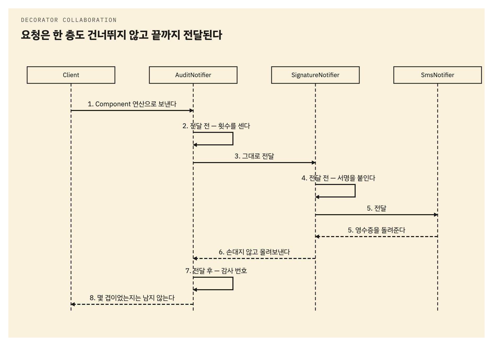
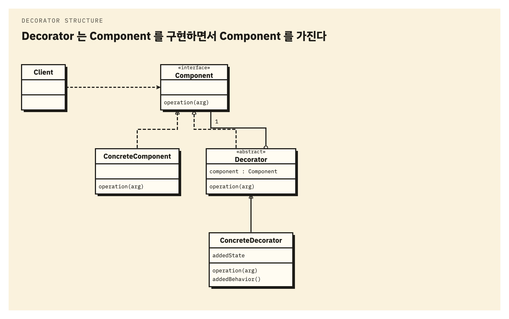

# Decorator — 인터페이스는 그대로 둔 채, 책임만 한 겹씩 더하기

## 한눈에 보는 개요

작은 상점의 알림 발송 코드를 하나 떠올려 봅시다. 주문이 나가면 고객에게 문자 한 통을 보내는 클래스가 있고, 하는 일은 받은 본문을 발송망에 넘기는 것 하나뿐이에요. 그런데 요구가 하나씩 붙습니다. 이번 달부터 모든 알림 끝에 상점 서명이 들어가야 하고, 감사 때문에 보낸 건마다 일련번호가 영수증에 찍혀야 하고, 법무팀은 본문에 긴 숫자가 그대로 나가지 않게 가려 달라고 해요.

문제는 이 셋이 **늘 함께 붙지 않는다**는 데 있습니다. 마케팅 알림에는 서명만, 배송 알림에는 서명과 감사 번호가, 환불 알림에는 셋 다 붙어요. 조합마다 클래스를 만들면 몇 개가 필요한지 세어 봅시다.

```text
책임 3개를 클래스로 굳힐 때 필요한 클래스 수

  켜고 끄는 조합만 세면            2³ = 8개
  붙는 순서도 결과를 바꾼다면       ₃P₀+₃P₁+₃P₂+₃P₃ = 1+3+6+6 = 16개
  책임이 하나 늘어 4개가 되면       조합만 16개, 순서까지 세면 65개
```

순서까지 세야 하는 이유는 이 글의 예시 코드가 실제로 보여 줍니다. 서명에 담당자 전화번호가 들어 있어서, 숫자를 가리는 일을 서명보다 먼저 하느냐 나중에 하느냐로 고객에게 나가는 문자가 달라져요(실행 출력 5번과 6번 줄).

Decorator 의 해법은 **책임 하나를 원래와 똑같은 인터페이스를 가진 층으로 만들어, 대상을 감싸 두는 것**입니다. 층은 자기 일을 한 뒤 안쪽으로 요청을 그대로 넘기고, 안쪽은 자기를 누가 감쌌는지 모릅니다. 조합은 클래스가 아니라 **객체를 조립할 때** 정해져요.

```text
Before : 조합마다 클래스를 만든다

  SmsNotifier
  SignedSmsNotifier                  ← 서명만
  SignedAuditedSmsNotifier           ← 서명 + 감사
  MaskedSignedAuditedSmsNotifier     ← 셋 다
  AuditedSignedSmsNotifier           ← 순서가 다른 같은 셋 … 클래스가 계속 늘어난다

After : 책임 하나가 층 하나가 되고, 조합은 조립할 때 고른다

  new AuditNotifier( new SignatureNotifier( sms ) )              ← 배송 알림
  new SignatureNotifier( new MaskingNotifier( sms ) )            ← 마스킹이 서명까지 덮는 구성
  new MaskingNotifier( new SignatureNotifier( sms ) )            ← 같은 셋, 다른 순서, 다른 결과
                       ↑ 층은 전부 같은 인터페이스라 아무 자리에나 들어간다
```

이 패턴의 이름은 GoF(Gang of Four, 1994년에 나온 *Design Patterns* 의 저자 네 명을 함께 부르는 이름)가 붙인 것이고 다른 이름은 Wrapper 예요(근거: GoF Decorator 절 Also Known As). 분류는 구조 패턴이고, 대상을 감싸는 방식만 쓰므로 객체 범위에만 실립니다. 구조가 거의 같은 이웃이 둘 있어요. Adapter 는 감싼 뒤 다른 인터페이스를 제공하고, Proxy 는 같은 인터페이스를 제공하되 접근을 통제합니다. 셋은 고르는 사이일 뿐 아니라 함께 쓰는 사이이기도 해요 — 어댑터가 맞춰 놓은 연산 모양 위에 데코레이터를 겹치는 구성이 성립합니다. 셋을 가르는 물음과 겹치는 순서는 경계 절에서 코드로 확인해요.

이 글은 시나리오 셋을 따라갑니다. 알림 한 통이 두 겹을 지나 나갔다 돌아오는 길, 새 요구가 들어올 때 무엇이 바뀌고 무엇은 안 바뀌는가, 데코레이터의 규칙을 어기면 어느 단계에서 무엇이 어긋나는가. 끝까지 읽으면 어떤 코드를 Decorator 라고 불러도 되는지 필수 조건 다섯으로 판정할 수 있고, Adapter·Proxy 와도 물음 셋으로 구분할 수 있게 됩니다.

## 패턴 자세히 들여다보기

### 시나리오 1 — 알림 한 통이 두 겹을 지나 나갔다 돌아오는 길

주문 `BOOK-042` 가 발송됐고, 고객에게 알림 한 통이 나가야 합니다. 실제로 보내는 일은 이미 `SmsNotifier` 가 하고 있어요. 이번 건에는 상점 서명이 붙어야 하고, 감사 기록을 위해 영수증 끝에 일련번호도 찍혀야 합니다. 들어가는 값은 발송 데스크가 만든 본문 `order BOOK-042 shipped today` 하나이고, 나와야 하는 값은 실행 출력 2번 줄인 `sent[order BOOK-042 shipped today -- Bbangto Store CS 010-1234-5678]+audit#1` 입니다. 이 장면에는 다섯이 등장해요. 알림을 시키는 `ShipmentDesk`(패턴에서는 Client 라고 부르는 역할), 알림을 보내는 연산 모양 `Notifier`(Component), 실제로 보내는 `SmsNotifier`(ConcreteComponent), 그리고 사이에 놓인 두 층 `AuditNotifier` 와 `SignatureNotifier`(ConcreteDecorator)입니다. 이름은 여기서 한 구절씩만 소개하고 정식 정의는 개념 정리에서 해요.



1. `ShipmentDesk` 가 `Notifier` 의 `send(...)` 를 부릅니다. 발송 데스크가 아는 타입은 `Notifier` 하나뿐이고, 자기가 받은 것이 감싸지 않은 `SmsNotifier` 인지 두 겹이 감긴 물건인지 모릅니다. 모르는 편이 나은 이유는 조합이 자주 바뀌기 때문이에요. 발송 데스크가 층의 개수를 알면 마케팅 알림과 환불 알림마다 발송 데스크 코드가 달라집니다.
2. 바깥 층 `AuditNotifier` 가 **전달하기 전에** 자기 일을 합니다. 받은 횟수를 하나 올려 1 로 만들어요. 이 일을 전달 앞에 두는 이유는 세는 대상이 "요청이 들어왔다"는 사실이기 때문입니다. 뒤로 옮기면 안쪽에서 발송이 실패해 예외가 나갈 때 그 요청은 숫자에 잡히지 않고, 감사 기록에 빠진 부분이 생깁니다.
3. `AuditNotifier` 가 자기가 가지고 있는 `Notifier` 참조로 요청을 **그대로 전달**합니다. 이 참조에 무엇이 들어 있는지는 모릅니다. 필드에 적힌 타입이 `Notifier` 라서 구체 클래스를 물어볼 방법이 없고, 물어볼 필요도 없어요. 실제로 지금 들어 있는 것은 감싸지 않은 발송기가 아니라 또 다른 데코레이터인데, 바깥 층은 이 사실을 끝까지 모릅니다.
4. 안쪽 층 `SignatureNotifier` 도 **전달하기 전에** 자기 일을 합니다. 본문 끝에 서명 `-- Bbangto Store CS 010-1234-5678` 을 이어 붙이고, 그렇게 길어진 본문으로 다시 안쪽에 전달해요. 서명을 전달 앞에 두는 이유는 서명이 고객에게 실제로 나가는 본문 안에 들어 있어야 하기 때문입니다. 뒤로 옮겨 영수증에만 붙이면 기록에는 서명이 보이는데 고객이 받은 문자에는 없습니다.
5. `SmsNotifier` 가 본문을 보관함에 넣고 영수증 `sent[...]` 를 돌려줍니다. 이 층에서 되돌아 나오는 이유는 여기가 유일하게 **남에게 넘길 대상을 가지고 있지 않은** 층이기 때문이에요. 데코레이터들은 전부 다음 층을 필드로 가지고 있지만 이 클래스는 가진 것이 없고, 그래서 요청이 여기서 끝나고 답이 돌아갑니다.
6. 영수증이 `SignatureNotifier` 를 지나 그대로 올라갑니다. 이 층에는 전달 뒤에 할 일이 없어요. 추가 책임이 앞과 뒤 어느 한쪽에만 있어도 되기 때문이고, 비어 있는 뒤쪽을 억지로 채울 이유는 없습니다.
7. `AuditNotifier` 가 **전달한 뒤에** 자기 일을 합니다. 올라온 영수증 끝에 `+audit#1` 을 붙여요. 이 일이 뒤에 있어야 하는 이유는 붙일 대상이 안쪽이 만들어 준 영수증이라서입니다. 전달 앞으로 옮기면 아직 없는 문자열에 이어 붙이는 셈이 됩니다.
8. `ShipmentDesk` 가 영수증 문자열 하나를 결과로 받습니다. 몇 겹을 지났는지, 어느 층이 무엇을 더했는지는 그 문자열 어디에도 타입으로 남아 있지 않아요. 발송 데스크가 보는 것은 `Notifier` 가 약속한 반환 하나입니다.

```text
단계   부르는 쪽 → 받는 쪽            본문                                     영수증
 1     Client → Component(바깥 층)   "order BOOK-042 shipped today"           (8단계에서 받음)
 2     Audit  → (자기 안)             그대로                                    —  횟수 0 → 1
 3     Audit  → 다음 층               그대로                                    —
 4     Sign   → (자기 안)             본문 + " -- Bbangto Store CS 010-1234-5678"
 5     Sign   → SmsNotifier           위의 긴 본문                              "sent[…]"
 6     Sign   → Audit                 —                                        그대로 올려보냄
 7     Audit  → (자기 안)             —                                        "sent[…]" + "+audit#1"
 8     Audit  → Client                —                                        실행 출력 2번 줄
```

잠깐, 확인 하나만 해 볼까요? 3단계에서 `AuditNotifier` 가 가지고 있는 참조의 타입이 `Notifier` 가 아니라 `SmsNotifier` 였다면, 위 표에서 무엇이 달라질까요?

표의 1·2·7·8 단계는 그대로입니다. 사라지는 것은 3단계와 4단계 사이예요. 필드가 `SmsNotifier` 면 그 자리에 `SignatureNotifier` 를 넣을 수 없어서, 감사 층은 발송기를 직접 감싸는 것 말고는 할 수 있는 일이 없습니다. 그러면 층이 하나밖에 못 쌓이고, 이 패턴이 조합을 다루려고 존재하는 이유가 사라져요. 시나리오 3 의 2번 갈래가 이것을 세 언어의 컴파일 오류로 확인합니다.

```text
AuditNotifier 의 참조 필드에 적힌 타입이 정하는 것

  Notifier inner      →  Audit( Signature( Sms ) )   그 자리에 층이 또 들어간다
  SmsNotifier inner   →  Audit( Sms )                발송기 말고는 못 들어간다
```

이 시나리오가 보여 준 것은 **전달이 재귀로 일어난다**는 사실과 **추가 책임이 붙는 자리가 둘**이라는 사실입니다. 바깥 층은 자기가 넘긴 상대가 또 다른 층인지 감싸지 않은 발송기인지 구별하지 못하고(3단계), 그래서 같은 과정이 안쪽 끝까지 되풀이돼요(4·5단계). 책임은 전달 앞(2·4단계)이나 뒤(7단계) 어디에든 붙고, 한쪽은 비어도 됩니다(6단계). 그동안 Client 가 보는 인터페이스는 하나입니다. `Notifier` 뿐이에요(1·8단계).

### 시나리오 2 — 개인정보를 가리라는 요구가 들어올 때

법무팀에서 요구가 내려왔습니다. 알림 본문에 네 자리 이상 이어진 숫자가 그대로 나가면 안 된다는 것이고, 시행일은 다음 주예요. 지금 운영 중인 알림 구성은 여럿이라 전부 한꺼번에 바꿀 수는 없고, 우선 배송 알림부터 적용해야 합니다. 품목 코드 `BOOK-042` 의 `042` 는 세 자리라 그대로 나가야 하고, 서명 안의 `010-1234-5678` 은 `010-****-****` 가 돼야 해요.

1. `MaskingNotifier` 클래스를 하나 새로 씁니다. 구현하는 연산 모양은 시나리오 1 이 쓴 `Notifier` 그대로예요. 여기서 `sendMasked` 같은 새 이름을 만들면 안 되는 이유는, 그 순간 이 클래스가 기존 층들과 겹쳐 쌓일 수 없는 물건이 되기 때문입니다. 층끼리 서로를 받아 주는 것은 셋 다 같은 인터페이스를 구현하고 있어서지 이름이 비슷해서가 아니에요.
2. 조립 코드에서 층 하나를 끼웁니다. 바뀌는 곳은 객체를 엮는 그 줄 하나고, `SmsNotifier`·`SignatureNotifier`·`AuditNotifier`·`ShipmentDesk` 는 한 글자도 안 바뀌어요. 이것이 가능한 이유는 데코레이터가 가지는 참조의 타입이 구체 클래스가 아니라 `Notifier` 이기 때문입니다. 그 자리는 `Notifier` 를 구현한 무엇이든 받으므로 새 층이 끼어들 틈이 이미 있어요.
3. **어느 자리에 끼우느냐로 고객이 받는 문자가 달라집니다.** 서명 층을 바깥에 두면(`SignatureNotifier(MaskingNotifier(sms))`) 서명이 먼저 붙고 그 결과가 마스킹 층을 지나므로 서명 속 전화번호까지 가려집니다. 마스킹 층을 바깥에 두면(`MaskingNotifier(SignatureNotifier(sms))`) 마스킹이 먼저 끝난 뒤에 서명이 붙으므로 전화번호가 그대로 나가요. 두 결과가 실행 출력 5번과 6번 줄입니다. 왜 이렇게 되는지는 시나리오 1 의 2·4단계에 이미 나와 있어요. 바깥 층의 전 처리는 **안쪽 층이 아직 더하지 않은 본문**에만 적용됩니다.
4. 같은 층을 두 번 겹칠 수도 있습니다. `SignatureNotifier(SignatureNotifier(sms))` 는 서명이 두 번 붙은 본문을 내보내고(실행 출력 7번 줄), 이것도 컴파일되고 돌아가요. 되는 이유는 3단계와 같습니다. 참조 타입이 추상이라 데코레이터는 자기와 같은 종류도 받아요. 만약 서명을 상속으로 붙였다면 같은 기능을 두 번 켤 방법 자체가 없습니다. 클래스는 한 번만 상속되니까요.

```text
같은 재료, 다른 순서 — 실행 출력 5·6번 줄

  SignatureNotifier( MaskingNotifier( sms ) )
    서명 붙임 → 마스킹 → 발송      ⇒  … CS 010-****-****      서명의 번호까지 가려짐
  MaskingNotifier( SignatureNotifier( sms ) )
    마스킹 → 서명 붙임 → 발송      ⇒  … CS 010-1234-5678      서명의 번호는 안 가려짐
                                        ↑ 마스킹이 지나갈 때 이 글자들은 아직 없었다
```

| 변화 | 바뀐 곳 | 안 바뀐 곳 |
| --- | --- | --- |
| 마스킹 요구가 들어옴 | `MaskingNotifier` (새 클래스 하나) | `Notifier` 의 연산 모양 |
| | 층을 엮는 조립 코드 한 줄 | `SmsNotifier` · `SignatureNotifier` · `AuditNotifier` |
| | | `ShipmentDesk` 전체 |

여기서 헷갈리기 쉬운 포인트는 **층을 쌓는 순서가 아무래도 좋다**고 믿는 것입니다. 앞의 5·6번 줄이 보여 주듯 순서는 결과를 바꿔요. 그리고 이것은 구현을 잘못해서 생긴 사고가 아니라 이 패턴을 쓰면 따라오는 성질입니다. 층마다 자기 일을 하는 시점이 전달의 앞뒤로 나뉘는 이상, 어떤 층은 다른 층이 만든 결과 위에서 일하고 어떤 층은 그 전에 일해요. 그래서 조립 코드는 "무엇을 켤 것인가" 뿐 아니라 "어떤 순서로 켤 것인가"까지 정하는 자리가 되고, 그 줄은 아무 데나 흩어 두면 안 되는 줄이 됩니다([refactoring.guru — Decorator](https://refactoring.guru/design-patterns/decorator) 도 순서에 의존하지 않게 데코레이터를 짜기가 어렵다는 점을 이 패턴의 단점으로 듭니다).

이 시나리오가 보여 준 것은 변화의 범위와 그 대가입니다. 책임이 하나 늘 때 바뀌는 곳은 새 클래스 하나와 조립 코드 한 줄이고, 기존 층과 Client 는 그대로예요(1·2단계). 참조 타입이 추상이라는 한 가지 덕분에 새 층을 아무 자리에나 끼워 넣을 수 있고, 같은 층을 두 번 겹칠 수도 있습니다(2·4단계). 대신 대가가 있습니다. 조합의 **순서**가 뜻을 갖게 되고, 그 뜻을 아는 코드는 조립하는 곳 한 군데로 모여요(3단계).

### 시나리오 3 — 데코레이터의 규칙을 어기면 어느 단계에서 무엇이 어긋나는가

같은 알림 코드를 네 사람이 각자 다르게 손봅니다. 한 사람은 조합을 클래스로 굳히려 하고, 한 사람은 참조 필드에 구체 타입을 적고, 한 사람은 가릴 것이 있으면 아예 안 보내게 고치고, 한 사람은 발송기별 설정을 맵에 담아 관리해요. 넷을 차례로 따라가되, 두 번째 수정에는 진단을 읽는 단계를 하나 더 붙입니다. 언어마다 컴파일러가 막아 주는 정도가 다르거든요. 그래서 갈래는 다섯이에요. 아래 진단은 `javac 21.0.11` · `tsc 5.9.3` · `rustc 1.95.0` 으로 실제로 컴파일해 받은 것이고, 옮기면서 무엇을 지웠는지는 각 줄에 적었습니다.

1. 첫 사람이 조합을 클래스 이름으로 굳힙니다. `SignedAuditedSmsNotifier extends SmsNotifier` 를 만들고 그 안에서 서명과 감사 번호를 함께 처리해요. 지금 당장은 돌아갑니다. 문제가 생기는 지점은 두 번째 조합이 필요해질 때인데, 개요에서 센 것처럼 책임 셋이면 순서를 따져 클래스가 열여섯 개까지 갈 수 있어요. 그리고 개수보다 무거운 문제가 따로 있습니다. 상속으로 붙인 책임은 **런타임에 뗄 수 없어요**. 같은 객체를 두고 이번 발송에만 감사 번호를 빼는 일이 불가능하고, 시나리오 2 의 4단계처럼 같은 책임을 두 번 붙이는 것도 안 됩니다.
2. 둘째 사람이 `SignatureNotifier` 의 참조 필드를 `Notifier` 대신 `SmsNotifier` 로 적습니다. 지금 들어가는 것이 발송기니까 정확하게 적자는 생각이었어요. 그다음 `SignatureNotifier(AuditNotifier(sms))` 처럼 층을 겹치려는 순간 세 언어가 모두 막습니다.

```text
javac 21.0.11  (파일명·줄 번호 앞머리 `Bad.java:22: ` 와 캐럿 표시 줄,
                그리고 "Note: Some messages have been simplified" 안내 줄을 지운 것 외에는 원문 그대로)
error: incompatible types: AuditNotifier cannot be converted to SmsNotifier

tsc 5.9.3      (파일명·줄·칸 앞머리 `bad2.ts(19,49): ` 를 지운 것 외에는 두 줄 모두 원문 그대로)
error TS2345: Argument of type 'AuditNotifier' is not assignable to parameter of type 'SmsNotifier'.
  Property 'outbox' is missing in type 'AuditNotifier' but required in type 'SmsNotifier'.

rustc 1.95.0   (머리 줄과 note 두 줄만 옮겼고 `--> 파일:줄:칸` 위치 줄과 밑줄 표시 줄은 지웠습니다)
error[E0308]: mismatched types
   = note: expected reference `&SmsNotifier`
              found reference `&AuditNotifier<'_>`
```

3. TypeScript 의 진단에는 눈여겨볼 단서가 하나 있습니다. 타입 이름이 아니라 `outbox` 라는 **필드 이름**을 근거로 거절했다는 점이에요. TypeScript 는 이름이 아니라 멤버 모양으로 타입을 견주기 때문인데([TypeScript Handbook — Type Compatibility](https://www.typescriptlang.org/docs/handbook/type-compatibility.html)), 여기서는 `SmsNotifier` 에 private 필드가 있어서 다른 클래스와 모양이 달랐습니다. 뒤집으면 `SmsNotifier` 에 고유한 상태가 없었다면 `AuditNotifier` 도 모양이 맞아 **그대로 통과한다**는 뜻이고, 실제로 그렇게 고쳐 컴파일해 보니 `tsc` 가 종료 코드 0 으로 끝났습니다(직접 확인). 그래서 TypeScript 에서는 이 검사가 약해요. 필드 타입을 구체 클래스로 적는 실수를 컴파일러가 늘 잡아 주리라고 기대하면 안 됩니다.
4. 셋째 사람이 마스킹 층을 고칩니다. 가릴 것이 있으면 위험하니 아예 보내지 말자며, 숫자가 걸리면 안쪽으로 전달하지 않고 `"blocked"` 를 돌려주게 해요. 이 갈래는 컴파일도 되고 실행도 됩니다. 어긋나는 것은 바깥 층의 기록이에요. `AuditNotifier` 는 시나리오 1 의 2단계에서 이미 횟수를 올렸고 7단계에서 `+audit#n` 을 붙이므로, 발송되지 않은 건이 감사 기록에는 발송된 것처럼 남습니다. 더 근본적으로는 이 층이 더 이상 데코레이터가 아니에요. 요청을 받아 넘길지 말지 스스로 정하는 층은 Chain of Responsibility 가 다루는 물건이고, 그쪽에서는 전달을 멈추는 것이 정상 동작입니다.
5. 넷째 사람이 발송기마다 다른 설정을 `Map<Notifier, Config>` 에 담습니다. 감싸지 않은 발송기를 키로 넣어 두고, 나중에 장식된 객체로 설정을 찾으려 해요. 못 찾습니다. 장식된 객체는 감싼 대상과 **같은 객체가 아니기** 때문이고, 실행 출력 8번 줄이 그 사실을 그대로 찍어요. 이 갈래가 앞의 셋과 다른 점은 잘못이 데코레이터 쪽에 없다는 것입니다. 투명한 외피를 씌우고도 원본과 같은 신원을 유지하는 방법은 없고, 그래서 이 제약은 고칠 대상이 아니라 알아 둘 대상이에요.

```text
같은 코드, 막는 곳이 다르다

  2번 갈래(구체 타입 필드)   → 세 언어 모두 컴파일이 막는다   … 단, TypeScript 는 조건부(3번 갈래)
  4번 갈래(전달을 끊음)      → 아무도 안 막는다. 기록만 조용히 어긋난다
  5번 갈래(동일성에 기댐)    → 아무도 안 막는다. 맵이 못 찾을 뿐이다
```

이 시나리오가 보여 준 것은 규칙 넷을 어길 때 나타나는 결과의 차이입니다. 조합을 클래스로 굳히면(1번 갈래) 당장은 돌아가지만 조합이 늘 때마다 클래스가 늘고, 무엇보다 런타임에 뗄 수 없게 돼요. 참조 필드에 구체 타입을 적으면 겹쳐 쌓기가 컴파일에서 막히는데(2번 갈래), 컴파일러가 막아 주는 정도는 언어마다 다릅니다(3번 갈래). 전달을 끊거나(4번 갈래) 객체 동일성에 기대면(5번 갈래) **아무 도구도 잡아 주지 않아요**. 컴파일러가 잡는 규칙과 사람이 지켜야 하는 규칙을 구분해 두는 것이 이 시나리오의 소득입니다.

### 개념 정리

시나리오에 나온 역할 다섯을 정식으로 정의합니다. 앞의 넷은 GoF 가 이 패턴의 참여자로 적은 역할이고, Client 는 예시에 등장하므로 함께 답니다(근거: GoF Decorator 절 Participants·Collaborations).

- **Component** — 장식되는 쪽과 장식하는 쪽이 **함께 구현하는** 연산 모양입니다. 이 인터페이스가 이 패턴의 축약된 계약이에요. Client 는 이것만 보고, 데코레이터는 이것을 구현하면서 동시에 이것을 필드로 가집니다. 구현하는 타입과 필드의 타입이 같기 때문에 층이 층을 감쌀 수 있어요. 알림 예에서는 `send(body)` 하나를 선언한 `Notifier` 가 Component 입니다.
- **ConcreteComponent** — 장식이 붙기 전의 알맹이입니다. 이 패턴에서 유일하게 **다음 층을 가지고 있지 않은** 구현체이고, 그래서 요청이 여기서 멈추고 답이 되돌아갑니다(시나리오 1 의 5단계). 알림 예에서는 본문을 보관함에 넣고 영수증을 돌려주는 `SmsNotifier` 예요.
- **Decorator** — Component 를 구현하면서 Component 참조를 하나 가지고, 받은 요청을 그 참조로 넘기는 역할입니다. 넘기는 일만 하고 더하는 일은 하지 않아요. 구체 데코레이터들이 되풀이해 쓰는 전달 코드를 한 곳에 모아 두는 자리라, 책임이 하나뿐이면 두지 않아도 됩니다. 알림 예에서는 `NotifierDecorator` 가 이 역할이고, 그 안의 전달 한 줄이 시나리오 1 의 6단계에서 영수증을 손대지 않고 올려보낸 코드예요.
- **ConcreteDecorator** — 전달의 앞이나 뒤에 실제 책임을 더하는 쪽입니다. 앞에만 더해도 되고 뒤에만 더해도 되며(시나리오 1 의 4·6·7단계), Component 에 없는 연산이나 상태를 자기 것으로 가질 수도 있어요. 알림 예에서는 서명을 붙이는 `SignatureNotifier`, 숫자를 가리는 `MaskingNotifier`, 횟수를 세고 영수증에 번호를 붙이는 `AuditNotifier` 셋입니다.
- **Client** — Component 타입으로만 대상을 받아 쓰는 쪽입니다. 몇 겹이 감겨 있는지, 어떤 순서로 감겨 있는지 모르고, 알 필요도 없어요(시나리오 1 의 1·8단계). 알림 예에서는 본문을 만들어 `send` 를 부르는 `ShipmentDesk` 가 Client 입니다. 조합을 고르는 일은 이 역할이 아니라 **객체를 엮는 조립 코드**가 맡아요. 뒤의 비교 절에서 「조합을 Client 가 고른다」고 할 때의 Client 는 패턴 바깥에서 층을 엮어 쓰는 쪽을 넓게 가리키는 말이고, 이 예시에서는 `main` 의 조립 코드가 그 자리입니다.



그림에서 `Decorator` 칸으로 들어가고 나가는 선을 봐 두세요. 위로는 `Component` 를 구현한다는 선이 있고, 옆으로는 `Component` 를 하나 갖는다는 선이 있습니다. 한 칸이 같은 타입과 이 두 관계를 함께 맺는다는 것이 이 패턴의 모양이고, 그래서 데코레이터가 데코레이터를 감싸도 타입이 맞아요. `ConcreteDecorator` 칸 안의 `addedBehavior()` 는 Component 에 없는 추가 연산인데, 이것을 두어도 되는지는 최소 조건 6번에서 다룹니다.

> 감싼 뒤에도 인터페이스가 같으면, 감싼 것을 다시 감쌀 수 있다.

## 사용 목적

Decorator 가 필요하다는 단서는 클래스 이름과 설정 코드에서 먼저 보입니다. 셋을 차례로 봅시다.

**단서 1. 클래스 이름이 책임을 이어 붙인 꼴로 자라고 있습니다.** `BufferedEncryptedFileStream` 이나 `SignedAuditedSmsNotifier` 처럼 형용사가 쌓인 이름이 저장소에 생기기 시작하면, 조합을 타입으로 굳히고 있다는 신호예요. 개요에서 센 것처럼 책임 셋이면 순서를 따져 클래스가 열여섯 개까지 가고 넷이면 예순다섯 개까지 갑니다. 이름으로 검색되는 단서라 가장 알아보기 쉬워요.

```text
클래스 이름에서 형용사를 떼어 보면
────────────────────────────────────────────────────────
SignedSmsNotifier                Signed
SignedAuditedSmsNotifier         Signed + Audited
MaskedSignedSmsNotifier          Masked + Signed
AuditedMaskedSmsNotifier         Audited + Masked      ← 순서만 다른 같은 둘
   떼어 낸 형용사 하나하나가 층 하나가 될 후보다
```

**단서 2. 같은 인터페이스 위에 더하고 싶은 것이 여럿이고, 켜고 끄는 조합이 대상마다 다릅니다.** 로깅·재시도·캐싱·계측·마스킹처럼 본래 일과 나란히 붙는 것들이에요. 이 단서가 중요한 이유는 조합이 **대상마다 다르다**는 조건에 있습니다. 모든 대상에 늘 같은 셋이 붙는다면 그냥 한 클래스 안에서 처리하는 편이 간단하고, 층을 나눠도 얻는 것이 없어요. 배송 알림에는 둘, 환불 알림에는 셋이 붙는 시나리오 2 의 상황이 이 단서입니다.

**단서 3. 붙였다 뗄 수 있어야 하거나, 서브클래싱할 수 없습니다.** 어떤 계정만 잠시 상세 로깅을 켜야 한다면 그 책임은 런타임에 붙고 떨어져야 하고, 상속으로는 안 돼요(근거: GoF Decorator 절 Intent — 이 패턴이 겨냥하는 것이 책임을 **동적으로** 덧붙이는 일이고, 확장 수단으로서 서브클래싱의 대안이라는 점입니다). 대상 클래스가 `final` 이거나 라이브러리가 감춰 둔 타입이면 아예 상속이 막혀 있기도 합니다. 아래 표는 세 단서를 코드에서 무엇을 보면 되는지로 정리한 것이에요.

| 단서 | 코드에서 관찰되는 것 | 확인 방법 |
| --- | --- | --- |
| 1. 조합형 클래스 이름 | 형용사가 둘 이상 붙은 구현 클래스가 여럿 | 클래스 이름에서 공통 접미사를 뗀 나머지를 세어 봄 |
| 2. 대상마다 다른 조합 | 같은 인터페이스를 쓰는 지점마다 켜는 것이 다름 | 설정 파일이나 조립 코드에서 분기 개수를 셈 |
| 3. 런타임 착탈·상속 불가 | 기능을 켜고 끄는 플래그가 구현체 안에 박혀 있거나, 대상 클래스가 `final` | 플래그 이름으로 검색하거나 상속 가능 여부를 확인 |

비슷한 단서에서 다른 패턴을 고르게 되는 경우가 셋 있습니다. 감싼 뒤 제공하는 인터페이스가 달라지면 Adapter 를, 끼어드는 목적이 접근 통제면 Proxy 를, 바꿔야 하는 것이 겉이 아니라 안에서 실행되는 알고리즘이면 Strategy 를 먼저 검토하세요. 차이는 다음 절에서 풉니다. 그리고 아래 상황에서는 층을 쌓으면 얻는 것보다 잃는 것이 큽니다.

| 쓰지 말아야 할 상황 | 쓰면 잃는 것 |
| --- | --- |
| 코드가 객체 동일성에 기대고 있음(참조 비교, 객체를 키로 쓰는 맵) | 장식한 객체로는 원본을 찾지 못합니다. 시나리오 3 의 5번 갈래가 그 상태이고, 이 제약은 구현으로 우회할 수 없어요 |
| Component 인터페이스에 연산이 많음 | 데코레이터마다 전달 메서드를 전부 써야 하고, 하나를 빠뜨리면 그 연산만 장식을 건너뛰는 상태가 됩니다. 컴파일러가 추상 클래스로 잡아 주지 않는 언어에서는 조용히 지나가요 |
| 스택 가운데의 한 겹만 떼어 내야 함 | 층은 바깥에서 안으로 한 방향으로만 엮여 있어 가운데를 빼려면 전체를 다시 조립해야 합니다([refactoring.guru — Decorator](https://refactoring.guru/design-patterns/decorator)) |
| 바꿔야 하는 것이 대상 안에서 실행되는 알고리즘 | 겉을 감싸는 것으로는 대상이 내부에서 고르는 계산을 바꿀 수 없습니다. 그 자리는 Strategy 가 맡아요 |

## 패턴의 경계

### 디자인 패턴을 충족하는 최소 조건

어떤 코드를 Decorator 라고 불러도 되는지 가르는 기준입니다. `[필수]` 가 하나라도 빠지면 Decorator 가 아니고, `[선택]` 은 갖추면 좋거나 상황에 따라 고르는 구조예요. 조건은 언어와 상관없이 코드에서 확인할 수 있는 모양(타입 선언·참조 보유·호출 방향·생성 위치)으로 적었고, 조건마다 그것을 보여 준 시나리오의 단계를 가리킵니다.

1. [필수] 감싼 결과가 Component 인터페이스를 **빠짐없이** 제공합니다 — 데코레이터가 Component 를 구현하고, Component 가 선언한 연산 가운데 하나도 빠지지 않으며, Client 는 장식 여부를 모른 채 Component 타입으로만 씁니다. 시나리오 1 의 1·8단계가 그 모양이에요 (근거: GoF Decorator 절 Participants — Decorator 는 Component 의 인터페이스를 따르는 인터페이스를 정의한다 / Related Patterns — 데코레이터는 객체의 책임만 바꾸고 인터페이스는 바꾸지 않는다).
   - 빠지면: 제공하는 연산이 대상의 것과 달라지면 그것은 변환이고 Adapter 입니다. 특히 **빼는 쪽**을 조심하세요. 연산 하나를 감춰 버리면 그 대상 자리에 더 이상 들어갈 수 없어 겹쳐 쌓기가 그 자리에서 끝납니다. 반대로 연산을 **더하는** 것은 이 조건을 어기지 않습니다(조건 6번).
2. [필수] Component 참조를 하나 가지고 있고, 그 참조의 타입이 구체 클래스가 아니라 **Component 자체**입니다 — 필드에 적힌 타입이 추상이라 그 자리에 또 다른 데코레이터가 들어갑니다. 시나리오 2 의 2단계가 그래서 조립 코드 한 줄만 고쳐 끝났고, 시나리오 3 의 2번 갈래가 이 조건을 어긴 자리예요 (근거: GoF Decorator 절 Participants — Decorator 는 Component 객체에 대한 참조를 유지한다 / GoF Discussion of Structural Patterns — 객체의 전체 기능을 컴파일 시점에 정할 수 없는 상황을 다루므로 재귀 합성이 이 패턴의 전제다).
   - 빠지면: 필드 타입이 `SmsNotifier` 면 다른 데코레이터를 그 자리에 넣을 수 없습니다. 세 언어 모두 컴파일이 막고, 층은 한 겹에서 끝나요.
3. [필수] 받은 요청을 그 참조로 **전달**하며, 추가 책임은 전달의 앞이나 뒤에 붙습니다 — 어떤 호출도 대상에 전달되지 않고 끝나는 일이 없습니다. 시나리오 1 의 2~7단계가 그 왕복이고, 실행 출력 4번 줄의 `sms deliveries 3` 이 세 번의 요청이 모두 안쪽 끝까지 전달됐다는 기록이에요 (근거: GoF Decorator 절 Collaborations — Decorator 는 요청을 자기가 참조하는 Component 객체에 전달하고, 전달 전후에 추가 연산을 선택적으로 수행한다).
   - 빠지면: 조건을 보고 전달을 멈추는 층은 Chain of Responsibility 쪽입니다. 시나리오 3 의 4번 갈래가 그 모양이고, 바깥 층이 이미 한 일과 안쪽에서 일어나지 않은 일이 어긋납니다. 덧붙이면, 원전은 전달이 일어난다는 것까지 적고 「끊지 않는다」를 따로 명시하지는 않아요. 이 조건을 절대형으로 읽는 근거는 [refactoring.guru — Decorator](https://refactoring.guru/design-patterns/decorator) 가 데코레이터에게는 요청 흐름을 끊을 권한이 없다고 적은 자리에서 왔습니다.
4. [필수] 감쌀 대상을 데코레이터가 **밖에서 받습니다** — 대상을 자기 안에서 만들지 않고 생성자나 설정 메서드로 받으므로, 무엇을 어떤 순서로 감쌀지 정하는 곳이 데코레이터 바깥에 있습니다. 시나리오 2 의 2·3단계에서 조립 코드가 순서를 정한 자리예요 (근거: GoF Decorator 절 Intent — 책임을 객체에 **동적으로** 덧붙인다 / Consequences — 정적 상속보다 유연해 실행 중에 책임을 붙였다 뗐다 할 수 있고 같은 속성을 두 번 붙일 수도 있다).
   - 빠지면: 데코레이터가 대상을 스스로 만들어 가지고 있으면 조합을 고르는 권한이 그 안으로 들어갑니다. 대상의 생성과 수명을 래퍼가 관리하는 것은 Proxy 쪽 성질이에요.
5. [필수] 장식된 객체는 감싼 대상과 **같은 객체가 아니며**, Client 코드가 그 동일성에 기대지 않습니다 — 참조 비교가 거짓이고, 대상을 키로 찾는 맵이나 `==` 검사에 장식된 객체가 끼어들지 않습니다. 시나리오 3 의 5번 갈래와 실행 출력 8번 줄이 그 자리예요 (근거: GoF Decorator 절 Consequences — 데코레이터는 투명한 외피이지만 컴포넌트와 동일한 객체는 아니므로 객체 동일성에 의존해서는 안 된다).
   - 빠지면: 장식하기 전의 객체로 등록한 설정·잠금·구독을 장식한 객체가 찾지 못합니다. 타입은 맞고 컴파일도 통과하므로 실행 중에야 나타나요.
6. [선택] ConcreteDecorator 가 Component 에 없는 공개 연산이나 상태를 **더합니다** — 조건 1번이 막는 것은 연산을 빼거나 바꾸는 일이지 더하는 일이 아니에요. 다만 **Client 가 그 연산을 부르는 순간 조건 1번의 뒷부분**(Client 가 Component 타입으로만 쓴다)이 성립하지 않습니다. 알림 예의 `AuditNotifier` 가 `count()` 를 갖는 것이 이 경우인데, 그것을 부르는 쪽은 Client 인 `ShipmentDesk` 가 아니라 층을 엮는 조립 코드예요. 실행 출력 4번 줄의 `audit count 2` 가 그 결과이고, 시나리오 1 의 2단계에서 센 숫자를 밖에서 읽으려면 이 연산이 필요합니다 (근거: 이 가이드의 결정 — 아래 「추가 연산을 두어도 되는가」 참고).
7. [선택] 전달만 하는 추상 Decorator 클래스를 따로 둡니다 — 구체 데코레이터가 여럿이면 전달 코드를 한 곳에 모으고, 책임이 하나뿐이면 두지 않아도 됩니다. 시나리오 1 의 6단계에서 영수증을 그대로 올려보낸 코드가 이 클래스에 있어요 (근거: GoF Decorator 절 Implementation — 책임을 하나만 붙이는 경우에는 추상 Decorator 클래스를 생략할 수 있다).
8. [선택] 같은 종류의 데코레이터를 두 번 이상 겹칩니다 — 참조 타입이 추상이라 데코레이터는 자기와 같은 종류도 받습니다. 시나리오 2 의 4단계와 실행 출력 7번 줄이 그 모양이에요 (근거: GoF Decorator 절 Consequences — 같은 속성을 두 번 덧붙이는 구성이 가능하다는 점을 정적 상속과 대비해 적고 있다).
9. [선택] 런타임에 층을 붙였다 떼는 API(Application Programming Interface, 바깥에서 부르라고 열어 둔 연산 묶음)를 둡니다 — 조립을 한 번만 하지 않고 운영 중에 바꿉니다. 시나리오 2 의 2단계에서 조립 코드가 하는 일을 실행 중에 하는 것이고, 이 가이드의 예시 코드는 조립을 시작할 때 한 번만 해서 이 항목을 쓰지 않았습니다.

**추가 연산을 두어도 되는가.** 조건 6번은 판정이 달라질 수 있는 자리라 근거를 따로 적습니다. GoF 는 관련 패턴을 견주는 대목에서 데코레이터가 객체의 책임을 바꾸지 인터페이스를 바꾸지는 않는다고 적어요. 이 문장의 상대는 Adapter 입니다. Adapter 는 감싼 대상 자리에 다른 인터페이스를 갖다 놓아서 원래 Client 가 못 쓰게 되고, Decorator 는 그렇지 않다는 대비예요. 그러니까 이 문장이 금지하는 것은 인터페이스를 **갈아 끼우는 일**이지 그 위에 하나를 더하는 일이 아닙니다. 실제로 refactoring.guru 는 데코레이터를 거쳐 접근하는 인터페이스가 같거나 확장된다고 적고 있고요([refactoring.guru — Decorator](https://refactoring.guru/design-patterns/decorator)).

```text
그 문장이 금지하는 것과 금지하지 않는 것

  Component 를 다른 인터페이스로 갈아 끼운다   → 금지. 그건 Adapter 다
  Component 위에 연산을 하나 추가한다          → 금지 아님. 선언된 연산은 그대로 남는다
```

코드에서 차이가 나는 지점도 같은 쪽을 가리킵니다. 연산을 **빼면** 장식된 객체를 Component 자리에 넣지 못하므로 조건 1번이 곧바로 성립하지 않아요. 연산을 **더하면** Component 가 선언한 것은 전부 그대로 있으므로 아무 자리에도 못 들어가는 일이 생기지 않습니다. 선언된 타입만 보면 더한 쪽은 여전히 Component 이고, 빼는 일은 애초에 타입 수준에서 불가능해요.

다만 비용이 없지는 않습니다. 추가 연산을 쓰려는 Client 는 그 데코레이터의 **구체 타입**을 알아야 하고, 그 순간 조건 2번이 주는 이득에서 빠져요. 알림 예가 그렇습니다. `audited.count()` 를 부르려면 `AuditNotifier` 타입 변수가 필요하고, 그래서 그 변수는 감사 층을 다시 무언가로 감싸는 순간 쓸모가 없어집니다. 바깥 층이 제공하는 것은 `Notifier` 뿐이니까요.

```text
추가 연산이 있는 층을 다시 감싸면

  AuditNotifier audited = new AuditNotifier(sms);
  audited.count()                                  ← 부를 수 있다
  Notifier outer = new SignatureNotifier(audited);
  outer.count()                                    ← 없다. 바깥이 제공하는 인터페이스는 Notifier 뿐
```

그래서 이 가이드는 추가 연산을 **허용하되 필수가 아닌 것**으로 둡니다. 감사·계측처럼 바깥에서 읽어야 하는 값이 있으면 두되, 그 층은 스택의 맨 바깥에 놓거나 값을 따로 모으는 객체에 넘기는 편이 낫다는 것까지가 이 조건의 내용이에요.

정리하면 이 자리에서 잣대는 둘로 나뉩니다. **어떤 패턴인지는 선언된 타입으로 판정하고, 대상 자리에 그대로 넣을 수 있는지는 Client 가 무엇에 기대는가로 가릅니다.** 앞엣것이 조건 1번의 앞부분이고 뒤엣것이 뒷부분이에요. 보호 프록시가 실행 중에 요청을 거부해도 물음 1 의 판정이 달라지지 않는 것도 같은 이유입니다 — 거부는 선언된 타입에서 연산을 빼지 않으니까요.

```text
잣대 둘

  어떤 패턴인가          ← 선언된 타입으로 판정            (조건 1번 앞부분)
  그 자리에 넣어도 되나   ← Client 가 무엇에 기대는가       (조건 1번 뒷부분)
```

조건 1번이 맨 앞인 데는 이유가 있습니다. Adapter·Proxy 와 구분하는 첫 물음이 여기이기 때문이에요. 아래 표로 판정 순서를 봅시다.

| 코드 | 1번 | 2번 | 3번 | 4번 | 5번 | 판정 |
| --- | --- | --- | --- | --- | --- | --- |
| `SignatureNotifier`(같은 `Notifier` 를 감싸 본문에 서명을 더함) | 만족 | 만족 | 만족 | 만족 | 만족 | Decorator |
| `AuditNotifier`(같은 인터페이스 + `count()` 추가) | 만족 (빼지 않고 더했음 · Client 가 `count()` 에 기대지 않는 한) | 만족 | 만족 | 만족 | 만족 | Decorator |
| 발송망 SDK(Software Development Kit, 외부 회사가 주는 개발 도구 묶음)를 감싸 `Notifier` 를 제공하는 클래스 | 빠짐 (감싼 것과 인터페이스가 다름) | 만족 | 만족 | 만족 | 만족 | Decorator 아님 — Adapter |
| 권한이 없으면 발송을 거부하는 래퍼 | 만족 | 만족 | **빠짐** (대상에 전달되지 않는 호출이 생김) | 만족 | 만족 | Decorator 아님 — Proxy |
| `SignedAuditedSmsNotifier extends SmsNotifier` | 만족 | 빠짐 (참조가 없음) | 빠짐 | 빠짐 | 빠짐 | Decorator 아님 — 정적 상속 |
| 조건에 따라 전달을 멈추는 층 | 만족 | 만족 | 빠짐 | 만족 | 만족 | Decorator 아님 — Chain of Responsibility 쪽 |

표의 두 번째 줄이 조건 6번이 다루는 경우입니다. 겉보기에는 인터페이스가 하나 늘어난 것처럼 보이지만 `Notifier` 가 선언한 `send` 는 그대로 있고, 그래서 이 객체는 여전히 `Notifier` 를 받는 모든 자리에 들어갑니다. 네 번째 줄과 대비해 보면 차이가 분명해요. 거부하는 래퍼도 `send` 를 갖고 있지만 그 `send` 를 거쳐도 대상에 전달되지 않는 호출이 생기고, 그것이 3번에서 걸립니다.

> 감쌌다는 사실은 셋 모두에 있다. 다른 것은 감싼 뒤에 제공하는 인터페이스와, 끼어드는 목적이다.

### 비슷한 패턴·안티패턴과의 차이

Decorator 와 구조가 닮았거나 같은 단서에서 떠오르는 대상 여섯을 비교합니다. Adapter·Proxy 는 Decorator 와 구조가 거의 같아 셋을 함께 가르는 기준을 먼저 세우고, 그다음 Composite·Strategy·Chain of Responsibility, 마지막으로 상속으로 기능을 더하는 방식을 봅니다.

| 비교 대상 | 구분 기준 (코드에서 보는 것) | Decorator 를 고르면 얻는 것 | 포기하는 것 |
| --- | --- | --- | --- |
| Adapter | 감싼 결과가 제공하는 인터페이스가 감싼 대상과 **같은가** — 다르면 Adapter | 감싼 것을 다시 감쌀 수 있는 재귀 합성. 조합을 조립 코드가 고름(시나리오 2 의 2단계) | 어휘가 맞지 않는 두 쪽을 잇는 일. 데코레이터는 인터페이스를 바꾸지 않으므로 애초에 맞는 두 쪽 사이에만 놓일 수 있음 |
| Proxy | 인터페이스가 같으면서 끼어드는 목적이 **책임 추가**인가 접근 통제인가 | 모든 호출이 대상에 전달된다는 보장. 층을 몇 겹이든 쌓아도 대상이 하는 일은 그대로 | 대상의 생성·수명·접근을 관리하는 일. 데코레이터는 이미 만들어진 대상을 밖에서 받음(최소 조건 4번) |
| Composite | 참조가 **여럿(자식 집합)** 인가 하나인가, 목적이 집계인가 책임 추가인가 | 한 대상에 책임을 겹겹이 쌓는 구성 | 여러 대상을 하나처럼 다루는 집계. 데코레이터는 한 대상만 감쌈 |
| Strategy | 바꾸는 것이 대상의 **겉**인가 대상 안에서 실행되는 **계산**인가 | 대상 코드를 건드리지 않고 밖에서 기능을 더함 | 대상 안의 알고리즘을 갈아 끼우는 일. 데코레이터는 대상이 내부에서 무엇을 계산하는지 모름 |
| Chain of Responsibility | 층이 전달을 **멈출 수 있는가** | 요청이 반드시 끝까지 전달되고, 층의 순서가 결과를 정함 | 어느 층에서 처리를 끝내는 흐름. 데코레이터는 멈출 권한이 없음(최소 조건 3번) |
| 상속으로 기능 더하기 | 기능이 **클래스 정의**에 붙는가 실행 중의 **객체**에 붙는가 | 조합과 순서를 런타임에 고르고, 같은 책임을 두 번 붙일 수도 있음 | 층이 없는 단순함. 객체 수와 조립 코드가 늘고 디버깅할 때 스택이 깊어짐 |

**Adapter·Proxy 와 구분하는 물음 셋.** 이 셋은 대상을 감싸 같은 요청을 넘긴다는 구조가 거의 같아서, 구조만 보면 구분되지 않습니다. 아래 물음 셋을 순서대로 적용하세요. 물음 1 에서 구분되면 거기서 끝이고, 구분되지 않으면 물음 2 로 내려갑니다. 물음 3 은 물음 2 의 판정을 코드에서 다시 확인하는 보조 물음이에요.

```text
물음 1 — 감싼 결과가 제공하는 인터페이스가 대상의 것과 같은가?
       │
       ├─ 다르다 ───────────────────────────────▶ Adapter
       │     (근거: GoF Adapter 절 Intent / GoF Decorator 절 Related Patterns /
       │            GoF Proxy 절 Related Patterns — Adapter 는 감싼 객체에 다른 인터페이스를 준다)
       │
       └─ 같다 ──▶ 물음 2 — 끼어드는 목적이 무엇인가?
                     │
                     ├─ 책임을 더한다 (전달 전후에 연산을 수행) ──▶ Decorator
                     │     (근거: GoF Decorator 절 Intent — 객체에 책임을 동적으로 덧붙인다 /
                     │            GoF Proxy 절 Related Patterns — 데코레이터는 책임을 더하고 프록시는 접근을 통제한다)
                     │
                     └─ 접근을 통제한다 (지연 생성·권한 검사·원격·참조 관리·쓸 때 복사) ──▶ Proxy
                           (근거: GoF Proxy 절 Intent — 다른 객체에 대한 접근을 통제하려고 대리자를 둔다)

물음 3 — 겹쳐 쌓는 것이 설계의 전제인가? (물음 2 의 판정을 코드에서 재확인)
       Decorator : 참조 필드가 데코레이터와 감싼 대상이 함께 구현하는 공통 인터페이스 타입(Decorator 가 Component 라고
                   부르는 역할)이라, 데코레이터 위에 데코레이터를 겹칠 수 있고 조합을 Client 가 고른다
       Proxy     : 대상과 프록시의 한 관계에 집중하며 보통 한 겹, 대상의 생성·수명까지 감출 수 있다
       Adapter   : 인터페이스가 바뀌므로 같은 어댑터를 겹쳐 쌓을 수 없다
       (근거: GoF Adapter 절 Related Patterns — Decorator 는 더 투명해 재귀 합성이 가능하고 순수 Adapter 는 그렇지 않다 /
              GoF Discussion of Structural Patterns — Decorator 는 재귀 합성을 전제하고 Proxy 의 관계는 정적으로 표현될 수 있다)
```

**Adapter 와의 차이.** 구분 기준은 감싼 결과가 제공하는 인터페이스가 감싼 대상의 것과 같은지입니다. 알림 예에서 `SignatureNotifier` 는 `Notifier` 를 감싸 `Notifier` 를 제공해요. 인터페이스가 그대로라서 발송 데스크는 자기가 받은 것이 층인지 감싸지 않은 발송기인지 몰랐고(시나리오 1 의 1단계), 같은 이유로 층 위에 층을 겹칠 수 있었습니다(시나리오 2 의 4단계). 만약 발송망 회사가 준 SDK 를 감싸 `Notifier` 를 제공하는 클래스를 쓴다면 그건 다릅니다. 감싼 것과 제공하는 것이 다른 인터페이스니까요.

```text
Adapter  : 발송망 SDK  ──감쌈──▶  Notifier 를 제공한다    인터페이스가 바뀜   → 변환
Decorator: Notifier    ──감쌈──▶  Notifier 를 제공한다    인터페이스가 그대로 → 책임 추가
```

Decorator 를 고르면 감싼 것을 다시 감쌀 수 있는 재귀 합성을 얻고, 어휘가 맞지 않는 두 쪽을 잇는 일을 포기합니다. 데코레이터가 놓일 수 있는 자리는 애초에 인터페이스가 맞아떨어지는 곳뿐이에요. 두 일이 한 스택 안에 함께 있는 구성도 자연스럽습니다. 발송망 SDK 를 어댑터로 감싸 `Notifier` 로 만들어 두면, 그 위에 서명 층과 감사 층을 더할 수 있어요. 순서가 그 반대일 수는 없습니다. 어댑터가 감싸야 하는 것은 SDK 인데 데코레이터가 제공하는 것은 `Notifier` 니까요.

```text
바깥                                                                        안쪽
ShipmentDesk ──▶ AuditNotifier ──▶ SignatureNotifier ──▶ (어댑터) ──▶ 발송망 SDK
                 Notifier 유지       Notifier 유지         Notifier 로 변환   자기 어휘
                 ↑ 여기에 Proxy 도 같은 층으로 들어갈 수 있다
```

**Proxy 와의 차이.** 구분 기준은 인터페이스가 같으면서 끼어드는 목적이 책임 추가인지 접근 통제인지입니다. 접근 통제라는 말은 넓어 보이지만 코드에서 보이는 모양은 좁아요. 대상을 첫 호출까지 만들지 않거나(지연 생성), 권한을 확인해 어떤 호출은 넘기지 않거나(보호), 다른 주소 공간으로 보내거나(원격), 참조 수·잠금·쓸 때 복사를 관리합니다. 데코레이터에는 이 중 어느 것도 없어요. 데코레이터는 받은 요청을 **전부** 넘기고, 넘기는 길의 앞뒤에 일을 더할 뿐입니다(시나리오 1 의 2·4·7단계).

```text
같은 인터페이스를 유지하는 두 래퍼

Proxy     : if (권한 없음) 거부       ← 어떤 호출은 대상에 전달되지 않는다
            if (아직 없음) 만들어 둠   ← 대상의 생성·수명을 래퍼가 관리한다
Decorator : before(); 대상 호출; after()   ← 모든 호출이 대상에 전달되고, 앞뒤에 일이 붙는다
```

코드에서 이 둘을 가르는 표식이 둘 더 있습니다. 하나는 대상이 어디서 오는가예요. 데코레이터는 감쌀 것을 밖에서 받고(최소 조건 4번), 프록시는 대상을 스스로 만들어 관리하는 경우가 많습니다. 다른 하나는 층의 개수입니다. 데코레이터는 겹쳐 쌓으려고 있으니 두 겹 세 겹이 예사이고, 프록시는 대상과의 한 관계에 집중해 보통 한 겹이에요.

경계 사례가 하나 있습니다. 보호 프록시가 일부 연산을 거부하면 실제로 쓸 수 있는 연산이 대상의 부분집합이 되어, 인터페이스가 같다는 판정이 맞지 않는 것처럼 보여요. 이때도 **선언된 타입**은 같습니다. 거부는 실행 중에 일어나지 시그니처에서 빠지는 것이 아니니까요(근거: GoF Proxy 절 Related Patterns). 그래서 물음 1 은 실행 결과가 아니라 선언된 타입으로 판정하고, 그런 래퍼는 물음 2 로 내려가 접근 통제를 이유로 Proxy 가 됩니다.

```text
보호 프록시가 어떤 연산을 거부할 때

  선언된 타입   감싼 대상의 연산이 전부 그대로 있다   → 물음 1 은 "같다"
  실행 중      어떤 호출은 대상에 전달되지 않는다     → 물음 2 에서 Proxy
``` 최소 조건 6번이 다룬 추가 연산이 물음 1 에서 걸리지 않는 것도 같은 규칙이에요. 선언된 타입에 Component 의 연산이 전부 있으면 같은 인터페이스입니다. Decorator 를 고르면 모든 호출이 대상에 전달된다는 보장을 얻고, 대상의 생성과 수명을 관리하는 일을 포기합니다.

**Composite 와의 차이.** 구분 기준은 참조가 하나인지 여럿인지, 그리고 목적이 집계인지 책임 추가인지입니다. 두 패턴 모두 같은 인터페이스를 구현한 객체를 필드로 가지고 요청을 넘기므로 클래스 모양이 닮았어요. 자식이 하나뿐인 컴포지트를 상상하면 구조는 거의 같아집니다(근거: GoF Decorator 절 Related Patterns — 데코레이터를 자식 하나짜리 컴포지트로 볼 수 있으나 목적이 다르다). 다른 점은 왜 그 참조를 드느냐예요. 컴포지트는 여러 개를 하나처럼 다루려고 자식을 모으고, 데코레이터는 한 대상 위에 일을 더하려고 하나만 가집니다. 시나리오 2 의 4단계에서 서명 층을 두 번 겹친 것도 자식이 둘이 된 것이 아니라 층이 두 겹이 된 것이에요. Decorator 를 고르면 한 대상에 책임을 겹겹이 쌓는 구성을 얻고, 여러 대상을 하나로 묶어 다루는 집계를 포기합니다.

**Strategy 와의 차이.** 구분 기준은 바꾸는 것이 대상의 겉인지, 대상 안에서 실행되는 계산인지입니다(근거: GoF Decorator 절 Implementation — 데코레이터는 객체의 겉을 바꾸고 스트래티지는 속을 바꾼다). 코드에서는 화살표 방향으로 보입니다. 데코레이터는 대상을 밖에서 감싸고, 스트래티지는 대상이 안에서 가지고 있어요.

```text
Decorator : Client ──▶ [ 층 ] ──▶ [ 대상 ]        층이 대상을 감싼다. 대상은 층을 모른다
Strategy  : Client ──▶ [ 대상 ( 전략 ) ]          대상이 전략을 가지고 있다. 대상이 부른다
```

알림 예로 옮겨 봅시다. 서명 문구를 나라별로 다르게 만들고 싶다면 그건 `SignatureNotifier` 안에서 고르는 계산이니 스트래티지 자리예요. 반면 서명을 붙일지 말지 자체를 켜고 끄는 것은 층을 넣느냐 빼느냐의 문제라 데코레이터입니다. Decorator 를 고르면 대상 코드를 건드리지 않고 밖에서 기능을 더하는 것을 얻고, 대상 안의 알고리즘을 갈아 끼우는 일을 포기합니다. 데코레이터는 대상이 내부에서 무엇을 계산하는지 볼 수 없으니까요.

**Chain of Responsibility 와의 차이.** 구분 기준은 층이 전달을 멈출 수 있는가입니다. 구조는 거의 같아요. 같은 인터페이스를 구현한 객체들이 다음을 하나씩 가지고 한 줄로 이어져 있으니까요. 다른 점은 권한입니다. 책임 연쇄의 핸들러는 자기가 처리할 수 있으면 거기서 끝내는 것이 정상 동작이고, 데코레이터는 그 권한이 없어요([refactoring.guru — Decorator](https://refactoring.guru/design-patterns/decorator) 의 관계 설명이 데코레이터가 요청 흐름을 끊지 않는다는 점으로 둘을 가릅니다). 시나리오 3 의 4번 갈래가 그 선을 넘은 코드였고, 넘은 결과 바깥 감사 층의 기록이 실제 발송과 어긋났습니다. Decorator 를 고르면 요청이 반드시 끝까지 전달된다는 보장을 얻고, 어느 층에서 처리를 끝내는 흐름을 포기합니다.

```java no-compile
// 데코레이터로 보이지만 전달을 멈춘다 — 이 층은 Chain of Responsibility 쪽이다
final class BlockingNotifier extends NotifierDecorator {
    BlockingNotifier(Notifier inner) {
        super(inner);
    }

    @Override
    public String send(String body) {
        if (body.matches(".*\\d{4}.*")) {
            return "blocked";          // inner.send 가 불리지 않는다
        }
        return inner.send(body);
    }
}
```

**상속으로 기능 더하기와의 차이.** 구분 기준은 기능이 클래스 정의에 붙는지, 실행 중의 객체에 붙는지입니다. 시나리오 3 의 1번 갈래가 상속 쪽이었어요. 그 코드는 지금 돌아가고, 층이 없어 스택도 얕습니다. 대신 조합이 늘 때마다 클래스가 늘고, 무엇보다 런타임에 뗄 수 없어요. 이 차이가 쓸모 있는 것은 실행 중에 조합이 달라지는 경우뿐입니다. 모든 알림에 늘 같은 셋이 붙는다면 상속이나 한 클래스가 더 간단해요. Decorator 를 고르면 조합과 순서를 런타임에 고르는 것과 같은 책임을 두 번 붙이는 자유를 얻고, 층이 없는 단순함을 포기합니다. 객체 수가 늘고, 오류를 쫓을 때 스택 트레이스가 층의 수만큼 깊어져요.

이름이 같아 헷갈리는 것이 하나 더 있습니다. TypeScript 나 Python 의 `@` 문법도 decorator 라고 부르는데, 그쪽은 클래스나 멤버의 **정의**에 붙는 언어 기능이에요([TypeScript 5.0 릴리스 노트](https://www.typescriptlang.org/docs/handbook/release-notes/typescript-5-0.html)). 이 글이 다루는 것은 실행 중의 **객체**를 다른 객체로 감싸는 설계 구조라, 같은 낱말을 쓸 뿐 다른 물건입니다. 둘의 차이가 나타나는 자리는 시나리오 2 의 3단계예요. 언어 문법으로는 같은 클래스의 인스턴스마다 다른 순서로 기능을 더할 수 없습니다.

## 구현 예시

### 상황 설정

시나리오가 쓴 도메인을 그대로 코드 크기로 고정합니다. 발송 데스크가 알림을 보내고, 보내는 일에 서명·감사 번호·마스킹이 상황마다 다르게 더해져요. 발송망은 외부에 있다고 가정하되 세 언어 표준 라이브러리만 쓰기 위해 메모리 안의 보관함으로 둡니다. 이 예시에서 중요한 것은 발송망이 층의 맨 안쪽에 있다는 점이지 통신 방식이 아니니까요.

| 고정된 것 | 바뀌는 것 |
| --- | --- |
| `Notifier` 의 연산 모양 — `send(body)` 가 영수증 문자열을 반환함 | 더해지는 책임 — 서명·감사·마스킹 중 무엇을 켤 것인가 |
| `ShipmentDesk` 가 본문을 만드는 규칙 — `order <품목> shipped today` | 층의 순서 — 같은 셋이라도 순서가 다르면 결과가 다름 |

들어가는 값과 나오는 값은 이렇습니다. 품목은 `BOOK-042` 와 `PEN-007` 둘을 쓰고, 서명은 `-- Bbangto Store CS 010-1234-5678` 이며, 마스킹 규칙은 네 자리 이상 이어진 숫자를 같은 길이의 `*` 로 바꾸는 것이에요. 그래서 `042` 와 `010` 은 살아남고 `1234` 와 `5678` 은 가려집니다. 예시 타입이 맡는 역할은 아래와 같습니다.

| 예시 타입 | 역할 |
| --- | --- |
| `Notifier` | Component |
| `SmsNotifier` | ConcreteComponent |
| `NotifierDecorator` | Decorator |
| `SignatureNotifier` · `MaskingNotifier` · `AuditNotifier` | ConcreteDecorator |
| `ShipmentDesk` | Client |

세 언어를 컴파일해 실행하면 아래 여덟 줄이 나옵니다. 본문이 드는 수치는 전부 이 출력에서 온 것이에요.

```text
1) plain desk: sent[order BOOK-042 shipped today]
2) audited desk, 1st: sent[order BOOK-042 shipped today -- Bbangto Store CS 010-1234-5678]+audit#1
3) audited desk, 2nd: sent[order PEN-007 shipped today -- Bbangto Store CS 010-1234-5678]+audit#2
4) audit count 2, sms deliveries 3
5) signature outside masking: sent[order BOOK-042 shipped today -- Bbangto Store CS 010-****-****]
6) masking outside signature: sent[order BOOK-042 shipped today -- Bbangto Store CS 010-1234-5678]
7) signature twice: sent[order BOOK-042 shipped today -- Bbangto Store CS 010-1234-5678 -- Bbangto Store CS 010-1234-5678]
8) decorated is the same object as the sms notifier? false
```

### 구현

```java
import java.util.ArrayList;
import java.util.List;

/** Component — 알림을 내보내는 연산 모양. 돌려주는 값은 발송 영수증이다. */
interface Notifier {
    String send(String body);
}

/** ConcreteComponent — 실제로 내보내는 쪽. 외부 발송망 대신 메모리 안 보관함을 쓴다. */
final class SmsNotifier implements Notifier {
    private final List<String> outbox = new ArrayList<>();

    @Override
    public String send(String body) {
        outbox.add(body);
        return "sent[" + body + "]";
    }

    int delivered() {
        return outbox.size();
    }
}

/** Decorator — Component 참조를 들고 받은 요청을 그대로 전달한다. */
abstract class NotifierDecorator implements Notifier {
    protected final Notifier inner;

    protected NotifierDecorator(Notifier inner) {
        this.inner = inner;
    }

    @Override
    public String send(String body) {
        return inner.send(body);
    }
}

/** ConcreteDecorator — 전달하기 전에 서명을 덧붙인다. */
final class SignatureNotifier extends NotifierDecorator {
    static final String SIGNATURE = " -- Bbangto Store CS 010-1234-5678";

    SignatureNotifier(Notifier inner) {
        super(inner);
    }

    @Override
    public String send(String body) {
        return inner.send(body + SIGNATURE);
    }
}

/** ConcreteDecorator — 전달하기 전에 네 자리 이상 이어진 숫자를 가린다. */
final class MaskingNotifier extends NotifierDecorator {
    MaskingNotifier(Notifier inner) {
        super(inner);
    }

    @Override
    public String send(String body) {
        return inner.send(mask(body));
    }

    private static String mask(String text) {
        StringBuilder out = new StringBuilder();
        int i = 0;
        while (i < text.length()) {
            if (!Character.isDigit(text.charAt(i))) {
                out.append(text.charAt(i));
                i++;
                continue;
            }
            int j = i;
            while (j < text.length() && Character.isDigit(text.charAt(j))) {
                j++;
            }
            String run = text.substring(i, j);
            out.append(run.length() >= 4 ? "*".repeat(run.length()) : run);
            i = j;
        }
        return out.toString();
    }
}

/** ConcreteDecorator — 전달한 뒤 영수증에 감사 번호를 붙이고, 받은 횟수를 센다. */
final class AuditNotifier extends NotifierDecorator {
    private int calls;

    AuditNotifier(Notifier inner) {
        super(inner);
    }

    @Override
    public String send(String body) {
        calls++;
        return inner.send(body) + "+audit#" + calls;
    }

    /** Component 에 없는 추가 연산 — 이것을 부르는 쪽은 AuditNotifier 라는 구체 타입을 알아야 한다. */
    int count() {
        return calls;
    }
}

/** Client — Notifier 만 알고, 몇 겹이 감겨 있는지 모른다. */
final class ShipmentDesk {
    private final Notifier notifier;

    ShipmentDesk(Notifier notifier) {
        this.notifier = notifier;
    }

    String ship(String sku) {
        return notifier.send("order " + sku + " shipped today");
    }
}

public class ShipmentNoticeApp {
    public static void main(String[] args) {
        SmsNotifier sms = new SmsNotifier();

        System.out.println("1) plain desk: " + new ShipmentDesk(sms).ship("BOOK-042"));

        AuditNotifier audited = new AuditNotifier(new SignatureNotifier(sms));
        ShipmentDesk auditedDesk = new ShipmentDesk(audited);
        System.out.println("2) audited desk, 1st: " + auditedDesk.ship("BOOK-042"));
        System.out.println("3) audited desk, 2nd: " + auditedDesk.ship("PEN-007"));
        System.out.println("4) audit count " + audited.count() + ", sms deliveries " + sms.delivered());

        Notifier signOutside = new SignatureNotifier(new MaskingNotifier(sms));
        System.out.println("5) signature outside masking: " + new ShipmentDesk(signOutside).ship("BOOK-042"));

        Notifier maskOutside = new MaskingNotifier(new SignatureNotifier(sms));
        System.out.println("6) masking outside signature: " + new ShipmentDesk(maskOutside).ship("BOOK-042"));

        Notifier twice = new SignatureNotifier(new SignatureNotifier(sms));
        System.out.println("7) signature twice: " + new ShipmentDesk(twice).ship("BOOK-042"));

        Notifier decorated = new AuditNotifier(sms);
        System.out.println("8) decorated is the same object as the sms notifier? " + (decorated == sms));
    }
}
```

```typescript
/** Component — 알림을 내보내는 연산 모양. 돌려주는 값은 발송 영수증이다. */
interface Notifier {
  send(body: string): string;
}

/** ConcreteComponent — 실제로 내보내는 쪽. 외부 발송망 대신 메모리 안 보관함을 쓴다. */
class SmsNotifier implements Notifier {
  private readonly outbox: string[] = [];

  send(body: string): string {
    this.outbox.push(body);
    return `sent[${body}]`;
  }

  delivered(): number {
    return this.outbox.length;
  }
}

/** Decorator — Component 참조를 들고 받은 요청을 그대로 전달한다. */
abstract class NotifierDecorator implements Notifier {
  protected constructor(protected readonly inner: Notifier) {}

  send(body: string): string {
    return this.inner.send(body);
  }
}

/** ConcreteDecorator — 전달하기 전에 서명을 덧붙인다. */
class SignatureNotifier extends NotifierDecorator {
  static readonly SIGNATURE = " -- Bbangto Store CS 010-1234-5678";

  constructor(inner: Notifier) {
    super(inner);
  }

  override send(body: string): string {
    return this.inner.send(body + SignatureNotifier.SIGNATURE);
  }
}

/** ConcreteDecorator — 전달하기 전에 네 자리 이상 이어진 숫자를 가린다. */
class MaskingNotifier extends NotifierDecorator {
  constructor(inner: Notifier) {
    super(inner);
  }

  override send(body: string): string {
    return this.inner.send(MaskingNotifier.mask(body));
  }

  private static mask(text: string): string {
    let out = "";
    let i = 0;
    while (i < text.length) {
      const ch = text.charAt(i);
      if (ch < "0" || ch > "9") {
        out += ch;
        i++;
        continue;
      }
      let j = i;
      while (j < text.length && text.charAt(j) >= "0" && text.charAt(j) <= "9") {
        j++;
      }
      const run = text.slice(i, j);
      out += run.length >= 4 ? "*".repeat(run.length) : run;
      i = j;
    }
    return out;
  }
}

/** ConcreteDecorator — 전달한 뒤 영수증에 감사 번호를 붙이고, 받은 횟수를 센다. */
class AuditNotifier extends NotifierDecorator {
  private calls = 0;

  constructor(inner: Notifier) {
    super(inner);
  }

  override send(body: string): string {
    this.calls++;
    return `${this.inner.send(body)}+audit#${this.calls}`;
  }

  /** Component 에 없는 추가 연산 — 이것을 부르는 쪽은 AuditNotifier 라는 구체 타입을 알아야 한다. */
  count(): number {
    return this.calls;
  }
}

/** Client — Notifier 만 알고, 몇 겹이 감겨 있는지 모른다. */
class ShipmentDesk {
  constructor(private readonly notifier: Notifier) {}

  ship(sku: string): string {
    return this.notifier.send(`order ${sku} shipped today`);
  }
}

const sms = new SmsNotifier();

console.log("1) plain desk: " + new ShipmentDesk(sms).ship("BOOK-042"));

const audited = new AuditNotifier(new SignatureNotifier(sms));
const auditedDesk = new ShipmentDesk(audited);
console.log("2) audited desk, 1st: " + auditedDesk.ship("BOOK-042"));
console.log("3) audited desk, 2nd: " + auditedDesk.ship("PEN-007"));
console.log(`4) audit count ${audited.count()}, sms deliveries ${sms.delivered()}`);

const signOutside: Notifier = new SignatureNotifier(new MaskingNotifier(sms));
console.log("5) signature outside masking: " + new ShipmentDesk(signOutside).ship("BOOK-042"));

const maskOutside: Notifier = new MaskingNotifier(new SignatureNotifier(sms));
console.log("6) masking outside signature: " + new ShipmentDesk(maskOutside).ship("BOOK-042"));

const twice: Notifier = new SignatureNotifier(new SignatureNotifier(sms));
console.log("7) signature twice: " + new ShipmentDesk(twice).ship("BOOK-042"));

const decorated: Notifier = new AuditNotifier(sms);
console.log(`8) decorated is the same object as the sms notifier? ${decorated === sms}`);
```

```rust
use std::cell::Cell;

/// Component — 알림을 내보내는 연산 모양. 돌려주는 값은 발송 영수증이다.
trait Notifier {
    fn send(&self, body: &str) -> String;
}

/// ConcreteComponent — 실제로 내보내는 쪽. 외부 발송망 대신 메모리 안 보관함을 쓴다.
struct SmsNotifier {
    outbox: Cell<usize>,
}

impl SmsNotifier {
    fn new() -> Self {
        Self { outbox: Cell::new(0) }
    }

    fn delivered(&self) -> usize {
        self.outbox.get()
    }
}

impl Notifier for SmsNotifier {
    fn send(&self, body: &str) -> String {
        self.outbox.set(self.outbox.get() + 1);
        format!("sent[{body}]")
    }
}

const SIGNATURE: &str = " -- Bbangto Store CS 010-1234-5678";

/// ConcreteDecorator — 전달하기 전에 서명을 덧붙인다.
/// Rust 에는 추상 클래스가 없어 전달 기본 구현을 물려줄 자리가 없다. 각 데코레이터가 직접 전달한다.
struct SignatureNotifier<'a> {
    inner: &'a dyn Notifier,
}

impl<'a> SignatureNotifier<'a> {
    fn new(inner: &'a dyn Notifier) -> Self {
        Self { inner }
    }
}

impl Notifier for SignatureNotifier<'_> {
    fn send(&self, body: &str) -> String {
        self.inner.send(&format!("{body}{SIGNATURE}"))
    }
}

/// ConcreteDecorator — 전달하기 전에 네 자리 이상 이어진 숫자를 가린다.
struct MaskingNotifier<'a> {
    inner: &'a dyn Notifier,
}

impl<'a> MaskingNotifier<'a> {
    fn new(inner: &'a dyn Notifier) -> Self {
        Self { inner }
    }

    fn mask(text: &str) -> String {
        let chars: Vec<char> = text.chars().collect();
        let mut out = String::new();
        let mut i = 0;
        while i < chars.len() {
            if !chars[i].is_ascii_digit() {
                out.push(chars[i]);
                i += 1;
                continue;
            }
            let mut j = i;
            while j < chars.len() && chars[j].is_ascii_digit() {
                j += 1;
            }
            if j - i >= 4 {
                out.push_str(&"*".repeat(j - i));
            } else {
                out.extend(&chars[i..j]);
            }
            i = j;
        }
        out
    }
}

impl Notifier for MaskingNotifier<'_> {
    fn send(&self, body: &str) -> String {
        self.inner.send(&MaskingNotifier::mask(body))
    }
}

/// ConcreteDecorator — 전달한 뒤 영수증에 감사 번호를 붙이고, 받은 횟수를 센다.
struct AuditNotifier<'a> {
    inner: &'a dyn Notifier,
    calls: Cell<u32>,
}

impl<'a> AuditNotifier<'a> {
    fn new(inner: &'a dyn Notifier) -> Self {
        Self { inner, calls: Cell::new(0) }
    }

    /// Component 에 없는 추가 연산 — 이것을 부르는 쪽은 AuditNotifier 라는 구체 타입을 알아야 한다.
    fn count(&self) -> u32 {
        self.calls.get()
    }
}

impl Notifier for AuditNotifier<'_> {
    fn send(&self, body: &str) -> String {
        self.calls.set(self.calls.get() + 1);
        format!("{}+audit#{}", self.inner.send(body), self.calls.get())
    }
}

/// Client — Notifier 만 알고, 몇 겹이 감겨 있는지 모른다.
struct ShipmentDesk<'a> {
    notifier: &'a dyn Notifier,
}

impl<'a> ShipmentDesk<'a> {
    fn new(notifier: &'a dyn Notifier) -> Self {
        Self { notifier }
    }

    fn ship(&self, sku: &str) -> String {
        self.notifier.send(&format!("order {sku} shipped today"))
    }
}

fn main() {
    let sms = SmsNotifier::new();

    println!("1) plain desk: {}", ShipmentDesk::new(&sms).ship("BOOK-042"));

    let signed = SignatureNotifier::new(&sms);
    let audited = AuditNotifier::new(&signed);
    let audited_desk = ShipmentDesk::new(&audited);
    println!("2) audited desk, 1st: {}", audited_desk.ship("BOOK-042"));
    println!("3) audited desk, 2nd: {}", audited_desk.ship("PEN-007"));
    println!("4) audit count {}, sms deliveries {}", audited.count(), sms.delivered());

    let masked = MaskingNotifier::new(&sms);
    let sign_outside = SignatureNotifier::new(&masked);
    println!(
        "5) signature outside masking: {}",
        ShipmentDesk::new(&sign_outside).ship("BOOK-042")
    );

    let mask_outside = MaskingNotifier::new(&signed);
    println!(
        "6) masking outside signature: {}",
        ShipmentDesk::new(&mask_outside).ship("BOOK-042")
    );

    let twice = SignatureNotifier::new(&signed);
    println!("7) signature twice: {}", ShipmentDesk::new(&twice).ship("BOOK-042"));

    let decorated = AuditNotifier::new(&sms);
    let same = std::ptr::eq(
        (&decorated as *const AuditNotifier).cast::<u8>(),
        (&sms as *const SmsNotifier).cast::<u8>(),
    );
    println!("8) decorated is the same object as the sms notifier? {same}");
}
```

시나리오의 단계가 코드의 어느 줄인지 짚어 봅시다. 줄 번호는 위 세 펜스 기준이에요.

| 시나리오 1 의 단계 | Java | TypeScript | Rust |
| --- | --- | --- | --- |
| 1. Client 가 Component 연산을 부른다 | 113행 `notifier.send(...)` | 98행 | 126행 |
| 2. 전달 전 — 횟수를 센다 | 94행 `calls++` | 83행 | 110행 |
| 3. 그대로 전달한다 | 95행 `inner.send(body)` | 84행 | 111행 |
| 4. 전달 전 — 서명을 붙인다 | 48행 `inner.send(body + SIGNATURE)` | 38행 | 46행 |
| 5. ConcreteComponent 가 일을 끝낸다 | 15~16행 | 11~12행 | 25~26행 |
| 6. 손대지 않고 올려보낸다 | 34행 (추상 Decorator 의 전달) | 25행 | 46·87행 (각 층이 직접) |
| 7. 전달 후 — 감사 번호 | 95행 `+ "+audit#" + calls` | 84행 | 111행 |
| 시나리오 2 의 3단계(순서가 결과를 바꾼다) | 129·132행 | 112·115행 | 143·149행 |

가장 중요한 줄은 Java 95행 · TypeScript 84행 · Rust 111행입니다. 한 줄 안에 전달과 후 연산이 함께 들어 있어서, 이 줄을 읽으면 데코레이터가 무엇을 하는 물건인지가 그대로 보여요. `inner.send(body)` 를 부르고 그 결과에 `+audit#n` 을 잇습니다. 이 줄에서 `inner.send(body)` 를 빼고 고정 문자열을 돌려주면 어떻게 될까요. 세 언어 모두 컴파일이 통과합니다. 직접 고쳐 실행해 보니 `javac 21.0.11` 과 `tsc 5.9.3` 은 종료 코드 0 에 메시지가 한 줄도 없었고, `rustc 1.95.0` 은 쓰이지 않게 된 인자와 필드를 경고 두 건으로 알릴 뿐 오류는 0 건이었어요. 그러고도 프로그램은 돌아가고, 출력 2·3번 줄만 발송되지 않은 값으로 바뀝니다. 어긴 것은 최소 조건 3번 하나인데 그것을 말해 주는 도구가 없는 셈이고, 시나리오 3 의 4번 갈래가 말한 고장이 바로 이 모양이에요.

최소 조건이 코드의 어디에서 확인되는지도 짚어 둡니다. 조건 5번만 읽는 방식이 달라요. 이 조건은 어떤 줄이 있느냐가 아니라 **비교 결과**로 확인하는데, 같은 `sms` 를 감쌌는데도 장식된 객체와 원본이 서로 다른 객체로 나온다는 것이 출력 8번 줄입니다.

| 최소 조건 | Java | TypeScript | Rust |
| --- | --- | --- | --- |
| 1. Component 를 빠짐없이 제공한다 | 25행 `implements Notifier` | 21행 | 44·85·108행 `impl Notifier for ...` |
| 2. 참조 타입이 Component | 26행 `protected final Notifier inner` | 22행 | 35·52·93행 `inner: &'a dyn Notifier` |
| 3. 전달을 끊지 않는다 | 34·48·60·95행이 전부 `inner.send` 를 지남 | 25·38·49·84행 | 46·87·111행 |
| 4. 감쌀 대상을 밖에서 받는다 | 28~30행 생성자 | 22행 | 39~41·56~58·98~100행 |
| 5. 같은 객체가 아니다 | 139행 `decorated == sms` | 122행 | 159~162행 |

언어 차이는 셋입니다. Java 는 추상 클래스가 전달 기본 구현을 물려줄 자리를 주므로 `NotifierDecorator` 가 그 자리를 맡고, 구체 층 셋은 고칠 연산만 덮어씁니다. TypeScript 도 같은 모양을 쓰지만 타입을 이름이 아니라 멤버 모양으로 견주기 때문에, 참조 필드에 구체 클래스를 적었을 때 컴파일러가 막아 주는지가 대상 클래스의 상태에 따라 달라져요(시나리오 3 의 3단계). Rust 에는 클래스 상속이 없어 전달 기본 구현을 물려줄 자리가 없고, 그래서 세 층이 각자 `impl Notifier` 안에서 직접 전달합니다. 이것은 최소 조건 7번이 말한 "추상 Decorator 클래스를 생략한 구성"의 실물이에요. 그리고 Rust 는 소유권 때문에 층이 대상을 참조로 가지고 수명 표기를 달며, 참조 뒤에서 횟수를 세야 해서 `Cell` 을 씁니다(`std::cell::Cell` — 공유 참조를 통해서도 값을 바꿀 수 있게 해 주는 표준 라이브러리 타입입니다).

### 실제 라이브러리에서

표준 라이브러리에 이 패턴이 들어 있는 자리를 셋 봅니다. 역할 매핑을 함께 달고, 아래 Java 동작은 Java 21 로 직접 실행해 확인했어요.

| 실제 타입 | Component | ConcreteComponent | Decorator · ConcreteDecorator |
| --- | --- | --- | --- |
| [`java.io.FilterInputStream`](https://docs.oracle.com/en/java/javase/21/docs/api/java.base/java/io/FilterInputStream.html) 계열 | `InputStream` | `FileInputStream` · `ByteArrayInputStream` | `FilterInputStream`(전달만) · [`BufferedInputStream`](https://docs.oracle.com/en/java/javase/21/docs/api/java.base/java/io/BufferedInputStream.html) · `DataInputStream` · `PushbackInputStream` |
| [`java.util.Collections.synchronizedList`](https://docs.oracle.com/en/java/javase/21/docs/api/java.base/java/util/Collections.html) | `List` | 넘긴 리스트(`ArrayList` 등) | 반환된 동기화 리스트 — 모든 연산을 잠금 안에서 그대로 전달 |
| [`std::io::BufReader`](https://doc.rust-lang.org/std/io/struct.BufReader.html) (Rust) | `Read` 트레이트 | `File` · `&[u8]` 등 | `BufReader<R>` — 읽기에 버퍼를 더함 |

`FilterInputStream` 계열은 이 패턴의 역할 넷이 클래스 계층으로 그대로 나타난 드문 경우예요. 감싼 스트림을 필드로 가지고 모든 연산을 그리로 넘기는 클래스가 하나 있고, 버퍼링이나 자료형 읽기 같은 책임은 그것을 상속한 클래스들이 맡습니다. 층이 겹친다는 것도 실제로 확인할 수 있어요. 바이트 배열을 버퍼 층으로 감싸고 그 위에 자료형 읽기 층을 더한 다음 정수를 읽어 보면 이렇게 나옵니다.

```text
byte[] raw = {0, 0, 0, 7, 65, 66};
DataInputStream stacked = new DataInputStream(new BufferedInputStream(new ByteArrayInputStream(raw)));

stacked instanceof InputStream   →  true    두 겹을 감싸고도 타입은 InputStream 그대로
stacked.readInt()                →  7       요청이 두 층을 지나 맨 안쪽 배열까지 전달됐다
```

`Collections` 의 래퍼들은 판정이 나뉘는 자리라 물음 셋을 실제로 적용해 볼 만합니다. `synchronizedList` 는 모든 연산을 대상에 그대로 넘기면서 잠금이라는 책임을 더하니 물음 1 도 물음 2 도 Decorator 쪽이에요. 반면 `unmodifiableList` 는 같은 판정을 받지 않습니다. 직접 실행해 보면 이렇습니다.

```text
List<String> backing = new ArrayList<>(List.of("a", "b"));
List<String> view = Collections.unmodifiableList(backing);

view 의 선언 타입      →  List                          물음 1 은 "같다" — 연산이 빠진 것이 아니다
view.add("c")          →  UnsupportedOperationException  물음 2 — 어떤 호출은 대상에 전달되지 않는다
backing.add("c") 뒤    →  view = [a, b, c]               대상을 복사하지 않고 그대로 들여다본다
```

선언된 타입만 보면 `List` 그대로라 물음 1 에서는 구분되지 않아요. 구분되는 곳은 물음 2 입니다. 이 래퍼가 하는 일은 책임을 더하는 것이 아니라 쓰기 연산을 막는 것이고, 그건 접근 통제니까요. 그래서 이 가이드는 `unmodifiableList` 를 보호 프록시로 읽습니다. refactoring.guru 는 `synchronizedXXX` 와 `unmodifiableXXX` 를 함께 Decorator 사례로 드는데([refactoring.guru — Decorator in Java](https://refactoring.guru/design-patterns/decorator/java/example)), 물음 2 를 적용하면 둘은 구분돼요. 최소 조건 3번이 요구하는 "모든 호출이 대상에 전달된다"가 `unmodifiableList` 에서는 성립하지 않습니다.

Rust 쪽에서도 이름을 조심해야 합니다. 표준 라이브러리 문서가 "iterator adapters" 라고 부르는 [`map`·`filter`·`take`](https://doc.rust-lang.org/std/iter/index.html) 는 `Iterator` 를 받아 `Iterator` 를 돌려줍니다. 인터페이스가 그대로이고 전달하면서 일을 더하니, 물음 1 과 물음 2 로 판정하면 Adapter 가 아니라 Decorator 쪽이에요. 표준 라이브러리가 쓰는 `adapter` 라는 낱말과 GoF 의 Adapter 는 같은 말이 아닙니다. `BufReader` 도 같은 모양이고, 이쪽은 문서가 스스로 "버퍼링을 더한다"고 적어 헷갈릴 여지가 적어요.

## 스스로 점검하기

1. 아래 `TimestampNotifier` 는 Decorator 인가요? 최소 조건 1~5번을 차례로 적용해 판정하고, 빠진 조건이 있으면 그 조건이 요구하는 것이 코드의 어디에 없는지 적어 보세요.

   ```java
   final class TimestampNotifier implements Notifier {
       private final SmsNotifier inner = new SmsNotifier();

       @Override
       public String send(String body) {
           return inner.send("[09:00] " + body);
       }
   }
   ```

2. 아래 두 클래스는 각각 Adapter · Decorator · Proxy 중 무엇인가요? 비교 절의 물음 1 과 물음 2 를 순서대로 적용해 답하고, 물음 1 만으로 구분되는지 물음 2 까지 내려가야 하는지도 밝혀 주세요. 이어서 `LazyNotifier` 의 `send` 가 `inner` 를 만들기만 하고 부르지는 않도록 바뀌면 판정이 어떻게 달라지는지도 적어 보세요.

   ```java
   final class RetryingNotifier extends NotifierDecorator {
       RetryingNotifier(Notifier inner) {
           super(inner);
       }

       @Override
       public String send(String body) {
           try {
               return inner.send(body);
           } catch (RuntimeException e) {
               return inner.send(body);
           }
       }
   }

   final class LazyNotifier implements Notifier {
       private final Supplier<Notifier> factory;
       private Notifier inner;

       LazyNotifier(Supplier<Notifier> factory) {
           this.factory = factory;
       }

       @Override
       public String send(String body) {
           if (inner == null) {
               inner = factory.get();
           }
           return inner.send(body);
       }
   }
   ```

3. 구현 절의 코드에서 `AuditNotifier` 의 두 줄 순서를 바꿔, 횟수 세기를 전달 뒤로 옮긴다고 해 봅시다(시나리오 1 의 2단계를 7단계 자리로). 실행 출력 2·3·4번 줄 가운데 무엇이 달라지고 무엇은 그대로인가요? 그리고 안쪽 층이 예외를 던지는 경우를 더하면 어느 줄이 어떻게 어긋나는지 단계로 적어 보세요.

4. 시나리오 2 의 3단계에서 본 순서 문제를 뒤집어 봅시다. 마스킹 층을 **항상 맨 안쪽**에 두기로 규칙을 정하면 실행 출력 5·6번 줄이 어떻게 바뀌나요? 그리고 그 규칙을 코드로 강제하려 할 때 최소 조건 2번과 4번 중 어느 쪽과 충돌하는지, 그 이유와 함께 적어 보세요.

## 참고 자료

웹 자료는 모두 2026-09-27 에 확인했습니다.

- Erich Gamma · Richard Helm · Ralph Johnson · John Vlissides, *Design Patterns: Elements of Reusable Object-Oriented Software*, Addison-Wesley, 1994. 쪽 번호는 원서 표 1.1(Design pattern space)의 교차참조 표기를 따랐고 종이책과 대조하지 않았습니다.
  - 4장 Structural Patterns, Decorator(175쪽부터) — 의도(Intent: 책임을 동적으로 덧붙인다, 서브클래싱의 대안)·다른 이름(Wrapper)·적용 대상(Applicability)·참여자(Participants)·협력(Collaborations)·결과(Consequences: 정적 상속보다 유연하다, 같은 속성을 두 번 붙일 수 있다, 데코레이터와 컴포넌트는 동일 객체가 아니다)·구현(Implementation: 추상 Decorator 클래스 생략, 겉과 속)·관련 패턴(Related Patterns). 개요·시나리오 1~3·개념 정리·사용 목적·최소 조건 1~9번·Adapter·Composite·Strategy 비교의 근거
  - 4장 Structural Patterns, Adapter(139쪽부터) — 의도(맞지 않는 인터페이스를 클라이언트가 기대하는 것으로 바꾼다)와 관련 패턴(Decorator 는 더 투명해 재귀 합성이 가능하다). 비교 물음 1·3 의 근거
  - 4장 Structural Patterns, Proxy(207쪽부터) — 의도(접근을 통제하는 대리자)와 관련 패턴(데코레이터는 책임을 더하고 프록시는 접근을 통제하며, 보호 프록시는 데코레이터와 똑같이 구현될 수 있다). 비교 물음 2 와 보호 프록시 경계 사례의 근거
  - 4장 Structural Patterns, Discussion of Structural Patterns — Composite versus Decorator versus Proxy. Composite 비교와 비교 물음 3 의 근거
- [refactoring.guru — Decorator](https://refactoring.guru/design-patterns/decorator) — 데코레이터로 접근하는 인터페이스가 같거나 확장된다는 서술, 순서 의존을 피하기 어렵다는 단점, 스택 가운데의 래퍼를 떼기 어렵다는 단점, 데코레이터가 요청 흐름을 끊지 않는다는 Chain of Responsibility 대비. 최소 조건 6번의 결정과 시나리오 2, 사용 목적의 "쓰지 말아야 할 상황" 표, Chain of Responsibility 비교의 근거
- [refactoring.guru — Decorator in Java](https://refactoring.guru/design-patterns/decorator/java/example) — `synchronizedXXX` · `unmodifiableXXX` 를 Decorator 사례로 드는 자리. 실제 라이브러리 절에서 물음 2 로 둘을 가른 대조의 근거
- [Java SE 21 — FilterInputStream](https://docs.oracle.com/en/java/javase/21/docs/api/java.base/java/io/FilterInputStream.html) — 감싼 스트림을 필드로 가지고 요청을 그대로 넘긴다는 설명과 직계 하위 클래스 목록. 실제 사용처의 역할 매핑 근거
- [Java SE 21 — BufferedInputStream](https://docs.oracle.com/en/java/javase/21/docs/api/java.base/java/io/BufferedInputStream.html) — 다른 입력 스트림에 버퍼링과 표시·되감기 기능을 **더한다**는 설명. 실제 사용처의 근거
- [Java SE 21 — Collections](https://docs.oracle.com/en/java/javase/21/docs/api/java.base/java/util/Collections.html) — `synchronizedList` 가 넘긴 리스트를 그대로 들여다보는 동기화 리스트를 돌려준다는 설명과 `unmodifiableList` 의 변경 거부. 실제 사용처와 보호 프록시 판정의 근거
- [Rust std — BufReader](https://doc.rust-lang.org/std/io/struct.BufReader.html) — 어떤 reader 에든 버퍼링을 더한다는 설명. 실제 사용처의 근거
- [Rust std — std::iter](https://doc.rust-lang.org/std/iter/index.html) — `map`·`filter`·`take` 를 "iterator adapters" 라고 부르는 자리. 이름 충돌을 짚은 근거
- [TypeScript Handbook — Type Compatibility](https://www.typescriptlang.org/docs/handbook/type-compatibility.html) — 멤버 모양으로 판정하는 구조적 서브타이핑. 시나리오 3 의 3단계와 구현 해설의 언어 차이 근거
- [TypeScript 5.0 릴리스 노트](https://www.typescriptlang.org/docs/handbook/release-notes/typescript-5-0.html) — `@` 문법의 decorator 가 클래스와 그 멤버를 맞춤화하는 언어 기능이라는 설명. 이름이 같은 다른 물건임을 짚은 근거
