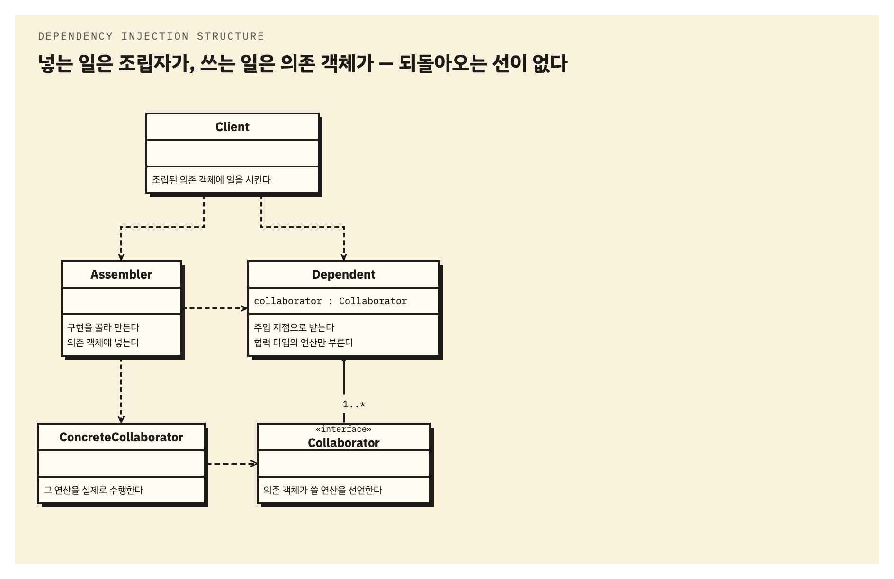

# Dependency Injection — 만드는 일을 밖으로 내보내고, 쓰는 쪽에는 협력 타입만 남기기

## 한눈에 보는 개요

도서관 연체 통지 프로그램을 하나 떠올려 봅시다. `OverdueNotifier` 는 대출 기록을 읽고, 오늘이 며칠인지 보고, 기한이 지난 건마다 통지를 내보냅니다. 그런데 그 셋을 통지기가 자기 생성자 안에서 직접 만들어 씁니다 — 저장소도, 시계도, 발송기도요. 통지 내용이 맞는지 확인하려고 다음 주 날짜로 한 번 실행해 보고 싶으면 방법이 없습니다. 오늘을 정하는 코드가 통지기 안에 있으니 통지기를 고쳐야 하고, 고치고 나면 그건 확인하려던 그 코드가 아니게 돼요.

Dependency Injection 의 해법은 **협력 객체를 만드는 일을 통지기 밖의 조립 코드로 옮기는 것**입니다. 통지기에는 "저장소가 있다 · 시계가 있다 · 발송기가 있다" 는 타입 선언만 남고, 어느 구현이 들어오는지는 조립하는 쪽만 압니다. 그래서 같은 통지기 코드에 운영용 조립과 시험용 조립을 각각 연결할 수 있어요.

```text
Before : 통지기가 협력 객체를 스스로 만든다

  OverdueNotifier
    ├─ new InMemoryLoanRepository(...)   ← 어느 저장소를 쓸지가 통지기 안에 적힌다
    ├─ new FixedClock(120)               ← 오늘이 며칠인지도 통지기가 정한다
    └─ new ConsoleNoticeSender("ops")    ← 통지가 어디로 나가는지도
       다른 날짜로 실행해 보려면 통지기를 고쳐야 한다

After : 조립자가 만들고, 통지기는 받아서 쓴다

  assembleForOperations()                      assembleForTest()
    InMemoryLoanRepository                       InMemoryLoanRepository
    FixedClock(120)                              FixedClock(127)
    ConsoleNoticeSender("ops")                   RecordingNoticeSender
              │                                            │
              └────────────▶ OverdueNotifier ◀─────────────┘
                               loans  : LoanRepository
                               clock  : Clock
                               sender : NoticeSender     ← 한 줄도 바뀌지 않는다
```

이 이름은 Martin Fowler 가 2004년에 붙였습니다. 그전까지는 이런 구조를 Inversion of Control(제어의 역전)이라고 불렀는데, 그 이름이 너무 넓어서 무엇이 뒤집히는지 알려 주지 못한다고 보고 더 좁은 이름을 제안했어요([Inversion of Control Containers and the Dependency Injection pattern](https://martinfowler.com/articles/injection.html)). GoF(Gang of Four, 1994년에 나온 *Design Patterns* 의 저자 네 명을 함께 부르는 이름)의 생성·구조·행위 어느 칸에도 들어가지 않습니다. 같이 놓고 볼 패턴은 [Strategy](../strategy/strategy-guide_v1.1.1.md) 와 [Singleton](../singleton/singleton-guide_v1.0.1.md) 둘이에요 — 앞은 주입되는 것이 교체 가능한 계산일 때 같은 코드에 붙는 이름이고, 뒤는 협력 객체를 하나만 두고 나눠 쓸 때 견줄 자리가 생깁니다. 이 글은 연체 통지 시나리오 셋을 따라갑니다. 통지 한 번이 조립부터 발송까지 가는 길, 시험용 조립이 붙을 때 무엇이 안 바뀌는가, 규칙을 어기면 어느 단계에서 무엇이 어긋나는가. 끝까지 읽으면 어떤 코드를 Dependency Injection 이라고 불러도 되는지 필수 조건 셋으로 판정할 수 있고, **그 조건 셋을 다 갖춘 코드가 동시에 Strategy 이기도 한 이유**까지 설명할 수 있게 됩니다.

## 패턴 자세히 들여다보기

### 시나리오 1 — 연체 통지 한 번이 조립부터 발송까지 가는 길

도서관 대출 기록이 넷 있습니다. `M-101` 의 「Data Structures」(기한 118일째), `M-204` 의 「Operating Systems」(기한 120일째), `M-101` 의 「Compiler Design」(기한 125일째), `M-337` 의 「Discrete Math」(기한 113일째)예요. 날짜는 연·월·일 대신 도서관 개관 이후 며칠째인지를 세는 정수 하나로 둡니다 — 세 언어 표준 라이브러리만으로 같은 값을 내려는 것이고, 이 편이 보이려는 것은 날짜 계산이 아니라 그 값을 어디서 얻는가입니다. 오늘은 120일째이고, 나와야 하는 것은 기한이 지난 건마다 통지 한 줄과 요약 한 줄입니다.

1. **조립자가 협력 구현 셋을 만듭니다.** `InMemoryLoanRepository`(대출 넷을 담은 저장소) · `FixedClock(120)`(오늘을 120일째로 답하는 시계) · `ConsoleNoticeSender("ops")`(통지를 줄로 찍는 발송기)입니다. 여기서 **조립자**는 어느 구현을 쓸지 정해 만드는 바깥 코드이고, **협력 구현**은 그렇게 만들어져 실제로 일을 하는 객체입니다. 왜 조립자가 맡는가 — 어느 저장소·어느 시계·어느 발송기를 쓸지는 프로그램을 어떻게 조립할지의 문제이지 통지 규칙의 문제가 아니에요. 통지기가 그것까지 정하면 조립하는 방법이 늘 때마다 통지기를 열게 됩니다.
2. **조립자가 그 셋을 통지기의 생성자 인자로 넣습니다.** `new OverdueNotifier(저장소, 시계, 발송기)` 한 줄이에요. 협력 객체가 들어가는 이 자리를 **주입 지점**이라고 부르겠습니다. 왜 생성자 자리인가 — 통지기는 셋이 다 있어야 일을 할 수 있으니, 셋 없이는 객체가 만들어지지도 않게 두는 편이 안전합니다. 이 순서를 뒤집어 객체를 먼저 만들고 나중에 채우면, 채우기 전에 통지를 청구하는 길이 열려요.
3. **조립자가 조립된 통지기를 쓰는 쪽에 돌려줍니다.** 조립자의 일은 여기서 끝납니다. 여기서 **쓰는 쪽**은 조립된 통지기에게 일을 시키는 코드예요. 왜 여기서 끝나는가 — 조립자가 통지까지 맡으면 "무엇으로 조립할지" 와 "무엇을 시킬지" 가 한 덩어리가 되고, 시험용으로 다르게 조립하려면 시키는 코드까지 복사하게 됩니다.
4. **쓰는 쪽이 통지기에게 연체 통지를 청구합니다.** `notifyOverdue()` 한 번이에요. 왜 쓰는 쪽이 구현을 몰라도 되는가 — 청구하는 연산의 모양이 어느 구현을 넣었든 같기 때문입니다. 시나리오 2 에서 발송기를 바꿀 때 이 줄이 안 바뀌는 것이 그 덕이에요.
5. **통지기가 시계에게 오늘을 묻습니다.** 돌아온 값은 120 입니다. 왜 통지기가 직접 시각을 읽지 않는가 — 직접 읽으면 오늘이 언제인지가 통지기 바깥에서 정해질 수 없고, 그러면 어제나 다음 주로 실행해 보는 일이 통지기를 고치는 일이 됩니다.
6. **통지기가 저장소에게 대출 목록을 청구합니다.** 넷이 들어온 순서 그대로 돌아옵니다. 왜 목록을 통지기가 가지고 있지 않는가 — 대출이 어디에 어떻게 쌓이는지는 통지 규칙과 상관없는 일이고, 통지기가 그것까지 알면 저장 방식이 바뀔 때 통지기가 함께 바뀝니다.
7. **통지기가 기한이 지난 건마다 발송기에게 넘깁니다.** 118일째 기한은 2일, 113일째 기한은 7일 초과라 둘이 넘어가고, 120일째 기한은 당일이라 넘어가지 않으며 125일째 기한은 아직 남았습니다. 발송기가 출력 1·2번 줄을 찍어요. 왜 통지기가 직접 찍지 않는가 — 찍는 일을 통지기가 맡으면 통지 내용을 확인할 방법이 화면을 읽는 것뿐이 됩니다. 시나리오 2 의 5단계가 그 차이가 나타나는 자리예요.
8. **통지기가 오늘과 보낸 건수를 담아 돌려주고, 쓰는 쪽이 그것을 찍습니다.** 출력 3번 줄이 이 자리입니다. 왜 통지기가 요약까지 찍지 않는가 — 통지기가 아는 발송 경로는 주입된 발송기 하나뿐이고, 요약을 어디에 낼지는 쓰는 쪽이 정할 일이에요.

```text
쓰는 쪽        조립자              통지기               시계    저장소   발송기
   │ 조립 청구    │                   │                   │        │        │
   ├────────────▶│ 구현 셋을 만든다   │                   │        │        │
   │             ├─ new ────────────────────────────────▶ ●        ●        ●
   │             ├─ new OverdueNotifier(저장소, 시계, 발송기) ▶ ●   │        │
   │◀── 통지기 ──┤                   │                   │        │        │
   │ notifyOverdue()                 │                   │        │        │
   ├────────────────────────────────▶│ today()           │        │        │
   │             │                   ├──────────────────▶│ 120    │        │
   │             │                   │ allLoans()        │        │        │
   │             │                   ├───────────────────┼───────▶│ 4건    │
   │             │                   │ send(…) ×2        │        │        │
   │             │                   ├───────────────────┼────────┼───────▶│ 1·2번 줄
   │◀── {today, sent} ───────────────┤                   │        │        │
   │ 3번 줄을 찍는다                  │                   │        │        │
```

이 시나리오에서 확인한 것은 다섯입니다. 협력 객체가 들어오는 자리가 통지기 밖에서 정해진다는 것, 통지기가 그 객체를 만들지도 찾지도 않는다는 것, 통지기 코드에는 협력 타입 이름만 있고 구현 이름은 없다는 것, 조립하는 코드와 시키는 코드가 서로 다른 단위라는 것, 그리고 통지기가 조립자를 부르는 곳이 한 군데도 없다는 것. 이 이름들의 정식 정의는 아래 「개념 정리」에 모았습니다.

### 시나리오 2 — 시험용 조립이 붙고, 통지기는 한 줄도 바뀌지 않는다

통지 내용이 맞는지 확인하고 싶습니다. 그런데 화면에 찍히면 읽어서 비교하는 수밖에 없고, 오늘이 120일째라 연체가 둘뿐이라 기한이 늦은 건까지 확인이 안 돼요. 오늘을 127일째로 두고 발송기를 통지를 쌓아 두는 것으로 바꾸면 넷이 다 걸립니다. 대출 넷은 그대로고, 나와야 하는 것은 요약 한 줄과 쌓인 통지 넷입니다.

1. **협력 구현 하나를 새로 만듭니다.** `RecordingNoticeSender` 는 발송기 타입을 따르되 찍는 대신 줄을 목록에 쌓고, 쌓인 것을 내주는 연산을 하나 더 갖습니다. 이때 통지기도, 저장소도, 시계도, 기존 발송기도 한 줄이 바뀌지 않아요. 왜 안 바뀌는가 — 새 구현은 발송기 타입이 선언한 연산만 맞추면 되고, 그 타입을 쓰는 쪽은 구현이 몇 개인지 모르기 때문입니다.
2. **조립자를 하나 더 만듭니다.** `assembleForTest()` 는 저장소는 같은 것을 쓰고 시계를 `FixedClock(127)` 로, 발송기를 새 구현으로 둡니다. 왜 통지기를 고치지 않고 조립자를 늘리는가 — 무엇으로 조립할지는 조립자의 일이라고 1단계에서 갈라 두었기 때문이에요. 그렇게 갈라 두지 않았다면 여기서 통지기에 `if (시험)` 가 들어갔을 겁니다.
3. **조립자가 대역을 만들어 통지기에 넣고, 조립 결과와 함께 그 대역도 돌려줍니다.** 왜 대역을 같이 돌려주는가 — 통지기는 자기가 무엇을 받았는지 바깥에 알려 주지 않습니다. 쌓인 통지를 읽으려면 그 객체를 가지고 있는 쪽이 따로 있어야 하고, 만든 것이 조립자이니 조립자가 넘겨줍니다.
4. **쓰는 쪽이 시나리오 1 과 같은 연산을 부릅니다.** `notifyOverdue()` 입니다. 오늘이 127일째라 넷이 다 기한을 넘겨 9일 · 7일 · 2일 · 14일 초과로 나오고, 출력 4번 줄이 그 요약이에요. 왜 같은 연산인가 — 바뀐 것은 어느 구현이 들어갔는가뿐이고 통지 규칙은 그대로이기 때문입니다.
5. **쓰는 쪽이 대역에 쌓인 통지를 읽습니다.** 출력 5~9번 줄이 이 자리예요. 왜 이것이 이제야 가능한가 — 1단계에서 발송기가 타입으로만 선언돼 있었기에 다른 구현이 그 자리에 들어갈 수 있었습니다. 통지기가 화면 출력을 직접 했다면 여기서 읽을 것이 없습니다.

주입 지점을 어디에 둘지는 갈래가 셋입니다. 셋 다 "협력 객체가 바깥에서 들어온다" 는 점은 같고, 들어오는 때와 자리가 다릅니다.

| 주입 경로 | 협력 객체가 들어오는 자리 | 언제 들어오는가 | 이 예시에서 |
| --- | --- | --- | --- |
| 생성자 인자 | 생성자의 매개변수 | 객체를 만들 때 한 번 | 이 편이 쓰는 경로. 시나리오 1 의 2단계 |
| 설치 연산 | 협력 객체를 받는 별도 메서드의 매개변수 | 객체를 만든 뒤 아무 때나 | 안 씀. 발행된 [Strategy 편](../strategy/strategy-guide_v1.1.1.md)의 `changePolicy` 가 이 모양 |
| 주입 인터페이스 | 「이 협력 객체를 받겠다」는 연산 하나만 담은 타입을 의존 객체가 구현하고, 주입하는 쪽이 그 연산을 부름 | 주입하는 쪽이 그 연산을 부를 때 | 안 씀. 받는 쪽이 따를 규약을 타입으로 명시해야 할 때 쓰는 경로 |

갈래마다 3단계가 달라집니다. 생성자 경로에서는 조립자가 `new OverdueNotifier(저장소, 시계, 발송기)` 한 줄로 끝내고, 설치 경로에서는 `new OverdueNotifier()` 로 만든 뒤 `setSender(대역)` 을 따로 부르며, 주입 인터페이스 경로에서는 `((SenderReceiver) 통지기).injectSender(대역)` 처럼 그 타입의 연산을 부릅니다. 나머지 단계는 셋 다 같아요.

```text
바꾸기 전                                  바꾼 뒤

  assembleForOperations()                  assembleForTest()
    FixedClock(120)                          FixedClock(127)        ← 바뀐 곳
    ConsoleNoticeSender("ops")               RecordingNoticeSender  ← 바뀐 곳
    InMemoryLoanRepository                   InMemoryLoanRepository

  OverdueNotifier  ── 한 줄도 안 바뀜 ──▶  OverdueNotifier
  통지 결과  2건                            통지 결과  4건
  새로 쓴 코드  —                           새로 쓴 코드  구현 1개 + 조립자 1개
```

이 시나리오에서 확인한 것은 둘입니다. 하나는 협력 구현이 늘어도 그것을 쓰는 코드가 안 바뀐다는 것이고, 다른 하나는 같은 의존 객체를 서로 다른 조립으로 두 번 조립할 수 있다는 것입니다. 통지기는 그대로였어요. 앞의 것이 최소 조건 1번과 2번이 지키는 성질이고, 뒤의 것이 3번이 지키는 성질이에요.

### 시나리오 3 — 이 구조를 어기면 어느 단계에서 무엇이 어긋나는가

아래 셋은 구현 절의 코드를 정해진 자리만 고쳐 실제로 컴파일하고 실행해 본 것입니다. 도구는 `javac 21.0.11` · `tsc 5.9.3`(Node v22.22.3) · `rustc 1.95.0` 이고, 아래에 적은 자리 말고는 구현 절 코드와 같습니다. 재현하려면 구현 절 코드를 그대로 저장한 뒤 적힌 줄만 고치면 돼요.

1. **통지기가 협력 구현을 직접 만들게 바꿨습니다.** 고친 자리는 셋입니다 — ① 생성자를 인자 없는 것으로 바꿔 그 안에서 저장소·시계·발송기를 만들고 ② `assembleForOperations` 를 `new OverdueNotifier()` 한 줄로 줄이고 ③ 끼울 자리가 없어진 `assembleForTest`·`TestRig`·`RecordingNoticeSender` 와 쓰는 쪽의 시험 부분을 지웠습니다. 결과는 **컴파일 통과이고 운영 쪽 출력 세 줄은 글자까지 같았습니다**(Java 로 실행해 확인). 대신 아홉 줄이던 출력이 세 줄이 됐어요 — 시험용 조립이 코드에서 사라졌으니까요. 왜 이렇게 되는가 — 통지기가 구현을 스스로 만들면 그 선택을 바꿀 자리가 통지기 안뿐이고, 밖에서 다른 것을 넣을 길이 없습니다.
2. **필드와 생성자 인자의 발송기 타입을 구체 구현 타입으로 바꿨습니다.** 세 언어 모두 두 줄씩만 고쳤고 셋 다 컴파일에서 막혔습니다. Java 는 `incompatible types: RecordingNoticeSender cannot be converted to ConsoleNoticeSender` 1건, TypeScript 는 `TS2345 ... Property 'tag' is missing in type 'RecordingNoticeSender' but required in type 'ConsoleNoticeSender'` 1건, Rust 는 `E0308 mismatched types`(`expected Rc<ConsoleNoticeSender>, found Rc<dyn NoticeSender>`) 1건이에요. 그런데 **TypeScript 가 막은 이유는 다른 언어와 다릅니다** — 진단이 가리키는 것은 이름이 아니라 모양이라, 두 클래스의 `tag` 필드를 공개로 맞춰 모양을 같게 하면(발송기 쪽 선언 한 줄을 고치고 기록 발송기에 같은 필드 한 줄을 보탬) 컴파일도 실행도 통과하고 출력 아홉 줄이 그대로 나왔습니다(직접 컴파일·실행해 확인). `tag` 를 양쪽 다 `private` 으로 두면 `Types have separate declarations of a private property 'tag'` 로 다시 막혀요. 왜 이 차이가 생기는가 — TypeScript 는 타입이 같은지를 선언한 이름이 아니라 멤버의 모양으로 가리고, 그 판정에서 `private` 멤버만 이름이 같은 곳에서 나왔는지를 따로 봅니다.
3. **협력 객체를 등록소에서 꺼내 오게 바꿨습니다.** 통지기의 필드와 생성자 인자를 모두 지우고, 정적 등록소 하나를 두어 `ServiceLocator.clock()` · `ServiceLocator.loans()` · `ServiceLocator.sender()` 로 꺼내 쓰게 했어요. 컴파일도 실행도 통과합니다. 그런데 시험용 등록을 먼저 해 두고 운영 통지기를 만들어 부르면 `ops: today=127 sent=4` 가 나오고, 시험용 대역에 통지 4건이 쌓였습니다(Java 로 실행해 확인). 운영 통지가 시험용 대역으로 나간 것이고, **통지기를 만드는 줄에는 인자가 하나도 없어서 그 사실을 확인할 수 있는 자리가 없습니다.** 왜 이렇게 되는가 — 꺼내 오는 구조에서는 무엇을 쓰는지가 호출 순서와 전역 상태에 달리고, 그 둘은 통지기를 만드는 자리에 적히지 않습니다.

| 바꾼 자리 | 어긋난 자리 | 확인되는 때 |
| --- | --- | --- |
| 통지기가 구현을 직접 만든다 | 시험용 조립이 코드에서 사라진다 (출력 9줄 → 3줄) | 고칠 때 — 운영 출력은 같다 |
| 협력 객체를 구체 타입으로 가진다 | 다른 구현을 넣을 수 없다 (Java·Rust 각 1건, TypeScript 는 모양이 다를 때만) | 컴파일 |
| 협력 객체를 등록소에서 꺼내 온다 | 운영 통지가 시험용 대역으로 나간다 (`today=127 sent=4`) | 실행 — 답이 어긋난다 |

여기서 헷갈리기 쉬운 포인트는 1번입니다. 컴파일도 되고 운영 출력도 글자까지 같으니 "그럼 같은 코드 아닌가" 싶어지죠. 그런데 사라진 여섯 줄이 무엇이었는지를 보면 구분됩니다. 그 여섯 줄은 같은 통지 규칙을 다른 날짜와 다른 발송 경로로 한 번 더 실행한 결과였고, 1번 판에서는 그것을 되살릴 길이 통지기를 고치는 것뿐이에요. **출력이 같다고 두 코드가 같은 것은 아니고, 이 패턴이 효과를 내는 자리는 프로그램을 한 벌로 실행할 때가 아니라 두 벌째를 조립할 때입니다.**

### 개념 정리

시나리오에 나온 이름 다섯을 역할 이름으로 정의합니다. 예시 코드의 타입 이름(`OverdueNotifier`·`Clock`)은 정의 대상이 아니라 「상황 설정」에서 이 역할들에 매핑하는 쪽이에요. **다섯 가운데 원전이 쓰는 이름은 `Assembler` 하나뿐이고 나머지 넷은 이 가이드가 붙였습니다.** 원전은 주입받는 쪽을 자기 예제의 클래스 이름으로 부르고 주입되는 쪽을 component 와 service 로 부르는데, 그 두 낱말은 이 편이 가리키려는 자리보다 넓어서 역할 이름으로 그대로 쓰지 않았어요.

- **Dependent(의존 객체)** — 협력 객체를 써서 자기 일을 하는 객체입니다. 협력 객체를 만들지도 찾지도 않고 주입 지점으로 받아 필드에 두고, 협력 타입이 선언한 연산만 부릅니다. 자기에게 무엇이 들어왔는지, 누가 넣어 주었는지는 모릅니다. Collaborator 와만 협력하고 Assembler 와는 협력하지 않아요 — 그 방향의 참조가 없는 것이 이 역할의 요점입니다.
- **Collaborator(협력 타입)** — 의존 객체가 협력 객체를 다룰 때 쓰는 타입입니다. 의존 객체가 부를 연산을 선언하고, 그 연산을 누가 어떻게 수행하는지는 모릅니다. 인터페이스·추상 클래스·trait(Rust 에서 타입이 구현할 연산을 선언하는 문법)·함수 타입처럼 구현을 하나로 지목하지 않는 것이면 됩니다. Dependent 가 이 타입으로 필드를 선언하고, ConcreteCollaborator 가 이 타입을 구현해요.
- **ConcreteCollaborator(협력 구현)** — 협력 타입이 선언한 연산을 실제로 수행하는 객체입니다. 자기가 어느 의존 객체에 들어가는지 모르고, 같은 협력 타입의 다른 구현이 있는지도 모릅니다. Assembler 가 이것을 만들어 Dependent 에 넣습니다.
- **Assembler(조립자)** — 어느 협력 구현을 쓸지 정해 만들고, 그것을 의존 객체의 주입 지점에 넣는 바깥 코드입니다. 함수 하나여도 되고 클래스나 설정 파일을 읽는 모듈이어도 됩니다. 의존 객체와 협력 구현 양쪽의 구체 타입을 다 알고, 그 앎이 여기 한 곳에 모이는 것이 이 역할의 핵심이에요. Dependent 가 Assembler 를 참조하는 순간 이 구조가 아니게 됩니다.
- **Client(쓰는 쪽)** — 조립된 의존 객체를 받아 일을 시키는 코드입니다. 어느 구현이 들어갔는지 모른 채 의존 객체가 공개한 연산만 부릅니다. 조립을 청구하는 쪽과 일을 시키는 쪽이 같은 코드일 수도 있지만, 갈라 두면 조립을 바꿔 가며 같은 청구를 되풀이할 수 있어요.



그림에서 눈여겨볼 것은 **없는 선**입니다. Assembler 에서 Dependent 로 가는 선은 있는데 되돌아오는 선이 없어요. 이 방향이 한쪽이라서 의존 객체는 자기가 어떻게 조립됐는지 모른 채로도 일을 할 수 있고, 조립 방식을 바꿔도 의존 객체 코드가 안 바뀝니다. 되돌아오는 선을 그으면, 다시 말해 의존 객체가 조립하는 쪽을 부르면 시나리오 3 의 3단계가 되고, 그 구조의 이름은 비교 절에서 따로 다룹니다. 그리고 Dependent 에서 Collaborator 로 가는 마름모 선의 수가 `1..*` 인 것도 읽을 자리예요. 협력 객체가 하나뿐인 의존 객체도 이 구조이고, 이 편의 예시처럼 셋이어도 같습니다.

## 사용 목적

어떤 단서가 보일 때 이 패턴을 꺼내는지부터 봅시다. 셋 다 코드에서 눈으로 확인되는 것들이에요.

1. **어떤 클래스만 떼어 실행해 보려는데 매번 같은 줄에서 막힙니다.** 그 줄은 대개 생성자나 메서드 안의 생성 호출(`new SystemClock()` · `new SmtpSender(...)`)이거나 전역 접근점 호출입니다. 확인하려는 규칙은 그 클래스 안에 있는데, 그 규칙을 실행하려면 실제 시각과 실제 발송이 함께 딸려 와요. 시나리오 3 의 1단계가 이 상태에서 무엇이 사라지는지 보여 줍니다.
2. **같은 클래스를 두 환경에서 다르게 조립해야 하는데, 그 차이가 클래스 안의 분기로 들어가 있습니다.** `if (env.equals("prod"))` 로 분기해 저장소를 고르는 코드가 클래스 안에 있으면, 환경이 하나 늘 때마다 그 클래스를 엽니다. 시나리오 2 의 2단계가 그 분기를 조립자 쪽으로 옮긴 자리예요.
3. **한 클래스가 협력 객체를 셋 이상 스스로 만들고, 그 생성 순서까지 그 안에 적혀 있습니다.** 저장소를 만들려면 연결 설정이 있어야 하고 그 설정은 또 어디선가 읽어야 하는 식으로 이어지면, 그 클래스의 생성자가 프로그램 조립 절차를 겸하게 됩니다.

```text
단서를 만났을 때 물어볼 것

  이 클래스가 협력 객체를 스스로 만들거나 찾아오는가?   ──아니오──▶ 이미 받고 있다
          │ 예
  그 선택을 바꿔야 할 이유가 있는가
  (시험 · 다른 환경 · 다른 구현)?                      ──아니오──▶ 그대로 둔다
          │ 예
  바꿔야 하는 것이 협력 객체인가, 값 하나인가?
          │ 협력 객체                    │ 값
     주입 지점을 낸다                매개변수 하나면 충분하다
```

반대로 이 패턴을 쓰면 손해인 자리도 분명합니다.

| 쓰지 말아야 할 상황 | 쓰면 잃는 것 |
| --- | --- |
| 협력 객체가 하나뿐이고 그 구현이 바뀔 이유가 없을 때 | 읽기 쉬움. 타입 하나와 조립 코드 한 곳이 늘고, 읽는 사람이 어느 구현이 들어오는지 알려면 조립 코드를 따로 찾아가야 함. `new FixedClock(120)` 한 줄이면 끝나던 일이 세 자리로 나뉨 |
| 주입할 것이 협력 객체가 아니라 자료 값일 때 | 이름값. 통화 객체를 생성자로 받는 금액 클래스도 아래 최소 조건 셋을 다 만족하지만, 그것을 의존성 주입이라 불러서 읽는 사람이 더 알게 되는 것이 없음. 비교 절에서 그 코드를 직접 봅니다 |
| 조립 코드를 둘 곳이 마땅치 않을 때 | 의존을 명시하려다 조립 절차가 여기저기 흩어짐. 주입 지점만 내고 조립을 부르는 쪽마다 따로 하면, 고쳐야 할 자리가 하나에서 여럿으로 늘어남 |

비슷한 단서에서 다른 이름을 고르게 되는 경우도 있습니다. 주입되는 것이 같은 계산의 여러 방법이면 그 자리는 Strategy 로도 부를 수 있고, 협력 객체를 받는 대신 꺼내 오게 만들면 Service Locator 가 됩니다. 둘 다 이 패턴과 배타적이지 않아서, 차이는 바로 아래 비교 절에서 풉니다.

## 패턴의 경계

### 디자인 패턴을 충족하는 최소 조건

어떤 코드를 Dependency Injection 이라고 불러도 되는지 가르는 기준입니다. `[필수]` 가 하나라도 빠지면 이 패턴이 아니고, `[선택]` 은 갖추면 좋거나 상황에 따라 고르는 구조예요. 조건은 언어와 상관없이 코드에서 확인할 수 있는 모양(타입 선언 · 참조 보유 · 호출 방향 · 생성 위치)으로 적었고, 조건마다 그것을 보여 준 시나리오의 단계를 가리킵니다. **여기서 "협력 객체" 는 1번이 정합니다** — 의존 객체가 필드나 인자로 들고 그 연산을 부르는 객체가 협력 객체이고, 나머지 조건은 그 객체들을 가리켜요.

1. [필수] 의존 객체가 협력 객체를 하나 이상 가지고, 가진 것 전부를 구현이 아닌 타입으로 참조합니다 — 협력 객체가 담기는 자리(필드 · 생성자 인자 · 설치 연산 인자 · 주입 인터페이스 연산의 인자)에 적힌 타입이 구현을 하나로 지목하지 않는 타입(인터페이스 · 추상 클래스 · trait · 함수 타입 · 그 연산을 요구하는 타입 매개변수)이고, 의존 객체는 그 타입이 선언한 연산만 부릅니다. 든 협력 객체 가운데 **하나라도** 구체 구현 타입으로 적혀 있으면 이 조건이 빠져요. 시나리오 1 의 5~7단계가 통지기가 협력 타입의 연산만 부르는 자리입니다 (근거: Fowler 「Inversion of Control Containers and the Dependency Injection pattern」 Forms of Dependency Injection 절 — 이 패턴의 기본 생각은 별도의 객체인 조립자가 의존하는 클래스의 필드를 협력 타입 인터페이스의 알맞은 구현으로 채우는 것이라고 적는다). 위 근거 괄호가 뒷받침하는 것은 **필드가 협력 타입 인터페이스로 선언되고 그 자리에 구현이 채워진다는 것까지**입니다. 협력 객체가 여럿일 때 "가진 것 전부" 라는 전수 한정은 이 가이드가 조건을 가를 수 있게 붙인 읽기예요 — 하나만 추상 타입이어도 통과한다면 이 조건이 아무것도 가르지 못합니다.
   - 빠지면: 시나리오 3 의 2단계입니다. 발송기 타입을 구체 구현으로 바꾸면 Java 와 Rust 는 각각 진단 1건으로 다른 구현을 막고(직접 컴파일해 확인), 그 자리에 시험용 대역을 넣을 길이 없어집니다. 남는 것은 협력 객체 하나를 도우미로 쓰는 평범한 클래스예요.
   - 빠지면(가진 것이 없는 쪽): 시나리오 3 의 3단계도 이 조건에서 먼저 걸립니다. 그 판은 필드와 인자를 다 지웠으니 위에 적은 네 자리 어디에도 협력 객체가 없고, 「하나 이상 가진다」가 성립하지 않아요. 「하나 이상」을 조건에 넣어 둔 이유가 이것입니다 — 없으면 협력 객체가 0개인 코드가 「전부 추상 타입이다」로 통과합니다.
2. [필수] 협력 객체가 의존 객체 바깥에서 들어오고, 의존 객체 안에는 협력 구현을 만드는 코드도 찾아오는 코드도 없습니다 — 협력 객체가 의존 객체로 들어오는 길이 생성자 인자 · 설치 연산 인자 · 주입 인터페이스 연산의 인자 가운데 하나로 있고, 의존 객체의 코드(생성자와 연산 전부)에 그 협력 구현을 만드는 생성 호출이 없으며, 등록소 · 전역 접근점 · 이름으로 찾아 주는 연산을 부르는 호출도 없습니다. 든 협력 객체 **전부**가 그래야 하고, **하나라도** 안에서 만들거나 찾아오면 빠집니다. 시나리오 1 의 2단계가 들어오는 자리이고 시나리오 2 의 3단계가 같은 자리에 다른 구현이 들어오는 자리예요 (근거: Fowler 「Inversion of Control Containers and the Dependency Injection pattern」 Inversion of Control 절 — 처음 예에서 의존하는 클래스가 구현을 직접 만들어 썼고 그것이 그 협력 객체가 갈아 끼울 수 있는 부품이 되는 것을 막는다고 적으며, 이 부류의 컨테이너가 뒤집는 것은 구현을 찾아오는 일이고 그 방식은 별도의 조립 모듈이 구현을 넣어 줄 수 있게 하는 규약을 따르는 것이라고 적는다). 위 근거 괄호가 뒷받침하는 것은 **의존 객체가 스스로 구현을 만들거나 찾아오면 교체가 막히고, 대신 별도 모듈이 넣어 준다는 것까지**입니다.
   - 빠지면(만드는 쪽): 시나리오 3 의 1단계입니다. 통지기가 구현 셋을 스스로 만들게 바꾸자 컴파일은 통과했지만 시험용 조립이 코드에서 사라져 출력이 아홉 줄에서 세 줄이 됐어요(직접 실행해 확인).
   - 빠지면(찾아오는 쪽): 시나리오 3 의 3단계입니다. 등록소에서 꺼내 오게 바꾸자 운영 통지가 시험용 대역으로 나가 `ops: today=127 sent=4` 가 찍혔습니다(직접 실행해 확인).
3. [필수] 구현을 골라 넣는 코드가 의존 객체 밖의 별도 단위에 있고, 의존 객체는 그 단위를 모릅니다 — 구체 협력 구현을 만들어 의존 객체에 넣는 코드가 의존 객체 타입 밖의 단위(함수 · 클래스 · 모듈 · 설정을 읽는 코드)에 있고, 의존 객체의 필드 · 인자 · 호출 어디에도 **그 단위의 타입 이름도, 그 단위가 구현·상속한 타입의 이름도** 나오지 않습니다. 시나리오 1 의 1~3단계가 그 단위이고, 시나리오 2 의 2단계가 그 단위만 늘려 다른 구현을 만드는 자리예요 (근거: Fowler 「Inversion of Control Containers and the Dependency Injection pattern」 Forms of Dependency Injection 절 — 필드를 채우는 것이 별도의 객체인 조립자라고 적는다 · Service Locator vs Dependency Injection 절 — 주입하는 쪽을 쓰면 부품에서 주입하는 쪽으로 가는 의존이 없다고 적는다). 위 근거 괄호가 뒷받침하는 것은 **넣는 일을 별도 객체가 맡고 의존 객체에서 그 객체로 가는 의존이 없다는 것까지**입니다.
   - 빠지면: 시나리오 3 의 3단계입니다. 등록소를 두면 넣는 코드와 내주는 코드가 한 단위에 모이고 의존 객체가 그 단위를 이름으로 부르게 돼요. 그러면 무엇을 쓰는지가 등록 순서에 달리고, 통지기를 만드는 줄에는 인자가 없어 그 사실을 알 수 없습니다(직접 실행해 확인). 이 구조에는 따로 이름이 있고 비교 절에서 다룹니다.
4. [선택] 주입 경로가 생성자 인자입니다 — 협력 객체가 생성자의 매개변수로 들어오고, 그것 없이는 의존 객체가 만들어지지 않습니다. 시나리오 1 의 2단계가 그 모양이에요 (근거: Fowler 「Inversion of Control Containers and the Dependency Injection pattern」 Forms of Dependency Injection 절이 생성자 · 설치 연산 · 주입 인터페이스 셋을 나란히 들어 선택지 나열이고, Constructor versus Setter Injection 절은 저자가 생성자 주입에서 시작하는 쪽을 선호한다고 적는 자리라 선호 표명입니다. 그래서 필수로 올리지 않았습니다). 설치 연산으로만 받는 코드도 1~3번을 그대로 만족합니다.
5. [선택] 주입된 참조를 의존 객체가 다시 바꾸지 않습니다 — 협력 객체를 담은 필드가 한 번 채워진 뒤 그 필드에 대입하는 코드가 의존 객체 안에 없습니다. 시나리오 1 의 2단계에서 생성자로 한 번 채운 뒤 통지기가 그 필드를 건드리지 않는 것이 이 모양이에요 (근거: Fowler 「Inversion of Control Containers and the Dependency Injection pattern」 Constructor versus Setter Injection 절 — 생성자로 초기화하면 바뀌지 않는 필드를 분명히 감출 수 있다는 이점으로 든다. 이점 서술이라 필수로 올리지 않았습니다). 발행된 Strategy 편의 `Checkout` 은 설치 연산으로 필드를 다시 채우므로 이 조건이 빠지지만 1~3번은 만족합니다.
6. [선택] 조립하는 코드와 조립된 것을 쓰는 코드가 서로 다른 단위입니다 — 구현을 골라 넣는 코드와 조립된 의존 객체에게 일을 시키는 코드가 같은 함수 안에 섞여 있지 않습니다. 시나리오 1 의 3·4단계가 그 경계예요 (근거: Fowler 「Inversion of Control Containers and the Dependency Injection pattern」 Separating Configuration from Use 절 — 이 모든 것에서 중요한 문제는 서비스의 구성을 그 사용과 분리하는 것이라고 적는다. 다만 그 경계를 코드의 어느 단위로 그을지는 적지 않아, 함수 단위로 잰 것은 이 가이드의 읽기입니다. 그래서 선택에 둡니다).
7. [선택] 한 협력 타입에 구현이 둘 이상 있습니다 — 같은 협력 타입을 구현한 별도 단위가 둘 이상 있어 조립자가 고를 대상이 생깁니다. 시나리오 2 의 1단계에서 발송기 구현이 둘이 된 자리가 이것이에요 (근거: 이 가이드의 정책 — 원전이 세는 것은 구현의 수가 아니라 구성과 사용이 분리되었는가입니다. 이 조건을 필수로 올리면 구현이 하나인 정당한 주입이 전부 탈락하고, 이 편의 예시에서도 저장소와 시계가 그 자리입니다). **이 조건이 Strategy 와 구분되는 자리**라 비교 절이 이어받습니다.

판정 순서를 정리해 둡시다. 1번은 의존 객체의 **필드와 인자 선언만** 보면 답이 나오고, 2번은 의존 객체 안의 생성 호출과 조회 호출만, 3번은 넣는 코드가 어디 있고 의존 객체가 그것을 부르는지만 봅니다. 보는 품이 적은 1번부터 적용하면 대부분 거기서 끝나요.

| 코드 | 1번 | 2번 | 3번 | 판정 |
| --- | --- | --- | --- | --- |
| 구현 절 정본 | 만족 | 만족 | 만족 | 의존성 주입 |
| 발송기를 구체 타입으로 가진 판 (시나리오 3 의 2단계) | **빠짐** | 만족 | 만족 | 아님 — 다른 구현이 들어갈 자리가 없다 |
| 통지기가 구현을 직접 만드는 판 (시나리오 3 의 1단계) | 만족 | **빠짐** | **빠짐** | 아님 — 조립 단위 자체가 없다 |
| 등록소에서 꺼내 오는 판 (시나리오 3 의 3단계) | **빠짐** | **빠짐** | **빠짐** | 아님 — 가진 협력 객체가 아예 없고 의존 객체가 등록소를 부른다 |
| 설치 연산으로만 받는 판 | 만족 | 만족 | 만족 | 의존성 주입 (선택 4·5번만 빠짐) |
| 구현이 하나뿐인 협력 타입 (정본의 `Clock`·`LoanRepository`) | 만족 | 만족 | 만족 | 의존성 주입 (선택 7번만 빠짐) |
| 생성자가 이름표를 받아 안에서 구현을 고르는 판 (비교 절의 오인 코드) | 만족 | **빠짐** | **빠짐** | 아님 — 들어오는 것이 구현이 아니라 이름표 |
| 발행된 Strategy 편의 `Checkout` 과 세 요금제 | 만족 | 만족 | 만족 | **의존성 주입이면서 Strategy** |
| 통화 객체를 생성자로 받는 금액 클래스 (비교 절) | 만족 | 만족 | 만족 | 의존성 주입 — 다만 이름을 붙여 얻는 것이 없다 |

표의 아래 두 줄이 이 편에서 가장 중요한 자리입니다. **필수 셋을 다 만족하면서 동시에 다른 패턴이기도 한 코드가 있고, 필수 셋을 다 만족하지만 이 이름을 붙여 얻을 것이 없는 코드도 있습니다.** 둘 다 조건의 결함이 아니에요 — 원전이 세운 요건이 만드는 일과 쓰는 일이 나뉘었는가 하나라서, 그 요건을 코드로 옮기면 이만큼 넓어집니다. 조건을 좁혀 이름값을 만들려 하면 원전이 인정하는 코드를 탈락시키게 되고, 가르는 일은 조건이 아니라 다음 절이 맡습니다.

이 겹침은 Strategy 하나에만 생기지 않습니다. 얼마나 넓은지 확인하려고 **이 프로젝트에 발행된 가이드 24편의 `### 구현` 절 코드를 위 필수 셋으로 직접 채점해 봤어요**(2026-09-30, 대상은 [인덱스](../../../PATTERNS.md)에 실린 발행본 전부). 채점 규칙은 둘입니다 — 각 편에서 협력 객체를 받아 가지는 클래스를 전부 후보로 놓고 한 클래스라도 셋을 다 만족하면 그 편을 통과로 세고, 클래스가 자기 안에서 만들어 쓰는 자료 객체는 협력 객체로 세지 않습니다. 결과는 **24편 가운데 17편 통과**였습니다. Decorator 의 `ShipmentDesk`, Bridge 의 `Receipt`, Proxy 의 `GuardedContract`, State 의 `Order`, Chain of Responsibility 의 `BaseHandler`, Observer 의 `Subject` 가 모두 협력 객체를 추상 타입으로 받아 들고 만드는 코드를 바깥에 두고 있어서 그대로 통과해요.

| 통과하지 못한 편 | 걸린 조건 | 무엇이 걸렸나 |
| --- | --- | --- |
| Facade | 1번 | `BookingDesk` 가 받아 든 넷 가운데 셋이 구체 클래스다 |
| Mediator | 3번 | 동료가 든 `SeatFormMediator` 가 그것을 넣어 주는 `SeatForm` 이 구현한 타입이다 |
| Singleton | 1·2번 | `OrderDesk` 가 발급기를 구체 타입으로 가지고, 생성자 안에서 전역 접근점을 부른다 |
| Factory Method | 1번 | 명세서가 받아 든 `Employee` 가 구체 타입이고, 실행 클래스는 협력 객체를 들지 않는다 |
| Template Method | 1번 | 협력 객체를 아예 들지 않는다 — 바뀌는 부분이 하위 클래스의 재정의로 들어온다 |
| Iterator | 2번 | 커서를 저장소가 자기 안에서 만든다 |
| Memento | 1번 | 보관자가 가진 협력 객체가 없다 — 원본을 업무 연산의 인자로 받을 뿐이다 |

이 숫자가 말해 주는 것은 둘입니다. 하나는 겹침이 한 패턴에 그치지 않는다는 것이고, 다른 하나는 **조건이 넓기는 해도 공허하지는 않다**는 것이에요. 일곱 편이 실제로 걸리고 걸린 이유가 편마다 다릅니다. 특히 조건 1번의 「가진 것 **전부**」(이 가이드가 보탠 읽기라고 위에서 밝힌 자리)가 Facade 를 잡고, 조건 3번의 「그 단위가 구현·상속한 타입의 이름도」가 Mediator 를 잡아요. 그 두 자리를 빼고 같은 방법으로 다시 세면 통과가 19편으로 늘어납니다.

잠깐, 하나만 확인해 볼까요. 시나리오 3 의 1단계 판에서 생성자 안의 생성 호출 세 줄을 생성자 인자로 옮기기만 하면 필수 셋이 다 성립할까요? 1번은 필드 타입을 안 건드렸으니 그대로 만족이고, 2번도 안에서 만드는 코드가 사라지니 만족입니다. 3번은 그 세 줄이 **어디로 옮겨 갔는가**에 달려요. 부르는 쪽 함수 안에 그대로 남으면 조립 코드가 쓰는 코드와 한 단위라 선택 6번만 빠지고 필수 3번은 성립합니다. 반대로 통지기가 자기 안에 정적 조립 메서드를 두고 그것을 부르면, 넣는 코드가 여전히 의존 객체 타입 안이라 3번이 빠져요.

> 만드는 일과 쓰는 일을 다른 코드에 둔다 — 쓰는 쪽은 협력 타입만 알고, 어느 구현인지는 조립하는 쪽만 안다.

### 비슷한 패턴·안티패턴과의 차이

겹치는 대상 넷을 비교합니다. 앞의 둘은 **구조가 닮은 정도가 아니라 같은 코드에 두 이름이 다 붙거나 한 이름만 붙는 관계**라서 먼저 그 사실을 분명히 하고 시작할게요. 뒤의 둘 가운데 하나는 같은 단서에서 떠오르는 다른 선택지이고, 나머지 하나는 이 패턴으로 오해받는 코드입니다.

| 비교 대상 | 구분 기준 (코드에서 보는 것) | 이 이름을 고르면 얻는 것 | 포기하는 것 |
| --- | --- | --- | --- |
| Strategy | 의존 객체가 든 협력 타입이 하나이고 그 구현들이 **같은 연산의 다른 계산**인가, 여럿이고 각자 다른 일을 맡는가 | 협력 객체가 하나든 셋이든, 구현이 하나뿐이어도 같은 이름으로 말할 수 있음 | 「교체할 알고리즘들」이라는 좁고 분명한 뜻. 무엇이 갈아 끼워지는지가 이름에 안 실림 |
| Service Locator | 협력 객체가 의존 객체 **안으로 들어오는가**, 의존 객체가 밖으로 나가 **꺼내 오는가**. 의존 객체가 등록소·접근점의 이름을 부르는 호출이 있는지를 봄 | 의존 객체가 무엇을 쓰는지가 생성 자리에 전부 적힘. 등록소를 모르는 코드에서도 그대로 씀 | 인자가 늘고 조립 코드가 필요함. 실행 중에 새 협력 객체를 더 얻어 올 길이 없음 |
| Singleton | 협력 객체를 **받는 경로가 있는가**, 협력 객체 쪽이 자기 생성자를 닫고 전역 접근점을 내는가 | 시험이나 다른 환경에서 그 자리에 다른 객체를 넣을 수 있음 | 하나만 존재한다는 보장. 컴파일러가 두 번째 인스턴스를 막아 주지 않음 |
| 이름표를 받아 안에서 고르는 코드 (오인 코드) | 생성자로 들어오는 것이 **협력 객체인가 이름표인가** | 구현이 늘 때 의존 객체를 안 고침 | 어느 구현인지 고르는 분기가 사라지지는 않고 조립 코드로 옮겨 감 |

**Strategy 와의 관계.** 먼저 사실부터 적습니다. **발행된 [Strategy 편](../strategy/strategy-guide_v1.1.1.md)의 예시 코드는 이 편의 필수 조건 셋을 전부 만족합니다.** 그 편의 코드를 직접 읽어 대조했어요. `Checkout` 은 요금제를 `ShippingPolicy` 라는 인터페이스 타입 필드로 가지고 그 타입의 연산만 부르니 1번을 만족하고, 그 필드가 생성자 인자와 `changePolicy` 로 들어오며 `Checkout` 안에 요금제를 만드는 생성 호출도 찾아오는 호출도 없으니 2번을 만족하며, 구체 요금제를 만드는 `choosePolicy` 가 `Checkout` 밖에 있고 `Checkout` 이 그 코드를 부르지 않으니 3번을 만족합니다. 반대로 이 편의 예시 코드를 그 편의 필수 조건으로 채점하면 자리마다 답이 달라요.

| 이 편 예시의 자리 | Strategy 1번 (교체할 계산마다 별도 구현) | Strategy 2·3번 | Strategy 로도 부를 수 있는가 |
| --- | --- | --- | --- |
| `NoticeSender` — 콘솔 발송기 · 기록 발송기 | 만족 (같은 연산의 다른 방법이 둘) | 만족 | 부를 수 있다 |
| `Clock` — 고정 시계 하나를 120일째와 127일째로 두 번 | 만족 (그 편 1번은 같은 클래스를 필드 값으로 나눈 경우도 「한 계산 방법을 매개변수로 나눈 것」으로 쳐서 만족으로 적는다) | 만족 | 부를 수 있다 |
| `LoanRepository` — 메모리 저장소 하나, 두 조립이 같은 대출 넷을 넣음 | 잴 대상 없음 (나뉜 값도 없어 「교체할 계산들」이 성립하지 않음) | 만족 | 부를 수 없다 |

그러니 두 이름의 관계는 겹침입니다. 협력 타입이 하나이고 그 구현들이 같은 계산의 대안이면 두 이름이 다 맞고, 갈아 끼울 것이 아예 없는 자리이거나 협력 타입이 여럿이면 의존성 주입이라는 이름만 남아요. 시나리오 2 의 1단계에서 발송기 구현이 둘이 된 순간 그 자리는 Strategy 로도 읽히고, 같은 시나리오에서 시계도 120일째와 127일째로 나뉘니 그 편이 한 계산을 매개변수로 나눈 경우로 치는 자리가 됩니다. 저장소만 두 조립이 같은 값을 넣어 잴 것이 남지 않아요. 그런데도 셋 다 구현 클래스는 하나뿐이라 이 편의 최소 조건 7번은 성립하지 않습니다. 7번을 선택에 둔 이유가 바로 이것이고, 그것을 필수로 올리면 시계와 저장소가 탈락합니다.

```text
              협력 객체를 추상 타입으로 가지고 · 바깥에서 받고 · 만드는 코드는 밖에 ← 여기까지는 둘이 같다
                                    │
                    가진 협력 타입이 몇이고, 그 구현들이 서로 무엇인가?
                                    │
        ┌───────────────────────────┴───────────────────────────┐
   하나 · 같은 계산의 다른 방법                            여럿 · 각자 다른 일 (또는 갈아 끼울 것이 없음)
        │                                                       │
   두 이름이 다 맞는다                                     의존성 주입이라고만 부른다
   예: Strategy 편의 ShippingPolicy                        예: 저장소 · 시계 · 발송기를 함께 든 통지기
```

Strategy 라는 이름을 고르면 무엇이 갈아 끼워지는지가 이름에 실리고, 대신 협력 객체가 셋이거나 구현이 하나뿐인 자리는 그 이름으로 덮이지 않습니다. 의존성 주입을 고르면 그 셋을 한 이름으로 말할 수 있고, 대신 교체할 알고리즘들을 가리키는 좁은 뜻을 포기해요. 그래서 이름을 고르는 일과 판정하는 일이 다릅니다 — **판정은 조건으로 하고, 이름은 그 코드를 읽는 사람이 무엇을 더 알게 되는가로 고릅니다.**

**Service Locator 와의 차이.** 구분 기준은 협력 객체가 의존 객체 안으로 들어오는지, 의존 객체가 밖으로 나가 꺼내 오는지입니다. 코드에서는 의존 객체가 등록소나 전역 접근점의 이름을 부르는 호출이 있는지를 보면 돼요. 시나리오 3 의 3단계가 그 호출을 넣어 본 자리입니다.

```java no-compile
// 꺼내 오는 쪽 — 생성자 인자가 없고, 무엇을 쓰는지는 실행할 때 정해진다
static final class OverdueNotifier {
    NoticeRun notifyOverdue() {
        int today = ServiceLocator.clock().today();          // 등록소를 이름으로 부른다
        for (Loan loan : ServiceLocator.loans().allLoans()) {
            ServiceLocator.sender().send(/* … */);
        }
    }
}

// 부르는 쪽에는 이렇게만 보인다
OverdueNotifier operations = new OverdueNotifier();          // 인자가 하나도 없다
```

이 판을 실제로 실행해 보면 시험용 등록이 먼저 있었을 때 운영 통지가 `today=127 sent=4` 로 나가고 통지 4건이 시험용 대역에 쌓입니다(직접 실행해 확인). 문제가 생긴 것은 등록소가 나쁜 구조여서가 아니라, 의존 객체가 무엇을 쓰는지가 **그 객체를 만드는 자리에 안 적혀** 있기 때문이에요. 넣어 주는 쪽은 반대입니다 — 시나리오 1 의 2단계에서 통지기를 만드는 줄에 저장소·시계·발송기가 다 적혀 있어서, 그 줄만 보면 이 통지기가 무엇으로 조립됐는지 알 수 있습니다. 대신 인자가 늘고 조립 코드가 필요해요. 그리고 실행 중에 협력 객체를 더 얻어 올 길이 없습니다 — 주입하는 쪽으로 가는 참조가 없으니 한 번 조립된 뒤에는 더 청구할 데가 없거든요. 원전은 두 방식을 나란히 놓고 비교한 끝에 이렇게 맺습니다.

> 둘 사이의 선택보다 **서비스의 구성을 그 사용과 분리한다는 원칙**이 더 중요하다 (근거: Fowler 「Inversion of Control Containers and the Dependency Injection pattern」 Concluding Thoughts 절).

**Singleton 과의 차이.** 구분 기준은 협력 객체를 받는 경로가 있는지, 아니면 협력 객체 쪽이 자기 생성자를 닫고 전역 접근점을 내는지입니다. 발행된 [Singleton 편](../singleton/singleton-guide_v1.0.1.md)이 「의존성 주입 컨테이너의 단일 스코프와의 차이」를 비교 갈래로 두고 있는데, 이 편이 그 갈래의 반대쪽이에요. 같은 요구 — "이 객체는 프로그램에 하나면 된다" — 를 두 방식이 다르게 답합니다. 시계를 하나만 두고 싶다고 해 봅시다.

```text
하나만 두려는 요구를 누가 지키는가

  Singleton          Clock.instance()          생성자가 닫혀 있어 컴파일러가 두 번째를 막는다
                                               시험에서 다른 시계를 넣을 자리가 없다

  의존성 주입        assemble() { Clock c = new FixedClock(120); … }
                                               조립자가 하나만 만들어 필요한 곳에 넣는다
                                               클래스는 몇 번이든 만들 수 있다 — 하나인 것은 조립의 약속이다
```

시나리오 2 의 2·3단계가 그 차이가 의미를 갖는 자리입니다. 조립자를 하나 더 만들어 시계를 `FixedClock(127)` 로 두었는데, 통지기는 한 줄도 안 바뀌었어요. 접근점을 부르는 구조였다면 통지기 안의 `Clock.instance()` 를 고쳐야 했을 겁니다. 의존성 주입을 고르면 그 자리에 다른 객체를 넣을 수 있고, 대신 하나만 존재한다는 보장을 포기합니다 — 조립 코드가 실수로 두 번 만들어도 컴파일러가 아무 말도 하지 않아요. 유일성 자체가 규칙인 자원이라면 그 편의 최소 조건 쪽이 맞습니다.

**이름표를 받아 안에서 고르는 코드와의 차이.** 이 모양이 의존성 주입으로 가장 자주 오해받습니다. 구분 기준은 생성자로 들어오는 것이 협력 객체인지 이름표인지예요.

```java no-compile
// 인자를 받으니 주입처럼 보이지만, 들어오는 것은 구현이 아니라 문자열이다
static final class OverdueNotifier {
    private final Clock clock;

    OverdueNotifier(String mode) {
        this.clock = switch (mode) {            // 고르는 분기가 의존 객체 안에 있다
            case "ops" -> new FixedClock(120);
            case "test" -> new FixedClock(127);
            default -> throw new IllegalArgumentException(mode);
        };
    }
}
```

필드 타입이 `Clock` 이라 1번은 만족합니다. 그런데 협력 구현을 만드는 생성 호출이 의존 객체 안에 있으니 2번이 빠지고, 고르는 코드가 밖의 별도 단위가 아니니 3번도 빠져요. 시나리오 2 의 2단계를 이 코드에 넣어 보면 차이가 납니다. 정본에서는 조립자를 하나 더 쓰는 것으로 끝났는데, 여기서는 `mode` 에 `case` 를 더해야 하고 그러면 통지기를 다시 여는 것입니다. 시계가 아니라 발송기를 바꾸려는 요구가 오면 `mode` 가 두 가지를 한꺼번에 뜻하게 되고요. 의존성 주입을 고르면 구현이 늘어도 의존 객체를 안 고치고, 대신 어느 구현을 쓸지 고르는 분기는 사라지지 않고 조립 코드로 옮겨 갑니다.

마지막으로 **필수 셋을 다 만족하는데 이 이름을 붙여 얻을 것이 없는 코드**도 확인해 둡니다. 조건이 넓다는 말을 실제 코드로 보이는 자리예요.

```java no-compile
interface Currency { String code(); }
final class Won implements Currency { public String code() { return "KRW"; } }

final class Price {
    private final Currency currency;                  // 추상 타입으로 든다 — 1번 만족
    private final long amount;

    Price(Currency currency, long amount) {           // 바깥에서 들어온다 — 2번 만족
        this.currency = currency;
        this.amount = amount;
    }

    String label() { return amount + " " + currency.code(); }
}

Price p = new Price(new Won(), 32_000);               // 만드는 코드가 밖에 있다 — 3번 만족
```

셋 다 성립합니다. 그래도 이 코드를 의존성 주입이라고 불러서 읽는 사람이 알게 되는 것이 없어요. `Won` 을 시험용 대역으로 바꿀 이유가 없고, 갈라 둘 구성이라는 것도 없습니다. 원전이 다루는 것은 프로그램을 조립할 때 어느 구현을 넣을지 정해야 하는 서비스이고, 통화는 그런 것이 아니에요. 다만 그렇게 좁히는 기준을 코드 구조만으로 잴 방법이 없어서 조건으로 옮기지 않았습니다 — 자료를 내주는 연산과 일을 해 주는 연산은 선언만 봐서는 구분되지 않으니까요. 이것이 최소 조건 절 아래에서 적은 "조건은 판정에 답하고 이름은 읽는 사람에게 답한다" 의 실제 모양입니다.

두 경로로 판정했을 때 답이 달라지는지도 확인해 뒀습니다. 경로 A 는 최소 조건의 `[필수]` 셋만 적용한 것이고, 경로 B 는 이 절의 구분 기준만 적용한 것이에요.

| 코드 | 경로 A (필수 셋) | 경로 B (이 절의 구분 기준) | 달라지는가 |
| --- | --- | --- | --- |
| 구현 절 정본 | 의존성 주입 | 의존성 주입 — 협력 타입 셋이 각자 다른 일을 맡는다 | 같음 |
| 정본의 `NoticeSender` 자리 | 의존성 주입 | 둘 다 — 구현 둘이 같은 일의 다른 방법 | 같음(둘 다로 판정) |
| 정본의 `Clock` 자리 | 의존성 주입 | 둘 다 — 한 계산을 120·127 두 값으로 나눈 자리 | 같음(둘 다로 판정) |
| 정본의 `LoanRepository` 자리 | 의존성 주입 | 의존성 주입 — 두 조립이 같은 값을 넣어 Strategy 의 「교체할 계산들」을 잴 대상이 없다 | 같음 |
| 발행된 Strategy 편의 `Checkout` | 의존성 주입 | 둘 다 — 협력 타입이 하나이고 구현들이 같은 계산의 대안 | 같음(둘 다로 판정) |
| 등록소에서 꺼내 오는 판 | 아님 (1·2·3번) | Service Locator — 의존 객체가 등록소를 이름으로 부른다 | 같음 |
| 이름표를 받아 안에서 고르는 판 | 아님 (2·3번) | 아님 — 들어오는 것이 구현이 아니라 이름표 | 같음 |
| 통화 객체를 받는 `Price` | 의존성 주입 | 의존성 주입 — 다만 이름을 붙여 얻는 것이 없다 | 같음 |
| 접근점을 부르는 시계 (Singleton) | 아님 (1·2·3번) | Singleton — 받는 경로가 없고 협력 객체가 접근점을 낸다 | 같음 |

두 경로가 어긋나는 자리는 없습니다. 어긋나지 않는 이유는 이 절이 최소 조건을 더 좁히지 않기 때문이에요 — **조건은 이 코드가 의존성 주입인가에 답하고, 이 절은 여러 이름이 다 맞을 때 어느 이름을 쓸지, 그리고 맞는 이름이 알려 주는 것이 있는지에 답합니다.** 마지막에서 두 번째 줄이 그 구분을 가장 분명하게 보여 주는 자리입니다.

## 구현 예시

### 상황 설정

시나리오가 쓴 도메인을 그대로 코드 크기로 고정합니다. 대출 기록에서 기한이 지난 건을 골라 통지를 내보내는 일이에요. 실제 데이터베이스와 실제 메일 발송은 이 예시의 관심 밖이라 메모리 안의 목록과 화면 출력으로 두고, 날짜는 개관 이후 일수를 세는 정수 하나입니다. 세 언어 표준 라이브러리 밖의 것은 쓰지 않아요.

**변하는 것**은 어느 구현을 넣을지입니다. 조립자가 둘이고 그 둘이 시계와 발송기를 다르게 만듭니다. **고정된 것**은 대출 기록 넷과 협력 타입 셋이 선언한 연산, 그리고 기한을 넘겼는지 가르는 규칙(오늘이 기한보다 커야 연체)이에요. 입력은 대출 넷과 조립 둘이고, 출력은 운영 쪽 세 줄과 시험 쪽 여섯 줄입니다.

| 예시 타입 | 역할 |
| --- | --- |
| `OverdueNotifier` | Dependent |
| `LoanRepository` · `Clock` · `NoticeSender` | Collaborator |
| `InMemoryLoanRepository` · `FixedClock` · `ConsoleNoticeSender` · `RecordingNoticeSender` | ConcreteCollaborator |
| `assembleForOperations` · `assembleForTest` | Assembler |
| 진입점(`main` 또는 최상위 호출) | Client |
| `Loan` · `NoticeRun` · `TestRig` | 역할이 아니라 값을 담아 나르는 자료 |

세 언어로 실행해 나온 출력입니다. 셋이 글자 단위로 같아요.

```text
ops: notice M-101 "Data Structures" 2 days late
ops: notice M-337 "Discrete Math" 7 days late
ops: today=120 sent=2
test: today=127 sent=4
test: recorded 4
test: log M-101 "Data Structures" 9 days late
test: log M-204 "Operating Systems" 7 days late
test: log M-101 "Compiler Design" 2 days late
test: log M-337 "Discrete Math" 14 days late
```

### 구현

```java
import java.util.ArrayList;
import java.util.List;

public final class OverdueNotice {

    // ── 자료 ────────────────────────────────────────────────────────────────
    record Loan(String memberId, String title, int dueDay) {
    }

    record NoticeRun(int today, int sent) {
    }

    // ── 협력 타입 — 의존 객체는 협력 객체를 이 타입으로만 안다 ──────────────
    interface LoanRepository {
        List<Loan> allLoans();
    }

    interface Clock {
        int today();
    }

    interface NoticeSender {
        void send(String memberId, String title, int daysLate);
    }

    // ── 의존 객체 — 만들지도 찾지도 않고, 받아서 쓴다 ───────────────────────
    static final class OverdueNotifier {
        private final LoanRepository loans;
        private final Clock clock;
        private final NoticeSender sender;

        OverdueNotifier(LoanRepository loans, Clock clock, NoticeSender sender) {
            this.loans = loans;
            this.clock = clock;
            this.sender = sender;
        }

        NoticeRun notifyOverdue() {
            int today = clock.today();
            int sent = 0;
            for (Loan loan : loans.allLoans()) {
                int daysLate = today - loan.dueDay();
                if (daysLate <= 0) {
                    continue;
                }
                sender.send(loan.memberId(), loan.title(), daysLate);
                sent += 1;
            }
            return new NoticeRun(today, sent);
        }
    }

    // ── 협력 구현 ───────────────────────────────────────────────────────────
    static final class InMemoryLoanRepository implements LoanRepository {
        private final List<Loan> rows;

        InMemoryLoanRepository(List<Loan> rows) {
            this.rows = List.copyOf(rows);
        }

        @Override
        public List<Loan> allLoans() {
            return rows;
        }
    }

    static final class FixedClock implements Clock {
        private final int day;

        FixedClock(int day) {
            this.day = day;
        }

        @Override
        public int today() {
            return day;
        }
    }

    static final class ConsoleNoticeSender implements NoticeSender {
        private final String tag;

        ConsoleNoticeSender(String tag) {
            this.tag = tag;
        }

        @Override
        public void send(String memberId, String title, int daysLate) {
            System.out.println(tag + ": notice " + line(memberId, title, daysLate));
        }
    }

    static final class RecordingNoticeSender implements NoticeSender {
        private final List<String> lines = new ArrayList<>();

        @Override
        public void send(String memberId, String title, int daysLate) {
            lines.add(line(memberId, title, daysLate));
        }

        List<String> recorded() {
            return List.copyOf(lines);
        }
    }

    static String line(String memberId, String title, int daysLate) {
        return memberId + " \"" + title + "\" " + daysLate + " days late";
    }

    // ── 조립자 — 어느 구현을 쓸지 여기서만 정한다 ───────────────────────────
    record TestRig(OverdueNotifier notifier, RecordingNoticeSender recorder) {
    }

    static List<Loan> loanRows() {
        return List.of(
                new Loan("M-101", "Data Structures", 118),
                new Loan("M-204", "Operating Systems", 120),
                new Loan("M-101", "Compiler Design", 125),
                new Loan("M-337", "Discrete Math", 113));
    }

    static OverdueNotifier assembleForOperations() {
        return new OverdueNotifier(
                new InMemoryLoanRepository(loanRows()),
                new FixedClock(120),
                new ConsoleNoticeSender("ops"));
    }

    static TestRig assembleForTest() {
        RecordingNoticeSender recorder = new RecordingNoticeSender();
        OverdueNotifier notifier = new OverdueNotifier(
                new InMemoryLoanRepository(loanRows()),
                new FixedClock(127),
                recorder);
        return new TestRig(notifier, recorder);
    }

    // ── 쓰는 쪽 — 조립된 것을 받아 일을 시킨다 ──────────────────────────────
    public static void main(String[] args) {
        OverdueNotifier operations = assembleForOperations();
        NoticeRun opsRun = operations.notifyOverdue();
        System.out.println("ops: today=" + opsRun.today() + " sent=" + opsRun.sent());

        TestRig rig = assembleForTest();
        NoticeRun testRun = rig.notifier().notifyOverdue();
        System.out.println("test: today=" + testRun.today() + " sent=" + testRun.sent());

        List<String> recorded = rig.recorder().recorded();
        System.out.println("test: recorded " + recorded.size());
        for (String entry : recorded) {
            System.out.println("test: log " + entry);
        }
    }
}
```

```typescript
// ── 자료 ──────────────────────────────────────────────────────────────────
interface Loan {
  readonly memberId: string;
  readonly title: string;
  readonly dueDay: number;
}

interface NoticeRun {
  readonly today: number;
  readonly sent: number;
}

// ── 협력 타입 — 의존 객체는 협력 객체를 이 타입으로만 안다 ─────────────────
interface LoanRepository {
  allLoans(): readonly Loan[];
}

interface Clock {
  today(): number;
}

interface NoticeSender {
  send(memberId: string, title: string, daysLate: number): void;
}

// ── 의존 객체 — 만들지도 찾지도 않고, 받아서 쓴다 ──────────────────────────
class OverdueNotifier {
  private readonly loans: LoanRepository;
  private readonly clock: Clock;
  private readonly sender: NoticeSender;

  constructor(loans: LoanRepository, clock: Clock, sender: NoticeSender) {
    this.loans = loans;
    this.clock = clock;
    this.sender = sender;
  }

  notifyOverdue(): NoticeRun {
    const today = this.clock.today();
    let sent = 0;
    for (const loan of this.loans.allLoans()) {
      const daysLate = today - loan.dueDay;
      if (daysLate <= 0) {
        continue;
      }
      this.sender.send(loan.memberId, loan.title, daysLate);
      sent += 1;
    }
    return { today, sent };
  }
}

// ── 협력 구현 ──────────────────────────────────────────────────────────────
class InMemoryLoanRepository implements LoanRepository {
  private readonly rows: readonly Loan[];

  constructor(rows: readonly Loan[]) {
    this.rows = [...rows];
  }

  allLoans(): readonly Loan[] {
    return this.rows;
  }
}

class FixedClock implements Clock {
  private readonly day: number;

  constructor(day: number) {
    this.day = day;
  }

  today(): number {
    return this.day;
  }
}

class ConsoleNoticeSender implements NoticeSender {
  private readonly tag: string;

  constructor(tag: string) {
    this.tag = tag;
  }

  send(memberId: string, title: string, daysLate: number): void {
    console.log(`${this.tag}: notice ${line(memberId, title, daysLate)}`);
  }
}

class RecordingNoticeSender implements NoticeSender {
  private readonly lines: string[] = [];

  send(memberId: string, title: string, daysLate: number): void {
    this.lines.push(line(memberId, title, daysLate));
  }

  recorded(): readonly string[] {
    return [...this.lines];
  }
}

function line(memberId: string, title: string, daysLate: number): string {
  return `${memberId} "${title}" ${daysLate} days late`;
}

// ── 조립자 — 어느 구현을 쓸지 여기서만 정한다 ──────────────────────────────
interface TestRig {
  readonly notifier: OverdueNotifier;
  readonly recorder: RecordingNoticeSender;
}

function loanRows(): readonly Loan[] {
  return [
    { memberId: "M-101", title: "Data Structures", dueDay: 118 },
    { memberId: "M-204", title: "Operating Systems", dueDay: 120 },
    { memberId: "M-101", title: "Compiler Design", dueDay: 125 },
    { memberId: "M-337", title: "Discrete Math", dueDay: 113 },
  ];
}

function assembleForOperations(): OverdueNotifier {
  return new OverdueNotifier(
    new InMemoryLoanRepository(loanRows()),
    new FixedClock(120),
    new ConsoleNoticeSender("ops"),
  );
}

function assembleForTest(): TestRig {
  const recorder = new RecordingNoticeSender();
  const notifier = new OverdueNotifier(
    new InMemoryLoanRepository(loanRows()),
    new FixedClock(127),
    recorder,
  );
  return { notifier, recorder };
}

// ── 쓰는 쪽 — 조립된 것을 받아 일을 시킨다 ─────────────────────────────────
const operations = assembleForOperations();
const opsRun = operations.notifyOverdue();
console.log(`ops: today=${opsRun.today} sent=${opsRun.sent}`);

const rig = assembleForTest();
const testRun = rig.notifier.notifyOverdue();
console.log(`test: today=${testRun.today} sent=${testRun.sent}`);

const recorded = rig.recorder.recorded();
console.log(`test: recorded ${recorded.length}`);
for (const entry of recorded) {
  console.log(`test: log ${entry}`);
}
```

```rust
use std::cell::RefCell;
use std::rc::Rc;

// ── 자료 ──────────────────────────────────────────────────────────────────
#[derive(Clone)]
struct Loan {
    member_id: String,
    title: String,
    due_day: i32,
}

struct NoticeRun {
    today: i32,
    sent: i32,
}

// ── 협력 타입 — 의존 객체는 협력 객체를 이 타입으로만 안다 ─────────────────
trait LoanRepository {
    fn all_loans(&self) -> Vec<Loan>;
}

trait Clock {
    fn today(&self) -> i32;
}

trait NoticeSender {
    fn send(&self, member_id: &str, title: &str, days_late: i32);
}

// ── 의존 객체 — 만들지도 찾지도 않고, 받아서 쓴다 ──────────────────────────
struct OverdueNotifier {
    loans: Rc<dyn LoanRepository>,
    clock: Rc<dyn Clock>,
    sender: Rc<dyn NoticeSender>,
}

impl OverdueNotifier {
    fn new(
        loans: Rc<dyn LoanRepository>,
        clock: Rc<dyn Clock>,
        sender: Rc<dyn NoticeSender>,
    ) -> OverdueNotifier {
        OverdueNotifier { loans, clock, sender }
    }

    fn notify_overdue(&self) -> NoticeRun {
        let today = self.clock.today();
        let mut sent = 0;
        for loan in self.loans.all_loans() {
            let days_late = today - loan.due_day;
            if days_late <= 0 {
                continue;
            }
            self.sender.send(&loan.member_id, &loan.title, days_late);
            sent += 1;
        }
        NoticeRun { today, sent }
    }
}

// ── 협력 구현 ──────────────────────────────────────────────────────────────
struct InMemoryLoanRepository {
    rows: Vec<Loan>,
}

impl LoanRepository for InMemoryLoanRepository {
    fn all_loans(&self) -> Vec<Loan> {
        self.rows.clone()
    }
}

struct FixedClock {
    day: i32,
}

impl Clock for FixedClock {
    fn today(&self) -> i32 {
        self.day
    }
}

struct ConsoleNoticeSender {
    tag: String,
}

impl NoticeSender for ConsoleNoticeSender {
    fn send(&self, member_id: &str, title: &str, days_late: i32) {
        println!("{}: notice {}", self.tag, line(member_id, title, days_late));
    }
}

struct RecordingNoticeSender {
    lines: RefCell<Vec<String>>,
}

impl RecordingNoticeSender {
    fn new() -> RecordingNoticeSender {
        RecordingNoticeSender { lines: RefCell::new(Vec::new()) }
    }

    fn recorded(&self) -> Vec<String> {
        self.lines.borrow().clone()
    }
}

impl NoticeSender for RecordingNoticeSender {
    fn send(&self, member_id: &str, title: &str, days_late: i32) {
        self.lines.borrow_mut().push(line(member_id, title, days_late));
    }
}

fn line(member_id: &str, title: &str, days_late: i32) -> String {
    format!("{} \"{}\" {} days late", member_id, title, days_late)
}

// ── 조립자 — 어느 구현을 쓸지 여기서만 정한다 ──────────────────────────────
struct TestRig {
    notifier: OverdueNotifier,
    recorder: Rc<RecordingNoticeSender>,
}

fn loan_rows() -> Vec<Loan> {
    vec![
        Loan { member_id: "M-101".to_string(), title: "Data Structures".to_string(), due_day: 118 },
        Loan { member_id: "M-204".to_string(), title: "Operating Systems".to_string(), due_day: 120 },
        Loan { member_id: "M-101".to_string(), title: "Compiler Design".to_string(), due_day: 125 },
        Loan { member_id: "M-337".to_string(), title: "Discrete Math".to_string(), due_day: 113 },
    ]
}

fn assemble_for_operations() -> OverdueNotifier {
    OverdueNotifier::new(
        Rc::new(InMemoryLoanRepository { rows: loan_rows() }),
        Rc::new(FixedClock { day: 120 }),
        Rc::new(ConsoleNoticeSender { tag: "ops".to_string() }),
    )
}

fn assemble_for_test() -> TestRig {
    let recorder = Rc::new(RecordingNoticeSender::new());
    let sender: Rc<dyn NoticeSender> = recorder.clone();
    let notifier = OverdueNotifier::new(
        Rc::new(InMemoryLoanRepository { rows: loan_rows() }),
        Rc::new(FixedClock { day: 127 }),
        sender,
    );
    TestRig { notifier, recorder }
}

// ── 쓰는 쪽 — 조립된 것을 받아 일을 시킨다 ─────────────────────────────────
fn main() {
    let operations = assemble_for_operations();
    let ops_run = operations.notify_overdue();
    println!("ops: today={} sent={}", ops_run.today, ops_run.sent);

    let rig = assemble_for_test();
    let test_run = rig.notifier.notify_overdue();
    println!("test: today={} sent={}", test_run.today, test_run.sent);

    let recorded = rig.recorder.recorded();
    println!("test: recorded {}", recorded.len());
    for entry in &recorded {
        println!("test: log {}", entry);
    }
}
```

시나리오의 단계를 코드 줄로 짚어 봅시다.

| 시나리오 단계 | Java | TypeScript | Rust |
| --- | --- | --- | --- |
| 1 의 1단계 — 조립자가 구현 셋을 만든다 | 124~126행 | 123~125행 | 133~135행 |
| 1 의 2단계 — 통지기가 주입 지점으로 받는다 | 32~36행 | 32~36행 | 38~44행 |
| 1 의 4단계 — 쓰는 쪽이 통지를 청구한다 | 141행 | 141행 | 153행 |
| 1 의 5단계 — 통지기가 시계에 묻는다 | 39행 | 39행 | 47행 |
| 1 의 6단계 — 통지기가 저장소에 청구한다 | 41행 | 41행 | 49행 |
| 1 의 7단계 — 통지기가 발송기에 넘긴다 | 46행 | 46행 | 54행 |
| 2 의 3단계 — 조립자가 대역을 넣고 함께 돌려준다 | 129~136행 | 129~137행 | 139~148행 |

여기서 가장 중요한 줄은 통지기의 필드 선언 셋입니다. Java 28~30행, TypeScript 28~30행, Rust 32~34행이에요. 세 줄에 적힌 타입이 `LoanRepository` · `Clock` · `NoticeSender` 뿐이고 구현 이름은 하나도 없습니다. 이 셋으로 최소 조건 1번이 성립하고, 같은 이름이 생성자 인자에 다시 나와 2번이 성립해요. 이 세 줄 가운데 하나라도 구체 구현 타입으로 바꾸면 시나리오 3 의 2단계가 되고, 대신 생성자 본문에서 그 필드를 `new` 로 채우면 시나리오 3 의 1단계가 됩니다. 조건 1번과 2번이 같은 자리를 다른 각도로 보는 것이라는 말이 이 세 줄에 그대로 있어요.

언어 차이는 두 자리에서만 나타납니다.

- **소유권** — Java 와 TypeScript 는 협력 객체를 그냥 참조로 가지지만, Rust 는 `Rc<dyn Trait>` 로 가집니다. `Rc` 는 참조를 세어 한 값을 여럿이 나눠 갖게 하는 표준 라이브러리 타입이고, `dyn` 은 어느 구현인지 실행할 때 정해진다는 표시예요. 통지 연산이 받는 `&self`(자기 자신을 빌려만 오는 매개변수) 덕에 협력 객체를 빌려 쓰기만 하니 이것으로 충분해요. 그리고 시험 조립은 같은 기록 발송기를 조립자와 통지기가 함께 들어야 해서, `recorder.clone()` 으로 참조를 하나 더 만든 뒤 협력 타입 자리에 넣습니다(Rust 140~141행). 그 두 줄이 Java 130행·TypeScript 130행의 변수 하나에 해당합니다.
- **기록 발송기의 쓰기** — Java 와 TypeScript 는 목록 필드에 그냥 더하는데, Rust 는 `RefCell`(빌림 검사를 컴파일할 때가 아니라 실행 중으로 미루는 상자)로 감싸야 합니다. 협력 타입이 선언한 연산이 `&self` 를 받기 때문이에요(Rust 93행·107~108행). 협력 타입 쪽을 `&mut self`(자기 자신을 고칠 수 있게 빌리는 매개변수)로 바꾸면 `Rc` 로는 들 수 없게 되므로, 쓰기가 필요한 구현 하나가 안쪽에서 해결하는 편이 나머지 구현에 짐을 지우지 않습니다.

### 실제 라이브러리에서

널리 쓰이는 프레임워크에 이 구조가 그대로 있습니다. 둘 다 링크로 확인한 것만 적었어요.

- **Spring Framework 의 컨테이너** — `ApplicationContext` 가 Assembler 입니다. 빈으로 등록된 클래스가 Dependent 이고, 그 클래스의 생성자 매개변수가 주입 지점이에요. 어느 구현을 넣을지는 `@Configuration` 클래스의 `@Bean` 메서드나 `@Component` 선언이 정하고, 컨테이너가 생성자를 부르면서 그 자리를 채웁니다([Dependency Injection — Spring Framework](https://docs.spring.io/spring-framework/reference/core/beans/dependencies/factory-collaborators.html)). 이 문서는 필수 협력 객체는 생성자로, 선택 협력 객체는 설치 연산으로 받으라는 기준을 제시하는데, 최소 조건 4번에서 생성자 경로를 선택으로 둔 이유와 같은 갈래예요. 다만 컨테이너를 쓰면 유일 인스턴스 이야기가 따라옵니다 — 그 갈래는 [Singleton 편](../singleton/singleton-guide_v1.0.1.md)의 비교 절에 있습니다.
- **JUnit 의 매개변수 해석** — 테스트 클래스가 Dependent 이고 그 생성자와 테스트 메서드의 매개변수가 주입 지점입니다. `ParameterResolver` 가 Assembler 쪽 역할을 맡아, `supportsParameter` 로 그 자리를 자기가 채울지 정하고 `resolveParameter` 로 실제 객체를 만들어 넘겨요. `TestInfoParameterResolver` 처럼 내장된 것도 있고 사용자가 등록한 것도 같은 규약을 따릅니다([Parameter Resolution — JUnit User Guide](https://docs.junit.org/6.1.1/extensions/parameter-resolution.html)). 여기서 내장 해석기가 넘기는 `TestInfo` 는 일을 해 주는 협력 객체라기보다 자료에 가까운데, 비교 절에서 본 `Price` 의 통화와 같은 자리예요. 사용자가 등록한 해석기가 저장소나 대역을 넘길 때 이 구조가 효과를 냅니다.

## 스스로 점검하기

1. **경계 판정.** 아래 코드를 최소 조건 1~3번으로 판정해 보세요. 의존성 주입입니까? 아니라면 몇 번에서 걸리고, 그 자리를 어떻게 고치면 통과합니까?

   ```java
   final class ReportMailer {
       private final MailSender sender;
       private final ReportStore store;

       ReportMailer(MailSender sender) {
           this.sender = sender;
           this.store = ReportStore.getInstance();
       }

       void sendDaily(String reportId) {
           sender.send(store.find(reportId));
       }
   }
   ```

2. **비교 판별.** 어떤 팀이 `interface RetryPolicy { boolean shouldRetry(int attempt); }` 를 만들고 세 구현을 두어 재시도 규칙을 갈아 끼웁니다. 다른 팀은 `interface AuditLog { void record(String event); }` 를 만들어 감사 기록 한 구현을 서비스 클래스에 넣습니다. 둘 중 어느 쪽을 Strategy 라고도 부를 수 있고, 어느 쪽은 의존성 주입이라고만 부를 수 있습니까? 판단의 근거가 되는 최소 조건 번호와 비교 절의 구분 기준을 대세요.

3. **책임·순서.** 시나리오 1 의 3단계에서 조립자가 하는 일을 쓰는 쪽으로 옮긴다고 해 봅시다. `main` 안에서 구현 셋을 직접 만들어 통지기 생성자에 넣는 식입니다. 이때 최소 조건 1~3번 가운데 빠지는 것이 있습니까? 없다면, 그래도 시나리오 2 의 2단계를 이 코드에 넣을 때 무엇이 달라지는지 한 문장으로 적으세요.

4. **경계 판정(반대 방향).** 시나리오 3 의 3단계처럼 등록소에서 꺼내 오는 코드는 컴파일도 실행도 통과했습니다. 그 판이 최소 조건 2번과 3번에 걸리는 이유를 "통지기를 만드는 줄에 무엇이 적혀 있는가" 로 설명해 보세요. 그리고 그 판에서 시험용 조립과 운영 조립을 한 프로그램 안에서 잇달아 실행하려면 무엇을 더 해야 합니까?

## 참고 자료

- Martin Fowler, ["Inversion of Control Containers and the Dependency Injection pattern"](https://martinfowler.com/articles/injection.html) (2004-01-23) — 이 패턴의 원전이자 이름이 붙은 자리입니다. 최소 조건 1번의 근거가 Forms of Dependency Injection 절, 2번이 Inversion of Control 절, 3번이 Forms of Dependency Injection 절과 Service Locator vs Dependency Injection 절이고, `[선택]` 4·5번이 Forms of Dependency Injection 절과 Constructor versus Setter Injection 절, 6번이 Separating Configuration from Use 절입니다. `[선택]` 7번만 원전이 아니라 이 가이드의 정책이에요. 개요가 인용한 Inversion of Control 이라는 이름이 너무 넓다는 지적은 Inversion of Control 절에, 비교 절이 인용한 맺음 문장은 Concluding Thoughts 절에 있습니다. 주입의 세 형태도 이 문서가 이름 붙인 것입니다. 다만 「개념 정리」의 역할 이름 다섯 가운데 이 문서의 것은 `Assembler` 하나뿐이고, `Dependent`·`Collaborator`·`ConcreteCollaborator`·`Client` 넷은 이 가이드가 붙인 이름입니다.
- [참고 문서 「GoF 공통 어휘」](../../reference/gof-vocabulary/gof-vocabulary-ref_v1.0.2.md) — 최소 조건 1번이 기대는 「인터페이스에 프로그래밍한다」와, 의존 객체가 협력 객체에 일을 넘기는 모양을 가리키는 「위임」이 그 문서에 있습니다. 두 낱말은 이 편의 주제 밖이라 링크로 잇습니다.
- [Strategy 가이드](../strategy/strategy-guide_v1.1.1.md) — 비교 절이 그 편의 예시 코드를 이 편의 필수 셋으로 채점하고, 반대로 이 편의 예시 코드를 그 편의 조건으로 채점합니다. 최소 조건 5번의 「설치 연산으로 다시 채우는 필드」 예도 그 편의 `changePolicy` 입니다.
- [Singleton 가이드](../singleton/singleton-guide_v1.0.1.md) — 비교 절이 「하나만 두려는 요구를 누가 지키는가」를 가르는 자리에서 씁니다. 그 편은 같은 갈래를 반대쪽에서 다룹니다.
- [Dependency Injection — Spring Framework 레퍼런스](https://docs.spring.io/spring-framework/reference/core/beans/dependencies/factory-collaborators.html) — 「실제 라이브러리에서」의 `ApplicationContext`·`@Bean`·`@Component` 와 생성자 대 설치 연산 기준의 근거입니다.
- [패턴 인덱스 PATTERNS.md](../../../PATTERNS.md) — 최소 조건 절이 「24편 가운데 17편 통과」로 적은 채점의 대상 목록입니다. 그 채점은 이 가이드가 직접 한 것이고, 각 편의 `### 구현` 절 코드가 입력이에요.
- [Parameter Resolution — JUnit User Guide](https://docs.junit.org/6.1.1/extensions/parameter-resolution.html) — 「실제 라이브러리에서」의 `ParameterResolver`·`supportsParameter`·`resolveParameter`·`TestInfoParameterResolver` 의 근거입니다.
