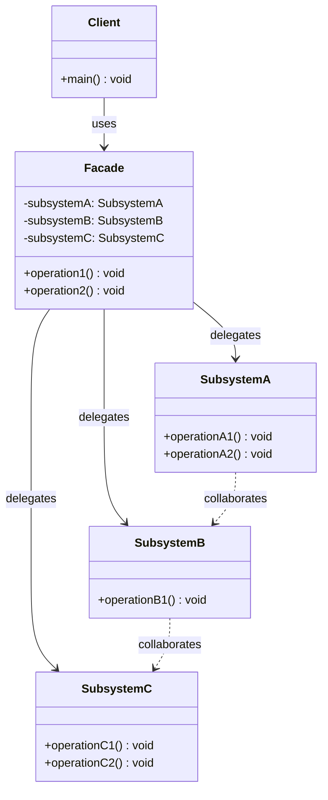

# 퍼사드(Facade) 디자인 패턴 가이드

> 한 줄 요약: 복잡하게 얽힌 서브시스템(Subsystem) 위에 단일한 고수준(High-level) 진입점(Interface)을 두어, 클라이언트(Client)가 내부 구조를 알지 못해도 일관된 방식으로 시스템을 사용할 수 있게 하는 패턴이다.
>
> 분류: 구조 패턴 (Structural Pattern)
> 다른 이름(Aliases): 정면(Facade), Unified Interface

---

## 상세 설명

퍼사드(Facade)는 복잡한 서브시스템(Subsystem)을 구성하는 다수의 클래스, 인터페이스, 의존 관계를 클라이언트(Client)로부터 가리고, 자주 사용되는 시나리오에 대해 단순화된 고수준 API를 제공하는 구조 패턴이다. 의도(Intent)는 GoF에서 "서브시스템 내부의 인터페이스 집합에 대한 통일된 인터페이스를 제공한다. 퍼사드는 서브시스템을 사용하기 쉽게 만드는 고수준 인터페이스를 정의한다(Provide a unified interface to a set of interfaces in a subsystem)"로 정의된다.

해결하고자 하는 문제(Problem)는 다음과 같다. 라이브러리나 모듈이 발전하면서 내부 구성 요소는 잘게 쪼개지고 책임이 분리되는 경향이 있다. 그 결과 단순히 "영화를 재생한다" 같은 흔한 시나리오를 수행하려고 해도 클라이언트가 수십 개의 객체(Amplifier, Tuner, DvdPlayer, Projector, Lights, Screen 등)를 직접 생성하고 올바른 순서로 호출해야 한다. 이는 클라이언트가 서브시스템 내부 구조에 강하게 결합(Coupling)되어 있다는 의미이며, 내부 구조가 바뀌면 모든 클라이언트가 함께 수정되어야 한다.

해결책(Solution)은 서브시스템 앞단에 퍼사드(Facade) 클래스를 두어, 자주 사용되는 워크플로(Workflow)를 메서드 하나로 묶어주는 것이다. 클라이언트는 퍼사드의 `watchMovie()`, `endMovie()` 같은 메서드만 호출하면 되고, 그 안에서 일어나는 내부 호출 순서는 퍼사드가 책임진다. 퍼사드는 서브시스템을 "감추는" 것이 목적이지 "막는" 것은 아니다. 따라서 퍼사드를 거치지 않고 서브시스템 클래스에 직접 접근하는 것도 여전히 가능해야 하며, 이것이 어댑터(Adapter) 같이 인터페이스 변환을 강제하는 패턴과 구분되는 지점이다.

핵심 개념과 용어를 정리하면 다음과 같다. **퍼사드(Facade)** 는 클라이언트에 노출되는 단일 진입점이다. **서브시스템 클래스들(Subsystem Classes)** 은 실제 일을 수행하는 다수의 클래스로, 서로에 대해서는 알지만 퍼사드의 존재는 모른다. **클라이언트(Client)** 는 퍼사드만 통해 서브시스템을 사용한다. 퍼사드는 서브시스템에 어떤 새로운 기능도 추가하지 않으며, 단지 호출을 위임(Delegation)하고 흐름을 조립할 뿐이다.

역사적 배경으로는 GoF(Gang of Four)가 1994년 『Design Patterns: Elements of Reusable Object-Oriented Software』에서 구조 패턴의 하나로 정의했으며, 이후 자바 표준 라이브러리(`javax.faces.context.FacesContext`), SLF4J `LoggerFactory`, Spring `JdbcTemplate` 같은 형태로 광범위하게 채택되었다. 변형으로는 "정적 퍼사드(Static Facade)"가 있는데, 인스턴스 없이 정적 메서드만 제공하는 형태이며 단일체(Singleton) 패턴과 결합되어 자주 등장한다.

---

## 디자인 패턴을 충족하는 최소 조건

이 섹션에서는 "어떤 코드가 진짜로 퍼사드 패턴이라고 부를 수 있는가"의 기준을 명확히 한다.

1. **서브시스템의 존재(Existence of a Subsystem)** — 퍼사드 뒤에는 반드시 둘 이상의 협력 객체(Collaborating Objects)로 구성된 서브시스템이 있어야 한다. 단일 클래스를 한 번 감싼 것은 래퍼(Wrapper)이지 퍼사드가 아니다.
2. **단일 진입점 제공(Unified Entry Point)** — 퍼사드는 클라이언트가 자주 수행하는 사용 시나리오(Use Case)를 하나의 고수준 메서드로 노출해야 한다. 내부 호출 순서나 객체 간 협력은 퍼사드 내부에 캡슐화된다.
3. **단방향 의존(One-way Dependency)** — 퍼사드는 서브시스템을 알지만, 서브시스템은 퍼사드의 존재를 몰라야 한다. 서브시스템 클래스가 퍼사드를 import 하거나 콜백하면 결합도가 역전되어 패턴의 이점이 사라진다.
4. **선택적 우회 허용(Optional Bypass)** — 클라이언트가 필요하다면 퍼사드를 거치지 않고 서브시스템에 직접 접근하는 것을 막지 않아야 한다. 막아야 한다면 그것은 어댑터/프록시(Adapter/Proxy)이거나 캡슐화된 모듈이지 퍼사드의 본래 의도와는 다르다.
5. **추가 기능 없음(No Extra Behavior)** — 퍼사드는 새로운 도메인 로직을 도입하지 않는다. 위임과 흐름 제어, 그리고 사소한 변환만 수행한다. 만약 퍼사드 안에서 비즈니스 규칙이 늘어난다면 그것은 응용 서비스(Application Service)나 파사드를 빙자한 신(God) 객체일 가능성이 높다.

> 위 조건 중 하나라도 빠지면 퍼사드 패턴이라고 보기 어렵거나 변형 패턴으로 분류된다.

### 흔히 오해하는 지점

- **어댑터(Adapter)와의 혼동**: 어댑터는 "기존 인터페이스를 클라이언트가 기대하는 인터페이스로 변환"하는 것이 목적이다. 퍼사드는 인터페이스 변환이 목적이 아니라 "여러 객체의 협력을 단순화"하는 것이 목적이다. 어댑터는 보통 1:1, 퍼사드는 1:N 관계로 나타난다.
- **중재자(Mediator)와의 혼동**: 중재자는 서브시스템 객체들 사이의 상호작용을 캡슐화하며, 객체들은 서로 직접 통신하지 않고 중재자를 통해 통신한다. 즉 중재자에 대한 의존이 양방향에 가깝다. 퍼사드는 외부 클라이언트의 편의를 위한 일방향(Unidirectional) 단순화이며, 서브시스템 객체들은 평소처럼 서로 직접 통신한다.
- **단순 래퍼(Wrapper) 클래스를 퍼사드라 부르는 경우**: 클래스 하나를 한 겹 감싼 것은 보통 위임(Delegation) 또는 데코레이터(Decorator)에 가깝다. 퍼사드는 본질적으로 "여러" 객체의 협력을 모아준다.
- **단일체(Singleton)와의 혼동**: 퍼사드는 한 인스턴스만 두는 경우가 많아 단일체로 구현되기도 하지만, 두 패턴은 독립적이다. 퍼사드의 본질은 단일 인스턴스가 아니라 단일 인터페이스다.

---

## 사례를 통한 예시

### 예시 1: 홈시어터(Home Theater) 시스템

**상황**: 홈시어터를 구성하는 앰프(Amplifier), DVD 플레이어(DvdPlayer), 프로젝터(Projector), 조명(Lights), 스크린(Screen) 같은 컴포넌트를 클라이언트가 일일이 켜고 끄는 일은 번거롭고 실수가 잦다. "영화를 본다"는 시나리오를 단일 호출로 추상화한다.

```java
// 서브시스템 클래스들 (Subsystem Classes)
class Amplifier {
    public void on() { System.out.println("Amplifier on"); }
    public void off() { System.out.println("Amplifier off"); }
    public void setVolume(int v) { System.out.println("Volume: " + v); }
}

class DvdPlayer {
    public void on() { System.out.println("DvdPlayer on"); }
    public void off() { System.out.println("DvdPlayer off"); }
    public void play(String movie) { System.out.println("Play: " + movie); }
    public void stop() { System.out.println("Stop DVD"); }
}

class Projector {
    public void on() { System.out.println("Projector on"); }
    public void off() { System.out.println("Projector off"); }
    public void wideScreenMode() { System.out.println("Projector: widescreen"); }
}

class Lights {
    public void dim(int level) { System.out.println("Lights dim to " + level + "%"); }
    public void on() { System.out.println("Lights on"); }
}

class Screen {
    public void down() { System.out.println("Screen down"); }
    public void up() { System.out.println("Screen up"); }
}

// 퍼사드 (Facade)
class HomeTheaterFacade {
    private final Amplifier amp;
    private final DvdPlayer dvd;
    private final Projector projector;
    private final Lights lights;
    private final Screen screen;

    public HomeTheaterFacade(Amplifier amp, DvdPlayer dvd, Projector projector,
                             Lights lights, Screen screen) {
        this.amp = amp;
        this.dvd = dvd;
        this.projector = projector;
        this.lights = lights;
        this.screen = screen;
    }

    public void watchMovie(String movie) {
        System.out.println("Get ready to watch a movie...");
        lights.dim(10);
        screen.down();
        projector.on();
        projector.wideScreenMode();
        amp.on();
        amp.setVolume(8);
        dvd.on();
        dvd.play(movie);
    }

    public void endMovie() {
        System.out.println("Shutting down theater...");
        dvd.stop();
        dvd.off();
        amp.off();
        projector.off();
        screen.up();
        lights.on();
    }
}

// 클라이언트 (Client)
public class Client {
    public static void main(String[] args) {
        HomeTheaterFacade theater = new HomeTheaterFacade(
            new Amplifier(), new DvdPlayer(), new Projector(),
            new Lights(), new Screen()
        );
        theater.watchMovie("Inception");
        theater.endMovie();
    }
}
```

**해설**: `HomeTheaterFacade`가 퍼사드(Facade) 역할이며, `Amplifier`/`DvdPlayer`/`Projector`/`Lights`/`Screen`이 서브시스템 클래스(Subsystem Classes)에 해당한다. 클라이언트(Client)는 다섯 개 객체를 일일이 조작하지 않고 `watchMovie()` 한 번으로 시나리오를 완수한다. 동시에 클라이언트는 필요하다면 `Amplifier`를 직접 가져와 정밀 제어할 수도 있다는 점이 중요하다(선택적 우회).

### 예시 2: SLF4J `LoggerFactory`

**상황**: 자바 진영의 로깅(Logging) 생태계는 Logback, Log4j, java.util.logging(JUL) 등 여러 구현체가 공존한다. SLF4J(Simple Logging Facade for Java)는 이름 그대로 이들 위에 얇은 퍼사드(Facade)를 둔다. 클라이언트는 어떤 구현체가 바인딩되어 있는지 알 필요 없이 동일한 API로 로그를 남긴다.

```java
import org.slf4j.Logger;
import org.slf4j.LoggerFactory;

public class OrderService {
    private static final Logger log = LoggerFactory.getLogger(OrderService.class);

    public void placeOrder(String orderId) {
        log.info("Placing order {}", orderId);
        try {
            // 주문 처리...
            log.debug("Order {} processed successfully", orderId);
        } catch (Exception e) {
            log.error("Failed to place order {}", orderId, e);
        }
    }
}
```

**해설**: `LoggerFactory.getLogger(...)`가 퍼사드의 단일 진입점이며, 반환되는 `Logger`도 SLF4J가 정의한 퍼사드 인터페이스다. 내부적으로는 클래스패스에서 발견된 바인딩(Logback, Log4j 어댑터 등)을 통해 실제 로거 구현체로 위임(Delegation)된다. 클라이언트 코드는 구현체 교체에도 변하지 않는다. 흥미로운 점은 SLF4J가 동시에 어댑터 패턴(Adapter)도 함께 사용한다는 것이다 — 각 로깅 백엔드별 어댑터 모듈이 SLF4J의 인터페이스를 실제 구현체로 변환해 준다. 본 사례는 "퍼사드는 다른 구조 패턴과 함께 쓰일 때 가장 강력하다"는 점을 보여준다.

추가로, JSF(JavaServer Faces)의 `javax.faces.context.FacesContext` 역시 대표적 퍼사드 사례다. 요청 처리에 필요한 `ExternalContext`, `Application`, `ViewRoot`, `RenderKit` 등 다수의 객체를 `FacesContext.getCurrentInstance()` 하나로 묶어 노출한다.

---

## 어떨 때 사용하나

다음과 같은 신호(Symptom)가 보일 때 퍼사드 도입을 고려한다.

- 클라이언트가 어떤 작업을 수행하기 위해 라이브러리/모듈의 여러 클래스를 정해진 순서로 호출해야 하고, 그 호출 시퀀스가 반복적으로 등장한다.
- 서브시스템이 빠르게 변경되는데 클라이언트가 너무 많은 내부 클래스에 의존하고 있어 변경 시마다 광범위한 수정이 일어난다.
- 신규 개발자가 모듈을 사용하기 위해 익혀야 할 클래스의 수가 많아 학습 곡선(Learning Curve)이 가파르다. "이 기능을 쓰려면 어디서부터 시작해야 하나"라는 질문이 반복된다.
- 시스템을 계층(Layer)으로 분리하고 싶고, 상위 계층은 하위 계층의 작은 진입점만 통해 협력하기를 원한다(계층화 아키텍처(Layered Architecture)의 경계).
- 레거시 시스템을 점진적으로 리팩터링하면서, 외부에는 깔끔한 인터페이스를 노출하고 내부는 자유롭게 정리하고 싶다(스트랭글러(Strangler) 마이그레이션에서 자주 등장).

### 사용하면 안 되는 경우 (Anti-patterns)

- 서브시스템이 사실상 한두 개의 클래스로 구성되어 있다면 퍼사드는 과도한 추상화다. 단순한 위임 클래스나 헬퍼 함수면 충분하다.
- 다양한 클라이언트가 서로 다른 시나리오로 서브시스템을 사용하는데, 그 모든 시나리오를 하나의 퍼사드로 묶으면 신(God) 클래스가 만들어진다. 이런 경우에는 시나리오별로 응용 서비스(Application Service)를 두거나 여러 개의 작은 퍼사드로 분리해야 한다.
- 클라이언트에게 서브시스템 전체에 대한 세밀한 제어가 필요한 경우, 퍼사드만 제공하면 오히려 표현력이 떨어진다. 이때는 퍼사드와 직접 접근을 병행해야 한다.
- 인터페이스 형태 자체를 바꿔서 호환되지 않는 두 시스템을 잇는 것이 목적이라면 그것은 어댑터(Adapter)지 퍼사드가 아니다.

---

## 장점과 단점, 한계점

### 장점

- **결합도 감소(Reduced Coupling)**: 클라이언트가 서브시스템의 구체 클래스가 아니라 퍼사드 하나에만 의존하므로, 내부 리팩터링이 클라이언트에 영향을 거의 주지 않는다.
- **사용성 향상(Improved Usability)**: 자주 쓰이는 시나리오를 단일 메서드로 제공함으로써 클라이언트 코드가 짧아지고 가독성이 좋아진다. 학습 곡선도 완만해진다.
- **계층 경계 정의(Layer Boundary)**: 모듈/계층 사이의 진입점을 명시적으로 표시해 아키텍처의 의도를 코드에 드러낼 수 있다.
- **점진적 마이그레이션 용이(Refactoring Friendly)**: 퍼사드 뒤에서 자유롭게 구현을 갈아끼울 수 있어 레거시 코드 정리, 기술 스택 전환에 유리하다.

### 단점

- **신(God) 객체화 위험**: 시나리오가 늘어날수록 퍼사드 한 클래스에 메서드가 쌓이기 쉽고, 결국 모든 기능이 모이는 만능 객체가 된다. 책임 단위로 퍼사드를 분리하는 규율이 필요하다.
- **표현력 손실(Loss of Expressiveness)**: 퍼사드가 노출하는 메서드 시그니처에 갇히면 서브시스템의 세밀한 제어가 어려워질 수 있다. 직접 접근을 함께 허용하지 않으면 클라이언트는 표현이 부족해진다고 느낀다.
- **추가 간접화 계층(Indirection)**: 호출이 한 단계 더 거쳐 가므로 디버깅 시 스택 깊이가 늘고, 마이크로 단위 성능 분석에서는 약간의 오버헤드가 있다.

### 한계점

- 퍼사드는 인터페이스의 모양(Shape)을 바꿀 수 없다. 서브시스템 자체가 잘못 설계되어 있다면 퍼사드를 씌워도 근본적인 복잡도는 줄지 않으며, 단지 클라이언트에서 보이지 않을 뿐이다.
- 자바처럼 정적 타입(Statically Typed) 언어에서는 퍼사드 인터페이스를 자주 바꾸기 어렵다. 시나리오가 자주 추가/제거되는 도메인에서는 인터페이스 안정성과 진화 사이의 균형이 필요하다.
- 동시성(Concurrency) 환경에서 퍼사드 메서드 하나가 여러 서브시스템 호출을 순차로 묶는다면, 그 시퀀스의 원자성(Atomicity)이나 트랜잭션 경계는 별도로 설계해야 한다. 퍼사드는 자동으로 트랜잭션을 만들어 주지 않는다.
- 테스트 측면에서는 퍼사드를 통한 테스트가 통합 테스트(Integration Test)에 가까워지기 쉬워, 단위 테스트(Unit Test)로는 서브시스템 각 클래스를 별도로 검증해야 한다.

---

## 정보 표

| 항목 | 값 |
| --- | --- |
| 분류 | 구조 패턴 (Structural Pattern) |
| 언어 의존성 | 언어 비의존적 (Language-agnostic). 클래스/모듈 개념이 있는 거의 모든 객체지향 언어에서 동일하게 적용 가능하다. |
| 활용성(1점~5점) | ★★★★★ (5/5) — 라이브러리 경계, 계층화 아키텍처, 레거시 리팩터링 등 거의 모든 실전 코드베이스에서 자연스럽게 등장하는 가장 흔한 패턴 중 하나다. |
| 학습 난이도 | 하 (Low). 개념이 직관적이고 구현이 단순하나, "신(God) 객체화"를 피하는 설계 감각이 요구된다. |
| 자주 함께 쓰이는 패턴 | 추상 팩토리(Abstract Factory), 단일체(Singleton), 어댑터(Adapter), 중재자(Mediator) |
| 대표 사용 사례 | SLF4J `LoggerFactory`, JSF `FacesContext`, Spring `JdbcTemplate`/`RestTemplate`, Java `javax.script.ScriptEngineManager` |

---

## Class Diagram



> 다이어그램에 등장하는 각 클래스가 패턴의 어떤 역할(Role)을 담당하는지 위 "상세 설명" 섹션과 1:1로 대응된다.

### 역할 설명

- **Client (클라이언트)**: 서브시스템을 사용하는 외부 코드. 퍼사드(Facade)만을 알면 되고, 서브시스템 클래스의 존재나 협력 방식을 알 필요가 없다.
- **Facade (퍼사드)**: 서브시스템에 대한 단일 진입점. 자주 쓰이는 시나리오를 고수준 메서드로 노출하며, 내부에서 서브시스템 클래스들에 호출을 위임(Delegation)한다. 새로운 도메인 로직은 추가하지 않는다.
- **SubsystemA / SubsystemB / SubsystemC (서브시스템 클래스들)**: 실제 작업을 수행하는 다수의 협력 객체. 서로에 대해서는 알지만 퍼사드의 존재는 알지 못한다. 퍼사드를 거치지 않고 직접 사용하는 것도 가능하다.

---

## 참고 자료

- Erich Gamma, Richard Helm, Ralph Johnson, John Vlissides (Gang of Four), "Design Patterns: Elements of Reusable Object-Oriented Software", Addison-Wesley, 1994 — Facade 패턴 원전.
- Eric Freeman, Elisabeth Robson, "Head First Design Patterns" (2nd ed.), O'Reilly, 2020 — 홈시어터(Home Theater) 예시의 원형이 소개된 책.
- Refactoring.Guru, "Facade", https://refactoring.guru/design-patterns/facade
- SLF4J 공식 문서, "Simple Logging Facade for Java (SLF4J) user manual", https://www.slf4j.org/manual.html
- Oracle Jakarta Server Faces 사양 — `jakarta.faces.context.FacesContext` 설명.
- Martin Fowler, "Patterns of Enterprise Application Architecture", Addison-Wesley, 2002 — 계층화 아키텍처(Layered Architecture)에서의 경계 객체로서의 퍼사드 논의.
