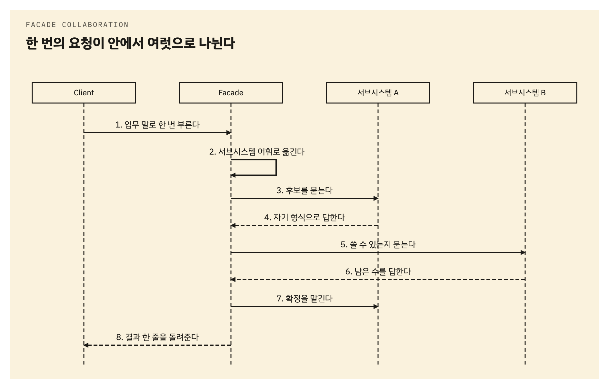
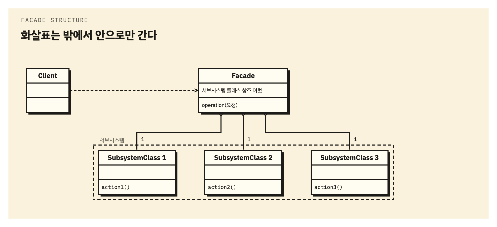

# Facade — 여럿이 정해진 순서로 협력하던 일을 문 하나로 줄이기

## 한눈에 보는 개요

사내 회의실 예약 코드를 하나 떠올려 봅시다. 예약을 한 건 잡으려면 방 목록에서 인원이 들어가는 후보를 뽑고, 일정 장부에 그 시간대가 비었는지 묻고, 비품 창고에 프로젝터가 남았는지 확인하고, 다시 일정 장부에 확정을 적고, 비품을 배정하고, 마지막으로 안내를 보내야 해요. 여섯 단계이고 순서가 정해져 있습니다. 그런데 이 순서를 아는 코드가 예약 화면에도, 총무팀 일괄 등록 배치에도, 채용 면접 일정 배치에도 각각 들어 있어요. 셋 중 하나가 비품 확인 한 단계를 빠뜨리면 방은 잡혔는데 프로젝터가 없는 예약이 생기고, 그 사실은 회의 당일에야 알게 됩니다.

Facade 의 해법은 **그 순서를 아는 객체 하나를 서브시스템 앞에 두는 것**입니다. 부르는 쪽은 그 하나에게 업무 말로 한 번만 요청하고, 안쪽 객체들은 무엇 하나 바뀌지 않아요. 안쪽은 앞에 문이 생겼다는 사실조차 모릅니다.

```text
Before : 순서를 아는 코드가 호출부마다 복제돼 있음

  예약 화면      ─┐
  총무팀 배치    ─┼─▶ RoomCatalog → ScheduleBook → EquipmentPool → ScheduleBook → EquipmentPool → NoticeSender
  면접 일정 배치  ─┘   (후보)        (비었나)        (남았나)        (확정)        (배정)        (안내)
                       ↑ 세 곳이 같은 여섯 단계를 각자 적는다. 한 곳이 세 번째를 빠뜨려도 타입 검사는 통과한다

After : 순서를 아는 객체 하나를 앞에 둠

  예약 화면      ─┐
  총무팀 배치    ─┼─▶ BookingDesk.reserve(요청)
  면접 일정 배치  ─┘        │
                            └─▶ RoomCatalog · ScheduleBook · EquipmentPool · NoticeSender
                                 ↑ 넷은 그대로다. BookingDesk 라는 이름을 어디에도 적지 않는다
```

분류는 구조 패턴이고 객체 범위이며 다른 이름은 없습니다. 자주 함께 쓰는 패턴이 셋 있어요. 서브시스템 객체를 만드는 일까지 감추고 싶으면 Abstract Factory 를 함께 쓰고, 창구는 보통 하나면 충분해서 Singleton 으로 두기도 합니다(근거: GoF 원서 Facade 절 Related Patterns). 나머지 하나는 Adapter 인데, 서브시스템 한 칸이 바깥 시스템을 우리 말로 옮기는 자리면 그 칸이 어댑터가 됩니다. 원전이 이 짝을 적어 둔 것은 아니고, 이 글의 예시 코드가 실제로 그렇게 동작하는 것을 비교 절에서 보여 줍니다. 이 글은 시나리오 셋을 따라갑니다. 예약 한 건이 확정되는 길, 창구를 건너뛰어야 하는 팀이 생길 때, 창구의 규칙을 어기면 어디서 어긋나는가. 끝까지 읽으면 어떤 코드를 Facade 라고 불러도 되는지 필수 조건 넷으로 판정할 수 있고, 구조가 닮은 Mediator·Adapter·Proxy 와도 구분할 수 있게 됩니다.

## 패턴 자세히 들여다보기

### 시나리오 1 — 예약 한 건이 확정되기까지

alice 가 8명짜리 회의를 14시부터 1시간, 프로젝터 1대로 신청했습니다. 이 회사의 회의실은 넷이고 수용 인원은 R1 이 4명, R2 와 R3 이 8명, R4 가 20명이에요. 프로젝터는 모두 2대입니다. 나와야 하는 답은 `confirmed R2 14-15 projector 1` 한 줄이에요. 이 장면에는 여섯이 등장합니다. 예약 요청을 받는 창구 `BookingDesk`(패턴에서는 Facade 라고 부르는 역할), 수용 인원표를 가진 `RoomCatalog`, 시간대 점유를 적는 `ScheduleBook`, 프로젝터 재고를 세는 `EquipmentPool`, 안내를 내보내는 `NoticeSender`(넷 다 서브시스템 클래스), 그리고 요청을 만들어 창구에 넘기는 예약 화면(Client)입니다. 이름은 여기서 한 번씩만 소개하고 정식 정의는 개념 정리에서 해요.



1. 예약 화면이 `BookingDesk` 에게 업무 말로 한 번 요청합니다 — "alice · 8명 · 14시 · 1시간 · 프로젝터 1". 화면이 창구에게만 말을 거는 이유는 넷에게 무엇을 어떤 순서로 물어야 하는지 아는 쪽이 창구이기 때문이에요. 그 지식이 화면 쪽에 있으면 화면이 늘 때마다 복제됩니다.
2. `BookingDesk` 가 요청을 서브시스템 어휘로 옮깁니다. "8명"은 `roomsFor(8)` 의 인자가 되고 "14시 1시간"은 `startHour = 14` 와 `hours = 1` 두 값으로 나뉘어요. 이 옮기는 일이 창구에 있는 이유는 넷 중 누구도 "예약 요청"이라는 말을 모르기 때문입니다. 넷이 아는 것은 수용 인원·시각·대수뿐이에요.
3. `RoomCatalog` 에 8명이 들어가는 방 후보를 묻고 `[R2, R3, R4]` 를 받습니다. 창구가 수용 인원을 직접 따지지 않는 이유는 그 표를 가진 쪽이 `RoomCatalog` 이어서예요. 창구가 표를 베껴 두면 방이 하나 늘 때 두 곳을 함께 고쳐야 합니다.
4. 후보를 앞에서부터 `ScheduleBook` 에 물어 비어 있는 첫 방을 고릅니다 — R2 예요. 수용 인원을 먼저 보고 점유를 나중에 보는 이유는 두 물음에 답하는 객체가 달라서입니다. 순서를 바꾸면 4명짜리 R1 이 비었는지까지 묻게 되고, 그 답은 8명 회의에 쓸모가 없어요.
5. `EquipmentPool` 에 14시부터 1시간 동안 남은 프로젝터 수를 묻습니다 — 2대이고 요청은 1대이니 통과예요. 이 확인이 6단계보다 **앞**에 있는 이유는, 뒤로 미루면 비품이 모자랄 때 이미 잡힌 방이 남기 때문입니다. 시나리오 3 의 2단계가 정확히 그 경우예요.
6. `ScheduleBook` 에 R2 의 14시 한 칸을 확정해 달라고 맡기고, `EquipmentPool` 에 프로젝터 1대 배정을 맡깁니다. 장부를 실제로 고치는 일은 둘이 해요. 창구가 점유 표를 직접 가지면 같은 장부가 두 벌이 되고, 총무팀이 `ScheduleBook` 만 떼어 썼을 때 두 벌의 답이 달라집니다.
7. `NoticeSender` 에 안내를 맡깁니다. 구현인 `MailNotice` 가 `alice` 를 `alice@corp.example` 로 바꿔 옛 메일 시스템에 넣어요. 창구가 메일 주소 규칙을 모르는 이유는 그것이 안내 쪽 일이지 예약 쪽 일이 아니기 때문입니다.
8. `BookingDesk` 가 `confirmed R2 14-15 projector 1` 한 줄을 화면에 돌려줍니다. 화면은 넷 중 어느 것도 직접 부르지 않았어요. 부를 수 없어서가 아니라 부를 필요가 없어서인데, 그 차이는 시나리오 2 에서 확인할 수 있습니다.

```text
단계   부르는 쪽 → 받는 쪽              넘기는 것                  돌아오는 것
 1     화면 → BookingDesk             alice · 8 · 14 · 1 · 1     (8단계에서 confirmed 한 줄)
 2     BookingDesk 안에서              —                          roomsFor(8) · (14, 1)
 3     BookingDesk → RoomCatalog      8                          [R2, R3, R4]
 4     BookingDesk → ScheduleBook     R2 · 14 · 1                true  (첫 후보에서 끝)
 5     BookingDesk → EquipmentPool    14 · 1                     2     (요청 1 ≤ 2)
 6     BookingDesk → ScheduleBook     R2 · 14 · 1                —     (확정)
       BookingDesk → EquipmentPool    1 · 14 · 1                 —     (배정)
 7     BookingDesk → NoticeSender     alice · "R2 14-15"         —
 8     BookingDesk → 화면              —                          confirmed R2 14-15 projector 1
```

잠깐, 확인 하나만 해 볼까요? 이 여덟 단계에서 `RoomCatalog` 가 `ScheduleBook` 에게 말을 거는 줄은 몇 개일까요?

하나도 없습니다. 넷은 서로도 부르지 않고 창구도 부르지 않아요. 화살표는 전부 화면 → 창구 → 넷 방향으로만 갑니다. 이 한 방향이 Facade 를 Mediator 와 구분하는 기준이고, 비교 절에서 다시 봅니다.

```text
alice 의 예약 한 건에서 오간 호출을 방향별로 세면

  화면 → BookingDesk          1개   (1단계)
  BookingDesk → 서브시스템     6개   (3·4·5·7단계에 하나씩, 6단계에 둘)
  서브시스템 → BookingDesk     0개
  서브시스템 → 서브시스템       0개
```

이 시나리오가 보여 준 것은 역할 셋과 그 사이의 호출 방향입니다. 순서와 번역(1·2단계)은 Facade 가, 실제 일(3~7단계)은 서브시스템 클래스가 맡고, Client 는 Facade 에게만 요청해요(1·8단계). 그리고 창구 안에는 넷을 부르는 줄과 그 답을 다음 줄로 넘기는 코드밖에 없습니다 — 수용 인원을 판단하는 코드도, 점유를 따지는 코드도 창구에는 없어요.

### 시나리오 2 — 창구를 건너뛰어야 하는 팀이 생길 때

총무팀이 요구를 하나 들고 왔습니다. "임원 일정 때문에 R1 을 우리가 직접 잡아야 한다"는 거예요. 그런데 `BookingDesk.reserve` 는 인원을 받아 방을 **골라 주는** 연산이라 방을 지정받지 않습니다. 같은 주에 두 번째 변화도 들어왔어요 — 비품 재고를 시간대 단위로 세던 방식을 대여 이력 단위로 바꾸기로 했습니다. 두 변화에서 무엇이 바뀌고 무엇은 안 바뀌는지 따라가 봅시다.

1. 총무팀 코드가 `ScheduleBook` 을 직접 불러 `hold("R1", 14, 1)` 을 실행합니다. 이것이 가능한 이유는 서브시스템 클래스가 공개돼 있기 때문이에요. 창구는 서브시스템 앞에 있는 문이지 벽이 아닙니다. 실행 출력 5번 줄이 이 호출 다음의 상태예요.
2. `BookingDesk` 는 한 줄도 바뀌지 않습니다. 총무팀이 창구의 연산을 부르지 않았고, 창구도 총무팀을 모르기 때문이에요. 새 요구 하나가 들어왔는데 기존 코드가 안 바뀌는 자리는 여기 하나뿐이고, 그 대신 총무팀 쪽에 여섯 단계 중 필요한 것을 직접 적는 코드가 생깁니다.
3. 총무팀이 치르는 값이 그 자리에서 보입니다 — 안내가 나가지 않아요. 실행 출력 5번 줄의 `mail sent 3` 은 창구를 거친 셋(alice·bob·dave)만 센 값이고, 총무팀의 직접 예약은 거기 없습니다. 순서를 아는 쪽이 창구인데 그 순서를 건너뛰었으니 마지막 단계도 함께 건너뛴 것이죠.
4. 비품 재고 계산 방식이 바뀝니다. `EquipmentPool.freeAt` 의 본문이 통째로 바뀌어도 이름·인자·반환이 그대로면 창구의 호출 줄도, 예약 화면도 한 줄이 안 바뀌어요. 화면이 아는 이름은 `BookingDesk.reserve` 하나뿐이라 그 아래에서 무엇이 바뀌든 화면은 영향을 받지 않습니다.
5. 요구가 "예약 취소"였다면 창구에 연산이 하나 늘어납니다. 취소를 실제로 하는 연산(`ScheduleBook` 쪽의 해제)은 서브시스템이 갖고, 창구는 그것을 부르는 순서만 알아요. 여기서 "며칠 전까지 취소할 수 있는가" 같은 판단을 창구에 넣고 싶어지는데, 그렇게 하면 시나리오 3 의 3단계가 됩니다.

```text
변화                       바뀐 곳                                   안 바뀐 곳
총무팀이 방을 지정          총무팀 코드에 ScheduleBook 직접 호출        BookingDesk 전체 · 예약 화면
                          (대신 안내가 빠진다 — mail sent 가 3 그대로)  RoomCatalog · EquipmentPool · NoticeSender
비품 재고 계산 방식 교체     EquipmentPool 의 freeAt 본문               BookingDesk 의 호출 줄 · 예약 화면
예약 취소 연산 추가         BookingDesk 에 연산 1개 · ScheduleBook 에    예약 화면의 기존 호출 · 나머지 셋
                          해제 연산 1개
```

여기서 헷갈리기 쉬운 포인트는 창구를 두면 서브시스템이 **닫힌다**고 믿는 것입니다. 닫히지 않아요. 1단계의 총무팀 코드는 컴파일도 되고 실행도 되며, 그렇게 쓰라고 열어 둔 것이기도 합니다(근거: GoF 원서 Facade 절 Consequences). 서브시스템을 감추고 싶으면 그것은 창구가 아니라 언어의 접근 제한자가 하는 일이에요 — Java 라면 패키지 전용, Rust 라면 모듈 비공개가 그 자리입니다. 다만 감추는 순간 1단계가 불가능해지므로 두 가지를 함께 가질 수는 없습니다.

이 시나리오가 보여 준 것은 창구가 무엇을 지켜 주고 무엇은 안 지켜 주는가입니다. 서브시스템 안쪽이 바뀔 때 Client 를 지켜 주고(4단계), 창구에 연산이 늘어도 기존 호출을 지켜 줍니다(5단계). 대신 서브시스템으로 가는 다른 길을 막지는 않고(1단계), 그 길로 간 코드는 창구가 알던 순서를 잃습니다(3단계).

### 시나리오 3 — 창구의 규칙을 어기면 어느 단계에서 무엇이 어긋나는가

같은 회사의 다른 코드베이스가 같은 예약 절차를 조금씩 다르게 짰습니다. 갈래 셋을 차례로 따라가는데, 아래 결과는 모두 정본 코드의 해당 줄만 바꿔 **직접 컴파일하고 실행한 것**입니다. 기준은 Java 21.0.11 이에요.

1. 서브시스템이 창구를 알게 되는 갈래부터 봅니다. "확정한 다음에 안내까지 `ScheduleBook` 이 챙기게 하자"는 생각으로 `ScheduleBook` 의 생성자가 `BookingDesk` 를 받도록 고쳤어요. 컴파일하면 진입점에서 멈춥니다. 아래가 javac 이 낸 진단이고, 절대 경로 앞머리와 캐럿(`^`) 줄, 마지막 `1 error` 줄을 뺀 나머지는 원문 그대로예요.

   ```text
   BookingDeskApp.java:150: error: cannot find symbol
           ScheduleBook schedule = new ScheduleBook(desk);
     symbol:   variable desk
     location: class BookingDeskApp
   ```

   진단이 가리키는 150행은 필드와 생성자를 더하느라 다섯 줄이 늘어난 사본 기준이고, 정본에서 같은 자리는 145행이에요. `BookingDesk` 는 `ScheduleBook` 을 받아야 만들어지고 `ScheduleBook` 은 `BookingDesk` 를 받아야 만들어지니, 둘 중 어느 쪽도 먼저 만들어질 수 없어서 나는 진단입니다. 생성자 대신 나중에 꽂아 넣는 연산을 두면 컴파일은 지나가지만 그때는 시나리오 2 의 1단계가 성립하지 않아요 — `ScheduleBook` 하나만 떼어다 쓸 수 없게 되니까요.
2. 다음은 Client 가 순서를 직접 따라가다가 한 단계를 뒤로 옮기는 갈래예요. carol 의 예약만 화면이 직접 처리하되 "방부터 잡고 비품은 나중에 확인"으로 바꿨어요. carol 은 정본과 같은 이유로 거절되는데(`rejected projector short need 1 free 0`), 거절된 예약이 잡아 둔 R4 의 14시 한 칸이 그대로 남습니다. 그래서 바로 뒤에 들어온 20명 회의 요청이 아래처럼 달라져요.

   ```text
   정본 (창구가 순서를 안다)        3b) erin 20 people 14-15: confirmed R4 14-15 projector 0
   순서를 바꾼 사본                 3b) erin 20 people 14-15: rejected no room for 20
   ```

   20명이 들어가는 방은 R4 하나뿐이라 그 한 칸이 잠긴 순간 다음 요청이 갈 곳이 없어집니다. 순서를 아는 쪽이 한 곳일 때만 그 순서가 한 번만 틀릴 수 있다는 것이 이 갈래가 보여 주는 것이에요.
3. 남은 갈래는 창구에 업무 규칙이 쌓이는 경우입니다. "한 예약에 프로젝터는 한 대까지"라는 규칙을 `BookingDesk.reserve` 안에 넣었어요. frank 의 2대 요청은 거절되는데, 같은 규칙을 모르는 총무팀이 `EquipmentPool` 에 2대를 직접 배정하면 그대로 들어갑니다.

   ```text
   5) frank via desk: rejected projector limit 1 per booking
   5b) admin direct: R2 9-10 held, projector free at 9 = 0
   ```

   규칙이 창구로 올라가면 그 규칙은 창구를 지나는 경로에만 적용됩니다. 시나리오 2 의 1단계에서 본 대로 서브시스템으로 가는 길이 하나 더 열려 있으니까요. 규칙은 그것이 지켜야 할 데이터를 가진 쪽에 있어야 하고, 프로젝터 대수 규칙이라면 `EquipmentPool` 이 그 쪽입니다.

```text
어긴 규칙                          어긋나는 자리                      최소 조건으로 보면
서브시스템이 창구를 안다            생성 자체가 안 된다 (진입점 145행)    3번
순서를 Client 가 직접 따른다        거절된 예약이 방을 잡은 채 남는다      시나리오 1 이 정한 협력 규칙
창구가 업무 규칙을 갖는다           두 경로의 답이 달라진다              4번
```

이 시나리오가 보여 준 것은 세 규칙이 각각 어디서 어긋나는지입니다. 1단계는 컴파일러가 막아 줍니다. 2·3단계는 막아 주는 것이 없어서 실행해 봐야 알 수 있고, 그래서 최소 조건 절에서 코드로 확인할 모양을 따로 적어 두었어요.

### 개념 정리

시나리오에 나온 역할 셋을 정식으로 정의합니다. Client 는 이 패턴의 참여 역할이 아니지만 시나리오와 구현에 늘 나오므로 함께 정의해요.

- **Facade** — 서브시스템의 어느 클래스가 어떤 요청을 책임지는지 알고, Client 의 요청을 그 객체들에게 순서대로 넘깁니다. 넘기기 전에 Client 의 말을 서브시스템의 말로 옮기는 일도 해요(시나리오 1 의 2단계). 일을 직접 하지 않고 넘기는 이 방식을 위임이라고 부르는데, 그 말의 정의는 [참고 문서 「GoF 공통 어휘」](../../reference/gof-vocabulary/gof-vocabulary-ref_v1.0.2.md)에 있습니다. 예약 예에서는 `BookingDesk` 가 Facade 예요.
- **서브시스템 클래스(subsystem classes)** — 실제 일을 하는 클래스들입니다. 서로 협력해도 되고 안 해도 되지만, **Facade 는 모릅니다** — 필드에도 인자에도 Facade 타입이 없고 Facade 의 연산을 부르지도 않아요(시나리오 3 의 1단계). 그래서 Facade 없이 직접 써도 그대로 동작합니다(시나리오 2 의 1단계). 예약 예에서는 `RoomCatalog`·`ScheduleBook`·`EquipmentPool`·`NoticeSender` 넷이고, `NoticeSender` 의 구현 `MailNotice` 도 서브시스템 안에 있습니다.
- **Client** — Facade 에게만 요청하는 쪽입니다(시나리오 1 의 1·8단계). 서브시스템 객체를 직접 부르는 것이 금지되지는 않고, 직접 부르는 순간 그 코드는 Client 가 아니라 서브시스템을 쓰는 다른 코드가 돼요(시나리오 2 의 1단계). 예약 예에서는 예약 화면과 진입점이 Client 입니다.



그림에서 눈여겨볼 것은 **없는 화살표**입니다. 점선 상자 안의 세 칸에서 밖으로 나가는 선이 하나도 없어요. Client 에서 나가는 선은 Facade 로만 향하고, Facade 에서 나가는 선은 안쪽으로만 갑니다. 이 한 방향이 최소 조건 3번이 코드에서 확인하는 것이고, 그림에 선이 하나만 더 생기면 — 서브시스템 칸에서 Facade 로 — 그것은 Mediator 쪽입니다.

> 창구는 안쪽을 알고, 안쪽은 창구를 모른다.

## 사용 목적

Facade 가 필요할 때는 코드나 요구에서 보이는 단서가 있습니다. 셋을 차례로 봅시다.

**단서 1. 같은 호출 순서가 호출부마다 복제돼 있습니다.** 서브시스템 타입 이름으로 검색하면 여러 파일에서 같은 순서가 나오는 모양이에요. 개요의 Before 그림이 이것이고, 검색으로 확인할 수 있는 단서라 가장 쓰기 좋습니다. 복제 중 하나가 한 단계를 빠뜨려도 타입 검사는 통과하므로 이 단서는 서둘러 확인해야 해요.

```text
ScheduleBook 으로 검색하면
──────────────────────────────────────────────────────────────
booking/ReservationScreen   roomsFor → isFree → freeAt → hold → assign → send
admin/BulkRegisterJob       roomsFor → isFree → freeAt → hold → assign → send
hiring/InterviewSlotJob     roomsFor → isFree →          hold → assign → send   ← freeAt 이 없다
```

**단서 2. 새로 온 사람이 "이걸 쓰려면 무엇부터 부르죠?"를 묻고, 답이 여러 단계입니다.** 라이브러리의 "시작하기"가 열 줄이면 같은 신호예요. 코드에서는 한 함수가 서브시스템 타입 여럿을 한꺼번에 만들어 쓰는 모양으로 보입니다. 원전도 복잡한 서브시스템에 대부분의 Client 에게 충분한 단순한 기본 뷰를 주고 싶을 때를 첫 적용 대상으로 들고, 그 이유는 대부분의 Client 가 맞춤을 필요로 하지 않기 때문이에요(근거: GoF 원서 Facade 절 Applicability). 맞춤이 필요한 소수는 시나리오 2 의 1단계처럼 창구를 거치지 않고 서브시스템을 직접 쓰면 됩니다.

**단서 3. 서브시스템을 계층으로 나누고 계층마다 진입점을 두고 싶습니다.** 계층이 여럿인 시스템에서 층끼리 직접 얽히면 의존이 그물이 되는데, 층마다 창구를 하나씩 두면 층 사이의 의존이 창구와 창구 사이로 줄어들어요(근거: GoF 원서 Facade 절 Applicability). 아래 표는 세 단서를 코드에서 무엇을 보면 되는지로 정리한 것입니다.

| 단서 | 코드에서 관찰되는 것 | 확인 방법 |
| --- | --- | --- |
| 1. 호출 순서의 복제 | 여러 파일이 같은 서브시스템 타입들을 같은 순서로 부름 | 서브시스템 타입 이름으로 검색해 호출부 수를 세고 단계 수를 맞춰 봄 |
| 2. 여러 단계짜리 시작 | 한 함수가 서브시스템 타입 셋 이상을 만들어 씀 | 그 함수에서 `new` 나 생성 호출의 타입을 셈 |
| 3. 층 사이의 그물 의존 | 층 A 의 여러 클래스가 층 B 의 여러 클래스를 직접 부름 | 층 경계를 넘는 import 를 세어 양쪽 클래스 수의 곱에 가까운지 봄 |

비슷한 단서에서 다른 패턴을 고르게 되는 경우가 셋 있습니다. 감싸는 목적이 연산 모양의 변환이면 Adapter 를, 접근 통제면 Proxy 를, 가운데 객체가 **안쪽 객체들 사이의** 통신을 조정해야 하면 Mediator 를 먼저 검토하세요. 차이는 다음 절에서 풉니다. 그리고 아래 상황에서는 창구를 두면 얻는 것보다 잃는 것이 큽니다.

| 쓰지 말아야 할 상황 | 쓰면 잃는 것 |
| --- | --- |
| 대부분의 Client 가 세밀한 제어를 필요로 함 | 창구가 우회로로만 쓰이는데 두 경로를 함께 유지하는 비용은 그대로 듭니다. 창구가 서브시스템보다 먼저 낡고, 그 사실을 아무도 모릅니다 |
| 서브시스템이 클래스 하나뿐 | 최소 조건 1번에 걸립니다. 한 겹 감싼 래퍼가 하나 늘고 호출이 한 단계 깊어질 뿐이에요 |
| 창구에 업무 규칙을 넣고 싶어짐 | 규칙이 한 경로에만 적용됩니다. 시나리오 3 의 3단계가 그 결과이고, 규칙이 계속 쌓이면 앱의 모든 클래스와 얽힌 객체 하나가 됩니다([refactoring.guru — Facade](https://refactoring.guru/design-patterns/facade)) |

## 패턴의 경계

### 디자인 패턴을 충족하는 최소 조건

어떤 코드를 Facade 라고 불러도 되는지 가르는 기준입니다. `[필수]` 가 하나라도 빠지면 Facade 가 아니고, `[선택]` 은 갖추면 좋거나 상황에 따라 고르는 구조예요. 조건은 언어와 상관없이 코드에서 확인할 수 있는 모양(타입 선언·참조 보유·호출 방향·생성 위치)으로 적었고, 조건마다 그것을 보여 준 시나리오의 단계를 가리킵니다.

1. [필수] Facade 가 서로 다른 서브시스템 타입 **둘 이상**을 참조하고, 적어도 한 연산이 그중 둘 이상을 부릅니다 — Facade 의 필드나 생성자 인자에 적힌 서브시스템 타입이 둘 이상이고, 연산 하나의 본문에서 그 서로 다른 타입의 연산이 함께 불립니다. 시나리오 1 의 3~7단계가 한 연산 안에서 넷을 차례로 부른 자리예요 (근거: GoF 원서 Facade 절 Intent — 서브시스템 안의 인터페이스 집합에 통합된 상위 인터페이스를 제공하는 것이 이 패턴의 의도다).
   - 빠지면: 부르는 대상이 하나뿐이면 단순화할 협력이 없습니다. 그 하나를 감싸 **다른** 연산 모양을 제공하면 Adapter 이고, **같은** 모양을 제공하면 목적에 따라 Decorator 나 Proxy 예요. 새 이름을 붙였는데 안에 대상이 하나면 셋 중 어느 것도 아닌, 한 겹 감싼 서비스 클래스입니다.
2. [필수] Facade 의 연산이 실제 일을 **서브시스템 객체 호출로** 수행합니다 — Facade 연산의 본문이 서브시스템 객체의 연산을 부르고 그 반환값을 다음 호출이나 Client 에게 넘기며, 같은 일을 하는 코드를 Facade 가 따로 가지고 있지 않습니다. 시나리오 1 의 6단계에서 장부를 고친 쪽이 `ScheduleBook` 이었던 것이 이 자리입니다 (근거: GoF 원서 Facade 절 Collaborations — 실제 일은 서브시스템 객체가 하고 Facade 는 요청을 그쪽으로 넘긴다).
   - 빠지면: 창구가 점유 표를 자기 안에 두고 직접 답하면 서브시스템을 단순화한 것이 아니라 대체한 것입니다. 장부가 두 벌이 되어, 총무팀이 `ScheduleBook` 을 직접 쓴 시나리오 2 의 1단계 다음부터 두 벌의 답이 달라져요.
3. [필수] 서브시스템 클래스가 Facade 를 **모릅니다** — 서브시스템 클래스의 필드·생성자 인자·메서드 인자·반환 타입 어디에도 Facade 타입이 없고, 서브시스템 코드가 Facade 의 연산을 부르지 않습니다. 시나리오 3 의 1단계가 이 조건을 어겼을 때의 자리예요 (근거: GoF 원서 Facade 절 **Participants** — 서브시스템 클래스의 역할을 「facade 를 알지 못하고, **그것을 가리키는 참조를 하나도 두지 않는다**」로 적는다. 같은 절 Related Patterns 도 Mediator 대비로 같은 말을 한다).
   - 빠지면: 가운데 객체를 안쪽이 알고 부르기 시작하면 Mediator 쪽입니다. 그 전에 컴파일이 먼저 막는 경우도 많은데, 시나리오 3 의 1단계에 실은 진단이 그것이에요. 억지로 만들어도 서브시스템을 단독으로 쓸 수 없게 됩니다.
4. [필수] Facade 가 서브시스템에 없는 **업무 규칙을 새로 정의하지 않습니다** — Facade 연산의 본문에 있는 것이 서브시스템 호출·반환값 전달·호출 순서 제어뿐이고, 어느 서브시스템 클래스도 모르는 판단(자격·요금·우선순위·한도)이 Facade 안에 없습니다. 시나리오 3 의 3단계가 이 조건을 어긴 자리입니다 (근거: GoF 원서 Facade 절 Related Patterns — Facade 는 서브시스템 인터페이스를 추상화할 뿐 새 기능을 정의하지 않는다는 문장).
   - 빠지면: 규칙이 창구를 지나는 경로에만 적용돼, 같은 서브시스템을 직접 쓴 코드와 답이 달라집니다. 규칙이 계속 쌓이면 앱의 거의 모든 클래스와 얽힌 객체 하나가 되고, 그때는 창구를 떼어 낼 수도 없어요.
5. [선택] Client 가 서브시스템에 직접 접근하는 것을 **막지 않습니다** — 서브시스템 클래스가 Client 쪽에서 보이고 생성·호출할 수 있습니다. 시나리오 2 의 1단계가 이 모양이에요 (근거: GoF 원서 Facade 절 Consequences — 애플리케이션이 서브시스템 클래스를 쓰는 것을 막지 않아 사용 편의와 일반성 중에 고를 수 있다). 반대로 일부 서브시스템 클래스를 감추는 것도 원전이 인정하는 선택이라, 이 조건은 `[필수]` 가 아니라 `[선택]` 입니다.
6. [선택] Facade 객체를 하나만 둡니다 — 한 서브시스템에 창구가 하나면 충분한 경우가 많아 Singleton 으로 두기도 합니다. 시나리오 1 의 1단계에서 예약 화면이 `BookingDesk` 를 하나만 가지고 있던 것이 이 모양이에요 (근거: GoF 원서 Facade 절 Related Patterns — 보통 Facade 객체는 하나면 충분하다).
7. [선택] 추상 Facade 를 두고 서브시스템 구현마다 구체 Facade 를 둡니다 — Client 가 추상 타입으로만 창구를 참조하면 서브시스템 구현이 통째로 바뀌어도 Client 가 안 바뀝니다. 시나리오 2 의 4단계가 연산 하나 수준에서 보여 준 것을 서브시스템 전체로 넓힌 모양이에요 (근거: GoF 원서 Facade 절 Implementation — Facade 를 추상 클래스로 두고 서브시스템 구현마다 구체 서브클래스를 두면 결합이 더 줄어든다).

조건 1번이 맨 앞인 데는 이유가 있습니다. 2·3·4번은 대상이 하나인 래퍼도 전부 만족해서, 1번을 보지 않으면 Adapter 와 Proxy 가 Facade 로 통과하거든요. 아래 표로 판정 순서를 봅시다.

| 코드 | 1번 | 2번 | 3번 | 4번 | 판정 |
| --- | --- | --- | --- | --- | --- |
| 구현 절의 `BookingDesk` 와 서브시스템 넷 | 만족 (넷을 한 연산에서 부름) | 만족 | 만족 | 만족 | Facade |
| `MailNotice`(`LegacyMailer` 하나를 감싸 `NoticeSender` 를 제공함) | 빠짐 (대상이 하나) | 만족 | 만족 | 만족 | Facade 아님 — Adapter |
| 창구 안에 점유 표를 두고 답하는 코드 | 만족 | 빠짐 | 만족 | 만족 | Facade 아님 |
| `ScheduleBook` 이 `BookingDesk` 를 필드로 받는 코드 | 만족 | 만족 | 빠짐 | 만족 | Facade 아님 — Mediator 쪽 |
| 프로젝터 한도 규칙이 들어간 `BookingDesk` | 만족 | 만족 | 만족 | 빠짐 | Facade 아님 — 규칙이 한 경로에만 적용됨 |

표의 두 번째 줄이 이 가이드의 예시 코드에 실제로 들어 있는 `MailNotice` 입니다. 서브시스템 안에 있고, 요청을 받아 다른 객체에게 넘기고, `BookingDesk` 를 모르고, 업무 규칙도 없어요. 2·3·4번만 보면 통과합니다. 1번에서 걸리는 것이 맞고요 — 이 클래스가 하는 일은 여럿의 협력을 줄이는 것이 아니라 하나의 말을 옮기는 것이니까요.

여기서 헷갈리기 쉬운 포인트는 5번을 `[필수]` 로 올리고 싶어지는 것입니다. 창구를 뒀으면 안쪽은 감춰야 맞지 않느냐는 생각이 자연스럽게 따라오니까요. 그런데 원전은 서브시스템 클래스 일부를 감추는 것도 쓸 만한 선택으로 적습니다(근거: GoF 원서 Facade 절 Implementation). 두 문장이 충돌하는 것이 아니라, **막지 않는 것이 기본이고 감추는 것도 허용**이라는 뜻이에요. 그래서 둘 중 하나를 `[필수]` 로 올리면 원전이 인정하는 쪽 절반이 이 패턴이 아닌 것으로 판정돼요. 아래 셋은 전부 1~4번을 만족해요.

| 서브시스템을 어디까지 열어 두었나 | 시나리오 2 의 1단계가 가능한가 | 판정 |
| --- | --- | --- |
| 전부 공개 (이 가이드의 예시 코드) | 가능 | Facade (5번 충족) |
| 일부만 공개, 나머지는 패키지 전용·모듈 비공개 | 공개된 것만 가능 | Facade (5번은 부분 충족) |
| 전부 비공개, 창구만 공개 | 불가능 | Facade (5번 미충족) |

### 비슷한 패턴·안티패턴과의 차이

Facade 와 구조가 닮았거나 같은 단서에서 떠오르는 대상 넷을 비교합니다. Mediator 는 "여러 객체 사이에 하나가 끼어든다"는 모양이 거의 같아 먼저 보고, Adapter·Proxy 는 "감싸서 제공한다"가 같아 한 물음으로 함께 구분하며, 마지막으로 창구에 업무 규칙이 들어갔을 때 생기는 안티패턴을 봅니다.

| 비교 대상 | 구분 기준 (코드에서 보는 것) | Facade 를 고르면 얻는 것 | 포기하는 것 |
| --- | --- | --- | --- |
| Mediator | 가운데 객체를 아는 쪽이 **바깥 Client 뿐인가**, 안쪽 객체들도 아는가 — 안쪽 클래스의 필드·생성자 인자에 가운데 객체 타입이 있으면 Mediator | 서브시스템을 창구 없이 그대로 쓸 수 있음. 창구를 떼어 내도 안쪽이 한 줄도 안 바뀜(시나리오 2 의 1단계) | 안쪽 객체들이 서로에게 알려야 할 일을 한곳에 모으는 것. 창구는 밖에서 들어온 요청만 다룸 |
| Adapter | Client 가 쓰는 인터페이스를 **새로 만들었는가**, 이미 있던 것을 재사용하는가 | 여러 객체의 복잡한 협력을 연산 하나로 줄여 주는 단순화(시나리오 1 의 3~7단계) | 이미 있던 인터페이스를 그대로 쓰는 것. 이름이 새로 생기니 그 자리에 기대던 코드는 함께 고쳐야 함 |
| Proxy | 같은 물음 — Client 가 쓰는 인터페이스를 **새로 만들었는가**, 대상의 것을 그대로 쓰는가 | 서브시스템 여럿을 하나로 묶음. 어느 객체가 무엇을 맡는지 Client 가 몰라도 됨 | 대상과의 교체 가능성. 창구 자리에 서브시스템 객체 하나를 넣으면 동작하지 않음 |
| 규칙이 들어간 창구 (안티패턴) | 창구 안에 **어느 서브시스템 클래스도 모르는 판단**이 있는가 | 규칙이 그것을 지켜야 할 데이터 곁에 남음 | 없음 — 규칙이 창구로 올라가면 창구를 지나는 경로에만 적용됨(시나리오 3 의 3단계) |

**Mediator 와의 차이.** 구분 기준은 가운데 객체를 아는 쪽이 바깥 Client 뿐인지, 안쪽 객체들도 아는지입니다. 두 패턴은 "여러 객체 사이에 하나가 끼어들어 직접 얽히는 것을 줄인다"는 모양이 같아서 그림만으로는 구분되지 않아요. 다른 점은 **방향**입니다. 아래 두 코드를 견줘 봅시다. 위는 이 가이드의 예시 코드이고, 아래는 같은 넷을 중재자로 묶은 모양이에요.

```java no-compile
// Facade — 가운데 객체만 안쪽을 안다
final class ScheduleBook {
    private final List<String> held = new ArrayList<>();   // 가운데 객체 타입의 필드가 없다

    void hold(String room, int startHour, int hours) { /* ... */ }
}

// Mediator — 안쪽 객체가 가운데 객체를 알고, 자기 일이 끝나면 그쪽에 알린다
final class ScheduleBook {
    private final BookingMediator mediator;                // 가운데 객체를 필드로 든다

    ScheduleBook(BookingMediator mediator) {
        this.mediator = mediator;
    }

    void hold(String room, int startHour, int hours) {
        // ...
        mediator.held(room, startHour, hours);             // 안쪽에서 가운데로 나가는 호출
    }
}
```

`ScheduleBook` 이 `BookingMediator` 를 필드로 갖는 순간 방향이 하나 늘어납니다. 그 동료 객체(Mediator 가 Colleague 라고 부르는 역할 — 서로 직접 말을 걸지 않고 중재자를 거쳐 통신하는 객체)는 이제 중재자 없이 혼자 쓸 수 없어요. 시나리오 2 의 1단계에서 총무팀이 `ScheduleBook` 만 떼어다 쓴 일이 Mediator 구조에서는 불가능하고, 시나리오 3 의 1단계 진단이 그 불가능을 컴파일 시점에 보여 준 것입니다. 표로 정리하면 가르는 물음이 셋이에요.

```text
                                    Facade                        Mediator
가운데 객체를 아는 쪽               바깥 Client 뿐                 바깥 Client + 안쪽 동료들
안쪽에서 가운데로 나가는 호출        없음 (최소 조건 3번)            있음 — 동료가 사건을 알린다
가운데 객체가 가진 것               호출 순서                      동료 어느 쪽에도 속하지 않는 협력 규칙
안쪽만 떼어 쓰기                    된다 (시나리오 2 의 1단계)       안 된다
```

세 번째 줄이 최소 조건 4번과 맞닿아 있습니다. Facade 는 새 기능을 정의하지 않는 반면 Mediator 는 흩어져 있던 협력 규칙을 자기 안으로 모으는 것이 목적이에요(근거: GoF 원서 Facade 절 Related Patterns). 그래서 시나리오 3 의 3단계에서 창구에 규칙을 넣었을 때 생긴 문제 — 규칙이 한 경로에만 적용된다 — 가 Mediator 에서는 문제가 아닙니다. Mediator 구조에서는 동료들이 중재자를 거치지 않는 길 자체가 없으니까요. Facade 를 고르면 서브시스템을 창구 없이 그대로 쓸 수 있는 것을 얻고, 안쪽끼리 주고받아야 할 규칙을 모으는 일을 포기합니다.

> 퍼사드는 밖에서 안으로 들어가는 문이고, 중재자는 안에서 서로를 대신 이어 주는 교환대다.

**Adapter·Proxy 와 구분하는 물음 하나.** 셋은 모두 다른 객체(들)를 감싸 요청을 넘긴다는 점이 같습니다. 가르는 물음은 하나예요 — **Client 가 쓰는 인터페이스를 이번에 새로 만들었는가, 이미 있던 것을 그대로 쓰는가.** 새로 만들었으면 Facade 이고, 대상의 것을 그대로 쓰면 Proxy 이며, 이미 다른 곳에서 쓰이던 인터페이스에 맞춰 준 것이면 Adapter 입니다.

```text
무엇을 감쌌고 무엇을 제공하는가

  Facade  : RoomCatalog · ScheduleBook · EquipmentPool · NoticeSender  ──▶  reserve(요청)
            여럿을 감싸고, 이번에 만든 새 연산을 제공한다
  Adapter : LegacyMailer                                              ──▶  NoticeSender 를 제공한다
            하나를 감싸고, 서브시스템이 이미 쓰던 인터페이스를 제공한다
  Proxy   : ScheduleBook                                              ──▶  ScheduleBook 을 제공한다
            하나를 감싸고, 대상의 인터페이스를 그대로 제공한다
```

대상 수는 이 물음을 보완하는 보조 단서입니다. [Adapter 가이드](../adapter/adapter-guide_v1.0.1.md)는 어댑터가 보통 한 대상을 맡는다고 적고, [Proxy 가이드](../proxy/proxy-guide_v1.0.1.md)는 프록시가 대상 하나를 맡는다고 적어요. 이 가이드의 최소 조건 1번이 서브시스템 둘 이상을 `[필수]` 로 둔 것이 그 반대편입니다. 세 편이 같은 선을 양쪽에서 그은 셈이고, 그래서 경계 사례 하나가 남아요 — **하나를 감쌌는데 새 이름의 인터페이스를 제공하는 코드**입니다. Adapter 는 새 인터페이스를 만들지 않으므로 아니고, Facade 는 대상이 둘 이상이어야 하므로 아니에요. 그런 코드는 셋 중 어느 것도 아닌 한 겹 감싼 서비스 클래스이고, 최소 조건 절의 판정 표 두 번째 줄이 이 자리를 가리킵니다.

Facade 를 고르면 여러 객체의 협력을 연산 하나로 줄이는 것을 얻고, **교체 가능성**을 포기합니다. 시나리오 1 의 8단계에서 화면이 받은 것은 `BookingDesk` 만 아는 연산의 결과예요. 그 자리에 `ScheduleBook` 하나를 넣으면 동작하지 않습니다. 반면 프록시는 대상과 같은 인터페이스라 같은 자리에 원본을 넣어도 동작하고, 어댑터는 Client 가 이미 쓰던 인터페이스를 그대로 제공해 Client 코드를 안 고쳐도 됩니다.

```text
그 자리에 다른 것을 넣어 보면

  Proxy   자리 ← 대상 자신(ScheduleBook)            동작한다.  프록시와 대상의 연산 모양이 같다
  Adapter 자리 ← NoticeSender 의 다른 구현           동작한다.  Client 가 기대는 것이 이미 있던 인터페이스다
  Facade  자리 ← 서브시스템 객체 하나(ScheduleBook)   동작하지 않는다. reserve 라는 연산은 창구에만 있다
```

**포개지는 관계 — Facade 와 Adapter 는 배타적 선택지가 아닙니다.** 창구 뒤 서브시스템 안에 어댑터를 두는 구성은 성립하고, 이 가이드의 예시 코드가 실제로 그렇게 동작합니다. `NoticeSender` 는 서브시스템이 쓰는 말이고 `MailNotice` 는 옛 메일 시스템 `LegacyMailer` 를 감싸 그 말로 옮기는 어댑터예요. `BookingDesk` 는 그것이 어댑터라는 사실을 모릅니다. `NoticeSender` 타입으로만 가지고 있으니까요. 실행 출력 6번 줄이 어댑터가 옮긴 결과입니다.

```text
6) first mail: alice@corp.example | booking confirmed | R2 14-15
```

순서는 한쪽으로만 정해집니다. 어댑터가 맞춰 주는 것은 서브시스템이 쓰는 인터페이스라 어댑터는 서브시스템 **안**에 놓이고, 창구는 그 넷을 묶어 새 연산을 제공하니 **밖**에 놓여요. 반대로 창구를 어댑터로 감싸는 구성도 성립하는데, 그때 어댑터가 맞추는 대상은 서브시스템이 아니라 창구입니다.

```text
바깥                                                                              안쪽
예약 화면 ──▶ BookingDesk ──▶ NoticeSender ──▶ MailNotice ──▶ LegacyMailer
              (Facade)         (서브시스템의 말)  (Adapter)      (옛 시스템의 말)
              새 연산을 제공한다                   서브시스템의 말로 옮긴다
              ↑ 여기 바깥에 Proxy 나 또 다른 Adapter 가 층으로 놓일 수 있다
```

**포개지는 관계 — Mediator 와도 배타적이지 않습니다.** 둘은 같은 자리에 놓이지 않아요. 서브시스템 안쪽 객체들끼리 사건을 주고받아야 하면 그 **안에** 중재자를 두면 되고, 창구는 그 사실을 모른 채 서브시스템의 공개 연산만 부릅니다. 이 경우에도 최소 조건 3번은 지켜져요. 안쪽 객체가 아는 것은 중재자이지 창구가 아니니까요. 층이 하나 더 생겼을 뿐입니다. 반대로 창구가 안쪽의 중재자를 겸하기 시작하면 3번이 성립하지 않고, 그것이 시나리오 3 의 1단계예요.

**규칙이 들어간 창구와의 차이.** 구분 기준은 창구 안에 어느 서브시스템 클래스도 모르는 판단이 있는지입니다. 아래는 Facade 로 오해받기 쉬운 코드예요.

```java no-compile
String reserve(String requester, int people, int startHour, int hours, int projectorCount) {
    // ... 방을 고르는 부분은 같다 ...
    if (projectorCount > 1) {                       // EquipmentPool 도 RoomCatalog 도 모르는 판단
        return "rejected projector limit 1 per booking";
    }
    if (requester.startsWith("exec-")) {            // 판단이 하나 더 붙는다
        room = "R4";
    }
    int free = projectors.freeAt(startHour, hours);
    // ...
}
```

겉모습은 그대로입니다. 넷을 부르고, 실제 일을 넘기고, 넷은 창구를 몰라요. 1·2·3번은 그대로 만족합니다. 빠진 것은 4번 하나인데, 시나리오 3 의 3단계에서 실행해 본 대로 그 하나 때문에 두 경로의 답이 달라져요. 확인하는 방법도 간단합니다 — 창구의 연산에서 서브시스템 호출 줄을 전부 지우고 남는 줄이 있는지 보면 돼요. `if` 와 상수가 남으면 그것이 새로 정의된 기능입니다.

## 구현 예시

### 상황 설정

시나리오 1·2 의 예약 장면을 세 언어로 똑같이 구현합니다. 회의실 넷과 프로젝터 2대를 메모리 안에 두고, 예약 네 건과 총무팀의 직접 호출 한 건을 차례로 실행해요.

- 고정되는 것: 예약 한 건의 절차(후보 → 빈 방 → 비품 확인 → 확정 → 배정 → 안내), 회의실 넷의 수용 인원(R1 4 · R2 8 · R3 8 · R4 20), 프로젝터 총 2대, Client 가 아는 연산 하나(`BookingDesk.reserve`)
- 바뀌는 것: 서브시스템 클래스 안쪽의 구현과 그 수. 서브시스템이 늘거나 안쪽이 바뀌어도 Client 가 아는 이름은 그대로입니다
- 입력 범위: 시각은 0 이상 23 이하의 정수, 인원과 대수는 0 이상의 정수예요. 세 언어의 수 타입(Java `int` · TypeScript `number` · Rust `u32`)이 모두 정확히 담는 크기만 씁니다
- 진입점의 실행 순서: alice(8명·14시·1시간·프로젝터 1) → bob(같음) → carol(같음) → dave(20명·16시·2시간·프로젝터 0)를 창구에 넣고, 그다음 총무팀이 `ScheduleBook` 을 직접 불러 R1 의 14시를 잡은 뒤, 옛 메일 시스템에 쌓인 건수와 첫 건을 출력
- 바깥 시스템인 옛 메일 시스템은 보낸 줄을 배열에 쌓는 대역으로 둡니다. 세 언어 표준 라이브러리만 쓰기 위한 것이고, 어댑터가 무엇을 옮겼는지 그 배열로 확인해요

손으로 따라가면 이렇게 됩니다. alice 는 후보 `[R2, R3, R4]` 중 R2 가 비어 있고 프로젝터도 2대 남아 확정, bob 은 R2 가 찼으니 R3 이고 프로젝터는 1대 남아 확정, carol 은 R2·R3 이 찼으니 R4 가 후보로 남는데 프로젝터가 0대라 거절, dave 는 20명이라 후보가 R4 하나이고 16시는 비어 있어 확정입니다. 메일은 확정된 셋만 나가요.

```text
요청                                 후보            고른 방   프로젝터 (총 2)     결과
alice  8명 · 14시 1시간 · 1대        R2 R3 R4        R2       남은 2 ≥ 1 → 1 배정  confirmed
bob    8명 · 14시 1시간 · 1대        R2 R3 R4        R3       남은 1 ≥ 1 → 1 배정  confirmed
carol  8명 · 14시 1시간 · 1대        R2 R3 R4        R4       남은 0 < 1           rejected (방은 안 잡힘)
dave   20명 · 16시 2시간 · 0대       R4              R4       남은 2 ≥ 0 → 0 배정  confirmed
```

손으로 낸 이 값을 세 구현이 실제로 내는지는 실행해 보면 압니다. 아래가 그 실행 출력이고, 가이드 폴더의 `code/expected-output.txt` 에 그대로 담긴 여섯 줄이에요. 이 글의 수치는 전부 이 출력에서 왔습니다.

```text
1) alice: confirmed R2 14-15 projector 1
2) bob: confirmed R3 14-15 projector 1
3) carol: rejected projector short need 1 free 0
4) dave: confirmed R4 16-18 projector 0
5) admin direct hold R1 14-15, mail sent 3
6) first mail: alice@corp.example | booking confirmed | R2 14-15
```

예시 타입이 맡는 역할은 다음과 같습니다. Rust 판은 함수 이름만 snake_case(소문자 단어를 밑줄로 잇는 이름 규칙)로 바뀌어 `rooms_for`·`is_free`·`free_at` 이 돼요.

| 예시 타입 | 역할 |
| --- | --- |
| `BookingDesk` (`reserve`) | Facade |
| `RoomCatalog` · `ScheduleBook` · `EquipmentPool` · `NoticeSender` | 서브시스템 클래스 |
| `MailNotice` | 서브시스템 클래스. 동시에 `LegacyMailer` 를 감싼 Adapter |
| 진입점(Java `BookingDeskApp.main` · TypeScript 최상위 코드 · Rust `main`) | Client |
| `LegacyMailer` | 역할 없음. 서브시스템 바깥의 옛 시스템 대역 |

### 구현

```java
import java.util.ArrayList;
import java.util.LinkedHashMap;
import java.util.List;
import java.util.Map;

// 서브시스템 바깥의 옛 메일 시스템 — 자기 어휘로만 말한다
final class LegacyMailer {
    private final List<String> sent = new ArrayList<>();

    void push(String to, String subject, String body) {
        sent.add(to + " | " + subject + " | " + body);
    }

    int count() {
        return sent.size();
    }

    String first() {
        return sent.isEmpty() ? "" : sent.get(0);
    }
}

// 서브시스템 클래스 넷 — 서로도 모르고 BookingDesk 도 모른다
interface NoticeSender {
    void send(String requester, String text);
}

final class MailNotice implements NoticeSender {
    private final LegacyMailer mailer;

    MailNotice(LegacyMailer mailer) {
        this.mailer = mailer;
    }

    @Override
    public void send(String requester, String text) {
        mailer.push(requester + "@corp.example", "booking confirmed", text);
    }
}

final class RoomCatalog {
    private final Map<String, Integer> capacity = new LinkedHashMap<>();

    RoomCatalog() {
        capacity.put("R1", 4);
        capacity.put("R2", 8);
        capacity.put("R3", 8);
        capacity.put("R4", 20);
    }

    List<String> roomsFor(int people) {
        List<String> got = new ArrayList<>();
        for (Map.Entry<String, Integer> e : capacity.entrySet()) {
            if (e.getValue() >= people) {
                got.add(e.getKey());
            }
        }
        return got;
    }
}

final class ScheduleBook {
    private final List<String> held = new ArrayList<>();

    boolean isFree(String room, int startHour, int hours) {
        for (int h = startHour; h < startHour + hours; h++) {
            if (held.contains(room + "@" + h)) {
                return false;
            }
        }
        return true;
    }

    void hold(String room, int startHour, int hours) {
        for (int h = startHour; h < startHour + hours; h++) {
            held.add(room + "@" + h);
        }
    }
}

final class EquipmentPool {
    private final int total;
    private final Map<Integer, Integer> used = new LinkedHashMap<>();

    EquipmentPool(int total) {
        this.total = total;
    }

    int freeAt(int startHour, int hours) {
        int least = total;
        for (int h = startHour; h < startHour + hours; h++) {
            least = Math.min(least, total - used.getOrDefault(h, 0));
        }
        return least;
    }

    void assign(int count, int startHour, int hours) {
        for (int h = startHour; h < startHour + hours; h++) {
            used.put(h, used.getOrDefault(h, 0) + count);
        }
    }
}

// Facade — 네 서브시스템 객체를 알고, 호출 순서만 안다
final class BookingDesk {
    private final RoomCatalog catalog;
    private final ScheduleBook schedule;
    private final EquipmentPool projectors;
    private final NoticeSender notice;

    BookingDesk(RoomCatalog catalog, ScheduleBook schedule, EquipmentPool projectors, NoticeSender notice) {
        this.catalog = catalog;
        this.schedule = schedule;
        this.projectors = projectors;
        this.notice = notice;
    }

    String reserve(String requester, int people, int startHour, int hours, int projectorCount) {
        String room = null;
        for (String candidate : catalog.roomsFor(people)) {
            if (schedule.isFree(candidate, startHour, hours)) {
                room = candidate;
                break;
            }
        }
        if (room == null) {
            return "rejected no room for " + people;
        }
        int free = projectors.freeAt(startHour, hours);
        if (free < projectorCount) {
            return "rejected projector short need " + projectorCount + " free " + free;
        }
        schedule.hold(room, startHour, hours);
        projectors.assign(projectorCount, startHour, hours);
        String slot = room + " " + startHour + "-" + (startHour + hours);
        notice.send(requester, slot);
        return "confirmed " + slot + " projector " + projectorCount;
    }
}

public final class BookingDeskApp {
    public static void main(String[] args) {
        LegacyMailer mailer = new LegacyMailer();
        RoomCatalog catalog = new RoomCatalog();
        ScheduleBook schedule = new ScheduleBook();
        EquipmentPool projectors = new EquipmentPool(2);
        BookingDesk desk = new BookingDesk(catalog, schedule, projectors, new MailNotice(mailer));

        System.out.println("1) alice: " + desk.reserve("alice", 8, 14, 1, 1));
        System.out.println("2) bob: " + desk.reserve("bob", 8, 14, 1, 1));
        System.out.println("3) carol: " + desk.reserve("carol", 8, 14, 1, 1));
        System.out.println("4) dave: " + desk.reserve("dave", 20, 16, 2, 0));

        // 총무팀은 방을 지정해야 해서 서브시스템을 직접 쓴다 — Facade 는 그것을 막지 않는다
        schedule.hold("R1", 14, 1);
        System.out.println("5) admin direct hold R1 14-15, mail sent " + mailer.count());
        System.out.println("6) first mail: " + mailer.first());
    }
}
```

```typescript
// 서브시스템 바깥의 옛 메일 시스템 — 자기 어휘로만 말한다
class LegacyMailer {
  private readonly sent: string[] = [];

  push(to: string, subject: string, body: string): void {
    this.sent.push(`${to} | ${subject} | ${body}`);
  }

  count(): number {
    return this.sent.length;
  }

  first(): string {
    return this.sent[0] ?? "";
  }
}

// 서브시스템 클래스 넷 — 서로도 모르고 BookingDesk 도 모른다
interface NoticeSender {
  send(requester: string, text: string): void;
}

class MailNotice implements NoticeSender {
  constructor(private readonly mailer: LegacyMailer) {}

  send(requester: string, text: string): void {
    this.mailer.push(`${requester}@corp.example`, "booking confirmed", text);
  }
}

class RoomCatalog {
  private readonly capacity: ReadonlyArray<readonly [string, number]> = [
    ["R1", 4],
    ["R2", 8],
    ["R3", 8],
    ["R4", 20],
  ];

  roomsFor(people: number): string[] {
    return this.capacity.filter(([, seats]) => seats >= people).map(([room]) => room);
  }
}

class ScheduleBook {
  private readonly held: string[] = [];

  isFree(room: string, startHour: number, hours: number): boolean {
    for (let h = startHour; h < startHour + hours; h++) {
      if (this.held.includes(`${room}@${h}`)) {
        return false;
      }
    }
    return true;
  }

  hold(room: string, startHour: number, hours: number): void {
    for (let h = startHour; h < startHour + hours; h++) {
      this.held.push(`${room}@${h}`);
    }
  }
}

class EquipmentPool {
  private readonly used = new Map<number, number>();

  constructor(private readonly total: number) {}

  freeAt(startHour: number, hours: number): number {
    let least = this.total;
    for (let h = startHour; h < startHour + hours; h++) {
      least = Math.min(least, this.total - (this.used.get(h) ?? 0));
    }
    return least;
  }

  assign(count: number, startHour: number, hours: number): void {
    for (let h = startHour; h < startHour + hours; h++) {
      this.used.set(h, (this.used.get(h) ?? 0) + count);
    }
  }
}

// Facade — 네 서브시스템 객체를 알고, 호출 순서만 안다
class BookingDesk {
  constructor(
    private readonly catalog: RoomCatalog,
    private readonly schedule: ScheduleBook,
    private readonly projectors: EquipmentPool,
    private readonly notice: NoticeSender,
  ) {}

  reserve(
    requester: string,
    people: number,
    startHour: number,
    hours: number,
    projectorCount: number,
  ): string {
    let room: string | null = null;
    for (const candidate of this.catalog.roomsFor(people)) {
      if (this.schedule.isFree(candidate, startHour, hours)) {
        room = candidate;
        break;
      }
    }
    if (room === null) {
      return `rejected no room for ${people}`;
    }
    const free = this.projectors.freeAt(startHour, hours);
    if (free < projectorCount) {
      return `rejected projector short need ${projectorCount} free ${free}`;
    }
    this.schedule.hold(room, startHour, hours);
    this.projectors.assign(projectorCount, startHour, hours);
    const slot = `${room} ${startHour}-${startHour + hours}`;
    this.notice.send(requester, slot);
    return `confirmed ${slot} projector ${projectorCount}`;
  }
}

const mailer = new LegacyMailer();
const catalog = new RoomCatalog();
const schedule = new ScheduleBook();
const projectors = new EquipmentPool(2);
const desk = new BookingDesk(catalog, schedule, projectors, new MailNotice(mailer));

console.log(`1) alice: ${desk.reserve("alice", 8, 14, 1, 1)}`);
console.log(`2) bob: ${desk.reserve("bob", 8, 14, 1, 1)}`);
console.log(`3) carol: ${desk.reserve("carol", 8, 14, 1, 1)}`);
console.log(`4) dave: ${desk.reserve("dave", 20, 16, 2, 0)}`);

// 총무팀은 방을 지정해야 해서 서브시스템을 직접 쓴다 — Facade 는 그것을 막지 않는다
schedule.hold("R1", 14, 1);
console.log(`5) admin direct hold R1 14-15, mail sent ${mailer.count()}`);
console.log(`6) first mail: ${mailer.first()}`);
```

```rust
use std::cell::RefCell;
use std::collections::HashMap;
use std::rc::Rc;

// 서브시스템 바깥의 옛 메일 시스템 — 자기 어휘로만 말한다
struct LegacyMailer {
    sent: Vec<String>,
}

impl LegacyMailer {
    fn new() -> Self {
        LegacyMailer { sent: Vec::new() }
    }

    fn push(&mut self, to: &str, subject: &str, body: &str) {
        self.sent.push(format!("{to} | {subject} | {body}"));
    }

    fn count(&self) -> usize {
        self.sent.len()
    }

    fn first(&self) -> String {
        self.sent.first().cloned().unwrap_or_default()
    }
}

// 서브시스템 클래스 넷 — 서로도 모르고 BookingDesk 도 모른다
trait NoticeSender {
    fn send(&self, requester: &str, text: &str);
}

struct MailNotice {
    mailer: Rc<RefCell<LegacyMailer>>,
}

impl NoticeSender for MailNotice {
    fn send(&self, requester: &str, text: &str) {
        self.mailer
            .borrow_mut()
            .push(&format!("{requester}@corp.example"), "booking confirmed", text);
    }
}

struct RoomCatalog {
    capacity: Vec<(String, u32)>,
}

impl RoomCatalog {
    fn new() -> Self {
        RoomCatalog {
            capacity: vec![
                ("R1".to_string(), 4),
                ("R2".to_string(), 8),
                ("R3".to_string(), 8),
                ("R4".to_string(), 20),
            ],
        }
    }

    fn rooms_for(&self, people: u32) -> Vec<String> {
        self.capacity
            .iter()
            .filter(|(_, seats)| *seats >= people)
            .map(|(room, _)| room.clone())
            .collect()
    }
}

struct ScheduleBook {
    held: Vec<String>,
}

impl ScheduleBook {
    fn new() -> Self {
        ScheduleBook { held: Vec::new() }
    }

    fn is_free(&self, room: &str, start_hour: u32, hours: u32) -> bool {
        (start_hour..start_hour + hours).all(|h| !self.held.contains(&format!("{room}@{h}")))
    }

    fn hold(&mut self, room: &str, start_hour: u32, hours: u32) {
        for h in start_hour..start_hour + hours {
            self.held.push(format!("{room}@{h}"));
        }
    }
}

struct EquipmentPool {
    total: u32,
    used: HashMap<u32, u32>,
}

impl EquipmentPool {
    fn new(total: u32) -> Self {
        EquipmentPool {
            total,
            used: HashMap::new(),
        }
    }

    fn free_at(&self, start_hour: u32, hours: u32) -> u32 {
        (start_hour..start_hour + hours)
            .map(|h| self.total - self.used.get(&h).copied().unwrap_or(0))
            .min()
            .unwrap_or(self.total)
    }

    fn assign(&mut self, count: u32, start_hour: u32, hours: u32) {
        for h in start_hour..start_hour + hours {
            *self.used.entry(h).or_insert(0) += count;
        }
    }
}

// Facade — 네 서브시스템 객체를 알고, 호출 순서만 안다
struct BookingDesk {
    catalog: Rc<RoomCatalog>,
    schedule: Rc<RefCell<ScheduleBook>>,
    projectors: Rc<RefCell<EquipmentPool>>,
    notice: Box<dyn NoticeSender>,
}

impl BookingDesk {
    fn reserve(
        &self,
        requester: &str,
        people: u32,
        start_hour: u32,
        hours: u32,
        projector_count: u32,
    ) -> String {
        let candidates = self.catalog.rooms_for(people);
        let picked = candidates
            .iter()
            .find(|candidate| self.schedule.borrow().is_free(candidate, start_hour, hours));
        let Some(room) = picked else {
            return format!("rejected no room for {people}");
        };
        let free = self.projectors.borrow().free_at(start_hour, hours);
        if free < projector_count {
            return format!("rejected projector short need {projector_count} free {free}");
        }
        self.schedule.borrow_mut().hold(room, start_hour, hours);
        self.projectors
            .borrow_mut()
            .assign(projector_count, start_hour, hours);
        let slot = format!("{room} {start_hour}-{}", start_hour + hours);
        self.notice.send(requester, &slot);
        format!("confirmed {slot} projector {projector_count}")
    }
}

fn main() {
    let mailer = Rc::new(RefCell::new(LegacyMailer::new()));
    let catalog = Rc::new(RoomCatalog::new());
    let schedule = Rc::new(RefCell::new(ScheduleBook::new()));
    let projectors = Rc::new(RefCell::new(EquipmentPool::new(2)));
    let desk = BookingDesk {
        catalog: Rc::clone(&catalog),
        schedule: Rc::clone(&schedule),
        projectors: Rc::clone(&projectors),
        notice: Box::new(MailNotice {
            mailer: Rc::clone(&mailer),
        }),
    };

    println!("1) alice: {}", desk.reserve("alice", 8, 14, 1, 1));
    println!("2) bob: {}", desk.reserve("bob", 8, 14, 1, 1));
    println!("3) carol: {}", desk.reserve("carol", 8, 14, 1, 1));
    println!("4) dave: {}", desk.reserve("dave", 20, 16, 2, 0));

    // 총무팀은 방을 지정해야 해서 서브시스템을 직접 쓴다 — Facade 는 그것을 막지 않는다
    schedule.borrow_mut().hold("R1", 14, 1);
    println!(
        "5) admin direct hold R1 14-15, mail sent {}",
        mailer.borrow().count()
    );
    println!("6) first mail: {}", mailer.borrow().first());
}
```

세 프로그램을 실제로 실행하면 상황 설정에 실은 그 여섯 줄이 나옵니다. Java 는 21.0.11 로, TypeScript 는 5.9.3 으로 컴파일해 Node.js 22.22.3 에서, Rust 는 1.95.0 으로 실행했고 세 출력이 글자까지 같아요. 세 컴파일러 모두 경고를 한 건도 내지 않았습니다. 시나리오의 단계가 코드의 어느 줄인지부터 맞춰 봅시다. 줄 번호는 위 펜스의 첫 줄을 1 로 센 것입니다.

| 시나리오 단계 | Java | TypeScript | Rust |
| --- | --- | --- | --- |
| 시나리오 1 의 1단계 — Client 가 업무 말로 한 번 요청한다 | 149행 | 127행 | 169행 |
| 시나리오 1 의 2단계 — 요청을 서브시스템 어휘로 옮긴다 | 118행의 인자가 120·129행의 인자로 | 92~98행 → 100·109행 | 126~133행 → 134·141행 |
| 시나리오 1 의 3단계 — RoomCatalog 에 후보를 묻는다 | 120행 | 100행 | 134행 |
| 시나리오 1 의 4단계 — ScheduleBook 에 물어 빈 첫 방을 고른다 | 121행 | 101행 | 135~137행 |
| 시나리오 1 의 5단계 — EquipmentPool 에 남은 수를 묻는다 | 129행 | 109행 | 141행 |
| 시나리오 1 의 6단계 — 확정과 배정을 맡긴다 | 133·134행 | 113·114행 | 145~148행 |
| 시나리오 1 의 7단계 — 안내를 맡긴다 | 136행 | 116행 | 150행 |
| 시나리오 1 의 8단계 — 결과 한 줄을 돌려준다 | 137행 | 117행 | 151행 |
| 시나리오 2 의 1단계 — 총무팀이 서브시스템을 직접 부른다 | 155행 | 133행 | 175행 |
| 시나리오 2 의 3단계 — 그 예약에는 안내가 없다 | 156행의 `mailer.count()` 가 3 | 134행 | 176~179행 |
| 시나리오 2 의 4단계 — 서브시스템 안쪽이 바뀌어도 호출 줄은 그대로 | 89~101행이 바뀌어도 129행 무변경 | 68~80행 ↔ 109행 | 103~114행 ↔ 141행 |

시나리오 3 은 이 코드가 지키는 규칙을 어긴 모양이라 정본에는 없고, 어느 줄을 바꾸면 그 모양이 되는지로 가리킵니다. 1단계는 `ScheduleBook`(Java 62~79행 · TypeScript 44~61행 · Rust 70~88행)에 `BookingDesk` 필드를 더한 것이고, 그때 Java 가 멈추는 자리는 145행의 `ScheduleBook schedule = new ScheduleBook();` 입니다. 2단계는 151행의 `desk.reserve` 호출을 120~136행의 절차를 직접 풀어 쓴 코드로 바꾼 것이고, 3단계는 129행 앞에 서브시스템이 모르는 분기를 끼운 것이에요. 여기서 가장 중요한 줄은 셋입니다.

| 언어 | 서브시스템 참조를 가진 줄 (최소 조건 1번) | 한 연산이 여럿을 부르는 줄 (1번·2번) | 서브시스템 쪽에 Facade 이름이 없다는 것 (3번) |
| --- | --- | --- | --- |
| Java | 106~109행 — 서로 다른 타입 넷 | 120 · 121 · 129 · 133 · 134 · 136행 | 7~102행의 타입 자리에 `BookingDesk` 가 없음 (23행 주석에만 이름이 나옴) |
| TypeScript | 86~89행 | 100 · 101 · 109 · 113 · 114 · 116행 | 2~81행 (18행 주석만 예외) |
| Rust | 119~122행 | 134 · 137 · 141 · 145 · 148 · 150행 | 6~115행 (28행 주석만 예외) |

세 번째 열이 이 패턴에서 가장 확인하기 쉬운 자리입니다. 서브시스템 쪽 코드에서 `BookingDesk` 를 검색해 필드·인자·반환의 타입 자리나 호출 자리에 한 건도 없으면 최소 조건 3번이 지켜진 것이고, 한 건이라도 있으면 그 줄이 Mediator 쪽으로 넘어가는 지점이에요. 이 코드에서 걸리는 것은 서브시스템 묶음 앞에 붙인 주석 한 줄뿐이고, 주석은 타입도 호출도 아니라 판정에 들어가지 않습니다. 언어 차이는 소유권 쪽에서만 납니다. Java 와 TypeScript 는 창구와 총무팀이 같은 `ScheduleBook` 객체를 가리키는 것으로 끝나지만, Rust 는 한 값의 주인이 하나라서 `Rc`(참조를 세어 여럿이 나눠 갖게 하는 표준 라이브러리 타입)와 `RefCell`(빌림 검사를 실행 중으로 미루는 타입)을 함께 씁니다. 패턴의 판정에는 영향이 없어요 — 119~122행이 서로 다른 서브시스템 타입 넷을 가지고 있다는 사실은 그대로니까요.

### 실제 라이브러리에서

표준 라이브러리와 프레임워크에서 같은 구조를 찾아 역할을 맞춰 봅니다. 앞의 둘은 공식 문서가 스스로를 facade 또는 convenience 로 소개하는 곳이고, 마지막 하나는 문서가 패턴 이름을 쓰지 않아 구조만 보고 맞춘 것입니다.

| 사용처 | Facade | 서브시스템 클래스 | Client 가 부르는 연산 |
| --- | --- | --- | --- |
| Spring Framework 7.0.9 [`JdbcClient`](https://docs.spring.io/spring-framework/docs/current/javadoc-api/org/springframework/jdbc/core/simple/JdbcClient.html) | `JdbcClient` | [`JdbcTemplate`](https://docs.spring.io/spring-framework/docs/current/javadoc-api/org/springframework/jdbc/core/JdbcTemplate.html) · `NamedParameterJdbcTemplate` 과 그 아래의 `PreparedStatement` 실행 흐름 | `sql(...).param(...).query(...)` |
| Rust 표준 라이브러리 [`fs::read_to_string`](https://doc.rust-lang.org/std/fs/fn.read_to_string.html) | 함수 자신 | `File::open` 과 `Read::read_to_string` | `fs::read_to_string(path)` |
| Java SE 21 [`java.nio.file.Files`](https://docs.oracle.com/en/java/javase/21/docs/api/java.base/java/nio/file/Files.html) | `Files` 의 정적 메서드들 | 파일 시스템 제공자와 그 아래 채널·스트림 | `Files.readString(path)` |

`JdbcClient` 는 자기 소개 문장에 이 패턴의 이름이 직접 들어 있는 드문 사례예요. Javadoc(Java 소스 주석에서 만들어 내는 라이브러리 설명 문서) 첫 문장이 스스로를 JDBC `PreparedStatement` 실행을 위한 편리하고 통합된 facade 라고 적고, 바로 아래에서 `JdbcTemplate` 과 `NamedParameterJdbcTemplate` 에 위임한다고 밝힙니다. 복잡한 조작이 필요하면 그 아래 템플릿 클래스를 직접 쓰라고 안내하기까지 해요 — 시나리오 2 의 1단계와 같은 길을 문서가 직접 열어 둔 것이고, 최소 조건 5번이 바로 이 모양입니다.

`fs::read_to_string` 은 문서가 패턴 이름 대신 convenience function 이라고 적고, `File::open` 과 `read_to_string` 을 쓰는 일을 import 를 줄이고 중간 변수 없이 해 주는 것이라고 설명합니다. 부르는 쪽이 두 단계를 직접 거치지 않아도 되게 하는 구조라 최소 조건 1·2번을 만족하지만, 클래스가 아니라 함수라는 점이 예시 코드와 달라요. `Files` 도 같은 모양인데, Javadoc 이 이 클래스가 정적 메서드로만 이뤄져 있고 대부분의 메서드가 연관된 파일 시스템 제공자에 위임한다고 적습니다.

```text
fs::read_to_string(path) 한 줄이 줄여 주는 것 (아래 두 s 가 같다는 것은 직접 컴파일해 확인)

  직접 부르면   use std::fs::File; use std::io::Read;   // import 둘
                let mut f = File::open(path)?;
                let mut s = String::new();              // 중간 변수
                f.read_to_string(&mut s)?;
  창구로 부르면 let s = std::fs::read_to_string(path)?;  // import 하나, 중간 변수 없음
```

여기서 헷갈리기 쉬운 포인트는 이름에 facade 가 들어간 것을 그대로 이 패턴으로 세는 것입니다. [SLF4J](https://www.slf4j.org/manual.html)가 그 경계 사례예요. 이름부터 Simple Logging Facade for Java 이고 문서도 스스로를 여러 로깅 프레임워크에 대한 facade 또는 추상화라고 적습니다. 그런데 문서가 이어서 말하는 것은 배포 시점에 원하는 로깅 프레임워크를 끼워 넣을 수 있다는 것이에요 — 여럿 중 **하나를 고르는** 구조이지 여럿의 협력을 줄이는 구조가 아닙니다. 최소 조건 1번으로 판정하면 한 번에 상대하는 대상이 하나라서 걸리고, 이 가이드는 그래서 SLF4J 를 이 패턴의 사용처로 세지 않습니다.

## 스스로 점검하기

1. 아래 `PayoutDesk` 가 Facade 인지 최소 조건 1~4번을 하나씩 적용해 판정해 보세요. 빠진 조건이 있다면 몇 번이고, 시나리오 3 의 어느 갈래와 같은 모양이며, 어느 줄을 어떻게 바꾸면 채워지나요?

   ```java
   final class PayoutDesk {
       private final PayoutLedger ledger;
       private final NoticeSender notice;

       PayoutDesk(PayoutLedger ledger, NoticeSender notice) {
           this.ledger = ledger;
           this.notice = notice;
       }

       String payout(String seller, long amount) {
           if (amount > 1_000_000) {
               return "rejected over daily limit";
           }
           long fee = amount < 100_000 ? 1_000 : 0;
           ledger.record(seller, amount - fee);
           notice.send(seller, "payout " + (amount - fee));
           return "paid " + (amount - fee);
       }
   }
   ```

2. 아래 `RoomBoard` 와 `DeviceBoard` 가 있는 코드는 Facade 쪽인가요, Mediator 쪽인가요? 비교 절의 구분 기준으로 답해 보세요. 이어서 `BookingHub` 를 떼어 내고 두 보드만 따로 쓰려고 할 때 무엇이 막는지도 적어 보세요.

   ```java
   final class RoomBoard {
       private final BookingHub hub;

       RoomBoard(BookingHub hub) {
           this.hub = hub;
       }

       void hold(String room, int hour) {
           // ... 점유를 적는다 ...
           hub.roomHeld(room, hour);
       }
   }

   final class DeviceBoard {
       private final BookingHub hub;

       DeviceBoard(BookingHub hub) {
           this.hub = hub;
       }

       void assign(int count, int hour) {
           // ... 배정을 적는다 ...
           hub.deviceAssigned(count, hour);
       }
   }
   ```

3. 구현 절의 코드에서 확정(`hold`)만 비품 확인 앞으로 옮기고 배정(`assign`)은 확인 뒤에 그대로 두었다고 해 봅시다. 시나리오 3 의 2단계에서 화면이 한 일을 창구 안에서 하는 셈이에요. 연산의 모양은 그대로라 세 언어 모두 컴파일은 통과하고, 실행 출력 여섯 줄은 carol 의 줄까지 글자 그대로 같습니다. 그런데 그다음에 20명짜리 회의를 14시에 요청하면 정본과 다른 답이 나와요. 왜 그런지, 그리고 그 답이 무엇인지 적어 보세요. 시나리오 1 의 5단계가 순서를 그렇게 정한 이유와 이어 보면 됩니다.

## 참고 자료

웹 자료는 모두 2026-09-27 에 확인했습니다. 원서 쪽 번호는 원서가 본문에서 쓰는 "패턴명 (시작 쪽)" 표기를 옮긴 것이고 종이책과 대조하지 않았습니다.

- Erich Gamma · Richard Helm · Ralph Johnson · John Vlissides, *Design Patterns: Elements of Reusable Object-Oriented Software*, Addison-Wesley, 1994.
  - 4장 Structural Patterns, Facade(185쪽부터) — 의도(Intent) · 적용 대상(Applicability) · 참여자(Participants) · 협력(Collaborations) · 결과(Consequences 1~3) · 구현(Implementation 1~2) · 관련 패턴(Related Patterns: Abstract Factory · Mediator · Singleton). 개요 · 시나리오 1~3 · 개념 정리 · 사용 목적 · 최소 조건 1~7번 · Mediator 비교의 근거
  - 4장 Structural Patterns, Discussion of Structural Patterns — Facade 는 새 인터페이스를 정의하고 Adapter 는 기존 인터페이스를 재사용한다는 구분. Adapter·Proxy 비교의 구분 기준
- [참고 문서 「GoF 공통 어휘」](../../reference/gof-vocabulary/gof-vocabulary-ref_v1.0.2.md) — 개념 정리의 Facade 항목이 말하는 위임(delegation)의 정의
- [Adapter 가이드](../adapter/adapter-guide_v1.0.1.md) — 어댑터가 보통 한 대상을 맡는다는 서술. 비교 절에서 대상 수를 보조 단서로 쓸 때의 반대편 근거
- [Proxy 가이드](../proxy/proxy-guide_v1.0.1.md) — 프록시가 대상 하나를 맡고 대상과 교체 가능하다는 서술. 비교 절의 교체 가능성 대비
- [refactoring.guru — Facade](https://refactoring.guru/design-patterns/facade) — 창구가 앱의 모든 클래스와 얽힌 객체 하나가 될 수 있다는 단점. 사용 목적의 "쓰지 말아야 할 상황" 표와 최소 조건 4번의 반례
- [Spring Framework 7.0.9 — JdbcClient](https://docs.spring.io/spring-framework/docs/current/javadoc-api/org/springframework/jdbc/core/simple/JdbcClient.html) — 자기 소개 문장의 facade 서술, `JdbcTemplate`·`NamedParameterJdbcTemplate` 위임, 복잡한 조작은 아래 템플릿을 직접 쓰라는 안내
- [Spring Framework 7.0.9 — JdbcTemplate](https://docs.spring.io/spring-framework/docs/current/javadoc-api/org/springframework/jdbc/core/JdbcTemplate.html) — `JdbcClient` 가 그 위에 선 창구라는 서술
- [Rust std — fs::read_to_string](https://doc.rust-lang.org/std/fs/fn.read_to_string.html) — `File::open` 과 `read_to_string` 을 import 를 줄이고 중간 변수 없이 쓰게 해 주는 convenience function 이라는 서술
- [Java SE 21 — java.nio.file.Files](https://docs.oracle.com/en/java/javase/21/docs/api/java.base/java/nio/file/Files.html) — 정적 메서드로만 이뤄져 있고 대부분 연관된 파일 시스템 제공자에 위임한다는 클래스 설명, `readString(Path)`
- [SLF4J 사용자 매뉴얼](https://www.slf4j.org/manual.html) — 여러 로깅 프레임워크에 대한 facade 또는 추상화라는 자기 소개와, 배포 시점에 원하는 프레임워크를 끼워 넣는다는 설명. 실제 사용처 절의 경계 사례 판정 근거
