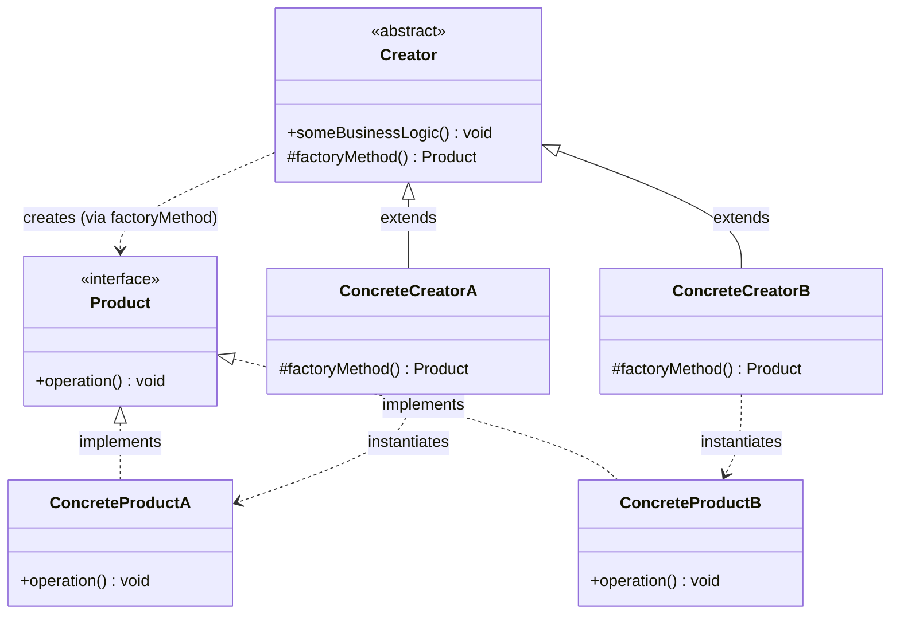

# 팩토리 메서드(Factory Method) 디자인 패턴 가이드

> 한 줄 요약: 객체 생성을 서브클래스가 결정하도록 위임함으로써, 클라이언트 코드는 구체 클래스에 의존하지 않고도 일관된 인터페이스로 새 인스턴스를 얻을 수 있게 하는 패턴이다.
>
> 분류: 생성 패턴(Creational Pattern)
> 다른 이름(Aliases): 가상 생성자(Virtual Constructor)

---

## 상세 설명

팩토리 메서드(Factory Method) 패턴은 상위 클래스(Creator)에 객체 생성용 메서드의 시그니처만 정의해 두고, 실제로 어떤 구체 타입을 만들지는 하위 클래스(Concrete Creator)가 결정하도록 하는 생성 패턴이다. 핵심 의도(Intent)는 "객체를 만드는 책임"을 한 군데로 모으되, 그 결정 시점을 컴파일 타임이 아니라 다형성(polymorphism)을 통해 런타임으로 미루는 데 있다.

이 패턴이 해결하려는 문제(Problem)는 다음과 같다. 어떤 프레임워크나 라이브러리는 자기가 다루는 객체의 추상 타입(`Document`, `Widget`, `Connection` 등)은 알지만, 사용자가 어떤 구체 타입(`PdfDocument`, `WindowsButton`, `MySqlConnection`)을 쓸지는 미리 알 수 없다. 만약 `new PdfDocument()`처럼 구체 클래스를 직접 호출하면, 프레임워크는 그 클래스에 강하게 묶여서 새로운 종류를 추가할 때마다 본체를 수정해야 한다. 이는 개방-폐쇄 원칙(Open-Closed Principle)을 깨뜨린다.

해결책(Solution)은 객체 생성을 별도의 가상 메서드(예: `createDocument()`)로 추출하고, 이 메서드를 추상 또는 기본 구현 상태로 상위 클래스에 둔 뒤 서브클래스가 오버라이드해서 원하는 구체 타입을 반환하도록 하는 것이다. 상위 클래스의 다른 비즈니스 로직은 추상 타입에만 의존하므로, 새 제품(Product)을 추가하려면 새 Creator 서브클래스만 추가하면 된다.

GoF(Gang of Four)는 이 패턴을 "가상 생성자(Virtual Constructor)"라는 별명으로 부르기도 한다. C++에서는 생성자가 가상 함수가 될 수 없지만, 팩토리 메서드를 가상 함수로 두면 마치 생성자를 다형적으로 호출하는 듯한 효과를 얻을 수 있기 때문이다. 한편 단일 메서드 하나로 한 종류의 제품을 만든다는 점에서, 여러 관련 제품군(family)을 함께 만들어 내는 추상 팩토리(Abstract Factory) 패턴과 구분된다.

---

## 디자인 패턴을 충족하는 최소 조건

이 섹션에서는 "어떤 코드가 진짜로 팩토리 메서드 패턴이라고 부를 수 있는가"의 기준을 명확히 한다.

1. **공통 제품 인터페이스(Product Interface)가 존재한다** — 생성되는 객체들은 공통의 추상 타입(인터페이스 혹은 추상 클래스)을 구현/상속해야 한다. 클라이언트는 이 추상 타입을 통해서만 결과를 다룬다.
2. **생성 책임이 별도의 다형 메서드로 분리되어 있다** — 단순히 `new`를 감싼 정적 유틸 메서드가 아니라, Creator 계층에 선언된 인스턴스 메서드여야 하며 서브클래스가 이를 오버라이드(override)할 수 있어야 한다.
3. **Creator의 상위 로직은 추상 Product에만 의존한다** — 템플릿 메서드(template method) 성격의 비즈니스 로직이 있다면, 그 안에서 구체 Product 타입(`PdfDocument` 등)을 직접 참조하지 않고 팩토리 메서드의 반환 타입(추상 `Document`)으로만 다뤄야 한다.
4. **확장이 "새 서브클래스 추가"로 이루어진다** — 새로운 제품 종류를 도입할 때, 기존 Creator의 코드를 수정하지 않고 새로운 ConcreteCreator를 추가하는 방식으로 확장 가능해야 한다.

> 위 조건 중 하나라도 빠지면 본 패턴이라고 보기 어렵다. 특히 2번과 3번이 깨지면 단순 정적 팩토리(Static Factory) 혹은 단순 팩토리(Simple Factory)로 분류된다.

### 흔히 오해하는 지점

- **단순 팩토리(Simple Factory)와의 혼동**: `if/switch`로 분기해 객체를 만드는 정적 메서드(예: `WidgetFactory.create(type)`)는 GoF의 팩토리 메서드가 아니다. 다형성을 통한 결정 위임이 없고, 새 타입이 추가될 때마다 `switch`를 수정해야 하므로 조건 2, 4를 모두 위반한다.
- **추상 팩토리(Abstract Factory)와의 혼동**: 추상 팩토리는 "여러 종류의 관련 제품군"을 한 객체가 함께 만들어내고, 팩토리 메서드는 보통 "한 종류의 제품"을 만든다. 추상 팩토리는 내부 구현으로 여러 개의 팩토리 메서드를 가질 수 있다.
- **모든 `create...()` 메서드를 팩토리 메서드로 부르는 경우**: 이름이 `create`로 시작한다는 이유만으로는 부족하다. 서브클래스가 오버라이드해서 다른 구체 타입을 반환할 의도가 설계에 명시되어 있어야 한다.
- **반환 타입이 구체 클래스인 경우**: 메서드 시그니처가 `PdfDocument createDocument()`처럼 구체 타입을 돌려주면 클라이언트가 결국 그 구체 타입에 의존하게 되어 패턴의 목적이 사라진다. 반드시 추상 타입을 반환해야 한다.

---

## 사례를 통한 예시

### 예시 1: GUI 위젯(Widget) 생성 - 직접 작성한 미니멀 예시

**상황**: 한 애플리케이션을 Windows와 macOS 양쪽에서 돌리려고 한다. 다이얼로그(Dialog)는 자기 위에 버튼을 하나 그리는 공통 로직을 갖지만, 어떤 종류의 버튼(`WindowsButton`, `MacButton`)을 쓸지는 운영체제마다 다르다. Dialog 본체는 구체 버튼에 의존하지 않아야 한다.

```java
// Product: 공통 제품 인터페이스
interface Button {
    void render();
    void onClick();
}

// ConcreteProduct A
class WindowsButton implements Button {
    @Override public void render()  { System.out.println("[Win] 사각형 버튼을 그린다"); }
    @Override public void onClick() { System.out.println("[Win] 클릭 이벤트 처리"); }
}

// ConcreteProduct B
class MacButton implements Button {
    @Override public void render()  { System.out.println("[Mac] 둥근 버튼을 그린다"); }
    @Override public void onClick() { System.out.println("[Mac] 클릭 이벤트 처리"); }
}

// Creator: 추상 생성자. 팩토리 메서드와, 그것을 사용하는 상위 로직을 함께 가진다.
abstract class Dialog {

    // 팩토리 메서드 (Factory Method) — 서브클래스가 어떤 Button을 만들지 결정한다.
    protected abstract Button createButton();

    // 템플릿 메서드 성격의 상위 로직. 구체 Button 타입을 모른 채 추상 Product에만 의존한다.
    public void renderWindow() {
        Button okButton = createButton();
        okButton.render();
        okButton.onClick();
    }
}

// ConcreteCreator A
class WindowsDialog extends Dialog {
    @Override protected Button createButton() { return new WindowsButton(); }
}

// ConcreteCreator B
class MacDialog extends Dialog {
    @Override protected Button createButton() { return new MacButton(); }
}

// Client
public class App {
    public static void main(String[] args) {
        Dialog dialog = pickDialogByOs();   // 런타임에 결정
        dialog.renderWindow();
    }

    private static Dialog pickDialogByOs() {
        String os = System.getProperty("os.name", "").toLowerCase();
        return os.contains("mac") ? new MacDialog() : new WindowsDialog();
    }
}
```

**해설**: `Button`이 Product, `WindowsButton`/`MacButton`이 ConcreteProduct다. `Dialog`는 Creator이며, `createButton()`이 바로 팩토리 메서드다. `renderWindow()`는 상위 로직으로서 구체 Button을 모른 채 추상 `Button` 인터페이스에만 의존한다. 새 플랫폼(예: Linux)을 지원하려면 `LinuxButton`과 `LinuxDialog`만 추가하면 되고, 기존 `Dialog`/`WindowsDialog`/`MacDialog`는 한 줄도 수정할 필요가 없다 — 이것이 조건 4(개방-폐쇄)를 충족한다.

### 예시 2: Document Reader 프레임워크 - 실제 응용 사례 구조

**상황**: 다양한 포맷(PDF, HTML, Plain Text)을 열어 텍스트를 추출하는 리더(Reader) 프레임워크를 설계한다. 파일을 열고, 파싱하고, 닫는 전체 흐름은 공통이지만 "문서 객체를 어떻게 만드느냐"는 포맷마다 다르다. 이는 JDK의 `java.net.URLStreamHandlerFactory`나 `Collection.iterator()`처럼 표준 라이브러리에서 흔히 보이는 구조다.

```java
// Product
interface Document {
    String extractText();
    void close();
}

// ConcreteProducts
class PdfDocument implements Document {
    private final String path;
    PdfDocument(String path) { this.path = path; }
    @Override public String extractText() { return "[PDF:" + path + "] 텍스트 추출 결과"; }
    @Override public void close()         { System.out.println("[PDF] 자원 해제"); }
}

class HtmlDocument implements Document {
    private final String path;
    HtmlDocument(String path) { this.path = path; }
    @Override public String extractText() { return "[HTML:" + path + "] DOM 트리 파싱 후 텍스트"; }
    @Override public void close()         { System.out.println("[HTML] 자원 해제"); }
}

// Creator: 템플릿 메서드와 팩토리 메서드를 함께 보유
abstract class DocumentReader {

    // 팩토리 메서드
    protected abstract Document openDocument(String path);

    // 템플릿 메서드: 처리 흐름은 고정, 객체 생성만 서브클래스에 위임
    public final String read(String path) {
        Document doc = openDocument(path);    // 다형 호출
        try {
            return doc.extractText();
        } finally {
            doc.close();
        }
    }
}

// ConcreteCreators
class PdfReader extends DocumentReader {
    @Override protected Document openDocument(String path) { return new PdfDocument(path); }
}

class HtmlReader extends DocumentReader {
    @Override protected Document openDocument(String path) { return new HtmlDocument(path); }
}

// Client
public class ReaderApp {
    public static void main(String[] args) {
        DocumentReader reader = readerFor("report.pdf");
        System.out.println(reader.read("report.pdf"));

        reader = readerFor("index.html");
        System.out.println(reader.read("index.html"));
    }

    private static DocumentReader readerFor(String path) {
        if (path.endsWith(".pdf"))  return new PdfReader();
        if (path.endsWith(".html")) return new HtmlReader();
        throw new IllegalArgumentException("지원하지 않는 포맷: " + path);
    }
}
```

**해설**: 이 구조는 JDK의 여러 곳에서 동일한 형태로 등장한다. 예를 들어 `java.util.Collection`의 `iterator()`는 Creator 측의 팩토리 메서드이고, 각 컬렉션 구현체(`ArrayList`, `HashSet` 등)는 자기에 맞는 `Iterator` 구현체를 만들어 반환한다. `java.util.Calendar.getInstance()`나 `java.text.NumberFormat.getInstance(Locale)`도 같은 의도를 정적 메서드 형태로 제공한 사례다. 위 예시에서 `read()`가 템플릿 메서드 역할을 하면서 `openDocument()`라는 팩토리 메서드를 호출하는 구조 자체가, 팩토리 메서드 패턴이 템플릿 메서드(Template Method) 패턴과 자연스럽게 결합하는 가장 전형적인 패턴이다.

---

## 어떨 때 사용하나

다음과 같은 신호(Symptom)가 보일 때 이 패턴 도입을 고려한다.

- 상위 모듈/프레임워크가 다루는 추상 타입은 정해져 있지만, 어떤 구체 타입을 쓸지는 사용 시점이나 환경(OS, 파일 포맷, 설정 등)에 따라 달라질 때.
- 클래스 내부 곳곳에 `new ConcreteX()`가 흩어져 있어, 새 타입을 추가할 때마다 본체를 수정해야 하는 통증이 반복될 때.
- 동일한 상위 처리 흐름을 두고 "객체를 만드는 부분만" 갈아끼우고 싶을 때 — 즉, 템플릿 메서드 패턴과 결합해서 "흐름은 고정, 생성은 다형" 구조가 필요할 때.
- 라이브러리/프레임워크를 설계하는 입장에서, 사용자가 자기만의 제품(Product) 구현체를 끼워 넣을 수 있는 확장점(extension point)을 제공해야 할 때.
- 단위 테스트에서 실제 객체 대신 가짜(mock/stub) 객체를 주입하고 싶지만 의존성 주입 컨테이너를 도입하기는 과한 작은 모듈일 때.

### 사용하면 안 되는 경우 (Anti-patterns)

- **제품 종류가 1개뿐이고 향후 늘어날 계획이 없는 경우**: 단순히 `new`로 생성하면 충분한 코드를, 팩토리 메서드를 위해 추상 클래스 계층까지 만드는 것은 과설계(over-engineering)다.
- **단순 분기 팩토리로 충분한 경우**: 생성 규칙이 단순한 `switch`이고 새 타입 추가 빈도가 낮다면, 정적 팩토리 메서드(예: `Button.of(type)`) 하나로 충분할 수 있다. 굳이 Creator 계층을 만들지 말 것.
- **객체 생성이 단순한 데이터 묶음(POJO/DTO) 수준인 경우**: 빌더(Builder)나 명명된 정적 팩토리(named static factory)가 더 적합하다.
- **이미 DI 컨테이너(Spring 등)가 객체 그래프 조립을 책임지는 영역**: 팩토리 메서드를 또 만들어 두면 객체 생성 책임이 두 군데로 쪼개져 흐름을 추적하기 어려워진다.
- **여러 종류의 관련 제품군을 한꺼번에 만들어야 하는 경우**: 이때는 추상 팩토리(Abstract Factory) 쪽이 더 적합하다.

---

## 장점과 단점, 한계점

### 장점
- **클라이언트와 구체 클래스의 결합도(coupling) 감소**: 클라이언트와 Creator의 상위 로직은 추상 Product에만 의존하므로, 구체 Product 클래스의 변경이 상위로 전파되지 않는다.
- **개방-폐쇄 원칙(OCP) 준수**: 새로운 Product를 추가할 때 기존 Creator를 수정하지 않고 새 ConcreteCreator를 추가하기만 하면 된다.
- **단일 책임 원칙(SRP) 강화**: "객체 생성" 책임이 팩토리 메서드 한 곳에 모이므로, Creator의 다른 비즈니스 로직은 생성 세부사항으로부터 자유로워진다.
- **테스트 용이성**: 테스트 전용 ConcreteCreator를 만들어 mock Product를 반환하게 하면, 외부 자원(파일, 네트워크 등)에 의존하는 객체를 손쉽게 대체할 수 있다.
- **템플릿 메서드와의 자연스러운 결합**: 상위 흐름은 고정하고 생성만 다형화하는 구조를 명시적으로 표현할 수 있다.

### 단점
- **클래스 수의 증가**: Product 하나를 추가할 때마다 ConcreteCreator도 함께 늘어나, 작은 도메인에서는 클래스 계층이 불필요하게 복잡해진다.
- **간접 호출로 인한 가독성 저하**: 단순히 `new PdfDocument()` 한 줄로 끝날 코드가, Creator 계층을 통과하면서 추적해야 할 호출 단계가 늘어난다.
- **상속 강제**: 팩토리 메서드는 본질적으로 상속 기반이라, 이미 다른 이유로 상속 계층이 고정된 클래스에 끼워 넣기 어렵다. 합성(composition) 기반의 의존성 주입이 더 자연스러운 상황도 많다.
- **잘못 적용 시 책임이 분산**: 팩토리 메서드를 너무 잘게 쪼개면 "어디서 어떤 객체가 만들어지는지" 추적이 오히려 어려워진다.

### 한계점
- **Java처럼 정적 메서드를 오버라이드할 수 없는 언어**에서는 팩토리 메서드를 반드시 인스턴스 메서드로 두어야 한다. C++에서는 생성자를 가상 함수로 둘 수 없다는 제약 때문에 이 패턴이 더 자주 활용된다.
- **런타임 타입을 동적으로 선택해야 하는 경우**(예: 클래스 이름 문자열로부터 생성)에는 결국 리플렉션(reflection)이나 서비스 로더(Service Loader) 같은 추가 메커니즘이 필요해, 팩토리 메서드 단독으로는 부족하다.
- **확장 시 깨지기 쉬운 가정**: Creator의 상위 로직이 Product의 추상 인터페이스 이상을 가정(예: instanceof 분기)하기 시작하면, 새 ConcreteProduct를 추가할 때마다 상위 로직도 함께 손봐야 해서 OCP가 무너진다.
- **테스트 측면의 함정**: ConcreteCreator를 직접 `new`로 인스턴스화해서 사용하는 클라이언트가 있다면 Creator 자체의 교체가 어려워지므로, 클라이언트에는 Creator를 외부에서 주입받는 형태가 권장된다.

---

## 정보 표

| 항목 | 값 |
| --- | --- |
| 분류 | 생성 패턴(Creational Pattern) |
| 언어 의존성 | 언어 비의존적(객체 지향 상속/다형성만 있으면 충분). 단, C++에서는 가상 생성자 제약 때문에 더 자주 쓰임 |
| 활용성(1점~5점) | 4/5 - 프레임워크/라이브러리 설계와 플러그인 구조에서 매우 자주 등장하는 핵심 패턴 |
| 학습 난이도 | 중 - 개념은 단순하지만 단순 팩토리/추상 팩토리와의 구분, 템플릿 메서드와의 결합 지점을 이해해야 함 |
| 자주 함께 쓰이는 패턴 | 템플릿 메서드(Template Method), 추상 팩토리(Abstract Factory), 반복자(Iterator), 프로토타입(Prototype) |
| 대표 사용 사례 | `java.util.Collection#iterator()`, `java.util.Calendar#getInstance()`, JDBC `Connection#createStatement()`, Spring `BeanFactory`의 하위 구조, GUI 툴킷의 위젯 생성 |

---

## Class Diagram



> 다이어그램에 등장하는 각 클래스가 패턴의 어떤 역할(Role)을 담당하는지 위 "상세 설명" 섹션과 1:1로 대응되어야 한다.

### 역할 설명
- **Product (제품 인터페이스)**: 팩토리 메서드가 반환하는 객체들의 공통 추상 타입. 클라이언트와 Creator의 상위 로직은 오직 이 타입을 통해서만 결과 객체를 다룬다. 예시의 `Button`, `Document`가 여기에 해당한다.
- **ConcreteProductA / ConcreteProductB (구체 제품)**: Product를 실제로 구현한 클래스들. 도메인별 실제 동작을 담는다. 예시의 `WindowsButton`/`MacButton`, `PdfDocument`/`HtmlDocument`가 해당된다.
- **Creator (추상 생성자)**: 팩토리 메서드(`factoryMethod()`)의 시그니처를 선언하고, 그것을 사용하는 상위 비즈니스 로직(`someBusinessLogic()`)을 함께 가진다. 상위 로직은 추상 Product에만 의존한다. 예시의 `Dialog`, `DocumentReader`가 이 역할이다.
- **ConcreteCreatorA / ConcreteCreatorB (구체 생성자)**: 팩토리 메서드를 오버라이드해서, 자신이 책임지는 ConcreteProduct를 반환한다. 새로운 종류의 제품을 추가할 때 새로 생성되는 클래스이며, 기존 Creator 계층은 수정되지 않는다. 예시의 `WindowsDialog`/`MacDialog`, `PdfReader`/`HtmlReader`가 해당한다.

---

## 참고 자료
- 원전: Erich Gamma, Richard Helm, Ralph Johnson, John Vlissides(GoF), "Design Patterns: Elements of Reusable Object-Oriented Software", Addison-Wesley, 1994 - "Factory Method" 장.
- Refactoring.Guru, "Factory Method" - https://refactoring.guru/design-patterns/factory-method
- Joshua Bloch, "Effective Java" 3rd ed., Item 1: "Consider static factory methods instead of constructors" - 정적 팩토리와 팩토리 메서드의 차이를 이해하는 데 유용.
- Oracle Java SE API Documentation - `java.util.Collection#iterator()`, `java.util.Calendar#getInstance()` 등 표준 라이브러리의 팩토리 메서드 사례.
- Martin Fowler, "Patterns of Enterprise Application Architecture" - 엔터프라이즈 환경에서의 객체 생성 책임 분리 논의.
