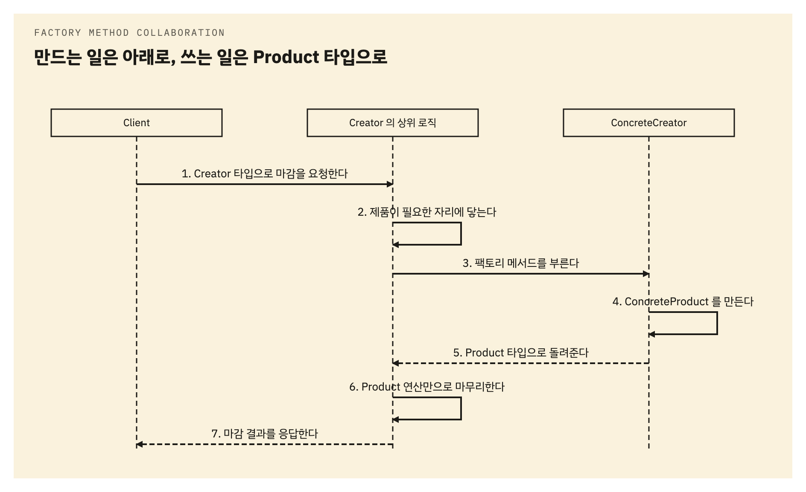
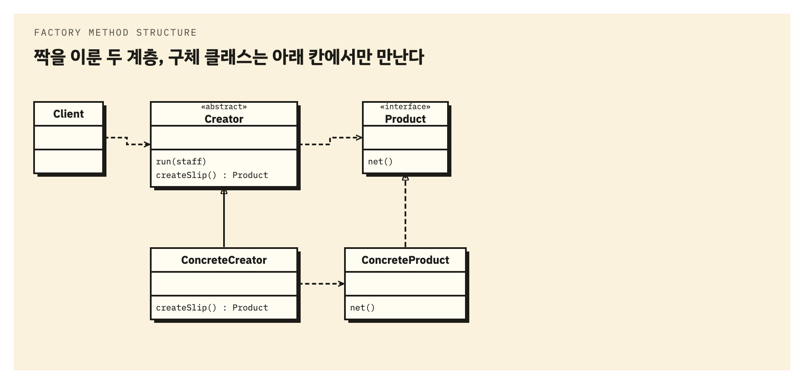

# Factory Method — 만들 때를 아는 쪽과 만들 것을 아는 쪽을 갈라 두기

## 한눈에 보는 개요

급여 마감을 도는 배치 코드를 하나 떠올려 봅시다. `PayrollRun.run(staff)` 은 직원 목록을 돌며 명세서를 한 장씩 만들고, 실지급액을 더해 합계를 냅니다. 그런데 사업장마다 명세서가 달라요. 본사는 월급제, 물류센터는 시급제, 외주 스튜디오는 건당 계약이라 공제 계산도 산출 근거 문구도 다릅니다. 사업장 이름으로 `switch` 를 갈라 그 안에서 명세서를 만들면, 사업장이 하나 늘 때마다 `run` 을 열어 `case` 를 더해야 해요. 마감 절차만 알면 되는 코드가 명세서 클래스 이름을 전부 안고 있는 셈이죠.

Factory Method 가 두는 한 수는 **만드는 한 줄만 서브클래스로 내려보내는 것**입니다. 상위 로직은 "여기서 명세서가 필요하다"까지만 말하고, 어느 클래스를 만들지는 그 메서드를 재정의한 서브클래스가 답해요. 사업장이 하나 늘면 명세서 클래스와 마감 서브클래스가 하나씩 늘 뿐, 마감 절차는 그대로입니다.

```text
Before : 마감 코드가 명세서 클래스 이름을 전부 안고 있음

  PayrollRun.run(staff)
    직원마다
      switch (사업장)
        "본사"      → new MonthlySlip(직원)
        "물류센터"   → new HourlySlip(직원)
        새 사업장    → 이 switch 를 열어 case 추가
      실지급액을 합계에 더한다

After : 만드는 한 줄만 서브클래스로 내려보냄

  PayrollRun.run(staff)            ← 마감 절차는 여기 한 곳
    직원마다
      createSlip(직원)             ← 무엇이 돌아올지 모른 채 부른다
        ├─ HeadOfficeRun  → MonthlySlip
        ├─ FulfillmentRun → HourlySlip
        └─ 새 사업장 = 새 서브클래스 (run 은 그대로)
      실지급액을 합계에 더한다
```

이 패턴의 이름은 GoF(Gang of Four, 1994년에 나온 *Design Patterns* 의 저자 네 명을 함께 부르는 이름)가 붙인 것이고, 다른 이름은 Virtual Constructor 예요(근거: GoF 원서 Factory Method 절 Also Known As). 분류는 생성 패턴이고, 생성 패턴 다섯 중 유일하게 **클래스 범위**로 묶입니다 — 바뀌는 부분을 객체 사이의 관계가 아니라 상속으로 떼어 냈다는 뜻인데, 그 구분의 정의는 [참고 문서 「GoF 공통 어휘」의 클래스 패턴과 객체 패턴](../../reference/gof-vocabulary/gof-vocabulary-ref_v1.0.1.md)에 있어요. 함께 쓰는 패턴은 Template Method 입니다. 팩토리 메서드는 보통 상위 클래스가 순서를 정해 둔 연산 안에서 한 단계로 불리거든요(근거: GoF 원서 Factory Method 절 Related Patterns). 이 글은 시나리오 셋을 따라갑니다. 마감 하나가 명세서 두 장과 합계가 되는 길, 새 사업장이 더해질 때 무엇이 안 바뀌는가, 만드는 자리를 위로 올리면 어느 단계에서 얼마가 틀리는가. 끝까지 읽으면 어떤 코드를 Factory Method 라고 불러도 되는지 필수 조건 다섯으로 판정할 수 있고, 이름이 닮아 헷갈리는 Abstract Factory·Simple Factory 코드와도 구분할 수 있게 됩니다.

## 패턴 자세히 들여다보기

### 시나리오 1 — 본사 마감 한 번이 명세서 두 장과 합계가 되는 길

본사 급여 마감을 돌립니다. 대상은 둘이에요. E1 은 월 기본급 3,200,000원, E2 는 2,750,000원이고 둘 다 월급제입니다. 공제는 이 예시가 정한 천분율로 월급제 90‰(1,000분의 90)이고, 실제 세율이 아니라 설명용으로 고른 값이에요. 나와야 하는 것은 직원별 한 줄과 마지막의 실지급 합계 5,414,500원입니다. 이 장면에는 다섯이 등장해요. 마감 절차를 담은 `PayrollRun`(패턴에서는 Creator 라고 부르는 역할), 본사 마감이라는 것만 다른 `HeadOfficeRun`(ConcreteCreator), 명세서들이 공통으로 따르는 연산 모양을 선언한 `PaySlip`(Product), 월급제 계산을 담은 `MonthlySlip`(ConcreteProduct), 그리고 마감을 시작하는 진입점(Client)입니다. 이름은 여기서 한 번씩만 소개하고 정식 정의는 개념 정리에서 해요.



1. 진입점이 `HeadOfficeRun` 인스턴스를 만들어 마감을 요청합니다. 요청을 받는 쪽의 선언 타입은 `PayrollRun` 이에요. 이 일을 진입점이 맡는 이유는 어느 사업장을 마감할지 아는 쪽이 실행을 시작하는 쪽뿐이라서입니다. 여기서 고르는 것은 **사업장**이지 명세서가 아니라는 점을 봐 두세요 — 명세서 종류는 아직 아무도 말하지 않았습니다.
2. `run(staff)` 이 시작되어 직원 목록을 돌다가 명세서가 필요한 자리에 닿습니다. 마감 절차(직원마다 한 줄을 찍고 마지막에 합계를 찍는다)가 `PayrollRun` 안에 한 곳으로 있어서, 사업장이 달라도 이 절차는 다시 쓰이지 않아요. 절차를 서브클래스마다 복제하면 합계 규칙이 사업장 수만큼 늘어나고, 한 곳만 고치면 나머지가 조용히 어긋납니다.
3. 상위 로직이 `createSlip(employee)` 를 부릅니다. 자기가 무엇을 만들게 될지 모른 채 부르는 것이 핵심이에요. 상위 로직이 아는 것은 **언제** 명세서가 필요한가까지이고, 무엇을 만들지는 사업장이 정합니다. 이 호출이 없으면 상위 로직 안에 `new` 가 박히고, 그러면 사업장이 끼어들 자리가 사라져요(시나리오 3 의 1단계가 그 모양입니다).
4. 동적 디스패치로 `HeadOfficeRun` 이 재정의한 `createSlip` 이 실행되어 `MonthlySlip` 을 만듭니다. 부르는 쪽의 선언 타입은 `PayrollRun` 인데 실제 객체가 `HeadOfficeRun` 이라 재정의한 쪽이 불려요. 호출이 한 번 아래로 내려갔다 올라오는 이 되돌아옴이 이 패턴의 전부입니다. 선언 타입으로 부를 메서드가 정해지는 방식(정적 디스패치)과 실제 객체를 보고 찾는 방식(동적 디스패치)의 정의는 [참고 문서 「GoF 공통 어휘」의 컴파일 시점 결합과 실행 시점 결합](../../reference/gof-vocabulary/gof-vocabulary-ref_v1.0.1.md)에 있어요. 시나리오 3 의 3단계가 이 되돌아옴을 잃었을 때 무엇이 나오는지 보입니다.
5. 상위 로직은 돌아온 것을 `PaySlip` 타입으로만 다룹니다. `basis()`·`gross()`·`tax()`·`net()` 네 연산만 부르고, `MonthlySlip` 이라는 이름은 `run` 어디에도 없어요. E1 은 gross 3,200,000원, tax 288,000원, net 2,912,000원이 나옵니다. 이름이 한 번이라도 들어가면 사업장이 늘 때 상위 로직이 함께 바뀌는데, 그 이름을 지우는 것이 이 패턴이 주는 첫 결과입니다(근거: GoF 원서 Factory Method 절 Consequences).
6. 다음 직원 E2 로 3~5단계를 다시 돕니다. gross 2,750,000원, tax 247,500원, net 2,502,500원이에요. 팩토리 메서드가 직원마다 새로 불리는 이유는 명세서가 직원 한 명의 값을 담은 객체라서입니다. 한 번 만들어 돌려쓰면 두 번째 직원의 줄에 첫 번째 직원의 금액이 찍혀요.
7. 합계 5,414,500원을 찍고 진입점으로 돌아옵니다. 더하는 일을 명세서로 옮기지 않는 이유는 합계가 마감의 몫이어서예요. 명세서 종류마다 합계를 갖게 하면 같은 덧셈이 종류 수만큼 복제되고, 종류가 섞인 마감에서는 어느 합계가 진짜인지가 흐려집니다.

```text
단계   부르는 쪽 → 받는 쪽            넘기는 것          돌아오는 것
 1     진입점 → PayrollRun 타입      직원 목록          (7단계에서 합계)
 2     PayrollRun → PayrollRun      직원 E1            —
 3     PayrollRun → createSlip      직원 E1            —
 4     HeadOfficeRun → (new)        직원 E1            MonthlySlip
 5     PayrollRun → PaySlip         —                  3,200,000 · 288,000 · 2,912,000
 6     (3~5단계를 직원 E2 로 반복)    직원 E2            2,750,000 · 247,500 · 2,502,500
 7     PayrollRun → 진입점           —                  2,912,000 + 2,502,500 = 5,414,500
```

잠깐, 확인 하나만 해 볼까요? 4단계에서 돌아온 객체가 `MonthlySlip` 이라는 것을 상위 로직은 어디에서 알 수 있을까요?

알 수 없고, 알 필요도 없습니다. 상위 로직이 가진 것은 `PaySlip` 타입의 참조 하나뿐이고 그 타입이 선언한 네 연산만 부를 수 있어요. 그래서 5단계가 찍는 `monthly 3200000` 이라는 산출 근거 문구도 상위 로직이 만든 것이 아니라 `MonthlySlip` 의 `basis()` 가 돌려준 것입니다. 시나리오 2 에서 새 명세서가 들어올 때 이 문구만 바뀌고 `run` 은 그대로인 것을 다시 봅니다.

```text
무엇을 정하는가            정하는 쪽            시나리오 1 의 단계
어느 사업장을 마감할지      Client              1
절차와 합계 규칙           Creator             2 · 7
어느 클래스를 만들지        ConcreteCreator     4
금액을 어떻게 계산할지      ConcreteProduct     5
```

이 시나리오가 보여 준 것은 호출이 한 번 아래로 내려갔다 올라온다는 점입니다. 내려가는 것은 "만들어 달라"는 요청 하나뿐이고(3단계), 올라오는 것은 Product 타입으로 가려진 객체입니다(5단계). 그 사이에서 구체 클래스 이름이 코드에 적히는 자리는 4단계 한 곳뿐이에요. 위 표의 이름 다섯은 개념 정리에서 정식으로 정의합니다.

### 시나리오 2 — 외주 스튜디오 마감이 더해질 때

회사가 외주 스튜디오와 건당 계약을 맺었습니다. E5 는 건당 450,000원짜리 작업을 3건 했고, 건당 계약의 공제는 이 예시가 정한 55‰ 예요. 나와야 하는 것은 gross 1,350,000원, tax 74,250원, net 1,275,750원 한 줄과 그 마감의 합계입니다. 앞서 물류센터(시급제)가 들어왔을 때와 드는 품이 같은지도 함께 봅니다.

1. 개발자가 `ProjectSlip` 클래스를 새로 씁니다. `PaySlip` 이 선언한 네 연산을 그대로 구현하고, 공제율과 산출 근거 문구만 건당 계약에 맞춰요. 연산 모양을 바꾸지 않는 이유는 그 모양이 `PayrollRun` 과 모든 명세서 사이의 계약이라서입니다. 모양이 바뀌면 `run` 의 호출 줄과 기존 명세서가 전부 따라 바뀌어요.
2. `StudioRun` 을 새로 쓰고 `createSlip` 을 재정의해 `ProjectSlip` 을 돌려줍니다. 어느 명세서를 쓸지 아는 유일한 자리가 여기예요. 이 결정을 상위 로직으로 올리면 시나리오 3 의 1단계가 되고, 밖에서 주입받게 하면 그건 다른 패턴의 이야기가 됩니다(경계 절의 Abstract Factory 비교에서 풉니다).
3. `PayrollRun` 은 한 줄도 바뀌지 않습니다. `run` 에 적힌 명세서 관련 이름은 `PaySlip` 과 네 연산 이름뿐이라 새 클래스 이름이 들어갈 자리가 없어요. 조건문이 사라진 것이 아니라, 사업장을 고르는 한 번의 선택이 진입점으로 옮겨 간 것입니다.
4. 진입점에 `new StudioRun().run(...)` 한 줄이 늘고 출력에 두 줄이 붙습니다. 진입점이 이 줄을 갖는 이유는 시나리오 1 의 1단계와 같아요. 어느 사업장을 마감할지 아는 쪽은 실행을 시작하는 쪽입니다.
5. 물류센터가 들어왔을 때와 품이 같습니다. 그때도 클래스 둘(`HourlySlip`·`FulfillmentRun`)과 진입점 한 줄이었어요. 같은 이유는 상위 로직이 명세서를 이름이 아니라 팩토리 메서드로만 얻기 때문입니다. 이름을 불렀다면 사업장이 늘 때마다 그 이름을 아는 자리도 함께 늘었을 거예요.

```text
변화              새로 쓴 것                          안 바뀐 곳
fulfillment 추가   HourlySlip (ConcreteProduct)        PayrollRun 전체
                  FulfillmentRun (ConcreteCreator)     PaySlip 의 연산 모양
                  진입점 한 줄                          MonthlySlip · HeadOfficeRun

studio 추가       ProjectSlip (ConcreteProduct)        PayrollRun 전체
                  StudioRun (ConcreteCreator)          PaySlip · 앞의 명세서 둘 · 앞의 마감 둘
                  진입점 한 줄
```

| 사업장 | 대상 | gross | tax | net |
| --- | --- | --- | --- | --- |
| head-office (90‰) | E1 월 3,200,000 | 3,200,000 | 288,000 | 2,912,000 |
| head-office (90‰) | E2 월 2,750,000 | 2,750,000 | 247,500 | 2,502,500 |
| fulfillment (45‰) | E3 시급 12,000 × 160 | 1,920,000 | 86,400 | 1,833,600 |
| fulfillment (45‰) | E4 시급 11,450 × 93 | 1,064,850 | 47,918 | 1,016,932 |
| studio (55‰) | E5 건당 450,000 × 3 | 1,350,000 | 74,250 | 1,275,750 |

E4 줄만 나누어떨어지지 않습니다. 1,064,850 × 45 ÷ 1000 은 47,918.25 인데 세 언어 모두 소수점 아래를 버리고 47,918 을 씁니다. 버리는 자리를 언어마다 다르게 두면 같은 마감이 언어에 따라 다른 금액을 내므로, 세 구현 모두 곱한 뒤에 나누는 순서를 지켰어요. 위 표의 수치는 전부 구현 예시의 실행 출력에서 가져온 것입니다.

여기서 헷갈리기 쉬운 포인트는 팩토리 메서드가 반드시 추상이어야 한다고 믿는 것입니다. `PayrollRun` 이 `createSlip` 에 기본 구현을 두고 월급제 명세서를 돌려주게 해도 돼요. 그러면 본사 마감은 서브클래스 없이 `PayrollRun` 하나로 돌아가고, 다른 명세서가 필요한 사업장만 재정의합니다(근거: GoF 원서 Factory Method 절 Implementation — 추상 Creator 로 기본 구현을 두지 않는 변형과 구체 Creator 가 기본 구현을 주는 변형 둘이 있다). 한 걸음 더 가면 `createSlip(employee, kind)` 처럼 만들 제품을 식별하는 인자를 받는 변형도 있습니다. 그때도 서브클래스가 그 메서드를 재정의해 일부 인자만 자기가 처리하고 나머지는 상위 구현에 넘길 수 있어요. 두 변형 모두 재정의할 수 있는 인스턴스 연산이라는 점은 그대로입니다. 그 점이 깨지는 모양은 시나리오 3 의 2·3단계에서 봅니다.

```text
팩토리 메서드를 어떻게 두나        본사 마감              물류센터 마감
추상으로 (구현 예시의 모양)        HeadOfficeRun 필요      FulfillmentRun 필요
기본 구현을 주고 추상은 아님        PayrollRun 하나로 동작   FulfillmentRun 필요
```

이 시나리오가 보여 준 것은 변화의 범위입니다. 새 제품 종류가 들어올 때 새로 쓰는 것은 ConcreteProduct 하나와 ConcreteCreator 하나이고(1·2단계), Creator 와 기존 제품·기존 마감은 그대로예요(3단계). 대신 제품 종류가 늘 때마다 마감 서브클래스도 하나씩 늘어납니다. 이것이 이 패턴이 치르는 대가이고(근거: GoF 원서 Factory Method 절 Consequences), 그 서브클래스가 만드는 일 말고 아무것도 하지 않을 때 무엇을 검토해야 하는지는 사용 목적에서 셈해 봅니다.

### 시나리오 3 — 만드는 자리를 위로 올리면 어느 단계에서 얼마가 틀리는가

같은 회사의 다른 팀은 마감 코드를 조금 다르게 짰습니다. 겉보기에는 시나리오 1 과 같아요. `PayrollRun` 이 있고 `run` 이 직원 목록을 돌며 명세서를 한 장씩 만들어 실지급액을 더하고 마지막에 합계를 찍는 흐름까지 똑같습니다. 다른 것은 명세서를 만드는 자리 하나뿐이에요. 아래 결과는 Java 21 로 실제로 컴파일해 실행한 것입니다.

1. `run` 안에서 `new MonthlySlip(employee)` 를 직접 부릅니다. 이렇게 짜는 이유는 대개 편의예요. 본사 마감만 돌리던 동안에는 서브클래스를 만들 이유가 없어 보였을 테니까요. 그 대가로 사업장이 끼어들 자리가 사라집니다 — 시나리오 1 의 3단계가 하던 "모른 채 부르기"가 "알고 만들기"로 바뀌었거든요.
2. 물류센터 마감을 돌립니다. `HourlySlip` 클래스는 멀쩡히 있고 `FulfillmentRun` 도 있는데, 출력에는 `monthly 12000` 이 찍혀요. E3 의 실지급액은 1,833,600원이 아니라 1,747,200원, E4 는 1,016,932원이 아니라 969,014원이고 마감 합계는 2,850,532원이 아니라 2,716,214원입니다. 134,318원이 덜 나가는데 **컴파일도 실행도 아무 오류를 내지 않아요.** 시급이 월급 자리에 들어가 공제율만 90‰ 로 바뀐 것이라, 숫자가 그럴듯해서 눈으로는 잡히지 않습니다.
3. 고치려고 생성 연산을 밖으로 빼되 `static` 으로 두면 다른 벽에 부딪힙니다. `protected abstract static PaySlip createSlip(Employee)` 는 javac 이 `illegal combination of modifiers: abstract and static` 으로 막아요. 기본 구현을 주고 `FulfillmentRun` 에 같은 시그니처의 `static` 메서드를 선언하면 컴파일은 통과하지만, 그건 재정의가 아니라 **숨김**이라 상위 `run` 은 여전히 상위 것을 부릅니다. 출력은 2단계와 글자 하나까지 같은 2,716,214원이에요. `static` 호출은 실제 객체가 아니라 부르는 쪽의 선언 타입으로 정해지기 때문입니다.
4. 반환 타입을 좁히는 갈래도 있습니다. `createSlip` 의 반환 타입을 `PaySlip` 대신 `MonthlySlip` 으로 적고 `HeadOfficeRun` 의 재정의도 같이 좁히면, `HeadOfficeRun` 은 통과하지만 `FulfillmentRun` 에서 `createSlip(Employee) in FulfillmentRun cannot override createSlip(Employee) in PayrollRun` 과 `return type PaySlip is not compatible with MonthlySlip` 으로 멈춰요. 이 갈래는 그나마 컴파일러가 막아 줍니다. 다른 명세서를 돌려줄 길이 타입 선언에서 이미 닫혀 있어서예요.
5. 되돌리는 길은 갈래마다 다릅니다. 1·2단계는 `new` 를 팩토리 메서드 호출로 바꾸는 일이고, 3단계는 `static` 을 인스턴스 연산으로 되돌리는 일이며, 4단계는 반환 타입을 추상 타입으로 넓히는 일이에요. 고치는 자리가 셋 다 달라서 최소 조건에서도 3번·2번·1번으로 갈라집니다.

```text
Before (시나리오 3)                            After (시나리오 1·2 의 모양)

  run(staff)                                   run(staff)
    PaySlip slip = new MonthlySlip(e);           PaySlip slip = createSlip(e);
                                               protected abstract PaySlip createSlip(Employee e);

  fulfillment 마감                              fulfillment 마감
    E3 monthly 12000 → net 1747200               E3 hourly 12000x160 → net 1833600
    E4 monthly 11450 → net  969014               E4 hourly 11450x93  → net 1016932
    net total 2716214   ← 오류 없이 틀림           net total 2850532
```

이 시나리오가 보여 준 것은 규칙이 깨지는 자리가 셋이고 증상이 서로 다르다는 점입니다. 만드는 자리를 상위 로직에 두면 오류 없이 금액이 틀리고(1·2단계), 생성 연산을 `static` 으로 두면 재정의할 자리 자체가 없어지며(3단계), 반환 타입을 구체 클래스로 좁히면 컴파일러가 먼저 막습니다(4단계). 앞 둘은 조용해서 더 오래 갑니다. 그래서 최소 조건은 출력이 맞는지가 아니라 코드가 어떤 모양인지로 적혀 있어요.

### 개념 정리

시나리오에 나온 역할 다섯을 정식으로 정의합니다. 넷은 패턴의 참여자이고 Client 는 참여자 넷에 들지 않지만 마감을 시작하는 쪽이라, 시나리오와 구현에 늘 나오므로 함께 정의해요(근거: GoF 원서 Factory Method 절 Participants).

- **Product** — 팩토리 메서드가 만드는 객체들이 공통으로 따르는 연산을 선언합니다. Creator 의 상위 로직은 이 선언만 보고 호출하고(시나리오 1 의 5단계), ConcreteProduct 가 이 선언을 구현해요. 급여 예에서는 산출 근거·지급 총액·공제액·실지급액 네 연산을 선언한 `PaySlip` 이 Product 입니다.
- **ConcreteProduct** — Product 가 선언한 연산을 실제 계산으로 구현합니다. 같은 Product 를 따르는 ConcreteProduct 들은 서로를 모르고, 새로 하나가 들어와도 기존 것을 보지 않아요(시나리오 2 의 1단계). ConcreteCreator 가 만들고 Creator 가 씁니다. 급여 예에서는 `MonthlySlip`·`HourlySlip`·`ProjectSlip` 이 각각 ConcreteProduct 예요.
- **Creator** — 제품을 쓰는 상위 로직과 제품을 만드는 연산(팩토리 메서드)을 함께 선언합니다. 상위 로직은 제품이 필요한 자리에서 팩토리 메서드를 부르고(시나리오 1 의 3단계), 돌아온 것을 Product 타입으로만 다뤄요(5단계). 팩토리 메서드에 기본 구현을 둘 수도 있고 두지 않을 수도 있습니다. 급여 예에서는 `run` 과 `createSlip` 을 가진 `PayrollRun` 이 Creator 이고, 여기서 `run` 처럼 순서를 정해 두고 일부 단계만 서브클래스에 맡기는 연산을 template method 라고 불러요.
- **ConcreteCreator** — 팩토리 메서드를 재정의해 특정 ConcreteProduct 를 돌려줍니다(시나리오 1 의 4단계). 어느 구체 클래스를 쓸지 아는 유일한 자리이고, 제품 종류가 늘면 이쪽도 하나 늡니다(시나리오 2 의 2단계). 급여 예에서는 `HeadOfficeRun`·`FulfillmentRun`·`StudioRun` 이 ConcreteCreator 예요.
- **Client** — ConcreteCreator 하나를 골라 만들고 Creator 타입으로 마감을 요청합니다(시나리오 1 의 1단계). 제품 종류를 직접 고르지는 않아요 — 고르는 것은 마감 대상이고, 제품은 그 선택에 딸려 옵니다. 급여 예에서는 사업장별로 마감을 돌리는 진입점이 Client 입니다.



그림에서 계층이 둘이고 나란히 서 있다는 점을 봐 두세요. 왼쪽이 만드는 쪽, 오른쪽이 만들어지는 쪽이고 두 계층의 위 칸끼리·아래 칸끼리 짝을 이룹니다. Creator 에서 나가는 점선은 Product 로만 향하고 ConcreteProduct 를 가리키지 않아요. ConcreteProduct 로 들어가는 점선은 ConcreteCreator 에서 온 것 하나뿐입니다 — 구체 클래스 이름이 코드에 적히는 자리가 거기 하나이기 때문이에요. 위 칸의 화살표는 최소 조건 1·3번이, 아래 칸의 화살표는 2·4번이 코드에서 확인합니다.

> 언제 만들지는 위가 알고, 무엇을 만들지는 아래가 안다.

## 사용 목적

Factory Method 를 꺼낼 때는 코드나 요구에서 보이는 단서가 있습니다. 셋을 차례로 봅시다.

**단서 1. 상위 로직은 그대로인데 `new` 대상만 하위 모듈마다 다릅니다.** 기반 클래스의 메서드 안에서 객체를 만드는데, 절차는 모두에게 같고 만들 클래스만 다를 때예요(근거: GoF 원서 Factory Method 절 Applicability). 코드에서는 자기 타입을 확인해 만들 대상을 고르는 분기로 보입니다. 이 모양이 보이면 그 분기 전체가 팩토리 메서드 한 번의 호출로 접힙니다.

```text
변경 이력                        수정된 곳
──────────────────────────────   ──────────────────────────────
물류센터 명세서 추가               PayrollRun.run() 의 switch
외주 스튜디오 명세서 추가          PayrollRun.run() 의 switch
해외 지사 명세서 추가              PayrollRun.run() 의 switch
```

**단서 2. 클래스 계층 둘이 짝을 이룹니다.** 한쪽이 늘면 반대쪽도 하나 늘고, 어느 쪽이 어느 쪽과 짝인지를 아는 코드가 여러 곳에 흩어지는 경우예요. 컬렉션과 그 순회자, 도형과 그 조작기, 마감과 그 명세서가 그렇습니다. 팩토리 메서드를 두면 그 짝짓기가 각 서브클래스의 한 메서드로 모여요.

```text
Creator 계층        짝        Product 계층
HeadOfficeRun    ──────▶     MonthlySlip
FulfillmentRun   ──────▶     HourlySlip
StudioRun        ──────▶     ProjectSlip
                             ▲
        짝을 아는 코드가 각 서브클래스의 createSlip 한 곳에만 있다
```

**단서 3. 남이 쓸 기반 클래스를 주면서 부품 하나만 바꿔 끼우게 하고 싶습니다.** 절차는 우리가 고정하고 그 안의 한 자리만 열어 주고 싶을 때예요. 팩토리 메서드에 기본 구현을 두면 그 자리가 곧 확장 지점이 되고, 기본값이 마음에 드는 쪽은 아무것도 하지 않아도 됩니다(근거: GoF 원서 Factory Method 절 Consequences — 팩토리 메서드는 서브클래스에 훅을 제공한다). 확장 지점이라고 부를 수 있으려면 그 메서드를 재정의해도 된다고 문서가 적어 두어야 해요. 아래 「실제 라이브러리에서」의 `http.Agent#createConnection` 이 그 모양입니다.

비슷한 단서에서 다른 패턴을 골라야 하는 경우가 둘 있습니다. 만들 제품이 한 종류가 아니라 함께 쓰여야 하는 여러 종류라면 Abstract Factory 를, 서브클래스가 만드는 일 말고 하는 일이 없다면 Prototype 을 먼저 검토하세요. 둘과의 차이는 「비슷한 패턴·안티패턴과의 차이」에서 풉니다. 그리고 아래 상황에서는 Factory Method 를 쓰면 얻는 것보다 잃는 것이 큽니다.

| 쓰지 말아야 할 상황 | 쓰면 잃는 것 |
| --- | --- |
| 만들 클래스가 절대 바뀌지 않음 | 상위 로직에서 바로 만들면 끝날 일에 추상 메서드 하나와 서브클래스 하나가 생김. 얻는 유연성이 쓰일 자리가 없음(근거: GoF 원서 생성 패턴 토론 절 — 인스턴스화할 클래스가 바뀌지 않으면 팩토리 메서드가 필요 없다) |
| 서브클래스가 쉽게 재정의할 수 있는 초기화 연산 안에서 생성이 일어남 | 그 초기화 연산 자체가 이미 확장 지점이라, 팩토리 메서드를 더해도 진화 지점만 하나 늘어남(같은 토론 절) |
| 제품 종류마다 Creator 서브클래스가 느는데 그 서브클래스가 만드는 일 말고 하는 일이 없음 | 결정 한 줄을 담으려고 클래스가 하나씩 늚. 표 아래에서 수를 세어 봄 |

세 번째 줄을 세어 봅시다. 구현 예시의 모양대로면 제품 종류가 m 개일 때 클래스 수는 Product 1 + Creator 1 + ConcreteProduct m + ConcreteCreator m = 2m + 2 입니다. m = 3 이면 8 개이고, 종류가 하나 늘 때마다 2 개가 늘어요.

```text
제품 종류 m       팩토리 메서드      만들 것을 표 한 줄로 두는 방식
   1              2 × 1 + 2 = 4      1 + 2 + 1 = 4
   3              2 × 3 + 2 = 8      3 + 2 + 1 = 6
   5              2 × 5 + 2 = 12     5 + 2 + 1 = 8
종류 하나 추가     +2 (제품 + 마감)    +1 (제품만, 표에 한 줄)
```

오른쪽은 마감 서브클래스를 두지 않고 "사업장 이름 → 견본 명세서" 같은 표 하나를 두어 거기서 꺼내 쓰는 방식의 수예요. ConcreteProduct m 개에 Product·Creator 둘, 그리고 표를 들고 있는 객체 하나입니다. 늘어나는 속도가 2 대 1 이라 종류가 많아질수록 차가 벌어집니다. 다만 조건이 하나 붙어요. 이 셈은 **ConcreteCreator 가 결정 한 줄만 담을 때**만 성립합니다. 구현 예시의 `HeadOfficeRun` 은 사업장 이름도 함께 들고 있고, 사업장마다 다른 규칙이 앞으로 더 붙을 자리이기도 합니다. 서브클래스가 그렇게 자기 몫을 갖고 있으면 이 표의 왼쪽이 손해가 아니에요. 세는 것은 클래스 수가 아니라 **그 클래스가 결정 말고 무엇을 더 담고 있는가**입니다.

## 패턴의 경계

### 디자인 패턴을 충족하는 최소 조건

어떤 코드를 Factory Method 라고 불러도 되는지 가르는 기준입니다. `[필수]` 가 하나라도 빠지면 Factory Method 가 아니고, `[선택]` 은 갖추면 좋은 구조예요. 조건은 언어와 상관없이 코드에서 확인할 수 있는 모양(타입 선언·참조 보유·호출 방향·생성 위치)으로 적었고, 조건마다 그것을 보여 준 시나리오의 단계를 가리킵니다.

1. [필수] 생성 연산의 반환 타입이 추상 Product 입니다 — 제품을 돌려주는 연산의 선언된 반환 타입이 인터페이스·추상 클래스·trait(Rust 에서 타입이 구현할 연산을 선언하는 문법) 같은 추상 타입이고, 그 타입을 구현한 클래스가 둘 이상 있거나 있을 수 있게 열려 있습니다. 시나리오 1 의 5단계가 그 반환값을 추상 타입으로만 쓴 자리예요 (근거: GoF 원서 Factory Method 절 Consequences — 애플리케이션 특화 클래스를 코드에 묶을 필요가 없어지고, 코드는 Product 인터페이스만 다루게 된다).
   - 빠지면: 시나리오 3 의 4단계입니다. 반환 타입을 `MonthlySlip` 으로 좁히면 `FulfillmentRun` 이 `HourlySlip` 을 돌려줄 길이 타입 선언에서 닫히고, javac 이 `return type PaySlip is not compatible with MonthlySlip` 으로 멈춥니다(직접 컴파일해 확인). 부르는 쪽도 구체 클래스에 묶여 제품을 바꾸려면 상위 로직을 고쳐야 해요.
2. [필수] 생성 연산이 Creator 의 재정의할 수 있는 인스턴스 연산입니다 — 그 연산이 클래스에 매인 정적 연산이 아니라 객체에 매인 연산이고, 재정의가 막혀 있지 않습니다(`final`·`sealed` 같은 봉인이 없고, Rust 에서는 trait 의 필수 메서드입니다). 시나리오 1 의 4단계에서 실제 객체를 보고 재정의된 쪽이 불린 것이 이 조건의 결과예요 (근거: GoF 원서 Factory Method 절 Intent — 객체를 만드는 인터페이스를 정의하되 어느 클래스를 인스턴스화할지는 서브클래스가 결정하게 한다).
   - 빠지면: 시나리오 3 의 3단계입니다. `static` 으로 두면 추상으로 선언하는 것조차 javac 이 `illegal combination of modifiers: abstract and static` 으로 막고, 기본 구현을 준 뒤 하위에서 같은 시그니처를 선언해도 상위 로직은 상위 것을 부릅니다(직접 실행해 확인). 이름이 `create` 로 시작해도 이 자리가 빠지면 Simple Factory 나 정적 생성 메서드예요.
3. [필수] Creator 의 상위 로직은 제품을 그 생성 연산으로만 얻습니다 — 제품을 쓰는 메서드 안에 구체 제품 클래스를 만드는 코드가 없고, 제품이 필요한 자리마다 생성 연산 호출이 있습니다. 시나리오 1 의 3단계가 이 자리이고, 시나리오 2 의 3단계에서 `run` 이 한 줄도 바뀌지 않은 것이 그 결과입니다 (근거: GoF 원서 Factory Method 절 Participants — Creator 는 Product 객체가 필요할 때 팩토리 메서드를 호출한다).
   - 빠지면: 시나리오 3 의 1·2단계입니다. `run` 안에서 `new MonthlySlip(employee)` 를 직접 부르면 물류센터 마감의 실지급 합계가 2,850,532원이 아니라 2,716,214원으로 나오는데 컴파일도 실행도 통과합니다(직접 실행해 확인). 오류가 없어서 더 오래 갑니다.
4. [필수] 제품 클래스를 고르는 결정이 Creator 의 서브클래스 쪽에 있습니다 — 생성 연산을 재정의한 ConcreteCreator 가 하나 이상 있거나, 아직 없더라도 재정의가 막혀 있지 않아 그렇게 할 수 있습니다. 시나리오 2 의 2단계가 새 결정을 이 자리에 더한 모양이에요 (근거: GoF 원서 Factory Method 절 Participants — ConcreteCreator 가 팩토리 메서드를 재정의해 ConcreteProduct 인스턴스를 돌려준다).
   - 빠지면: 생성 연산이 `final` 이거나 Creator 클래스 자체가 봉인돼 있으면 서브클래스가 결정을 내릴 자리가 없습니다. 그러면 2번을 만족해도 제품을 바꾸는 길은 Creator 자신을 고치는 것뿐이라, 이름이 `createSlip` 이어도 상위 로직 안의 생성 코드를 메서드로 뽑아 둔 것에 그쳐요.
5. [필수] 상위 로직이 제품의 구체 타입으로 갈라지지 않습니다 — 재정의된 생성 연산들이 돌려주는 객체는 Product 가 선언한 연산만으로 쓸 수 있고, 상위 로직에 타입 검사나 다운캐스트(상위 타입으로 받은 값을 하위 타입으로 바꾸는 변환)가 없습니다. 이것이 이 패턴이 늘 지켜야 하는 불변식이고, 시나리오 1 의 5단계가 그 상태예요 (근거: GoF 원서 Factory Method 절 Consequences — 코드는 Product 인터페이스만 다루게 되므로, 어떤 ConcreteProduct 가 돌아와도 상위 로직이 그대로 돌아야 한다).
   - 빠지면: 어떤 재정의가 `basis()` 를 빈 문자열로 두고 진짜 산출 근거를 자기 전용 메서드에만 담으면, 상위 로직은 그 값을 꺼내려고 `if (slip instanceof HourlySlip)` 로 갈라야 합니다. 1번이 지운 구체 클래스 이름이 상위 로직으로 되돌아오고, 사업장이 늘 때마다 그 분기가 함께 늘어요.
6. [선택] Creator 가 생성 연산에 기본 구현을 둡니다 — 추상으로 두지 않고 기본 제품을 돌려주는 본문을 주면, 기본값으로 충분한 쪽은 서브클래스를 만들지 않아도 됩니다. 시나리오 2 의 끝에서 본 변형이에요 (근거: GoF 원서 Factory Method 절 Implementation — 팩토리 메서드에 기본 구현을 두지 않는 변형과 두는 변형 둘이 있다).
7. [선택] 생성 연산이 만들 제품을 식별하는 인자를 받습니다 — 하나의 생성 연산이 인자에 따라 여러 제품을 만들고, 서브클래스는 그것을 재정의해 일부만 바꾸고 나머지는 상위 구현에 넘깁니다. 시나리오 2 의 끝에서 예고한 모양이고, 재정의할 수 있어야 한다는 2번은 그대로 걸려요 (근거: GoF 원서 Factory Method 절 Implementation — 만들 제품을 식별하는 매개변수를 받는 팩토리 메서드 변형).
8. [선택] 생성 연산이 Creator 의 template method 안에서 불립니다 — 순서가 상위 클래스에 고정된 연산이 있고, 그 절차의 한 단계에서 생성 연산을 부릅니다. 시나리오 1 의 2·3단계가 이 모양이에요 (근거: GoF 원서 Factory Method 절 Related Patterns — 팩토리 메서드는 보통 템플릿 메서드 안에서 호출된다).

1번과 2번을 앞에 둔 데는 이유가 있습니다. 둘 중 하나만 빠져도 나머지를 아무리 갖춰도 서브클래스가 제품을 바꿀 수 없어서, 뒤 조건을 읽을 필요가 없어져요. 실제로 2번만 빠진 코드가 가장 흔합니다.

```java no-compile
final class SlipFactory {
    // static 이라 서브클래스가 결정할 자리가 없다 — 이름만 팩토리다
    static PaySlip create(String site, Employee employee) {
        return switch (site) {
            case "head-office" -> new MonthlySlip(employee);
            case "fulfillment" -> new HourlySlip(employee);
            default -> throw new IllegalArgumentException(site);
        };
    }
}

// PayrollRun.run 은 SlipFactory.create(site, employee) 를 부른다.
// 반환 타입은 추상 PaySlip 이고(1번 충족), run 안에 new 도 없다(3번 충족).
```

이 코드는 1번과 3번을 만족합니다. 반환 타입이 `PaySlip` 이고 `run` 안에 `new` 가 없으니까요. 그런데 사업장이 하나 늘면 `SlipFactory.create` 의 `switch` 를 고쳐야 하고, 사업장마다 다른 규칙을 끼울 자리도 없습니다. 시나리오 3 의 3단계가 상위 클래스 안에서 겪은 일이 여기서는 별도 클래스 안에서 일어나는 것이죠.

| 코드 | 1번 | 2번 | 3번 | 4번 | 5번 | 판정 |
| --- | --- | --- | --- | --- | --- | --- |
| 구현 절의 `PayrollRun` 과 세 마감 | 충족 | 충족 | 충족 | 충족 | 충족 | Factory Method |
| 위 `SlipFactory` 를 부르는 `run` | 충족 | 빠짐 (`static`) | 충족 | 빠짐 | 충족 | Simple Factory |
| 시나리오 3 의 1단계 `run` | 충족 | 해당 없음 (생성 연산 자체가 없음) | 빠짐 | 빠짐 | 충족 | 아님 |
| 반환 타입이 `MonthlySlip` 인 `createSlip` | 빠짐 | 충족 | 충족 | 충족 | 충족 | 아님 (컴파일 실패) |
| `final` 로 봉인된 `createSlip` | 충족 | 빠짐 | 충족 | 빠짐 | 충족 | 아님 |

여기서 헷갈리기 쉬운 포인트는 이름으로 판정하려는 것입니다. `create` 나 `newInstance` 로 시작한다고 팩토리 메서드가 아니고, 반대로 이름에 `create` 가 없어도 위 다섯을 만족하면 팩토리 메서드예요. Java 표준 라이브러리의 `Calendar.getInstance()` 나 `NumberFormat.getInstance()` 는 이름만 보면 딱 그것 같지만 `static` 이라 2번에서 빠집니다. 반대로 `iterator()` 는 이름에 `create` 가 없는데도 다섯을 다 만족해요 — 아래 「실제 라이브러리에서」에 그 대응이 있습니다.

> 이름이 아니라 재정의할 수 있는 자리인가를 본다.

### 비슷한 패턴·안티패턴과의 차이

Factory Method 와 구조가 닮았거나 같은 단서에서 떠오르는 대상 넷을 비교합니다. Abstract Factory 와 Prototype 은 사용 목적에서 이름만 꺼냈고, Template Method 는 개요에서 함께 쓰는 패턴으로 짚은 것이에요. 나머지 하나는 생성 코드를 한 클래스로 뽑아 놓고 Factory Method 로 불리는 코드입니다. 표에 기준을 먼저 모으고, 대상마다 코드로 풀어 볼게요.

| 비교 대상 | 구분 기준 | Factory Method 를 고르면 얻는 것 | 포기하는 것 |
| --- | --- | --- | --- |
| Abstract Factory | 제품을 쓰는 로직과 생성 연산이 같은 클래스 계층에 있고 상속으로 갈리는가, 생성만 하는 별도 객체를 받아 쓰는가. 그리고 생성 연산이 제품 한 종류를 만드는가 여러 종류를 만드는가 | 별도 팩토리 객체와 그 주입 경로 없이 서브클래스 하나로 제품이 정해짐. 제품 종류가 하나면 인터페이스가 늘지 않음 | 제품군 전체를 한 번에 갈아 끼우는 지점. 종류가 여럿이면 팩토리 메서드도 여럿이 되고, 같은 계열끼리만 쓰이게 강제할 자리가 없음 |
| Simple Factory · 정적 생성 메서드 | 제품을 고르는 결정이 재정의로 갈리는가, 한 곳의 정적 연산 안에서 갈리는가 | 새 제품이 새 서브클래스로 들어오고 기존 코드를 열지 않음 | 한 줄로 끝나던 호출이 계층 하나가 됨. 제품이 둘뿐이고 늘지 않는 코드에서는 정적 연산이 더 읽힘 |
| Template Method | 서브클래스가 채우는 훅이 객체를 돌려주는가, 계산이나 동작을 수행하는가 | 절차의 한 단계를 "무엇을 쓸지"로 열어 둠. 제품 계층이 따로 서서 제품만 따로 테스트할 수 있음 | 훅이 바로 일을 하던 단순함. 제품 인터페이스와 구현 클래스가 더 생김 |
| Prototype | 새 제품을 만들 때 새 클래스를 쓰는가, 미리 만들어 둔 견본을 복제하는가 | 제품 종류가 타입으로 드러나고 컴파일러가 계약을 검사함 | 종류마다 늘어나는 Creator 서브클래스. 견본을 표에 등록하는 방식은 클래스 하나만 늘어남 |

**Abstract Factory 와의 차이.** 구분 기준은 둘입니다. 생성 연산이 제품을 쓰는 로직과 같은 클래스 계층에 있는지, 그리고 그 팩토리가 만드는 제품이 한 종류인지 서로 맞물려야 하는 여러 종류인지예요. 앞쪽이면 상속으로 갈리고 뒤쪽이면 객체를 받아 씁니다. 코드에서는 생성 연산이 `this` 의 메서드인지 필드로 들고 있는 다른 객체의 메서드인지를 보면 돼요.

```java no-compile
// Factory Method — 쓰는 로직과 생성 연산이 한 계층에 있고, 상속으로 갈린다
abstract class PayrollRun {
    final void run(List<Employee> staff) {
        PaySlip slip = createSlip(staff.get(0));   // this 의 메서드를 부른다
        record(slip.net());
    }

    protected abstract PaySlip createSlip(Employee employee);
}

// Abstract Factory — 생성만 하는 별도 객체를 받아 쓰고, 제품 종류가 둘 이상이다
interface PayrollDocuments {
    PaySlip createSlip(Employee employee);
    TaxReport createTaxReport(List<Employee> staff);
}

final class PayrollRunWithFactory {
    private final PayrollDocuments documents;      // 필드로 들고 있다

    PayrollRunWithFactory(PayrollDocuments documents) {
        this.documents = documents;
    }

    void run(List<Employee> staff) {
        PaySlip slip = documents.createSlip(staff.get(0));
        TaxReport report = documents.createTaxReport(staff);   // 같은 계열끼리 나온다
        record(slip.net(), report);
    }
}
```

두 코드가 갈리는 자리는 `createSlip` 앞에 무엇이 있느냐입니다. 위는 아무것도 없고(자기 메서드), 아래는 `documents` 가 있어요(받아 둔 객체). 시나리오 2 의 2단계에서 새 사업장을 더할 때 우리가 한 일은 `PayrollRun` 을 상속한 클래스를 쓰는 것이었는데, 아래 모양이었다면 `PayrollDocuments` 를 구현한 객체를 새로 만들어 생성자에 넣었을 거예요. 종류가 여럿일 때 아래를 고르는 이유는 명세서와 원천징수영수증이 **같은 계열에서 나와야** 한다는 요구를 한 객체가 책임지기 때문입니다. 위 모양으로 같은 요구를 맞추려면 팩토리 메서드 두 개를 각 서브클래스가 짝 맞게 재정의해 주기를 바라는 수밖에 없어요. 반대로 제품이 한 종류뿐이면 아래는 인터페이스 하나와 주입 경로만 더 생깁니다. 두 패턴이 섞여 보이는 것은 정상이에요 — Abstract Factory 의 생성 연산 하나하나가 흔히 팩토리 메서드로 구현되거든요(근거: GoF 원서 Abstract Factory 절 Related Patterns). 상속으로 떼어 낸 것과 객체로 떼어 낸 것이 왜 다른 시점에 고정되는지는 [참고 문서 「GoF 공통 어휘」의 클래스 패턴과 객체 패턴](../../reference/gof-vocabulary/gof-vocabulary-ref_v1.0.1.md)에 있습니다.

```text
                     Factory Method              Abstract Factory
생성 연산의 주인      제품을 쓰는 클래스 자신        받아 둔 별도 객체
갈리는 방식          상속 (서브클래스가 재정의)      합성 (다른 객체를 넣음)
제품 종류            1종                          2종 이상 (한 계열로 묶임)
바꾸는 지점          어느 서브클래스를 쓰는가        어느 팩토리 객체를 넣는가
```

여기서 헷갈리기 쉬운 포인트는 둘을 서로 밀어내는 선택지로 보는 것입니다. 위 표는 어느 쪽이라고 **부를지**를 가르는 기준이지 함께 쓰지 말라는 뜻이 아니에요. 오히려 포개지는 쪽이 표준 구성입니다(근거: GoF 원서 Abstract Factory 절 Related Patterns). 위 `PayrollDocuments` 의 `createSlip` 과 `createTaxReport` 를 보세요. 둘 다 추상 타입을 돌려주는 연산으로 선언만 되어 있고, 계열마다 그것을 구현한 클래스가 자기 명세서와 자기 영수증을 돌려줍니다. 연산 하나만 떼어 놓고 보면 최소 조건 1·2·4번이 그대로 걸리는 모양이에요. 반환 타입이 추상이고, 재정의할 수 있는 연산이며, 어느 구체 클래스를 쓸지는 구현 쪽이 정하니까요. 다만 3번은 이 자리에서 잴 것이 없습니다. 팩토리 객체는 제품을 만들어 넘길 뿐, 시나리오 1 의 2단계에서 `run` 이 하던 것처럼 제품을 쓰는 상위 로직을 자기 안에 두지는 않거든요. 그래서 이 코드가 둘 중 무엇이냐고 물을 때는 무엇을 보고 있는지를 밝히면 됩니다. 제품 하나를 만드는 연산 한 개를 보면 팩토리 메서드이고, 그 연산들을 묶어 한 계열을 책임지는 객체 전체를 보면 Abstract Factory 예요.

> 만드는 일이 내 계층에 있으면 팩토리 메서드, 남의 객체에 있으면 추상 팩토리.

**Simple Factory·정적 생성 메서드와의 차이.** 구분 기준은 제품을 고르는 결정이 재정의로 갈리는지, 한 곳의 정적 연산 안에서 갈리는지입니다. 앞에서 본 `SlipFactory` 가 Simple Factory 이고, `Calendar.getInstance()` 처럼 클래스 자신이 자기 인스턴스를 돌려주는 정적 메서드가 정적 생성 메서드예요. 둘 다 최소 조건 2번에서 빠집니다. Factory Method 를 고르면 새 제품이 새 서브클래스로 들어와 기존 코드를 열지 않는 대신, 한 줄로 끝나던 호출 자리가 계층 하나가 돼요. 제품이 둘뿐이고 늘 계획도 없다면 정적 연산 한 줄이 읽기에 낫습니다. 그 판단은 사용 목적의 표 첫 줄과 같아요.

```text
                    제품을 고르는 결정이 있는 곳         재정의로 바꿀 수 있나
팩토리 메서드         ConcreteCreator 의 재정의          가능 (최소 조건 2번 충족)
Simple Factory      SlipFactory.create 의 switch       불가 (static)
정적 생성 메서드      Calendar.getInstance 안            불가 (static)
```

**Template Method 와의 차이.** 구분 기준은 서브클래스가 채우는 훅이 객체를 돌려주는지, 계산이나 동작을 수행하는지입니다. 둘은 경쟁 관계가 아니라 대개 같은 클래스 안에 함께 있어요.

```java no-compile
abstract class PayrollRun {
    final void run(List<Employee> staff) {          // 순서를 고정한 template method
        PaySlip slip = createSlip(staff.get(0));    // 객체를 돌려주는 훅 — 팩토리 메서드
        long adjusted = adjust(slip.net());         // 값을 돌려주는 훅 — 기본 연산
        record(adjusted);
    }

    protected abstract PaySlip createSlip(Employee employee);
    protected abstract long adjust(long net);
}
```

같은 클래스에 훅이 둘 있는데 하나만 팩토리 메서드입니다. `createSlip` 은 앞으로 쓸 객체를 정하고, `adjust` 는 받은 값을 그 자리에서 계산해요. 시나리오 1 의 2단계에서 `run` 이 절차를 고정한 것은 Template Method 쪽 성질이고, 3·4단계에서 제품 클래스가 아래에서 정해진 것이 Factory Method 쪽 성질입니다. 팩토리 메서드를 고르면 제품이 따로 선 타입이 되어 마감 없이도 테스트할 수 있는 대신, 훅이 바로 일을 하던 단순함을 잃고 제품 인터페이스와 구현 클래스가 더 생겨요.

**Prototype 과의 차이.** 구분 기준은 새 제품을 만들 때 새 클래스를 쓰는지, 미리 만들어 둔 견본을 복제하는지입니다. Factory Method 는 제품 계층과 나란한 Creator 계층을 요구하지만 만든 뒤에 따로 초기화할 필요가 없고, Prototype 은 Creator 계층이 필요 없는 대신 복제한 객체를 쓸 수 있게 손보는 단계가 필요할 수 있어요(근거: GoF 원서 Factory Method 절 Related Patterns). 둘은 섞어 쓸 수도 있습니다.

```java no-compile
final class StudioRun extends PayrollRun {
    private final PaySlip prototype;                 // 미리 만들어 둔 견본 하나

    StudioRun(PaySlip prototype) {
        this.prototype = prototype;
    }

    @Override
    protected PaySlip createSlip(Employee employee) {
        return prototype.copyFor(employee);          // 새 클래스가 아니라 복제로 만든다
    }
}
```

이 코드는 최소 조건 다섯을 모두 만족하므로 여전히 Factory Method 입니다 — 재정의된 생성 연산이 추상 타입을 돌려주고 상위 로직은 그것만 쓰니까요. 달라진 것은 그 안에서 제품을 얻는 방법이에요. 시나리오 2 의 1단계에서 새 종류를 더하려고 클래스를 썼던 자리가, 이 모양에서는 견본 객체를 하나 더 등록하는 일로 바뀝니다. 사용 목적의 셈에서 오른쪽 열이 이 방식이었어요. Factory Method 만 고르면 제품 종류가 타입으로 드러나 컴파일러가 계약을 검사해 주는 대신, 종류마다 Creator 서브클래스가 하나씩 늘어납니다.

## 구현 예시

### 상황 설정

시나리오 1·2 의 급여 마감을 세 언어로 똑같이 구현합니다. 마감 절차는 고정이고, 사업장마다 달라지는 명세서가 바뀌는 부분이에요.

- 고정되는 것: 마감 절차(직원마다 한 줄을 찍고 마지막에 실지급 합계를 찍는다), 직원 데이터의 모양(식별자·단가·수량), 명세서 연산의 모양(산출 근거·지급 총액·공제액·실지급액 네 가지)
- 바뀌는 것: 명세서 종류 셋과 그 공제율. 월급제는 단가가 월 기본급이고 수량이 1, 시급제는 단가가 시급이고 수량이 근무 시간, 건당 계약은 단가가 건당 금액이고 수량이 건수입니다. 지급 총액은 셋 다 단가 × 수량이고 공제율만 90‰·45‰·55‰ 로 다릅니다
- 공제율은 이 예시가 설명을 위해 정한 값이고 실제 세율이 아닙니다. 공제액은 지급 총액에 천분율을 곱한 뒤 1,000 으로 나눈 정수이고, 나누어떨어지지 않으면 소수점 아래를 버립니다
- 입력 범위: 단가와 수량은 0 이상의 정수이고, 곱한 중간값과 결과까지 세 언어의 수 타입(Java `long` · TypeScript `number` · Rust `u64`)이 모두 정확히 담는 크기만 씁니다. 세 언어의 결과가 같다는 말은 이 범위에서 한 말이에요
- 진입점이 도는 순서: 본사(E1·E2) → 물류센터(E3·E4) → 외주 스튜디오(E5) 순으로 마감을 돌리며 직원 줄과 합계 줄을 출력합니다. 시나리오 3 의 반례는 정본 코드에 넣지 않고 구현 해설에서 따로 컴파일한 결과로 보입니다

예시 타입이 맡는 역할은 다음과 같습니다. Rust 판은 메서드 이름만 snake_case(소문자 단어를 밑줄로 잇는 이름 규칙)로 바뀌어 `create_slip` 이 됩니다.

| 예시 타입·함수 | 역할 |
| --- | --- |
| `PaySlip` | Product |
| `MonthlySlip` · `HourlySlip` · `ProjectSlip` | ConcreteProduct |
| `PayrollRun` (`run` · `createSlip`) | Creator. `run` 이 template method 이고 `createSlip` 이 팩토리 메서드 |
| `HeadOfficeRun` · `FulfillmentRun` · `StudioRun` | ConcreteCreator |
| 진입점(Java `PayrollApp.main` · TypeScript 최상위 코드 · Rust `main`) | Client |
| `Employee` | 역할 없음. 명세서가 계산에 쓰는 입력 데이터 |

손으로 낸 시나리오 1·2 의 값을 세 언어 구현이 실제로 내는지는 돌려 보면 압니다. 아래가 그 실행 출력이고, 가이드 폴더의 `code/expected-output.txt` 에 그대로 담긴 여덟 줄이에요. 이 글의 수치는 전부 이 출력에서 왔습니다.

```text
[head-office] E1 monthly 3200000 -> gross 3200000 tax 288000 net 2912000
[head-office] E2 monthly 2750000 -> gross 2750000 tax 247500 net 2502500
[head-office] net total 5414500
[fulfillment] E3 hourly 12000x160 -> gross 1920000 tax 86400 net 1833600
[fulfillment] E4 hourly 11450x93 -> gross 1064850 tax 47918 net 1016932
[fulfillment] net total 2850532
[studio] E5 project 450000x3 -> gross 1350000 tax 74250 net 1275750
[studio] net total 1275750
```

### 구현

```java
import java.util.List;

interface PaySlip {
    long gross();

    long tax();

    long net();

    String basis();
}

record Employee(String id, long rate, long units) {
}

final class MonthlySlip implements PaySlip {
    private static final long DEDUCTION_PER_MILLE = 90;

    private final Employee employee;

    MonthlySlip(Employee employee) {
        this.employee = employee;
    }

    @Override
    public long gross() {
        return employee.rate() * employee.units();
    }

    @Override
    public long tax() {
        return gross() * DEDUCTION_PER_MILLE / 1_000;
    }

    @Override
    public long net() {
        return gross() - tax();
    }

    @Override
    public String basis() {
        return "monthly " + employee.rate();
    }
}

final class HourlySlip implements PaySlip {
    private static final long DEDUCTION_PER_MILLE = 45;

    private final Employee employee;

    HourlySlip(Employee employee) {
        this.employee = employee;
    }

    @Override
    public long gross() {
        return employee.rate() * employee.units();
    }

    @Override
    public long tax() {
        return gross() * DEDUCTION_PER_MILLE / 1_000;
    }

    @Override
    public long net() {
        return gross() - tax();
    }

    @Override
    public String basis() {
        return "hourly " + employee.rate() + "x" + employee.units();
    }
}

final class ProjectSlip implements PaySlip {
    private static final long DEDUCTION_PER_MILLE = 55;

    private final Employee employee;

    ProjectSlip(Employee employee) {
        this.employee = employee;
    }

    @Override
    public long gross() {
        return employee.rate() * employee.units();
    }

    @Override
    public long tax() {
        return gross() * DEDUCTION_PER_MILLE / 1_000;
    }

    @Override
    public long net() {
        return gross() - tax();
    }

    @Override
    public String basis() {
        return "project " + employee.rate() + "x" + employee.units();
    }
}

abstract class PayrollRun {
    private final String label;

    protected PayrollRun(String label) {
        this.label = label;
    }

    final void run(List<Employee> staff) {
        long total = 0;
        for (Employee employee : staff) {
            PaySlip slip = createSlip(employee);
            total += slip.net();
            System.out.println("[" + label + "] " + employee.id() + " " + slip.basis()
                    + " -> gross " + slip.gross() + " tax " + slip.tax() + " net " + slip.net());
        }
        System.out.println("[" + label + "] net total " + total);
    }

    protected abstract PaySlip createSlip(Employee employee);
}

final class HeadOfficeRun extends PayrollRun {
    HeadOfficeRun() {
        super("head-office");
    }

    @Override
    protected PaySlip createSlip(Employee employee) {
        return new MonthlySlip(employee);
    }
}

final class FulfillmentRun extends PayrollRun {
    FulfillmentRun() {
        super("fulfillment");
    }

    @Override
    protected PaySlip createSlip(Employee employee) {
        return new HourlySlip(employee);
    }
}

final class StudioRun extends PayrollRun {
    StudioRun() {
        super("studio");
    }

    @Override
    protected PaySlip createSlip(Employee employee) {
        return new ProjectSlip(employee);
    }
}

public final class PayrollApp {
    public static void main(String[] args) {
        new HeadOfficeRun().run(List.of(
                new Employee("E1", 3_200_000L, 1L),
                new Employee("E2", 2_750_000L, 1L)));
        new FulfillmentRun().run(List.of(
                new Employee("E3", 12_000L, 160L),
                new Employee("E4", 11_450L, 93L)));
        new StudioRun().run(List.of(
                new Employee("E5", 450_000L, 3L)));
    }
}
```

```typescript
interface PaySlip {
  gross(): number;
  tax(): number;
  net(): number;
  basis(): string;
}

interface Employee {
  readonly id: string;
  readonly rate: number;
  readonly units: number;
}

class MonthlySlip implements PaySlip {
  private static readonly DEDUCTION_PER_MILLE = 90;

  constructor(private readonly employee: Employee) {}

  gross(): number {
    return this.employee.rate * this.employee.units;
  }

  tax(): number {
    return Math.floor((this.gross() * MonthlySlip.DEDUCTION_PER_MILLE) / 1_000);
  }

  net(): number {
    return this.gross() - this.tax();
  }

  basis(): string {
    return `monthly ${this.employee.rate}`;
  }
}

class HourlySlip implements PaySlip {
  private static readonly DEDUCTION_PER_MILLE = 45;

  constructor(private readonly employee: Employee) {}

  gross(): number {
    return this.employee.rate * this.employee.units;
  }

  tax(): number {
    return Math.floor((this.gross() * HourlySlip.DEDUCTION_PER_MILLE) / 1_000);
  }

  net(): number {
    return this.gross() - this.tax();
  }

  basis(): string {
    return `hourly ${this.employee.rate}x${this.employee.units}`;
  }
}

class ProjectSlip implements PaySlip {
  private static readonly DEDUCTION_PER_MILLE = 55;

  constructor(private readonly employee: Employee) {}

  gross(): number {
    return this.employee.rate * this.employee.units;
  }

  tax(): number {
    return Math.floor((this.gross() * ProjectSlip.DEDUCTION_PER_MILLE) / 1_000);
  }

  net(): number {
    return this.gross() - this.tax();
  }

  basis(): string {
    return `project ${this.employee.rate}x${this.employee.units}`;
  }
}

abstract class PayrollRun {
  constructor(private readonly label: string) {}

  run(staff: readonly Employee[]): void {
    let total = 0;
    for (const employee of staff) {
      const slip = this.createSlip(employee);
      total += slip.net();
      console.log(
        `[${this.label}] ${employee.id} ${slip.basis()}` +
          ` -> gross ${slip.gross()} tax ${slip.tax()} net ${slip.net()}`,
      );
    }
    console.log(`[${this.label}] net total ${total}`);
  }

  protected abstract createSlip(employee: Employee): PaySlip;
}

class HeadOfficeRun extends PayrollRun {
  constructor() {
    super("head-office");
  }

  protected createSlip(employee: Employee): PaySlip {
    return new MonthlySlip(employee);
  }
}

class FulfillmentRun extends PayrollRun {
  constructor() {
    super("fulfillment");
  }

  protected createSlip(employee: Employee): PaySlip {
    return new HourlySlip(employee);
  }
}

class StudioRun extends PayrollRun {
  constructor() {
    super("studio");
  }

  protected createSlip(employee: Employee): PaySlip {
    return new ProjectSlip(employee);
  }
}

new HeadOfficeRun().run([
  { id: "E1", rate: 3_200_000, units: 1 },
  { id: "E2", rate: 2_750_000, units: 1 },
]);
new FulfillmentRun().run([
  { id: "E3", rate: 12_000, units: 160 },
  { id: "E4", rate: 11_450, units: 93 },
]);
new StudioRun().run([{ id: "E5", rate: 450_000, units: 3 }]);
```

```rust
trait PaySlip {
    fn gross(&self) -> u64;
    fn tax(&self) -> u64;
    fn net(&self) -> u64;
    fn basis(&self) -> String;
}

#[derive(Clone)]
struct Employee {
    id: String,
    rate: u64,
    units: u64,
}

impl Employee {
    fn new(id: &str, rate: u64, units: u64) -> Self {
        Employee { id: id.to_string(), rate, units }
    }
}

struct MonthlySlip {
    employee: Employee,
}

impl MonthlySlip {
    const DEDUCTION_PER_MILLE: u64 = 90;
}

impl PaySlip for MonthlySlip {
    fn gross(&self) -> u64 {
        self.employee.rate * self.employee.units
    }

    fn tax(&self) -> u64 {
        self.gross() * Self::DEDUCTION_PER_MILLE / 1_000
    }

    fn net(&self) -> u64 {
        self.gross() - self.tax()
    }

    fn basis(&self) -> String {
        format!("monthly {}", self.employee.rate)
    }
}

struct HourlySlip {
    employee: Employee,
}

impl HourlySlip {
    const DEDUCTION_PER_MILLE: u64 = 45;
}

impl PaySlip for HourlySlip {
    fn gross(&self) -> u64 {
        self.employee.rate * self.employee.units
    }

    fn tax(&self) -> u64 {
        self.gross() * Self::DEDUCTION_PER_MILLE / 1_000
    }

    fn net(&self) -> u64 {
        self.gross() - self.tax()
    }

    fn basis(&self) -> String {
        format!("hourly {}x{}", self.employee.rate, self.employee.units)
    }
}

struct ProjectSlip {
    employee: Employee,
}

impl ProjectSlip {
    const DEDUCTION_PER_MILLE: u64 = 55;
}

impl PaySlip for ProjectSlip {
    fn gross(&self) -> u64 {
        self.employee.rate * self.employee.units
    }

    fn tax(&self) -> u64 {
        self.gross() * Self::DEDUCTION_PER_MILLE / 1_000
    }

    fn net(&self) -> u64 {
        self.gross() - self.tax()
    }

    fn basis(&self) -> String {
        format!("project {}x{}", self.employee.rate, self.employee.units)
    }
}

trait PayrollRun {
    fn label(&self) -> &str;

    fn create_slip(&self, employee: &Employee) -> Box<dyn PaySlip>;

    fn run(&self, staff: &[Employee]) {
        let mut total = 0;
        for employee in staff {
            let slip = self.create_slip(employee);
            total += slip.net();
            println!(
                "[{}] {} {} -> gross {} tax {} net {}",
                self.label(),
                employee.id,
                slip.basis(),
                slip.gross(),
                slip.tax(),
                slip.net()
            );
        }
        println!("[{}] net total {}", self.label(), total);
    }
}

struct HeadOfficeRun;

impl PayrollRun for HeadOfficeRun {
    fn label(&self) -> &str {
        "head-office"
    }

    fn create_slip(&self, employee: &Employee) -> Box<dyn PaySlip> {
        Box::new(MonthlySlip { employee: employee.clone() })
    }
}

struct FulfillmentRun;

impl PayrollRun for FulfillmentRun {
    fn label(&self) -> &str {
        "fulfillment"
    }

    fn create_slip(&self, employee: &Employee) -> Box<dyn PaySlip> {
        Box::new(HourlySlip { employee: employee.clone() })
    }
}

struct StudioRun;

impl PayrollRun for StudioRun {
    fn label(&self) -> &str {
        "studio"
    }

    fn create_slip(&self, employee: &Employee) -> Box<dyn PaySlip> {
        Box::new(ProjectSlip { employee: employee.clone() })
    }
}

fn main() {
    HeadOfficeRun.run(&[
        Employee::new("E1", 3_200_000, 1),
        Employee::new("E2", 2_750_000, 1),
    ]);
    FulfillmentRun.run(&[
        Employee::new("E3", 12_000, 160),
        Employee::new("E4", 11_450, 93),
    ]);
    StudioRun.run(&[Employee::new("E5", 450_000, 3)]);
}
```

시나리오의 단계가 세 파일의 어느 줄인지부터 맞춰 봅시다.

| 시나리오 단계 | Java | TypeScript | Rust |
| --- | --- | --- | --- |
| 1 의 1단계 — Client 가 ConcreteCreator 를 만들어 요청 | 160~171행 | 129~137행 | 159~169행 |
| 1 의 2단계 — 상위 로직이 절차를 돈다 | 113~115행 | 83~85행 | 104~106행 |
| 1 의 3단계 — 팩토리 메서드를 부른다 | 116행 | 86행 | 107행 |
| 팩토리 메서드의 선언 | 124행 | 96행 | 102행 |
| 1 의 4단계 — 재정의가 ConcreteProduct 를 만든다 | 133~134행 | 104~105행 | 130~131행 |
| 1 의 5단계 — Product 타입으로만 다룬다 | 117~119행 | 87~91행 | 108~117행 |
| 1 의 7단계 — 합계를 찍는다 | 121행 | 93행 | 119행 |
| 2 의 2단계 — 새 ConcreteCreator 가 는다 | 149~158행 | 119~127행 | 147~157행 |

여기서 가장 중요한 줄은 둘입니다. 팩토리 메서드의 선언(Java 124 · TypeScript 96 · Rust 102)과 그것을 부르는 줄(Java 116 · TypeScript 86 · Rust 107)이에요. 선언에 적힌 반환 타입이 최소 조건 1번이고, 부르는 줄에 `new` 가 없다는 것이 3번입니다. 이 두 줄이 패턴의 전부라, 둘만 시나리오 3 의 모양으로 바꾸면 나머지 200여 줄이 그대로여도 패턴이 성립하지 않아요.

언어마다 갈리는 자리는 셋입니다. Java 와 TypeScript 는 추상 클래스로 Creator 계층을 만들고(Java 106 · TypeScript 80행), 추상 멤버를 구현하지 않은 하위 클래스는 컴파일이 막혀요. TypeScript 는 `Non-abstract class 'Broken' does not implement inherited abstract member createSlip from class 'PayrollRun'.`(TS2515)로 멈춥니다(직접 컴파일해 확인). 대신 TypeScript 는 타입을 이름이 아니라 모양으로 맞춰서, `implements PaySlip` 을 적지 않은 객체 리터럴을 돌려줘도 네 연산의 모양만 같으면 통과해요(직접 컴파일해 확인). 최소 조건 1번이 요구하는 것은 모양이지 이름이 아니라서 그래도 조건은 만족합니다. Rust 에는 상속이 없어서 trait 의 필수 메서드(102행)가 팩토리 메서드가 되고 trait 의 기본 구현 메서드(104~120행)가 상위 로직이 됩니다 — 기본 구현이 같은 trait 의 필수 메서드를 부를 수 있다는 규칙이 이 구조를 받쳐 줘요([The Rust Programming Language 10.2](https://doc.rust-lang.org/book/ch10-02-traits.html)). Rust 판만 반환 타입이 `Box<dyn PaySlip>` 인 것은 제품 타입을 실행 중에 고르기 위해서인데, 마감 하나가 한 종류만 만든다면 연관 타입으로 바꿔 컴파일할 때 고정할 수도 있습니다.

```rust no-compile
trait PayrollRun {
    type Slip: PaySlip;                                   // 제품 타입을 구현마다 고정한다
    fn create_slip(&self, gross: u64) -> Self::Slip;

    fn run(&self, gross: u64) -> u64 {
        self.create_slip(gross).net()
    }
}

impl PayrollRun for HeadOfficeRun {
    type Slip = MonthlySlip;
    fn create_slip(&self, gross: u64) -> MonthlySlip {
        MonthlySlip { gross }
    }
}
```

이 모양도 최소 조건 다섯을 만족합니다. `Self::Slip` 은 `PaySlip` 을 구현한 타입이어야 한다는 제약만 걸린 추상 자리라 1번을, `create_slip` 은 여전히 구현마다 채우는 필수 메서드라 2번을 만족해요. 실제로 줄여 컴파일해 보면 E1 과 같은 2912000 이 나옵니다(직접 실행해 확인). 갈리는 것은 결합 시점뿐이고, 그 구분은 [참고 문서 「GoF 공통 어휘」의 컴파일 시점 결합과 실행 시점 결합](../../reference/gof-vocabulary/gof-vocabulary-ref_v1.0.1.md)에 있습니다.

### 실제 라이브러리에서

표준 라이브러리와 프레임워크에서 같은 구조를 찾아 역할을 대응시켜 봅니다. 세 줄 모두 공식 문서로 연산의 존재와 동작을 확인한 것이고, 문서가 패턴 이름을 직접 쓰는 곳은 없어서 구조로 읽은 대응이라는 점을 함께 적었어요.

| 사용처 | Creator | 팩토리 메서드 | Product · ConcreteProduct |
| --- | --- | --- | --- |
| Java SE 21 [`Iterable`](https://docs.oracle.com/en/java/javase/21/docs/api/java.base/java/lang/Iterable.html) | `Iterable<T>` 를 구현한 컬렉션 계층 | `iterator()` | [`Iterator<T>`](https://docs.oracle.com/en/java/javase/21/docs/api/java.base/java/util/Iterator.html) 와 컬렉션마다 다른 그 구현 |
| Node.js [`http.Agent`](https://nodejs.org/api/http.html) (문서 v26.9.0) | `http.Agent` 와 그것을 상속한 사용자 정의 Agent | `createConnection(options[, callback])` | [`stream.Duplex`](https://nodejs.org/api/stream.html) 와 그 구현인 소켓 |
| Rust [`IntoIterator`](https://doc.rust-lang.org/std/iter/trait.IntoIterator.html) | `IntoIterator` 를 구현한 타입 | `into_iter()` | [`Iterator`](https://doc.rust-lang.org/std/iter/trait.Iterator.html) 와 연관 타입 `IntoIter` 가 가리키는 구현 |

`Iterable` 행이 왜 팩토리 메서드인지는 최소 조건을 하나씩 대 보면 보입니다. `iterator()` 의 반환 타입은 인터페이스 `Iterator` 이고(1번), 인스턴스 메서드이며 컬렉션마다 재정의합니다(2번·4번). `Iterable` 의 기본 메서드 `forEach` 는 `iterator()` 가 돌려준 것을 `Iterator` 의 연산으로만 쓰고요(3번·5번). 이름에 `create` 가 없어도 다섯을 다 만족한다는 것이 이 행의 요점이에요. 이름은 기준이 아닙니다. 제품을 만드는 시점도 시나리오 1 의 6단계와 같습니다 — 순회할 때마다 새 순회자가 나오지, 컬렉션 하나가 순회자 하나를 돌려쓰지 않아요.

`http.Agent#createConnection` 은 문서가 사용자 정의 Agent 에서 이 메서드를 재정의해도 된다고 적어 둔 자리입니다. 사용 목적의 단서 3 에서 말한 확장 지점이 문서에 적힌 모양이 이것이에요. 기반 클래스가 연결이 필요한 때를 정해 두고 무엇을 연결로 쓸지만 열어 둔 것이라, 시나리오 1 의 3·4단계가 라이브러리 경계를 사이에 두고 일어납니다.

```text
사용처                         제품의 구체 타입이 정해지는 때
Iterable#iterator()           실행 중 — 어느 컬렉션이냐에 따라
http.Agent#createConnection   실행 중 — 어느 Agent 를 넘겼느냐에 따라
IntoIterator::into_iter       컴파일할 때 — 연관 타입 IntoIter 로 고정
```

`IntoIterator::into_iter` 는 앞의 둘과 결합 시점이 다릅니다. 돌려줄 제품의 타입이 연관 타입 `IntoIter` 로 구현마다 고정돼 컴파일할 때 정해져요. 구현 해설에서 `Box<dyn PaySlip>` 대신 연관 타입으로 바꿔 본 모양이 표준 라이브러리에 있는 셈입니다. 문서가 패턴 이름을 쓰지는 않으니 구조로 읽은 대응이라는 점은 짚어 둡니다.

## 스스로 점검하기

1. 아래 `BillingRun` 이 Factory Method 인지 최소 조건 1~5번을 하나씩 적용해 판정해 보세요. 빠진 조건이 있다면 몇 번이고, 시나리오 3 의 어느 단계와 같은 모양이며, `total(List.of(10_000L))` 을 `DomesticBillingRun` 으로 부르면 어떤 값이 나오나요?

   ```java
   interface Invoice {
       long amount();
   }

   final class TaxInvoice implements Invoice {
       private final long amount;

       TaxInvoice(long amount) {
           this.amount = amount;
       }

       public long amount() {
           return amount;
       }
   }

   abstract class BillingRun {
       final long total(List<Long> charges) {
           long sum = 0;
           for (long charge : charges) {
               sum += newInvoice(charge).amount();
           }
           return sum;
       }

       static Invoice newInvoice(long charge) {
           return new TaxInvoice(charge);
       }
   }

   final class DomesticBillingRun extends BillingRun {
       static Invoice newInvoice(long charge) {
           return new TaxInvoice(charge - 500);
       }
   }
   ```

2. 아래 둘 중 어느 쪽이 Factory Method 이고 어느 쪽이 Abstract Factory 인가요? 비교 절의 두 구분 기준(생성 연산의 주인 · 제품 종류의 수)을 각각 적용해 답해 보세요. 이어서 `ReportJob` 쪽에 머리말과 꼬리말이 반드시 같은 양식에서 나와야 한다는 요구가 생기면 어느 쪽이 그 요구를 맡기 쉬운지도 적어 보세요.

   ```java
   // 가
   abstract class ReportJob {
       final void run() {
           render(header());
       }

       protected abstract Header header();

       private void render(Header header) {
           System.out.println(header.text());
       }
   }

   // 나
   final class ComposedReportJob {
       private final ReportParts parts;

       ComposedReportJob(ReportParts parts) {
           this.parts = parts;
       }

       void run() {
           System.out.println(parts.header().text() + parts.footer().text());
       }
   }

   interface ReportParts {
       Header header();
       Footer footer();
   }
   ```

3. 구현 절의 코드에서 시나리오 1 의 4단계와 5단계 사이에 상위 로직이 `if (slip instanceof HourlySlip) { }` 한 줄을 끼워 넣었다고 해 봅시다. 분기 안에서 아무 일도 하지 않게 두면 Java 와 TypeScript 에서는 컴파일이 통과하고 실행 출력도 여덟 줄 그대로입니다. 그렇다면 최소 조건 몇 번이 깨진 것이고, 시나리오 2 의 어느 단계가 더 이상 성립하지 않나요? 출력이 같은데도 이것을 위반으로 보는 이유를 개념 정리의 Creator 정의에서 찾아 적어 보세요. 한편 Rust 판에는 같은 한 줄을 그대로 옮길 수 없습니다. `Box<dyn PaySlip>` 이 내주는 것은 `PaySlip` 이 선언한 네 연산뿐이라, 구체 타입으로 되돌리는 장치를 `PaySlip` 에 따로 두지 않으면 타입 검사를 걸 자리가 없거든요. 세 언어 중 하나만 이 위반을 문법으로 막아 준다는 점이 조건 5번을 읽는 데 무엇을 더해 주는지도 적어 보세요.

## 참고 자료

웹 자료는 모두 2026-09-27 에 확인했습니다.

- Erich Gamma · Richard Helm · Ralph Johnson · John Vlissides, *Design Patterns: Elements of Reusable Object-Oriented Software*, Addison-Wesley, 1994. 쪽 번호는 원서 표 1.1(Design pattern space)의 교차참조 표기를 따른 것이고, 장 번호와 함께 종이책 판면과 대조하지는 않았습니다.
  - 3장 생성 패턴, Factory Method(107쪽부터) — 의도(Intent)·다른 이름(Virtual Constructor)·적용 대상(Applicability)·참여자(Participants)·협력(Collaborations)·결과(Consequences: 애플리케이션 특화 클래스 제거, 서브클래스 훅, 나란한 클래스 계층 연결, 서브클래싱 대가)·구현(기본 구현 유무 두 변형, 매개변수를 받는 변형)·관련 패턴(템플릿 메서드 안에서 호출됨, Prototype 과의 대비). 개요·시나리오 1~3·개념 정리·사용 목적·최소 조건·Prototype 비교의 근거
  - 3장 생성 패턴, Abstract Factory(87쪽부터) — 관련 패턴(Related Patterns)의 "각 생성 연산은 흔히 팩토리 메서드로 구현된다"는 서술. Abstract Factory 비교의 근거
  - 3장 생성 패턴의 토론 절 — 인스턴스화할 클래스가 바뀌지 않거나 이미 재정의하기 쉬운 초기화 연산 안에서 생성이 일어날 때는 팩토리 메서드가 필요 없다는 서술. 사용 목적의 「쓰지 말아야 할 상황」 첫 두 줄의 근거
  - 1장 서론, 표 1.1(Design pattern space) — 생성 패턴 다섯 중 Factory Method 만 클래스 범위라는 분류. 개요의 분류 한 줄의 근거
  - 5장 행위 패턴, Iterator(257쪽부터) — 순회자를 만드는 연산을 팩토리 메서드의 예로 드는 서술. 「실제 라이브러리에서」 `Iterable` 행 대응의 근거
- [참고 문서 「GoF 공통 어휘」](../../reference/gof-vocabulary/gof-vocabulary-ref_v1.0.1.md) — 개요와 Abstract Factory 비교의 클래스 패턴과 객체 패턴, 시나리오 1 의 4단계와 구현 해설의 컴파일 시점 결합과 실행 시점 결합(정적·동적 디스패치)
- [Refactoring.Guru — Factory Method](https://refactoring.guru/design-patterns/factory-method) — 다른 생성 패턴과의 관계, 장단점 정리
- [Refactoring.Guru — Factory Comparison](https://refactoring.guru/design-patterns/factory-comparison) — 생성 메서드·정적 생성 메서드·Simple Factory·Factory Method 를 가르는 기준. Simple Factory 비교의 근거
- [Refactoring.Guru — Factory Method in Java](https://refactoring.guru/design-patterns/factory-method/java/example) — `Calendar#getInstance()` 등을 Java 사용 예로 드는 목록. 최소 조건 절에서 이름만으로 판정하지 말라고 짚은 자리의 배경
- [Java SE 21 — Iterable](https://docs.oracle.com/en/java/javase/21/docs/api/java.base/java/lang/Iterable.html) — `iterator()` 선언과 `forEach` 기본 메서드
- [Java SE 21 — Iterator](https://docs.oracle.com/en/java/javase/21/docs/api/java.base/java/util/Iterator.html) — 순회자 인터페이스가 선언하는 연산
- [Node.js — HTTP](https://nodejs.org/api/http.html) — `agent.createConnection(options[, callback])` 설명과 사용자 정의 Agent 가 이 메서드를 재정의해도 된다는 안내(조회 시 문서 v26.9.0)
- [Node.js — Stream](https://nodejs.org/api/stream.html) — `stream.Duplex` 의 위치
- [Rust std — IntoIterator](https://doc.rust-lang.org/std/iter/trait.IntoIterator.html) — `into_iter()` 와 연관 타입 `IntoIter`
- [Rust std — Iterator](https://doc.rust-lang.org/std/iter/trait.Iterator.html) — 순회자 trait
- [The Rust Programming Language 10.2](https://doc.rust-lang.org/book/ch10-02-traits.html) — trait 의 기본 구현이 같은 trait 의 다른 메서드를 부를 수 있다는 규칙. Rust 판 구조의 근거
- [The Rust Programming Language 18.2](https://doc.rust-lang.org/book/ch18-02-trait-objects.html) — trait 객체와 정적·동적 디스패치. Rust 판 `Box<dyn PaySlip>` 설명의 근거
- [TypeScript Handbook — Classes](https://www.typescriptlang.org/docs/handbook/2/classes.html) — 추상 클래스와 추상 멤버 규칙
- [TypeScript Handbook — Type Compatibility](https://www.typescriptlang.org/docs/handbook/type-compatibility.html) — 멤버 모양으로 판정하는 구조적 타이핑
