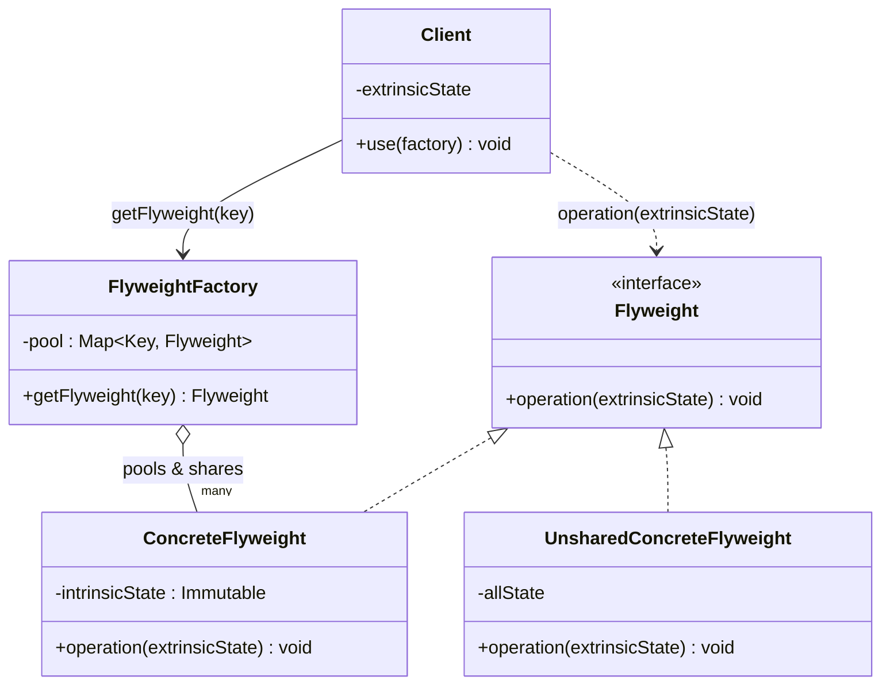

# 플라이웨이트(Flyweight) 디자인 패턴 가이드

> 한 줄 요약: 다수의 유사한 객체가 공통으로 가지는 상태(Intrinsic State)를 객체 외부에서 공유함으로써, 메모리 사용량을 극적으로 줄이는 구조 패턴.
>
> 분류: 구조 패턴 (Structural Pattern)
> 다른 이름(Aliases): Cache, 경량(輕量) 패턴

---

## 상세 설명

플라이웨이트(Flyweight) 패턴은 GoF가 정의한 구조 패턴 중 하나로, "다량의 미세 객체(fine-grained object)"를 효율적으로 다루기 위한 방법을 제시한다. 패턴의 이름은 권투의 최경량급 체급(flyweight)에서 유래하며, 객체 하나의 메모리 비용을 극단적으로 가볍게 만든다는 의도를 함축한다. 즉, 객체를 새로 만들기보다는 이미 만들어진 객체를 재사용해 같은 결과를 더 적은 자원으로 표현하는 것이 핵심이다.

해결하고자 하는 문제(Problem)는 명확하다. 텍스트 에디터에서 문자 하나하나를 객체로 표현하거나, 게임에서 수만 개의 나무·총알·파티클을 객체로 다뤄야 한다면, 객체 수가 폭발적으로 늘면서 메모리가 한계에 도달한다. 그런데 자세히 보면 이 객체들은 서로 다른 정보(예: 좌표, 색상)와 동일한 정보(예: 글꼴 모양, 나무 텍스처, 총알 메시)를 함께 가진다. 동일한 정보까지 객체마다 중복 저장하는 것이 낭비의 원인이다.

플라이웨이트가 제안하는 해결책(Solution)은 객체의 상태를 두 부분으로 분리하는 것이다. 첫 번째는 **내재 상태(Intrinsic State)**로, 객체 간에 공유 가능한 불변(immutable) 정보다. 글리프의 폰트 모양, 나무 종(species)의 텍스처와 메시 등이 여기 속한다. 두 번째는 **외재 상태(Extrinsic State)**로, 객체마다 달라지며 호출자(클라이언트)가 컨텍스트로 주입한다. 글리프가 그려질 좌표, 나무가 서 있는 좌표 등이다. 내재 상태만을 담은 객체를 한 번만 생성해 풀(pool)에 보관하고, 같은 내재 상태가 필요한 모든 클라이언트는 이 객체를 공유한다. 외재 상태는 메서드 인자로 매번 전달한다.

핵심 용어는 다음과 같이 정리된다. **Flyweight**는 공유 가능한 인터페이스/클래스, **ConcreteFlyweight**는 실제로 공유되며 내재 상태를 가지는 객체, **FlyweightFactory**는 풀을 관리하며 동일 키에 대해 동일 인스턴스를 반환하도록 보장하는 팩토리, **Client**는 외재 상태를 보유하고 필요할 때 팩토리에서 Flyweight를 얻어 외재 상태와 결합해 사용하는 주체다.

플라이웨이트는 단순한 "객체 캐싱"과 자주 혼동되지만, 결정적인 차이는 **상태의 의도적 분리**에 있다. 캐시는 단순히 계산 결과나 객체 생성을 재사용할 뿐 객체의 의미적 구조를 바꾸지 않는다. 반면 플라이웨이트는 객체 모델 자체를 "공유 가능한 부분 + 컨텍스트로 주입되는 부분"으로 재설계한다. 자바 표준 라이브러리의 `Integer.valueOf`, `String.intern`, `Boolean.TRUE`처럼 일부 값 객체가 사실상 플라이웨이트로 동작하는 것도 같은 원리다.

---

## 디자인 패턴을 충족하는 최소 조건

이 섹션에서는 "어떤 코드가 진짜로 이 패턴이라고 부를 수 있는가"의 기준을 명확히 한다.

1. **상태 분리(Intrinsic vs Extrinsic)** — 객체의 상태가 명시적으로 두 종류로 나뉘어야 한다. 공유 가능한 내재 상태는 Flyweight 객체 내부에 보관되고, 컨텍스트마다 달라지는 외재 상태는 Flyweight 객체에 저장하지 않고 메서드 파라미터로 주입된다.
2. **내재 상태의 불변성(Immutability)** — ConcreteFlyweight 인스턴스가 여러 클라이언트에서 공유되므로, 내재 상태는 생성 후 변경되지 않아야 한다. 변경 가능한 상태가 공유되면 한 클라이언트의 수정이 모든 클라이언트에게 부작용을 일으킨다.
3. **공유를 책임지는 Factory** — 같은 키에 대해 항상 동일 인스턴스를 반환하는 FlyweightFactory(또는 동등한 풀 메커니즘)가 존재해야 한다. 클라이언트가 `new ConcreteFlyweight()`를 자유롭게 호출할 수 있다면 공유가 보장되지 않는다.
4. **외재 상태의 외부 보관** — 외재 상태는 클라이언트나 별도의 컨텍스트 객체가 보관한다. Flyweight의 메서드는 `operation(extrinsicState)` 형태로 외재 상태를 인자로 받아 동작한다.

> 위 조건 중 하나라도 빠지면 본 패턴이라고 보기 어렵다. 특히 1번과 2번이 빠지면 단순 캐시이며, 3번이 빠지면 공유가 우연에 맡겨진 비-패턴 코드다.

### 흔히 오해하는 지점

- **"객체를 캐싱하면 다 플라이웨이트다"** — 단순 캐싱(Cache)이나 객체 풀(Object Pool)은 플라이웨이트가 아니다. Object Pool은 생성 비용이 큰 객체(예: DB 연결)를 재사용하기 위한 패턴이며, 객체 자체는 상태를 유지할 수 있고 한 시점에 하나의 사용자에게 독점된다. 플라이웨이트는 같은 인스턴스가 동시에 여러 클라이언트에서 공유된다는 점이 다르다.
- **"싱글톤(Singleton)과 같다"** — 싱글톤은 "오직 하나의 인스턴스"를 보장하는 패턴이고, 플라이웨이트는 "같은 키에는 같은 인스턴스, 다른 키에는 다른 인스턴스"를 다수 공유한다. 풀 안에 N개의 ConcreteFlyweight가 존재할 수 있다.
- **"내재 상태를 가변(mutable)으로 둬도 된다"** — 공유 객체의 상태를 변경하는 순간 모든 컨텍스트의 출력이 함께 바뀌어 디버깅이 어려운 버그가 발생한다. 내재 상태의 불변성은 사실상 필수 조건이다.
- **"메서드 시그니처에 외재 상태가 없어도 된다"** — 외재 상태가 어딘가에 저장된다면 그것은 더 이상 외재가 아니다. Flyweight 메서드는 외부에서 상태를 전달받는 형태여야 한다.

---

## 사례를 통한 예시

### 예시 1: 텍스트 에디터의 글리프(Glyph) 공유

**상황**: 텍스트 에디터가 문서에 표시되는 문자(character) 하나하나를 객체로 다룬다고 하자. 한 문서에 수십만 글자가 있고, 같은 문자 'a'가 수천 번 등장한다. 글자마다 폰트 패밀리·크기·굵기·글리프 메트릭을 따로 들고 있으면 메모리가 폭발한다. 폰트 정보는 공유 가능한 내재 상태로, 화면상의 위치만 외재 상태로 분리한다.

```java
import java.util.HashMap;
import java.util.Map;

// Flyweight 인터페이스
interface Glyph {
    void draw(int x, int y); // 외재 상태(좌표)를 인자로 받는다
}

// ConcreteFlyweight: 내재 상태(문자, 폰트)만 보관하고 불변이다
final class CharacterGlyph implements Glyph {
    private final char symbol;       // 내재 상태
    private final String fontFamily; // 내재 상태
    private final int fontSize;      // 내재 상태

    CharacterGlyph(char symbol, String fontFamily, int fontSize) {
        this.symbol = symbol;
        this.fontFamily = fontFamily;
        this.fontSize = fontSize;
    }

    @Override
    public void draw(int x, int y) {
        // 외재 상태(x, y)는 매번 외부에서 주입된다
        System.out.printf("draw '%c' [%s %dpt] at (%d,%d)%n",
                symbol, fontFamily, fontSize, x, y);
    }
}

// FlyweightFactory: 동일 키에는 동일 인스턴스를 반환
final class GlyphFactory {
    private final Map<String, Glyph> pool = new HashMap<>();

    public Glyph get(char symbol, String fontFamily, int fontSize) {
        String key = symbol + "|" + fontFamily + "|" + fontSize;
        return pool.computeIfAbsent(key,
                k -> new CharacterGlyph(symbol, fontFamily, fontSize));
    }

    public int pooledCount() { return pool.size(); }
}

// Client: 외재 상태(좌표)는 클라이언트가 보관한다
public class TextEditorDemo {
    public static void main(String[] args) {
        GlyphFactory factory = new GlyphFactory();
        String text = "aaa bbb";
        int x = 0;
        for (char c : text.toCharArray()) {
            Glyph g = factory.get(c, "Helvetica", 12);
            g.draw(x, 100);
            x += 8;
        }
        // 'a','b',' ' 세 종류만 풀에 존재한다
        System.out.println("pooled glyphs = " + factory.pooledCount()); // 3
    }
}
```

**해설**: `CharacterGlyph`가 ConcreteFlyweight로서 내재 상태(symbol/fontFamily/fontSize)만 `final`로 보관해 불변성을 강제한다. `GlyphFactory`는 키 기반 풀을 관리해 같은 (문자, 폰트) 조합에는 항상 동일 인스턴스를 돌려준다. 좌표 `(x, y)`는 외재 상태이므로 풀이 보관하지 않고 `draw()` 호출 시점에 주입된다. 결과적으로 'aaa bbb' 일곱 글자에 대해 'a','b',' ' 세 개의 글리프만 메모리에 존재한다.

### 예시 2: `java.lang.Integer.valueOf` (자바 표준 라이브러리)

**상황**: 자바는 박싱(boxing)된 정수 객체 중 -128 ~ 127 범위(IntegerCache의 기본 범위)에 대해 동일 인스턴스를 캐시해 재사용한다. 이는 사실상 플라이웨이트 패턴의 실제 적용 사례다. 값 자체가 내재 상태이며 불변이고, 사용 컨텍스트(어떤 변수가 참조하는지)는 외부에 있다.

```java
public class IntegerFlyweightDemo {
    public static void main(String[] args) {
        Integer a = Integer.valueOf(100);
        Integer b = Integer.valueOf(100);
        Integer c = Integer.valueOf(200);
        Integer d = Integer.valueOf(200);

        // -128 ~ 127 범위는 공유된 동일 인스턴스
        System.out.println(a == b); // true  (공유)
        // 범위를 벗어나면 매번 새 인스턴스가 생성된다
        System.out.println(c == d); // false (공유 아님)

        // String.intern() 도 같은 아이디어의 문자열 풀(String pool)이다
        String s1 = "hello";
        String s2 = "hello";
        String s3 = new String("hello").intern();
        System.out.println(s1 == s2); // true
        System.out.println(s1 == s3); // true
    }
}
```

**해설**: `Integer.valueOf(int)`의 내부 구현은 `IntegerCache`라는 정적 배열에 미리 만들어 둔 `Integer` 인스턴스를 반환한다. 이때 `Integer` 자체는 `final` 클래스에 값이 `final int`로 보관된 불변 객체(내재 상태의 불변성 충족)이고, `IntegerCache`가 FlyweightFactory의 역할을 한다. 클라이언트(=자바 코드)는 어떤 변수가 어떤 의미로 그 값을 가리키는지를 외재 상태로 보관한다. `String` 리터럴이 자동으로 String pool에 인턴(intern)되는 것도 동일한 패턴이며, JVM이 메모리에서 같은 문자열 인스턴스를 광범위하게 공유한다.

---

## 어떨 때 사용하나

플라이웨이트는 만능 최적화가 아니라 명확한 신호가 보일 때 도입해야 한다. 다음과 같은 신호(Symptom)가 동시에 여러 개 보일 때 도입을 고려한다.

- 애플리케이션이 매우 많은 수의 유사 객체를 생성하고 있으며, 객체 수가 시스템의 메모리 한계에 영향을 미친다(예: 텍스트 에디터의 문자, 게임의 파티클·총알·나무, GIS의 도로 세그먼트).
- 객체의 상태를 자세히 살펴봤을 때, 큰 부분이 인스턴스 간에 동일하게 중복되어 있다. 그리고 그 중복되는 상태는 자연스럽게 불변으로 만들 수 있다.
- 객체의 정체성(identity)이 핵심 요구사항이 아니다. 즉 "이 'a'와 저 'a'는 다른 인스턴스여야 한다"는 가정이 시스템 어디에도 없다.
- 외재 상태를 클라이언트나 컨텍스트 객체에서 자연스럽게 보관할 수 있다(예: 좌표는 어차피 문서 모델이 보관).
- 힙 메모리 사용량, GC 부하, 캐시 미스로 인한 성능 저하가 측정 가능한 문제로 드러난다.

### 사용하면 안 되는 경우 (Anti-patterns)

- **객체 수가 적을 때**: 수십~수백 개 수준의 객체에 플라이웨이트를 적용하면 메모리 절약 효과보다 풀 관리, 외재 상태 전달, 코드 가독성 저하의 비용이 더 크다.
- **상태 분리가 어려울 때**: 내재 상태와 외재 상태의 경계가 명확하지 않고, 외재 상태가 객체 내부 로직과 강하게 얽혀 있다면 분리 자체가 설계를 왜곡한다.
- **객체가 본질적으로 가변일 때**: 잦은 상태 변경이 동작의 핵심인 도메인 객체(예: 게임 캐릭터의 HP·인벤토리)에 플라이웨이트를 강제하면 공유 객체에 가변 상태가 새어 들어가 정합성 버그를 만든다.
- **정체성(identity)이 중요한 도메인**: 회원, 주문, 결제처럼 인스턴스 단위 식별이 본질인 엔티티에는 부적합하다. 같은 값이라도 서로 다른 객체여야 한다.
- **단순 캐시면 충분할 때**: "객체 생성 비용만 줄이면 된다"면 메모이제이션(memoization)이나 Object Pool로 충분하다. 굳이 상태를 재설계할 필요는 없다.

---

## 장점과 단점, 한계점

### 장점
- **메모리 사용량 감소**: 중복 상태를 단일 인스턴스로 합치므로, 객체 수가 많을수록 절약 효과가 비선형적으로 커진다. 수만 객체가 수십 객체로 줄어드는 경우도 흔하다.
- **객체 생성 비용 감소**: 동일 키에 대해 인스턴스 생성을 1회로 줄이므로, 생성자 비용과 GC 압박이 함께 줄어든다.
- **캐시 친화성(Cache locality) 향상 가능**: 같은 내재 상태를 공유하므로 데이터 지역성이 좋아져 일부 워크로드에서 CPU 캐시 효율이 올라간다.
- **불변성에서 오는 안정성**: 내재 상태가 불변이므로 멀티스레드 환경에서 별도 동기화 없이 안전하게 공유할 수 있다.

### 단점
- **설계 복잡도 증가**: 상태를 두 종류로 분리하고, 외재 상태를 호출 측에서 보관·전달해야 하므로 코드가 더 길고 추적하기 어려워진다.
- **API의 비대칭성**: Flyweight 메서드 시그니처에 외재 상태 파라미터가 늘어나면서, 모든 사용처에서 컨텍스트를 들고 다녀야 한다.
- **CPU와 메모리의 트레이드오프**: 외재 상태를 매번 계산·전달하는 비용이 추가된다. 메모리는 줄지만 CPU 사이클은 늘어날 수 있다.
- **디버깅 난이도**: 동일 인스턴스가 여러 컨텍스트에서 재사용되므로, 로그·스택 추적만으로는 "어느 사용처에서 호출된 것인지"를 알기 어렵다.

### 한계점
- **팩토리 풀의 메모리 누수 위험**: 키 종류가 매우 많고 수명이 짧은 경우, 풀이 무한정 커져 오히려 메모리 누수가 된다. 약한 참조(`WeakHashMap`)나 LRU 정책 등 회수 전략이 필요하다.
- **동시성 환경에서 팩토리 동기화 비용**: 멀티스레드가 동시에 같은 키를 요청할 때 팩토리에서 중복 생성이 일어나지 않도록 `ConcurrentHashMap` 등 적절한 자료구조가 필요하며, 잘못 구현하면 락 경합 지점이 된다.
- **테스트의 어려움**: 공유 인스턴스가 전역 풀에 남아 테스트 간 상태가 새는 경우가 있다. 풀을 테스트 사이에 명시적으로 비우거나 의존성 주입으로 격리해야 한다.
- **확장 시 깨지기 쉬운 가정**: "내재 상태는 영원히 불변일 것"이라는 가정 위에 시스템이 서 있다. 요구사항이 바뀌어 내재 상태에 가변 필드가 추가되는 순간 패턴이 무너진다.

---

## 정보 표

| 항목 | 값 |
| --- | --- |
| 분류 | 구조 패턴 (Structural Pattern) |
| 언어 의존성 | 언어 비의존적. 다만 Java처럼 객체 박싱/문자열 인턴을 제공하는 언어에서는 표준 라이브러리 차원의 적용 사례가 풍부하다. |
| 활용성(1점~5점) | ★★★☆☆ (3/5) — 대규모 객체를 다루는 특정 도메인(에디터, 게임, GIS, 렌더링)에서는 강력하지만, 일반 비즈니스 애플리케이션에서 직접 구현할 일은 많지 않다. |
| 학습 난이도 | 중 — 개념은 단순하지만, 내재/외재 상태 분리와 풀 수명 관리에서 실수가 잦다. |
| 자주 함께 쓰이는 패턴 | Factory Method, Composite (글리프 트리), Singleton (FlyweightFactory를 단일체로 두기도 함), State/Strategy (공유되는 행위 객체) |
| 대표 사용 사례 | Java `Integer.valueOf`/`String.intern`, 텍스트 에디터 글리프, 게임 엔진의 메시·텍스처 공유, 웹 브라우저의 DOM/CSS 스타일 공유 |

---

## Class Diagram



> 다이어그램에 등장하는 각 클래스가 패턴의 어떤 역할(Role)을 담당하는지 위 "상세 설명" 섹션과 1:1로 대응되어야 한다.

### 역할 설명
- **Flyweight (인터페이스)**: 공유 가능한 객체의 공통 인터페이스. `operation()` 메서드는 외재 상태(extrinsicState)를 인자로 받는 형태로 정의되어, 호출 측이 컨텍스트를 주입할 수 있도록 강제한다.
- **ConcreteFlyweight**: 실제로 공유되는 객체. 내재 상태(intrinsicState)만 보관하며, 그 상태는 생성 후 변경되지 않는다. 어느 클라이언트에서 호출되든 동일한 의미로 동작해야 한다.
- **UnsharedConcreteFlyweight**: Flyweight 인터페이스를 구현하되 공유되지 않는 객체. GoF 원전에서 정의된 역할로, 공유 가능한 글리프(예: 문자)와 공유되지 않는 노드(예: 단락, 행)가 같은 트리에 섞일 수 있도록 허용한다. 실무에서는 생략되는 경우가 많다.
- **FlyweightFactory**: 키별로 ConcreteFlyweight 인스턴스를 풀(pool)에 보관한다. 동일 키 요청에는 동일 인스턴스를 반환해 공유를 보장한다. 풀의 크기, 회수 정책, 동시성 처리 책임도 이 클래스에 있다.
- **Client**: 외재 상태를 보유하고, 필요할 때 FlyweightFactory에서 Flyweight를 얻어 외재 상태와 결합해 `operation()`을 호출하는 주체. 상태의 의미적 분리에서 외재 상태의 보관 책임을 진다.

---

## 참고 자료
- 원전: Erich Gamma, Richard Helm, Ralph Johnson, John Vlissides, *Design Patterns: Elements of Reusable Object-Oriented Software*, Addison-Wesley, 1994 — "Flyweight" 항목.
- OpenJDK 소스: `java.lang.Integer.IntegerCache`, `java.lang.String#intern()` — 표준 라이브러리에서의 플라이웨이트 적용 사례.
- Refactoring Guru, "Flyweight" — https://refactoring.guru/design-patterns/flyweight
- Joshua Bloch, *Effective Java* (3rd ed.), Item 1 "Consider static factory methods instead of constructors" — `valueOf` 류 정적 팩토리와 인스턴스 통제(instance-controlled) 클래스 논의.
- Wikipedia, "Flyweight pattern" — https://en.wikipedia.org/wiki/Flyweight_pattern
