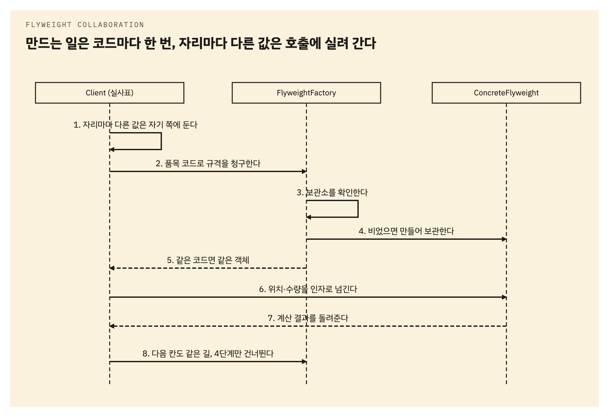
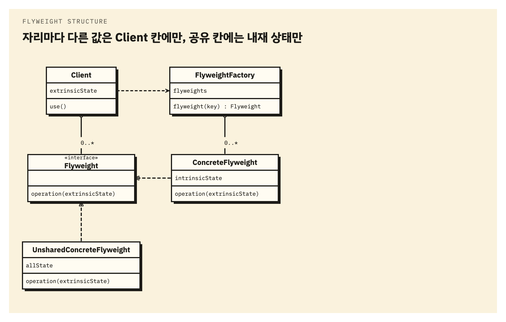

# Flyweight — 어디서나 같은 값은 객체 하나로 모으고, 자리마다 다른 값은 호출에 실어 보내기

## 한눈에 보는 개요

창고 재고 실사표를 하나 떠올려 봅시다. 실사표는 보관 칸마다 줄이 하나씩이고, 줄에는 그 칸에 무엇이 몇 개 있는지와 무게가 적힙니다. 칸이 1,200개인 구역을 코드로 옮기면서 칸 객체마다 품목 규격 객체(품목 코드와 개당 무게)를 하나씩 붙였더니 규격 객체가 1,200개 생겼어요. 그런데 그 구역에서 취급하는 품목은 네 종류뿐입니다. 같은 내용의 객체가 300번씩 복제돼 있는 셈이죠.

Flyweight 의 해법은 **어디서 쓰이든 같은 값과 자리마다 달라지는 값을 갈라, 앞엣것만 객체로 만들어 같이 쓰는 것**입니다. 품목 코드와 개당 무게는 규격 객체에 남기고, 위치와 수량은 칸이 가지고 있다가 계산을 청구할 때 인자로 넘겨요. 그러면 규격 객체는 품목 종류 수만큼만 있으면 됩니다.

```text
Before : 칸마다 규격 객체를 따로 만듦

  칸 D-1-1  ── 규격 #1 (SKU-101 · 300g)
  칸 D-1-2  ── 규격 #2 (SKU-204 · 850g)
  칸 D-1-3  ── 규격 #3 (SKU-330 · 40g)
  …                                        ← 1,200칸이면 규격 객체도 1,200개
                                             서로 다른 내용은 네 가지뿐인데

After : 같은 값은 코드마다 하나, 자리마다 다른 값은 인자로

  칸 D-1-1 (위치 D-1-1 · 수량 1) ─┐
  칸 D-1-5 (위치 D-1-5 · 수량 5) ─┼─ 보관소 ─▶ 규격 SKU-101 (300g)   ← 객체 하나
  칸 D-2-1 (위치 D-2-1 · 수량 7) ─┘                 weightGrams(수량)

                                              규격 객체 4개 (품목 종류 수)
```

직접 재 보면 이 구역의 규격 객체는 1,200개에서 4개가 되고, 실사표가 내는 총무게 1,959,780g 은 양쪽이 같습니다. 재는 방법과 그 값이 어디서 왔는지는 「상황 설정」과 구현 해설에 있어요. 분류는 구조 패턴이면서 객체 범위이고, 함께 쓰는 패턴은 Composite · State · Strategy 입니다(근거: GoF 원서 Flyweight 절 Related Patterns). 어느 값이 객체에 남고 어느 값이 호출마다 넘어가는지를 구분하는 어휘는 [참고 문서 「GoF 공통 어휘」의 내재 상태와 외재 상태](../../reference/gof-vocabulary/gof-vocabulary-ref_v1.0.2.md#내재-상태와-외재-상태)에 있습니다. 이 글은 시나리오 셋을 따라갑니다. 칸 하나가 무게를 받아 내는 길. 칸이 천 개 넘게 늘고 혼합 팔레트가 끼어들 때 무엇이 안 바뀌는가. 자리마다 다른 값을 공유 객체 안에 넣으면 어느 단계에서 어긋나는가. 끝까지 읽으면 어떤 코드를 Flyweight 라고 불러도 되는지 필수 조건 셋으로 판정할 수 있고, Singleton 이나 객체 풀과도 구분할 수 있게 됩니다.

## 패턴 자세히 들여다보기

### 시나리오 1 — 실사표의 첫 칸이 무게를 받아 내는 길

창고 A 구역 실사가 시작됐습니다. 칸 `A-01-1` 에 품목 `SKU-101` 이 12개 있고, 바로 옆 칸 `A-01-2` 에 같은 품목이 5개, 조금 떨어진 `B-03-4` 에 `SKU-204` 가 2개 있어요. `SKU-101` 은 개당 300g, `SKU-204` 는 개당 850g 입니다. 실사표가 내야 하는 값은 3,600g · 1,500g · 1,700g 세 줄이에요. 이 장면에는 다섯이 등장합니다. 칸 하나를 나타내는 객체 `Slot`(위치와 수량을 가지고 있는 쪽), 품목 규격을 담은 객체 `SharedItemSpec`(패턴에서는 ConcreteFlyweight 라고 부르는 역할), 규격들이 공통으로 따르는 연산 모양 `ItemSpec`(Flyweight), 규격을 만들고 보관하는 `ItemSpecPool`(FlyweightFactory), 그리고 실사표를 짜는 진입점입니다. 이름은 여기서 한 구절씩만 소개하고 정식 정의는 개념 정리에서 해요.



1. 진입점이 실사표에 들어갈 값을 둘로 가릅니다. 품목 코드와 개당 무게는 그 품목이 어느 칸에 있든 같고, 위치와 수량은 칸마다 달라요. 이 구분을 맨 앞에 두는 이유는 뒤 단계 전부가 여기에 달려 있기 때문입니다. 무엇이 어느 쪽인지 정하지 않으면 규격 객체에 무엇을 남길지도, 연산이 무엇을 인자로 받을지도 정할 수 없어요.
2. 진입점이 보관소에 `SKU-101` 규격을 청구합니다. 직접 만들지 않는 이유는 공유가 성립하려면 같은 코드에 같은 객체가 나와야 하고, 그 판단을 할 수 있는 곳이 보관소 하나뿐이어서예요. 진입점 두 곳이 각자 만들면 둘 중 누구도 상대가 이미 만들었다는 것을 알 수 없습니다.
3. 보관소가 자기 안의 보관 자리를 들여다봅니다. `SKU-101` 자리가 비어 있네요. 확인을 먼저 하는 이유는 이 검사가 빠지면 청구할 때마다 새 객체가 생겨 이 패턴이 아예 성립하지 않아서입니다.
4. 비어 있으니 보관소가 규격 객체를 만들어 그 자리에 넣고 돌려줍니다. 이때 객체 안에 들어가는 값은 품목 코드와 개당 무게 둘뿐이에요. 위치를 함께 넣으면 3단계에서 찾아 쓴 객체가 남의 위치를 가지고 있게 되므로, 넣을 수 있는 값의 범위가 1단계의 구분으로 이미 정해져 있습니다.
5. 진입점이 칸 객체를 만들면서 위치 `A-01-1` 과 수량 12 를 칸에 담고, 4단계에서 받은 규격 참조를 함께 둡니다. 위치와 수량을 칸이 가지는 이유는 그 값이 칸마다 다르기 때문이에요. 규격 객체는 여러 칸이 같이 쓰므로 한 칸의 값을 거기 두면 다른 칸이 그 값을 보게 됩니다.
6. 실사표가 칸에 무게를 물으면 칸이 규격 객체에게 `weightGrams(12)` 를 부릅니다. 수량을 인자로 실어 보내는 이유는 그 값이 규격 객체 안에 없기 때문이에요. 규격은 개당 무게만 알고 있고, 몇 개인지는 부르는 쪽이 알려 줘야 계산이 성립합니다.
7. 규격이 300 × 12 = 3,600 을 돌려줍니다. 받은 수량 12 를 어디에도 적어 두지 않아요. 적어 두면 다음 칸이 부를 때 그 값이 남아 있게 되고, 그 순간부터 이 객체는 한 칸 전용이 됩니다. 돌려주고 잊는 것이 여러 칸이 같이 쓸 수 있는 조건이에요.
8. 다음 칸 `A-01-2` 가 같은 코드로 보관소를 부릅니다. 이번에는 3단계의 검사에서 자리가 차 있어 4단계를 지나지 않고, 앞 칸이 받은 것과 같은 객체가 돌아와요. 달라지는 것은 6단계에서 넘기는 수량 5 하나입니다. `B-03-4` 는 코드가 달라 4단계를 한 번 더 지납니다.

```text
단계   부르는 쪽 → 받는 쪽              넘기는 것           돌아오는 것
 1     진입점                           —                  무엇이 내재 · 무엇이 외재인가
 2     진입점 → 보관소                  "SKU-101"          (4단계에서 규격 객체)
 3     보관소 → 보관 자리               —                  비어 있음
 4     보관소 → (생성)                  코드 · 개당 무게    규격 객체 · 보관 자리에 저장
 5     진입점 → 칸 A-01-1               위치 · 수량 · 규격  칸 객체
 6     칸 A-01-1 → 규격                 수량 12            (7단계에서 3,600)
 7     규격 → 칸 A-01-1                 —                  3,600  (수량은 남지 않음)
 8     칸 A-01-2 → 보관소               "SKU-101"          같은 규격 객체 (4단계 건너뜀)
```

잠깐, 확인 하나만 해 볼까요? 8단계에서 `A-01-2` 가 받은 규격과 2단계에서 `A-01-1` 이 받은 규격을 참조 같음으로 견주면 무엇이 나올까요? 그리고 `B-03-4` 의 규격과 견주면요?

앞은 참, 뒤는 거짓입니다. 구현 예시의 출력 네 번째·다섯 번째 줄 `same-spec A-01-1,A-01-2 = true` 와 `same-spec A-01-1,B-03-4 = false` 가 그 값이에요. 공유의 단위가 품목 코드라서 코드가 같으면 한 객체, 다르면 다른 객체가 됩니다. 두 칸의 무게가 3,600g 과 1,500g 으로 다르게 나오는데도 규격은 하나라는 것이 이 패턴이 주는 것의 전부이고, 그 차이는 6단계에서 넘긴 수량에서만 옵니다.

```text
칸 A-01-1 (수량 12) ─┐
                     ├──▶ 같은 규격 객체 (SKU-101 · 300g) ──▶ 3,600g / 1,500g
칸 A-01-2 (수량 5)  ─┘

수량을 규격 객체 안에 넣었다면
  칸 A-01-1 ──▶ 규격 #1 (SKU-101 · 300g · 수량 12)
  칸 A-01-2 ──▶ 규격 #2 (SKU-101 · 300g · 수량 5)   ← 내용이 같은 칸이 없어 공유가 안 된다
```

이 시나리오가 보여 준 것은 구분 하나와 그 구분이 만든 세 가지 규칙입니다. 어디서나 같은 값과 자리마다 다른 값을 가르고(1단계), 앞엣것만 객체에 남기며(4단계), 뒤엣것은 부르는 쪽이 가지고 있다가 호출에 실어 보내고(5·6단계), 그 객체를 얻는 길은 보관소 하나로 모읍니다(2·3·8단계). 규격이 받은 값을 잊는 것(7단계)은 규칙이 아니라 앞의 구분에서 따라 나오는 결과예요. 자리마다 다른 값이 객체 안에 남으면 그 값은 더 이상 자리마다 다른 값이 아니게 되니까요.

### 시나리오 2 — 칸이 1,200개로 늘고 혼합 팔레트가 끼어들 때

같은 창고의 D 구역으로 실사가 넘어갑니다. 여기는 칸이 1,200개이고 취급 품목은 `SKU-101` · `SKU-204` · `SKU-330` · `SKU-457` 네 가지, 개당 무게는 차례로 300g · 850g · 40g · 120g 이에요. 그리고 칸 `C-09-2` 에는 `SKU-330` 과 `SKU-457` 을 한 개씩 올려 묶은 혼합 팔레트가 7개 쌓여 있습니다. 기대하는 결과는 둘이에요. 1,200칸의 총무게가 나와야 하고, 혼합 팔레트 칸은 1,120g 으로 나와야 합니다.

1. 칸 1,200개를 만들되 규격은 전부 보관소를 거쳐 얻습니다. 만들어진 규격 객체는 4개예요. 세는 방법은 규격 객체의 생성자에 1씩 올라가는 카운터를 두고 이 구간을 지나기 전후의 값을 빼는 것이고, 그렇게 얻은 값이 구현 예시 출력의 마지막 줄 `pooled: slots=1200 spec-objects=4` 입니다.
2. 대조군으로 같은 1,200칸을 칸마다 새 규격을 만들어 채워 봅니다. 규격 객체는 1,200개가 됩니다(출력 일곱 번째 줄 `direct: slots=1200 spec-objects=1200`). 두 방식의 총무게는 1,959,780g 으로 같아요. 공유가 계산 결과를 바꾸지 않는다는 것을 이 자리에서 확인해 두는 이유는, 뒤 시나리오에서 결과가 달라지는 경우와 구분해 보기 위해서입니다.
3. 칸 객체는 양쪽 모두 1,200개 그대로입니다. 줄어든 것은 규격 객체뿐이에요. 칸은 자리마다 다른 값을 가지고 있으니 합칠 수 없고, 애초에 이 패턴이 줄이려는 것도 칸이 아니라 칸들이 중복해서 가지고 있던 같은 값입니다.
4. 혼합 팔레트가 들어옵니다. 이것도 칸이 부르는 연산 모양 `ItemSpec` 을 따르지만 보관소에 넣지 않아요. 팔레트 안에 무엇이 몇 개 들었는지가 팔레트마다 다르기 때문에 묶을 키가 없습니다. 칸은 자기가 가진 것이 공유 규격인지 팔레트인지 모른 채 같은 연산을 부르고, 그래서 칸 쪽 코드는 한 줄도 바뀌지 않아요.
5. 그 팔레트 안에는 다시 공유 규격이 들어갑니다. 팔레트는 `SKU-330` 과 `SKU-457` 의 규격을 보관소에서 얻어 자기 목록에 넣고, 무게를 물으면 둘에게 각각 `weightGrams(1)` 을 불러 더한 뒤 수량을 곱해요. 공유되지 않는 객체가 하나 끼었다고 해서 그 아래의 공유가 끊기지는 않습니다.

| 변화 | 바뀐 곳 | 안 바뀐 곳 |
| --- | --- | --- |
| 칸이 3개에서 1,200개로 | 칸 객체 1,200개 · 진입점의 반복문 | 규격 객체 4개 · 규격 클래스 전체 |
| 품목이 2종에서 4종으로 | 규격 객체 2개 → 4개 | 칸 클래스 · 보관소 코드 |
| 혼합 팔레트 등장 | `ItemSpec` 을 따르는 클래스 하나 추가 | 칸이 연산을 부르는 줄 · 공유 규격 쪽 전부 |

여기서 헷갈리기 쉬운 포인트는 절감의 크기를 품목 수가 아니라 칸 수로 읽는 것입니다. 1,200이 4가 된 것은 절감률이 아니라 이 구역의 수치예요. 규격 객체의 수를 정하는 것은 칸 수가 아니라 **서로 다른 내재 상태의 가짓수**이고, 여기서는 그것이 품목 종류 수 4 입니다. 품목이 1,200종이면 같은 코드로도 규격 객체가 1,200개가 되고 절감은 0 이 돼요. 그 경계를 실제로 넘겨 보는 것이 다음 시나리오의 3단계입니다.

이 시나리오가 보여 준 것은 무엇이 늘 때 무엇이 따라 늘지 않는가입니다. 칸이 늘어도 규격은 늘지 않고(1·2단계), 공유되지 않는 구현체가 끼어도 부르는 쪽은 그대로이며(4단계), 그 구현체 아래에서 공유는 계속됩니다(5단계). 대신 줄어드는 것은 규격 객체뿐이고 칸 객체는 그대로라는 것(3단계), 그리고 절감의 크기가 내재 상태의 가짓수에 달려 있다는 것도 함께 확인됐어요.

### 시나리오 3 — 위치를 규격 객체 안에 넣으면 어디서 어긋나는가

이번에는 같은 실사 프로그램의 다른 판본입니다. 출력 줄을 만드는 연산이 `describe(위치, 수량)` 으로 인자를 둘이나 받는 것이 번거로워 보였던 개발자가 위치를 규격 객체의 필드로 옮기고 연산을 `describe(수량)` 으로 줄였어요. 보관소는 그대로 품목 코드를 키로 씁니다. 시나리오 1 과 같은 세 칸을 넣으면 `A-01-1` · `A-01-2` · `B-03-4` 세 줄이 나와야 하는데, 실제로는 무엇이 나올까요.

1. 첫 칸이 규격을 청구하면 보관소가 위치 `A-01-1` 을 가지고 있는 규격 객체를 만들어 보관합니다. 여기까지는 아무 일도 일어나지 않아요. 문제가 나타나려면 같은 코드의 두 번째 칸이 와야 합니다.
2. 두 번째 칸 `A-01-2` 가 같은 코드로 청구하면 보관소는 이미 있는 객체를 돌려줍니다. 그 객체가 가진 위치는 `A-01-1` 이에요. 그래서 출력 두 번째 줄이 `A-01-1 SKU-101 x5 1500g` 으로 나옵니다. 수량 5 는 여전히 인자로 넘어가니 맞고, 위치만 틀려요. 이 판본을 실제로 컴파일하고 실행해 확인한 값입니다.
3. 고치는 가장 짧은 길은 보관소의 키에 위치를 더하는 것입니다. 키를 `코드@위치` 로 바꾸면 출력은 맞아져요. 대신 키가 칸 수만큼 생기므로 규격 객체가 1,200개로 돌아옵니다. 같은 1,200칸에 대해 키가 코드일 때 4개, 코드와 위치일 때 1,200개라는 값을 직접 실행해 확인했어요. 값을 맞히려고 키를 늘리면 이 패턴을 쓰는 이유가 사라집니다.
4. 그래서 되돌리는 길은 하나입니다. 위치를 규격 객체 밖으로 빼서 연산 인자로 되돌리는 것이에요. 시나리오 1 의 5·6단계가 그 모양이고, 그렇게 두면 3단계의 딜레마 자체가 생기지 않습니다. 인자가 둘이라 번거롭다는 처음의 불편은 남지만, 그 불편이 바로 공유의 대가예요.
5. 갈래 하나를 더 봅시다. 규격 객체는 밖으로 뺐는데, 두 칸이 같은 물건인지를 규격 참조가 같은지로 판정하는 코드를 둔 경우입니다. `A-01-1` 과 `A-01-2` 는 다른 칸인데 규격이 같은 객체라 이 판정은 참을 냅니다. 구현 예시 출력의 `same-spec A-01-1,A-01-2 = true` 가 그 값이에요. 공유하기 전에는 두 칸의 규격이 서로 다른 객체였으므로 같은 코드가 거짓을 냈을 겁니다.

```text
Before (시나리오 3 의 1·2단계)                After (시나리오 1 의 모양)

  규격: 코드 · 개당 무게 · 위치                규격: 코드 · 개당 무게
  칸  : 수량                                   칸  : 위치 · 수량
  describe(수량)                               describe(위치, 수량)

  A-01-1 SKU-101 x12 3600g                     A-01-1 SKU-101 x12 3600g
  A-01-1 SKU-101 x5 1500g   ← 위치가 틀림      A-01-2 SKU-101 x5 1500g

  키를 코드@위치 로 바꾸면 값은 맞지만
  규격 객체 4개 → 1,200개
```

이 시나리오가 보여 준 것은 세 자리가 각각 어떻게 어긋나는지입니다. 자리마다 다른 값이 공유 객체의 필드로 들어가면 값이 조용히 틀리고(1·2단계), 그것을 키로 막으면 절감이 사라지며(3단계), 공유된 객체의 동일성으로 업무 판정을 하면 판정이 뒤집힙니다(5단계). 앞의 둘은 최소 조건 1·2번으로 가려내고, 마지막 하나는 선택 조건 4번이 가리키는 자리예요. 세 번째가 필수가 아닌 이유는 그것이 공유하는 코드의 구조가 아니라 공유 객체를 쓰는 쪽의 습관이기 때문인데, 이 구분은 최소 조건 절에서 다시 풉니다.

### 개념 정리

시나리오에 나온 역할은 다섯입니다. 역할 이름으로 정의하고, 이 글의 예시에서 그 역할을 맡은 타입을 괄호에 적어 둘게요.

- **Flyweight** — 공유될 수 있는 객체들이 공통으로 따르는 연산 모양입니다. 연산 하나가 자리마다 달라지는 값을 인자로 받도록 선언하는 것이 이 역할의 전부예요. 부르는 쪽이 이 모양만 알면 되므로, 그 뒤에 있는 것이 공유 객체인지 아닌지는 몰라도 됩니다. 이 글에서는 `ItemSpec` 이고 `weightGrams(수량)` · `describe(위치, 수량)` 둘을 선언합니다.
- **ConcreteFlyweight** — Flyweight 를 구현하면서 어디서 쓰이든 같은 값만 자기 안에 담는 객체입니다. 이 객체가 담는 값을 내재 상태라고 부르고, 담지 않고 인자로 받는 값을 외재 상태라고 불러요(두 낱말의 정의는 [참고 문서 「GoF 공통 어휘」의 내재 상태와 외재 상태](../../reference/gof-vocabulary/gof-vocabulary-ref_v1.0.2.md#내재-상태와-외재-상태)에 있습니다). FlyweightFactory 가 만들어 보관하고 여러 Client 가 같이 씁니다. 이 글에서는 품목 코드와 개당 무게를 담은 `SharedItemSpec` 이에요.
- **UnsharedConcreteFlyweight** — Flyweight 를 구현하지만 공유되지 않는 객체입니다. 연산 모양이 같으니 Client 는 이것과 ConcreteFlyweight 를 구분하지 않고 부를 수 있고, 안에는 공유 객체를 자식으로 가질 수 있어요. 이 글에서는 품목 구성이 팔레트마다 달라 묶을 키가 없는 `MixedPallet` 이고, 그 안에 공유 규격 둘을 담습니다.
- **FlyweightFactory** — ConcreteFlyweight 를 만들고 보관하며 같은 키에 같은 객체를 돌려주는 역할입니다. 키를 받아 보관 자리를 확인하고, 있으면 그대로 돌려주고 없으면 만들어 넣는 연산 하나가 책임의 전부예요. Client 와 ConcreteFlyweight 사이에서 공유를 보장합니다. 이 글에서는 품목 코드를 키로 쓰는 `ItemSpecPool` 입니다.
- **Client** — 자리마다 달라지는 값을 자기가 가지고 있다가 연산을 부를 때 넘기는 쪽입니다. 공유 객체를 직접 만들지 않고 FlyweightFactory 에서만 얻으며, 받은 참조를 자기 필드에 둘 수 있어요. 이 글에서는 위치와 수량을 담은 칸 객체 `Slot` 과, 칸들을 만들어 실사표를 짜는 진입점이 함께 이 역할입니다.



그림에서 `extrinsicState` 가 적힌 칸이 Client 하나뿐이라는 점을 봐 두세요. ConcreteFlyweight 칸에는 `intrinsicState` 만 있고, 두 구현체가 선언하는 연산은 둘 다 `operation(extrinsicState)` 로 자리마다 다른 값을 인자로 받습니다. Client 에서 나가는 실선은 Flyweight 로만 향하고 ConcreteFlyweight 로 곧장 가지 않아요. 공유 대상을 얻는 길이 FlyweightFactory 하나로 모인다는 것이 그 화살표가 없다는 사실로 그려져 있습니다. 최소 조건 1번은 `intrinsicState` 칸을, 2번은 `operation` 의 인자를, 3번은 Client 에서 FlyweightFactory 로 가는 점선을 코드에서 확인합니다.

> 어디서나 같으면 객체 안에, 자리마다 다르면 호출 인자에.

## 사용 목적

Flyweight 가 필요하다는 단서는 객체 수와 필드 이름에서 보입니다. 셋을 차례로 봅시다.

**단서 1. 같은 내용을 담은 객체가 수천 개인데 서로 다른 내용은 몇 가지뿐입니다.** 세는 방법은 그 클래스의 생성자에 카운터를 넣고 한 번 실행해 보는 것이고, 그 값과 실제로 다른 값의 가짓수를 견주면 됩니다. 실사표 예에서는 규격 객체 1,200개에 서로 다른 내용이 4가지였어요. 비율이 클수록 이 패턴으로 얻는 것이 큽니다.

```text
세는 법                                      이 구역에서 나온 값
─────────────────────────────────────────    ──────────────────────
규격 객체 생성자에 카운터 += 1               생성 1,200개
그 객체들이 실제로 담은 서로 다른 값의 수    4가지 (SKU-101 · 204 · 330 · 457)
                                             → 1,196개는 같은 내용의 복제본
```

**단서 2. 객체의 필드 이름이 "어디서 쓰이는가"를 적고 있습니다.** 위치 · 좌표 · 소유자 · 시각 · 인덱스처럼 그 객체가 놓인 자리를 가리키는 이름이 필드에 있으면, 그 값 때문에 객체가 자리 수만큼 필요해진 것일 수 있어요. 시나리오 3 의 1단계가 정확히 그 모양이었습니다. 반대로 코드 · 이름 · 단가처럼 자리를 말하지 않는 이름만 남은 객체는 이미 공유할 수 있는 상태예요.

**단서 3. 같은 인자 조합으로 객체를 반복해서 만드는 자리가 반복문 안에 있습니다.** 반복문 안에 생성 호출이 있고 그 인자가 늘 몇 가지 값 가운데 하나이면 같은 객체를 계속 새로 만드는 중입니다. 시나리오 2 의 2단계가 그 모양이고, 그 자리를 보관소 호출로 바꾸는 것이 시나리오 2 의 1단계예요. 비슷한 단서에서 객체 풀이나 단순 캐시를 고르게 되는 경우도 있는데, 차이는 비교 절에서 풉니다.

| 쓰지 말아야 할 상황 | 쓰면 잃는 것 |
| --- | --- |
| 객체 수가 애초에 문제되지 않는 규모 | 보관소 한 겹과 호출마다 넘기는 인자가 느는 비용에 비해 얻는 것이 없음. 칸이 세 개인 시나리오 1 만 놓고 보면 규격 객체가 3개에서 2개로 줄 뿐임 |
| 자리마다 다른 값의 가짓수가 객체 수만큼 많은 경우 | 키가 자리 수만큼 생겨 공유가 일어나지 않음. 시나리오 3 의 3단계에서 키에 위치를 넣었더니 규격 객체가 4개에서 1,200개로 돌아온 것이 이 경우의 실측값 |
| 코드가 공유 객체의 동일성에 기대는 경우 | 공유하는 순간 판정이 뒤집힘. 시나리오 3 의 5단계처럼 다른 칸 둘이 같다고 나옴 |
| 외재 상태를 넘길 때마다 다시 계산해야 하는 경우 | 메모리를 아끼는 대신 그 계산을 호출마다 치름. 저장해 두면 다시 자리마다 객체가 필요해지므로 둘 중 하나를 골라야 함 |

## 패턴의 경계

### 디자인 패턴을 충족하는 최소 조건

어떤 코드를 Flyweight 라고 불러도 되는지 가르는 기준입니다. `[필수]` 가 하나라도 빠지면 Flyweight 가 아니고, `[선택]` 은 갖추면 좋은 구조예요. 조건은 언어와 상관없이 코드에서 확인할 수 있는 모양(필드에 담긴 값의 성격 · 연산 시그니처 · 생성 호출의 위치)으로 적었고, 조건마다 그것을 보여 준 시나리오의 단계를 가리킵니다.

1. [필수] 공유되는 객체의 필드에 자리마다 달라지는 값이 없습니다 — 그 타입이 필드로 가진 값이 그 객체가 어느 자리에서 쓰이든 같아야 하고, 쓰이는 자리를 가리키는 값(위치 · 좌표 · 소유자 · 인덱스)은 필드에 없습니다. 시나리오 1 의 4단계가 이 자리이고, 시나리오 2 의 1단계가 그 결과로 규격 객체가 네 개에 머무는 것을 보여 줍니다 (근거: GoF 원서 Flyweight 절 Participants — ConcreteFlyweight 는 공유 가능해야 하고 그것이 저장하는 상태는 모두 내재, 곧 그 객체가 놓인 맥락과 독립이어야 한다고 적는다).
   - 빠지면: 시나리오 3 의 1·2단계가 그 모양이에요. 위치를 필드로 옮기면 같은 코드의 두 번째 칸이 앞 칸의 위치를 그대로 받아 출력이 `A-01-1 SKU-101 x5 1500g` 으로 나옵니다(직접 컴파일해 실행한 값). 값을 맞히려고 보관소 키에 위치를 더하면 규격 객체가 1,200개로 돌아와 공유가 사라지고, 남는 것은 키만 복잡해진 생성 캐시입니다.
2. [필수] 자리마다 달라지는 값은 연산을 부를 때 넘어옵니다 — 공유 객체의 연산 시그니처가 그 값을 인자로 받고, 그 값을 보관하는 자리는 공유 객체 밖(부르는 쪽 또는 그 자리를 나타내는 객체)에 있습니다. 시나리오 1 의 5·6단계가 그 자리입니다 (근거: GoF 원서 Flyweight 절 Collaborations · Participants — 클라이언트가 연산을 호출할 때 외재 상태를 플라이웨이트에 넘기고, Client 가 그 외재 상태를 저장하거나 계산한다고 적는다).
   - 빠지면: 연산이 인자를 받지 않고 필드만 보는 모양이 됩니다. 그러면 1번을 지키는 길이 막혀 자리마다 다른 값이 필드로 들어오거나, 키를 받아 객체를 캐시해 돌려줄 뿐 자리마다 다른 값이라는 개념 자체가 없는 인스턴스 통제 캐시가 돼요. 뒤엣것은 비교 절에서 따로 구분합니다.
3. [필수] 공유 대상은 팩토리 역할의 연산으로만 얻고, 같은 키에는 같은 객체가 돌아옵니다 — 부르는 쪽 코드에 그 타입의 생성 호출이 없고, 키를 받는 연산 하나가 보관 자리를 확인해 있으면 그대로 돌려주고 없으면 만들어 넣습니다. 시나리오 1 의 2·3·8단계가 그 길이에요 (근거: GoF 원서 Flyweight 절 Participants · Collaborations — FlyweightFactory 가 플라이웨이트를 만들고 관리하며 적절한 공유를 보장하고, 클라이언트는 ConcreteFlyweight 를 직접 인스턴스화하지 않고 팩토리에서만 얻는다고 적는다).
   - 빠지면: 시나리오 2 의 2단계가 그 모양입니다. 부르는 쪽이 자유롭게 생성하면 내용이 같은 객체가 자리 수만큼 생겨 규격 객체가 1,200개가 돼요(실행으로 확인한 값). 1번과 2번을 다 지켜도 이 조건이 빠지면 공유가 일어나지 않으므로, 남는 것은 인자를 많이 받는 평범한 값 객체입니다.
4. [선택] 공유 객체의 동일성으로 업무 판정을 하지 않습니다 — 부르는 쪽 코드가 두 공유 객체를 참조 같음으로 견주어 업무상 무엇을 판정하는 자리가 없습니다. 시나리오 3 의 5단계가 그 판정이 뒤집히는 자리예요 (근거: GoF 원서 Flyweight 절 Applicability — 공유하면 개념상 다른 객체의 동일성 검사가 참이 되므로 애플리케이션이 객체 동일성에 의존하지 않아야 한다고 적는다).
5. [선택] 공유되는 동안 내재 상태가 바뀌지 않습니다 — 그 타입에 내재 상태를 바꾸는 공개 연산이 없고 필드가 생성 뒤 고정입니다. 시나리오 1 의 7단계가 그 성질에 기대는 자리입니다 (근거: 이 가이드의 정책 — 원전은 ConcreteFlyweight 에 대해 공유 가능할 것과 저장 상태가 맥락과 독립일 것만 요구하고 불변이라는 말은 쓰지 않는다. 필수로 올리면 쓰기 전에 값을 다시 채워 넣는 방식으로 공유하는 구현이 전부 패턴 아님으로 판정된다).
6. [선택] 공유되지 않는 구현체가 같은 연산 모양을 따릅니다 — Flyweight 를 구현하면서 팩토리의 보관 자리에는 들어가지 않는 타입이 있고, 부르는 쪽은 둘을 구분하지 않습니다. 시나리오 2 의 4·5단계가 그 자리예요 (근거: GoF 원서 Flyweight 절 Participants — 모든 Flyweight 하위 타입이 공유될 필요는 없고 Flyweight 인터페이스는 공유를 가능하게 할 뿐 강제하지 않는다고 적는다).
7. [선택] 더는 쓰이지 않는 공유 객체를 회수하는 장치가 있습니다 — 참조 수를 세거나 언어의 회수기가 가져갈 수 있도록 보관 자리가 약한 참조를 씁니다. 시나리오 2 의 1단계처럼 공유 객체의 수가 적고 고정이면 이 장치 없이 프로그램이 끝날 때까지 가지고 있어도 됩니다 (근거: GoF 원서 Flyweight 절 Implementation — 공유 객체 관리는 회수를 함의하지만 플라이웨이트의 수가 고정이고 적으면 둘 다 필요 없으며 영구 보관할 만하다고 적는다).

| 판정할 코드 | 1번 | 2번 | 3번 | 판정 |
| --- | --- | --- | --- | --- |
| 구현 절의 `SharedItemSpec` 과 보관소 | 만족 (코드 · 개당 무게만) | 만족 (위치 · 수량이 인자) | 만족 (`spec(code)`) | Flyweight |
| 시나리오 3 의 위치를 필드로 옮긴 판 | 빠짐 | 빠짐 (연산이 위치를 안 받음) | 만족 | Flyweight 아님 |
| 시나리오 2 의 2단계처럼 칸마다 새로 만드는 판 | 만족 | 만족 | 빠짐 | Flyweight 아님 |
| 키를 받아 객체만 캐시해 돌려주는 연산 | 알 수 없음 | 빠짐 (넘길 값이 없음) | 만족 | Flyweight 아님 (인스턴스 통제 캐시) |
| 보관소 없이 미리 만들어 둔 상수 객체를 쓰는 코드 | 만족 | 만족 | 부분 (키 대신 이름으로 고름) | 경계 — 아래 설명 |

`[필수]` 는 하나만 빠져도 판정이 끝나므로 1번부터 차례로 봅니다. 1번은 필드 목록만, 2번은 연산 시그니처만, 3번은 생성 호출이 어디 있는지만 보면 되어서 앞에서 멈추면 뒤는 읽지 않아도 돼요. 표 마지막 줄의 경계 사례는 상수로 선언해 둔 공유 객체를 이름으로 골라 쓰는 코드인데, 키를 받아 찾는 연산은 없지만 생성이 한곳에 모여 있고 같은 이름에 늘 같은 객체가 나옵니다. 이 글은 이것을 3번의 만족으로 봅니다. 3번이 요구하는 것은 조회 연산이라는 문법이 아니라 부르는 쪽이 생성하지 못하고 같은 키에 같은 객체가 나온다는 결과이기 때문이에요.

여기서 헷갈리기 쉬운 포인트는 4번 동일성과 5번 불변성을 필수로 올리고 싶어지는 것입니다. 둘 다 어기면 사고가 나는 것은 맞아요. 그래도 필수는 아닙니다. 두 조건이 말하는 것은 공유하는 쪽의 구조가 아니라 공유된 객체를 **쓰는 쪽의 습관**이거든요. 같은 규격 클래스와 같은 보관소를 쓰는 두 프로그램이 있을 때, 한쪽이 참조 비교로 업무 판정을 한다고 해서 그 클래스가 Flyweight 가 아니게 되지는 않습니다. 코드 판정 도구는 공유하는 쪽의 코드만 받아 보는 일이 많아서, 이 둘을 필수로 올리면 멀쩡한 구현이 판정 대상 밖의 사정 때문에 패턴 아님으로 판정돼요.

```java no-compile
// 3번은 만족하지만 1·2번이 빠진 모양 — 키별 캐시일 뿐이다
final class SessionKeys {
    private static final Map<String, SessionKey> CACHE = new HashMap<>();

    static SessionKey of(String userId) {              // 같은 키에 같은 객체 (3번 만족)
        return CACHE.computeIfAbsent(userId, SessionKey::new);
    }
}

final class SessionKey {
    private final String userId;                       // 자리마다 다른 값이 필드에 있다 (1번 빠짐)
    private Instant lastSeenAt;                        // 쓰는 자리마다 달라지는 값인데 인자가 아니다 (2번 빠짐)

    SessionKey(String userId) {
        this.userId = userId;
    }

    void touch() {                                     // 연산이 자리마다 다른 값을 받지 않는다
        this.lastSeenAt = Instant.now();
    }
}
```

이 코드에는 공유도 있고 팩토리도 있지만, 이 글의 기준으로는 Flyweight 가 아닙니다. 객체를 구분하는 값 `userId` 가 곧 키라서 객체 수가 사용자 수만큼 늘어나고, 줄어든 것이 하나도 없어요. 시나리오 3 의 3단계에서 키에 위치를 더했을 때와 같은 자리입니다. 같은 키에 같은 객체를 주는 성질이 필요했던 것이지 객체 수를 줄이려던 것이 아니라면, 그 코드는 캐시라고 부르는 편이 읽는 사람에게 정확합니다.

### 비슷한 패턴·안티패턴과의 차이

Flyweight 와 겉모습이 닮았거나 같은 단서에서 떠오르는 대상 셋을 비교합니다. 셋 다 "같은 객체를 다시 쓴다" 는 말이 붙는 자리라서 헷갈려요. 표에 기준을 먼저 모으고 대상마다 코드와 시나리오로 풀어 볼게요.

| 비교 대상 | 구분 기준 | Flyweight 를 고르면 얻는 것 | 포기하는 것 |
| --- | --- | --- | --- |
| Singleton | 공유되는 것이 하나인가 여럿인가. 코드에서는 객체를 내주는 연산이 키를 받는지를 봄 | 값마다 다른 객체를 공유할 수 있어, 종류가 늘어도 객체 수가 종류 수에서 멈춤 | 부르는 쪽이 키를 알아야 하고, 보관 자리가 하나가 아니라 맵 하나로 늘어남 |
| 객체 풀 | 빌려 갔다 돌려주는 주기가 있는가. 코드에서는 반납 연산과 반납 시 상태를 되돌리는 코드가 있는지를 봄 | 같은 객체를 여러 자리가 동시에 참조해도 되고, 반납을 기다릴 필요가 없음 | 객체를 한 자리가 독점하는 일을 보장하지 못하므로, 안에 쓰기 가능한 상태를 둘 수 없음 |
| 단순 캐시 · 메모이제이션 | 객체의 상태를 둘로 갈랐는가. 코드에서는 연산이 자리마다 다른 값을 인자로 받는지를 봄 | 객체 수가 내재 상태의 가짓수에서 멈춤 | 모델을 다시 설계해야 하고, 값을 인자로 실어 나르는 호출 비용이 늘 붙음 |

**Singleton 과의 차이.** 구분 기준은 공유되는 것이 하나인지 여럿인지이고, 코드에서는 객체를 내주는 연산이 키를 받는지를 봅니다. [Singleton 가이드](../singleton/singleton-guide_v1.0.1.md)의 접근점은 아무것도 묻지 않고 늘 같은 객체 하나를 주지만, 이 글의 보관소는 품목 코드를 받아 코드마다 다른 객체를 줘요. 시나리오 1 의 8단계가 그 차이가 보이는 자리입니다. 같은 코드에는 같은 객체가 나오므로 공유라는 말은 양쪽에 다 붙지만, 공유의 단위가 프로그램 전체인가 키별인가가 다릅니다.

```text
객체를 내주는 연산이 받는 것

  Singleton 의 접근점  instance()      →  늘 같은 객체 하나
  Flyweight 의 보관소  spec("SKU-101") →  코드마다 다른 객체, 같은 코드에는 같은 객체
```

여기서 한 칸 더 좁혀 둘 것이 있습니다. 키를 받아 객체를 캐시해 돌려주는 연산은 Singleton 이 아닌 것이 확실하지만, 그 사실만으로 Flyweight 가 되지는 않아요. 최소 조건 표의 네 번째 줄이 그 자리입니다. 3번은 만족하지만 1번과 2번이 빠져 있으면 그것은 인스턴스 통제 캐시이고, 두 패턴 중 어느 쪽도 아닌 코드가 실제로 있습니다. 그 코드를 Flyweight 로 만들려면 캐시 키를 내재 상태로 삼고 자리마다 다른 값을 연산 인자로 빼내는 설계 변경이 따로 필요해요.

```text
접근점이 키를 받는가?
  아니오 ─────────────────────────────▶ Singleton 쪽 (공유 단위가 전체)
  예 ─┬─ 1·2번도 만족 ────────────────▶ Flyweight
      └─ 1·2번이 빠짐 ────────────────▶ 어느 쪽도 아님 (인스턴스 통제 캐시)
```

**객체 풀과의 차이.** 구분 기준은 빌려 갔다 돌려주는 주기가 있는지이고, 코드에서는 반납 연산과 반납 시 상태를 되돌리는 코드가 있는지를 봅니다. 연결 풀처럼 객체를 빌려 쓰고 돌려주는 구조에서는 빌린 동안 그 객체를 한 자리가 독점하므로 안에 쓰기 가능한 상태를 둬도 되고, 돌려줄 때 그 상태를 되돌립니다. Flyweight 에는 반납이 없고 여러 자리가 동시에 같은 객체를 써요. 시나리오 1 의 8단계에서 앞 칸이 아직 규격을 참조하고 있는 채로 뒤 칸이 같은 객체를 받는 것이 그 차이입니다.

```java no-compile
// 객체 풀 — 빌리고 돌려주는 주기가 있고, 돌려줄 때 상태를 되돌린다
Connection c = pool.acquire();
try {
    c.setAutoCommit(false);        // 빌린 동안 독점하므로 안을 고쳐도 된다
    c.execute(sql);
} finally {
    pool.release(c);               // 반납 · 풀이 상태를 되돌린다
}

// Flyweight — 빌림도 반납도 없다. 두 칸이 같은 객체를 동시에 들고 있다
ItemSpec spec = pool.spec("SKU-101");
int a = spec.weightGrams(12);      // 칸 A-01-1 이 쓰는 중
int b = spec.weightGrams(5);       // 칸 A-01-2 도 같은 객체를 동시에 쓴다
```

얻는 것은 동시 사용이 자유롭다는 것이고, 치르는 값은 그 자유의 조건입니다. 언제든 다른 자리가 같은 객체를 보고 있으므로 안에 쓰기 가능한 상태를 둘 수 없어요. 반대로 객체 하나를 한동안 독점해야 하는 자원이라면 이 패턴은 맞지 않고 객체 풀 쪽이 맞습니다.

**단순 캐시·메모이제이션과의 차이.** 구분 기준은 객체의 상태를 둘로 갈랐는지이고, 코드에서는 연산이 자리마다 다른 값을 인자로 받는지를 봅니다. 캐시는 만드는 데 시간이 걸리는 것을 다시 만들지 않으려고 결과를 저장해 두는 장치라 객체의 모양을 바꾸지 않아요. Flyweight 는 객체의 모양 자체를 바꿉니다. 시나리오 3 의 3단계가 둘을 구분하는 자리인데, 키에 위치를 넣어도 캐시로서는 멀쩡히 동작하지만 규격 객체가 1,200개로 돌아와 이 패턴의 목적이 사라졌어요.

| 무엇이 다른가 | 단순 캐시 | Flyweight |
| --- | --- | --- |
| 객체의 필드 | 그대로 둠 | 자리마다 다른 값을 밖으로 뺌 |
| 객체 수 | 키의 가짓수만큼 (줄지 않을 수 있음) | 내재 상태의 가짓수만큼 |
| 노리는 것 | 다시 만드는 비용을 아낌 | 같은 내용의 복제본을 없앰 |

**두 패턴이 겹치는 자리 하나.** 이 글의 보관소는 프로그램에 하나만 있으면 충분한 객체라서, 그 보관소 자체를 Singleton 으로 둘 수 있습니다. 앞의 비교는 Flyweight 와 Singleton 중 하나를 고르라는 말이 아니에요. 두 패턴이 적용되는 객체가 다르기 때문입니다. 공유되는 것이 여럿이라는 판정은 규격 객체를 두고 하는 말이고, 유일성 판정은 보관소를 두고 하는 말이에요. 보관소를 `ItemSpecPool.instance()` 로 얻게 만들면 그 연산은 인자를 받지 않고 언제 불러도 같은 보관소를 돌려주므로 Singleton 최소 조건 3번을 만족하고, 그 안의 `spec(code)` 는 키를 받아 코드마다 다른 객체를 주므로 이 글의 필수 조건 3번을 만족합니다. 다만 이 글의 구현 예시는 보관소를 진입점이 만들어 넘기는 쪽을 골랐어요. 시나리오 2 의 2단계에서 공유하지 않는 대조군을 같은 프로그램 안에서 나란히 실행해야 했는데, 보관소가 프로그램에 하나뿐이면 두 방식을 같은 실행에서 견줄 수 없기 때문입니다.

**Strategy · State 와 겹치는 자리.** 전략 객체나 상태 객체가 생성할 때 정한 값만 가지고 호출 사이에 새 값을 남기지 않으면, 그 객체 하나를 여러 자리가 같이 써도 됩니다(근거: GoF 원서 Flyweight 절 Related Patterns). [Strategy 가이드](../strategy/strategy-guide_v1.1.1.md)의 배송비 객체가 그 조건을 이미 갖추고 있어요. 이때 고르는 것은 둘 중 하나가 아니라 둘 다입니다. 바꿔 끼울 수 있게 만드는 일은 Strategy 가 하고, 그 객체를 자리 수만큼 만들지 않게 하는 일은 이 패턴이 해요. Composite 의 잎 노드를 공유하는 구성도 같은 모양인데, 대신 공유된 잎은 자기 부모가 누구인지를 필드에 둘 수 없습니다. 부모는 자리마다 다른 값이라 최소 조건 1번에 걸리고, 그래서 부모를 알아야 하는 연산은 그 값을 인자로 받아야 해요(근거: GoF 원서 Flyweight 절 Related Patterns · Consequences).

## 구현 예시

### 상황 설정

시나리오 1 · 2 · 3 의 실사 장면을 세 언어로 똑같이 구현합니다. 세 칸을 채워 무게를 찍고, 같은 코드의 두 칸이 같은 규격 객체를 받았는지 확인하고, 혼합 팔레트 칸을 하나 찍은 뒤, 1,200칸을 두 방식으로 채워 규격 객체 수와 총무게를 견주는 프로그램이에요.

- 고정되는 것: 연산 이름(`weightGrams` · `describe`)과 그 인자(수량 · 위치), 보관소의 키(품목 코드), 출력 줄의 형식
- 바뀌는 것: 칸의 수와 위치·수량, 품목의 종류. 시나리오 2 의 변화가 그 둘이고, 규격 코드와 칸 코드는 서로를 건드리지 않고 각자 바뀝니다
- 품목표: `SKU-101` 300g · `SKU-204` 850g · `SKU-330` 40g · `SKU-457` 120g. 이 네 가지가 이 프로그램이 아는 전부이고, 모르는 코드가 들어오면 예외로 끝납니다
- 입력 범위: 수량은 1 이상의 정수이고 이 프로그램은 1~12 만 씁니다. 1,200칸의 수량은 `i % 9 + 1` 로 1~9 를 반복하고, 총무게는 세 언어 모두 32비트 정수 범위 안입니다
- 진입점의 실행 순서: 세 칸을 만들어 한 줄씩 찍고, 규격 참조가 같은지 두 번 찍고, 혼합 팔레트 칸을 찍고, 1,200칸을 직접 생성 방식과 보관소 방식으로 각각 채워 한 줄씩 찍습니다
- 이 예시가 다루지 않는 것: 시나리오 3 의 위치를 필드로 옮긴 판은 정본 코드에 넣지 않았어요. 틀린 출력을 기대 출력에 담을 수 없어서이고, 대신 그 판을 따로 컴파일해 실행한 결과를 아래 해설에 싣습니다

| 예시 타입 | 역할 | 담은 것 |
| --- | --- | --- |
| `ItemSpec` | Flyweight | 연산 둘의 모양 (`weightGrams(수량)` · `describe(위치, 수량)`) |
| `SharedItemSpec` | ConcreteFlyweight | 품목 코드 · 개당 무게 |
| `MixedPallet` | UnsharedConcreteFlyweight | 공유 규격들의 목록 |
| `ItemSpecPool` | FlyweightFactory | 품목 코드 → 규격 객체 보관 자리 |
| `Slot` · 진입점 | Client | 위치 · 수량 · 규격 참조 |

손으로 내면 첫 세 줄은 3,600g · 1,500g · 1,700g 이고 혼합 팔레트는 (40 + 120) × 7 = 1,120g 입니다. 규격 객체 수와 1,200칸 총무게는 손으로 낼 값이 아니라 실행해서 확인할 값이에요. 아래가 그 실행 출력이고, 가이드 폴더의 `code/expected-output.txt` 에 그대로 담긴 여덟 줄입니다. 이 글의 수치는 전부 이 출력에서 왔어요.

```text
A-01-1 SKU-101 x12 3600g
A-01-2 SKU-101 x5 1500g
B-03-4 SKU-204 x2 1700g
same-spec A-01-1,A-01-2 = true
same-spec A-01-1,B-03-4 = false
C-09-2 MIXED x7 1120g
direct: slots=1200 spec-objects=1200 total=1959780g
pooled: slots=1200 spec-objects=4 total=1959780g
```

### 구현

```java
import java.util.ArrayList;
import java.util.HashMap;
import java.util.List;
import java.util.Map;

final class SpecCensus {
    static int created;

    private SpecCensus() {
    }
}

interface ItemSpec {
    int weightGrams(int quantity);

    String describe(String location, int quantity);
}

final class SharedItemSpec implements ItemSpec {
    private final String code;
    private final int unitGrams;

    SharedItemSpec(String code, int unitGrams) {
        this.code = code;
        this.unitGrams = unitGrams;
        SpecCensus.created += 1;
    }

    @Override
    public int weightGrams(int quantity) {
        return unitGrams * quantity;
    }

    @Override
    public String describe(String location, int quantity) {
        return location + " " + code + " x" + quantity + " " + weightGrams(quantity) + "g";
    }
}

final class MixedPallet implements ItemSpec {
    private final List<ItemSpec> parts = new ArrayList<>();

    void add(ItemSpec part) {
        parts.add(part);
    }

    @Override
    public int weightGrams(int quantity) {
        int onePallet = 0;
        for (ItemSpec part : parts) {
            onePallet += part.weightGrams(1);
        }
        return onePallet * quantity;
    }

    @Override
    public String describe(String location, int quantity) {
        return location + " MIXED x" + quantity + " " + weightGrams(quantity) + "g";
    }
}

final class ItemSpecPool {
    static final String[] CODES = {"SKU-101", "SKU-204", "SKU-330", "SKU-457"};
    static final int[] UNIT_GRAMS = {300, 850, 40, 120};

    private final Map<String, SharedItemSpec> pool = new HashMap<>();

    ItemSpec spec(String code) {
        SharedItemSpec found = pool.get(code);
        if (found == null) {
            found = new SharedItemSpec(code, unitGramsOf(code));
            pool.put(code, found);
        }
        return found;
    }

    static int unitGramsOf(String code) {
        for (int i = 0; i < CODES.length; i++) {
            if (CODES[i].equals(code)) {
                return UNIT_GRAMS[i];
            }
        }
        throw new IllegalArgumentException("unknown code: " + code);
    }

    static String codeAt(int index) {
        return CODES[index % CODES.length];
    }
}

final class Slot {
    private final String location;
    private final int quantity;
    private final ItemSpec spec;

    Slot(String location, int quantity, ItemSpec spec) {
        this.location = location;
        this.quantity = quantity;
        this.spec = spec;
    }

    ItemSpec spec() {
        return spec;
    }

    int weightGrams() {
        return spec.weightGrams(quantity);
    }

    String describe() {
        return spec.describe(location, quantity);
    }
}

public final class StockCountApp {
    public static void main(String[] args) {
        ItemSpecPool pool = new ItemSpecPool();
        Slot first = new Slot("A-01-1", 12, pool.spec("SKU-101"));
        Slot second = new Slot("A-01-2", 5, pool.spec("SKU-101"));
        Slot third = new Slot("B-03-4", 2, pool.spec("SKU-204"));
        System.out.println(first.describe());
        System.out.println(second.describe());
        System.out.println(third.describe());
        System.out.println("same-spec A-01-1,A-01-2 = " + (first.spec() == second.spec()));
        System.out.println("same-spec A-01-1,B-03-4 = " + (first.spec() == third.spec()));

        MixedPallet pallet = new MixedPallet();
        pallet.add(pool.spec("SKU-330"));
        pallet.add(pool.spec("SKU-457"));
        System.out.println(new Slot("C-09-2", 7, pallet).describe());

        System.out.println(countDirect(1200));
        System.out.println(countPooled(1200));
    }

    static String countDirect(int slots) {
        int before = SpecCensus.created;
        List<Slot> sheet = new ArrayList<>();
        for (int i = 0; i < slots; i++) {
            String code = ItemSpecPool.codeAt(i);
            ItemSpec own = new SharedItemSpec(code, ItemSpecPool.unitGramsOf(code));
            sheet.add(new Slot(locationAt(i), i % 9 + 1, own));
        }
        return "direct: slots=" + sheet.size() + " spec-objects=" + (SpecCensus.created - before)
                + " total=" + totalGrams(sheet) + "g";
    }

    static String countPooled(int slots) {
        int before = SpecCensus.created;
        ItemSpecPool pool = new ItemSpecPool();
        List<Slot> sheet = new ArrayList<>();
        for (int i = 0; i < slots; i++) {
            sheet.add(new Slot(locationAt(i), i % 9 + 1, pool.spec(ItemSpecPool.codeAt(i))));
        }
        return "pooled: slots=" + sheet.size() + " spec-objects=" + (SpecCensus.created - before)
                + " total=" + totalGrams(sheet) + "g";
    }

    static int totalGrams(List<Slot> sheet) {
        int sum = 0;
        for (Slot slot : sheet) {
            sum += slot.weightGrams();
        }
        return sum;
    }

    static String locationAt(int index) {
        return "D-" + (index / 24 + 1) + "-" + (index % 24 + 1);
    }
}
```

```typescript
interface ItemSpec {
  weightGrams(quantity: number): number;
  describe(location: string, quantity: number): string;
}

const census = { created: 0 };

class SharedItemSpec implements ItemSpec {
  private readonly code: string;
  private readonly unitGrams: number;

  constructor(code: string, unitGrams: number) {
    this.code = code;
    this.unitGrams = unitGrams;
    census.created += 1;
  }

  weightGrams(quantity: number): number {
    return this.unitGrams * quantity;
  }

  describe(location: string, quantity: number): string {
    return `${location} ${this.code} x${quantity} ${this.weightGrams(quantity)}g`;
  }
}

class MixedPallet implements ItemSpec {
  private readonly parts: ItemSpec[] = [];

  add(part: ItemSpec): void {
    this.parts.push(part);
  }

  weightGrams(quantity: number): number {
    let onePallet = 0;
    for (const part of this.parts) {
      onePallet += part.weightGrams(1);
    }
    return onePallet * quantity;
  }

  describe(location: string, quantity: number): string {
    return `${location} MIXED x${quantity} ${this.weightGrams(quantity)}g`;
  }
}

const CODES = ["SKU-101", "SKU-204", "SKU-330", "SKU-457"];
const UNIT_GRAMS = [300, 850, 40, 120];

function unitGramsOf(code: string): number {
  for (let i = 0; i < CODES.length; i++) {
    if (CODES[i] === code) {
      return UNIT_GRAMS[i]!;
    }
  }
  throw new Error(`unknown code: ${code}`);
}

function codeAt(index: number): string {
  return CODES[index % CODES.length]!;
}

class ItemSpecPool {
  private readonly pool = new Map<string, SharedItemSpec>();

  spec(code: string): ItemSpec {
    let found = this.pool.get(code);
    if (found === undefined) {
      found = new SharedItemSpec(code, unitGramsOf(code));
      this.pool.set(code, found);
    }
    return found;
  }
}

class Slot {
  private readonly location: string;
  private readonly quantity: number;
  readonly spec: ItemSpec;

  constructor(location: string, quantity: number, spec: ItemSpec) {
    this.location = location;
    this.quantity = quantity;
    this.spec = spec;
  }

  weightGrams(): number {
    return this.spec.weightGrams(this.quantity);
  }

  describe(): string {
    return this.spec.describe(this.location, this.quantity);
  }
}

function totalGrams(sheet: Slot[]): number {
  let sum = 0;
  for (const slot of sheet) {
    sum += slot.weightGrams();
  }
  return sum;
}

function locationAt(index: number): string {
  return `D-${Math.floor(index / 24) + 1}-${(index % 24) + 1}`;
}

function countDirect(slots: number): string {
  const before = census.created;
  const sheet: Slot[] = [];
  for (let i = 0; i < slots; i++) {
    const code = codeAt(i);
    const own = new SharedItemSpec(code, unitGramsOf(code));
    sheet.push(new Slot(locationAt(i), (i % 9) + 1, own));
  }
  return `direct: slots=${sheet.length} spec-objects=${census.created - before}`
    + ` total=${totalGrams(sheet)}g`;
}

function countPooled(slots: number): string {
  const before = census.created;
  const pool = new ItemSpecPool();
  const sheet: Slot[] = [];
  for (let i = 0; i < slots; i++) {
    sheet.push(new Slot(locationAt(i), (i % 9) + 1, pool.spec(codeAt(i))));
  }
  return `pooled: slots=${sheet.length} spec-objects=${census.created - before}`
    + ` total=${totalGrams(sheet)}g`;
}

const pool = new ItemSpecPool();
const first = new Slot("A-01-1", 12, pool.spec("SKU-101"));
const second = new Slot("A-01-2", 5, pool.spec("SKU-101"));
const third = new Slot("B-03-4", 2, pool.spec("SKU-204"));
console.log(first.describe());
console.log(second.describe());
console.log(third.describe());
console.log(`same-spec A-01-1,A-01-2 = ${first.spec === second.spec}`);
console.log(`same-spec A-01-1,B-03-4 = ${first.spec === third.spec}`);

const pallet = new MixedPallet();
pallet.add(pool.spec("SKU-330"));
pallet.add(pool.spec("SKU-457"));
console.log(new Slot("C-09-2", 7, pallet).describe());

console.log(countDirect(1200));
console.log(countPooled(1200));
```

```rust
use std::collections::HashMap;
use std::rc::Rc;
use std::sync::atomic::{AtomicUsize, Ordering};

static SPECS_CREATED: AtomicUsize = AtomicUsize::new(0);

fn created() -> usize {
    SPECS_CREATED.load(Ordering::Relaxed)
}

trait ItemSpec {
    fn weight_grams(&self, quantity: u32) -> u32;

    fn describe(&self, location: &str, quantity: u32) -> String;
}

struct SharedItemSpec {
    code: String,
    unit_grams: u32,
}

impl SharedItemSpec {
    fn new(code: &str, unit_grams: u32) -> SharedItemSpec {
        SPECS_CREATED.fetch_add(1, Ordering::Relaxed);
        SharedItemSpec { code: code.to_string(), unit_grams }
    }
}

impl ItemSpec for SharedItemSpec {
    fn weight_grams(&self, quantity: u32) -> u32 {
        self.unit_grams * quantity
    }

    fn describe(&self, location: &str, quantity: u32) -> String {
        format!("{} {} x{} {}g", location, self.code, quantity, self.weight_grams(quantity))
    }
}

struct MixedPallet {
    parts: Vec<Rc<dyn ItemSpec>>,
}

impl MixedPallet {
    fn new() -> MixedPallet {
        MixedPallet { parts: Vec::new() }
    }

    fn add(&mut self, part: Rc<dyn ItemSpec>) {
        self.parts.push(part);
    }
}

impl ItemSpec for MixedPallet {
    fn weight_grams(&self, quantity: u32) -> u32 {
        let one_pallet: u32 = self.parts.iter().map(|part| part.weight_grams(1)).sum();
        one_pallet * quantity
    }

    fn describe(&self, location: &str, quantity: u32) -> String {
        format!("{} MIXED x{} {}g", location, quantity, self.weight_grams(quantity))
    }
}

const CODES: [&str; 4] = ["SKU-101", "SKU-204", "SKU-330", "SKU-457"];
const UNIT_GRAMS: [u32; 4] = [300, 850, 40, 120];

fn unit_grams_of(code: &str) -> u32 {
    for i in 0..CODES.len() {
        if CODES[i] == code {
            return UNIT_GRAMS[i];
        }
    }
    panic!("unknown code: {}", code);
}

fn code_at(index: usize) -> &'static str {
    CODES[index % CODES.len()]
}

struct ItemSpecPool {
    pool: HashMap<String, Rc<dyn ItemSpec>>,
}

impl ItemSpecPool {
    fn new() -> ItemSpecPool {
        ItemSpecPool { pool: HashMap::new() }
    }

    fn spec(&mut self, code: &str) -> Rc<dyn ItemSpec> {
        if let Some(found) = self.pool.get(code) {
            return Rc::clone(found);
        }
        let made: Rc<dyn ItemSpec> = Rc::new(SharedItemSpec::new(code, unit_grams_of(code)));
        self.pool.insert(code.to_string(), Rc::clone(&made));
        made
    }
}

struct Slot {
    location: String,
    quantity: u32,
    spec: Rc<dyn ItemSpec>,
}

impl Slot {
    fn new(location: &str, quantity: u32, spec: Rc<dyn ItemSpec>) -> Slot {
        Slot { location: location.to_string(), quantity, spec }
    }

    fn weight_grams(&self) -> u32 {
        self.spec.weight_grams(self.quantity)
    }

    fn describe(&self) -> String {
        self.spec.describe(&self.location, self.quantity)
    }
}

fn total_grams(sheet: &[Slot]) -> u32 {
    sheet.iter().map(|slot| slot.weight_grams()).sum()
}

fn location_at(index: usize) -> String {
    format!("D-{}-{}", index / 24 + 1, index % 24 + 1)
}

fn count_direct(slots: usize) -> String {
    let before = created();
    let mut sheet: Vec<Slot> = Vec::new();
    for i in 0..slots {
        let code = code_at(i);
        let own: Rc<dyn ItemSpec> = Rc::new(SharedItemSpec::new(code, unit_grams_of(code)));
        sheet.push(Slot::new(&location_at(i), (i % 9) as u32 + 1, own));
    }
    format!(
        "direct: slots={} spec-objects={} total={}g",
        sheet.len(),
        created() - before,
        total_grams(&sheet)
    )
}

fn count_pooled(slots: usize) -> String {
    let before = created();
    let mut pool = ItemSpecPool::new();
    let mut sheet: Vec<Slot> = Vec::new();
    for i in 0..slots {
        let spec = pool.spec(code_at(i));
        sheet.push(Slot::new(&location_at(i), (i % 9) as u32 + 1, spec));
    }
    format!(
        "pooled: slots={} spec-objects={} total={}g",
        sheet.len(),
        created() - before,
        total_grams(&sheet)
    )
}

fn main() {
    let mut pool = ItemSpecPool::new();
    let first = Slot::new("A-01-1", 12, pool.spec("SKU-101"));
    let second = Slot::new("A-01-2", 5, pool.spec("SKU-101"));
    let third = Slot::new("B-03-4", 2, pool.spec("SKU-204"));
    println!("{}", first.describe());
    println!("{}", second.describe());
    println!("{}", third.describe());
    println!("same-spec A-01-1,A-01-2 = {}", Rc::ptr_eq(&first.spec, &second.spec));
    println!("same-spec A-01-1,B-03-4 = {}", Rc::ptr_eq(&first.spec, &third.spec));

    let mut pallet = MixedPallet::new();
    pallet.add(pool.spec("SKU-330"));
    pallet.add(pool.spec("SKU-457"));
    println!("{}", Slot::new("C-09-2", 7, Rc::new(pallet)).describe());

    println!("{}", count_direct(1200));
    println!("{}", count_pooled(1200));
}
```

세 프로그램을 실제로 실행하면 상황 설정에 실은 그 여덟 줄이 나옵니다. Java 는 21.0.11 로, TypeScript 는 5.9.3 으로 컴파일해 Node.js 22.22.3 에서, Rust 는 1.95.0 으로 2021 에디션에 맞춰 실행했고 세 언어의 출력이 글자까지 같아요. 시나리오의 단계가 코드의 어느 줄인지부터 맞춰 봅시다. 줄 번호는 위 펜스의 첫 줄을 1 로 센 것입니다.

| 시나리오 단계 | Java | TypeScript | Rust |
| --- | --- | --- | --- |
| 시나리오 1 의 1단계 — 상태를 둘로 가른다 | 규격 20~21행 · 칸 92~93행 | 규격 9~10행 · 칸 77~78행 | 규격 18~19행 · 칸 100~101행 |
| 시나리오 1 의 2단계 — 보관소에 청구한다 | 118행 | 132행 | 161행 |
| 시나리오 1 의 3단계 — 보관 자리를 확인한다 | 69~70행 | 67~68행 | 90행 |
| 시나리오 1 의 4단계 — 만들어 보관하고 돌려준다 | 71~74행, 생성자는 23~27행 | 69~72행, 12~16행 | 93~95행, 23~26행 |
| 시나리오 1 의 5단계 — 칸이 외재 상태를 가진다 | 96~100행, 호출은 118행 | 81~85행, 132행 | 106~108행, 161행 |
| 시나리오 1 의 6단계 — 연산에 인자로 넘긴다 | 110~112행 | 91~93행 | 114~116행 |
| 시나리오 1 의 7단계 — 받은 값을 남기지 않는다 | 29~32행(대입문 없음) | 18~20행 | 30~32행 |
| 시나리오 1 의 8단계 — 같은 코드면 만들기를 건너뛴다 | 119행 → 69행에서 분기함, 결과는 124행 | 133행 → 67행, 138행 | 162행 → 90행, 167행 |
| 시나리오 2 의 1단계 — 보관소로 1,200칸을 채운다 | 148~157행 | 120~129행 | 143~157행 |
| 시나리오 2 의 2단계 — 대조군을 직접 생성한다 | 136~146행, 생성은 141행 | 108~118행, 113행 | 127~141행, 132행 |
| 시나리오 2 의 4·5단계 — 공유되지 않는 구현체 | 40~60행, 조립은 127~130행 | 27~45행, 141~144행 | 39~62행, 170~173행 |
| 시나리오 3 의 5단계 — 동일성 비교 | 124~125행 | 138~139행 | 167~168행 |

규격 객체 수를 어떻게 셌는지도 코드에 그대로 있습니다. 세는 장치는 규격 클래스 밖에 둔 카운터 하나예요(Java 6~11행 · TypeScript 6행 · Rust 5~9행). 규격 객체의 생성자가 그 값을 1 올리고(Java 26행 · TypeScript 15행 · Rust 24행), 1,200칸을 채우는 두 함수가 시작할 때와 끝날 때의 값을 빼서 그 구간에서 새로 만들어진 개수를 냅니다. 대조군 쪽은 Java 137행과 144행 · TypeScript 109행과 116행 · Rust 128행과 138행이고, 보관소 쪽은 Java 149행과 155행 · TypeScript 121행과 127행 · Rust 144행과 154행이에요. 카운터를 규격 객체 안이 아니라 밖에 둔 이유는 그것이 자리마다 다른 값도 어디서나 같은 값도 아닌 측정 장치라서예요. 객체 안에 두면 공유되는 객체가 호출마다 바뀌는 값을 가지게 되어 선택 조건 5번에 걸립니다.

| 잰 것 | 직접 생성 | 보관소 경유 | 어떻게 쟀는가 |
| --- | --- | --- | --- |
| 규격 객체 수 | 1,200 | 4 | 생성자 카운터의 구간 차이 |
| 칸 객체 수 | 1,200 | 1,200 | 두 함수가 만든 리스트의 길이 |
| 총무게 | 1,959,780g | 1,959,780g | 칸마다 `weightGrams()` 를 불러 더함 |

시나리오 3 의 위치를 필드로 옮긴 판은 정본 코드 밖에서 따로 확인했습니다. `SharedItemSpec` 에 `location` 필드를 더하고 `describe` 에서 위치 인자를 빼 `describe(quantity)` 로 줄인 뒤, 보관소가 품목 코드만 키로 쓰는 판과 `코드@위치` 를 키로 쓰는 판 둘을 같은 프로그램에 넣어 Java 21.0.11 로 컴파일해 실행했어요. 앞의 판은 세 줄 중 두 번째가 `A-01-1 SKU-101 x5 1500g` 으로 나와 위치가 틀렸고, 1,200칸에 대해 규격 객체는 4개였습니다. 뒤의 판은 출력이 맞는 대신 규격 객체가 1,200개였어요. 시나리오 3 의 2·3단계에 적은 값이 이 실행에서 온 것입니다.

세 언어의 다른 점은 공유 참조를 무엇으로 표현하느냐 하나입니다. Java 와 TypeScript 는 참조가 기본이라 칸이 규격을 그냥 필드로 두면 되는데, Rust 는 한 값의 소유자가 하나여서 `Rc` 로 감싸 여러 칸이 같이 참조하게 했어요. `Rc::clone` 은 값을 복제하지 않고 같은 할당을 가리키는 새 포인터를 만들므로 규격 객체는 여전히 하나입니다(근거: [std `rc` 모듈 문서](https://doc.rust-lang.org/std/rc/index.html)). 같은 객체인지 확인하는 방법도 그래서 다릅니다. Java 는 `==`, TypeScript 는 `===` 로 참조를 견주는데 Rust 는 `Rc::ptr_eq` 를 써요(근거: [`Rc` 문서](https://doc.rust-lang.org/std/rc/struct.Rc.html)). 여기에 더해 Rust 는 선택 조건 5번을 타입 시스템에서 추가 코드 없이 얻습니다. `Rc` 로 공유하는 값은 기본적으로 고칠 수 없어서, 내재 상태를 바꾸려면 `RefCell` 같은 것을 일부러 넣어야 하거든요.

### 실제 라이브러리에서

표준 라이브러리에서 같은 구조를 찾아 역할을 대응시켜 봅니다. 아래 세 줄은 공식 문서를 확인하고 Java 21.0.11 로 직접 실행해 본 것만 실었어요.

| 사용처 | FlyweightFactory | ConcreteFlyweight | 외재 상태 |
| --- | --- | --- | --- |
| [`java.lang.Integer.valueOf(int)`](https://docs.oracle.com/en/java/javase/21/docs/api/java.base/java/lang/Integer.html) | `valueOf` | 캐시된 `Integer` | 없음 |
| [`java.lang.Boolean.valueOf(boolean)`](https://docs.oracle.com/en/java/javase/21/docs/api/java.base/java/lang/Boolean.html) | `valueOf` | 공유 인스턴스 둘 | 없음 |
| [`java.lang.String.intern()`](https://docs.oracle.com/en/java/javase/21/docs/api/java.base/java/lang/String.html) | `String` 이 안에 둔 문자열 풀 | 풀에 든 문자열 | 없음 |

`Integer.valueOf` 의 문서는 -128 이상 127 이하의 값을 **항상** 캐시하고 그 밖의 값은 캐시할 수도 있다고 적습니다. 범위 밖은 보장이 없어요. 실제로 실행해 보면 `Integer.valueOf(120) == Integer.valueOf(120)` 은 참이고 `Integer.valueOf(300) == Integer.valueOf(300)` 은 거짓이에요(직접 실행해 확인). 같은 자리에서 `Boolean.valueOf(true)` 는 늘 참이고, 서로 다른 객체로 만든 문자열 둘도 `intern()` 을 거치면 같은 객체가 됩니다. 값을 만드는 길이 정적 팩토리 하나로 모여 있고 같은 키에 같은 객체가 나오므로 셋 다 최소 조건 3번을 만족해요.

다만 셋 다 최소 조건 2번은 빠집니다. 넘길 자리마다 다른 값이 아예 없거든요. `Integer` 가 담은 값 자체가 키이고, 그 객체에 연산을 부를 때 자리마다 달라지는 값을 실어 보내는 일이 없습니다. 그래서 이 글은 셋을 Flyweight 의 완전한 사례가 아니라 **팩토리와 공유까지가 같은 부분 대응**으로 싣습니다. 객체 수가 줄어드는 이유도 이 글의 예와 다른데, 여기서는 같은 내용의 복제본이 사라진 것이 아니라 캐시 범위 안의 값만 객체를 새로 만들지 않는 것이에요.

```text
                     이 글의 실사표 예            Integer.valueOf

  내재 상태          품목 코드 · 개당 무게        값 그 자체
  외재 상태          위치 · 수량 (호출 인자)      없음          ← 조건 2번이 빠지는 자리
  공유 객체 수       품목 종류 수 4               늘 캐시되는 값 256가지(-128~127)
  줄어든 것          같은 내용의 복제본           새로 만드는 일
```

문서가 하나 더 경고하는 것이 있습니다. `Integer` 는 값 기반 클래스라서 같은 값인 인스턴스를 서로 바꿔 써도 되는 것으로 다뤄야 하고 동기화 대상으로 삼으면 안 됩니다. 이것이 선택 조건 4번의 표준 라이브러리판이에요. `Integer.valueOf(120)` 이 참을 내고 `Integer.valueOf(300)` 이 거짓을 내는 위의 결과가 정확히 그 이유입니다. 같은 코드가 값의 크기에 따라 다르게 동작하니까요.

## 스스로 점검하기

1. 아래 `FontKeyCache` 가 Flyweight 인지 최소 조건 1~3번을 하나씩 적용해 판정해 보세요. 빠진 조건이 있다면 몇 번이고, 시나리오 3 의 어느 단계와 같은 모양이며, 어느 줄을 어떻게 바꾸면 채워지나요?

   ```java
   final class FontKeyCache {
       private static final Map<String, Glyph> CACHE = new HashMap<>();

       static Glyph glyph(char ch, int x, int y) {
           String key = ch + "@" + x + "," + y;
           return CACHE.computeIfAbsent(key, k -> new Glyph(ch, x, y));
       }
   }

   final class Glyph {
       private final char ch;
       private final int x;
       private final int y;

       Glyph(char ch, int x, int y) {
           this.ch = ch;
           this.x = x;
           this.y = y;
       }

       void draw() {
           System.out.println(ch + " at " + x + "," + y);
       }
   }
   ```

2. 아래 두 코드 가운데 어느 쪽이 Flyweight 이고 어느 쪽이 객체 풀인가요? 비교 절의 구분 기준으로 답하고, 두 코드의 차이가 최소 조건 몇 번에서 나는지도 짚어 보세요. 이어서 두 코드에서 `Tile` 안에 쓰기 가능한 필드를 하나씩 더하면 어느 쪽이 먼저 어긋나는지 설명해 보세요.

   ```java
   final class TileSet {
       private final Map<String, Tile> shared = new HashMap<>();

       Tile tile(String kind) {
           return shared.computeIfAbsent(kind, Tile::new);
       }
   }

   final class TilePool {
       private final Deque<Tile> idle = new ArrayDeque<>();

       Tile borrow(String kind) {
           Tile t = idle.poll();
           return t != null ? t : new Tile(kind);
       }

       void giveBack(Tile t) {
           t.reset();
           idle.push(t);
       }
   }
   ```

3. 구현 절의 코드에서 `Slot` 이 위치와 수량을 가지고 있는 대신, `SharedItemSpec` 이 수량을 필드로 받고 `weightGrams()` 가 인자를 받지 않도록 바꿨다고 해 봅시다. 출력 여덟 줄 가운데 어느 줄이 달라질까요? 그다음, 이 변경으로 최소 조건 1~3번의 판정이 각각 어떻게 달라지는지 따져 보고, 시나리오 2 의 1단계가 낸 `spec-objects=4` 가 몇으로 바뀔지 근거와 함께 적어 보세요.

## 참고 자료

웹 자료는 모두 2026-09-28 에 확인했습니다.

- Erich Gamma · Richard Helm · Ralph Johnson · John Vlissides, *Design Patterns: Elements of Reusable Object-Oriented Software*, Addison-Wesley, 1994. 구조 패턴의 쪽 번호는 원서 표 1.1(Design pattern space)의 교차참조 표기를 따랐고 종이책과 대조하지 않았습니다.
  - 4장 Structural Patterns, Flyweight(195쪽부터) — 의도(공유로 많은 수의 미세 객체를 감당한다)·활용성(다섯 조건이 모두 참이어야 한다, 그중 하나가 객체 동일성에 의존하지 않을 것)·참여자 다섯(Flyweight · ConcreteFlyweight · UnsharedConcreteFlyweight · FlyweightFactory · Client)·협력(상태를 내재와 외재로 가르고 클라이언트가 외재 상태를 넘긴다, 클라이언트는 팩토리에서만 얻는다)·결과(외재 상태를 넘기고 찾는 런타임 비용과 공간 절약의 거래)·구현(외재 상태 제거, 공유 객체의 회수와 영구 보관)·관련 패턴(Composite · State · Strategy). 개요·시나리오 1~3·개념 정리·최소 조건 1·2·3·4·6·7번의 근거
- [참고 문서 「GoF 공통 어휘」](../../reference/gof-vocabulary/gof-vocabulary-ref_v1.0.2.md) — 개요와 개념 정리가 내재 상태·외재 상태 두 낱말의 정의를 맡기는 자리
- [Singleton 가이드](../singleton/singleton-guide_v1.0.1.md) — 비교 절이 접근점이 키를 받는지로 두 패턴을 구분하고, 보관소를 Singleton 으로 둘 수 있다고 적을 때 기대는 최소 조건 3번
- [Strategy 가이드](../strategy/strategy-guide_v1.1.1.md) — 겹치는 자리에서 든 전략 객체의 예. 그 편의 개요가 이 패턴을 함께 쓰는 패턴으로 이미 가리킵니다
- [Integer (Java SE 21 API)](https://docs.oracle.com/en/java/javase/21/docs/api/java.base/java/lang/Integer.html) — `valueOf` 가 -128 이상 127 이하를 항상 캐시한다는 서술과 값 기반 클래스 경고. 「실제 라이브러리에서」 첫 줄과 선택 조건 4번의 표준 라이브러리판
- [Boolean (Java SE 21 API)](https://docs.oracle.com/en/java/javase/21/docs/api/java.base/java/lang/Boolean.html) — `valueOf` 가 돌려주는 공유 인스턴스. 「실제 라이브러리에서」 두 번째 줄
- [String (Java SE 21 API)](https://docs.oracle.com/en/java/javase/21/docs/api/java.base/java/lang/String.html) — `intern` 이 쓰는 문자열 풀. 「실제 라이브러리에서」 세 번째 줄
- [std::rc 모듈 (Rust std)](https://doc.rust-lang.org/std/rc/index.html) — 공유 소유권과 `clone` 이 값이 아니라 포인터를 복제한다는 설명. 구현 해설에서 Rust 판의 규격 객체가 하나라고 한 근거
- [Rc (Rust std)](https://doc.rust-lang.org/std/rc/struct.Rc.html) — `ptr_eq`. 구현 해설에서 세 언어의 동일성 확인 방법이 다르다고 한 근거
