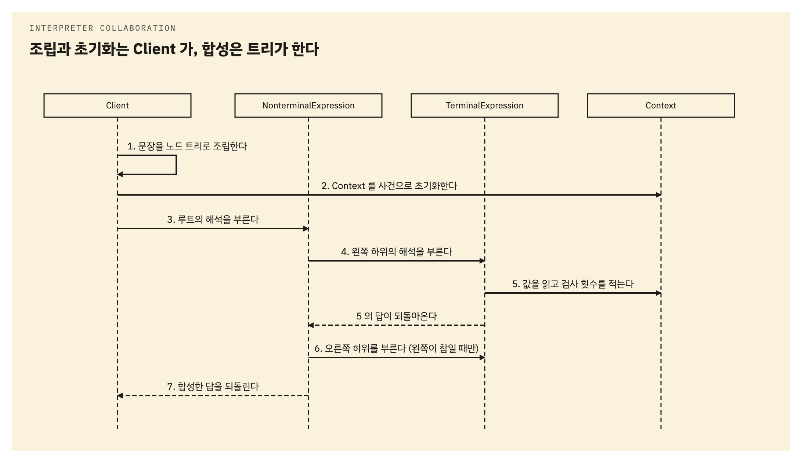
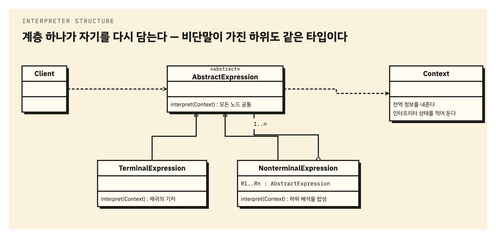

# Interpreter — 문법 규칙 하나를 타입 하나로 만들고, 문장의 뜻을 트리에서 합성하기

## 한눈에 보는 개요

사내 알림 시스템을 하나 떠올려 봅시다. 팀마다 "어떤 알림을 받을지"를 짧은 규칙으로 적어 내요. 인프라 팀은 `team=infra and level>=3` 이라고 적었습니다. 처음에는 조건이 둘뿐이라 알림 한 건마다 `if` 하나로 끝났죠. 그런데 결제 팀이 "우리 팀 알림은 다 받고, 다른 팀은 심각도 5만"이라고 적어 내면서 `or` 가 필요해지고, 곧 `not` 과 괄호까지 들어옵니다. 규칙 문자열을 받아 한 함수에서 `if (op.equals("and"))` 로 가르는 코드는 규칙이 한 겹 겹칠 때마다 조건문이 한 겹씩 깊어져요. 겹침이 세 겹이 되는 순간 그 함수는 아무도 못 고치는 자리가 됩니다.

Interpreter 의 해법은 **문법 규칙 하나를 타입 하나로 만들고, 규칙 문장을 그 타입들의 트리로 나타내는 것**입니다. 그러면 `and` 의 뜻은 `And` 안에만 있고, `not` 의 뜻은 `Not` 안에만 있어요. 규칙이 겹치는 일은 조건문이 깊어지는 일이 아니라 노드가 노드를 품는 일이 되고, 규칙이 하나 느는 일은 타입이 하나 느는 일이 됩니다.

```text
Before : 규칙 문자열을 한 함수가 통째로 가른다

  boolean send(String rule, Alert a)
    if (rule 이 "and" 를 담고 있으면)  → 앞뒤로 쪼개 다시 자기를 부른다
    else if (rule 이 "or" 를 담고 있으면) → 또 쪼갠다
    else if (rule 이 "not" 으로 시작하면) → 또…
    새 연산 → 이 사슬을 열어 가지를 추가
    괄호 → 쪼개는 자리를 찾는 코드가 통째로 복잡해짐

After : 규칙 하나 = 타입 하나, 문장 하나 = 트리 하나

  구독 설정 ── Client 가 조립 ──▶        Or
                                       ╱    ╲
                                    And      Not
                                   ╱   ╲       │
                             TeamIs   LevelAtLeast   TeamIs
                             (단말)      (단말)       (단말)

  해석 = 루트에게 한 번 묻는다. 나머지는 트리가 아래로 내려가며 합성한다.
  새 연산 = 타입 하나 추가. 기존 타입은 열지 않는다.
```

분류는 행위 패턴이고, 행위 패턴 가운데 클래스 범위로 묶이는 둘 중 하나입니다(다른 하나는 [Template Method](../template-method/template-method-guide_v1.0.1.md) 예요). 그 말이 Rust 처럼 클래스 상속이 없는 언어에서 무슨 뜻이 되는지는 개념 정리에서 따로 답합니다. 함께 쓰는 패턴은 [Composite](../composite/composite-guide_v1.0.1.md) 인데, 문장을 담은 트리 자체가 그 패턴의 사례라서 둘은 겹쳐 나타나는 일이 많아요. 이 글은 시나리오 셋을 따라갑니다. 알림 한 건이 규칙 하나를 통과하는 길, 문법에 규칙이 늘 때와 해석 방법이 늘 때 무엇이 달라지는가, 하위 표현식의 타입을 좁히면 어느 단계에서 무엇이 막히는가. 끝까지 읽으면 어떤 코드를 Interpreter 라고 불러도 되는지 필수 조건 넷으로 판정할 수 있고, 구조가 똑같아 보이는 Composite·Visitor 코드와 어떻게 다른지도 말할 수 있게 됩니다.

## 패턴 자세히 들여다보기

### 시나리오 1 — 알림 한 건이 구독 규칙을 통과하는 길

인프라 팀의 구독 규칙은 `team=infra and level>=3` 입니다. 지금 알림 한 건이 들어왔어요. 심각도 4, 팀 `infra`. 나와야 하는 것은 "보냄"이라는 답 하나와, 규칙이 단말을 몇 번 열어 봤는지 센 값 `checked=2` 입니다. 이 장면에는 다섯이 등장해요. 구독 설정을 읽어 트리를 만들고 답을 받는 조립 코드 `Client`, 모든 노드가 따르는 해석 연산 모양을 선언한 `Expression`(패턴에서는 AbstractExpression 이라고 부르는 역할), 문법의 끝에 있는 기호를 맡아 더 내려갈 데가 없는 `TeamIs`·`LevelAtLeast`(TerminalExpression), 하위 표현식 둘을 품고 그 답을 합치는 `And`(NonterminalExpression), 그리고 알림 한 건과 검사 횟수를 담은 그릇 `Context` 입니다. 이름은 여기서 한 구절씩만 소개하고 정식 정의는 개념 정리에서 해요.



1. Client 가 구독 설정에서 문장 `team=infra and level>=3` 을 읽고, 그 문장에 대응하는 노드 인스턴스를 만들어 트리로 엮습니다. `And` 하나가 `TeamIs("infra")` 와 `LevelAtLeast(3)` 를 품은 모양이에요. 이 일을 Client 가 맡는 이유는 문장을 트리로 바꾸는 일이 이 패턴의 일이 아니기 때문입니다. 규칙 문장이 어떤 글자로 적히는지는 설정 파일 형식이 바뀌면 같이 바뀌는데, `And` 가 그것까지 알면 문법 규칙 하나가 설정 파일 형식에 묶여요. 트리를 받아 해석하는 쪽은 문장이 어디서 왔는지 몰라도 됩니다.
2. Client 가 `Context` 를 이 알림 한 건으로 초기화합니다. 심각도 4 와 팀 `infra` 가 들어가고 검사 횟수는 0 에서 시작해요. 알림을 노드의 필드에 넣지 않고 따로 담는 이유는 같은 트리를 다음 알림에도 그대로 써야 해서입니다. 알림을 노드가 가지고 있으면 알림이 올 때마다 트리를 다시 만들어야 하고, 그러면 규칙 트리를 만드는 비용이 알림 건수만큼 늘어요.
3. Client 가 루트 노드 `And` 에게 해석을 청합니다. 루트 하나만 부르면 되는 이유는 나머지 호출이 전부 트리 안에서 일어나서예요. Client 가 노드마다 따로 부르면 "왼쪽을 보고 참이면 오른쪽을 본다"는 `and` 의 뜻이 Client 쪽 코드로 옮겨 가고, 그러면 규칙 하나가 클래스 하나라는 성질이 성립하지 않습니다.
4. `And` 가 왼쪽 하위 `TeamIs("infra")` 의 해석을 부릅니다. 비단말이 자기 답을 하위의 답으로 정의하는 자리예요. `And` 가 알고 있는 것은 "왼쪽과 오른쪽을 논리곱으로 합친다"까지이고 왼쪽이 무엇인지는 모릅니다. 몰라도 부를 수 있게 해 주는 것이 `Expression` 이라는 공통 타입이에요.
5. `TeamIs` 가 `Context` 에 검사 한 번을 적어 두고, `Context` 에서 팀 이름을 읽어 `"infra"` 와 견줍니다. 답은 참이고 검사 횟수는 1 이 됐어요. 이 노드가 하위 해석을 부르지 않는 것이 재귀의 기저입니다. 단말이 하위를 부르면 내려가는 일이 끝나지 않아요. 그리고 검사 횟수를 노드가 자기 필드에 적지 않고 `Context` 에 적는 이유는, 같은 `TeamIs` 인스턴스가 트리 여러 자리에 놓일 수 있어서입니다. 노드가 세면 누가 몇 번 불렀는지 섞여요.
6. 왼쪽이 참이니 `And` 가 오른쪽 `LevelAtLeast(3)` 의 해석을 부릅니다. 심각도 4 가 3 이상이라 참이고 검사 횟수는 2 가 됐어요. 왼쪽이 거짓이었다면 오른쪽을 부르지 않습니다. 순서를 바꿔 오른쪽부터 부르면 답은 같지만 검사 횟수가 달라져요. 같은 규칙 같은 알림인데 `checked` 가 1 이 되는 갈래와 2 가 되는 갈래가 생깁니다.
   - 갈래 6-a. 이 알림이 `level=5 team=billing` 이었다면 5단계에서 왼쪽이 거짓이 되고 `And` 는 거기서 멈춥니다. 오른쪽을 부르지 않으니 `checked` 가 1 에서 끝나요. 실행 출력의 `rule A` 둘째 줄이 그 값입니다.
7. `And` 가 참과 참을 합쳐 참을 돌려주고, 그 답이 루트의 답이 되어 Client 에 전달됩니다. Client 는 알림을 보내고 `checked=2` 를 로그에 적어요. 합치는 규칙이 `And` 안에 있어야 하는 이유는 그것이 `and` 라는 문법 규칙의 뜻 전부이기 때문입니다. 그 규칙을 Client 가 가지고 있으면 `and` 의 뜻이 규칙을 쓰는 자리마다 복제돼요.

이 시나리오가 보여 준 것은 일의 자리가 셋으로 나뉜다는 점입니다. 문장을 트리로 바꾸는 일과 알림을 그릇에 담는 일은 Client 에 있고, 뜻을 합치는 일은 비단말에 있고, 실제로 값을 들여다보는 일은 단말에 있어요. 셋 중 어느 하나를 옆으로 옮기면 나머지 둘도 같이 영향을 받습니다. 그리고 `checked` 가 2 와 1 로 달라진 자리가 보여 주듯, 해석 중에 생기는 상태는 노드가 아니라 `Context` 에 쌓입니다.

### 시나리오 2 — 문법에 규칙이 늘 때와, 해석 방법이 늘 때

이번에는 요구가 둘 옵니다. 하나는 결제 팀의 규칙 `team=infra or level>=5` 이고, 다른 하나는 "내가 적은 규칙이 시스템에 어떻게 들어갔는지 화면에서 확인하고 싶다"예요. 앞의 것은 문법이 넓어지는 요구이고 뒤의 것은 같은 트리에 다른 일을 시키는 요구입니다. 겉보기에는 둘 다 "기능 추가" 한 줄인데, 코드에서 드는 품은 정반대예요.

```text
변화가 들어오는 방향이 둘이다

  ① 문법 규칙이 는다 (or 가 필요해졌다)
     새 노드 종류 1개 추가 ······ 기존 노드 4종: 0줄 수정
                                  Client 조립: 1줄 수정

  ② 해석 방법이 는다 (규칙을 사람이 읽을 문장으로 찍어야 한다)
     기존 노드 5종 전부에 연산 1개씩 추가 ······ 5곳 수정
     Client: 1줄 수정
```

1. `or` 를 위해 문법에 규칙 하나를 더합니다. `rule ::= rule "or" rule` 이 늘었으니 그 규칙만 맡는 노드 종류 `Or` 를 하나 만들어요. 규칙과 노드 종류를 하나씩 짝지어 두는 이점이 여기서 나옵니다. 문법을 넓히는 일이 곧 타입을 더하는 일이 되니까, 어디를 고쳐야 하는지 찾을 필요가 없어요.
2. `Or` 는 하위 둘을 `Expression` 타입으로 가지고, 해석은 왼쪽이 참이면 거기서 멈추고 아니면 오른쪽을 봅니다. 하위를 공통 타입으로 들어야 하는 이유는 `or` 의 양쪽에 무엇이든 올 수 있어야 해서예요. `Or` 의 왼쪽이 `TeamIs` 로 적혀 있으면 `(A and B) or C` 를 만들 수 없습니다. 시나리오 3 이 그 자리를 따라갑니다.
3. 기존 노드 넷과 `Context` 는 한 줄도 바뀌지 않습니다. Client 에서 바뀌는 것은 트리를 조립하는 한 줄뿐이에요. `or` 의 뜻이 `Or` 안에서 끝나기 때문인데, 이것이 규칙마다 클래스를 두는 이점입니다. 반대로 개요의 Before 그림처럼 한 함수가 규칙을 통째로 가르고 있었다면, `or` 를 더하는 일은 그 함수의 조건 사슬을 여는 일이 됐을 거예요.
4. 두 번째 요구로 넘어가면 얻고 잃는 것이 정반대가 됩니다. 규칙을 사람이 읽을 문장으로 찍으려면 "나를 어떻게 적느냐"를 노드마다 알아야 하는데, 그 지식은 노드마다 다르니 노드 **다섯을 전부 열어** 연산을 하나씩 더해야 해요. 해석 방법을 노드 안에 두었기 때문에 치르는 대가입니다. 노드가 늘어나는 방향에서는 비용이 작고 연산이 늘어나는 방향에서는 비용이 큰 구조예요.
5. 그래서 해석 방법이 앞으로도 계속 늘 것 같으면 다른 길이 있습니다. 해석을 노드 밖의 한 클래스로 모아 두고 노드는 "나를 방문해 달라"는 연산 하나만 갖는 길이에요. 그 길로 가도 문장이 트리라는 것과 합성이 트리를 따라 일어난다는 것은 그대로 남습니다. 최소 조건이 요구하는 것은 그 둘이지 해석이 어디 있는지가 아니거든요. 비교 절에서 이 차이를 다시 봅니다.

이 시나리오가 보여 준 것은 이 패턴이 어느 방향에서 비용이 작은지입니다. 문법 규칙이 늘어나는 쪽으로는 기존 코드를 열지 않고 타입만 더하면 되고, 해석 방법이 늘어나는 쪽으로는 노드 수만큼 손이 갑니다. 그리고 두 요구 모두 `And`·`Or` 가 하위를 공통 타입으로 가지고 있다는 전제 위에서만 적은 비용으로 끝나요. 그 전제가 성립하지 않으면 어떻게 되는지를 다음 시나리오가 봅니다.

### 시나리오 3 — 하위 표현식의 타입을 구체 노드로 좁히면 어디서 막히는가

지금까지 들어온 규칙은 `team=infra and level>=3` 처럼 `and` 의 왼쪽이 늘 팀 비교였고 오른쪽이 늘 심각도 비교였습니다. 그래서 누군가 `And` 의 두 필드를 `Expression` 대신 `TeamIs` 와 `LevelAtLeast` 로 좁혀 둡니다. 타입이 구체적일수록 좋다는 감각이죠. 그 상태에서 규칙 A·B·C 는 전부 그대로 컴파일되고 실행 결과도 한 글자 다르지 않아요. 그러다 규칙 D 가 옵니다. `(team=infra or team=payments) and level>=3` — 인프라나 결제 팀의 심각도 3 이상.

1. 좁히는 편집은 `And` 가 하위를 가지는 자리의 타입 이름을 바꾸는 것뿐이고, 줄 수는 그대로예요. 그 자리가 언어마다 몇 줄인지는 다릅니다. Java 는 필드 선언 둘과 생성자 매개변수 둘이라 96·97·99행 세 줄, TypeScript 는 매개변수 속성이라 74·75행 두 줄, Rust 는 구조체 필드 둘이라 83·84행 두 줄입니다. 이 자리를 정확히 적어 두는 이유는, 줄을 지우는 편집이면 뒤 줄 번호가 당겨져 아래에서 말하는 진단 위치가 어긋나기 때문입니다. 여기서는 타입 이름만 제자리에서 갈아 끼웁니다.
2. 좁힌 채로 기존 규칙 셋을 그대로 실행하면 세 언어 모두 오류 0건이고, 실행 출력도 좁히기 전과 같습니다. 이 단계가 중요한 이유는 문제가 편집 시점에 나타나지 않기 때문이에요. 좁히는 사람은 자기가 무엇을 막았는지 모른 채 커밋합니다.
3. 규칙 D 를 조립하는 줄을 더하는 순간 막힙니다. `Or` 를 `And` 의 왼쪽 자리에 넣어야 하는데 그 자리가 `TeamIs` 로 적혀 있으니까요. 세 언어가 모두 컴파일 단계에서 잡고, 오류는 각각 1건씩입니다.

| 언어 | 좁히기만 했을 때 | 규칙 D 를 더했을 때 | 진단 |
| --- | --- | --- | --- |
| Java 21 | 오류 0건 · 출력 같음 | 오류 1건 | `error: incompatible types: Or cannot be converted to TeamIs` |
| TypeScript 5.9 strict | 오류 0건 · 출력 같음 | 오류 1건 | `error TS2345` — `Property 'name' is missing in type 'Or' but required in type 'TeamIs'` |
| Rust 1.95 (2021) | 오류 0건 · 출력 같음 | 오류 1건 | `error[E0308]: mismatched types` — `expected TeamIs, found Or` |

4. 막힌 자리를 타입을 다시 넓히지 않고 우회하면 어떻게 될까요. `And` 에 "왼쪽이 `Or` 인 경우"를 위한 필드를 따로 두는 길이 있습니다. 그러면 규칙을 겹치는 조합 수만큼 필드와 생성자가 늘어나요. `and` 의 왼쪽에 올 수 있는 것이 5종이고 오른쪽도 5종이면 조합이 25가지입니다. 문법이 아니라 조합표가 되는 거예요. 공통 추상 타입이 하는 일이 바로 "어떤 규칙이든 하위 자리에 온다"를 타입 한 줄로 말해 주는 것입니다.

세 언어가 같은 자리에서 막긴 했는데, **막는 원리는 언어마다 다릅니다.** TypeScript 는 타입 이름이 아니라 멤버 목록으로 견주는 언어라서, 진단이 나는 이유를 따로 확인해야 했어요. 정본 끝에 탐침 두 줄을 붙이고 필드의 `private` 표시만 바꿔 가며 실행해 보니 결과가 이렇게 달라집니다.

```typescript no-compile
const probeA: TeamIs = new Or(new TeamIs("infra"), new TeamIs("payments"));
const probeB: Or = new And(new TeamIs("infra"), new LevelAtLeast(3));
```

| 탐침 | 필드가 `private readonly` 일 때 | 필드를 `readonly` 로 바꿨을 때 |
| --- | --- | --- |
| A — `Or` 를 `TeamIs` 자리에 (멤버 목록이 다름) | `TS2741` — `'name'` 이 없다 | 같은 진단 그대로 |
| B — `And` 를 `Or` 자리에 (멤버 목록이 똑같음) | `TS2322` — 같은 이름의 비공개 멤버가 따로 선언됐다 | **진단 없음 — 그대로 통과** |
| 합계 | 오류 2건 | 오류 **1건** |

아래 줄이 이 언어에서 조심할 자리입니다. `And` 와 `Or` 는 필드 둘과 연산 둘이 이름까지 같아서, 필드에 `private` 표시가 없으면 `And` 가 `Or` 자리에 그대로 들어가요. 합계가 2건에서 1건으로 줄고 사라진 한 건이 정확히 그것입니다. 그러니 이 언어에서는 "하위를 구체 노드 타입으로 좁혀 두면 다른 노드가 못 들어온다"가 참이 아니에요. 모양이 다른 노드만 막히고 모양이 같은 다른 노드는 통과합니다. 최소 조건 3번이 "구체 타입으로 좁히지 않는다"가 아니라 "모든 노드를 받아 주는 공통 타입 하나가 있다"를 요구하는 것도 이 때문입니다.

이 시나리오가 보여 준 것은 공통 추상 타입이 성능이나 취향의 문제가 아니라 문법이 겹칠 수 있는가의 문제라는 점입니다. 그리고 그 전제가 어긋난 것은 편집 시점이 아니라 새 규칙이 올 때 확인돼요. 좁히는 편집 자체는 세 언어 모두 조용히 통과합니다.

### 개념 정리

시나리오에 나온 역할 다섯을 정식으로 정의합니다. 넷은 패턴의 참여자이고 Client 는 문장을 트리로 만들고 해석을 청하는 쪽이라 시나리오와 구현에 늘 나오므로 함께 정의해요(근거: GoF 원서 Interpreter 절 Participants).

- **AbstractExpression** — 추상 구문 트리의 모든 노드에 공통인 해석 연산을 선언합니다. 하는 일은 선언 하나뿐이지만, 그 타입이 있어야 비단말이 하위를 품을 때 "무엇이든 온다"고 말할 수 있고 Client 가 루트를 부를 때 루트가 어느 규칙인지 몰라도 돼요(시나리오 1 의 3·4단계). 알림 예에서는 `Expression` 이 이 자리입니다.
- **TerminalExpression** — 문법의 단말 기호 하나를 맡아 그 기호의 해석을 구현합니다. 하위 표현식을 품지 않아서 여기서 재귀가 멈춰요(시나리오 1 의 5단계). 한 문장에 같은 단말 기호가 여러 번 나오면 그 수만큼 인스턴스가 필요합니다. 알림 예에서는 `TeamIs` 와 `LevelAtLeast` 가 각각 TerminalExpression 이에요.
- **NonterminalExpression** — 문법 규칙 하나를 맡습니다. 규칙 오른쪽에 오는 기호마다 AbstractExpression 타입의 자리를 하나씩 갖고, 자기 해석을 그 자리들의 해석으로 정의해요(시나리오 1 의 4·6·7단계). 규칙 하나에 클래스 하나가 기본이고, 알림 예에서는 `Not`(자리 하나)·`And`·`Or`(자리 둘)가 여기 듭니다.
- **Context** — 인터프리터에 전역인 정보를 담습니다. 해석하는 동안 노드들이 여기서 값을 읽고 여기에 상태를 적어요(시나리오 1 의 2·5단계). 알림 예에서는 알림 한 건의 심각도·팀과 검사 횟수를 담은 `Context` 가 이 자리입니다.
- **Client** — 문법이 정하는 문장 하나를 나타내는 트리를 만들거나 받아 오고, Context 를 초기화한 뒤 루트의 해석을 부릅니다(시나리오 1 의 1·2·3단계). 알림 예에서는 구독 설정을 읽어 트리를 조립하고 결과를 로그에 적는 진입점이 Client 예요.



그림에서 봐 둘 것은 화살표 둘이 같은 칸으로 간다는 점입니다. `NonterminalExpression` 은 `AbstractExpression` 을 **상속하면서 동시에 보유해요.** 속이 빈 마름모로 표시된 쪽이 보유인데, 그 자리에 다시 비단말이 올 수 있어서 트리가 얼마든지 깊어집니다. `TerminalExpression` 칸에는 보유 화살표가 없고 그래서 트리가 거기서 끝나요. 이 두 모양이 최소 조건 2번과 4번이 코드에서 확인하는 것입니다.

문법·문장·추상 구문 트리라는 세 낱말도 여기서 정리해 둘게요. 셋은 서로 다른 것이고, 이 패턴의 판정이 셋의 구별 위에 서 있습니다.

```text
문법(grammar)  = 규칙의 목록. 무엇이 올바른 문장인가를 정한다.
                 rule ::= term | "not" rule | rule "and" rule | rule "or" rule
                 term ::= "level>=" n | "team=" word
                 ↑ 코드에서는 노드 종류의 목록이 이것과 하나씩 짝을 이룬다

문장(sentence) = 그 문법이 만들어 내는 것 하나.
                 (team=infra and level>=3) or (not team=billing)

AST            = 그 문장 하나를 노드 인스턴스로 만든 트리 한 그루.
                 문법이 다섯 종류라면 이 트리에 쓰이는 노드도 그 다섯 안에서 나온다.
```

이제 클래스 범위라는 분류가 Rust 에서 무슨 뜻이 되는지에 답할 차례입니다. Rust 에는 클래스 상속이 없는데, 분류는 클래스 패턴을 상속으로 맺어져 컴파일 시점에 고정되는 것으로 정의하거든요. 이 글의 판정은 **Rust 의 `Box<dyn Expression>` 트리도 `enum` + `match` 도 원전의 Interpreter 와 같은 자리에 놓인다**는 것이고, 근거는 셋입니다.

- 원전이 AbstractExpression 에 요구하는 것은 데이터도 상속 계층도 아니라 **연산 하나의 선언**이에요 (근거: GoF 원서 Interpreter 절 Participants — AbstractExpression 은 추상 구문 트리의 모든 노드에 공통인 추상 해석 연산을 선언한다). Rust 의 trait 이 그대로 하고, `enum` 도 자기 타입 하나로 모든 variant 를 묶으니 같은 일을 합니다.
- 제어 방향이 같습니다. 비단말이 하위를 부르고 그 반대가 아니며, 단말에서 멈추는 것도 같아요. 두 판 모두 그렇습니다.
- 컴파일할 때 정해져 실행 중에 안 바뀌는 것이 남아 있습니다. **Interpreter 에서 그것은 문법 규칙과 노드 종류의 대응**이에요. 실행 중에 새 문법 규칙이 생기지 않고, 바뀌는 것은 트리의 모양이지 규칙표가 아닙니다. Rust 에서도 어떤 타입이 `Expression` 을 구현하는지, `enum Expr` 에 어떤 variant 가 있는지는 컴파일할 때 정해지고 실행 중에 늘지 않아요.

다만 이 패턴이 클래스 범위로 묶이는 이유는 Template Method 와 **다른 자리에서 옵니다.** 그 편은 패턴이 돌아가는 구조 자체가 상속이에요. 골격이 위에 있고 단계가 아래에 있어서, 상속을 빼면 패턴이 성립하지 않습니다. Interpreter 는 그렇지 않아요. 돌아가는 동안의 관계는 보유, 곧 합성입니다(근거: GoF 원서 Interpreter 절 Participants — NonterminalExpression 은 규칙 오른쪽의 기호마다 AbstractExpression 타입의 인스턴스 변수를 보유한다). 상속이 실제로 역할을 하는 자리는 따로 있는데, **문법을 고치거나 넓히는 일**입니다(근거: GoF 원서 Interpreter 절 Consequences — 규칙을 클래스로 나타내므로 상속으로 문법을 바꾸거나 넓힐 수 있고, 기존 표현식을 조금씩 고치거나 그 변형으로 새 표현식을 정의할 수 있다). 그래서 Rust 를 볼 때도 물어야 할 것이 달라져요. Template Method 에서는 "상속 자리에 무엇이 오는가"를 물었지만, 여기서는 "규칙과 타입의 대응이 컴파일 때 정해지는가"를 묻습니다.

```text
같은 「클래스 범위」인데 상속이 역할을 하는 자리가 다르다

  Template Method   골격(위) ── 단계(아래)          ← 패턴이 동작하는 동안 쓰인다
  Interpreter       비단말 ──보유──▶ 하위 표현식     ← 패턴이 동작하는 동안 쓰이는 것은 보유
                    규칙 A ──상속──▶ 규칙 A의 변형   ← 상속은 문법을 넓힐 때 쓰인다
```

그 차이 때문에 Rust 의 두 판이 달라집니다. `Box<dyn Expression>` 쪽은 새 규칙을 새 타입으로 더하기만 하면 되니 문법을 넓히는 길이 열려 있어요. `enum` 쪽은 variant 를 더하려면 `enum` 선언을 열어야 하니 그 길이 닫힙니다. 대신 얻는 것이 있는데, 규칙 하나를 빠뜨리면 컴파일이 막아 줍니다. 실제로 해석 함수의 `match` 에서 `Or` 갈래 한 줄을 지우고 컴파일해 보면 `error[E0004]: non-exhaustive patterns` 1건이 나고 빠진 variant 이름까지 찍혀요(직접 실행해 확인). 문장을 찍는 함수에도 같은 `match` 가 있어서, 두 곳에서 지우면 2건이 납니다. 두 판 모두 조건 1~4 를 만족하므로 둘 다 Interpreter 이고, 다른 점은 넓히기가 쉬운가와 빠뜨림을 컴파일러가 잡아 주는가입니다.

> 문장은 트리이고, 문법은 타입의 목록이다.

## 사용 목적

Interpreter 가 필요할 때 코드나 요구에서 보이는 단서가 셋 있습니다. 셋 다 "규칙"이라는 말이 요구에 등장할 때 같이 나타나요.

```text
단서                                   어디서 관찰되는가
──────────────────────────────────    ───────────────────────────────────────
1. 규칙을 글로 적어 넣고 되풀이 적용     설정 키에 담긴 규칙 문자열 + 그것을 받는 함수
2. 규칙을 겹칠 수 있어야 한다는 요구     한 함수만 계속 고쳐지고 매번 한 겹씩 깊어짐
3. 같은 규칙에 다른 일을 시켜야 함       규칙 문자열을 자리마다 다시 읽는 코드
```

**단서 1. 사람이나 설정이 짧은 규칙을 글로 적어 넣고, 시스템이 그 규칙을 입력 여럿에 되풀이해 적용합니다.** 검색 필터식, 알림 구독 규칙, 권한 규칙, 단위 변환식이 그 모양이에요(근거: GoF 원서 Interpreter 절 Applicability — 해석할 언어가 있고 언어의 문장을 추상 구문 트리로 표현할 수 있을 때 쓴다). 코드에서는 "규칙 문자열"을 필드나 설정 키로 가지고 있고, 그것을 받는 함수가 하나 있는 모양으로 보입니다. 그 함수가 규칙 하나에 대해 여러 번 불리고 있으면 단서가 더 분명해져요. 한 번 만든 트리를 재사용할 자리가 있다는 뜻이니까요.

**단서 2. 규칙을 겹칠 수 있어야 한다는 요구가 옵니다.** 처음에는 조건 하나였는데 "둘 다 맞을 때", "둘 중 하나만 맞을 때", "이건 빼고"가 차례로 붙는 모양이에요. 변경 이력을 보면 분명합니다.

```text
변경 이력                                      수정된 곳
────────────────────────────────────────────   ────────────────────────────
팀 조건에 심각도 조건을 더할 수 있게            send() 의 조건 사슬
"둘 중 하나만" 도 되게                          send() 의 조건 사슬
"이 팀은 빼고" 도 되게                          send() 의 조건 사슬
괄호로 묶을 수 있게                             send() 의 조건 사슬 + 쪼개는 코드
```

한 함수만 계속 고쳐지고 있고 그 함수가 매번 한 겹씩 깊어지고 있으면, 늘어나고 있는 것은 기능이 아니라 문법입니다. 문법이 늘고 있는데 그것을 담을 자리가 없어서 조건문이 대신 받아 내고 있는 거예요.

**단서 3. 같은 규칙에 다른 일을 시켜야 합니다.** 평가만 하던 규칙을 화면에 다시 보여 주거나, 저장 전에 검사하거나, 사람이 읽을 문장으로 풀어 써야 할 때입니다(근거: GoF 원서 Interpreter 절 Consequences — 표현식 클래스에 새 연산을 정의해 예쁜 출력이나 타입 검사 같은 새로운 해석 방법을 더할 수 있다). 규칙이 문자열로만 있으면 그때마다 문자열을 다시 읽어야 하는데, 트리로 만들어져 있으면 같은 트리를 한 번 더 순회하면 돼요. 시나리오 2 의 4단계가 그 자리입니다. 반대로 쓰지 말아야 할 상황도 셋 있어서, 표로 모으고 아래에서 첫 줄을 풀어 볼게요.

| 상황 | 쓰면 무엇을 잃는가 |
| --- | --- |
| 문법이 크거나 앞으로 크게 넓어질 것이 보인다 | 규칙마다 클래스가 하나씩 생겨 클래스 수가 문법 크기만큼 늘고, 규칙 하나가 여러 클래스를 요구하는 경우도 있어 관리가 안 된다 (근거: GoF 원서 Interpreter 절 Consequences) |
| 해석 속도가 핵심 관심사다 | 트리를 그대로 순회하며 해석하는 방식은 다른 형태로 바꿔 실행하는 방식보다 느리다. 이 패턴이 잘 맞는 자리는 효율이 핵심이 아닐 때다 (근거: GoF 원서 Interpreter 절 Applicability) |
| 규칙이 겹치지 않고 앞으로도 겹치지 않는다 | 노드 클래스 다섯과 조립 코드를 얻는 대신 `if` 두 줄로 끝날 일을 트리로 만든다. 읽는 사람이 규칙 하나를 보려고 파일 다섯을 연다 |

첫 줄이 가장 자주 걸리는 자리입니다. 문법이 커지는 정도는 규칙 수로 세면 되는데, 이 예시의 문법은 규칙 다섯이라 노드도 다섯이에요. 그런데 프로그래밍 언어급 문법은 규칙이 수백 개이고, 규칙 하나가 클래스 하나로 안 끝나는 경우도 흔합니다. 그때는 파서 생성기나 컴파일러 생성기가 맞는 도구예요. 클래스 다섯은 읽히지만 클래스 삼백은 읽히지 않습니다.

## 패턴의 경계

### 디자인 패턴을 충족하는 최소 조건

어떤 코드를 Interpreter 라고 불러도 되는지 가르는 기준입니다. `[필수]` 가 하나라도 빠지면 Interpreter 가 아니고, `[선택]` 은 갖추면 좋은 구조예요. 조건은 언어와 상관없이 코드에서 확인할 수 있는 모양(타입 선언·필드 보유·호출 방향)으로 적었고, 조건마다 그것을 보여 준 시나리오의 단계를 가리킵니다. 여기서 "노드 종류"는 규칙 하나를 맡는 타입을 뜻하는데, 언어에 따라 클래스일 수도 있고 `enum` 의 variant 나 유니온의 한 갈래일 수도 있어요.

1. [필수] 문장 하나가 노드 트리 한 그루로 만들어지고, 해석은 그 트리를 입력으로 받습니다 — 트리 한 그루가 해석의 입력 단위이고, 해석하는 쪽은 그 트리 말고 원래 문자열을 다시 들여다보지 않습니다. 시나리오 1 의 1단계가 문장 하나가 트리 하나가 된 자리예요 (근거: GoF 원서 Interpreter 절 Intent — 언어가 주어지면 그 문법의 표현을 정의하고 그 표현으로 언어의 문장을 해석하는 인터프리터를 함께 정의한다 · 같은 절 Applicability — 해석할 언어가 있고 언어의 문장을 추상 구문 트리로 표현할 수 있을 때 쓴다). 위 근거 괄호가 받쳐 주는 것은 **문장이 트리로 표현된다는 것과 해석이 그 표현을 써서 문장을 해석한다는 것까지**입니다. 문법이 작아야 한다는 것은 여기서 오지 않아요 — 원전에서 그것은 잘 맞는 조건이지 성립 요건이 아니고, 사용 목적의 표 첫 줄에 그 자리를 뒀습니다. **그 트리가 나타내는 것을 언어로 볼 것인가도 여기서 오지 않습니다.** 그것은 `[선택]` 5번이 따로 봐요.
   - 빠지면: 규칙 문자열을 받자마자 한 함수가 `if (rule.contains("and"))` 로 갈라 답을 내면 해석의 입력이 트리가 아니라 문자열입니다. 개요의 Before 그림이 그 모양이고, 노드 종류도 트리도 없는 조건문이에요.
   - 먼저 보는 곳: 이 조건은 구조만 봅니다. **그 계층을 언어로 볼 것인가라는 판단은 `[필수]` 넷 어디에도 없어요.** 부분-전체 트리와 문장 트리는 구조가 같아서, 네 조건만으로는 선물 상자 트리와 규칙 트리가 구분되지 않습니다. 그 자리를 맡는 것이 `[선택]` 5번이고, 아래 조건표 셋째·넷째 줄이 그 구분을 코드 한 글자 차이 없이 보여 줍니다.
2. [필수] 문법 규칙마다 노드 종류가 하나 이상 있고, 비단말은 하위 표현식을 필드로 보유합니다 — 규칙 `R ::= R1 … Rn` 마다 그 규칙을 맡는 노드 종류가 있고, 그 노드가 R1~Rn 각각을 공통 타입의 자리로 가지고 있습니다. 문법의 단말 기호에는 하위 자리를 갖지 않는 노드 종류가 따로 대응해요. 시나리오 2 의 1·2단계가 규칙 하나가 늘 때 노드 종류가 하나 는 자리입니다 (근거: GoF 원서 Interpreter 절 Participants — NonterminalExpression 은 문법 규칙 하나마다 클래스 하나가 필요하고 규칙 오른쪽의 기호 각각에 대해 AbstractExpression 타입의 인스턴스 변수를 보유하며, TerminalExpression 은 문법의 단말 기호에 대한 해석을 구현하고 문장 속 단말 기호마다 인스턴스가 필요하다). 위 근거 괄호가 받쳐 주는 것은 **규칙마다 노드 종류가 있다는 것, 비단말이 하위를 공통 타입 자리로 가진다는 것, 단말 기호에 따로 노드 종류가 있다는 것까지**입니다. 규칙과 노드 종류가 꼭 1:1 이어야 한다는 것은 여기서 오지 않아요. 원전은 규칙 하나가 여러 클래스를 요구할 수도 있다고 보므로 "하나 이상"으로 적었습니다.
   - 빠지면: 모든 노드가 `Map<String, Object>` 한 종류이면 규칙이 타입으로 나타나지 않습니다. 규칙을 하나 더하는 일이 노드 종류를 하나 더하는 일이 되지 않고, 대신 그 맵의 `kind` 값을 가르는 함수를 열게 돼요. 트리 모양 자료 구조에 해석 함수 하나가 붙은 것이고, 시나리오 2 의 1·3단계에서 얻은 것이 그대로 사라집니다.
   - 빠지면: 단말 자리에 이름 없는 함수가 오는 경우도 여기서 걸립니다. `p.and(a -> a.level() >= 3)` 처럼 조립하면 비단말은 있는데 단말 기호가 문법으로 열거되지 않아요. 어떤 단말이 있는지 타입으로 셀 수 없으면 문법이 닫히지 않습니다.
3. [필수] 모든 노드를 받아 주는 공통 타입 하나가 있고, 해석이 그 타입을 통해 불립니다 — 비단말이 하위를 들 때 쓰는 타입도, Client 가 루트를 잡을 때 쓰는 타입도 그 하나입니다. 시나리오 3 의 2·3단계가 이 조건을 어긴 코드가 어디서 막히는지 세 언어로 잰 자리예요 (근거: GoF 원서 Interpreter 절 Participants — AbstractExpression 은 추상 구문 트리의 모든 노드에 공통인 추상 해석 연산을 선언하고, NonterminalExpression 은 하위 기호마다 그 타입의 인스턴스 변수를 보유한다). 위 근거 괄호가 받쳐 주는 것은 **모든 노드에 공통인 해석 연산이 있다는 것과 하위 자리의 타입이 그 공통 타입이라는 것까지**입니다. 그 타입이 인터페이스인지 추상 클래스인지 `enum` 인지 유니온인지는 여기서 오지 않고, 해석이 그 타입의 메서드로 불리는지 그 타입을 받는 함수로 불리는지도 오지 않아요. 아래 조건표에서 `kind` 한 타입 판과 Rust `enum` 판이 이 조건을 같은 이유로 통과하는 것이 그래서입니다.
   - 빠지면: 하위를 구체 노드 타입으로 들면 규칙을 겹쳐 쌓지 못합니다. 시나리오 3 의 표대로 세 언어 모두 컴파일에서 막고, 우회하면 규칙 조합 수만큼 필드와 생성자가 늘어 문법이 아니라 조합표가 돼요.
4. [필수] 해석이 트리를 따라 재귀로 합성되고 단말에서 멈춥니다 — 비단말의 답이 자기 하위들의 답으로 정의되고, 단말의 해석은 하위 해석을 부르지 않아 재귀의 기저가 됩니다. 시나리오 1 의 4~7단계가 그 합성이 처음부터 끝까지 일어나는 자리예요 (근거: GoF 원서 Interpreter 절 Collaborations — 각 NonterminalExpression 노드는 하위 표현식 각각의 해석으로 자기 해석을 정의하고, 각 TerminalExpression 의 해석이 재귀의 기저를 이룬다). 위 근거 괄호가 받쳐 주는 것은 **비단말의 뜻이 하위의 뜻으로 정의되고 단말이 기저라는 것까지**입니다.
   - 빠지면: 트리를 만들어 놓고 해석은 그 트리를 평탄한 전이표나 명령 목록으로 펴서 실행하는 코드가 됩니다. 정규식을 상태 기계로 바꿔 실행하는 코드가 그 모양인데, 상태가 규칙이 아니라 입력 위치를 나타내고 다음 상태를 전이로 찾아가므로 합성이 없어요. 규칙 목록을 차례로 검사해 첫 매치를 취하는 규칙 엔진도 같은 자리입니다.
   - 먼저 보는 곳: 어느 노드도 자기를 조상으로 두는 하위를 들지 않아야 기저에 이릅니다. 순환이 생기면 이 조건의 앞쪽은 만족하는 것처럼 보이는데 해석이 끝나지 않아요. 트리를 Client 가 조립하므로 이 성질은 조립하는 쪽이 지킵니다.
5. [선택] 문법 규칙의 목록이 규칙 형태로 글에 적혀 있습니다 — 노드 종류의 목록과 짝을 이루는 규칙 목록이 BNF(Backus–Naur Form, 문법 규칙을 적는 표기) 주석·문법 파일·설정 형식 문서 어디든 **글로** 있습니다. 타입 이름이 규칙과 짝을 이루는지는 조건 2 가 보므로, 타입 이름만 있는 것은 이 조건이 아니에요. 시나리오 2 의 1단계에서 문법에 규칙을 먼저 더하고 그다음 노드를 더한 것이 이 자리입니다 (근거: GoF 원서 Interpreter 절 Known Uses — 트리 계층에 연산을 흩어 놓은 형태로 가장 넓게 보면 Composite 을 쓰는 거의 모든 곳에 이 패턴이 들어 있지만, 그 클래스 계층을 언어를 정의하는 것으로 생각하려는 경우로 이 패턴을 한정해야 한다). **원전이 이것을 성립 요건이 아니라 이름을 붙이는 규율로 적었으므로 필수로 올리지 않았습니다.** 대신 **「그 계층을 언어로 볼 것인가」**를 실무에서 가르는 표식이 이것이고, 이 조건이 빠진 코드는 조건 1~4 를 갖추고도 Composite 이라고만 부르는 편이 원전의 규율에 맞아요.
6. [선택] 해석 연산이 노드 종류 안에 있습니다 — 각 노드 타입이 해석 연산의 본문을 자기 안에 갖습니다. 시나리오 2 의 4·5단계가 이 선택이 대가를 치르는 자리예요 (근거: GoF 원서 Interpreter 절 Implementation — 해석 연산을 표현식 클래스에 정의하지 않아도 되며, 새 해석을 자주 만든다면 별도의 방문자 객체에 해석을 두는 편이 낫다). 원전이 이 자리를 열어 두었으므로 필수로 올리지 않았습니다.
7. [선택] Context 객체가 있습니다 — 해석하는 동안 노드들이 값을 읽고 상태를 적는 그릇이 따로 있고, 그것이 노드의 필드가 아닙니다. 시나리오 1 의 2·5단계가 그 자리입니다 (근거: GoF 원서 Interpreter 절 Participants — Context 는 인터프리터에 전역인 정보를 담는다). 담을 전역 정보가 없는 문법이면 비어 있을 수 있어 선택에 뒀어요. 리터럴만 있는 산술식 평가기가 그런 경우입니다.
8. [선택] 같은 단말 기호가 여러 자리에서 인스턴스 하나를 나눠 씁니다 — 단말 노드가 자기 위치를 가지고 있지 않아서, 한 문장에 같은 기호가 여러 번 나와도 인스턴스 하나로 됩니다. 시나리오 1 의 5단계에서 `TeamIs` 가 검사 횟수를 자기 필드에 적지 않은 것이 이 조건이 성립하는 자리예요 (근거: GoF 원서 Interpreter 절 Implementation — 단말 노드는 트리에서 자기 위치에 대한 정보를 보통 갖지 않고 부모가 필요한 문맥을 넘겨 주므로, 공유되는 상태와 넘겨받는 상태가 갈리고 Flyweight 를 적용할 수 있다).

조건 목록에 **파서가 없는 것은 빠뜨린 것이 아닙니다.** 문장을 트리로 바꾸는 일은 이 패턴이 다루지 않는 일이고, 트리를 만드는 방법은 표를 쓰는 파서든 손으로 쓴 파서든 클라이언트가 직접 조립하든 상관없습니다(근거: GoF 원서 Interpreter 절 Implementation — 이 패턴은 추상 구문 트리를 만드는 방법을 설명하지 않으며 파싱을 다루지 않는다). 그래서 파서가 있는지는 조건이 아니고, 선택 조건으로도 두지 않았어요. 선택 조건은 "갖추면 좋은 것"이라는 뜻인데 파서는 이 패턴의 바깥이라 그 뜻이 맞지 않습니다. 구현 예시의 Client 도 파서 없이 트리를 직접 조립합니다.

```text
패턴의 바깥                        패턴이 다루는 곳
─────────────────────────────    ──────────────────────────────────────
규칙 문장을 어디서 읽어 오는가     트리가 어떤 타입들로 이뤄지는가 (조건 1·2·3)
그 문장을 트리로 어떻게 바꾸는가   트리에서 뜻이 어떻게 합성되는가 (조건 4)
        ↑ 파서의 자리 — 조건에도 선택 조건에도 없다
```

조건 1 과 2 를 앞뒤로 묶어 둔 데는 이유가 있습니다. 둘은 같은 것을 양쪽에서 봐요. 1번은 해석의 입력이 트리 한 그루인지를 보고, 2번은 그 트리를 이루는 규칙 하나하나가 타입으로 나타나 있는지를 봅니다. 1번만 보면 아래 코드가 통과해요.

```java no-compile
// 문법 주석은 있는데 규칙이 타입으로 서 있지 않다
//   rule ::= term | rule "and" rule | rule "or" rule
final class RuleNode {
    String kind;                   // "term" | "and" | "or"
    Map<String, Object> payload;   // 규칙마다 다른 것이 여기 담긴다
    List<RuleNode> children;
}

boolean interpret(RuleNode n, Context ctx) {
    switch (n.kind) {              // 규칙이 늘면 이 switch 를 연다
        case "and": return interpret(n.children.get(0), ctx) && interpret(n.children.get(1), ctx);
        case "or":  return interpret(n.children.get(0), ctx) || interpret(n.children.get(1), ctx);
        default:    return matchTerm(n.payload, ctx);
    }
}
```

이 코드에는 문법도 있고 트리도 있고 재귀 합성도 있습니다. 그런데 `and` 를 맡는 타입이 없어서, 규칙이 하나 늘면 `switch` 를 열고 `payload` 의 키 규약을 늘려야 해요. 시나리오 2 의 3단계에서 "기존 노드는 한 줄도 안 바뀐다"고 한 것이 여기서는 참이 아닙니다. 2번이 잡는 자리가 이곳이에요. 반대로 아래 코드는 규칙마다 타입이 있고 `[필수]` 넷을 다 갖추는데, 그 계층이 무슨 언어를 나타내는지 어디에도 적혀 있지 않습니다.

```java no-compile
// 규칙마다 타입이 있는데 그 타입들이 무슨 문법을 이루는지 어디에도 없다
interface Parcel { int grams(); }

final class Goods implements Parcel {
    private final int g;
    public int grams() { return g; }
}

final class Carton implements Parcel {
    private final List<Parcel> inside = new ArrayList<>();
    public int grams() {
        int sum = 120;
        for (Parcel p : inside) sum += p.grams();
        return sum;
    }
}
```

`Carton` 은 하위를 공통 타입으로 가지고, `grams()` 는 하위의 답을 합성하며, `Goods` 에서 재귀가 멈춥니다. 트리 한 그루가 `grams()` 의 입력 단위이기도 하고요. 그래서 `[필수]` 넷을 전부 만족합니다. 다른 점은 이 트리가 나타내는 것이 문장이 아니라 실제 상자 하나라는 점인데, 무엇이 올바른 상자인가를 정하는 규칙 목록이 없고 `Carton ::= (Goods | Carton)*` 이라고 적힌 곳도 없어요. **`[선택]` 5번이 잡는 자리가 이곳입니다.** 네 조건은 구조를 보고, 이름을 붙일지는 5번이 봅니다.

| 코드 | 1번 | 2번 | 3번 | 4번 | 5번(선언) | 판정 |
| --- | --- | --- | --- | --- | --- | --- |
| 구현 절의 `Expression` 과 노드 다섯 | 충족 | 충족 | 충족 | 충족 | 충족 | Interpreter |
| 위 「`kind` 와 `payload` 를 가진 한 타입」 코드 | 충족 | 빠짐 | 충족 | 충족 | 충족 | 아님 |
| 위 「선물 상자 무게 합산」 코드 | 충족 | 충족 | 충족 | 충족 | 빠짐 | Composite 이라고만 부른다 |
| 같은 상자 코드에 `Carton ::= (Goods \| Carton)*` 을 적은 판 | 충족 | 충족 | 충족 | 충족 | 충족 | Interpreter (동시에 Composite) |
| 개요 Before 의 「규칙 문자열을 한 함수가 가르는」 코드 | 빠짐 | 빠짐 | 빠짐 | 빠짐 | 빠짐 | 아님 |
| 시나리오 3 의 좁힌 `And` 와 규칙 D | 충족 | 충족 | 빠짐 | 충족 | 충족 | 아님 (컴파일이 막는다) |
| 정규식을 상태 기계로 바꿔 실행하는 코드 (상태를 타입으로 둔 판) | 빠짐 | 빠짐 | 충족 | 빠짐 | 충족 | 아님 |
| 규칙 목록을 차례로 검사해 첫 매치를 취하는 엔진 | 빠짐 | 빠짐 | 충족 | 빠짐 | 빠짐 | 아님 |
| `p.and(a -> a.level() >= 3)` 로 쌓은 술어 트리 | 충족 | 빠짐 | 충족 | 충족 | 빠짐 | 아님 |
| 같은 빌더가 `new And(new TeamIs(…), …)` 를 만드는 판 | 충족 | 충족 | 충족 | 충족 | 충족 | Interpreter |
| 해석을 방문자 클래스로 뺀 같은 트리 | 충족 | 충족 | 충족 | 충족 | 충족 | Interpreter (6번은 미충족) |
| Rust `enum Expr` + `match` 판 | 충족 | 충족 | 충족 | 충족 | 충족 | Interpreter (6번은 미충족) |
| Context 없이 리터럴만 합성하는 산술식 평가기 | 충족 | 충족 | 충족 | 충족 | 충족 | Interpreter (7번은 미충족) |
| 문법을 적어 붙인 데코레이터 스택 · 책임 연쇄 | 충족 | 충족 | 충족 | 충족 | 충족 | Interpreter (이름이 겹친다) |
| Spring SpEL 의 `SpelNode` 계층 | 충족 | 충족 | 충족 | 충족 | 충족 | Interpreter |
| OpenJDK 정규식의 `Node` 계층 | 충족 | 충족 | 충족 | 빠짐 | 충족 | 아님 |

표에서 봐 둘 줄이 다섯입니다. 먼저 셋째 줄과 넷째 줄은 **코드가 한 글자도 다르지 않고 문법을 적어 뒀는지만 다릅니다.** `[필수]` 넷은 두 줄 모두 충족이에요. 상자 트리도 하위를 공통 타입으로 가지고, 하위의 답으로 합성하고, 단말에서 멈추니까요. 다른 것은 5번 하나이고 그것이 곧 이름을 붙이는 규율입니다. `Carton ::= (Goods | Carton)*` 을 적어 두고 그 계층을 언어로 보겠다고 하면 5번이 충족되고 이름이 하나 더 붙어요. 억지가 아니라 원전이 그렇게 봅니다. **Composite 을 쓰는 곳** 거의 전부에 이 패턴이 들어 있지만 그 클래스 계층을 언어 정의로 생각하려는 경우로 이름을 한정하라는 것이거든요(근거: GoF 원서 Interpreter 절 Known Uses — 트리 계층에 연산을 흩어 놓은 형태로 가장 넓게 볼 때의 이야기다).

```text
셋째 줄과 넷째 줄 — 코드는 같고 적어 둔 것만 다르다

  Carton · Goods 타입 선언       (동일)
  grams() 의 재귀 합성           (동일)
  [필수] 1 · 2 · 3 · 4           (둘 다 충족)
  ─────────────────────────────────────────────
  Carton ::= (Goods | Carton)*   없음 → Composite 이라고만 부른다
                                 있음 → Composite 이면서 Interpreter
```

그다음 아홉째·열째 줄은 같은 빌더의 두 판입니다. 이름 없는 함수를 단말 자리에 넣는 판은 2번에서 걸리고, 이름 있는 단말 타입을 만드는 판은 넷을 다 만족해요. 겉으로 보이는 조립 코드는 `Filter.team("infra").and(Filter.atLeast(3))` 로 같은데, 그 `and` 가 무엇을 돌려주는지가 다릅니다. 합성 람다를 돌려주면 문법이 닫히지 않고, `And` 인스턴스를 돌려주면 닫혀요.

열한째·열두째 줄은 해석이 노드 밖에 있는 두 판인데 둘 다 Interpreter 입니다. 6번이 선택이라서요. 이 판정이 말로만 그치지 않는다는 것은 실행해 보면 확인됩니다. 해석을 방문자 클래스로 뺀 판을 만들어 실행해 보니 규칙 C 에 대해 같은 문장, 같은 `send`/`skip`, 같은 `checked=2 · 2 · 3` 이 나왔어요. Rust `enum` 판도 같았고요(둘 다 직접 실행해 확인). 트리도 같고 합성도 같고 답도 같으니, 다른 것은 이름이 아니라 연산이 늘어날 때 어디를 여는가입니다.

```text
해석이 어디 있든 조건 1~4 는 그대로 성립한다

  노드 안에 있다             Or.interpret(ctx)      규칙을 더하면 → 타입 하나
  방문자 한 클래스에 있다     EvalVisitor.or(node)   해석을 더하면 → 클래스 하나
  자유 함수의 match 에 있다   interpret(&Expr, ctx)  규칙을 더하면 → 갈래 하나

  셋 다 트리가 같고 답도 같다. 다른 것은 [선택] 6번뿐이다.
```

열넷째 줄이 이 조건들의 성격을 가장 솔직하게 말해 줍니다. **조건 넷은 구조만 보기 때문에, 하위를 하나씩 품는 재귀 계층이면 무엇이든 문법을 적어 붙이는 것만으로 통과합니다.** 실제로 만들어 봤어요. `stream ::= "raw" | "upper" stream | "tag" word stream` 이라는 문법을 적고 데코레이터를 그 규칙에 하나씩 맞춰 쌓으면 네 조건이 다 충족됩니다. 결재 사슬도 `chain ::= "reject" | "amount" n chain | "role" word chain` 으로 적으면 마찬가지고요. 이때 그 코드는 이 편의 `[필수]` 넷을 전부 통과합니다. 다만 **거기에 두 이름을 함께 붙이는 것은 원전이 직접 다룬 자리가 아니에요.** 원전이 겹친다고 적은 상대는 Composite 하나이고, 데코레이터나 책임 연쇄까지 그 문장으로 끌어오면 근거의 범위를 넘습니다. 여기서 말할 수 있는 것은 조건이 구조를 본다는 사실과, 이름을 여럿 붙이는 것을 조건이 막지 않는다는 사실까지예요.

마지막 줄은 본문이 「실제 라이브러리에서」에 싣는 사용처인데 **조건 4 에서 걸립니다.** 단말 성격의 노드가 재귀의 기저가 아니라 다음 노드를 이어 부르기 때문인데, 그 자리는 아래에서 다시 봅니다.

> 조건표가 묻는 것은 무엇을 만들었는가이지 그것을 어떤 이름으로만 불러야 하는가가 아니다.

### 비슷한 패턴·안티패턴과의 차이

이 패턴과 구조가 겹치거나 같은 단서에서 떠오르는 대상 넷을 비교합니다. 앞의 둘은 **포개지는** 관계라 "둘 중 하나"를 고르는 문제가 아니고, 뒤의 둘은 이 패턴으로 오해받는 코드예요. 이 절이 가르는 것은 **어느 갈래인가**이고, 그 갈래 안에서 제대로 만들어진 코드인가는 최소 조건이 따로 봅니다. 시나리오 3 의 좁힌 `And` 가 그 예인데, 이 절의 기준 넷 어디에도 안 걸리지만 최소 조건 3번에서 떨어져요. 표에 기준을 먼저 모으고 대상마다 풀겠습니다.

| 대상 | 구분 기준 (코드에서 보는 것) | 이 패턴을 고르면 얻는 것 | 포기하는 것 |
| --- | --- | --- | --- |
| Composite | 그 노드 계층이 무슨 문법을 이루는지 글로 적혀 있는가 (`[선택]` 5번) | 규칙이 늘 때 타입만 더하면 되고, 같은 트리에 다른 해석을 더할 수 있다 | 문법과 조립 코드를 함께 유지해야 한다. 적어 두지 않고 부분-전체만 필요하면 그 부담에 비해 얻는 것이 없다 |
| Visitor | 노드 집합이 **언어의 문법**을 나타내고 **각 노드가 자기를 해석하는가** — 앞은 `[선택]` 5번이, 뒤는 `[선택]` 6번이 본다 | 노드 하나만 열면 그 규칙이 무슨 뜻인지 거기 적혀 있다 | 해석 방식이 늘 때 문법 클래스를 전부 열어야 한다 |
| 상태 기계 | 다음에 할 일을 전이표에서 찾는가, 하위의 답을 합성하는가 | 문장이 구조를 그대로 가지고 있어 다시 읽고 다시 쓸 수 있다 | 해석 속도. 전이 기반이 대개 더 빠르다 |
| 거대한 분기 함수 (안티패턴) | 규칙 하나가 타입 하나인가, 한 함수의 가지 하나인가 | 규칙 하나를 고칠 때 파일 하나만 연다 | 타입 다섯과 조립 코드. 규칙이 겹치지 않으면 순손해다 |

**Composite** 과 다른 점은 구조가 아니라 선언입니다. 문장을 담은 트리는 그 패턴의 사례이고(근거: GoF 원서 Interpreter 절 Related Patterns), 그래서 시나리오 1 의 4~7단계에서 본 내려가고 올라오는 모양은 두 패턴이 글자까지 같아요. 차이가 나는 자리는 그 계층이 무엇을 만들어 내는가입니다. `Carton` 트리 한 그루는 상자 하나이지 문장이 아니고, 무엇이 올바른 상자인가를 정하는 규칙 목록이 없어요. 최소 조건 절의 조건표 셋째·넷째 줄이 그 구분을 코드 한 글자 차이 없이 보여 줍니다. 그리고 문법을 적어 두면 두 이름이 함께 붙어요. **Composite 을 쓰는 곳** 거의 전부에 이 패턴이 들어 있다고 본 것이 원전이고, 이름을 한정하라는 것이 그 문장의 뒷부분입니다(근거: GoF 원서 Interpreter 절 Known Uses — 트리 계층에 연산을 흩어 놓은 형태로 가장 넓게 볼 때의 이야기다). 그러니 [Composite 편](../composite/composite-guide_v1.0.1.md)의 조건으로 통과한 코드를 여기서 부정할 필요가 없습니다. 이쪽에서 더 묻는 것은 문법을 적어 뒀는가 하나뿐이에요.

**Visitor** 와 구분하는 기준은 노드 집합이 언어의 문법을 나타내고 각 노드가 자기를 해석하는가입니다. 이쪽에서는 클래스 계층이 곧 문법 규칙이고 노드 하나를 열면 그 규칙이 무슨 뜻인지 그 안에 적혀 있어요. 시나리오 2 의 4단계에서 문장을 찍는 연산이 노드 다섯에 하나씩 들어간 것이 그 모양입니다. 방문자 쪽에서는 노드가 무엇을 나타내든 상관없고, 뜻을 계산하는 코드가 노드 밖 한 클래스에 모여요. 원전은 두 패턴을 서로 가리켜 두었습니다(근거: GoF 원서 Interpreter 절 Related Patterns — 방문자를 써서 추상 구문 트리 각 노드의 행위를 한 클래스에 유지할 수 있다). 그래도 배타가 아니에요. 방문자로 해석을 옮긴 트리도 조건 1~4 를 그대로 만족하고, 실제로 만들어 실행해 보면 값까지 같습니다.

```java no-compile
// 같은 문법·같은 트리·같은 답. 다른 것은 해석이 어디 사는가뿐이다.
Node c = new OrN(new AndN(new TeamIsN("infra"), new LevelAtLeastN(3)),
        new NotN(new TeamIsN("billing")));

c.accept(new RenderVisitor());   // ((team=infra and level>=3) or (not team=billing))
c.accept(new EvalVisitor(ctx));  // send · skip · send  /  checked = 2 · 2 · 3
```

그래서 이 둘이 함께 쓰일 때는 **판정이 두 번 일어납니다.** 노드 계층이 문법을 나타내는가는 이 편의 조건이 보고(`[필수]` 1~4번과 `[선택]` 5번), 그 위의 연산이 방문자 한 클래스에 모였는가는 [Visitor 편](../visitor/visitor-guide_v1.0.1.md)의 조건이 봐요. 한 코드가 둘 다일 수 있고, 위 코드가 바로 그것입니다. 다른 것은 어느 방향에서 대가를 치르느냐뿐이에요. 시나리오 2 의 1~3단계는 규칙이 느는 방향이었고 거기서는 해석을 노드에 두는 쪽이 비용이 작습니다. 기존 노드를 안 열거든요. 시나리오 2 의 4단계는 해석 방식이 느는 방향이었고 거기서는 방문자 쪽이 비용이 작습니다. 새 방문자 클래스 하나로 끝나니까요. 그래서 새 해석을 자주 만들 것 같으면 해석을 별도 객체로 옮기라는 것이 원전의 권고이고(근거: GoF 원서 Interpreter 절 Implementation), 그 권고를 따른 코드는 두 패턴이 겹친 것이지 이 패턴에서 탈락한 것이 아닙니다. 문법 클래스를 안 고치려고 방문자를 쓰라는 말 자체가 문법 클래스가 그대로 있다는 뜻이기도 해요(근거: GoF 원서 Interpreter 절 Consequences).

**상태 기계** 와는 다음에 할 일을 찾는 방법이 다릅니다. 상태 기계는 현재 상태와 입력 한 조각으로 전이표를 찾아가고, 이 패턴은 하위의 답을 받아 합성해요. 그래서 상태 기계에는 트리가 없고 순환이 있습니다. 정규식을 상태 기계로 바꿔 실행하는 것이 대표적인데, 원전도 가장 효율적인 인터프리터는 트리를 직접 해석하지 않고 다른 형태로 바꾼다고 봅니다(근거: GoF 원서 Interpreter 절 Applicability). 그 말이 이 패턴을 부정하지는 않아요. 바꾸는 일 자체를 이 패턴으로 구현할 수 있고, 그때 트리를 읽는 쪽이 이 패턴입니다. 시나리오 1 의 5단계에서 단말이 재귀의 기저가 된 자리가 상태 기계에는 아예 없어요. 상태 기계의 종료는 입력이 끝났는가로 정해지지 트리의 끝에 이르렀는가로 정해지지 않으니까요.

```text
다음에 할 일을 어디서 찾는가

  상태 기계    현재 상태 ─ 입력 한 조각 ─▶ 전이표 조회 ─▶ 다음 상태 (되돌아올 수 있다)
               끝나는 조건: 입력이 다 떨어졌다

  Interpreter  비단말 ─▶ 하위의 답 ─▶ 합성 ─▶ 자기 답 (내려간 만큼 올라온다)
               끝나는 조건: 단말에 이르렀다
```

**거대한 분기 함수** 는 개요의 Before 그림이자 이 패턴이 대신하려는 모양입니다. 규칙 하나가 함수의 가지 하나이고, 규칙이 겹치면 그 가지 안에서 문자열을 다시 쪼개요. 조건 1·2·3·4 가 전부 빠져서 판정은 간단한데, 정작 실무에서 헷갈리는 것은 **언제 이쪽으로 가는 것이 맞는가**입니다. 규칙이 겹치지 않고 앞으로도 겹치지 않으면 분기 함수가 맞아요. 노드 다섯과 조립 코드를 만들어도 얻는 것이 없으니까요. 사용 목적의 단서 2 가 그 구분 기준입니다. 한 함수가 계속 고쳐지면서 매번 한 겹씩 깊어지고 있으면 그때 넘어갑니다.

```text
분기 함수로 두는 것이 맞는 자리

  규칙이 겹치지 않는다 ───────▶ if 두 줄. 노드도 조립 코드도 없다
  규칙이 겹치기 시작했다 ─────▶ 한 함수가 고쳐질 때마다 한 겹씩 깊어진다
  겹침이 두 겹을 넘었다 ──────▶ 이 패턴으로 넘어간다
```

[Strategy](../strategy/strategy-guide_v1.1.1.md) 를 여기에 넣지 않은 이유도 적어 둘게요. 둘은 같은 단서에서 떠오르는 일이 있는데, 그 패턴은 계산 하나를 통째로 갈아 끼우는 것이고 여기는 여러 조각의 뜻을 트리에서 합치는 것이라 구분 기준이 조건 2·4 로 이미 정해져 있습니다. 원전이 두 패턴을 직접 견주는 자리도 없고요.

끝으로 **포개짐이 Composite 과 Visitor 둘로 끝나지 않는다**는 점을 밝혀 둡니다. 최소 조건 넷은 구조만 보므로, 하위를 품는 재귀 계층에 문법을 적어 붙이면 이웃 패턴들도 조건을 통과해요. 데코레이터 스택과 책임 연쇄를 그렇게 만들어 실행해 봤고 둘 다 넷을 다 만족했습니다(최소 조건 절 조건표 열넷째 줄).

```text
문법을 적어 붙이면 이웃도 조건 넷을 통과한다

  stream ::= "raw" | "upper" stream | "tag" word stream   ← 데코레이터 스택
  chain  ::= "reject" | "amount" n chain | "role" word chain  ← 책임 연쇄

  둘 다 · 규칙마다 타입 하나 (조건 2)
         · 하위를 공통 타입 자리로 보유 (조건 3)
         · 하위의 답으로 합성, 단말이 기저 (조건 4)
```

그러니 이 절의 기준은 "이 코드가 저 패턴이면 이 패턴이 아니다"를 뜻하지 않습니다. 가르는 것은 **독자가 그 계층을 무엇으로 생각하기를 바라는가**예요. 다만 Composite 과 달리 이 두 이웃까지 겹친다는 것은 **원전이 직접 적은 자리가 아닙니다.** 원전이 겹친다고 적은 상대는 Composite 하나이므로, 데코레이터나 책임 연쇄를 그 문장으로 끌어오면 근거의 범위를 넘겨요. 여기서 말할 수 있는 것은 조건이 구조를 본다는 사실과, 이름을 여럿 붙이는 것을 조건이 막지 않는다는 사실까지입니다.

## 구현 예시

### 상황 설정

시나리오 절이 쓴 사내 알림 구독 도메인을 그대로 코드 크기로 고정합니다. 알림 한 건은 심각도(정수)와 팀 이름(ASCII 소문자)만 갖고, 구독 규칙은 아래 문법이 만들어 내는 문장 하나예요. 입력을 ASCII 로 고정한 이유는 언어마다 문자열 색인 단위가 다르기 때문인데, 이 예시는 문자열을 자르지 않고 통째로 견주기만 해서 그 차이가 답에 영향을 주지 않습니다.

```text
rule ::= term | "not" rule | rule "and" rule | rule "or" rule
term ::= "level>=" n | "team=" word
```

변하는 것은 문법 규칙의 가짓수와 그 규칙들이 조립되는 모양이고, 고정된 것은 해석 연산의 모양(`Context` 를 받아 참·거짓을 돌려준다)과 Client 가 하는 일(조립 → 초기화 → 루트 호출)입니다. 파서는 두지 않았어요. 문장을 트리로 바꾸는 일이 이 패턴의 바깥이라서, Client 가 트리를 직접 조립합니다. 예시 타입이 어느 역할인지는 아래와 같아요.

| 예시 타입 | 역할 |
| --- | --- |
| `Expression` | AbstractExpression |
| `TeamIs` · `LevelAtLeast` | TerminalExpression |
| `Not` · `And` · `Or` | NonterminalExpression |
| `Context` | Context |
| `main` / 최상위 호출 | Client |

세 규칙을 알림 두세 건에 대해 실행합니다. 규칙 A 는 시나리오 1 의 것, 규칙 B 는 시나리오 2 에서 `or` 가 더해진 것, 규칙 C 는 `not` 까지 겹친 것이에요. 각 줄의 `checked` 는 그 판정에서 단말을 몇 번 열었는지이고, 규칙 헤더에 찍히는 문장은 저장해 둔 문자열이 아니라 같은 트리를 한 번 더 순회해 만든 것입니다. 시나리오 2 의 4단계에서 말한 두 번째 해석이 바로 이것이에요.

```text
grammar rule ::= term | not rule | rule and rule | rule or rule
        term ::= level>=n | team=word
rule A = (team=infra and level>=3)
  level=4 team=infra   -> send checked=2
  level=5 team=billing -> skip checked=1
rule B = (team=infra or level>=5)
  level=4 team=infra   -> send checked=1
  level=5 team=billing -> send checked=2
rule C = ((team=infra and level>=3) or (not team=billing))
  level=4 team=infra   -> send checked=2
  level=5 team=billing -> skip checked=2
  level=2 team=infra   -> send checked=3
```

### 구현

```java
import java.util.List;

// 문법 (이 트리가 나타내는 언어)
//   rule ::= term | "not" rule | rule "and" rule | rule "or" rule
//   term ::= "level>=" n | "team=" word
interface Expression {
    boolean interpret(Context ctx);

    String render();
}

final class Context {
    private final int level;
    private final String team;
    private int checked = 0;

    Context(int level, String team) {
        this.level = level;
        this.team = team;
    }

    int level() {
        return level;
    }

    String team() {
        return team;
    }

    void markChecked() {
        checked++;
    }

    int checked() {
        return checked;
    }
}

final class TeamIs implements Expression {
    private final String name;

    TeamIs(String name) {
        this.name = name;
    }

    @Override
    public boolean interpret(Context ctx) {
        ctx.markChecked();
        return ctx.team().equals(name);
    }

    @Override
    public String render() {
        return "team=" + name;
    }
}

final class LevelAtLeast implements Expression {
    private final int min;

    LevelAtLeast(int min) {
        this.min = min;
    }

    @Override
    public boolean interpret(Context ctx) {
        ctx.markChecked();
        return ctx.level() >= min;
    }

    @Override
    public String render() {
        return "level>=" + min;
    }
}

final class Not implements Expression {
    private final Expression inner;

    Not(Expression inner) {
        this.inner = inner;
    }

    @Override
    public boolean interpret(Context ctx) {
        return !inner.interpret(ctx);
    }

    @Override
    public String render() {
        return "(not " + inner.render() + ")";
    }
}

final class And implements Expression {
    private final Expression left;
    private final Expression right;

    And(Expression left, Expression right) {
        this.left = left;
        this.right = right;
    }

    @Override
    public boolean interpret(Context ctx) {
        return left.interpret(ctx) && right.interpret(ctx);
    }

    @Override
    public String render() {
        return "(" + left.render() + " and " + right.render() + ")";
    }
}

final class Or implements Expression {
    private final Expression left;
    private final Expression right;

    Or(Expression left, Expression right) {
        this.left = left;
        this.right = right;
    }

    @Override
    public boolean interpret(Context ctx) {
        return left.interpret(ctx) || right.interpret(ctx);
    }

    @Override
    public String render() {
        return "(" + left.render() + " or " + right.render() + ")";
    }
}

public final class NotificationRules {

    record Alert(int level, String team) {
    }

    static void run(String label, Expression rule, List<Alert> alerts) {
        System.out.println("rule " + label + " = " + rule.render());
        for (Alert e : alerts) {
            Context ctx = new Context(e.level(), e.team());
            boolean send = rule.interpret(ctx);
            System.out.printf("  level=%d team=%-7s -> %-4s checked=%d%n",
                    e.level(), e.team(), send ? "send" : "skip", ctx.checked());
        }
    }

    public static void main(String[] args) {
        List<Alert> two = List.of(new Alert(4, "infra"), new Alert(5, "billing"));
        List<Alert> three = List.of(new Alert(4, "infra"), new Alert(5, "billing"), new Alert(2, "infra"));

        Expression a = new And(new TeamIs("infra"), new LevelAtLeast(3));
        Expression b = new Or(new TeamIs("infra"), new LevelAtLeast(5));
        Expression c = new Or(new And(new TeamIs("infra"), new LevelAtLeast(3)),
                new Not(new TeamIs("billing")));

        System.out.println("grammar rule ::= term | not rule | rule and rule | rule or rule");
        System.out.println("        term ::= level>=n | team=word");
        run("A", a, two);
        run("B", b, two);
        run("C", c, three);
    }
}
```

```typescript
// 문법 (이 트리가 나타내는 언어)
//   rule ::= term | "not" rule | rule "and" rule | rule "or" rule
//   term ::= "level>=" n | "team=" word
interface Expression {
  interpret(ctx: Context): boolean;
  render(): string;
}

class Context {
  private checkedCount = 0;

  constructor(
    private readonly levelValue: number,
    private readonly teamValue: string,
  ) {}

  level(): number {
    return this.levelValue;
  }

  team(): string {
    return this.teamValue;
  }

  markChecked(): void {
    this.checkedCount += 1;
  }

  checked(): number {
    return this.checkedCount;
  }
}

class TeamIs implements Expression {
  constructor(private readonly name: string) {}

  interpret(ctx: Context): boolean {
    ctx.markChecked();
    return ctx.team() === this.name;
  }

  render(): string {
    return `team=${this.name}`;
  }
}

class LevelAtLeast implements Expression {
  constructor(private readonly min: number) {}

  interpret(ctx: Context): boolean {
    ctx.markChecked();
    return ctx.level() >= this.min;
  }

  render(): string {
    return `level>=${this.min}`;
  }
}

class Not implements Expression {
  constructor(private readonly inner: Expression) {}

  interpret(ctx: Context): boolean {
    return !this.inner.interpret(ctx);
  }

  render(): string {
    return `(not ${this.inner.render()})`;
  }
}

class And implements Expression {
  constructor(
    private readonly left: Expression,
    private readonly right: Expression,
  ) {}

  interpret(ctx: Context): boolean {
    return this.left.interpret(ctx) && this.right.interpret(ctx);
  }

  render(): string {
    return `(${this.left.render()} and ${this.right.render()})`;
  }
}

class Or implements Expression {
  constructor(
    private readonly left: Expression,
    private readonly right: Expression,
  ) {}

  interpret(ctx: Context): boolean {
    return this.left.interpret(ctx) || this.right.interpret(ctx);
  }

  render(): string {
    return `(${this.left.render()} or ${this.right.render()})`;
  }
}

interface Alert {
  level: number;
  team: string;
}

function run(label: string, rule: Expression, alerts: readonly Alert[]): void {
  console.log(`rule ${label} = ${rule.render()}`);
  for (const e of alerts) {
    const ctx = new Context(e.level, e.team);
    const send = rule.interpret(ctx);
    const team = `team=${e.team}`.padEnd(12, " ");
    console.log(`  level=${e.level} ${team} -> ${send ? "send" : "skip"} checked=${ctx.checked()}`);
  }
}

const two: readonly Alert[] = [
  { level: 4, team: "infra" },
  { level: 5, team: "billing" },
];
const three: readonly Alert[] = [
  { level: 4, team: "infra" },
  { level: 5, team: "billing" },
  { level: 2, team: "infra" },
];

const a: Expression = new And(new TeamIs("infra"), new LevelAtLeast(3));
const b: Expression = new Or(new TeamIs("infra"), new LevelAtLeast(5));
const c: Expression = new Or(
  new And(new TeamIs("infra"), new LevelAtLeast(3)),
  new Not(new TeamIs("billing")),
);

console.log("grammar rule ::= term | not rule | rule and rule | rule or rule");
console.log("        term ::= level>=n | team=word");
run("A", a, two);
run("B", b, two);
run("C", c, three);
```

```rust
// 문법 (이 트리가 나타내는 언어)
//   rule ::= term | "not" rule | rule "and" rule | rule "or" rule
//   term ::= "level>=" n | "team=" word
trait Expression {
    fn interpret(&self, ctx: &mut Context) -> bool;

    fn render(&self) -> String;
}

struct Context {
    level: i32,
    team: String,
    checked: u32,
}

impl Context {
    fn new(level: i32, team: &str) -> Context {
        Context { level, team: team.to_string(), checked: 0 }
    }

    fn level(&self) -> i32 {
        self.level
    }

    fn team(&self) -> &str {
        &self.team
    }

    fn mark_checked(&mut self) {
        self.checked += 1;
    }

    fn checked(&self) -> u32 {
        self.checked
    }
}

struct TeamIs {
    name: String,
}

impl Expression for TeamIs {
    fn interpret(&self, ctx: &mut Context) -> bool {
        ctx.mark_checked();
        ctx.team() == self.name
    }

    fn render(&self) -> String {
        format!("team={}", self.name)
    }
}

struct LevelAtLeast {
    min: i32,
}

impl Expression for LevelAtLeast {
    fn interpret(&self, ctx: &mut Context) -> bool {
        ctx.mark_checked();
        ctx.level() >= self.min
    }

    fn render(&self) -> String {
        format!("level>={}", self.min)
    }
}

struct Not {
    inner: Box<dyn Expression>,
}

impl Expression for Not {
    fn interpret(&self, ctx: &mut Context) -> bool {
        !self.inner.interpret(ctx)
    }

    fn render(&self) -> String {
        format!("(not {})", self.inner.render())
    }
}

struct And {
    left: Box<dyn Expression>,
    right: Box<dyn Expression>,
}

impl Expression for And {
    fn interpret(&self, ctx: &mut Context) -> bool {
        self.left.interpret(ctx) && self.right.interpret(ctx)
    }

    fn render(&self) -> String {
        format!("({} and {})", self.left.render(), self.right.render())
    }
}

struct Or {
    left: Box<dyn Expression>,
    right: Box<dyn Expression>,
}

impl Expression for Or {
    fn interpret(&self, ctx: &mut Context) -> bool {
        self.left.interpret(ctx) || self.right.interpret(ctx)
    }

    fn render(&self) -> String {
        format!("({} or {})", self.left.render(), self.right.render())
    }
}

struct Alert {
    level: i32,
    team: &'static str,
}

fn run(label: &str, rule: &dyn Expression, alerts: &[Alert]) {
    println!("rule {} = {}", label, rule.render());
    for e in alerts {
        let mut ctx = Context::new(e.level, e.team);
        let send = rule.interpret(&mut ctx);
        let team = format!("team={}", e.team);
        println!(
            "  level={} {:<12} -> {} checked={}",
            e.level,
            team,
            if send { "send" } else { "skip" },
            ctx.checked()
        );
    }
}

fn main() {
    let two = [Alert { level: 4, team: "infra" }, Alert { level: 5, team: "billing" }];
    let three = [
        Alert { level: 4, team: "infra" },
        Alert { level: 5, team: "billing" },
        Alert { level: 2, team: "infra" },
    ];

    let a: Box<dyn Expression> = Box::new(And {
        left: Box::new(TeamIs { name: "infra".to_string() }),
        right: Box::new(LevelAtLeast { min: 3 }),
    });
    let b: Box<dyn Expression> = Box::new(Or {
        left: Box::new(TeamIs { name: "infra".to_string() }),
        right: Box::new(LevelAtLeast { min: 5 }),
    });
    let c: Box<dyn Expression> = Box::new(Or {
        left: Box::new(And {
            left: Box::new(TeamIs { name: "infra".to_string() }),
            right: Box::new(LevelAtLeast { min: 3 }),
        }),
        right: Box::new(Not { inner: Box::new(TeamIs { name: "billing".to_string() }) }),
    });

    println!("grammar rule ::= term | not rule | rule and rule | rule or rule");
    println!("        term ::= level>=n | team=word");
    run("A", a.as_ref(), &two);
    run("B", b.as_ref(), &two);
    run("C", c.as_ref(), &three);
}
```

시나리오 1 의 단계가 코드 어디에 있는지부터 짚을게요.

| 시나리오 1 의 단계 | Java | TypeScript | Rust |
| --- | --- | --- | --- |
| 1. 문장을 노드 트리로 조립 | 154~157행 | 127~132행 | 141~155행 |
| 2. Context 를 알림 한 건으로 초기화 | 143행 | 110행 | 120행 |
| 3. 루트의 해석을 부른다 | 144행 | 111행 | 121행 |
| 4·6. 비단말이 하위를 부르고 합성 | 106행 | 79행 | 89행 |
| 5. 단말이 상태를 적고 값을 읽는다 | 47~50행 | 37~40행 | 43~46행 |
| 7. 합성한 답이 Client 에 전달된다 | 144행 | 111행 | 121행 |

표에서 봐 둘 자리가 셋입니다. 1단계 줄에서만 구체 노드 타입의 이름이 나와요. 조립이 끝난 뒤로는 어디에도 `TeamIs` 나 `And` 가 안 보이고, 그래서 3단계 한 줄이 규칙 A 든 C 든 똑같습니다. 2단계는 알림 한 건마다 새로 만드는 자리이고 트리는 그 바깥에서 한 번만 만들어지는데, 이 차이가 시나리오 1 의 2단계에서 말한 재사용입니다. 4·6단계가 한 줄에 모여 있는 것은 세 언어 모두 논리곱 연산자가 왼쪽이 거짓이면 오른쪽을 안 부르기 때문이고, 시나리오 1 의 갈래 6-a 에서 본 `checked=1` 이 그 한 줄에서 나와요. 5단계가 가리키는 네 줄 안에는 "상태를 적는다"와 "값을 읽는다"가 나란히 있는데, 앞이 저장이고 뒤가 조회입니다.

시나리오 2 가 말한 두 방향도 코드에서 셀 수 있어요. 규칙이 느는 방향은 `Or` 하나를 더하는 일이고 그것이 Java 115~133행 · TypeScript 87~100행 · Rust 97~110행입니다. 그 블록과 Client 에서 `Or` 를 쓰는 줄을 함께 지우면, 나머지 노드 넷과 `Context` 가 담긴 Java 1~114행이 글자 하나 다르지 않은 채로 컴파일되고 규칙 A 가 그대로 돌아가요(직접 실행해 확인). 해석이 느는 방향은 `render` 인데, 그 연산이 노드마다 한 번씩 나와 세 언어 모두 다섯 자리에 흩어져 있습니다(Java 53·72·90·110·130행). 두 방향의 비용 차이가 이 흩어짐에서 나오고, 언어 차이는 아래 셋뿐이에요.

| 무엇이 다른가 | Java · TypeScript | Rust |
| --- | --- | --- |
| 공통 추상 타입을 잇는 모양 | 클래스가 인터페이스를 구현한다 | 타입과 trait 구현이 떨어져 있다 (`impl Expression for TeamIs`) |
| 재귀 트리를 담는 방법 | 참조가 기본이라 그대로 담는다 | 자기를 직접 담으면 크기를 알 수 없어 `Box<dyn Expression>` 으로 간접 참조를 둔다 (83·84행) |
| 해석 연산이 받는 것 | `Context` 하나 | `&mut Context` — 그릇에 상태를 적어야 해서다 (5행) |

가운데 줄이 Rust 에서 가장 먼저 걸리는 자리입니다. 트리가 `Box` 의 소유권 사슬로 이루어지는데, 같은 노드를 두 자리가 가리켜야 하면 `Rc<dyn Expression>` 이 필요해요. 이 예시는 해석 연산이 `&self` 만 받고 트리를 공유할 일이 없어 `Box` 로 됩니다. 아래 줄에서 노드 자신이 `&self` 로 남는 것도 같은 이유인데, 해석하는 동안 바뀌는 것은 노드가 아니라 그릇뿐이거든요.

### 실제 라이브러리에서

**Spring Expression Language 의 `SpelNode` 계층.** [`SpelNode`](https://docs.spring.io/spring-framework/docs/current/javadoc-api/org/springframework/expression/spel/SpelNode.html) 는 파싱된 SpEL 식의 추상 구문 트리에 있는 노드를 나타낸다고 문서가 적고 있고, 그 인터페이스가 AbstractExpression 자리입니다. 해석 연산은 `getValue(ExpressionState)` 이고 `ExpressionState` 가 Context 예요. 구현 클래스 목록을 보면 연산자 규칙을 맡아 하위를 갖는 쪽과 리터럴을 맡는 쪽이 나뉩니다. 이 계층에는 두 번째 해석도 있어요. `toStringAST()` 가 같은 트리를 순회해 문장을 다시 만드는데, 시나리오 2 의 4단계에서 본 `render` 와 같은 자리입니다.

| SpEL 의 것 | 이 패턴의 역할 |
| --- | --- |
| `SpelNode` | AbstractExpression |
| `ExpressionState` | Context |
| `OpAnd` · `OpOr` · `OperatorNot` · `Ternary` | NonterminalExpression |
| `IntLiteral` · `StringLiteral` · `BooleanLiteral` · `NullLiteral` | TerminalExpression |
| `getValue(ExpressionState)` | 해석 연산 |
| `getChild(int)` · `getChildCount()` | 하위 표현식에 접근하는 연산 |
| `toStringAST()` | 같은 트리에 더한 두 번째 해석 |

**OpenJDK 의 정규식 노드 계층.** [`java.util.regex.Pattern`](https://github.com/openjdk/jdk/blob/jdk-21-ga/src/java.base/share/classes/java/util/regex/Pattern.java) 안의 `Node` 가 AbstractExpression 자리이고, 소스 주석이 컴파일된 정규식을 객체들로 이루어진 구조로 설명하면서 각 타입이 `match()` 로 자기 구문을 맞춘다고 적습니다(3714~3722행). 해석 연산은 `match(Matcher, int, CharSequence)` 이고 매치 상태를 유지하는 `Matcher` 가 Context 역할이에요. `Branch`(4890행)는 대안 둘을 `Node[] atoms` 로 가지고 있어 NonterminalExpression 성격이고, `Slice`·`CharProperty` 는 문자 하나나 문자열 조각을 맡아 TerminalExpression 성격입니다.

다만 이 사용처는 **이 편의 최소 조건 4번으로 보면 미충족입니다.** 노드가 `next` 필드로 다음 노드를 가리키는 연결 구조라서, 단말 성격의 노드가 재귀의 기저가 아니라 자기 일을 마친 뒤 `next.match(...)` 를 이어 부르거든요(`CharProperty` 4109~4110행 · `Slice` 4268행). 하위의 답을 받아 합성하는 것이 아니라 뒤로 넘기는 것이라, 조건 4 가 요구하는 모양이 아닙니다. 그러니 여기서 대응시킨 것은 **역할의 모양까지**이고, 이 계층을 이 편의 조건으로 판정하면 「아님」이 나와요(최소 조건 절 조건표 마지막 줄). 공개 API 가 아니라 내부 구현이라 판올림에서 바뀔 수 있다는 점도 함께 적어 둡니다.

## 스스로 점검하기

1. 아래 코드를 최소 조건 1~4번으로 판정해 보세요. 조건마다 충족인지 빠짐인지 적고, 빠진 조건이 있으면 그 자리가 최소 조건 절 조건표의 어느 줄과 같은지 고르세요.

   ```typescript
   type Spec = { kind: "leaf"; field: string; want: string }
             | { kind: "all"; parts: Spec[] }
             | { kind: "any"; parts: Spec[] };

   // 문법
   //   spec ::= leaf | "all" spec+ | "any" spec+
   //   leaf ::= field "=" value
   function check(s: Spec, row: Record<string, string>): boolean {
     switch (s.kind) {
       case "leaf": return row[s.field] === s.want;
       case "all":  return s.parts.every((p) => check(p, row));
       case "any":  return s.parts.some((p) => check(p, row));
     }
   }
   ```

2. 같은 코드를 조금 바꿔 봅시다. 문법 주석 세 줄을 지우고, `kind` 를 `"leaf" | "all" | "any"` 대신 `string` 으로 두며, `check` 의 `switch` 를 `if (s.kind === "all") … else if …` 사슬로 바꿨습니다. 이 세 편집 각각이 `[필수]` 1~4번과 `[선택]` 5번 가운데 무엇을 어기는지 하나씩 짝지어 보세요. 그리고 `[필수]` 넷 중 어느 것도 어기지 않는 편집이 있다면 그것은 무엇을 뜻하는지 한 줄로 적어 보세요.

3. 시나리오 1 의 5단계와 6단계를 바꿔 봅시다. `And` 가 오른쪽 하위를 먼저 부르고 그다음 왼쪽을 부르도록 구현 절의 코드를 고치는 거예요. 규칙 A 를 `level=4 team=infra` 와 `level=5 team=billing` 두 건에 대해 실행했을 때 `send`/`skip` 과 `checked` 가 각각 어떻게 되는지 적어 보세요. 그다음 이 편집이 최소 조건 1~4번 가운데 어느 것도 어기지 않는다는 점을 확인하고, 그렇다면 최소 조건이 잡아 주지 못하는 것이 무엇인지 한 줄로 적어 보세요.

4. 최소 조건 절 조건표의 셋째 줄과 넷째 줄은 코드가 같고 문법 선언만 다른데 판정이 달라집니다. 이 차이를 Composite 과의 비교 기준과 나란히 놓고, 어떤 사람이 "그러면 주석 세 줄만 붙이면 Composite 이 Interpreter 가 되느냐"고 물었을 때 무엇을 답할지 적어 보세요. 답에는 그 선언이 실제로 바꾸는 것이 무엇인지가 들어가야 합니다.

5. 해석을 방문자 클래스로 뺀 판과 Rust `enum` + `match` 판은 둘 다 최소 조건 1~4번을 만족합니다. 그런데 이 두 판에 새 문법 규칙 하나를 더할 때 여는 파일과 새 해석 방법 하나를 더할 때 여는 파일이 각각 다릅니다. 네 경우를 표로 적고, 그 표에서 시나리오 2 가 말한 두 방향이 어떻게 보이는지 한 줄로 적어 보세요.

## 참고 자료

웹 자료는 모두 2026-09-28 에 확인했습니다.

- Erich Gamma · Richard Helm · Ralph Johnson · John Vlissides, *Design Patterns: Elements of Reusable Object-Oriented Software*, Addison-Wesley, 1994. 쪽 번호는 원서 표 1.1(Design pattern space)의 교차참조 표기를 따른 것이고, 종이책 판면과 대조하지는 않았습니다.
  - 5장 행위 패턴, Interpreter(243쪽부터) — 의도(Intent)·적용 대상(Applicability: 해석할 언어와 AST 표현, 문법이 단순하고 효율이 핵심이 아닐 때, 다른 형태로 바꾸는 변환기도 이 패턴으로 구현 가능)·참여자(Participants: AbstractExpression · TerminalExpression · NonterminalExpression · Context · Client)·협력(Collaborations: 조립과 초기화와 호출, 하위 해석으로 정의되는 비단말과 재귀의 기저인 단말, Context 에 상태를 저장하고 조회)·결과(Consequences: 상속으로 문법을 바꾸고 넓히기, 문법 구현의 용이함, 복잡한 문법의 유지보수 부담, 새 해석 방법의 추가와 Visitor)·구현(Implementation: 파싱은 이 패턴의 범위 밖, 해석 연산을 표현식 클래스에 두지 않아도 됨, 단말 기호 공유와 Flyweight)·알려진 사용처(Known Uses: Smalltalk 컴파일러 · SPECTalk · QOCA, 그리고 Composite 기반 계층에 연산이 흩어진 것으로 가장 넓게 볼 때 Composite 을 쓰는 거의 모든 곳에 이 패턴이 들어 있지만 계층을 언어 정의로 볼 때로 이름을 한정하라는 서술)·관련 패턴(Related Patterns: Composite · Flyweight · Iterator · Visitor). 개요·시나리오 1~3·개념 정리·사용 목적·최소 조건·비교 절의 근거
  - 1장 서론, 표 1.1(Design pattern space) — 행위 패턴 가운데 Interpreter 와 Template Method 만 클래스 범위라는 분류와, 클래스 패턴이 상속으로 맺어져 컴파일 시점에 고정된다는 서술. 개요의 분류 한 줄과 개념 정리의 Rust 판정 근거
- [Template Method 편](../template-method/template-method-guide_v1.0.1.md) — 개요에서 같은 클래스 범위 패턴으로 이름을 든 자리, 그리고 개념 정리에서 상속이 역할을 하는 자리가 이 패턴과 다르다고 밝힌 대비
- [Composite 편](../composite/composite-guide_v1.0.1.md) — 비교 절의 포개짐 서술과 최소 조건 절 조건표의 「선물 상자 무게 합산」 줄
- [Visitor 편](../visitor/visitor-guide_v1.0.1.md) — 같은 쌍을 반대 방향에서 다룬 편. 비교 절의 구분 기준을 그 편에서 받았고, 「판정은 두 번 일어난다」는 틀도 그 편이 세운 것이다
- [Strategy 편](../strategy/strategy-guide_v1.1.1.md) — 비교 절 끝에서 이 패턴과 견주지 않은 이유를 밝힌 자리
- [Spring Framework API — SpelNode](https://docs.spring.io/spring-framework/docs/current/javadoc-api/org/springframework/expression/spel/SpelNode.html) — 파싱된 SpEL 식의 AST 노드라는 설명, `getValue(ExpressionState)` · `getChild(int)` · `getChildCount()` · `toStringAST()` 선언, 구현 클래스 목록. 「실제 라이브러리에서」 첫 항목의 근거
- [OpenJDK jdk-21-ga — Pattern.java](https://github.com/openjdk/jdk/blob/jdk-21-ga/src/java.base/share/classes/java/util/regex/Pattern.java) — 컴파일된 정규식이 구성 요소 객체들로 이루어지고 각 타입이 `match()` 로 자기 구문을 맞춘다는 소스 주석(3714~3722행), `Node` 의 `next` 필드와 `match(Matcher, int, CharSequence)` 선언, `Branch` 의 `Node[] atoms`(4890행). 「실제 라이브러리에서」 둘째 항목의 근거
- [The Rust Programming Language 15.1](https://doc.rust-lang.org/book/ch15-01-box.html) — 자기를 직접 담는 재귀 타입이 크기를 알 수 없어 `Box` 로 간접 참조를 둬야 한다는 규칙. 구현 해설의 Rust 서술 근거
