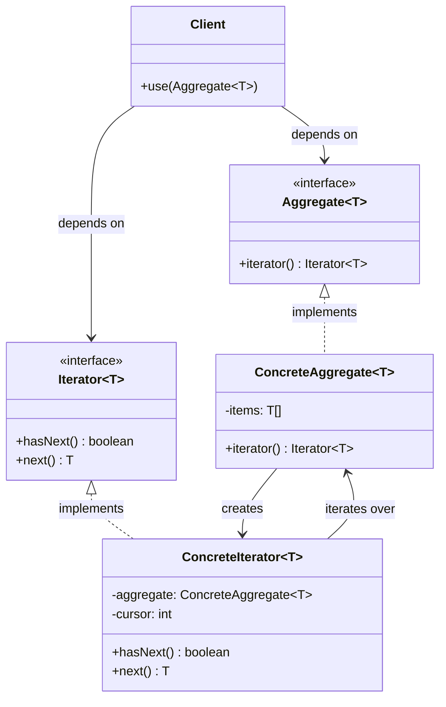

# 이터레이터(Iterator) 디자인 패턴 가이드

> 한 줄 요약: 집계 객체(Aggregate)의 내부 표현 방식을 노출하지 않으면서, 그 원소들을 순차적으로 접근할 수 있는 일관된 방법을 제공한다.
>
> 분류: 행위 패턴 (Behavioral Pattern)
> 다른 이름(Aliases): 커서(Cursor)

---

## 상세 설명

이터레이터(Iterator) 패턴은 GoF가 정의한 행위 패턴 중 하나로, 어떤 자료구조(배열, 연결 리스트, 트리, 해시 테이블 등)가 내부적으로 어떤 방식으로 원소를 저장하고 있는지에 관계없이 클라이언트(Client)가 동일한 인터페이스로 원소를 한 번에 하나씩 꺼내올 수 있도록 만든다. 다른 이름인 커서(Cursor)는 데이터베이스의 커서처럼 "현재 위치"라는 상태를 들고 다니며 순차적으로 다음 위치로 이동한다는 메타포에서 비롯된다.

이 패턴이 해결하려는 문제(Problem)는 두 가지다. 첫째, 컬렉션(Collection)이 자신을 어떻게 순회할지 직접 책임지면 컬렉션 클래스가 비대해진다. 정방향 순회, 역방향 순회, 짝수 인덱스만 순회, 깊이 우선 순회, 너비 우선 순회 등 순회 방식이 늘어날수록 컬렉션 자체의 책임이 폭발한다. 둘째, 클라이언트가 컬렉션의 내부 구조(배열 인덱스인지, 노드 포인터인지)에 의존하면 자료구조를 교체하는 순간 클라이언트 코드도 모두 깨진다. 즉 "단일 책임 원칙(Single Responsibility Principle)" 위반과 "캡슐화(Encapsulation)" 위반이 동시에 발생한다.

이터레이터가 제안하는 해결책(Solution)은 순회 책임을 별도의 객체(Iterator)로 분리하는 것이다. 집계 객체는 `iterator()` 같은 팩토리 메서드를 통해 자신을 순회할 수 있는 이터레이터 객체를 만들어 반환하고, 클라이언트는 그 이터레이터의 `hasNext()`/`next()` 같은 표준 인터페이스만 호출한다. 이렇게 하면 컬렉션의 내부 표현은 완전히 숨겨지며(정보 은닉, Information Hiding), 같은 컬렉션에 대해 여러 종류의 순회 전략을 별도 이터레이터 구현으로 제공할 수 있다.

이터레이터는 누가 순회를 통제하느냐에 따라 외부 이터레이터(External Iterator)와 내부 이터레이터(Internal Iterator)로 나뉜다. 외부 이터레이터는 클라이언트가 직접 `next()`를 호출하며 진행을 제어하는 방식이고(Java `Iterator`, C++ STL `iterator` 등), 내부 이터레이터는 클라이언트가 동작(보통 람다/함수 객체)을 넘기면 컬렉션이 알아서 모든 원소에 대해 그 동작을 적용한다(Java `forEach`, Ruby `each`, JavaScript `Array.prototype.forEach`). 또한 동시 수정(Concurrent Modification)에 대한 정책에 따라 Fail-fast 이터레이터와 Fail-safe 이터레이터로 나뉘는데, 이는 아래 장단점 절에서 다룬다.

---

## 디자인 패턴을 충족하는 최소 조건

이 섹션에서는 "어떤 코드가 진짜로 이터레이터 패턴이라고 부를 수 있는가"의 기준을 명확히 한다.

1. **순회 책임의 분리(Separation of Traversal)** — 컬렉션 자체가 아니라, 컬렉션과 분리된 별도의 이터레이터(Iterator) 객체가 순회 상태("현재 위치")를 관리해야 한다. 컬렉션 내부에 `currentIndex` 같은 필드를 두고 `next()`를 컬렉션 본인이 제공한다면 그것은 이터레이터 패턴이 아니라 단순한 커서 흉내에 가깝다.
2. **통일된 순회 인터페이스(Uniform Interface)** — `hasNext()`/`next()` 또는 그에 준하는 두 가지 작업(다음이 있는지 확인 + 다음 원소 반환)이 추상 타입으로 정의되어 있어야 한다. 클라이언트는 구체 컬렉션 타입(`ArrayList`, `LinkedList`, `TreeMap` 등)이 아니라 이 추상 인터페이스에만 의존한다.
3. **내부 표현의 은닉(Encapsulation of Internal Representation)** — 클라이언트는 이터레이터를 통해 원소만 받을 뿐, 인덱스/노드/포인터 같은 내부 자료구조의 디테일을 알 필요가 없어야 한다. 즉 컬렉션을 배열에서 연결 리스트로 바꾸어도 클라이언트 코드는 컴파일되어야 한다.
4. **집계 객체의 이터레이터 생성 책임(Factory Responsibility)** — 집계(Aggregate) 객체가 자신에 맞는 이터레이터를 만들어주는 진입점(예: `iterator()`)을 제공해야 한다. 이렇게 해야 같은 컬렉션에 대해 여러 이터레이터 변형(역방향, 필터링 등)을 다형적으로 제공할 수 있다.

> 위 조건 중 하나라도 빠지면 본 패턴이라고 보기 어렵다 / 변형 패턴(예: 단순 Cursor, Visitor의 일부)으로 분류된다.

### 흔히 오해하는 지점

- **외부 이터레이터(External Iterator)와 내부 이터레이터(Internal Iterator)의 혼동**: `for (Item i : list)` 같은 향상된 for문은 외부 이터레이터를 컴파일러가 감춰주는 것이고, `list.forEach(x -> ...)`는 내부 이터레이터다. 둘 다 이터레이터 패턴이지만, 누가 루프의 진행을 제어하는지(클라이언트 vs 컬렉션)가 다르다. "람다를 넘기는 건 이터레이터가 아니다"라는 말은 틀렸다.
- **`for` 인덱스 루프를 이터레이터라고 부르는 경우**: `for (int i = 0; i < arr.length; i++)`는 이터레이터 패턴이 아니다. 클라이언트가 내부 표현(인덱스)에 직접 의존하고 있고, 순회 책임이 분리되지 않았기 때문이다.
- **`Iterable`만 구현하면 끝이라는 오해**: Java에서 `Iterable<T>`을 구현하더라도 그 안에서 반환하는 `Iterator<T>`가 실제로 컬렉션의 내부 상태를 캡슐화하고 독립적인 순회 상태를 가져야 진정한 이터레이터 패턴이다. 단순히 내부 리스트를 그대로 노출해 버리면 캡슐화 조건이 깨진다.
- **이터레이터 패턴 = `next()` 메서드가 있는 것**: 단순히 `next()`라는 이름의 메서드가 있다고 이터레이터인 것이 아니다. 위 4가지 조건을 모두 만족해야 한다.

---

## 사례를 통한 예시

### 예시 1: 직접 만든 컬렉션에 이터레이터 붙이기

**상황**: 사내 도서관 시스템에서 `BookShelf`라는 자체 컬렉션을 사용하고 있다. 내부 자료구조는 배열이지만, 클라이언트는 그 사실을 몰라야 하며, 추후 연결 리스트로 바꾸더라도 클라이언트 코드는 그대로 컴파일되어야 한다.

```java
// Aggregate 인터페이스
interface Aggregate<T> {
    Iterator<T> iterator();
}

// Iterator 인터페이스
interface Iterator<T> {
    boolean hasNext();
    T next();
}

// 도메인 객체
class Book {
    private final String title;
    public Book(String title) { this.title = title; }
    public String getTitle() { return title; }
}

// ConcreteAggregate: 내부 표현은 배열이지만 외부에는 숨긴다
class BookShelf implements Aggregate<Book> {
    private final Book[] books;
    private int last = 0;

    public BookShelf(int maxSize) {
        this.books = new Book[maxSize];
    }
    public void appendBook(Book book) {
        this.books[last++] = book;
    }
    public int getLength() { return last; }
    Book getBookAt(int index) { return books[index]; } // 패키지 전용

    @Override
    public Iterator<Book> iterator() {
        return new BookShelfIterator(this);
    }
}

// ConcreteIterator: 순회 상태(현재 인덱스)를 본인이 보관
class BookShelfIterator implements Iterator<Book> {
    private final BookShelf shelf;
    private int index = 0;

    public BookShelfIterator(BookShelf shelf) {
        this.shelf = shelf;
    }
    @Override
    public boolean hasNext() {
        return index < shelf.getLength();
    }
    @Override
    public Book next() {
        return shelf.getBookAt(index++);
    }
}

// Client
public class IteratorDemo {
    public static void main(String[] args) {
        BookShelf shelf = new BookShelf(4);
        shelf.appendBook(new Book("Design Patterns"));
        shelf.appendBook(new Book("Refactoring"));
        shelf.appendBook(new Book("Clean Code"));

        Iterator<Book> it = shelf.iterator();
        while (it.hasNext()) {
            Book b = it.next();
            System.out.println(b.getTitle());
        }
    }
}
```

**해설**: `Aggregate`는 집계(Aggregate) 역할, `BookShelf`는 구체 집계(ConcreteAggregate) 역할이다. `Iterator`는 이터레이터(Iterator) 역할, `BookShelfIterator`는 구체 이터레이터(ConcreteIterator) 역할이다. 핵심은 `BookShelfIterator`가 `index`라는 순회 상태를 자기 자신이 들고 있다는 점이며, 이로 인해 같은 `BookShelf`에서 이터레이터를 두 개 만들면 서로 독립적으로 순회할 수 있다. 클라이언트는 `Book[]`가 내부에 있다는 사실을 전혀 모르며, 만약 `BookShelf`가 내부 자료구조를 `LinkedList<Book>`으로 바꾸더라도 클라이언트 코드는 한 줄도 수정할 필요가 없다.

### 예시 2: Java 표준 라이브러리의 `Iterable` / `Iterator`

**상황**: Java 컬렉션 프레임워크(Java Collections Framework)의 `java.util.Iterator`와 `java.util.Iterable`은 이터레이터 패턴의 가장 정통적인 표준화 사례다. `for-each` 문법, `Stream`, `forEach` 메서드 모두 이 두 인터페이스를 토대로 동작한다.

```java
import java.util.ArrayList;
import java.util.Iterator;
import java.util.List;

public class JavaIteratorExample {
    public static void main(String[] args) {
        List<String> langs = new ArrayList<>();
        langs.add("Java");
        langs.add("Kotlin");
        langs.add("Scala");

        // (1) 외부 이터레이터(External Iterator) — 클라이언트가 진행을 제어
        Iterator<String> it = langs.iterator();
        while (it.hasNext()) {
            String lang = it.next();
            if (lang.startsWith("S")) {
                it.remove(); // 순회 중 안전한 삭제
            }
        }

        // (2) for-each — 컴파일러가 외부 이터레이터로 변환
        for (String lang : langs) {
            System.out.println(lang);
        }

        // (3) 내부 이터레이터(Internal Iterator) — 컬렉션이 진행을 제어
        langs.forEach(System.out::println);
    }
}
```

**해설**: `ArrayList`는 `Iterable<String>`을 구현하고, `iterator()`는 내부적으로 `Itr`이라는 비공개(private) 클래스 인스턴스를 반환한다. 이 `Itr`이 `cursor`(다음 원소 인덱스)와 `lastRet`(마지막으로 반환된 인덱스), `expectedModCount`(예상 수정 횟수)를 들고 있어서 진정한 이터레이터 역할을 한다. `for-each` 문법은 컴파일 단계에서 `iterator()` + `hasNext()` + `next()` 호출로 풀리고, `forEach(Consumer)`는 내부 이터레이터 변형이다. 특히 `expectedModCount`를 통한 Fail-fast 동작은 이터레이터 패턴의 실전 적용에서 빠질 수 없는 중요한 디테일이며, 이는 아래 장단점 절에서 자세히 설명한다.

---

## 어떨 때 사용하나

다음과 같은 신호(Symptom)가 보일 때 이터레이터 패턴 도입을 고려한다.

- 컬렉션의 내부 구조를 외부에 노출하지 않으면서도 원소를 하나씩 처리해야 할 때. 예를 들어 `getInternalArray()` 같은 메서드를 외부에 열어두고 클라이언트가 인덱스 루프를 도는 식의 코드를 보면 이터레이터 도입 시점이다.
- 같은 컬렉션을 여러 방식으로 순회해야 할 때. 정방향, 역방향, 깊이 우선(DFS), 너비 우선(BFS), 짝수 인덱스만, 조건에 맞는 원소만 등 다양한 순회 전략을 컬렉션 클래스 본인이 모두 떠안으면 비대해지므로, 각 전략을 별도 이터레이터로 분리한다.
- 트리, 그래프, 해시 테이블처럼 자료구조가 복잡해서 클라이언트가 직접 순회 코드를 작성하기 까다로운 경우. 순회 알고리즘을 이터레이터 안에 캡슐화하면 클라이언트는 `while(hasNext())`만 작성하면 된다.
- 무한 수열(Infinite Sequence)이나 지연 평가(Lazy Evaluation)가 필요한 경우. 모든 원소를 메모리에 올리지 않고 필요한 시점에 다음 원소만 생성해서 반환하는 스트림성 컬렉션을 만들 때 이터레이터는 자연스러운 선택이다.
- 자료구조 교체 가능성을 열어두고 싶을 때. 초기에는 배열로 구현했지만 나중에 연결 리스트나 외부 저장소로 바꿀 가능성이 있다면, 처음부터 이터레이터로 접근을 제한해 두면 교체 비용이 거의 0이다.

### 사용하면 안 되는 경우 (Anti-patterns)

- **단순한 배열 한 번 도는 일회성 코드**: 도메인 로직 한 곳에서만 잠깐 도는 1차원 배열에 굳이 이터레이터 인터페이스를 만들지 않는다. 과한 추상화는 코드를 늘리기만 한다.
- **랜덤 액세스가 본질인 자료구조**: 행렬 연산이나 그래픽 픽셀 버퍼처럼 임의 인덱스 접근이 핵심 사용 패턴이라면 이터레이터로 강제하면 성능과 표현력 모두 손해다. 이런 경우 인덱스 API를 그대로 노출하는 편이 옳다.
- **순회 중 구조적 수정이 빈번한 자료구조**: 순회 도중에 원소를 마구잡이로 추가/삭제하는 시나리오가 본질적인 경우, 이터레이터의 일관성 보장(Fail-fast)이 오히려 방해가 된다. 이 경우 명시적인 큐/스택 자료구조를 쓰는 것이 더 자연스럽다.
- **이미 언어가 표준 이터레이터를 제공하는데 자체 인터페이스를 따로 만드는 것**: Java에서 굳이 `MyIterator<T>`를 만들어 표준 `java.util.Iterator<T>`와 단절시키면 `for-each`, `Stream` 등과의 호환성이 사라진다. 자체 인터페이스를 만들지 말고 표준 인터페이스를 구현하라.

---

## 장점과 단점, 한계점

### 장점

- **내부 표현의 캡슐화(Encapsulation of Internals)**: 컬렉션의 구체적인 자료구조(배열/리스트/트리)를 클라이언트에 노출하지 않는다. 추후 자료구조를 교체해도 클라이언트 코드는 변경되지 않는다.
- **단일 책임 원칙(Single Responsibility Principle) 준수**: 컬렉션은 "원소를 보관"하는 책임만 지고, 이터레이터는 "원소를 순회"하는 책임만 진다. 두 책임이 분리되어 각자의 변경 이유가 달라진다.
- **다중 순회 전략 지원**: 같은 컬렉션에 대해 정방향, 역방향, 필터링, 변환 등 다양한 이터레이터 구현을 다형적으로 붙일 수 있다. 컬렉션 클래스 자체는 변경하지 않는다.
- **다중 동시 순회(Multiple Simultaneous Traversals)**: 각 이터레이터가 자기 상태(현재 위치)를 들고 있으므로, 같은 컬렉션에 대해 두 개 이상의 이터레이터를 만들어 동시에 서로 다른 위치를 가리키게 할 수 있다.
- **표준화된 인터페이스를 통한 상호운용성**: Java의 `Iterable`, C++의 `iterator` 컨셉, Python의 `__iter__`/`__next__` 등 언어 표준을 구현하면 `for-each`, `Stream`, list comprehension 같은 언어 차원의 기능과 자연스럽게 결합된다.

### 단점

- **단순한 컬렉션엔 과잉 설계(Over-engineering)**: 자료구조가 단순한 배열 한 개이고 사용처도 한 곳이라면, 이터레이터 인터페이스/구현 두 개를 추가하는 비용이 더 크다.
- **직접 인덱스 접근에 비해 성능 오버헤드**: 객체 생성, 가상 메서드 호출, 상태 필드 갱신 등이 끼어들기 때문에 타이트한 수치 연산 루프에서는 인덱스 루프보다 느릴 수 있다(JIT 최적화로 상당 부분 상쇄되긴 한다).
- **랜덤 액세스 부재**: 표준 이터레이터는 본질적으로 순차 접근(Sequential Access)만 제공한다. n번째 원소만 빠르게 보려는 시나리오에서는 부적합하다(`ListIterator`처럼 보강된 변종이 필요).
- **순회 중 수정에 대한 미묘한 의미론**: 클라이언트가 순회 중에 컬렉션을 수정했을 때 어떻게 동작해야 하는지(Fail-fast로 즉시 예외? Fail-safe로 스냅샷 위에서 계속 진행?)에 대한 정책이 사람마다 다르게 기대되어 버그의 원인이 된다.

### 한계점

- **Fail-fast vs Fail-safe**: Java의 `ArrayList`, `HashMap` 등 대부분의 비동기(non-concurrent) 컬렉션은 Fail-fast 이터레이터를 제공한다. 즉 순회를 시작한 뒤 컬렉션의 구조적 수정(structural modification)이 일어나면 `ConcurrentModificationException`을 던지면서 즉시 실패한다. 이는 `modCount`와 `expectedModCount`를 비교해 구현되며, 동시성을 보장하지는 않고 단지 "조용한 데이터 손상보다는 명확한 실패가 낫다"는 정책이다. 반대로 `CopyOnWriteArrayList`, `ConcurrentHashMap` 등은 Fail-safe 이터레이터를 제공한다. 이들은 순회 시작 시점의 스냅샷(Snapshot)이나 약하게 일관된(weakly consistent) 뷰 위에서 동작하므로, 다른 스레드가 컬렉션을 수정해도 예외를 던지지 않고 계속 순회한다. 다만 이 경우 순회 도중 발생한 변경사항이 반영되는지 여부는 보장되지 않는다. 이 둘은 트레이드오프 관계이며, 사용 시 어느 정책의 이터레이터인지 명확히 인지해야 한다.
- **스레드 안전성(Thread Safety) 부재**: 일반적인 이터레이터는 단일 스레드 사용을 가정한다. 멀티스레드 환경에서 같은 이터레이터를 공유하면 위 Fail-fast 정책으로도 잡히지 않는 미묘한 데이터 레이스가 발생할 수 있다.
- **양방향/임의 접근의 부재**: 기본 이터레이터는 한 방향 진행만 가능하다. 뒤로 가거나 점프하려면 `ListIterator`나 인덱스 기반 API가 별도로 필요하다.
- **상태 누수의 위험**: 이터레이터가 자기 안에 컬렉션 참조와 인덱스/노드 참조를 들고 있기 때문에, 오래 살아남는 이터레이터는 컬렉션이 GC되는 것을 막을 수 있다.

---

## 정보 표

| 항목 | 값 |
| --- | --- |
| 분류 | 행위 패턴 (Behavioral) |
| 언어 의존성 | 언어 비의존적이지만, 대부분의 모던 언어가 표준 인터페이스(Java `Iterable`/`Iterator`, C++ STL iterator, Python `__iter__`/`__next__`, C# `IEnumerable`/`IEnumerator`)와 `for-each` 문법을 제공하므로 해당 표준을 따르는 것이 권장된다. |
| 활용성(1점~5점) | 5/5 — 거의 모든 언어의 컬렉션 프레임워크에 기본 내장될 만큼 보편적이며, 매일 사용하는 `for-each`, `Stream`, list comprehension의 토대다. |
| 학습 난이도 | 하 — 개념 자체는 `hasNext()`/`next()` 두 메서드로 단순하다. 다만 Fail-fast/Fail-safe, 내부/외부 이터레이터 같은 변형까지 포함하면 중급이다. |
| 자주 함께 쓰이는 패턴 | 컴포지트(Composite, 트리 구조 순회), 팩토리 메서드(Factory Method, `iterator()`가 그 자체), 방문자(Visitor, 순회 + 작업 분리), 메멘토(Memento, 순회 상태 저장) |
| 대표 사용 사례 | `java.util.Iterator` / `Iterable`, C++ STL `begin()`/`end()`, Python의 모든 `for x in y` 구문, JavaScript의 `Symbol.iterator`, C# `foreach` |

---

## Class Diagram



> 다이어그램에 등장하는 각 클래스가 패턴의 어떤 역할(Role)을 담당하는지 위 "상세 설명" 섹션과 1:1로 대응된다.

### 역할 설명

- **Aggregate (집계)**: 이터레이터를 만들어주는 팩토리 메서드 `iterator()`를 선언하는 추상 인터페이스다. 클라이언트는 이 타입에만 의존한다. (Java의 `java.lang.Iterable<T>`에 해당)
- **ConcreteAggregate (구체 집계)**: 실제 원소들을 보관하는 컬렉션 구현체. `iterator()`를 오버라이드해 자신에게 맞는 `ConcreteIterator`를 생성·반환한다. (예: `ArrayList`, `BookShelf`)
- **Iterator (이터레이터)**: 순회를 위한 표준 인터페이스로 `hasNext()`, `next()` 등을 선언한다. 클라이언트는 이 타입을 통해서만 원소에 접근한다. (Java의 `java.util.Iterator<T>`에 해당)
- **ConcreteIterator (구체 이터레이터)**: 특정 `ConcreteAggregate`에 대한 순회 로직과 현재 위치(커서) 상태를 담는다. `hasNext()`/`next()`의 실제 구현을 제공한다. (예: `ArrayList$Itr`, `BookShelfIterator`)
- **Client (클라이언트)**: `Aggregate.iterator()`로 이터레이터를 얻고, `Iterator`의 추상 메서드만 사용해 순회한다. 구체 타입에 의존하지 않는 것이 핵심이다.

---

## 참고 자료

- 원전: Erich Gamma, Richard Helm, Ralph Johnson, John Vlissides, "Design Patterns: Elements of Reusable Object-Oriented Software", Addison-Wesley, 1994 — "Iterator" 항목 (pp. 257-271)
- Joshua Bloch, "Effective Java" (3rd Edition) — Item 58 "Prefer for-each loops to traditional for loops", Item 47 "Prefer Collection to Stream as a return type"
- Java 공식 문서: `java.util.Iterator`, `java.lang.Iterable` (https://docs.oracle.com/en/java/javase/17/docs/api/java.base/java/util/Iterator.html)
- Java 공식 문서: Fail-fast iterators 동작 설명 (`ArrayList`, `HashMap`의 Javadoc 내 "fail-fast" 단락)
- `CopyOnWriteArrayList` / `ConcurrentHashMap` Javadoc — Fail-safe(약한 일관성) 이터레이터의 사례
- Hiroshi Yuki, "Java 언어로 배우는 디자인 패턴 입문" — Iterator 패턴 장 (BookShelf 예제의 원형)
- Refactoring.Guru, "Iterator" (https://refactoring.guru/design-patterns/iterator)
